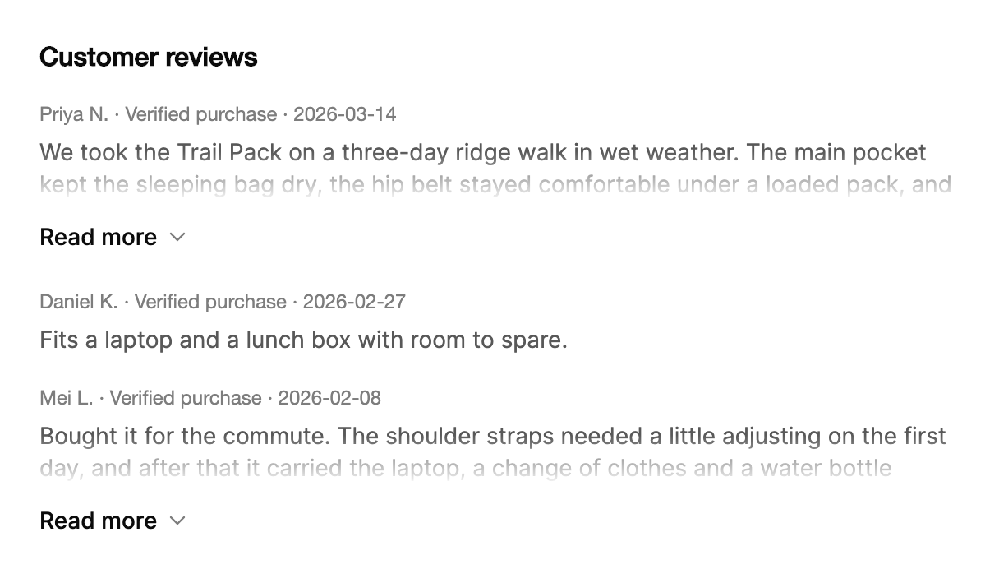

<Demo name="Default" />

## 何时使用

`ExpandableText` 用几行展示一段长文本，并允许读者展开其余部分。即使各条文本长短不一，它也能保持列表或栏目的布局稳定，当每一项是卡片或行、背后有固定网格时尤其重要。切换按钮只在文本确实溢出时出现，因此短文本保持原样。

- **客户评价与评论**：商品页的评价列表或支持工具中的评论串，每条只显示两行，读者需要时再展开阅读全文。
- **个人简介与团队介绍**：内部工具中的人员目录，每张卡片显示三到四行简介，完整内容按需展开。
- **目录中的商品描述**：商品标题下的长描述，截断后让价格和加入购物车按钮保持在首屏，切换按钮文字为“查看完整描述”。
- **开发者控制台中的发布说明与更新日志**：每个版本显示说明的前几行，其余内容在原处展开，无需跳转到其他页面。

## 何时不用

- **必须阅读的文本**，例如法律条款、结账时的退款政策，或带有修复步骤的错误信息。不要截断它们；应显示全文，或链接到存放全文的页面。
- **一组带标题的分节或问题**：用 `Accordion`，它会为每一节提供作为行标题的问题。
- **隐藏在摘要行之后的结构化信息**，例如带状态与商品列表的订单：用 `ExpandableCard`，它会保持标题与摘要可见。
- **需要保持固定高度并可滚动的文本**，例如日志或转写稿：用 `ScrollArea`。
- **本身就很短的文本**，例如标签或标题：用普通的 `TextBlock`。标题上加切换按钮只会增加干扰。

## 用法

用 `Text` 设置内容。文本会被截断为 `Lines` 行，默认为 3 行。只有当文本超出截断范围时，切换按钮才会出现。

```xml
<UserControl xmlns="https://github.com/avaloniaui"
             xmlns:arc="https://github.com/AtomUICommunity/TKCode.Arc">
    <arc:ExpandableText Text="我们在一个下午内就把整个设计团队迁移到了新的工作区。导入过程保留了每一条评论和每个版本。"
                        MaxWidth="520"
                        HorizontalAlignment="Left" />
</UserControl>
```

`ExpandableText` 派生自 Avalonia 的 `TemplatedControl`，包含三个部分：截断后的文本、末行上的渐隐以及其下方的切换行。文本是截断区域内一个普通的自动换行 `TextBlock`，因此文本样式（`FontSize`、`Foreground`、`LineHeight`）在控件上设置，文本会继承它。默认文本为小号字号、次要文本颜色、1.4 倍行高，这是 Arc 在卡片与列表中正文的外观。

请在控件上设置 `MaxWidth` 或 `Width`，而不是在文本上设置。截断以控件获得的宽度为准，因此可见行数会随布局变化。

### 结构

1. **文本**（`Text` 或 `Inlines`）：自动换行的文本，次要文本颜色、小号字号，行高 19.6 px（14 px 乘以 1.4）。
2. **截断**：折叠时，文本高度恰好为 `Lines` 乘以行高，超出的部分被隐藏。宽度或字体变化时会重新计算截断，无需代码即可响应尺寸变化。
3. **渐隐**：折叠时，底部 1.6 行上覆盖一层柔和的蒙版。文本展开时蒙版消散，收起时在接近截断处重新出现。
4. **切换行**：文本下方 8 px 的间距。切换按钮左对齐，最小高度 28 px，水平内边距 2 px，左外边距为负 2 px，使标签与文本边缘对齐。
5. **切换标签**（`MoreLabel` 或 `LessLabel`）：中等字重，使用前景色。两个标签共用同一单元格，因此标签变化时切换按钮的宽度不变。悬停时标签变为次要文本颜色，按下时变为弱化文本颜色。
6. **箭头**：标签后 16 px 的下箭头，使用弱化文本颜色。它随展开进度旋转 180 度，与文本的进度保持一致。
7. **焦点环**：切换按钮周围 2 px 的焦点环，仅在键盘聚焦时显示。

### 行数

`Lines` 设置文本折叠时显示的行数。评论与评价这类需要在一屏内放下大量条目的密集列表使用 2 行；个人简介与商品描述等首句信息量最大的内容使用 3 或 4 行。最小值为 1 行，小于 1 的值会被提升为 1。

<Demo name="TwoLines" />

```xml
<arc:ExpandableText Lines="2"
                    Text="{Binding CommentText}"
                    MaxWidth="420" />
```

请按真实宽度计算行数。同一段文本在窄卡片与宽栏中截断出的行数不同，因此应在文本出现的最窄宽度下检查截断效果。

### 标签

`MoreLabel` 与 `LessLabel` 设置切换按钮的文字。默认值为 `Read more` 和 `Show less`。当切换按钮应说明会打开什么内容时修改它们，例如“查看完整简介”或“查看完整描述”，因为具体的标签能让读者清楚将得到什么。

```xml
<arc:ExpandableText MoreLabel="查看完整简介"
                    LessLabel="收起"
                    Lines="4"
                    Text="{Binding Bio}" />
```

两个标签都会作为切换按钮的名称提供给辅助技术，因此每个标签本身都必须是一个完整的操作说明。

### 绑定展开状态

`IsExpanded` 为双向绑定。可以将其绑定到视图模型属性，也可以在代码中设置。文本展开或收起时会触发 `ExpandedChanged`，其参数为 `ExpandableTextExpandedChangedEventArgs`，其中的 `IsExpanded` 保存新的状态。

<Demo name="Controlled" />

```xml
<arc:ExpandableText Text="{Binding Bio}"
                    IsExpanded="{Binding BioExpanded, Mode=TwoWay}" />
```

当页面需要对变化作出响应时使用事件，例如更新状态行或保存读者的选择。当其他控件需要打开或收起文本时使用绑定，如演示中的按钮所示。

### 文本能完整显示

只有文本确实溢出时，切换按钮才会出现，并会随宽度和字体的变化而更新。短文本没有切换按钮也没有渐隐，因此混合长短条目的列表无需额外逻辑即可正确显示。

<Demo name="Fits" />

`IsOverflowing` 为只读属性，报告当前状态。它适合用于页面其他位置显示数量或提示，而不用于决定是否显示切换按钮：控件已经自行处理了这一点。

### 由数据驱动

评价列表是一组条目，每条都有自己的文本和自己的展开状态。将展开状态保存在条目上，使展开一条评价时不会影响其他评价。

```csharp
public sealed partial class ReviewItem : ObservableObject
{
    public required string Author { get; init; }

    public required string Date { get; init; }

    public required string Body { get; init; }

    [ObservableProperty]
    private bool _isExpanded;
}

public partial class ProductReviewsViewModel : ObservableObject
{
    [ObservableProperty]
    private ObservableCollection<ReviewItem> _reviews = new();
}
```

```xml
<ItemsControl ItemsSource="{Binding Reviews}">
    <ItemsControl.ItemTemplate>
        <DataTemplate>
            <StackPanel Spacing="6" Margin="0,0,0,16">
                <TextBlock Text="{Binding Author}"
                           FontWeight="Medium"
                           Foreground="{arc:ArcDesignTokenResource Foreground}" />
                <arc:ExpandableText Lines="2"
                                    Text="{Binding Body}"
                                    IsExpanded="{Binding IsExpanded, Mode=TwoWay}" />
            </StackPanel>
        </DataTemplate>
    </ItemsControl.ItemTemplate>
</ItemsControl>
```

视图模型持有文本，条目持有展开状态。因此只要同一批条目对象仍在集合中，读者的选择在列表被筛选或重新排序后仍会保留。若用新对象替换条目，它们的展开状态会重置为收起。

### 富文本与链接

`Text` 接受纯文本，段落之间用换行分隔。当文案需要多段格式或链接时，改为设置 `Inlines`；设置后它会代替 `Text` 使用。请在代码中构建该集合：该属性没有默认集合，因此 XAML 无法向其中添加文本段。文本中的链接是一个内联控件，放在 `InlineUIContainer` 中，因此与其他控件一样可以获得键盘焦点。

```csharp
var notice = new ExpandableText { Lines = 3, MaxWidth = 520 };
notice.Inlines = new InlineCollection
{
    new Run("你的数据存储在欧盟地区。请阅读 "),
    new InlineUIContainer(new Button { Content = "隐私政策" }),
    new Run(" 了解保留规则与数据处理方清单。")
};
```

即使被截断的部分读者看不到，其中的链接仍可通过键盘访问。当此类链接在截断线以下获得焦点时，文本会展开，焦点永远不会停留在隐藏的内容上。只放读者真正需要访问的链接，并把最重要的链接放在文案靠前的位置，使其通常可见。

### 示例：商品评价

商城商品页上的评价列表。两行截断让评价保持紧凑，切换按钮只出现在较长的评价上，因此简短的评价按原样显示。作者、“已购买”标签与日期位于文本上方的一行小号弱化文字中，读者在展开前即可判断评价的参考价值。列表宽 560，即商品栏的宽度。



```xml
<StackPanel Width="560" Spacing="18">
    <TextBlock Text="Customer reviews"
               FontSize="16"
               FontWeight="SemiBold"
               Foreground="{arc:ArcDesignTokenResource Foreground}" />
    <StackPanel Spacing="6">
        <TextBlock Text="Priya N. · Verified purchase · 2026-03-14"
                   FontSize="12"
                   Foreground="{arc:ArcDesignTokenResource TextMuted}" />
        <arc:ExpandableText Lines="2"
                            Text="We took the Trail Pack on a three-day ridge walk in wet weather. The main pocket kept the sleeping bag dry, the hip belt stayed comfortable under a loaded pack, and the zips still ran smoothly on the last morning. The only change I would make is a larger side pocket for water bottles." />
    </StackPanel>
    <StackPanel Spacing="6">
        <TextBlock Text="Daniel K. · Verified purchase · 2026-02-27"
                   FontSize="12"
                   Foreground="{arc:ArcDesignTokenResource TextMuted}" />
        <arc:ExpandableText Lines="2"
                            Text="Fits a laptop and a lunch box with room to spare." />
    </StackPanel>
    <StackPanel Spacing="6">
        <TextBlock Text="Mei L. · Verified purchase · 2026-02-08"
                   FontSize="12"
                   Foreground="{arc:ArcDesignTokenResource TextMuted}" />
        <arc:ExpandableText Lines="2"
                            Text="Bought it for the commute. The shoulder straps needed a little adjusting on the first day, and after that it carried the laptop, a change of clothes and a water bottle without any strain on my back. The reflective trim is a welcome detail in the winter months." />
    </StackPanel>
</StackPanel>
```

### 文案规范

- **切换标签**：用动词短语写明将打开的内容，使用句子式大小写。`Read more` 是默认值；“查看完整简介”和“查看完整描述”说明读者将得到什么。“收起”用于关闭文本。
- **文案首句**：评价、简介或描述的第一句应能在截断状态下独立成立。读者正是根据这几行决定是否展开全文。
- **文本上方的元数据**：作者、日期以及任何认证或状态信息，放在一行简短的弱化文字中，使读者在阅读正文前就能判断该条目。
- **数字**：日期与数量使用阿拉伯数字，例如“2026-03-14”“14 条评价”，使截断区域在切换按钮出现之前就能显示完整日期。

| 不要写 | 改为 |
|---|---|
| 更多... | 阅读更多 |
| 展开 | 查看完整描述 |
| 点击这里查看剩余文本 | 查看完整简介 |
| 折叠 | 收起 |
| 阅读这条评价的剩余部分，其中有大段内容谈到拉链。 | 阅读更多 |

### 最佳实践

**推荐**

- 密集列表使用两行；单个且读者很可能会阅读的条目（例如个人简介）使用三或四行。截断是读者首先看到的内容，应根据内容而非布局来选择行数。
- 把最有用的信息放在首句，因为其余部分在读者展开之前是隐藏的。
- 列表中每个条目的 `Lines` 保持一致，这样即使不显示切换按钮，各行也能对齐。
- 让控件自行测量溢出。不要自己拆分文本或计算字符数，因为截断取决于真实的宽度与字体。

**避免**

- 截断读者必须阅读的文本，例如条款、价格、错误或警告。切换按钮会将其隐藏，直到读者主动点开，而很多读者不会点开。
- 为评价或简介将 `Lines` 设为 1。单行几乎隐藏了全部内容，切换按钮就成了主要内容。
- 把重要的表单或按钮放在文本的隐藏部分。读者可能永远不会展开它，而焦点会意外地将文本展开。
- 用 `ExpandableText` 承载一组带标题的分节。每一节都应是一行 `Accordion`，以便拥有自己的标题。
- 在实时信息流的每次更新中修改 `Text`。每次变化都会重新测量截断，切换按钮可能随文本变化而出现或消失。在读者有理由查看时再更新文本。

### 常见问题

**为什么我的文本没有切换按钮？** 只有完整文本高于截断高度时才会出现切换按钮。如果在当前宽度下文本能放进 `Lines` 行，就没有需要展开的内容，控件会直接原样显示。请检查 `Lines`、宽度和字号。

**为什么切换标签变化时切换按钮宽度保持不变？** 两个标签共用切换按钮中的同一个单元格，因此切换按钮的宽度与较长的那个标签一致。宽度恒定，标签在其中交叉淡化。

**如何知道文本何时展开或收起？** 订阅 `ExpandedChanged`，它会收到一个 `ExpandableTextExpandedChangedEventArgs`，读取其中的 `IsExpanded` 即可。或者将 `IsExpanded` 双向绑定，并监听视图模型属性。

**隐藏部分中的链接能否展开文本？** 可以。当文本中的链接在截断线以下获得键盘焦点时，文本会展开。位于截断线以上、可见的链接不会改变状态；只有切换按钮和隐藏链接上的键盘焦点会改变状态。

**文本在页面下方收起时会怎样？** 控件会将文本的开头重新滚入视野，使读者不会停留在刚刚收起的文本下方。减弱动效时，这一操作会立即完成。

## API 参考

<!-- api: ExpandableText -->

### 事件参数

`ExpandableTextExpandedChangedEventArgs` 是 `ExpandedChanged` 的参数。

| 成员 | 含义 |
|---|---|
| `IsExpanded` | 新状态：文本已展开时为 `True`，已收起时为 `False` |

## 无障碍

- 完整文本始终位于无障碍树中。屏幕阅读器无需使用切换按钮即可读取全部内容，因此截断仅是视觉效果。
- 切换按钮是一个按钮，并公开展开与收起模式。其名称为当前标签（`MoreLabel` 或 `LessLabel`），状态改变时名称随之变化。
- 截断部分中的链接可以获得键盘焦点。聚焦到位于截断线以下的隐藏链接会展开文本，因此焦点不会停留在隐藏内容上。
- 切换按钮支持 Enter 与空格键。
- 文本本身不接收焦点。在 Tab 顺序中，只有切换按钮和其中的链接会停留。

### 键盘

| 按键 | 操作 |
|---|---|
| `Tab` / `Shift+Tab` | 在文本中的链接间移动，显示切换按钮时再移到切换按钮 |
| `Enter` / `Space` | 通过切换按钮展开或收起文本 |
| 焦点位于截断线以下的链接上 | 展开文本，使获得焦点的链接可见 |

## 动效

- 高度、末行渐隐与箭头遵循同一个进度值，因此始终同步运动。它们以平缓的曲线缓动收尾，不会过冲。
- 展开约需半秒，收起约需 0.4 秒。距离较长时耗时略长，但有一个较小的上限。
- 文本展开时，末行的渐隐随之消散。新出现的行穿过柔和的边缘升起，因此不会露出生硬的行边。
- 动画进行中再次点击，会从当前高度反向运动，文本不会跳到任何一端。
- 两个切换标签以 4 px 位移与 2 px 模糊交叉淡化，时序与展开一致，切换按钮的宽度保持不变。
- 减弱动效时，文本立即展开或收起。当文本在页面下方收起时，会将文本的开头重新滚入视野。

| 变化 | 完整 | 减弱 | 关闭 |
|---|---|---|---|
| 文本展开 | 高度以平缓的缓出曲线增长，末行渐隐消散，箭头旋转 | 立即展开 | 立即完成 |
| 文本收起 | 高度约在 0.4 秒内收缩，渐隐回归，箭头旋回 | 立即收起，并将文本开头滚入视野 | 立即完成 |
| 切换标签 | “Read more”与“Show less”以 4 px 位移和 2 px 模糊交叉淡化 | 立即完成 | 立即完成 |
| 切换按钮悬停与按下 | 标签颜色交叉淡化 | 立即完成 | 立即完成 |

## 相关组件

- `Accordion`：用于多个带标题的分节，在原位展开。
- `ExpandableCard`：用于带隐藏详细信息的摘要卡片。
- `ScrollArea`：用于必须保持固定高度的内容。

| 组件 | 适用场景 |
|---|---|
| `Accordion` | 多个带标题的分节在原位展开，每节都有自己的问题 |
| `ExpandableCard` | 摘要卡片需要在隐藏的详细信息上方显示标题与摘要行 |
| `ScrollArea` | 内容必须保持固定高度并可滚动 |
| `Textarea` | 读者需要编辑文本，而不仅仅是阅读 |
| `TextBlock` | 文本本身很短，例如标签或标题 |
