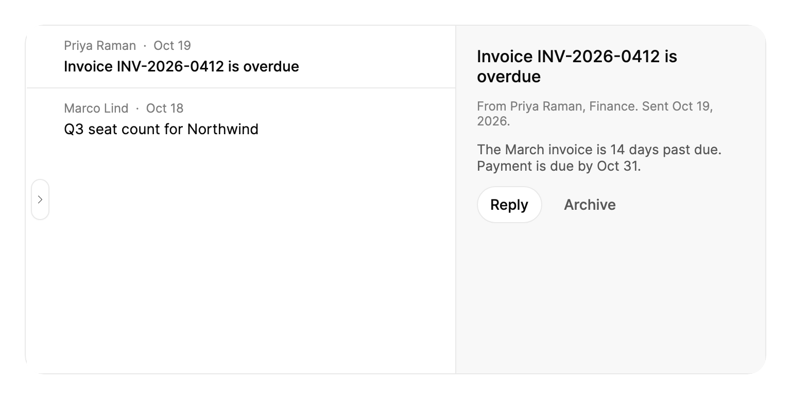

<Demo name="Default" />

## When to use

`ResizablePanels` splits one area into side-by-side panes and lets the person decide how much room each pane gets.
It fits the working area of an application: the body under a page header, where a list, a detail view and a
secondary pane must share the window. The group needs a definite height from its parent, so it belongs in the
content region of a shell, not in an auto-sized row.

- **Mail and messaging clients**: a folder list, a message list and a reading pane. People widen the reading pane for
  long threads and collapse the folders when they need the room.
- **Ticket and order triage in admin consoles**: a queue on the left and the selected ticket or order on the right.
  Support agents shrink the queue for dense reading and widen it when they sort a backlog.
- **Query and code editors in analytics tools**: a schema browser, an editor and a results pane, where the editor
  needs most of the width while a SQL or DAX query is written.
- **Dashboards with a side inspector**: a chart pane beside a filter or detail inspector. The inspector collapses
  when it is not needed, which gives the chart the full width.
- **Layouts that people shape once and keep**: the sizes are stored with `Sizes` and restored in the next session,
  so a team's preferred split survives a restart.

## When not to use

- **A panel that covers the page**: use `Drawer` for a pane that slides over the content and must be dismissed
  before the person returns to the page.
- **Stacked sections of one page**: `ResizablePanels` splits horizontally only. Use `Accordion` for sections that
  open and close one above another.
- **One pane at a time**: use `Tabs` when the person switches between views and never needs to see two at once.
- **A narrow screen or a phone layout**: the panes never stack. Use `Tabs` or let the page change its structure
  for the narrow width.
- **A fixed split that nobody adjusts**: a plain Avalonia `Grid` with star-sized columns is simpler and has no
  dividers to operate.
- **Content that is longer than its pane**: keep the split and put a `ScrollArea` inside the pane. The group does
  not scroll its panes.

## Usage

```xml
<UserControl xmlns="https://github.com/avaloniaui"
             xmlns:arc="https://github.com/AIDotNet/TKCode.Arc">
    <arc:ResizablePanels Label="Mail layout" Height="320">
        <arc:ResizablePanel Id="folders"
                            Label="Folders"
                            DefaultSize="22"
                            MinSize="140"
                            IsCollapsible="True">
            <TextBlock Text="Inbox, Drafts, Sent, Archive" />
        </arc:ResizablePanel>
        <arc:ResizablePanel Id="messages"
                            Label="Messages"
                            DefaultSize="33"
                            MinSize="200">
            <TextBlock Text="42 conversations" />
        </arc:ResizablePanel>
        <arc:ResizablePanel Id="reading"
                            Label="Reading pane"
                            DefaultSize="45"
                            MinSize="220"
                            IsCollapsible="True">
            <TextBlock Text="Quarterly review" />
        </arc:ResizablePanel>
    </arc:ResizablePanels>
</UserControl>
```

`ResizablePanels` derives from Avalonia's `Control`, and `ResizablePanel` derives from `ContentControl`. The group
takes its `Panels` collection as its content, so the panes are written directly inside it. The group lays the
panes out itself: each pane's width comes from its share and its limits, not from a `Width` you set on it. The
dividers between panes are created by the group and are focusable, so the keyboard reaches them without extra
markup.

`Label` names the group for assistive technology. Each pane's `Label` names the divider that follows it.

### Anatomy

1. **Group** (`ResizablePanels`): clipped to its bounds and laid out left to right. It has no visual of its own
   besides the dividers and restore tabs. Text inside the group uses the body font at the `TypeSM` size in the
   foreground color unless a pane sets its own.
2. **Pane** (`ResizablePanel`): its content stretches to fill the pane. Below the pane's effective minimum the
   content keeps that minimum width and stays anchored to the moving edge, so a closing pane slides away instead of
   being squeezed.
3. **Divider line**: a 1 px line in the border color. It becomes the strong border color while the pointer is over
   it, the divider is dragged or the divider has keyboard focus.
4. **Grab area**: 6 px on each side of the line, 13 px in total. Pressing anywhere in it starts a drag.
5. **Grip**: a 4 × 32 px rounded pill centered on the line. It forms when the divider is hovered, focused or dragged,
   in the strong border color, and turns to the foreground color while it is dragged.
6. **Restore tab**: an 18 × 40 px pill 5 px from the line, on the side the hidden pane returns to. It appears when a
   neighbor pane is hidden. It has the surface fill, a border stroke that darkens on hover or focus, a secondary
   text chevron and the resting shadow. The hit area of a hidden divider reaches 30 px into the visible pane so the
   tab is easy to press.
7. **Cursor**: a horizontal resize cursor over an open divider and a hand cursor over a hidden one.

### Sizing panes

Each pane has a `DefaultSize`, which is a share, not a width. The shares are relative: `22`, `33` and `45` produce
the same layout as `2.2`, `3.3` and `4.5`, and they do not need to add up to 100. The group divides the room in
proportion to the shares, then holds every pane to its limits. A pane that would break its `MinSize` or `MaxSize`
is fixed at that limit, and the remaining room is shared again among the others.

| Property | Default | Meaning |
|---|---|---|
| `DefaultSize` | `1` | Starting share. Also the size the group returns to on `Reset()`. |
| `MinSize` | `80` px | Width where the pane starts to resist. Its content never reflows below it. |
| `MaxSize` | Unlimited | Upper width limit in px. A value of zero or less means no limit. |
| `IsCollapsible` | `False` | Lets the pane be hidden by its divider, the keyboard or a flick. |
| `IsCollapsed` | `False` | Starts the pane hidden. Takes effect only with `IsCollapsible="True"`. Two-way. |
| `Id` | None | Stable key for the pane. It names the divider when `Label` is empty. |

A group narrower than the sum of every pane's minimum scales the minimums down in proportion, so all panes stay
visible.

### Collapsed by default

Set `IsCollapsed="True"` on a collapsible pane to start it hidden. Its divider then shows a restore tab that
brings the pane back, and the pane is removed from hit testing and the tab order until it returns.

<Demo name="CollapsedAndPersisted" />

Collapsing from code uses the same path as a drag or the Enter key. Setting `IsCollapsed` to `True` hides the pane
through its divider, and setting it to `False` restores it. Both are ignored for a pane that is not collapsible.

### Limits

`MinSize` is the width in pixels where a pane starts to resist. `MaxSize` caps the width and is unlimited by default.
Past a limit the divider stops at the limit and gives a rubber-band resistance of up to 44 px before it refuses to
move further, so the person sees that the limit has been reached.

```xml
<arc:ResizablePanel Id="code" Label="Code" DefaultSize="50" MinSize="240" MaxSize="800" />
```

Pick a `MinSize` that is the narrowest width at which the pane's content still reads. A message list needs room for
a sender and a subject, a folder list for its longest label, and a reading pane for a line of body text. The
default of 80 px only suits panes that hold an icon or a short value.

### Binding to a view model

The group's `Sizes` property is the layout, so the view model owns it. `Sizes` and each pane's `IsCollapsed` are
two-way by default, which means the view model receives every settled resize and every collapse made by a drag or
the keyboard, and it can set them to restore a layout.

```csharp
public interface IUserSettings
{
    IReadOnlyList<double>? MailPaneSizes { get; set; }
    bool MailFoldersCollapsed { get; set; }
}

public partial class MailViewModel : ObservableObject
{
    private readonly IUserSettings _settings;

    public MailViewModel(IUserSettings settings)
    {
        _settings = settings;
        _paneSizes = settings.MailPaneSizes;
        _isFoldersCollapsed = settings.MailFoldersCollapsed;
    }

    [ObservableProperty]
    private IReadOnlyList<double>? _paneSizes;

    [ObservableProperty]
    private bool _isFoldersCollapsed;

    partial void OnPaneSizesChanged(IReadOnlyList<double>? value) => _settings.MailPaneSizes = value?.ToArray();

    partial void OnIsFoldersCollapsedChanged(bool value) => _settings.MailFoldersCollapsed = value;
}
```

```xml
<arc:ResizablePanels Label="Mail layout" Sizes="{Binding PaneSizes}" Height="480">
    <arc:ResizablePanel Id="folders"
                        Label="Folders"
                        DefaultSize="22"
                        MinSize="140"
                        IsCollapsible="True"
                        IsCollapsed="{Binding IsFoldersCollapsed}">
        <!-- Folder list -->
    </arc:ResizablePanel>
    <arc:ResizablePanel Id="messages" Label="Messages" DefaultSize="33" MinSize="200">
        <!-- Message list -->
    </arc:ResizablePanel>
    <arc:ResizablePanel Id="reading" Label="Reading pane" DefaultSize="45" MinSize="220">
        <!-- Message detail -->
    </arc:ResizablePanel>
</arc:ResizablePanels>
```

- `Sizes` holds one value per pane in order, in percent of the room, and the values add up to 100. A hidden pane
  holds 0. The view model sees a new value when a resize settles (`LayoutChanged` fires at the same moment), not on
  every pointer move, so saving in the property-changed handler writes to storage once per gesture.
- Store the layout with the pane set it came from. The group expects the same panes for its whole life, so discard
  a saved array when the pane list changes and let the defaults apply.
- `Reset()` is a method, not a property. Call it from a button's click handler in the view's code-behind,
  because it returns every pane to its default share and its default collapsed state.

### Drag, flick and double-click

Dragging a divider follows the pointer one to one, and the panes move with it. Several rules shape what the person
sees when a drag crosses a limit:

- **Limits**: past a pane's minimum or maximum the divider resists, and it stops at the limit when the pointer
  is released inside the rubber band.
- **Collapse by drag**: a collapsible pane snaps closed once its width falls below its minimum minus the larger of
  half the minimum or 40 px. That threshold is 40 px for the default 80 px minimum and 100 px for a 200 px minimum.
- **Flick**: on release the group projects the pointer's speed a short distance ahead. A flick toward an edge
  collapses the pane and a flick back out restores it. Without a flick the divider stays where it was released.
- **Release motion**: the panes settle on a spring that keeps the pointer's velocity, so a fast flick carries
  naturally into the settle.
- **Press to restore**: pressing a hidden pane's divider without moving it restores the pane.
- **Double-click**: double-clicking any divider calls `Reset()`, which returns the whole group to its defaults.

These rules are tuned for a mouse and a trackpad. A touch user can drag a divider, but the flick threshold is
measured from pointer samples, so test the collapse gestures on the devices you support.

### Narrow windows

The panes never stack. When the window narrows, the minimums scale down in proportion and a pane below its minimum
fades with its width, its content held at the minimum width as it slides away. A phone-width layout needs a different
structure: switch to `Tabs` or change the page layout at that width.

### Example: mail workspace

A reading-focused mail view. The folder list starts hidden so the messages and the reading pane have the window,
and the restore tab on the left edge shows how to bring the folders back. The message list shows a sender and a
subject on each row, and the reading pane carries the actions for the open message. Labels repeat the visible
headings, so the divider names match what the person sees.



```xml
<Border Width="720"
        Height="340"
        BorderThickness="1"
        CornerRadius="18"
        ClipToBounds="True"
        BorderBrush="{arc:ArcDesignTokenResource Border}">
    <arc:ResizablePanels Label="Mail workspace">
        <arc:ResizablePanel Id="folders"
                            Label="Folders"
                            DefaultSize="22"
                            MinSize="140"
                            IsCollapsible="True"
                            IsCollapsed="True">
            <Border Padding="16" Background="{arc:ArcDesignTokenResource SurfaceMuted}">
                <StackPanel Spacing="10">
                    <TextBlock Text="Folders"
                               FontSize="14"
                               FontWeight="Medium"
                               Foreground="{arc:ArcDesignTokenResource Foreground}" />
                    <TextBlock Text="Inbox  12"
                               FontSize="13"
                               Foreground="{arc:ArcDesignTokenResource TextSecondary}" />
                    <TextBlock Text="Drafts  2"
                               FontSize="13"
                               Foreground="{arc:ArcDesignTokenResource TextSecondary}" />
                </StackPanel>
            </Border>
        </arc:ResizablePanel>
        <arc:ResizablePanel Id="messages"
                            Label="Messages"
                            DefaultSize="33"
                            MinSize="200">
            <StackPanel Background="{arc:ArcDesignTokenResource Surface}">
                <Border Padding="36,12,16,12" BorderBrush="{arc:ArcDesignTokenResource Border}"
                        BorderThickness="0,0,0,1">
                    <StackPanel Spacing="4">
                        <TextBlock Text="Priya Raman  ·  Oct 19"
                                   FontSize="12"
                                   Foreground="{arc:ArcDesignTokenResource TextMuted}" />
                        <TextBlock Text="Invoice INV-2026-0412 is overdue"
                                   FontSize="14"
                                   FontWeight="Medium"
                                   Foreground="{arc:ArcDesignTokenResource Foreground}" />
                    </StackPanel>
                </Border>
                <Border Padding="36,12,16,12">
                    <StackPanel Spacing="4">
                        <TextBlock Text="Marco Lind  ·  Oct 18"
                                   FontSize="12"
                                   Foreground="{arc:ArcDesignTokenResource TextMuted}" />
                        <TextBlock Text="Q3 seat count for Northwind"
                                   FontSize="14"
                                   Foreground="{arc:ArcDesignTokenResource Foreground}" />
                    </StackPanel>
                </Border>
            </StackPanel>
        </arc:ResizablePanel>
        <arc:ResizablePanel Id="reading"
                            Label="Reading pane"
                            DefaultSize="45"
                            MinSize="300">
            <Border Padding="20" Background="{arc:ArcDesignTokenResource SurfaceMuted}">
                <StackPanel Spacing="12">
                    <TextBlock Text="Invoice INV-2026-0412 is overdue"
                               FontSize="16"
                               FontWeight="Medium"
                               TextWrapping="Wrap"
                               Foreground="{arc:ArcDesignTokenResource Foreground}" />
                    <TextBlock Text="From Priya Raman, Finance. Sent Oct 19, 2026."
                               FontSize="12"
                               TextWrapping="Wrap"
                               Foreground="{arc:ArcDesignTokenResource TextMuted}" />
                    <TextBlock Text="The March invoice is 14 days past due. Payment is due by Oct 31."
                               FontSize="13"
                               TextWrapping="Wrap"
                               Foreground="{arc:ArcDesignTokenResource TextSecondary}" />
                    <StackPanel Orientation="Horizontal" Spacing="8">
                        <arc:Button Content="Reply" Variant="Secondary" Size="Small" />
                        <arc:Button Content="Archive" Variant="Ghost" Size="Small" />
                    </StackPanel>
                </StackPanel>
            </Border>
        </arc:ResizablePanel>
    </arc:ResizablePanels>
</Border>
```

### Content guidelines

- **Pane labels**: a short noun phrase in sentence case that matches the pane's visible heading: "Folders",
  "Messages", "Reading pane". The label is the name of the divider for assistive technology, so a generic label
  such as "Pane 2" leaves a screen reader user with nothing to act on.
- **Group label**: a noun phrase that says what the layout is: "Mail workspace", "Query editor". Name the layout,
  not the mechanism, so the label does not say "resizable".
- **Restore wording**: when a pane is hidden, the divider reports "Folders hidden, press Enter to show it". Keep the
  pane label short so that this sentence still reads in full.
- **Numbers in panes**: write counts as digits, "42 conversations", so a value can be scanned at a glance.

| Instead of | Write |
|---|---|
| Label="Pane 2" | Label="Messages" |
| Label="resizable area" | Label="Mail workspace" |
| Label="Reading" (only in a deep, dense layout) | Label="Reading pane" |
| Label="Stuff on the right" | Label="Query results" |

### Best practices

**Do**

- Give every pane a stable `Id` and a visible `Label`. The `Id` identifies the pane in your saved settings, and the
  label is what a divider announces.
- Set `MinSize` to the narrowest width at which the pane's content still reads, and `MaxSize` only when a wider pane
  would waste the room, for example a code pane that stops at 800 px.
- Keep the group's height definite and let the page's shell decide it. A group in an auto-sized row has no height
  to split and shows nothing.
- Save `Sizes` when a resize settles, not on every pointer move, and set it from the saved settings when the view
  model loads.

**Avoid**

- Collapsing the pane that holds the primary action. A person who cannot find the restore tab cannot reach the
  action again, so keep the primary action in a pane that stays open.
- Setting `IsCollapsible` on a pane whose hidden state would hide information the person needs to notice, such as
  an error list or a pending approval.
- Changing the set of panes while the group is in use. The group is built for a fixed pane set, and a saved layout
  from another set does not describe it.
- Nesting groups inside a narrow pane, where the outer and inner minimums compete for the same few pixels.
- Expecting a vertical split. The group is horizontal only, so build the stacked part of the layout outside it.

### Common questions

**Why does the group show nothing?** It needs a definite height from its parent. In a `StackPanel` or an auto-sized
row the group has no height to share, so set `Height` or place it in a `Grid` row with star height.

**Why did my pane not collapse when I dragged the divider?** Only a pane with `IsCollapsible="True"` can collapse.
A drag collapses the pane only once it passes the collapse threshold; a shorter drag stops at the pane's `MinSize`
and shows the rubber band.

**How do I hide a pane from a toolbar button?** Bind the pane's `IsCollapsed` to a view model property and change
that property. Setting it to `True` collapses the pane through its divider, and `False` restores it. The same binding
receives the change when the person collapses the pane with the mouse or the keyboard.

**What does `Sizes` contain while a pane is hidden?** The hidden pane's value is 0, and the remaining panes share
the 100 percent.

## API reference

<!-- api: ResizablePanels -->

<!-- api: ResizablePanel -->

| Event arguments member | Type | Meaning |
|---|---|---|
| `ResizablePanelsLayoutChangedEventArgs.Sizes` | `IReadOnlyList<double>` | Each pane's share of the group in percent, 0 for hidden panes. |

## Accessibility

- `Label` sets the accessible name of the group, which is announced as a group.
- Each divider is a focusable thumb. Its value is the pane's share in percent, and its range is the share limits the
  pane pair can reach. A hidden pane is reported with the hint to press Enter to show it.
- A divider takes the label of the pane before it, or that pane's `Id` when the label is empty.
- A collapsed pane is removed from hit testing and the tab order, and is hidden from the control view of the
  accessibility tree.
- Left and Right arrows resize the divider by a small step. Shift with an arrow resizes by a large step.
- Home and End move the divider to its smallest and largest position. Enter hides or restores a collapsible neighbor.
- Escape during a pointer drag returns the divider to where the drag started.

### Keyboard

Each divider is a tab stop. The keys below apply while the divider has focus and no pointer drag is in progress.

| Keys | Action |
|---|---|
| `Tab` / `Shift+Tab` | Move to the next or previous divider or focusable control |
| `Left` / `Right` | Move the divider 16 px. At a limit, it collapses a collapsible pane on that side |
| `Shift` + `Left` / `Right` | Move the divider 64 px |
| `Left` / `Right` toward a hidden pane | Restore the hidden pane |
| `Home` / `End` | Move the divider to its smallest or largest position. Ignored while a neighbor is hidden |
| `Enter` | Restore a hidden neighbor. Otherwise collapse the pane before the divider if it is collapsible, else the pane after it |
| `Escape` (during a drag) | Return the divider to where the drag started |

## Motion

- Dragging follows the pointer directly. Past a pane's minimum, the divider resists with a short rubber band.
- On release, the panes settle on a spring that keeps the pointer's speed. Dragging a collapsible pane well past its minimum,
  or flicking it toward the edge, collapses it.
- Keyboard resizing uses a snappy spring.
- A restore tab pops in when a pane is collapsed, and its content fades out as the pane shrinks.
- Reduced motion moves the panes straight to their target, and the restore tab only fades in.

| Change | Full | Reduced | Off |
|---|---|---|---|
| Pointer drag | Divider follows the pointer, with rubber band past a limit | Same | Same |
| Release, drag collapse or restore | Smooth spring that keeps the pointer's velocity | Panes jump to the target | Panes jump to the target |
| Keyboard step | Snappy spring | Panes jump to the target | Panes jump to the target |
| Reset on double-click | Smooth spring to the default shares | Panes jump to the target | Panes jump to the target |
| Restore tab appears | Scales from 60% on the snappy spring and fades in | Fades in only | Immediate |
| Restore tab leaves | Fades out and scales to 60% | Fades out | Immediate |
| Grip forms on hover or focus | Scales from 60% on the CSS-style spring | Immediate | Immediate |

## Related

- `Drawer` for a pane that covers the page as an overlay.
- `Tabs` for one pane at a time, or for a narrow layout.
- `ScrollArea` for content that overflows a pane.

| Component | Choose it when |
|---|---|
| `Drawer` | The pane slides over the page and is dismissed before the person returns to it |
| `Tabs` | People switch between views and never need two at once, or the window is narrow |
| `Accordion` | Sections stack vertically and open one at a time or several at a time |
| `ScrollArea` | Content overflows a pane and needs its own scrollbars |
