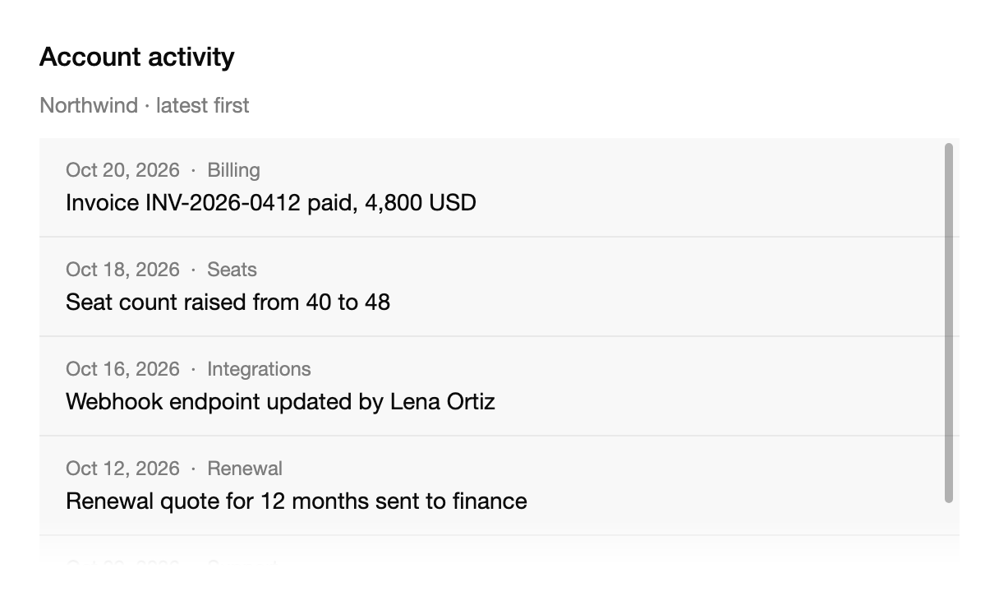

<Demo name="Vertical" />

## 何時使用

`ScrollArea` 為固定尺寸的區域提供它自己的捲動，使面板可以容納超出其空間的內容，同時不改變周圍頁面的版面配置。它位於外殼、側邊面板或對話方塊中，外框已經確定，其中的內容隨資料增長。

- **側邊面板與檢視器**：客戶紀錄的活動時間軸或訂單的明細列，與一個必須保持可見的清單並排。面板保持高度，時間軸在其中捲動。
- **卡片或標籤的橫向條帶**：帳單頁上的一排方案卡片，或表格上方的一排篩選標籤。`Horizontal` 搭配強制貼齊，能在使用者以滾輪或觸控板捲動時讓每張卡片保持對齊。
- **需要載入更多的資訊流**：CRM 活動動態或投遞紀錄，當底邊回報其後已無內容時載入下一頁。`EdgesChanged` 提供這一訊號。
- **開發者工具中的酬載與紀錄**：固定高度面板中的 Webhook 要求本文或部署紀錄，使用者從頂端開始閱讀，漸隱則表示後面還有更多文字。
- **面板或彈出方塊中的選項清單**：一個放不進浮層的長清單，例如地區或貨幣。

## 何時不用

- **逐項翻頁**：用 `Carousel`，它在投影片之間切換並顯示位置。
- **應當縮短的長文字**：用 `ExpandableText`，它截斷到幾行並提供「閱讀更多」。
- **帶欄與排序的表格資料**：用 `SortableDataTable`，資料量大時用 `DataGrid`。把 `ScrollArea` 套在一般 `StackPanel` 外面會量測每一列，因此數千列的表格會很慢。
- **帶鍵盤導覽的巢狀樹狀結構**：用 `TreeView`，它處理展開與層級之間的方向鍵移動。
- **從長清單中選擇一個值**：用 `Select` 或 `Combobox`，它們自行管理清單、篩選與鍵盤模型。

## 用法

用 `Orientation` 設定軸向。預設為 `Vertical`。

```xml
<UserControl xmlns="https://github.com/avaloniaui"
             xmlns:arc="https://github.com/AIDotNet/TKCode.Arc">
    <arc:ScrollArea Width="360"
                    Height="260"
                    Label="發佈說明"
                    CornerRadius="18">
        <StackPanel Spacing="0">
            <TextBlock Text="v2.4 · 浮層捲軸" Margin="16,12" />
            <TextBlock Text="v2.3 · 冷啟動更快" Margin="16,12" />
            <TextBlock Text="v2.2 · 鍵盤快速鍵" Margin="16,12" />
        </StackPanel>
    </arc:ScrollArea>
</UserControl>
```

`ScrollArea` 衍生自 Avalonia 的 `ScrollViewer`，因此偏移量、範圍與視口、貼齊點屬性、觸控慣性、`ScrollChanged` 以及捲動自動化模式的運作方式都與捲動檢視相同。Arc 以浮層軌道取代原生捲軸，增加邊緣漸隱，並改變預設的焦點與捲軸行為。區域會把內容裁剪到其邊界內，因此內容絕不會繪製到外框之外。

`Label` 為捲動區域命名。具名區域會被朗讀為一個區域。沒有標籤時，區域周圍的內容必須說明它容納的是什麼。

### 結構

1. **內容**（`Content`）：被捲動的子元素。它保持自然尺寸；區域的 `Width` 與 `Height` 決定可見視窗。
2. **邊緣漸隱**：每條邊 28 px 的漸層（`FadeLength`），讓被截斷處的內容變暗。漸隱只出現在內容延伸到該邊之外的地方，其長度等於被隱藏的內容，但不超過最大值。
3. **垂直軌道**：一個 11 px 的點擊區域（`TrackThickness` 權杖），包住一個 5 px 的圓條，距尾端邊緣 3 px。指標停在上方或拖曳時，圓條增粗到 7 px，並移到距邊緣 2 px 處。
4. **滑桿顏色**：前景色、30% 不透明度，指標停在軌道上時升至 46%。滑桿長度不短於 28 px，位置隨偏移量變化。
5. **水平軌道**：沿底邊的同款圓條，高 11 px。
6. **角落**：使用 `Both` 時，每條軌道在距角落 13 px 處停止，因此兩條軌道永不交叉。
7. **焦點環**：2 px 的焦點色環，繪製在區域內部，因此裁剪不會將其切掉。僅在鍵盤焦點時顯示。

沒有溢出時，軌道與漸隱都不會出現。短區域沒有漸隱、沒有軌道，也沒有 `:overflow` 虛擬類別，因此清單增減內容時，提示會隨之開啟或關閉。

### 軸向與浮層捲軸

先選軸向，再選捲軸行為。

- `Vertical` 是清單、資訊流、紀錄和側邊面板的預設值。橫向捲軸隱藏。
- `Horizontal` 適用於卡片、標籤或篩選項的條帶。垂直滾輪會將其橫向捲動（見下文）。
- `Both` 適用於需要雙向捲動的網格和寬表格。請謹慎使用，因為兩條軌道與兩處漸隱會與內容爭奪注意力。

執行階段修改 `Orientation` 會更新原生捲軸的可見性與軌道邊界，因此軸向可以隨檢視模式變化。

`OverlayScrollbarMode` 決定捲軸何時顯示。`Auto`（預設）在內容捲動或滑鼠停在區域上時顯示，並在捲動停止後保留 `HideDelay` 的時間。懸停只對滑鼠輸入顯示捲軸，因此觸控螢幕只在使用者捲動時才顯示。`Always` 在內容溢出時始終保持可見。對於必須讓使用者看到還有更多內容的資訊流、紀錄或酬載，使用 `Always`；對於裝飾性或次要面板，使用 `Auto`。

<Demo name="BothAxes" />

### 橫向條帶

垂直滾輪會讓橫向區域左右捲動，直到無法再捲動，然後把滾輪交還給頁面。設定 `HorizontalSnapPointsType` 可使各項貼齊。

<Demo name="HorizontalStrip" />

滾輪轉換由 `IsWheelToHorizontalEnabled` 控制（預設 `True`）。僅當滾輪移動主要為垂直方向、未按住 `Ctrl`、且條帶在滾輪方向上仍有空間時才生效。每一格滾輪大約移動條帶 50 px。對於必須停在邊緣的卡片，設定 `HorizontalSnapPointsType="Mandatory"`；對於自由捲動，使用 `None`（預設）。

### 邊緣漸隱與隱藏延遲

`FadeLength` 以像素為單位設定每條邊緣漸隱的長度（預設 28）。將其設為 `0` 可關閉漸隱。`HideDelay` 設定捲動停止後捲軸保持可見的時間（預設 900 ms）。

```xml
<arc:ScrollArea FadeLength="0"
                HideDelay="0:0:1.5" />
```

### 由程式碼驅動

`ScrollArea` 沒有可以繫結的值，因此由程式碼驅動。`Edges` 是四條邊的目前狀態，`EdgesChanged` 在每次變化時回報。`ScrollBy` 與 `ScrollToOffset` 捲動區域。在完整動態效果下，它們以彈簧動畫過渡；在減少或關閉動態效果下則直接跳到目標位置。

```csharp
area.EdgesChanged += (_, e) =>
{
    if (!e.Edges.Bottom)
    {
        LoadMoreItems();
    }
};
```

`EdgesChanged` 僅在某條邊在「有超出內容」與「沒有超出內容」之間切換時觸發，因此它是載入更多請求的恰當觸發器。需要在其他時候得知狀態時，讀取 `Edges`。

```csharp
area.ScrollBy(new Vector(0, 240));
area.ScrollToOffset(new Vector(0, 0));
```

`ScrollBy` 與 `ScrollToOffset` 會把目標限制在內容範圍內，因此過大的位移會停在尾端。要讓某一項進入視野，對該項呼叫 `BringIntoView()`，這是每個控制項都有的 Avalonia 方法。

### 範例：客戶紀錄旁的活動動態

CRM 中一筆客戶紀錄，旁邊是固定高度的活動面板。標題寫明帳號與排序方式，動態在其外框內捲動。捲軸設為 `Always`，因為動態很長，使用者必須看到更早的事件還在後面。底邊的漸隱也以不用捲軸的方式傳達同樣的資訊；頂邊沒有漸隱，因為動態從最新的事件開始。



```xml
<StackPanel Width="560" Spacing="12">
    <TextBlock Text="Account activity"
               FontSize="16"
               FontWeight="Medium"
               Foreground="{arc:ArcDesignTokenResource Foreground}" />
    <TextBlock Text="Northwind · latest first"
               FontSize="13"
               Foreground="{arc:ArcDesignTokenResource TextMuted}" />
    <arc:ScrollArea Height="260"
                    Label="Account activity"
                    OverlayScrollbarMode="Always"
                    CornerRadius="12"
                    Background="{arc:ArcDesignTokenResource SurfaceMuted}">
        <StackPanel>
            <Border Padding="16,12"
                    BorderThickness="0,0,0,1"
                    BorderBrush="{arc:ArcDesignTokenResource Border}">
                <StackPanel Spacing="4">
                    <TextBlock Text="Oct 20, 2026  ·  Billing"
                               FontSize="12"
                               Foreground="{arc:ArcDesignTokenResource TextMuted}" />
                    <TextBlock Text="Invoice INV-2026-0412 paid, 4,800 USD"
                               FontSize="14"
                               Foreground="{arc:ArcDesignTokenResource Foreground}" />
                </StackPanel>
            </Border>
            <Border Padding="16,12"
                    BorderThickness="0,0,0,1"
                    BorderBrush="{arc:ArcDesignTokenResource Border}">
                <StackPanel Spacing="4">
                    <TextBlock Text="Oct 18, 2026  ·  Seats"
                               FontSize="12"
                               Foreground="{arc:ArcDesignTokenResource TextMuted}" />
                    <TextBlock Text="Seat count raised from 40 to 48"
                               FontSize="14"
                               Foreground="{arc:ArcDesignTokenResource Foreground}" />
                </StackPanel>
            </Border>
            <Border Padding="16,12"
                    BorderThickness="0,0,0,1"
                    BorderBrush="{arc:ArcDesignTokenResource Border}">
                <StackPanel Spacing="4">
                    <TextBlock Text="Oct 16, 2026  ·  Integrations"
                               FontSize="12"
                               Foreground="{arc:ArcDesignTokenResource TextMuted}" />
                    <TextBlock Text="Webhook endpoint updated by Lena Ortiz"
                               FontSize="14"
                               Foreground="{arc:ArcDesignTokenResource Foreground}" />
                </StackPanel>
            </Border>
            <Border Padding="16,12"
                    BorderThickness="0,0,0,1"
                    BorderBrush="{arc:ArcDesignTokenResource Border}">
                <StackPanel Spacing="4">
                    <TextBlock Text="Oct 12, 2026  ·  Renewal"
                               FontSize="12"
                               Foreground="{arc:ArcDesignTokenResource TextMuted}" />
                    <TextBlock Text="Renewal quote for 12 months sent to finance"
                               FontSize="14"
                               Foreground="{arc:ArcDesignTokenResource Foreground}" />
                </StackPanel>
            </Border>
            <Border Padding="16,12">
                <StackPanel Spacing="4">
                    <TextBlock Text="Oct 09, 2026  ·  Support"
                               FontSize="12"
                               Foreground="{arc:ArcDesignTokenResource TextMuted}" />
                    <TextBlock Text="Ticket 5521 resolved after a token rotation"
                               FontSize="14"
                               Foreground="{arc:ArcDesignTokenResource Foreground}" />
                </StackPanel>
            </Border>
        </StackPanel>
    </arc:ScrollArea>
</StackPanel>
```

### 文案規範

- **標籤**：一個名詞片語，說明區域容納的內容，採句首大寫：「帳號活動」「發佈說明」。螢幕閱讀器會在內容之前朗讀它，因此「可捲動區域」什麼也沒有告訴使用者。
- **標題與日期**：當標題必須在內容捲動時保持可見，把它放在區域之外。日期的寫法與產品其他地方一致，數量用阿拉伯數字書寫。
- **溢出提示**：不要加入「向下捲動查看更多」之類的文字。漸隱與捲軸已經傳達了這一點，而文字還會佔用內容的空間。

| 不要寫 | 改為 |
|---|---|
| Label="可捲動區域" | Label="帳號活動" |
| Label="清單" | Label="發佈說明" |
| 下方「向下捲動查看更多」 | （無文字：由漸隱與捲軸表達） |

### 最佳做法

**建議**

- 當內容值得被螢幕閱讀器找到時，為每個區域設定 `Label`，因為具名區域會被朗讀為一個區域。
- 從父元素為區域設定有界尺寸。捲動需要視口小於內容；隨內容增長的視口沒有可捲動的空間。
- 對於必須讓使用者看到還有更多內容的資訊流、紀錄與酬載，使用 `OverlayScrollbarMode="Always"`。
- 對於載入更多的觸發，使用 `EdgesChanged`，而不是監看偏移量，因為它只在每次變化時觸發一次，而不是每一步捲動都觸發。

**避免**

- 巢狀放置兩個同方向捲動的區域。滾輪只有在內層區域到達邊緣時才會離開它，因此外層區域會出現意外的跳動。只有軸向不同時才巢狀放置。
- 在以觸控為主的螢幕上依賴 `Auto` 捲軸。懸停只為滑鼠顯示捲軸，因此觸控使用者只在捲動時才看到它們，而閒置的面板不會顯示它可以捲動。
- 在資訊流上設定 `FadeLength="0"`。沒有漸隱，被截斷的線條看起來像是內容的結尾，使用者會停止捲動。
- 在區域內的一般 `StackPanel` 中放入數千列。區域會量測所有列，大清單會很慢；請使用表格或自行管理列的清單控制項。
- 包裹整個頁面。頁面版面配置應負責螢幕的捲動，使其頁首與頁尾保持不動；包住整個螢幕的區域會鎖住捲動。

### 常見問題

**為什麼鍵盤不能捲動我的區域？** 按鍵只有在區域本身取得焦點時才會傳到區域。區域內取得焦點的 `TextBox` 或 `ListBox` 會先處理方向鍵。用 `Tab` 或點選區域背景把焦點移到區域上。

**為什麼觸控螢幕上看不到捲軸？** 在 `Auto` 模式下，懸停只為滑鼠輸入顯示捲軸。觸控在捲動時顯示它們，並在 `HideDelay` 之後隱藏。當捲軸是必要的提示時，設定 `OverlayScrollbarMode="Always"`。

**為什麼滾輪在橫向條帶的尾端會離開？** 這是刻意的設計。條帶在任一端都沒有滾輪方向上的剩餘空間，因此滾輪交給頁面，由頁面捲動。

**新的行加入時，如何讓紀錄檢視保持在底部？** 在附加一行後，用較大的 `Y` 呼叫 `ScrollToOffset`，例如 `area.ScrollToOffset(new Vector(0, area.Extent.Height));`，它會被限制到尾端，但只在使用者已經位於底部時才這樣做。否則捲動會把使用者拉離他正在閱讀的那一行。

## API 參考

<!-- api: ScrollArea -->

| 類型 | 成員 | 意義 |
|---|---|---|
| `ScrollAreaOrientation` | `Vertical`, `Horizontal`, `Both` | 區域捲動的軸向。 |
| `ScrollAreaScrollbarMode` | `Auto`, `Always` | 浮層捲軸何時顯示。`Auto` 在捲動或懸停時顯示。 |
| `ScrollAreaEdges` | `Top`, `Bottom`, `Left`, `Right` | 內容在該邊之外繼續延伸時為 `True`。 |
| `ScrollAreaEdgesChangedEventArgs` | `Edges` | 新的邊緣狀態。 |

## 無障礙

- `Label` 設定區域的無障礙名稱，具名區域會被朗讀為一個區域。沒有標籤時，周圍的內容必須說明其用途。
- 區域可取得焦點，並位於 Tab 順序中。方向鍵、Page Up 與 Page Down、Home、End 以及 Space 原生地捲動它。
- 捲動保留 `ScrollViewer` 的自動化模式。浮層捲軸僅為視覺呈現，因此螢幕閱讀器使用者透過捲動瀏覽內容，而不需要操作捲軸。
- 在減少動態效果下，軌道翻頁直接跳轉，不做動畫。

### 鍵盤

按鍵只在區域本身取得焦點時生效。`Shift` 只改變 `Space` 的方向。

| 按鍵 | 操作 |
|---|---|
| `Tab` / `Shift+Tab` | 將焦點移入或移出區域 |
| `Up` / `Down` | 以 40 px 捲動垂直區域 |
| `Left` / `Right` | 以 40 px 捲動水平區域 |
| `Page Up` / `Page Down` | 沿主軸以視口的 90% 捲動 |
| `Space` / `Shift+Space` | 以視口的 90% 向前或向後捲動 |
| `Home` / `End` | 捲動到軸的起點或終點。在 `Both` 中，它們移動垂直軸 |

## 動態效果

- 內容捲動或指標懸停於區域上時，捲軸淡入。捲動停止後保留 `HideDelay`（900 ms），然後用 480 ms 淡出。
- 指標懸停時滑桿變粗，並且可以拖曳。拖曳滑桿時關閉貼齊，直到拖曳結束。
- 每條邊緣漸隱隨最初幾像素的捲動而增長，且永遠不會長於被隱藏的內容。
- 減少動態效果會移除捲軸的淡入淡出，並使軌道翻頁即時完成。

| 變化 | 完整 | 減少 | 關閉 |
|---|---|---|---|
| 捲軸出現 | 以快速時長淡入 | 立即出現 | 立即出現 |
| 捲軸消失 | 在 `HideDelay` 之後，以 480 ms 淡出 | 立即隱藏 | 立即隱藏 |
| 指標懸停時的滑桿 | 從 5 px 增粗到 7 px，並在快速時長內變深 | 立即變化 | 立即變化 |
| 按鍵、程式碼或軌道捲動 | 平滑彈簧過渡到目標 | 直接跳到目標 | 直接跳到目標 |
| 邊緣漸隱 | 長度隨使用者捲動而跟隨被隱藏的內容變化 | 同完整 | 同完整 |

## 相關元件

- `Carousel` 逐項翻頁，並顯示位置。
- `ExpandableText` 將一段文字截斷為幾行，而不是捲動它。
- `ResizablePanels` 在窗格之間分配空間；當某個窗格可能溢出時，在其中放入 `ScrollArea`。

| 元件 | 適用情境 |
|---|---|
| `Carousel` | 使用者逐項切換內容，並需要位置指示器 |
| `ExpandableText` | 一段文字較長，應先顯示幾行並提供「閱讀更多」 |
| `ResizablePanels` | 使用者需要決定每個窗格獲得多少空間 |
| `SortableDataTable` / `DataGrid` | 內容是使用者需要排序或瀏覽的列與欄 |
| `TreeView` | 項目有層級，使用者用鍵盤在層級之間移動 |
