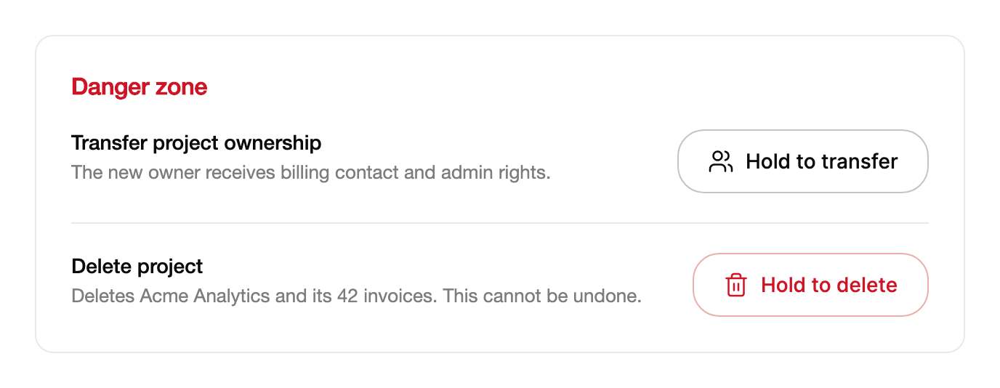

<Demo name="Default" />

## 何時使用

`HoldToConfirm` 是一個只有在使用者按住一段設定時間後才執行操作的按鈕。它適用於破壞性或難以復原的操作，且其後果已經顯示在畫面上，因此使用者無需再閱讀另外的訊息。按住期間填滿會沿按鈕向前推進；提前放開則會倒回，因此控制項會在真正送出之前準確顯示操作推進到了哪裡。

- **在設定頁中刪除專案**：專案設定底部的危險區域，在專案名稱旁列出「長按刪除專案」。名稱就在畫面上，因此長按就足以確認這一選擇。
- **在開發者主控台中撤銷 API 金鑰或 Webhook 密鑰**：金鑰列顯示其前綴與最後使用日期，撤銷按鈕需要按住兩秒。仍在被建置管線使用的金鑰會立即失效，因此較長的按住時間可以防止誤觸。
- **在精簡的帳單列中取消訂閱**：方案列已經顯示續訂日期與即將停止的金額。長按讓決定留在該列上，而不是彈出一個重複相同資訊的確認對話方塊。
- **在內部工具中清空垃圾桶或重設沙箱**：在共用平板上使用的倉儲或客服工具中，誤觸「清空垃圾桶」不能刪除 300 筆紀錄。

## 何時不用

- **安全的或容易復原的操作，例如儲存草稿或靜音頻道**：使用 `Button` 或 `ActionButton`。對可逆的操作長按，只會讓使用者白白等待。
- **需要先讀清後果的操作，例如退款、附比例計費的方案降級或批次修改帳單資料**：使用 `Dialog`，它可以顯示金額、受影響的紀錄以及清楚的取消選項。
- **從觸控清單中移除一列，例如收件匣、訂單佇列或通知清單**：使用 `SwipeActions`，它在滑動時顯示操作，並讓操作留在該列旁邊。
- **從一組中選擇值或選項**：使用 `Select`、`Combobox` 或 `MorphSelect`。長按只提交一個操作。
- **確認使用者在儲存前於表單上所做的變更**：使用表單的主要 `Button`，並在送出時驗證。長按儲存按鈕會讓每次儲存都多出一段延遲。

## 用法

```xml
<UserControl xmlns="https://github.com/avaloniaui"
             xmlns:arc="https://github.com/AtomUICommunity/TKCode.Arc">
    <arc:HoldToConfirm Label="長按刪除專案"
                       ConfirmedLabel="已刪除"
                       Command="{Binding DeleteProject}" />
</UserControl>
```

`HoldToConfirm` 衍生自 Avalonia 的 `Button`，因此 `Command`、`CommandParameter`、`IsEnabled` 以及按鈕的範本與樣式機制都與按鈕的運作方式相同。差別在於觸發方式：`Click` 事件與 `Command` 只在長按完成時才執行。一般點按、短於長按時間的輕觸，或自動化叫用都不會有任何作用。控制項在按鈕之上增加了填滿、完成狀態、`IsHolding` 狀態以及 `Confirmed` 事件。

### 結構

1. **圖示**（`Icon`）：一個 24 × 24 的 Lucide 幾何圖形，在標籤前以 18 px 繪製。預設是垃圾桶圖示。長按完成時，它會被繪製的勾號取代。
2. **標籤**（`Label`）：操作說明與動作，例如「長按刪除專案」。完成後文字改為顯示 `ConfirmedLabel`，預設為「Done」。圖示與標籤之間相距 8 px，並在按鈕內置中。
3. **表面**：1 px 的邊框使用強邊框色，控制項圓角（`RadiusControl`）與表面背景。最小高度為中等控制項尺寸，預設主題下為 44 px。水平內距為 20 px。
4. **懸停色調**：指標停在未確認的按鈕上時，色調顏色以 6% 的比例混入表面。它只是一層色調，而不是第二個填滿，且絕不遮住標籤。
5. **填滿**：一層色調顏色，隨長按推進從左邊緣顯露。同樣的圖示與標籤會在填滿內部以色調的對比色再次繪製，因此文字顏色恰好在邊緣處改變。
6. **焦點環**（僅鍵盤焦點）：2 px 的焦點色環，繪製在按鈕外 4 px 處，圓角為 22 px。指標取得焦點時不顯示。
7. **停用狀態**：整個按鈕降至 50% 不透明度，並顯示「不允許」游標。

### 選擇色調

`Tone` 設定填滿的顏色。由於文字會在填滿邊緣處改變顏色，因此在長按的每個位置標籤都保持可讀。

| 色調 | 填滿 | 適用於 |
|---|---|---|
| `Accent`（預設） | 所選的強調色 | 有意為之但非破壞性的操作，例如「長按發佈」 |
| `Danger` | 危險色，搭配帶危險色調的邊框與標籤 | 不可復原的操作：刪除、撤銷、清除、關閉帳號 |
| `Neutral` | 前景色 | 可逆但仍需要刻意長按的操作，例如「長按封存」 |

對於使用者無法收回的操作使用 `Danger`，並且每組內只保留一個 `Danger` 控制項。一個面板裡若有好幾個紅色的長按按鈕，真正的危險就難以辨認。封存類操作選擇 `Neutral`，使危險色保持其含義。

<Demo name="Tones" />

### 長按時長

`HoldDuration` 設定按鈕必須按住多久才會完成。預設為 1.2 秒，這個時長足以忽略輕觸，又不會讓有意的長按顯得太慢。對於影響範圍廣的操作，例如撤銷正式環境系統在用的金鑰，可以設定更長的值，例如兩秒。同一畫面上的所有長按保持相同的值，讓使用者形成一致的節奏。說明文案中的文字由時長產生，因此修改時長後它仍然正確。

該值是一個 `TimeSpan`。在 XAML 中，兩秒寫作 `HoldDuration="0:0:2"`。

### 圖示

`Icon` 是一個 `Geometry`。預設是 Lucide 的垃圾桶圖示，適合刪除操作。請選擇與操作名詞相符的圖示，例如封存用的收納盒，撤銷用的鑰匙。標籤已經足夠時，傳入 `null`。

```csharp
var archive = new HoldToConfirm
{
    Label = "長按封存",
    Tone = HoldToConfirmTone.Neutral,
    Icon = ArcIcons.Archive,
    ConfirmedLabel = "已封存"
};
```

在 XAML 中，使用靜態資源：`Icon="{x:Static arc:ArcIcons.Archive}"`。

### 長按時的提示

`HoldingChanged` 在長按開始和結束時引發。`IsHolding` 告訴你目前的狀態。可以用它們在按鈕旁顯示提示，例如填滿推進時顯示的「請繼續按住」。

```csharp
project.HoldingChanged += (_, e) =>
{
    hint.Text = e.IsHolding
        ? "請繼續按住…"
        : project.IsConfirmed ? "已刪除。" : "提前放開，填滿會倒回。";
};
```

提前放開時，填滿會以彈簧倒回，且不會確認任何操作。長按完成時，`HoldingChanged` 會在 `IsConfirmed` 變為 `true` 之前回報 `IsHolding` 為 `false`。因此，上例中的判斷在完成時讀到的是 `false`。應改由 `Confirmed` 事件顯示完成文字：

```csharp
project.Confirmed += (_, _) => hint.Text = "已刪除。";
```

### 完成狀態

`IsConfirmed` 是雙向的。長按完成時它變為 `true`，早於 `Confirmed` 的引發與 `Command` 的執行。一旦為 `true`，按鈕會顯示 `ConfirmedLabel`、繪製勾號，向輔助技術回報自己已無法使用，並且不能再次長按。將其設回 `false` 即可重設按鈕；標籤變回 `Label` 時，填滿隨之倒回。

```xml
<arc:HoldToConfirm Label="長按刪除專案"
                   IsConfirmed="{Binding IsDeleted}" />
```

```csharp
reset.Click += (_, _) => project.IsConfirmed = false;
```

由程式碼設定的確認狀態（例如專案在另一個視窗中已被刪除時）會直接填滿按鈕，而無需長按。

### 停用

停用的按鈕不能被長按；按鈕被停用時，正在進行的長按會被取消。只在操作無法適用時使用停用狀態，並在旁邊的文字中說明原因，例如「請先轉移擁有權」。

<Demo name="Disabled" />

### 取消長按

以下情況下長按會被取消，填滿倒回且不會確認：

- 在 `HoldDuration` 到達之前，使用者放開了指標或按鍵。
- 長按期間，指標移到按鈕邊緣之外超過 24 px，這與原生按下所允許的容差相同。指標移回內部不會重新開始長按。
- 焦點移離按鈕，例如透過 Tab。
- 視窗失去啟用狀態，因為視窗在長按中途失去作用時可能遺失按鍵放開事件。
- 長按期間按鈕被停用或從視覺樹中移除。

要從程式碼中取消長按，例如對話方塊在頁面上方開啟時，呼叫 `CancelHold()`。

### 繫結到檢視模型

在 MVVM 應用程式中，檢視模型擁有操作的狀態。使用 CommunityToolkit.Mvvm 時，檢視模型持有 `IsDeleted` 旗標與刪除命令，按鈕同時繫結到兩者。命令在長按完成且 `IsDeleted` 已變為 `true` 之後執行一次。

```csharp
public partial class ProjectDangerZoneViewModel : ObservableObject
{
    private readonly IProjectService _projects;
    private readonly string _projectId;

    public ProjectDangerZoneViewModel(IProjectService projects, string projectId)
    {
        _projects = projects;
        _projectId = projectId;
    }

    [ObservableProperty]
    private bool _isDeleted;

    [ObservableProperty]
    private string? _error;

    [RelayCommand]
    private async Task DeleteProjectAsync()
    {
        var result = await _projects.DeleteAsync(_projectId);
        if (!result.IsSuccess)
        {
            // 在旗標被清除之前，按鈕都會顯示「已刪除」，因此失敗時要重設它。
            IsDeleted = false;
            Error = result.Error;
        }
    }
}
```

```xml
<StackPanel Spacing="12">
    <arc:HoldToConfirm Label="長按刪除專案"
                       ConfirmedLabel="已刪除"
                       Tone="Danger"
                       IsConfirmed="{Binding IsDeleted}"
                       Command="{Binding DeleteProjectCommand}" />
    <TextBlock Text="{Binding Error}"
               Foreground="{arc:ArcDesignTokenResource Danger}"
               TextWrapping="Wrap" />
</StackPanel>
```

- `IsConfirmed` 預設是雙向的，因此檢視模型的 `IsDeleted` 旗標會跟隨完成的長按。從程式碼將其設為 `true`，按鈕就會不經長按直接顯示完成狀態。
- `Command` 是單向的。只把 `Command` 繫結到長按完成時執行的操作；不要同時為同一項工作處理 `Confirmed`，否則操作會執行兩次。
- 對於並非操作本身的副作用，例如統計或提示，使用 `Confirmed`。
- 操作失敗時必須把 `IsConfirmed` 設回 `false`。否則對於一個並未發生的操作，按鈕仍會顯示「已刪除」。
- 編譯繫結需要在檢視上設定 `x:DataType`（為求簡潔，這裡的範例省略了它）。

### 範例：專案設定頁的危險區域

SaaS 管理主控台中專案設定頁底部的危險區域。每一列都用平實的文字說明後果（「刪除專案及其 42 張發票」），按鈕則用同樣的文字說明操作。兩個操作都使用 `Danger` 色調，因為兩者都無法復原。按鈕位於右側，使使用者先讀到文字。



```xml
<Border Width="640"
        Padding="24"
        CornerRadius="12"
        BorderThickness="1"
        BorderBrush="{arc:ArcDesignTokenResource Border}"
        Background="{arc:ArcDesignTokenResource Surface}">
    <StackPanel Spacing="20">
        <TextBlock Text="Danger zone"
                   FontSize="16"
                   FontWeight="SemiBold"
                   Foreground="{arc:ArcDesignTokenResource Danger}" />
        <Grid ColumnDefinitions="*,Auto" ColumnSpacing="24">
            <StackPanel Spacing="4">
                <TextBlock Text="Transfer project ownership"
                           FontSize="14"
                           FontWeight="Medium"
                           Foreground="{arc:ArcDesignTokenResource Foreground}" />
                <TextBlock Text="The new owner receives billing contact and admin rights."
                           FontSize="13"
                           TextWrapping="Wrap"
                           Foreground="{arc:ArcDesignTokenResource TextMuted}" />
            </StackPanel>
            <arc:HoldToConfirm Grid.Column="1"
                               Label="Hold to transfer"
                               ConfirmedLabel="Transferred"
                               Tone="Neutral"
                               Icon="{x:Static arc:ArcIcons.Users}"
                               VerticalAlignment="Center" />
        </Grid>
        <Border Height="1" Background="{arc:ArcDesignTokenResource Border}" />
        <Grid ColumnDefinitions="*,Auto" ColumnSpacing="24">
            <StackPanel Spacing="4">
                <TextBlock Text="Delete project"
                           FontSize="14"
                           FontWeight="Medium"
                           Foreground="{arc:ArcDesignTokenResource Foreground}" />
                <TextBlock Text="Deletes Acme Analytics and its 42 invoices. This cannot be undone."
                           FontSize="13"
                           TextWrapping="Wrap"
                           Foreground="{arc:ArcDesignTokenResource TextMuted}" />
            </StackPanel>
            <arc:HoldToConfirm Grid.Column="1"
                               Label="Hold to delete"
                               ConfirmedLabel="Deleted"
                               Tone="Danger"
                               VerticalAlignment="Center" />
        </Grid>
    </StackPanel>
</Border>
```

刪除列適合使用長按確認。轉移列使用 `Neutral`，因為轉移可以透過再轉移一次來逆轉，因此危險色只保留給無法撤銷的操作。每個操作都有自己的長按，因此使用者確認的是他想要的那一列，並且每一列都在按鈕旁邊寫明了後果。

### 文案規範

- **標籤**：操作說明加對象，「長按刪除專案」，讓使用者在長按之前就知道動詞與目標。不要只寫「刪除」，那看起來像一個一般按鈕。
- **完成標籤**：過去式的結果，「已刪除」「已封存」「已撤銷」。操作一旦送出，它就取代操作說明，因此必須描述現在的狀態。
- **後果文字**：按鈕旁的一句話，說明會失去什麼；已知數量時寫明數量：「刪除 Acme Analytics 及其 42 張發票。」把它放在同一列中，而不要放在工具提示裡，因為觸控使用者看不到工具提示。
- **語氣**：句首大寫，不用驚嘆號，不寫「您確定嗎？」。長按本身就是確認。

| 不要寫 | 改為 |
|---|---|
| 刪除 | 長按刪除專案 |
| 按一下刪除 | 長按刪除專案 |
| 已刪除！ | 已刪除 |
| 您確定要刪除此專案嗎？ | 刪除專案及其 42 張發票，且無法復原。 |
| 長按此按鈕 1.2 秒即可刪除 | 長按刪除專案 |

### 最佳做法

**建議**

- 把後果以可見文字放在按鈕旁邊。長按確認的是使用者能看到的選擇，因此它不能取代說明。
- 只對無法復原的操作使用 `Danger`，其餘使用 `Neutral` 或 `Accent`。每個控制項都用危險色，會讓危險色失去意義。
- 操作失敗時把 `IsConfirmed` 設回 `false`，使按鈕不會對一個並未發生的操作回報成功。
- 每列只放一個長按，不要在同一列放多個。當各列靠得很近時，誤按在錯誤列上的長按更難被發現。
- 在表單較密集時，用可見文字告訴鍵盤使用者如何確認，因為提示是看不見的。

**避免**

- 對可逆或安全的操作使用長按。使用者要等待一段毫無保護作用的延遲，並會因此不再信任這個控制項。
- 對多個選取的列執行批次操作。一次長按刪除 50 張發票會隱藏數量；請使用 `Dialog` 列出受影響的紀錄。
- 在伺服器端尚未完成操作時就顯示完成狀態。應在儲存成功後設定 `IsConfirmed`，或在失敗時重設它。
- 過長的標籤。按鈕會隨標籤加寬，過長的操作說明會把後果文字擠到視野之外。
- 對同一個操作同時依賴 `Confirmed` 和 `Command`。應為該工作選定一個觸發器，使其不會執行兩次。

### 常見問題

**為什麼按一下不會執行命令？** 長按是完成操作的唯一途徑。按一下、短按或自動化叫用都不會有任何作用。把操作方式寫在標籤中，「長按刪除專案」，讓使用者知道該怎麼做。

**鍵盤使用者能確認操作嗎？** 可以。按住 Space 或 Enter。按住按鍵時的自動重複不會重新開始填滿，在長按完成前放開按鍵則會使填滿倒回。Enter 由按鈕自己處理，因此控制項取得焦點時，它不會觸發視窗的預設按鈕。

**復原成功後，如何重設按鈕？** 將 `IsConfirmed` 設為 `false`，例如 `project.IsConfirmed = false;`。標籤變回 `Label` 時，填滿隨之倒回，因此變化無需額外訊息即可看到。

**如何只為某一個按鈕修改長按時長？** 在該按鈕上設定 `HoldDuration`。當 `HoldDuration` 變動時，供輔助技術使用的說明文字會重新計算，因此它始終準確。

**為什麼長按完成時 `IsHolding` 讀出來是 false？** `HoldingChanged` 在設定 `IsConfirmed` 之前，為長按結束而引發。應在 `Confirmed` 事件中讀取 `IsConfirmed` 來判斷完成狀態，而不是在 `HoldingChanged` 中讀取。

## API 參考

<!-- api: HoldToConfirm -->

### 色調值

| 值 | 意義 |
|---|---|
| `Accent` | 以所選強調色填滿（Arc 預設值） |
| `Danger` | 用於不可復原的操作：危險色的文字與填滿 |
| `Neutral` | 以前景色填滿 |

## 無障礙

- `Label` 為按鈕命名。長按完成後，名稱跟隨 `ConfirmedLabel`。
- 說明文字告訴使用者如何確認：按住並保持相應時長，或用鍵盤按住 Space 或 Enter。它由 `HoldDuration` 產生，操作完成後即被移除。
- 完成狀態透過禮貌的狀態區域播報一次，按鈕回報自己已不再可用，但保留焦點。
- 用 Space 或 Enter 長按使用的是鍵盤；按鍵自動重複不會重新開始長按。移開焦點會取消長按，指標離開按鈕超過 24 px 也會取消。
- 文字繪製了兩次：一次在表面上，一次在填滿內部。它的顏色恰好在填滿邊緣處改變，因此在長按的每個位置對比都成立。
- 輔助技術把長按說明讀作按鈕的說明文字，因此螢幕閱讀器使用者在操作執行前就能聽到如何確認。

### 鍵盤

| 按鍵 | 操作 |
|---|---|
| `Space` 或 `Enter`，按住 | 開始填滿；長按在 `HoldDuration` 之後完成 |
| `Space` 或 `Enter`，提前放開 | 填滿倒回；不確認任何操作 |
| 按住時的按鍵自動重複 | 忽略；不會重新開始填滿 |
| `Tab` / `Shift+Tab` | 移動焦點；離開按鈕會取消正在進行的長按 |
| 快速按下 `Space` 或 `Enter` | 不做任何操作；長按必須持續 `HoldDuration` |

## 動態效果

- 長按期間，填滿以穩定的速度沿按鈕推進，推進時間為剩餘的時長。提前放開時，它會以不帶過衝的平滑彈簧倒回。
- 長按完成時，標籤與圖示以短暫的模糊滑動切換，圖示同時繪製出勾號。
- 減少動態效果會移除按下時的縮放與倒回彈簧。標籤與圖示淡入，而填滿仍然跟隨長按，因為它顯示的是進度。
- 關閉動態效果時只保留填滿進度，其餘變化立即完成。

| 變化 | 完整 | 減少 | 關閉 |
|---|---|---|---|
| 長按期間的填滿 | 以穩定速度沿按鈕推進 | 隨長按推進 | 隨長按推進 |
| 提前放開 | 以不帶過衝的平滑彈簧倒回 | 無彈簧，直接跳回 | 立即完成 |
| 長按時的按下縮放 | 以靈敏彈簧縮放到 0.97（寬於 220 px 時為 0.985） | 無 | 無 |
| 完成時的標籤與圖示 | 模糊滑動；勾號自行繪製 | 淡入 | 立即完成 |
| 重設時的標籤與圖示 | 填滿倒回時，標籤變形回到初始狀態 | 淡入 | 立即完成 |

動態效果用於顯示進度，而不是裝飾。使用者長按按鈕時，填滿是唯一重要的元素，因此它在每個動態效果層級下都保留。減少動態效果會移除按下縮放與彈簧，因為它們會移動按鈕本身，可能讓部分人感到不適。

## 相關元件

- `Button` 與 `ActionButton` 用於不需要長按的操作。
- `Dialog` 用於使用者必須先閱讀後果再確認的情形。
- `SwipeActions` 用於在觸控清單中刪除一列。
- `ConfirmMorph` 用於按鈕需要在原處提問的情形，它提供取消路徑或倒數計時。

| 元件 | 適用情境 |
|---|---|
| `Button` / `ActionButton` | 操作安全、可逆或常見，一次按一下即可 |
| `ConfirmMorph` | 按鈕需要在原處提問，並提供取消路徑或倒數計時，之後才執行 |
| `Dialog` | 必須閱讀後果，或操作同時影響多筆紀錄 |
| `SwipeActions` | 操作屬於觸控清單中的某一列，例如收件匣或訂單佇列 |
| `Select` / `Combobox` | 使用者從一組值中選擇，而不是提交一個操作 |
| `Toast` | 操作已經執行，應在不阻塞頁面的情況下回報結果 |
