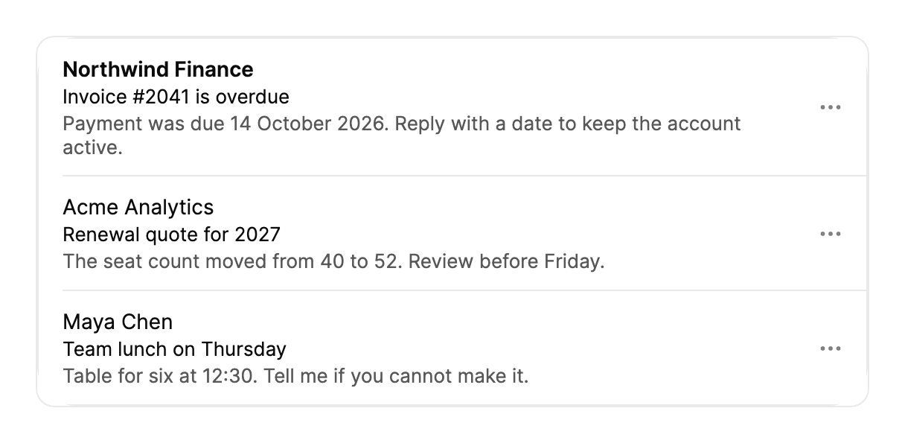

<Demo name="Inbox" />

## 何時使用

`SwipeActions` 是一個清單，其中的列被橫向滑動時會露出操作。它為觸控優先的分類而設計：使用者逐一處理長清單，每一項通常只需要一兩個快速決定。操作位於列的下方，因此決定就在閱讀該項目的地方做出；完整滑動會移除該列並填補空隙，無需另外確認。

- **平板上的郵件分類**：在支援或銷售收件匣中，向左滑動可封存對話，向右滑動可將其標為未讀。兩個操作都只需從列上點按一下，封存後清單會填補空隙。
- **手機上的外勤服務工單清單**：技術人員向右滑動以標記工單完成，向左滑動以改期。工單卡片在操作下方仍可閱讀，因此無需開啟工單即可做出決定。
- **手機上的審核**：主管用強調色滑動核准採購申請，用危險色滑動拒絕。拒絕列關閉了完整滑動，因此一次長拖曳不會誤拒申請。
- **配套應用程式中的通知中心**：登入提醒以危險色滑動關閉，而耗時較長的匯出則透過一個讓列保持原位的操作靜音。

## 何時不用

- **桌面表格或主要用滑鼠操作的清單**：在列上使用 `ContextMenu`，或在列按鈕上使用 `DropdownMenu`。滑動手勢不適合作為滑鼠的主要操作路徑，而且每一列本來就有選單。
- **透過上下拖曳調整列的順序**：用 `ReorderableList`。滑動手勢鎖定在水平方向，永遠不會改變列的順序。
- **大量欄位、分頁或排序的長資料集**：用 `Table`。滑動列不做虛擬化，因此數千列的清單在此顯示前應先分頁。
- **清單之外的單一破壞性操作**，例如在設定頁面刪除專案：用 `HoldToConfirm`，它需要刻意的長按，而不是列上可能被誤觸發的手勢。
- **一側超過兩個快速操作**：露出的寬度會隨每個操作增加。把兩個最常用的操作放在滑動上，其餘的移入該列的「更多操作」選單，或用 `ContextMenu` 顯示完整清單。

## 用法

`SwipeActions` 即清單本身。每一項是一個 `SwipeActionsRow`，或是透過 `ItemTemplate` 顯示的資料項目。

```xml
<UserControl xmlns="https://github.com/avaloniaui"
             xmlns:arc="https://github.com/AIDotNet/TKCode.Arc">
    <arc:SwipeActions Label="收件匣" ItemsSource="{Binding Messages}">
        <arc:SwipeActions.LeadingActions>
            <arc:SwipeAction Label="未讀" Tone="Accent" KeepsRow="True" />
        </arc:SwipeActions.LeadingActions>
        <arc:SwipeActions.TrailingActions>
            <arc:SwipeAction Label="封存" />
            <arc:SwipeAction Label="刪除" Tone="Danger" />
        </arc:SwipeActions.TrailingActions>
        <arc:SwipeActions.ItemTemplate>
            <DataTemplate>
                <TextBlock Text="{Binding Subject}" />
            </DataTemplate>
        </arc:SwipeActions.ItemTemplate>
    </arc:SwipeActions>
</UserControl>
```

前導與尾隨操作由每一列共用。某一側最外層的操作即為完整滑動時執行的操作。

`SwipeActions` 衍生自 Avalonia 的 `ItemsControl`，因此 `ItemsSource`、`ItemTemplate` 與項目容器的運作方式與一般清單一致。每個容器都是 `SwipeActionsRow`，它衍生自 `ContentControl`，因此列也可以單獨使用。每個 `SwipeAction` 都是一般的模型物件，而不是控制項：它保存標籤、圖示、色調和命令，由列負責繪製。

前導操作位於左邊緣下方，向右滑動時露出。尾隨操作位於右邊緣下方，向左滑動時露出。每一側可以容納任意數量的操作，但露出的寬度會隨每個操作增加，因此實際上每側兩個是上限。

### 結構

1. **清單外框**（`Label` 為其命名）：所有列外圍的一個表面，列與列之間有一條細分隔線。分隔線從左邊緣向內 16 px 處開始（`SeparatorInset`）。
2. **列主體**（`MinRowHeight` 為 64 px）：你提供的內容，左側內距 16 px，上下各 12 px，右側在「更多操作」按鈕前為 8 px。內容較高時，列會隨之變高。
3. **更多操作按鈕**：32 px 的方塊，圓角 12 px，省略號圖示 18 px。它是通往相同操作的鍵盤與螢幕閱讀器路徑，因此每一列都始終存在。
4. **露出的操作**：每個操作靜止時寬 76 px，圖示為 20 px 的字形，位於標籤上方。圖示與標籤相距 3 px。中性操作用前景色按 20% 混入表面色作為填滿；強調與危險操作使用主題色。
5. **完整滑動拉伸**：滑動越過確認門檻時，最外層的操作會橫向拉伸鋪滿整列。
6. **更多操作選單**：寬度至少 176 px 的選單，位於「更多操作」按鈕下方 6 px。它依滑動的順序列出該列的操作，並標示破壞性操作，使其一望即知。

### 色調

`Tone` 設定露出操作的填滿。應依結果選擇色調，而不是依它在列上的位置。

| 色調 | 填滿 | 用於 |
|---|---|---|
| `Neutral`（預設） | 平靜的中性填滿 | 封存、稍後提醒、移動，以及其他可逆的整理操作 |
| `Accent` | 強調色 | 完成、核准、標為未讀：正面或主要的結果 |
| `Danger` | 危險色 | 刪除、拒絕、關閉：移除或拒絕某物的結果 |

將 `Danger` 操作與一個說明結果的標籤搭配，例如「刪除」或「拒絕」，使顏色不是唯一的提示。每側至多保留一個 `Danger` 操作，並把它放在最外層，使完整滑動只能在刻意的情況下觸及它。

### 執行操作

選取操作時，`Command` 會執行，可以透過完整滑動、點按露出的操作或「更多操作」選單觸發。`SwipeAction` 上的 `Invoked` 以及清單或列上的 `ActionInvoked` 會告訴你是哪一列、哪一項。操作的 `Invoked` 處理常式先執行，然後執行其 `Command`。未設定 `CommandParameter` 時，預設為該列的資料項目。

`KeepsRow="True"` 會執行操作並讓列回到原位，而不是將其移除。適用於未讀、靜音、標記等切換類操作，因為這些情況下列應保留在清單中。

```csharp
inbox.ActionInvoked += (_, e) =>
{
    if (!e.Action.KeepsRow)
    {
        messages.Remove((Message)e.Item!);
    }
};
```

在處理常式中移除資料項目即可。不保留列的操作要等到列滑出並收合後才執行，因此清單填補空隙時不會跳動。處理常式可以直接移除該項目。如果操作執行後 1.4 秒該項目仍在清單中，列會滑回原位，因此從不移除其項目的操作不會留下空白帶。

收件匣示例保留被移除的郵件並提供復原，這是封存或刪除應遵循的模式。當使用者點按「復原」時，被移除的列會插回原來的索引。

### 列自帶操作

`SwipeActionsRow` 可以宣告自己的操作。宣告了操作的列會忽略清單的前導與尾隨操作。列上的 `IsFullSwipeEnabled` 會覆寫清單的設定：`False` 會阻止該列在完整滑動時確認，因此使用者必須點按露出的操作；`True` 則允許完整滑動，即使清單將其關閉；`null`（預設值）則跟隨清單。

<Demo name="OwnActions" />

### 保持展開

`Open(SwipeActionSide.Trailing)` 無需手勢即可顯示列的操作，使列彈回到其靜止寬度。露出一個操作的列靜止在 76 px；露出兩個的列靜止在 152 px。清單一次只保持一列展開：開啟一列會收合先前展開的那一列。`Close()` 收合已展開的列，`SwipeActions.CloseRows()` 關閉清單中已展開的列。`OpenRow` 回傳已展開的列，若沒有則回傳 `null`。

```csharp
// 通知頁面開啟時顯示匯出列的操作。
export.Open(SwipeActionSide.Trailing);
```

用保持展開的列來表明可以滑動，例如使用者第一次開啟通知清單時。不要讓列永久保持展開，因為它會遮住列的內容，讓清單看起來像是壞了。

<Demo name="RestingOpen" />

### 完整滑動

完整滑動會執行某一側最外層的操作。門檻取兩個值中較大的一個：該側的展開寬度加 48 px，或列寬的 56%。列越過門檻後會保持待命狀態，直到拖曳回退 20 px，因此輕微晃動不會取消執行。速度超過 900 px/s 的快速輕滑，若沿其方向帶動列越過門檻，同樣會執行。

對於誤拖代價高昂的操作，例如拒絕或付款，在清單或列上設定 `IsFullSwipeEnabled="False"`。露出的操作仍可透過點按執行。

### 繫結到檢視模型

在 MVVM 應用程式中，檢視模型持有集合以及移除項目的規則。清單繫結到該集合，而操作在程式碼中連接，因為 `SwipeAction` 是一般的模型物件，不是視覺樹中的控制項。

```csharp
public partial class InboxViewModel : ObservableObject
{
    private readonly IMailService _mail;

    public InboxViewModel(IMailService mail)
    {
        _mail = mail;
    }

    public ObservableCollection<MailThread> Threads { get; } = [];

    [RelayCommand]
    private async Task ArchiveAsync(MailThread thread)
    {
        await _mail.ArchiveAsync(thread.Id);
        Threads.Remove(thread);
    }

    [RelayCommand]
    private void ToggleUnread(MailThread thread)
    {
        thread.IsUnread = !thread.IsUnread;
    }
}
```

```xml
<arc:SwipeActions Label="收件匣"
                  ItemsSource="{Binding Threads}"
                  RowLabelBinding="{Binding Subject}">
    <arc:SwipeActions.ItemTemplate>
        <DataTemplate>
            <StackPanel Spacing="2">
                <TextBlock Text="{Binding Sender}" FontWeight="SemiBold" />
                <TextBlock Text="{Binding Subject}" />
                <TextBlock Text="{Binding Preview}" Foreground="{arc:ArcDesignTokenResource TextSecondary}" />
            </StackPanel>
        </DataTemplate>
    </arc:SwipeActions.ItemTemplate>
</arc:SwipeActions>
```

```csharp
// 在檢視的程式碼後置檔中，即檢視模型可用的地方：
var archive = new SwipeAction { Label = "封存", Icon = ArcIcons.Archive, Command = viewModel.ArchiveCommand };
var unread = new SwipeAction { Label = "未讀", Icon = ArcIcons.Mail, Tone = SwipeActionTone.Accent, KeepsRow = true, Command = viewModel.ToggleUnreadCommand };
inbox.TrailingActions.Add(archive);
inbox.LeadingActions.Add(unread);
```

- 清單讀取 `ItemsSource`，檢視模型透過改變集合來新增或移除列。請使用 `ObservableCollection<T>`，這樣移除項目時清單會更新。
- `RowLabelBinding` 為每個產生的列命名，供其「更多操作」按鈕使用，例如「更多操作：發票 #2041」。
- 命令接收該列的資料項目作為參數，因此一個命令即可服務於所有列。
- 編譯繫結需要在檢視和資料範本上設定 `x:DataType`（為求簡潔，這裡的範例省略了它）。

### 範例：平板上的郵件分類

平板上的支援收件匣。主旨是列的第一行並加粗，寄件者與時間提供背景，預覽讓使用者判斷該對話是否需要自己處理。前導操作用強調色把對話標為未讀，尾隨操作則用於封存或刪除。本情境中的列沒有宣告自己的操作，因此每一列都使用清單的操作。截圖展示的是靜止的清單；只有在列被滑動或開啟時，露出的操作才會出現。



```xml
<Border Width="560"
        CornerRadius="12"
        BorderThickness="1"
        BorderBrush="{arc:ArcDesignTokenResource Border}"
        Background="{arc:ArcDesignTokenResource Surface}"
        ClipToBounds="True">
    <arc:SwipeActions Label="Support inbox">
        <arc:SwipeActions.LeadingActions>
            <arc:SwipeAction Label="Unread" Icon="{x:Static arc:ArcIcons.Mail}" Tone="Accent" KeepsRow="True" />
        </arc:SwipeActions.LeadingActions>
        <arc:SwipeActions.TrailingActions>
            <arc:SwipeAction Label="Archive" Icon="{x:Static arc:ArcIcons.Archive}" />
            <arc:SwipeAction Label="Delete" Icon="{x:Static arc:ArcIcons.Trash2}" Tone="Danger" />
        </arc:SwipeActions.TrailingActions>
        <arc:SwipeActionsRow Label="Invoice #2041 is overdue">
            <StackPanel Spacing="2" VerticalAlignment="Center">
                <TextBlock Text="Northwind Finance" FontSize="14" FontWeight="SemiBold"
                           Foreground="{arc:ArcDesignTokenResource Foreground}" />
                <TextBlock Text="Invoice #2041 is overdue" FontSize="13"
                           Foreground="{arc:ArcDesignTokenResource Foreground}" />
                <TextBlock Text="Payment was due 14 October 2026. Reply with a date to keep the account active."
                           FontSize="13" TextWrapping="Wrap"
                           Foreground="{arc:ArcDesignTokenResource TextSecondary}" />
            </StackPanel>
        </arc:SwipeActionsRow>
        <arc:SwipeActionsRow Label="Acme Analytics renewal">
            <StackPanel Spacing="2" VerticalAlignment="Center">
                <TextBlock Text="Acme Analytics" FontSize="14"
                           Foreground="{arc:ArcDesignTokenResource Foreground}" />
                <TextBlock Text="Renewal quote for 2027" FontSize="13"
                           Foreground="{arc:ArcDesignTokenResource Foreground}" />
                <TextBlock Text="The seat count moved from 40 to 52. Review before Friday."
                           FontSize="13" TextWrapping="Wrap"
                           Foreground="{arc:ArcDesignTokenResource TextSecondary}" />
            </StackPanel>
        </arc:SwipeActionsRow>
        <arc:SwipeActionsRow Label="Team lunch on Thursday">
            <StackPanel Spacing="2" VerticalAlignment="Center">
                <TextBlock Text="Maya Chen" FontSize="14"
                           Foreground="{arc:ArcDesignTokenResource Foreground}" />
                <TextBlock Text="Team lunch on Thursday" FontSize="13"
                           Foreground="{arc:ArcDesignTokenResource Foreground}" />
                <TextBlock Text="Table for six at 12:30. Tell me if you cannot make it."
                           FontSize="13" TextWrapping="Wrap"
                           Foreground="{arc:ArcDesignTokenResource TextSecondary}" />
            </StackPanel>
        </arc:SwipeActionsRow>
    </arc:SwipeActions>
</Border>
```

這三列展示了分類清單需要的三類內容：一個需要採取行動的主旨、一個只供參考的對話，以及一則個人訊息。清單使用同一組操作，因此同一種滑動在每一列上的意思都相同。危險操作位於最外層，因此只有刻意的完整滑動才能觸及它，而「更多操作」選單則為鍵盤使用者提供相同的操作。

### 文案規範

- **操作標籤**：一個簡短的詞，例如「封存」「刪除」「完成」或「未讀」。標籤位於 76 px 寬的欄中、20 px 圖示的下方，較長的片語會被截斷。較長的動詞留給選單，那裡有完整的寬度。
- **列標籤**：主旨或項目名稱，例如「發票 #2041 已逾期」。它為「更多操作」按鈕命名這一列，因此要寫成螢幕閱讀器使用者能夠辨識的句子。
- **清單標籤**：集合的名稱，例如「收件匣」「工作」「通知」。它是清單的無障礙名稱。
- **結果用語**：說明結果，而不是手勢。「刪除」描述發生了什麼；「滑動刪除」描述如何達到它，而且滑動並不是唯一的途徑。

| 不要寫 | 改為 |
|---|---|
| 滑動封存 | 封存 |
| 將此對話移到封存資料夾 | 封存 |
| 移除 | 刪除 |
| 標為未讀 | 未讀 |
| 永久丟棄 | 刪除 |

### 最佳做法

**建議**

- 把完整滑動應執行的操作放在某一側的最外層，因為該位置的操作會被確認執行。除非提供了復原，否則不要把破壞性操作放在該位置。
- 對於改變列狀態的切換操作（例如未讀或標記），使用 `KeepsRow="True"`；只有在操作結束時項目也隨之結束的情況下，才移除項目。切換操作若移除該列，使用者想要復原時會很困惑。
- 透過 `RowLabelBinding` 為每一列設定 `Label`，讓「更多操作」按鈕指明它所屬的列。
- 在移除類操作之後提供復原路徑，例如按鈕或輕提示，因為完整滑動很快，也容易被誤觸。
- 同一清單中的所有列使用相同的操作，除非某一列確有不同的理由，例如被鎖定的項目。

**避免**

- 僅用手勢作為操作方式。「更多操作」按鈕始終存在，它服務於無法滑動的鍵盤和螢幕閱讀器使用者。
- 在列的兩側都放危險操作，這會使任一方向的誤滑動都具有破壞性。
- 露出操作使用過長的標籤。標籤會被截斷到 76 px 的欄寬內，因此含義必須能用一個詞表達。
- 在每一列上都關閉完整滑動。對於可逆的操作保持開啟，只在拒絕或付款這類情境關閉，因為額外的一次點按正是安全保障。
- 一個清單中有數千列。列不做虛擬化，清單會建立每一個容器，因此應對資料分頁。

### 常見問題

**為什麼我的處理常式在列滑出後才執行？** 移除其項目的操作會在列滑出並收合之後執行，因此清單填補空隙時不會出現可見的跳動。如果需要操作立即執行，請設定 `KeepsRow="True"`，並稍後移除項目，例如在伺服器確認變更之後。

**如果項目沒有被移除會怎樣？** 如果操作執行後 1.4 秒項目仍在清單中，列會滑回原位。請在處理常式中移除項目，或在列應保留時設定 `KeepsRow`。

**如何阻止完整滑動執行破壞性操作？** 在列上將 `IsFullSwipeEnabled` 設為 `False`。使用者仍可露出操作並點按，但長拖曳只會展開該列。

**為什麼我的列的操作忽略了清單的操作？** 宣告了自己前導或尾隨操作的列只使用那些操作。沒有宣告操作的列則以清單的操作為預設值。

**可以在沒有清單的情況下單獨使用一列嗎？** 可以。`SwipeActionsRow` 可以獨立運作，擁有自己的操作以及自己的 `Open`、`Close` 和 `Run` 方法。它沒有清單，因此單一展開規則與清單的完整滑動設定都不適用。

## API 參考

<!-- api: SwipeActions -->

<!-- api: SwipeAction -->

<!-- api: SwipeActionsRow -->

### 色調與側邊值

| 類型 | 值 | 含義 |
|---|---|---|
| `SwipeActionTone` | `Neutral` | 平靜的中性填滿（預設） |
| `SwipeActionTone` | `Accent` | 強調色填滿 |
| `SwipeActionTone` | `Danger` | 危險色填滿，用於破壞性或拒絕性的結果 |
| `SwipeActionSide` | `None` | 列已收合 |
| `SwipeActionSide` | `Leading` | 位於左邊緣下方，向右滑動時露出 |
| `SwipeActionSide` | `Trailing` | 位於右邊緣下方，向左滑動時露出 |

## 無障礙

- 清單的名稱來自 `Label`，每一列都是清單項目。每一列都有一個「更多操作」按鈕，名稱為「更多操作：」加上該列的 `Label`。
- 滑鼠與鍵盤使用者無需使用手勢：按 Tab 移到「更多操作」按鈕，按 Enter 或 Space 開啟選單，再用方向鍵移動。
- 按 Esc 關閉選單或收合已展開的列。在其他位置按下時也會收合已展開的列。
- 露出的操作對輔助技術隱藏，且不在 Tab 順序中。
- 當某一列透過選單被移除時，焦點移到相鄰列的「更多操作」按鈕。最後一列離開時，焦點落在清單本身上。
- 選單列出與滑動相同的操作，破壞性項目會被標示為破壞性，因此螢幕閱讀器使用者會在操作執行前聽到風險提示。

### 鍵盤

| 按鍵 | 操作 |
|---|---|
| `Tab` / `Shift+Tab` | 在各列的可聚焦內容與「更多操作」按鈕之間移動；露出的操作會被跳過 |
| 「更多操作」按鈕上的 `Enter` 或 `Space` | 開啟該列的選單，並醒目標示第一項 |
| 「更多操作」按鈕上的 `Up` 或 `Down` | 選單關閉時，開啟選單並定位到最後一項或第一項 |
| 選單中的 `Up` / `Down` | 在各操作之間移動 |
| 選單中的 `Enter` | 執行醒目標示的操作 |
| `Escape` | 關閉選單，或收合已展開的列 |

## 動態效果

- 列跟隨指標移動。超過最後一個停靠點後會產生阻力，因此列會稍微拉伸，然後回彈。
- 放開後，列以保留放開速度的彈簧停靠到最近的停靠點。快速輕滑會被視為滑向對應方向的停靠點。
- 完整滑動時，最外層的操作會橫向拉伸鋪滿整列，列隨後滑出，清單再填補空隙。
- 減少動態效果時，列直接跳到停靠點，列的出現與消失改為淡入淡出，不做高度動畫。關閉動態效果時，所有內容一次移動到位。

| 變化 | 完整 | 減少 | 關閉 |
|---|---|---|---|
| 列跟隨指標 | 跟隨指標移動，超過最後一個停靠點後有橡皮筋式阻力 | 不跟隨；列直接跳到停靠點 | 不跟隨；列直接跳到停靠點 |
| 放開 | 以放開速度彈簧停靠：關閉時平滑，開啟時俐落 | 直接跳到停靠點 | 立即完成 |
| 完整滑動 | 最外層的操作橫向拉伸鋪滿整列，列隨後滑出 | 淡出 | 立即完成 |
| 列被移除 | 列的高度在 120 ms 後以平滑彈簧收合，清單填補空隙 | 淡出，無高度動畫 | 立即完成 |
| 列被新增 | 列以平滑高度彈簧與淡入增長出現 | 淡入，無高度動畫 | 立即完成 |
| 「更多操作」選單 | 隨選單面板的過渡開合 | 選單面板的減少動態過渡 | 選單面板的關閉過渡 |

滑動本身是使用者唯一能控制的動態效果，因此在每一種動態效果等級下都應保持直接而靈敏。放開時使用彈簧來顯示列將停靠的位置，並省去周圍清單上的裝飾性移動。

## 相關元件

- `ContextMenu` 與 `DropdownMenu`：桌面端的列操作。
- `ReorderableList`：透過拖曳把列重新排序。
- `HoldToConfirm`：清單之外的單一破壞性操作。
- `Table`：大型、可排序的資料集。

| 元件 | 適用情境 |
|---|---|
| `ContextMenu` / `DropdownMenu` | 主要輸入方式是滑鼠，或列上有很多操作 |
| `ReorderableList` | 使用者透過拖曳改變列的順序 |
| `Table` | 資料有欄位、排序或數量很多的列 |
| `HoldToConfirm` | 一個破壞性操作需要刻意長按，且不在清單中 |
| `Dialog` | 操作執行前必須先閱讀後果 |
| `Toast` | 操作已執行，應回報結果並提供復原 |
