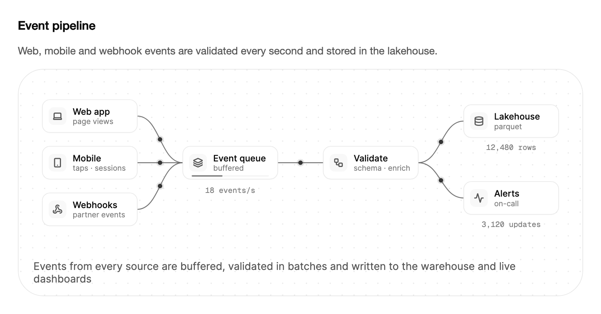

<Demo name="EventPipeline" />

## 何时使用

`DataFlow` 说明事件如何在数据平台中流动：从产生事件的产品与服务出发，经过事件流和批量转换，进入数据仓库，再到建立在其上的实时视图。它是一幅示意图，而不是监控工具。它适合放在文档页面、引导页或空状态中，让读者在任何真实数据存在之前就理解这条管线。

- **分析类产品的引导页**：首次使用的页面先展示事件来自哪里（网页应用、移动应用、账单 Webhook），然后客户再接入第一个来源。这张图无需设置向导，就能回答“我的数据去了哪里”。
- **数据平台文档**：描述接入架构的页面，例如一个 Kafka 主题向校验任务和湖仓表供数。说明文字与标签应使用平台的真实组件名称。
- **运维控制台中的空状态**：管线页面上的“暂无事件”面板。动画告诉用户管线已经接通并在等待流量，这是空白表格做不到的。
- **解释过滤步骤**：在数据存储之前丢弃一部分流量的隐私或质量规则。在转换节点处淡出的红色数据包，无需一张规则表就能展示规则移除了什么。
- **发布说明与更新日志页面**：为新增管线阶段（例如新的富化步骤）的功能配一张简短的示意图，放在描述它的文字旁边。

## 何时不用

- **绘制真实数据量随时间的变化**：使用图表分类中的 `LineChart` 或 `BarChart`。`DataFlow` 中的计数器用于讲故事，并不是测量值，插图也不接受你的指标。
- **有当前位置的固定步骤序列**：使用 `Stepper`，适合设置向导或用户通过“下一步”和“上一步”推进的摄入任务。`DataFlow` 自行循环，无法在步骤之间切换。
- **管线的实时状态**：用 `Alert` 或 `Badge` 显示每个任务的实际状态，并用表格展示延迟与失败。循环的示意图无法报告某个任务正在失败。
- **同一页面上有大量动画插图**：每个插图在播放时都会逐帧重绘画布，因此一个屏幕上只保留一两个正在运行，其余使用减弱动效的静态画面。
- **分支由用户或数据决定的流程**：历史记录使用 `Timeline`，流程关系使用文档中的流程图。`DataFlow` 展示的是一条固定路线，外加一个过滤分支。

## 用法

插图加载后即开始播放。图表下方的说明文字随故事推进而变化，播放按钮可暂停播放。该控件无需数据即可运行：它内置了一个默认故事，讲的是网页应用、移动应用和 Webhook 向数据仓库与仪表板供数。

```xml
<UserControl xmlns="https://github.com/avaloniaui"
             xmlns:arc="https://github.com/AtomUICommunity/TKCode.Arc">
    <arc:DataFlow Label="事件管道" />
</UserControl>
```

`DataFlow` 派生自 `Illustration`，而 `Illustration` 派生自 Avalonia 的 `TemplatedControl`。因此它是一个普通控件：它有一个为辅助技术命名的 `Label`，可以获得焦点，可通过主题设置样式，也能放入任何布局。共享的插图基类提供场景时钟、循环脚本、说明文字、播放按钮和减弱动效的静态画面，因此控件本身只需描述图示及其数字。

### 结构

1. **来源**（左列，`Sources`）：一到四张卡片，每张 150 × 52 场景单位，圆角 12 px，包含图标、标题和一行详细信息。默认来源为网页应用（页面浏览）、移动端（点击与会话）和 Webhook（合作方事件）。来源在列中均匀分布，数量增加时间距随之缩小。
2. **事件流**（`Labels.Stream`、`Labels.StreamDetail`）：接收每个事件的队列。卡片下方的计量条随事件到达而填充，在转换环节取走一批后清空。计量条上限为 24 个事件。
3. **吞吐量读数**：事件流卡片下方的每秒事件数，以半秒采样平滑，并用 `Labels.EventsPerSecond` 格式化。
4. **转换**（`Labels.Transform`、`Labels.TransformDetail`）：批量处理步骤，批次处理期间显示忙碌圆环。被过滤的事件在此被移除。
5. **数据仓库**（`Labels.Warehouse`、`Labels.WarehouseDetail`）：右侧上方的分支。卡片下方的读数统计已存储的行数，并用 `Labels.Rows` 格式化。
6. **仪表板**（`Labels.Realtime`、`Labels.RealtimeDetail`）：右侧下方的分支，其读数统计推送到实时视图的更新次数，并用 `Labels.Updates` 格式化。
7. **说明行**（`IsCaptionVisible`）：图示下方的一行次要文字，使用小字号和次要文字颜色，随每一步变化。
8. **播放按钮**（`IsPlaybackButtonVisible`）：外框右下角的圆形按钮，在静态画面中隐藏。
9. **外框**：带 1 px 边框（边框色）和表面圆角的表面卡片，背景为点状底纹。左右与上方的内边距为 20 px，下方为 14 px。场景会按控件给定的宽度缩放，因此在窄列中图示仍能保持比例。

数据包以强调色绘制。走过过滤路径的数据包变为危险色并淡出；通往实时视图的路线使用成功色。

### 吞吐量与过滤

`EventsPerSecond` 设置数据源发出事件的速度。取值范围为 1 到 60，默认 18，超出范围的值会被限制在边界内。`FilterRatio` 设置转换环节移除的事件占比。取值范围为 0 到 0.5，默认 0.14，因此默认情况下约每七个事件过滤掉一个。

```xml
<arc:DataFlow EventsPerSecond="8" FilterRatio="0.3" />
```

转换环节每秒处理一批最多八个事件，因此每秒事件数高于 8 时，计量条会逐渐涨向其容量。该插图说明的是管线的形态；它不模拟背压、延迟或丢弃事件，也不应用来估算容量。

### 来源与标签

`Sources` 接受一到四个 `DataFlowSource` 值。每个值都有一个 `Title` 和一行可选的 `Detail`。空列表会回退为默认来源，超过四项的列表只取前四项。`Labels` 属性接受一个 `DataFlowLabels` 对象，其中包含图示中每一个可见的文字：节点标题与详细信息、读数格式以及步骤说明文字。只设置需要的属性即可，其余保持英文默认值。

<Demo name="OwnSources" />

更改 `Sources` 或 `Labels` 会重建图示，因此应在页面加载时同时设置两者，而不要在每次数据刷新时设置。

### 播放与速度

`IsPlaying` 用于播放和暂停故事。它是双向的：用户按下播放按钮或空格键时，控件会写入该值；应用也可以读取或绑定它。`Speed` 缩放场景时钟，取值范围为 0.25 到 4。`Play()`、`Pause()` 和 `Restart()` 可在代码中完成相同的操作。`Restart()` 会重置计数器并回到第一步。

```xml
<arc:DataFlow Speed="2" IsPlaying="{Binding IsPipelineRunning}" />
```

```csharp
flow.Speed = 0.5;
flow.Restart();
```

当控件移出屏幕、被隐藏或从可视树中分离时，场景时钟会暂停，因此滚动到视野之外的标签页中的插图在重新可见之前不耗费任何资源。

### 跟随故事进度

`Step` 与 `StepCount` 描述循环中的位置。故事共三步，每一步都会更新说明文字：

| 步骤 | 说明文字 | 高亮内容 |
|---|---|---|
| 0 | 带有来源数量的摄入说明文字 | 从来源到事件流的连线 |
| 1 | 转换说明文字：已校验并富化，异常事件被过滤 | 通往转换环节的连线 |
| 2 | 存储说明文字：合格事件写入数据仓库并更新实时仪表板 | 通往数据仓库与仪表板的连线 |

`StepChanged` 提供新的步骤及其说明文字。`RowsStored` 与 `EventsFiltered` 分别统计故事开始以来写入数据仓库的行数，以及被转换环节移除的事件数。两者均为只读，由插图自行维护。

```csharp
flow.StepChanged += (_, e) => status.Text = $"第 {e.Step + 1} 步，共 {flow.StepCount} 步：{e.Caption}";
```

### 减弱动效

在减弱动效（或关闭动效）下，插图是其稳定状态的静态画面：每条连线都会高亮，每条路线的中间停留一个数据包以显示行进方向，说明文字概括整个故事。播放按钮隐藏，因为没有可播放的内容。在不需要动效的页面、打印件以及静态导出中使用该静态画面。

<Demo name="ReducedMotion" />

### 由数据驱动

`DataFlow` 不读取事件流，它只绘制交给它的故事。在应用中，当来源和标签来自配置时，从视图模型绑定它们，并将播放状态与之一同保存。下面的示例使用 CommunityToolkit.Mvvm，展示一个仍在设置中的分析产品的管线。

```csharp
public partial class PipelineSetupViewModel : ObservableObject
{
    [ObservableProperty]
    private bool _isPipelineRunning = true;

    [ObservableProperty]
    private double _speed = 1;

    public IReadOnlyList<DataFlowSource> Sources { get; } =
    [
        new("结账", "订单"),
        new("移动应用", "会话"),
        new("账单 Webhook", "发票")
    ];

    public DataFlowLabels Labels { get; } = new()
    {
        Warehouse = "数据湖仓",
        WarehouseDetail = "parquet",
        Realtime = "告警",
        RealtimeDetail = "值班"
    };
}
```

```xml
<arc:DataFlow Sources="{Binding Sources}"
              Labels="{Binding Labels}"
              IsPlaying="{Binding IsPipelineRunning}"
              Speed="{Binding Speed}" />
```

每种配置只绑定一次 `Sources` 与 `Labels`。新的列表或标签对象会重建图示，因此不要在定时器中替换它们。用 `IsPlaying` 把故事与页面状态关联起来，例如在设置对话框打开时暂停它。

### 示例：数据平台概览

一个分析产品的设置页面。插图位于已连接来源的简短说明上方，因此读者看到的三个来源与文字中提到的完全一致。数据仓库是 Parquet 格式的湖仓表，第二个分支向值班团队的告警视图供数。标签使用平台自己的名称，详细信息行说明每个阶段的作用，而不是重复标题。



```xml
<StackPanel Width="760" Spacing="16">
    <TextBlock Text="Event pipeline"
               FontSize="16"
               FontWeight="SemiBold"
               Foreground="{arc:ArcDesignTokenResource Foreground}" />
    <TextBlock Text="Web, mobile and webhook events are validated every second and stored in the lakehouse."
               TextWrapping="Wrap"
               Foreground="{arc:ArcDesignTokenResource TextSecondary}" />
    <arc:DataFlow Label="Event pipeline for Acme Analytics">
        <arc:DataFlow.Labels>
            <arc:DataFlowLabels Stream="Event queue"
                                StreamDetail="buffered"
                                Transform="Validate"
                                TransformDetail="schema · enrich"
                                Warehouse="Lakehouse"
                                WarehouseDetail="parquet"
                                Realtime="Alerts"
                                RealtimeDetail="on-call" />
        </arc:DataFlow.Labels>
    </arc:DataFlow>
</StackPanel>
```

示例保留了默认来源，因此上方的说明文字提到了网页、移动端和 Webhook 事件。若要展示平台自己的来源，请如上方视图模型所示，在代码中设置 `Sources`。截图是静态的稳定状态画面，因此其中的读数（12,480 行、3,120 次更新）是插图自身的展示数值，而不是测量结果。

### 文案规范

用与架构相同的名词命名节点标题（事件队列、数据湖仓、告警），详细信息行应简短、小写且具体（schema · enrich、parquet、on-call）。使用真实的来源名称，而不是类型名：“结账订单”比“数据源 1”更能说明问题。说明文字与标签应与页面其余部分使用相同的时态。

| 不要写 | 改为 |
|---|---|
| 数据源 1 | 结账 |
| 处理 | 校验 |
| 数据库 | 数据湖仓 |
| 实时 | 告警 |
| 事件在我们出色的管线中被处理 | 事件每秒校验一次，并存入数据湖仓 |
| 已达到 18 events/s 的吞吐量 | 18 events/s |
| 你的数据正在流动 | 等待第一批事件 |

将标签控制在约 16 个字符以内，使节点卡片保持单行；过长的标题会换行，卡片显得拥挤。不要在详细信息行中写整句话。整个故事的描述请使用 `Summary`，并保持为一句话。

### 最佳实践

**推荐**

- 在 `Labels` 中使用平台的真实组件名称，因为读者会把图示与他们来自的架构页面进行对照。通用的“处理”节点无法传达任何信息。
- 使用两到三个来源。默认间距在两个和三个来源时最宽松，四张卡片在窄宽度下几乎没有给详细信息行留出空间。
- 在文档页面上保持故事的默认速率。每秒 18 个事件的速率既能体现活跃感，又不会分散读者对正文的注意力。
- 当读者关注的页面之外的插图处于视野之外时，用 `IsPlaying` 暂停故事；对于关闭了动效的用户，让静态画面取而代之。

**避免**

- 把计数器当作指标使用。`RowsStored` 与各项读数统计的是插图所讲的故事，如果仪表板将它们显示为真实数据量，报告的数字就不是来自你的系统。
- 在同一屏幕上放置多个正在播放的插图。每个插图都会逐帧重绘画布，开销会叠加，还会争夺注意力。
- 在定时器中或每次数据刷新时更改 `Sources` 或 `Labels`。每次更改都会丢弃图示并重新构建，故事永远无法播放完成。
- 在标签中写一句话。卡片很小，长文字会换行并挤满外框。
- 依赖图示来判断状态。它展示的是管线的形态，而不是某个任务是否健康，因此故障应使用 `Alert` 或表格报告。

### 常见问题

**如何重命名说明文字中的三个步骤？** 设置 `Labels` 的 `TransformStep` 和 `StoreStep` 属性，整个故事则设置 `Summary`。第一步的说明文字由 `Ingest` 生成，它接收来源数量作为参数，因此若要修改措辞，请修改该函数。

**为什么故事总是显示相同的数字？** 插图使用固定的随机种子，因此每次运行的过程都相同。每次重新启动时计数器都从相同的值开始，数据源以带抖动但可重复的间隔发出事件。这使文档截图和测试保持稳定。

**能否用我自己的计数来驱动读数？** 不能。`RowsStored` 与 `EventsFiltered` 是只读的，读数值由插图自行维护。若要展示真实数据量，请使用 `LineChart` 或 `AnimatedCounter`，并填入指标存储中的数字。

**不改代码，如何展示不同数量的来源？** 如上方视图模型所示，将 `Sources` 绑定到配置中的集合。第四项之后的值会被忽略，空列表则会恢复为三个默认来源。

**长时间运行时，事件池会增长吗？** 不会。数据包来自一个固定的池并被重复使用，因此运行数小时的故事始终保持相同数量的数据包对象。

## API 参考

<!-- api: DataFlow -->

<!-- api: DataFlowLabels -->

来源使用 `DataFlowSource` 记录类型。

| 属性 | 类型 | 含义 |
|---|---|---|
| `Title` | `string` | 来源卡片上显示的名称，例如“网页应用” |
| `Detail` | `string?` | 卡片上可选的第二行，例如“页面浏览”；为 null 时只显示标题 |

## 无障碍

- `Label` 是插图的无障碍名称。请在其中为管线命名，例如“Acme Analytics 的事件管道”，因为图示本身没有读者可以逐项浏览的文字。
- 插图可获得焦点，获得焦点时外框周围显示 2px 焦点环。
- 当前的说明文字作为帮助文本提供，因此焦点位于控件上时，屏幕阅读器会朗读该步骤的描述。
- 说明文字的变化不会被播报。故事会循环播放，逐步播报会无休止地重复。
- 标签与读数就是图示显示的文字。请让它们脱离动画也能被理解，因为看不到动画的读者仍能获得节点标题和说明文字。
- 在减弱动效下，静态画面显示稳定状态及概要说明文字，在没有任何动作的情况下传达相同的信息。

### 键盘

插图可通过 Tab 键获得焦点。获得焦点后，以下按键可控制故事：

| 按键 | 操作 |
|---|---|
| `Tab` / `Shift+Tab` | 将焦点移入或移出插图 |
| `Space` 或 `Enter` | 播放或暂停故事 |
| `R` | 从第一步重新开始故事 |

## 动效

- 事件以小数据包的形式沿连线传输。事件流的计量条随事件到达而填充，随批次离开而清空，读数同步递增。
- 每一步都会点亮属于该步骤的连线，其余连线淡回原色。
- 被过滤的数据包变为红色，并在离开转换环节后不久淡出。
- 播放按钮与说明文字以短暂的过渡变化，步骤的节点在激活时强调显示。

| 变化 | 完整 | 减弱 | 关闭 |
|---|---|---|---|
| 事件沿连线传输 | 每条路线上都有动画数据包 | 静态画面，每条路线上停留一个数据包 | 静态画面 |
| 当前步骤的连线点亮 | 0.4 s 内淡入 | 以稳定状态显示（全部点亮） | 以稳定状态显示 |
| 被过滤的事件 | 变为红色，并在转换环节附近淡出 | 不显示 | 不显示 |
| 读数（事件/s、行数、更新数） | 故事进行中递增计数 | 显示静态画面的数值 | 显示静态画面的数值 |
| 播放按钮 | 可见；切换播放状态 | 隐藏 | 隐藏 |

## 相关组件

- `PaymentFlow`：单笔请求被通过或被拒绝的场景，外框与播放控件相同。
- `MultiRegionFailover`：流量在区域之间切换的场景。
- `VectorSearch`：根据最相近的文档回答问题的场景。

| 组件 | 适用场景 |
|---|---|
| `LineChart` / `BarChart` | 你要绘制随时间变化的真实测量值 |
| `Stepper` | 用户通过“下一步”和“上一步”依次经过固定的序列 |
| `Timeline` | 你要按顺序、带时间地展示事件的历史 |
| `Alert` | 你要以文字说明真实管线或任务的状态 |
| `PaymentFlow` | 故事是一笔请求被通过或被拒绝 |
| `VectorSearch` | 故事是由最相近的文档回答的问题 |
