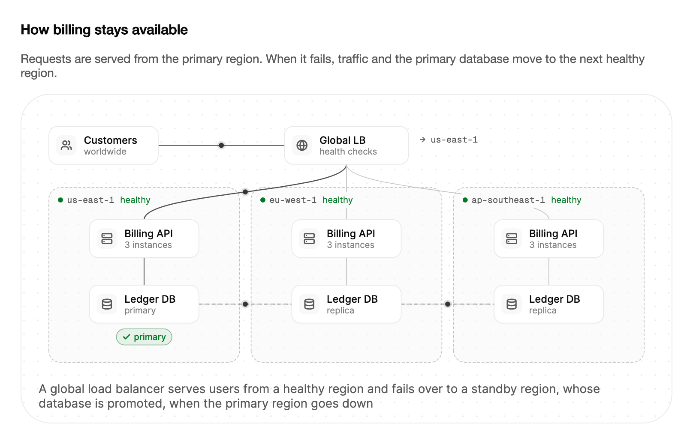

<Demo name="AutomaticFailover" />

## 何時使用

`MultiRegionFailover` 展示當某個區域發生故障時，服務如何維持可用。它會繪製全域流量路徑、每個區域及其應用程式與資料庫，以及資料庫之間的複寫連結，然後播放故障、流量切換、資料庫升格和復原的全過程。它適合放在架構與可靠性頁面、維運手冊和教育訓練教材中，讓讀者知道在任何時刻由哪個區域提供流量、哪個資料庫接受寫入。

- **支付或帳單 API 的可靠性頁面**：說明為什麼在 `us-east-1` 故障時結帳仍能繼續。主要區域提供流量，`eu-west-1` 持有一個被升格的副本，說明文字描述處理中的請求會發生什麼事。
- **遊戲日之前的維運手冊演練**：團隊使用手動控制項演練訂單資料庫的容錯移轉，所用的狀態機與圖示相同，然後才在正式環境中執行真正的流程。
- **多區域部署的架構審查**：一份設計文件比較雙區域主備布局與三區域布局，並使用 `Regions` 屬性展示每一種方案。
- **值班工程師的入門說明**：簡短解釋「升格」和「副本」對團隊自己的資料庫代表什麼，並放在他們將要執行的維運手冊步驟旁邊。
- **資料駐留功能的客戶文件**：說明資料在哪裡複寫、由哪個區域接手，並使用客戶合約中的區域名稱。

## 何時不用

- **通知真實服務中斷**：使用 `Alert`，填寫實際的狀態文字與事故發生時間。圖示播放的是固定的故事，絕不能取代正式環境的真實狀態。
- **單一區域或單一伺服器**：故事需要兩到三個區域才說得通。只涉及一個位置時，使用搭配純文字的 `Card`，或用事故的 `Timeline`。
- **真實的可用性、延遲或錯誤率**：使用 `LineChart` 或 `Gauge` 並填入實測值。插圖展示的是容錯移轉的形態，而不是你的容錯移轉花了多久。
- **每個區域的即時健康檢視**：使用 `DataGrid` 或由 `Badge` 組成的清單，呈現健康檢查結果。十個區域或十幾項健康檢查無法放進三區域的外框中。
- **需要人員逐步執行的流程**：維運手冊的步驟使用 `Stepper`，並在旁邊連結該圖示。插圖會自行循環，無法等待操作員確認某一步。

## 用法

預設情況下故事會自動播放：某個區域未通過健康檢查，流量與主要資料庫切換到備用區域，故障區域以副本身分復原，流量最終回到原定區域。此控制項無需資料，也無需程式碼即可執行。

```xml
<UserControl xmlns="https://github.com/avaloniaui"
             xmlns:arc="https://github.com/AIDotNet/TKCode.Arc">
    <arc:MultiRegionFailover />
</UserControl>
```

`MultiRegionFailover` 衍生自 `Illustration`，而 `Illustration` 衍生自 Avalonia 的 `TemplatedControl`。它可取得焦點，擁有供輔助技術使用的 `Label`，並與其他系統插圖使用相同的外框、播放按鈕和說明文字。控制項為每個區域保留一個小型狀態機：健康、降級、故障或復原中。圖示中每一次可見的變化都是該狀態機的一次轉換，因此圖示永遠不會展示程式碼無法到達的狀態。

### 結構

1. **使用者**（`Labels.Users`、`Labels.UsersDetail`）：左上角的流量來源，150 × 52 場景單位。
2. **全域負載平衡器**（`Labels.Balancer`、`Labels.BalancerDetail`）：頂端中央較寬的卡片，170 × 52 單位，帶有來自使用者的流量路徑。旁邊的讀數顯示接收流量的區域（`Labels.ServedBy`），切換期間還會顯示容錯移轉所需時間（`Labels.FailoverTime`）。
3. **區域外框**：場景下方依區域名稱排列的兩到三組。每個外框都有一個健康指示點、一個標題和一個狀態詞（`Labels.Healthy`、`Labels.Degraded`、`Labels.Down` 或 `Labels.Recovering`），繪製在連線之上，因此線條永遠不會穿過文字。
4. **應用程式**（`Labels.App`、`Labels.AppDetail`）：每個區域中的服務，帶有來自負載平衡器的流量連線。
5. **資料庫**（`Labels.Database`，以及讀作 `Labels.Primary`、`Labels.Replica`、`Labels.Unavailable` 或「副本 · 正在追趕」的副標題）：每個區域中的資料儲存，並透過一條連線與應用程式相連。
6. **複寫連結**：依 `Regions` 清單順序，繪製在相鄰資料庫之間的虛線。變更以綠色封包的形式沿其傳送。
7. **標示**：切換期間在負載平衡器上顯示「切換中」標示，在成為主要資料庫的資料庫上顯示「已升為主要」標示。標示文字來自 `Labels.FailingOver`、`Labels.Promoted` 和 `Labels.Primary`。
8. **說明行**（`IsCaptionVisible`）與**播放按鈕**（`IsPlaybackButtonVisible`）：與其他插圖相同的控制項。按鈕在靜態畫面中隱藏。

場景為 844 × 356 單位，並依控制項給定的寬度縮放。外框在兩側與頂部保留 20 px 內距，底部保留 14 px，節點使用權杖中的 12 px 圓角。

健康狀態以三種色調顯示：降級的區域變為警告色，故障的區域變為危險色且其封包會被捨棄，復原的區域則回到成功色。

### 區域

`Regions` 接受兩到三個區域名稱。少於兩個名稱的清單會回退為預設區域（`us-east-1`、`eu-west-1` 和 `ap-southeast-1`），超過三個名稱的清單則只取前三個。區域外框平均分配場景寬度，因此兩個區域的外框比三個區域的更寬。

<Demo name="TwoRegions" />

清單中的第一個區域初始為主要區域，第二個為備用區域。在雙區域的情況下，主要區域的每次故障都會把流量和主要資料庫移到另一個區域，容錯移轉是故事唯一能走的路徑。在三區域的情況下，容錯移轉會指向清單中下一個健康的區域，到達尾端時回繞，因此清單的順序就是優先順序。應優先接手的區域要放在主要區域的緊接之後。

### 自行驅動故障

將 `IsAutomatic` 設為 `False` 以停止腳本化的故事，然後用區域的索引呼叫 `FailRegion` 和 `RecoverRegion`。每次呼叫都會執行與自動故事相同的狀態機，因此圖示與讀數的表現一致。

- `FailRegion(index)` 讓某個區域故障。若索引超出範圍，或該區域已處於降級或故障狀態，則忽略此呼叫。
- `RecoverRegion(index)` 讓某個區域復原。若索引超出範圍，或該區域已處於健康或復原中狀態，則忽略此呼叫。
- `PrimaryRegion` 是主要資料庫所在區域的索引，`TrafficRegion` 是接收流量的區域的索引。兩者皆為唯讀。
- `PrimaryRegionChanged` 在升格完成後以新主要資料庫的索引觸發。持有主要角色的區域以外的區域故障時，不會觸發此事件。

<Demo name="DriveItYourself" />

```csharp
var failover = new MultiRegionFailover { IsAutomatic = false };
var regionNames = new[] { "us-east-1", "eu-west-1", "ap-southeast-1" };

failover.PrimaryRegionChanged += (_, index) =>
    primaryLabel.Text = $"主要：{regionNames[index]}";

failButton.Click += (_, _) => failover.FailRegion(0);
recoverButton.Click += (_, _) => failover.RecoverRegion(0);
```

故障是一個序列，而不是單一的變化。發生故障的區域先顯示 0.8 秒的降級狀態，然後變為故障狀態。如果它承載了流量或主要角色，負載平衡器會在 0.5 秒後切換到下一個健康的區域；如果它承載了主要資料庫，則下一個健康區域的資料庫會在此之後 0.7 秒被升格。容錯移轉所需時間的讀數從故障發生開始計時，直到流量切換為止。這些時間都是場景時間，因此暫停的插圖在重新播放時會完成整個序列。

使用這些控制項來演練故障。依動作與區域命名，例如「讓 us-east-1 故障」和「復原 us-east-1」，讓每個按鈕對螢幕閱讀器以及閱讀頁面的操作員都清楚明確。

### 標籤

`Labels` 接受一個 `MultiRegionFailoverLabels` 物件，其中包含圖示中每一個可見的文字：節點名稱與詳細資訊、健康狀態、標示以及步驟說明文字。只設定需要的屬性即可，但要讓步驟說明文字的措辭與維運手冊保持一致，因為在故事播放期間，說明文字是讀者看到的唯一解釋。

```csharp
failover.Labels = new MultiRegionFailoverLabels
{
    Balancer = "全域負載平衡",
    FailingOver = "切換中",
    Promoted = "已升為主要"
};
```

### 播放

`IsPlaying`、`Speed` 和 `Restart()` 與其他插圖一樣控制故事。`Speed` 的取值範圍為 0.25 到 4。自動故事共六步，`StepChanged` 會回報每一步：

| 步驟 | 說明文字 | 發生時機（自動故事） |
|---|---|---|
| 0 | 流量由規劃中的區域提供；資料複寫到備用區域 | 開始 |
| 1 | 某個區域未通過健康檢查 | 3.0 s 時，該區域故障 |
| 2 | 負載平衡器將流量切換到下一個健康區域 | 故障後約 1.3 s |
| 3 | 備用資料庫被升格為主要資料庫 | 故障後約 2.0 s |
| 4 | 故障區域復原，並以副本身分追趕資料 | 8.6 s 時，該區域復原 |
| 5 | 規劃內的回切到原區域 | 11.8 s；循環長 14.4 s |

故事以規劃內的回切結束，流量與主要角色會移回第一個區域。手動控制項不會自行回切；請參閱下方的常見問題。

```xml
<arc:MultiRegionFailover Speed="2" />
```

### 減少動態效果

在減少動態效果（或關閉動態效果）下，插圖是健康部署的靜態畫面。流量由第一個區域提供，備用複寫連結以虛線繪製，說明文字概括整個部署。播放按鈕隱藏。當讀者需要了解拓撲結構而不需要了解故障序列時，請使用此靜態畫面。

<Demo name="ReducedMotion" />

### 由程式碼驅動

此控制項示範的是一個狀態機，而不是基礎架構的讀取工具。用它來展示已經發生的容錯移轉，或你想要演練的容錯移轉，並將真實狀態保存在你的監控系統中。一個合理的做法是把插圖放在說明設計的頁面上，並像上面的範例那樣由操作員自己的控制項驅動它。不要把健康檢查資料來源直接接到 `FailRegion`：那樣控制項就會播放一個由資料來源回報的故障動畫，卻沒有真實容錯移轉中的任何檢查、逾時和核准流程。

### 範例：支付平台可靠性頁面

一個帳單服務的可靠性頁面。區域是該服務實際執行的區域，負載平衡器使用基礎架構團隊慣用的簡稱命名，資料庫和應用程式的標籤則描述它們在架構中的角色。說明文字解釋讀者在故事播放時看到的內容，因此頁面不會只依賴動畫。



```xml
<StackPanel Width="760" Spacing="16">
    <TextBlock Text="How billing stays available"
               FontSize="16"
               FontWeight="SemiBold"
               Foreground="{arc:ArcDesignTokenResource Foreground}" />
    <TextBlock Text="Requests are served from the primary region. When it fails, traffic and the primary database move to the next healthy region."
               TextWrapping="Wrap"
               Foreground="{arc:ArcDesignTokenResource TextSecondary}" />
    <arc:MultiRegionFailover Label="Billing service failover across three regions">
        <arc:MultiRegionFailover.Labels>
            <arc:MultiRegionFailoverLabels Users="Customers"
                                           UsersDetail="worldwide"
                                           Balancer="Global LB"
                                           BalancerDetail="health checks"
                                           App="Billing API"
                                           AppDetail="3 instances"
                                           Database="Ledger DB"
                                           FailingOver="Failing over" />
        </arc:MultiRegionFailover.Labels>
    </arc:MultiRegionFailover>
</StackPanel>
```

標籤刻意保持簡短：負載平衡器卡片比區域卡片窄，較長的標題會被省略號截斷。修改標籤後請檢查截圖。

### 文案規範

依基礎架構中的名稱命名區域，並使用團隊維運手冊中的用詞命名資料庫角色（主要、副本）。將負載平衡器寫成元件的職責（「全域負載平衡器」「流量管理器」），而不是產品名稱，除非頁面本身就是關於該產品。說明文字使用現在式，描述狀態而非團隊的回應（「流量由 eu-west-1 提供」，而不是「我們已移動流量」）。

| 不要寫 | 改為 |
|---|---|
| 所有區域皆高可用 | us-east-1 故障期間，流量由 eu-west-1 提供 |
| 區域 1 | us-east-1 |
| 主資料庫（Master DB） | 主要資料庫 |
| 從屬（Slave） | 副本 |
| 容錯移轉完成 | 流量由 eu-west-1 提供 |
| 系統會自我修復 | 故障區域復原，並以副本身分追趕資料 |

不要在標籤中承諾容錯移轉所需時間。容錯移轉讀數是圖示所花的時間，面向客戶的說法必須來自你自己的測量，並寫在圖示旁邊。

### 最佳做法

**建議**

- 展示與正式環境部署相同的區域。如果讀數中出現服務實際並未執行的區域，就會傳達錯誤的拓撲，而讀者無法分辨其中的差異。
- 依優先順序在 `Regions` 清單中排列容錯移轉的順序，並在頁面上說明這一點，因為清單中下一個健康的區域會接收流量。
- 在維運手冊頁面上使用 `IsAutomatic="False"` 搭配真正的按鈕，讓操作員決定每一步何時發生。
- 在圖示旁邊以文字提供狀態。輔助技術不會朗讀說明文字的變化，因此頁面必須以文字說明當前的情況。

**避免**

- 把圖示當作真實服務的狀態。循環播放的故事會顯示一個可能並不存在的故障。真實狀態請使用 `Alert`。
- 用你尚未測量的數值為讀數加上標籤。容錯移轉所需時間是場景時間，而不是基準測試的結果。
- 在說明某次特定事故的頁面上保留自動故事。故事會循環播放，暗示事故仍在發生。
- 將即時健康資料來源接到 `FailRegion` 或 `RecoverRegion`。這些呼叫只會驅動狀態機的動畫，不會移動任何真實流量，因此圖示可能與正式環境不一致。

### 常見問題

**如何停止自動故事並自行驅動故障？** 將 `IsAutomatic` 設為 `False`。腳本化的故障、復原與回切都會停止，狀態只會在你呼叫 `FailRegion` 或 `RecoverRegion` 時變化。修改 `IsAutomatic` 會重建圖示，因此應在頁面顯示控制項之前設定它。

**為什麼容錯移轉所需時間與我的監控告警時間不同？** 此讀數是從呼叫 `FailRegion` 到流量切換之間的場景時間。它描述的是圖示的序列，其中使用固定的延遲（0.8 秒與 0.5 秒），並不是對你系統的測量。

**復原會把流量切回去嗎？** 不會。`RecoverRegion` 會讓該區域以副本身分復原並追趕資料，但流量與主要角色仍停留在容錯移轉之後的位置。只有自動故事會執行規劃內的回切。流量會一直停留在已升格的區域，直到該區域故障為止。

**如果沒有其他健康的區域，會發生什麼事？** 故障區域保留流量與主要角色。容錯移轉不會開始，因此 `TrafficRegion` 與 `PrimaryRegion` 不會改變，`PrimaryRegionChanged` 也不會觸發。

**複寫遵循哪些區域之間的關係？** 複寫在相鄰資料庫之間進行，順序取決於 `Regions` 清單，每次只跨一跳。位於故障區域之後的備用區域在故障區域復原之前不會收到任何資料，而復原的區域會從主要資料庫接收一小批追趕變更。

## API 參考

<!-- api: MultiRegionFailover -->

<!-- api: MultiRegionFailoverLabels -->

容錯移轉事件使用標準的 `EventHandler<int>`，參數為新主要資料庫的索引。

## 無障礙

- `Label` 是插圖的無障礙名稱。請在其中為部署命名，例如「跨三個區域的帳單服務容錯移轉」。
- 插圖可取得焦點，取得焦點時外框周圍會顯示 2px 焦點環。
- 目前的說明文字會作為說明文字提供，因此控制項取得焦點時，螢幕閱讀器會朗讀該步驟的意義。
- 說明文字的變化不會被播報，因為故事會循環播放，否則會無止境地重複同一則訊息。
- 區域名稱、健康狀態與標示就是圖示的文字。請讓它們脫離動畫也能被理解，因為看不到動畫的讀者仍能從標籤取得拓撲資訊。
- 手動控制項必須是真正的按鈕，並帶有各自的名稱，例如「讓 us-east-1 故障」。只標示為「故障」的按鈕無法說明它影響的是哪個區域。
- 在減少動態效果下，靜態畫面會展示健康的拓撲結構及概要說明文字，因此在沒有任何動作的情況下，狀態依然清楚。

### 鍵盤

插圖可透過 Tab 鍵取得焦點。取得焦點後，以下按鍵控制自動故事：

| 按鍵 | 操作 |
|---|---|
| `Tab` / `Shift+Tab` | 將焦點移入或移出插圖 |
| `Space` 或 `Enter` | 播放或暫停故事 |
| `R` | 從健康狀態重新開始故事 |

鍵盤本身無法讓區域故障或復原。請為此提供按鈕，並以與頁面其餘部分相同的方式讓它們可透過鍵盤存取。

## 動態效果

- 故障區域先變為琥珀色，再變為紅色，傳往該區域且仍在傳輸中的封包會被捨棄。
- 負載平衡器帶著「切換中」標示將流量切換到健康區域，讀數顯示切換所花的時間。
- 備用資料庫以「已升為主要」標示被升格，複寫從新的主要資料庫開始。
- 復原階段顯示該區域以副本身分追趕資料，隨後在自動故事中進行規劃內的回切。

| 變化 | 完整 | 減少 | 關閉 |
|---|---|---|---|
| 區域故障 | 外框先變為警告色，再變為危險色；其封包淡出，連線變暗 | 以健康的穩定狀態顯示 | 以穩定狀態顯示 |
| 流量切換到另一個區域 | 流量連線在 0.4 s 內交叉淡化；切換期間顯示容錯移轉標示 | 不顯示 | 不顯示 |
| 資料庫被升格 | 「已升為主要」標示彈出；複寫連線從新的主要資料庫開始運作 | 不顯示 | 不顯示 |
| 區域復原 | 追趕變更突發之後，外框回到成功色 | 不顯示 | 不顯示 |
| 播放按鈕 | 可見；切換播放狀態 | 隱藏 | 隱藏 |

## 相關元件

- `PaymentFlow`：依賴支付服務可用的單筆請求。
- `DataFlow`：將事件存入單一資料倉儲的管線。
- `Alert`：以文字說明真實服務的狀態。

| 元件 | 適用情境 |
|---|---|
| `Alert` | 你要以文字說明真實服務或事故的狀態 |
| `Stepper` | 維運手冊的步驟是操作員依序經過的序列 |
| `Timeline` | 你要依順序並帶時間地展示真實事故中發生的事 |
| `LineChart` / `Gauge` | 你要繪製實測的可用性、延遲或錯誤率 |
| `DataGrid` | 你要以表格列出每個區域或每項檢查的健康狀況 |
| `PaymentFlow` | 故事是依賴該服務的一筆支付請求 |
| `DataFlow` | 故事是事件從來源流向資料倉儲 |
