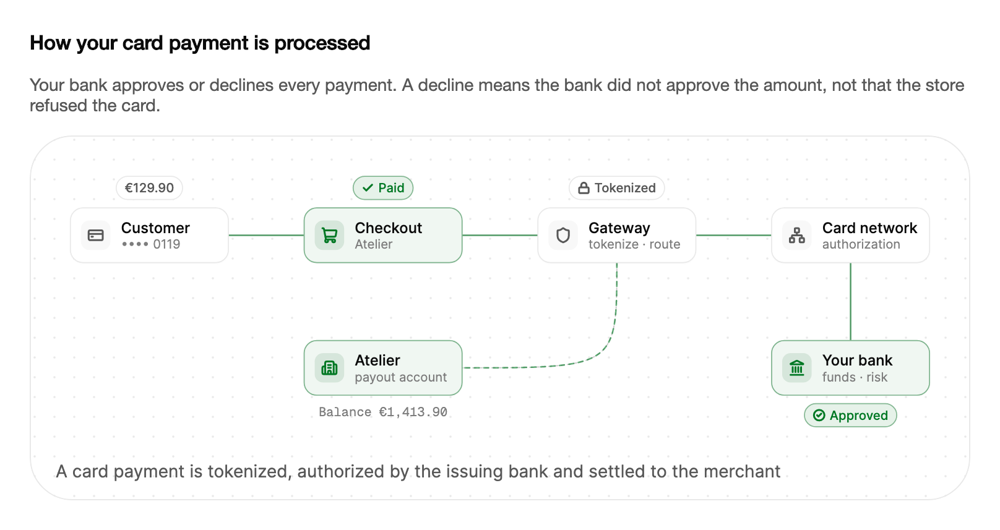

<Demo name="CardPayment" />

## 何时使用

`PaymentFlow` 说明客户点击“付款”到商户收到资金之间发生的事情。它描绘一笔银行卡付款的路径：结账、对银行卡进行令牌化的支付网关、卡组织网络、负责批准或拒绝的发卡行、沿原路返回的响应，以及结算到商户账户。它适用于结账帮助页、支付文档和入驻页面，读者需要了解付款为何会被批准或拒绝，以及资金何时到账。

- **被拒绝银行卡的结账帮助**：结账页上解释拒付原因的帮助文章。图示表明决定是由发卡行作出的，因此客户知道应联系银行或更换另一张卡。
- **支付服务商的接入文档**：面向开发者的指南，展示接入时配置的金额、币种和商户，以及令牌化与授权步骤发生的位置。
- **商户入驻中的结算时间**：说明已批准的资金何时到达商户收款账户的页面。结算路径与余额读数无需时间表，就能展示事件的先后顺序。
- **销售或客服培训**：为回答“为什么我的卡被拒绝”的客服人员准备的简短说明，拒绝路径以危险色显示。
- **定价页上的产品宣传**：一项端到端处理银行卡付款的功能的示意图，放在支付方式说明的旁边。

## 何时不用

- **输入付款金额或银行卡信息**：客户输入的金额用 `MoneyInput`，银行卡字段用表单。`PaymentFlow` 只演示流程，没有输入功能。
- **绘制付款总额随时间的变化**：营收、交易量或拒付率用图表分类中的 `BarChart` 或 `LineChart`。插图中的余额读数只为故事服务，不是你的账本。
- **真实付款的实时状态**：付款失败用 `Alert`，状态用 `Badge`，单笔交易的事件用 `Timeline`。循环播放的插图无法告诉读者某笔付款仍在等待处理。
- **历史付款列表**：用 `DataGrid` 展示金额、日期和拒付代码。单个动画示例无法替代可搜索的历史记录。
- **客户需要完成的多步结账**：结账本身的步骤用 `Stepper`。`PaymentFlow` 展示客户点击付款之后发生的事情，不接收输入。

## 用法

故事会依次播放每一笔付款。图示下方的说明文字描述当前步骤，每笔获批的付款都会让商户余额增加。该控件运行时无需数据，默认使用金额 42、商户 Northwind 以及尾号 4242 的银行卡。

```xml
<UserControl xmlns="https://github.com/avaloniaui"
             xmlns:arc="https://github.com/AtomUICommunity/TKCode.Arc">
    <arc:PaymentFlow />
</UserControl>
```

`PaymentFlow` 派生自 `Illustration`，而 `Illustration` 派生自 Avalonia 的 `TemplatedControl`。它可以获得焦点，带有供辅助技术使用的 `Label`，并与其他系统插图使用相同的外框、说明文字和播放按钮。每笔付款都是场景时钟上的固定序列，因此相同的输入总会产生相同的故事；发卡行作出的决定，在动画播放到之前控件就已经知道。

### 结构

1. **客户**（`Labels.Customer`）：左上角的银行卡。其详情行显示后四位数字，例如“•••• 4242”；付款开始时，上方的金额徽标会显示金额。
2. **结账**（`Labels.Checkout`）：商户的结账环节，详情行显示商户名称（`MerchantName`）。发送银行卡信息时变为强调色，付款结束时变为成功色或危险色。
3. **网关**（`Labels.Gateway`、`Labels.GatewayDetail`）：对银行卡进行令牌化的支付网关。网关持有令牌期间，其上方会出现带锁形图标的“已令牌化”徽标。
4. **卡组织网络**（`Labels.Network`、`Labels.NetworkDetail`）：承载授权请求的网络。
5. **发卡行**（`Labels.Issuer`、`Labels.IssuerDetail`）：位于卡组织网络下方的银行。核对资金和风险时，其忙碌圆环会开始转动；下方的徽标会显示“已通过”或“已拒绝”及对应图标。
6. **商户账户**（`Labels.Merchant`、`Labels.MerchantDetail`）：位于结账下方的收款账户。其下方的余额读数（`Labels.Balance`）以币种显示金额，每次结算都会出现“+ 金额”徽标。
7. **结算线**：一条从网关出发、向左转并连到商户账户的虚线。只有获批的付款才会沿它输送资金。
8. **说明行**与**播放按钮**：与其他插图相同的控件。静态海报中会隐藏按钮。

场景尺寸为 844 × 270 单位，会按控件给定的宽度缩放。节点尺寸为 150 × 52 单位，圆角半径为令牌中的 12 px；外框两侧和顶部的内边距为 20 px，底部为 14 px。请求在每条连接的上方通道传输，响应在下方通道返回，因此两者不会重叠。

### 金额、币种与商户

`Amount` 为 `decimal` 类型，默认值为 42。`Currency` 为 ISO 币种代码，默认值为 USD；为空时回退为 USD。`MerchantName` 设置结账时显示的商户名称，`CardLast4` 显示银行卡号的后四位。

插图会按币种格式化金额。USD、EUR 和 GBP 显示符号并保留两位小数；JPY 和 KRW 显示符号且不保留小数；CNY 和 INR 显示符号并保留两位小数；其他代码则显示 ISO 代码，并在金额前加一个空格，例如“CHF 42.00”。数字会使用千分位分组，并始终采用不变文化（invariant culture），因此“1,284.00”在任何机器上显示一致。

<Demo name="AmountAndMerchant" />

```xml
<arc:PaymentFlow Amount="129.90"
                 Currency="EUR"
                 MerchantName="Atelier"
                 CardLast4="0119"
                 DeclineEvery="0" />
```

`Amount` 和 `Currency` 应取自结账实际收取的同一订单，这样图示上的徽标金额与客户看到的金额一致。图示不做币种换算；即使商户账户持有另一种币种，余额读数也使用 `Currency` 的币种。

### 拒绝

`DeclineEvery` 每隔 N 笔付款拒绝一笔。默认值为 4，因此故事中的第 4、第 8 和第 12 笔付款会被拒绝。设为 0 则批准每一笔付款；设为 1 则拒绝每一笔付款。负值视为 0。

```xml
<arc:PaymentFlow DeclineEvery="0" />
```

被拒绝的付款与通过的付款沿同一路径到达发卡行。发卡行的徽标以危险色显示“已拒绝”，响应沿下方通道返回，说明文字解释拒绝原因：“已拒绝：余额不足”。结算线不会亮起，商户余额也不会变化，故事会停在提示客户更换另一张卡的那一步。

### 标签

`Labels` 接受一个 `PaymentFlowLabels` 对象，其中包含图示中所有可见的文字：节点名称与详情、徽标（`Approved`、`Declined`、`Paid`、`Payment failed`、`Tokenized`）以及各步骤的说明。付款开始时的说明由 `Pay` 生成，它接收格式化后的金额和商户名称，因此新标签可以同时使用这两个值。

```csharp
var payment = new PaymentFlow
{
    Amount = 19.00m,
    Labels = new PaymentFlowLabels
    {
        Merchant = "商店",
        Issuer = "发卡行",
        Approved = "已通过",
        Declined = "已拒付"
    }
};
```

标签应保持简短。节点卡片在一行中可容纳约 16 个字符，徽标与卡片位于上方和下方，宽度相同。

### 响应决定

发卡行对付款作出决定时会触发 `PaymentCompleted`。其参数 `PaymentCompletedEventArgs` 包含 `Approved` 标志和该笔付款的 `Amount`。`PaymentCount` 给出故事开始后已作出决定的付款笔数，`Balance` 给出商户余额。

```csharp
payment.PaymentCompleted += (_, e) =>
    log.Text = $"{(e.Approved ? "已通过" : "已拒绝")} {e.Amount:0.00} · 余额 {payment.Balance:0.00}";
```

`Balance` 会在结算到达商户时才增加，这比作出决定的时间晚。在 `PaymentCompleted` 处理程序内部，`Balance` 仍显示本笔付款之前的余额。如果日志需要在决定的那一刻显示新余额，应在后续步骤读取它，或在 `Approved` 为 true 时自行加上金额。

### 播放

`IsPlaying` 用于播放和暂停故事，`Speed` 缩放播放速度（0.25 到 4），`Restart()` 从第一步重新开始，并将商户账户恢复为开始时的余额 1,284。`Step`、`StepCount` 和 `StepChanged` 跟踪一笔付款的各个步骤。故事共有七个步骤；被拒绝的付款会停在第 5 步，因为结算步骤只对获批的付款运行。

| 步骤 | 说明 | 显示内容 |
|---|---|---|
| 0 | 客户在 Northwind 支付 $42.00（格式化后的金额与商户） | 客户上方的金额徽标 |
| 1 | 银行卡信息在支付网关完成令牌化 | 请求先到达结账，再到达网关 |
| 2 | 授权请求发往发卡行 | 网关徽标显示“已令牌化”；请求穿过卡组织网络 |
| 3 | 发卡行核对资金与风险 | 发卡行的忙碌圆环开始转动 |
| 4 | 已通过：响应返回；或已拒绝：余额不足 | 发卡行的徽标，以及下方通道上的响应 |
| 5 | 订单已确认，或请客户更换另一张卡 | 结账显示“已付款”或“付款失败” |
| 6 | 资金结算至商户账户（仅限获批的付款） | 虚线结算线与余额读数 |

```xml
<arc:PaymentFlow Speed="0.5" IsPlaying="False" />
```

一笔付款约占 8.4 秒的场景时间，因此故事以默认速度播放时，每笔付款略少于 9 秒。当页面只讲解一笔付款，而动画会与文字争抢注意力时，应使用 `IsPlaying` 停止故事。

### 绑定到视图模型

在结账页面中，订单拥有金额、币种和商户，插图只负责展示。绑定应为单向：控件从不把金额或币种写回。`IsPlaying` 是插图唯一的双向属性。`PaymentCompleted` 事件不是绑定目标，因此应在代码后置文件中订阅它，并把决定转发给视图模型。

```csharp
public partial class CheckoutViewModel : ObservableObject
{
    [ObservableProperty]
    private decimal _orderTotal = 129.90m;

    [ObservableProperty]
    private string _currency = "EUR";

    [ObservableProperty]
    private string _merchantName = "Atelier";

    [ObservableProperty]
    private string _cardLast4 = "0119";

    [ObservableProperty]
    private int _declinedCount;

    public void RecordDecision(bool approved)
    {
        if (!approved)
        {
            DeclinedCount++;
        }
    }
}
```

```xml
<arc:PaymentFlow Amount="{Binding OrderTotal}"
                 Currency="{Binding Currency}"
                 MerchantName="{Binding MerchantName}"
                 CardLast4="{Binding CardLast4}"
                 DeclineEvery="0" />
```

在代码后置文件中订阅事件，此时可以访问视图模型：

```csharp
public CheckoutView()
{
    InitializeComponent();
    Payment.PaymentCompleted += OnPaymentCompleted;
}

private void OnPaymentCompleted(object? sender, PaymentCompletedEventArgs e)
{
    ViewModel.RecordDecision(e.Approved);
}
```

订单已有的值应使用绑定；插图的拒绝循环只用于演示。展示真实订单的结账页面，不应把动画中的拒绝循环当作该订单的结果来显示。

### 减弱动效

在减弱动效（或关闭）下，插图是获批路径的静态画面。每条连接都以成功色点亮，发卡行与结账显示成功状态，金额徽标位于客户上方，余额读数显示开始时的余额加上金额。播放按钮会隐藏。当页面只需说明获批路径而不需要整个序列时，使用静态画面。

<Demo name="ReducedMotion" />

### 示例：银行卡付款的结账帮助

某设计用品商店结账页面上的帮助文章。订单为 Atelier 的 129.90 EUR，银行卡尾号为 0119，插图以静态画面展示获批路径，因此读者看到的是一笔正常付款。文字解释发卡行可以作出的两种决定，以及读者唯一可以采取行动的地方，即银行卡。标签在有助于理解的地方保留商户自己的措辞，币种也与客户付款时使用的一致。



```xml
<StackPanel Width="760" Spacing="16">
    <TextBlock Text="How your card payment is processed"
               FontSize="16"
               FontWeight="SemiBold"
               Foreground="{arc:ArcDesignTokenResource Foreground}" />
    <TextBlock Text="Your bank approves or declines every payment. A decline means the bank did not approve the amount, not that the store refused the card."
               TextWrapping="Wrap"
               Foreground="{arc:ArcDesignTokenResource TextSecondary}" />
    <arc:PaymentFlow Label="Card payment of 129.90 EUR at Atelier"
                     Amount="129.90"
                     Currency="EUR"
                     MerchantName="Atelier"
                     CardLast4="0119"
                     DeclineEvery="0">
        <arc:PaymentFlow.Labels>
            <arc:PaymentFlowLabels Issuer="Your bank"
                                   IssuerDetail="funds · risk"
                                   Merchant="Atelier"
                                   MerchantDetail="payout account"
                                   Approved="Approved"
                                   Declined="Declined"
                                   Paid="Paid" />
        </arc:PaymentFlow.Labels>
    </arc:PaymentFlow>
</StackPanel>
```

截图是获批路径的静态画面，因此显示的是最终状态下的徽标和余额读数。除非页面设置了减弱动效，实时控件会播放完整的序列。

### 文案规范

按读者在对账单或收据上看到的方式称呼各方：商户、卡组织网络，以及发卡行统一称为“您的银行”。金额应带上币种并保留两位小数；决定性的用词只使用银行实际表达的内容。说明文字使用现在时，描述付款的状态，而不是描述公司的流程。

| 不要写 | 改为 |
|---|---|
| 付款处理成功 | 已通过 |
| 您的银行卡已被拒绝 | 已拒绝：余额不足 |
| 交易编号已验证 | 银行卡信息已在支付网关完成令牌化 |
| 款项已发送给商户 | 资金结算至商户账户 |
| 129 EUR | EUR 129.90 或 129.90 EUR，依页面的区域设置决定 |
| 客户已成功扣款 | 已付款 |

未结算的授权不要使用“扣款”一词；被拒绝的付款也不要说“退款”：没有扣款，就不需要退还。标签应简短，说明文字限定为一句话。

### 最佳实践

**推荐**

- 展示订单所使用的金额、币种和商户，使图示与客户正在阅读的页面一致。金额不一致会让帮助文字看起来像是在描述另一笔付款。
- 在页面上说明决定是由银行作出的。图示把发卡行标示为作出决定的一方，读者因此不会怪罪商店。
- 介绍正常付款的页面保留获批路径；只在演示中使用拒绝循环，避免读者看到一笔正常订单的拒付。
- 当页面讲解的是读者已经完成的一笔付款时，用 `IsPlaying` 停止故事，因为同一画面中的循环动画会分散读者对收据的注意力。

**避免**

- 把这段序列当作真实结算的时间表。故事约占 8.4 秒的场景时间，结算步骤只表示先后顺序。真实结算需要数天，并取决于服务商。
- 把发卡行标示为你的公司。发卡行是客户的银行，图示中若写上你的公司，就表达了你无法得知的信息。
- 从插图中统计拒付笔数。`PaymentCount` 和 `Balance` 只统计故事中的数据，若页面把它们当作销售数字展示，报出的数字与你的账本毫无关系。
- 仅用图示来解释拒绝原因。应以文字告诉客户拒绝原因和下一步操作，因为图示并不说明触发了哪条银行规则。

### 常见问题

**为什么 `PaymentCompleted` 处理程序中的 `Balance` 不包含本笔付款？** 作出决定发生在结算到达商户账户之前，只有结算款项抵达时余额才会增加。应在后续步骤读取 `Balance`，或在获批的决定之后自行加上金额。

**能让某个订单显示拒绝吗？** 不能。`DeclineEvery` 统计的是故事中的付款，控件无法接收某个特定订单的决定。若要解释真实订单的拒绝，应使用 `Alert`，或在表单旁边给出银行的拒绝原因。

**按下按钮后如何重新开始故事？** 调用 `Restart()`。它会从第一步重新开始，余额回到开始时的 1,284，拒绝计数器也会重置，因此下一笔付款会按默认循环获批。

**为什么 CHF 显示代码而不是符号？** 插图对 USD、EUR、GBP、JPY、CNY、INR 和 KRW 使用符号。其他币种显示 ISO 代码，并在金额前加一个空格，这样就不会去猜测客户可能不认识的符号。

**能把标签改成其他语言吗？** 可以。将 `Labels` 设为一个 `PaymentFlowLabels` 对象，并填入你自己的字符串。`Pay` 和 `Balance` 是接收格式化值的函数，因此参数的数量应与默认值保持一致。

## API 参考

<!-- api: PaymentFlow -->

<!-- api: PaymentFlowLabels -->

`PaymentCompleted` 传递一个 `PaymentCompletedEventArgs`，包含以下成员。

| 成员 | 类型 | 含义 |
|---|---|---|
| `Approved` | `bool` | 发卡行是否批准了该笔付款 |
| `Amount` | `decimal` | 该笔付款的金额，即作出决定时设置的 `Amount` |

## 无障碍

- `Label` 是插图的无障碍名称。请在其中写明流程，例如“订单金额 129.90 EUR 的银行卡付款”，这样屏幕阅读器用户在朗读说明之前就知道图示讲的是什么。
- 插图可以获得焦点，获得焦点时外框周围显示 2px 的焦点环。
- 当前说明作为帮助文本公开，因此控件获得焦点时会读出该步骤的描述。
- 说明文字的变化不会被播报，屏幕阅读器用户不会因为同一笔付款每隔几秒重复一次而受到干扰。
- 决定以文字表达，而不只靠颜色：发卡行的徽标显示“已通过”或“已拒绝”，结账显示“已付款”或“付款失败”。看不到颜色的读者仍能得知结果。
- 在减弱动效下，静态画面显示获批路径，并带有文字徽标和总结性说明。

### 键盘

插图可通过 Tab 获得焦点。获得焦点后，以下按键可控制故事：

| 按键 | 操作 |
|---|---|
| `Tab` / `Shift+Tab` | 将焦点移入或移出插图 |
| `Space` 或 `Enter` | 播放或暂停故事 |
| `R` | 从第一步和开始时的余额重新播放故事 |

插图不提供为某笔付款选择决定的方式。若要按需展示拒绝，请设置 `DeclineEvery` 或保留默认循环，并在周围的文字中说明该循环。

## 动效

- 金额在客户上方浮现，银行卡信息传送至网关，请求穿过卡组织网络到达发卡行。
- 发卡行的决定以绿色的“已通过”或红色的“已拒绝”徽标显示，响应沿下方通道返回。
- 获批的付款沿虚线结算至商户账户，余额读数随之增加。
- 减弱动效和关闭动效下，显示获批路径的静态画面，带有“已通过”和“已付款”徽标。播放按钮会隐藏。

| 变化 | 完整 | 减弱 | 关闭 |
|---|---|---|---|
| 金额与请求传输 | 每条路径上有动态数据包，金额徽标位于客户上方 | 获批路径的静态画面 | 获批路径的静态画面 |
| 网关与发卡行状态 | “已令牌化”徽标弹出；发卡行的圆环在核对时转动 | 以最终状态显示 | 以最终状态显示 |
| 决定 | 徽标弹出，响应沿下方通道返回 | 已通过徽标与成功路径 | 已通过徽标与成功路径 |
| 结算与余额 | 虚线延伸至商户；读数变为新余额 | 读数显示开始余额加上金额 | 读数显示开始余额加上金额 |
| 播放按钮 | 可见；切换播放状态 | 隐藏 | 隐藏 |

## 相关组件

- `DataFlow`：付款完成后存储事件的管道。
- `MultiRegionFailover`：区域故障时保持支付服务可用。
- `Stepper`：用户依次经过的固定步骤序列。

| 组件 | 适用场景 |
|---|---|
| `MoneyInput` | 客户输入的金额需要解析和格式化 |
| `Alert` | 需要以文字说明付款失败或服务中断 |
| `Timeline` | 按时间顺序展示一笔真实交易的事件 |
| `DataGrid` | 列出包含金额、日期和拒付代码的历史付款 |
| `BarChart` / `LineChart` | 绘制随时间变化的营收、交易量或拒付率 |
| `Stepper` | 用户依次经过结账的各个步骤 |
| `MultiRegionFailover` | 内容讲的是某个区域故障，而服务依然可用 |
