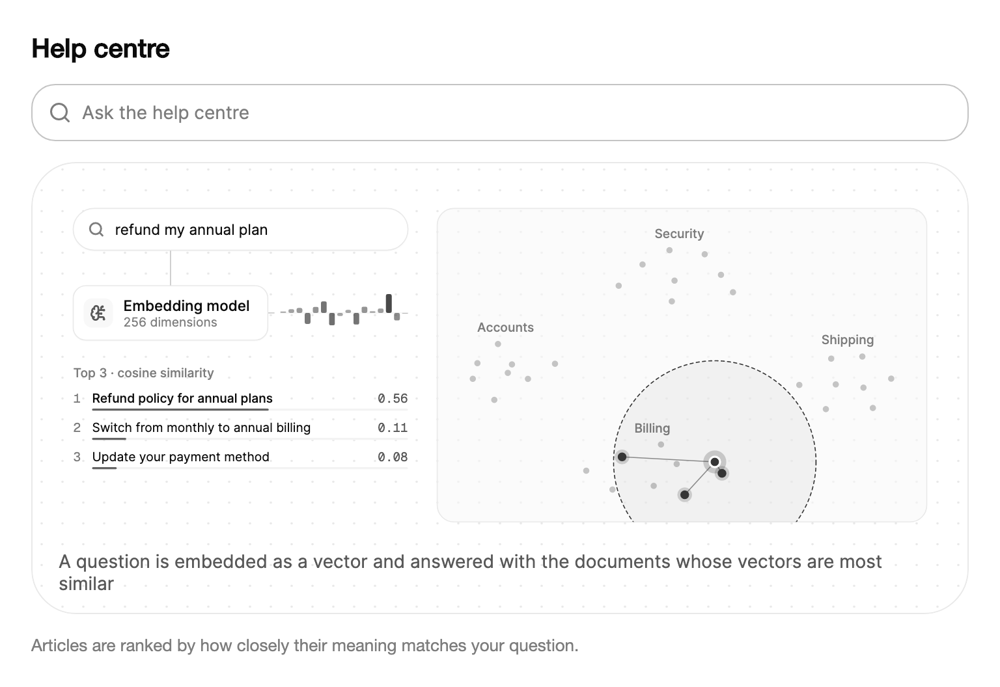

<Demo name="HelpCentreSearch" />

## 何時使用

`VectorSearch` 是語意搜尋的動畫插圖。它逐字輸入一個問題，將其轉換為向量，把它放在文件向量的地圖上，並把離它最近的文件作為排好名次的答案列出。將它放在說明搜尋功能的文字旁邊，讀者就能看到：為什麼一個與文件沒有任何相同字詞的問題，仍然能比對到這篇答案。

- **帳單產品的說明中心首頁**：訪客問「為什麼我被扣了兩次費」，看到關於重複付款的文章排在第一，儘管用字並不相同。這張圖在訪客使用真正的搜尋框之前就先建立了預期。
- **AI 輔助客服主控台的新手導覽**：新的客服人員看到助理如何選擇建議的文章，從而建立對排名的信任，並理解為什麼換一種問法會改變答案。
- **資料分析工作區的產品導覽**：介紹「用白話問你的資料」的導覽步驟，展示一個普通問題如何找到與之相關的已儲存報表。
- **搜尋功能的開發者文件**：一篇關於嵌入、餘弦相似度與 top-k 結果的教學，用即時地圖與排名清單作為旁邊文字的參考圖。
- **知識庫作者培訓**：排名清單及其相似度分數向作者展示哪些標題與關鍵字能夠相符，使他們可以改進排名靠後的文章。

## 何時不用

- **回答真實客戶的問題**：內建索引使用雜湊字詞與字元三元組，而不是經過訓練的模型，因此它只是教學工具。請使用你自己的搜尋服務，並用 `SearchField` 呈現其結果。
- **精確查詢或帶篩選條件的查詢**：發票號碼、訂單 ID 或日期範圍需要帶篩選的精確索引。請使用 `SearchField` 進行一般查詢，而不是相似度排名。
- **繪製真實量測值**：地圖是文字相似度的二維投影，沒有單位與座標軸。對於使用者需要比較的數值，請使用 `LineChart` 或 `BarChart`。
- **使用者據以採取行動的長結果清單**：排名、分數與文件中繼資料以欄的形式呈現時，更便於在 `SortableDataTable` 中瀏覽、排序與匯出。
- **說明流程而非搜尋**：當圖片應展示文件如何被收集、驗證與儲存時，請使用 `DataFlow`，它正是為這類敘述而設計的。
- **資訊密集的儀表板，或包含多個動畫圖片的頁面**：每個插圖在播放時都會每一影格重繪其畫布。請改用 `Card` 搭配簡短的靜態說明。

## 用法

```xml
<UserControl xmlns="https://github.com/avaloniaui"
             xmlns:arc="https://github.com/AtomUICommunity/TKCode.Arc">
    <arc:VectorSearch />
</UserControl>
```

`VectorSearch` 衍生自 `Illustration`，而 `Illustration` 衍生自 `TemplatedControl`。基底類別在場景時鐘上循環播放故事，為控制項提供焦點，加入播放與暫停按鈕以及說明文字列，並在故事於四個步驟之間推進時觸發 `StepChanged`。當控制項位於螢幕之外、被隱藏或已從視覺樹中分離時，時鐘會暫停，因此位於首屏以下的故事在捲動進入視野之前不會耗用任何資源。`VectorSearch` 則負責搜尋本身：它為文件建立記憶體中的索引，嵌入每個問題，依餘弦相似度對文件排序並繪製結果。預設故事會循環三個範例問題，因此一個控制項就能展示從問題到答案的完整過程。

### 結構

圖示繪製在一塊畫布上，畫布會依控制項所給的寬度縮放，因此下列比例在任何尺寸下都成立。外框的內距在兩側與頂部為 20 px，底部為 14 px。

1. **查詢框**（執行時為 `Query`）：左上角的問題，逐字元輸入並帶有游標。
2. **嵌入模型節點**（`Labels.Model`，其下方為 `Labels.ModelDetail`）：帶有大腦圖示的卡片。模型處理問題時，它會顯示忙碌圓環。
3. **向量條**：16 個儲存格，以整個向量的固定投影來顯示問題的向量。儲存格根據查詢的真實嵌入填滿，因此同一個問題總是以相同方式填滿。
4. **文件地圖**：每個文件是一個點，依其 `Topic` 分組，主題名稱以淡色繪製在群組內。查詢是一個點，放置在其最近的文件之間，並有一個圓環延伸到最遠的答案。
5. **結果清單**：標題（`Labels.Header`，預設為 "Top 3 · cosine similarity"），之後每個答案一列，包含排名、標題、保留兩位小數的相似度分數以及一條長條。在一列中放不下的標題會以省略號截斷，保持單行顯示。
6. **說明文字列**（`Caption`）：圖示下方一行，使用次要文字顏色與小號字體，說明目前的步驟。使用 `IsCaptionVisible="False"` 可將其隱藏。
7. **播放按鈕**（`IsPlaybackButtonVisible`）：位於右下角、直徑 28 px 的幽靈圓形按鈕，在播放與暫停圖示之間切換。靜態畫面下它會隱藏。
8. **外框**：Surface 卡片，帶有 1 px 的邊框線、表面圓角以及點狀背景。當控制項取得鍵盤焦點時，外框周圍會出現焦點色的 2 px 焦點環。

節點卡片的圓角為 12 px。所有顏色都來自 ArcDesign 權杖（表面、邊框、文字、強調色與狀態色），因此該控制項無需任何顏色設定即可跟隨淺色與深色主題。

### 答案數量

`TopK` 設定清單顯示的答案數量。該值被限制在 1 到 5 之間，預設為 3。清單始終是最佳答案排在最前，地圖會把圓環畫到最遠的答案，並限制在 110 個場景單位內，以免一個離群值佔滿整張地圖。

```xml
<arc:VectorSearch TopK="4" />
```

在說明頁面上使用 3。它適合閱讀欄的寬度，最佳相符結果會從其餘答案中脫穎而出。只有當清單本身就是講解的重點時才使用 5，因為每增加一個答案，圓環都會變大。變更 `TopK` 會重建場景，因此請在頁面建立時一次設定，而不是在每次互動時修改。

### 你自己的文件與問題

`Documents` 接受 `VectorSearchDocument` 值。該記錄有三個部分：`Title` 是結果清單顯示的文字，`Topic` 將文件歸入地圖上的群組並為其叢集加上標籤，`Keywords`（選用）為文件的嵌入增加字詞，但不會顯示出來。`Queries` 接受故事循環播放的問題。兩者一旦設定（且至少包含一項），就會取代預設值。

<Demo name="YourDocuments" />

```csharp
search.Documents =
[
    new VectorSearchDocument("取消並退款年度方案", "帳單", "退款 退錢 取消"),
    new VectorSearchDocument("重設雙因素驗證", "安全", "手機 遺失 新裝置"),
    new VectorSearchDocument("追蹤延誤的包裹", "物流", "快遞 延誤 包裹"),
];
search.Queries = ["怎樣把錢退回來", "我的手機不見了"];
```

標題應寫成讀者會點擊的答案，並把讀者真正會輸入的字詞放入 `Keywords`。關鍵字也計入比對，因此標題可以簡短樸素。主題名稱要少而寬泛（四到六個較為合適）：每個主題都會在地圖上形成一個叢集，叢集過多、過小會讓地圖難以閱讀。

### 搜尋某個問題

`Search(query)` 會立即顯示一個問題：它取消已排定的步驟，嵌入該問題並開始其故事。空白或僅含空白字元的字串不會產生任何作用。在該問題的答案呈現之後，故事會繼續播放 `Queries` 中的問題。`Query` 是螢幕上顯示的問題，`Results` 保存其答案（最佳者在前），每當某個問題的答案確定時都會觸發 `ResultsChanged`，包括故事自行播放的問題。

<Demo name="AskYourOwn" />

每個 `VectorSearchResult` 都有 `Document`、`Score`（餘弦相似度，範圍從 −1 到 1）和 `Rank`（1 表示最相符）。`Results` 是一般屬性，不會發出變更通知，因此請在 `ResultsChanged` 處理常式中讀取它，而不要將其繫結。

### 標籤

`Labels` 接受一個 `VectorSearchLabels` 物件，用於設定可見的文字：模型名稱及其詳細說明列、清單標題，以及四個步驟的說明文字（`Typing`、`Embedding`、`Comparing` 與 `Answers`）。其 `Summary` 是靜態畫面的說明文字。請整體取代該物件來變更文字，因為標題與模型節點是在建立場景時讀取的。

```csharp
search.Labels = new VectorSearchLabels { Model = "文字模型", Header = k => $"最佳 {k} 個相符結果" };
```

### 播放、速度與說明文字

插圖預設自動播放。`IsPlaying` 為雙向繫結：可以繫結到頁面上顯示的切換開關，也可以呼叫 `Play()` 和 `Pause()`。`Restart()` 從第一步重新開始故事。本頁頂部的預覽使用了速度按鈕，同樣的設定在程式碼中也可以使用。

| 成員 | 用途 |
|---|---|
| `Speed` | 縮放故事時鐘，範圍從 0.25 到 4（預設 1）。講解每個步驟的導覽可以放慢，預告片則可以加快。 |
| `IsCaptionVisible` | 當頁面已在正文中說明各步驟時，隱藏說明文字列。 |
| `IsPlaybackButtonVisible` | 在必須保持靜止的頁面上，隱藏播放與暫停按鈕。 |
| `Caption` 與 `Step` | 讀取目前的說明文字及其步驟（0 到 3）。這些唯讀值同時也為無障礙說明文字提供依據。 |
| `StepChanged` | 回應每個步驟，例如在圖片旁的文字中高亮對應的句子。 |
| `Label` | 為輔助技術為插圖命名（預設為 "Vector search illustration"）。 |

### 減少動態效果

在減少動態效果下，插圖是第一個問題答案的靜態畫面。說明文字概括整個故事，播放按鈕隱藏，游標也不再閃爍。請在控制項上設定動態效果等級（如示範所示），或在持有頁面動態效果設定的上層元素上設定。

<Demo name="ReducedMotion" />

### 節制地使用動態效果

當讀者需要看清一條路徑時，故事會有所幫助：問題變成向量，向量找到它的鄰居，鄰居成為答案。請將其放在讀者有時間看完一個問題的頁面上，在一倍速的完整動態效果下，一個問題大約需要 6.5 秒。當它位於表單、結帳步驟或即時儀表板旁邊時，就會分散注意力，因為視線應停留在讀者正在填寫的欄位上。每頁最多放置一兩個插圖，並且只在圖片位於螢幕上時才讓故事執行。時鐘本身已經會在螢幕外暫停，因此長頁面不會為讀者尚未看到的插圖付出代價。

### 繫結到檢視模型

在 MVVM 應用程式中，檢視模型持有文件與問題，控制項只負責顯示它們。下面的檢視模型使用 CommunityToolkit.Mvvm。控制項的 `Documents`、`Queries`、`TopK` 與 `Labels` 都是單向輸入：新值會重建索引與地圖。`IsPlaying` 是唯一的雙向值。

```csharp
public partial class HelpCentreViewModel : ObservableObject
{
    [ObservableProperty]
    private IReadOnlyList<VectorSearchDocument> _articles = [];

    [ObservableProperty]
    private IReadOnlyList<string> _sampleQuestions = [];

    [ObservableProperty]
    private string _topMatchTitle = string.Empty;

    [ObservableProperty]
    private bool _isStoryPlaying = true;

    public void Load()
    {
        // 指派新清單會觸發 PropertyChanged，因此控制項只會重建一次索引。
        Articles =
        [
            new VectorSearchDocument("取消並退款年度方案", "帳單", "退款 退錢 取消"),
            new VectorSearchDocument("重設雙因素驗證", "安全", "手機 遺失 新裝置"),
            new VectorSearchDocument("追蹤延誤的包裹", "物流", "快遞 延誤 包裹"),
        ];
        SampleQuestions = ["怎樣把錢退回來", "我的手機不見了"];
    }
}
```

```xml
<arc:VectorSearch Documents="{Binding Articles}"
                  Queries="{Binding SampleQuestions}"
                  IsPlaying="{Binding IsStoryPlaying, Mode=TwoWay}"
                  TopK="3"
                  Label="說明中心搜尋插圖" />
```

`Search` 是方法，`Results` 是一般屬性，因此它們留在程式碼後置中。在 `ResultsChanged` 處理常式中將最佳相符結果轉交給檢視模型，並在頁面搜尋框的處理常式中呼叫 `Search`：

```csharp
// 在承載該控制項的檢視之程式碼後置中。
Search.ResultsChanged += (_, _) =>
{
    ViewModel.TopMatchTitle = Search.Results.Count > 0 ? Search.Results[0].Document.Title : string.Empty;
};

private void OnAskSubmitted(object? sender, SearchSubmittedEventArgs e)
{
    Search.Search(e.Query);
}
```

### 資料結構與效能

- **資料項模型**：`VectorSearchDocument` 是由 `Title`、`Topic` 與 `Keywords` 組成的記錄。索引在建立時為每個文件嵌入一次。每個問題在被搜尋時嵌入，因此一次提問只需一次嵌入與一輪對文件的排序計算。
- **規模**：預設索引包含四個主題下的 32 篇說明中心文章。索引位於記憶體中，沒有分頁或持久化。地圖會對文件集執行固定次數（300 次）的應力最小化迭代。只有在文件變動時才會重新計算，每次提問並不會重算。該插圖是為教學規模的索引而設計的：擁有數千篇文章的真實說明中心應使用你的搜尋服務，而本控制項用於說明其運作原理。
- **更新**：取代 `Documents`、`Queries`、`TopK` 或 `Labels` 會重建場景。原地修改清單中的項目不會觸發重建，因為控制項並不監看清單本身。請用新的清單取代它。
- **格式**：排名與分數文字使用不變文化並保留兩位小數（例如 "0.87"），因此數字在任何地區設定下都顯示一致。請透過 `Labels` 翻譯文字，而不是數字。

### 範例：帳單問題的說明中心搜尋

某訂閱產品的說明中心首頁。搜尋框請訪客輸入一個問題，其下方的插圖說明文章是如何排名的。文字簡短，並說明圖片的含義；搜尋框的預留位置文字展示了應提問的類型；插圖保留預設故事，因此讀者能看到三個不同的問題分別比對到三個不同的主題。720 px 的寬度適合桌面頁面上的閱讀欄，並且外框在任何寬度下都保持其內距。



```xml
<StackPanel Width="720" Spacing="16">
    <TextBlock Text="Help centre"
               FontSize="20"
               FontWeight="SemiBold"
               Foreground="{arc:ArcDesignTokenResource Foreground}" />
    <arc:SearchField Placeholder="Ask the help centre" />
    <arc:VectorSearch TopK="3" />
    <TextBlock Text="Articles are ranked by how closely their meaning matches your question."
               FontSize="13"
               TextWrapping="Wrap"
               Foreground="{arc:ArcDesignTokenResource TextMuted}" />
</StackPanel>
```

### 文案規範

- **標籤**：說明圖片展示的內容，採句首大寫：「說明中心搜尋插圖」，而不是「Vector search」。螢幕閱讀器會先讀它，因此它應在沒有圖片的情況下也說得通。
- **說明與標題**：面向讀者書寫，而不是面向數學。預設標題使用了「餘弦相似度」一詞，適合開發者。面向客戶的頁面通常會說明這個數字的含義。
- **文件標題**：寫成讀者會點擊的答案，採句首大寫，並讓標題短到能放進結果清單的一列。讀者使用的同義詞與錯別字應放入 `Keywords`。
- **主題**：一個簡短的名詞，採句首大寫，與導覽所用的字詞一致：「帳單」「安全」「物流」。

| 不要寫 | 改為 |
|---|---|
| Top 3 · cosine similarity | 最佳 3 個相符結果 |
| Vector search illustration | 說明中心搜尋插圖 |
| Embedding model | 文字模型 |
| Query | 問題 |
| The vector is compared with 32 document vectors | 正在比對 32 篇文章 |

### 最佳做法

**建議**

- 將插圖放在真實搜尋框旁邊，使讀者能把圖片與自己的問題連結起來。插圖說明的是排名方式，它並不替頁面執行搜尋。
- 在說明頁與行銷頁上將 `TopK` 維持為 3。簡短的清單能適應版面，也便於看清最佳相符結果。
- 將讀者會輸入的字詞放入 `Keywords`。它們能改善比對，又不會讓讀者看到的標題變得雜亂。
- 當頁面需要無障礙支援時，透過 `Results` 以文字形式提供相同的答案，放在讀者可以閱讀與瀏覽的清單中。繪製的清單本身並不是無障礙清單。

**避免**

- 將內建排名當作你的產品搜尋品質。嵌入是雜湊字詞與三元組，因此這些範例是在說明方法，而不是衡量你的內容。
- 在同一螢幕上放置多個故事插圖。每個插圖在播放時都會逐影格重繪畫布，頁面會變得沉重，讀者也無法同時跟隨一個以上的故事。
- 在文件清單中原地編輯項目。控制項只在清單被取代時才會重建，因此地圖與結果仍保留舊的文件。
- 依賴完整文字的長標題。結果清單會以省略號將長標題截斷為一行，因此重要的字詞必須放在前面。

### 常見問題

**故事執行時呼叫 `Search` 會怎樣？** 已排定的步驟會被取消，問題會立即顯示。隨後故事會從當時的位置繼續播放 `Queries` 清單，因此單次搜尋不會讓循環重新開始。

**為什麼新增一個文件後地圖會移動？** 地圖是根據所有文件同時配置的，因此新增一個文件會改變其他文件的位置。排名則不會以同樣的方式改變：答案的順序只取決於問題與每個文件之間的餘弦相似度。

**哪些字詞會計入比對？** 字詞會被轉為小寫，「the」「my」「how」等常見字會被去掉，複數以及 `-ing`、`-ed` 字尾會被截去。每個字詞及其字元三元組都會進入向量，三元組以 0.3 個字詞計算，因此 "bill" 與 "billing" 會部分重合。`Keywords` 的計算方式相同，但從不顯示。

**我能停止故事並仍然閱讀答案嗎？** 可以。設定 `IsPlaying="False"` 即可停留在目前畫面，並且隨時可以讀取 `Results`。在減少動態效果下，控制項會以靜態畫面顯示第一個問題的答案。

## API 參考

<!-- api: VectorSearch -->

<!-- api: VectorSearchLabels -->

本頁使用的兩個記錄是同一命名空間中的公開伴隨型別。它們的參數來自其原始碼，順序與主建構函式一致。

| 記錄 | 參數 | 意義 |
|---|---|---|
| `VectorSearchDocument` | `Title`、`Topic`、`Keywords`（選用） | 要搜尋的文件。`Title` 顯示在清單中，`Topic` 為其叢集命名，`Keywords` 計入其嵌入但不顯示。 |
| `VectorSearchResult` | `Document`、`Score`、`Rank` | 一個答案。`Score` 為 −1 到 1 之間的餘弦相似度，`Rank` 為 1 時表示最相符。 |

## 無障礙

- `Label` 是無障礙名稱，目前的說明文字會作為說明文字提供給輔助技術。
- 插圖可取得鍵盤焦點，並在其外框周圍顯示 2 px 的焦點環。
- 說明文字與繪製的結果清單在變化時不會被播報。排名後的答案也可透過 `Results` 以文字形式取得，因此請將其放在使用者可以閱讀與瀏覽的清單中。
- 在減少動態效果下，控制項顯示其靜態畫面，因此沒有任何內容需要依靠動態效果才能理解。

### 鍵盤

| 按鍵 | 操作 |
|---|---|
| `Tab` / `Shift+Tab` | 將焦點移入或移出插圖 |
| `Space` 或 `Enter` | 播放或暫停故事（插圖本身有焦點時） |
| `R` | 從第一步重新開始故事 |

## 動態效果

- 問題會以帶閃爍游標的方式逐字輸入，然後嵌入模型開始處理。
- 向量條逐格填滿，查詢點飛入文件地圖。
- 半徑不斷擴大直到觸及最後一個答案，答案依排名依序點亮，其所在列向上浮入清單。
- 問題在完整動態效果、速度為 1 時大約需要 6.5 秒，之後故事開始下一個問題。
- 減少動態效果和關閉動態效果時，顯示第一個問題答案的靜態畫面，沒有游標和逐字輸入。播放按鈕會隱藏。

| 變化 | 完整 | 減少 | 關閉 |
|---|---|---|---|
| 問題出現 | 帶閃爍游標逐字輸入 | 完整顯示，沒有游標 | 完整顯示，沒有游標 |
| 模型處理問題 | 模型節點顯示忙碌圓環 | 沒有忙碌圓環 | 沒有忙碌圓環 |
| 向量條 | 儲存格逐個填滿 | 最終數值 | 最終數值 |
| 查詢點 | 從向量條飛入地圖 | 放置在最終位置 | 放置在最終位置 |
| 答案 | 半徑擴大到最後一個答案，鄰近的答案依排名依序點亮 | 最終的圓環與答案 | 最終的圓環與答案 |
| 結果列 | 依排名順序向上浮入清單 | 立即列出 | 立即列出 |

## 相關元件

- `SearchField`：應用程式中的問題輸入框，也用於呈現你自己的結果。
- `DataFlow`：為搜尋提供文件的內容如何被收集與儲存。
- `SortableDataTable`：以分數呈現長清單的結果。

| 元件 | 適用情境 |
|---|---|
| `SearchField` | 讀者在你的產品中輸入問題，由你自己的搜尋服務作答 |
| `ExpandingSearch` | 搜尋位於頁首，並依需要展開 |
| `SortableDataTable` | 結果是一份需要使用者排序、篩選或匯出的長清單 |
| `DataFlow` | 故事講述的是文件如何被收集、驗證與儲存 |
| `LineChart` | 數值是使用者需要依時間比較的量測值 |
| `Card` | 靜態說明已經足夠，插圖會與頁面內容爭搶注意力 |
