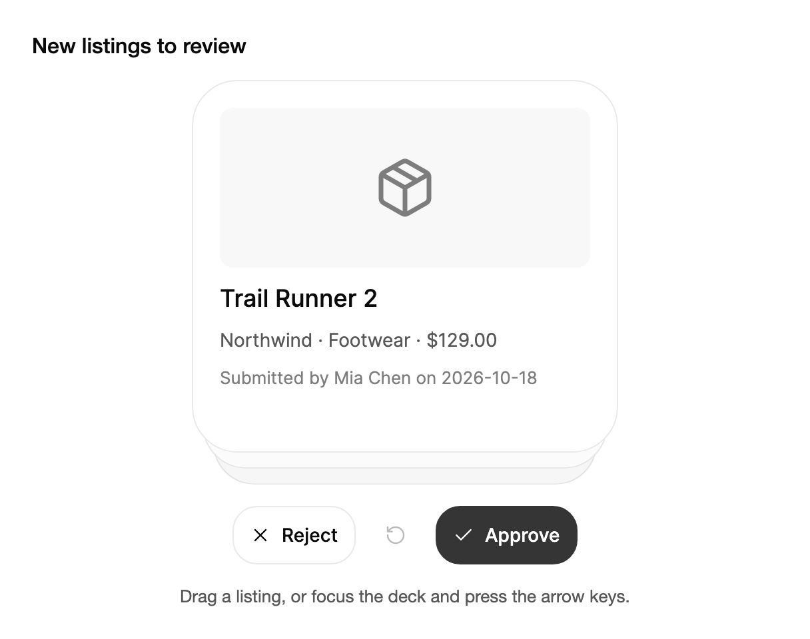

<Demo name="Shortlist" />

## 何時使用

`CardStack` 將一個待處理佇列變成卡片堆疊，讓人逐張處理。每張卡片要求一個明確的決定，即略過或保留，然後下一張卡片升到原位。它適合每個項目都值得單獨關注、而表格會隱藏關鍵細節（例如商品照片或候選人摘要）的審核工作。把它放在專注任務的主要區域，並在旁邊顯示目前的結果，例如已保留項目的數量。

- **商品上架審核**：商品團隊在商品上架前逐一審核新的商品清單。每張卡片顯示照片、價格與供應商，審核人員核准或拒絕。復原可以救回誤核准的商品。
- **招募工具中的候選人篩選**：招募人員保留或略過求職者檔案。每張卡片只呈現一位候選人，讓審閱者一次只專注於一份摘要，而不是面對一排只看了一半的記錄。
- **SaaS 應用中的入門選擇**：新的工作區管理員逐一保留或略過建議的整合，例如 Slack、Jira 或 Google Drive。卡片堆疊最後顯示「所有卡片已審閱」，而不是一份冗長的設定表單。
- **金融科技主控台中的標記交易審核**：分析師確認或放行每一筆被標記的交易。每個決定在發生時都會被播報，復原會把上一筆決定放回卡片堆疊的頂端，然後才送出整批結果。

## 何時不用

- **並排比較或排序項目**：用 `Table`。欄位與排序讓人一次比較多筆記錄；卡片堆疊一次只顯示一筆記錄。
- **只瀏覽而不做決定**：用 `Carousel`，適合一排人們只需查看、不需保留或略過的投影片、橫幅或照片。
- **清單列上的快速操作**：用 `SwipeActions`，對每一列執行封存、稍後提醒或標為已讀。列是用來操作的地方，而不是一個會向前推進的佇列。
- **重新排列使用者擁有的清單**：用 `ReorderableList`，它在移動時讓每個項目保持可見。
- **表單中單一的是或否**：用 `Checkbox` 或 `Switch`，它們與其他欄位並排放置，不需要佇列、標記或復原。

## 用法

```xml
<arc:CardStack Label="目的地"
               LeftLabel="略過"
               RightLabel="保留"
               LeftOutcome="已略過"
               RightOutcome="已入選">
    <arc:CardStack.ItemTemplate>
        <DataTemplate>
            <Border Width="300" Height="360" Padding="20" CornerRadius="12" Background="#F5F1EA">
                <TextBlock Text="{Binding}" FontSize="18" />
            </Border>
        </DataTemplate>
    </arc:CardStack.ItemTemplate>
</arc:CardStack>
```

`CardStack` 衍生自 Avalonia 的 `ItemsControl`，因此 `ItemsSource`、`Items`、`ItemTemplate` 與項目容器的邏輯都與清單中的用法相同。每個項目成為一張卡片，也就是一個承載項目範本的 `ContentControl` 容器。堆疊只配置並實例化最上面的四張卡片，以及仍在移動中的卡片，因此 500 個項目的佇列與 5 個項目的佇列成本大致相同。`Label` 為堆疊命名，供輔助技術使用。

上面的範例為了簡潔使用了固定的卡片尺寸。在主題中，卡片高 304 px，周圍的舞台高 328 px，因此依照這些尺寸製作的卡面能填滿堆疊，不留空隙。

### 結構

1. **舞台**（`Label` 為其命名）：容納卡片的可聚焦群組。它預留了頂端卡片以及其下方 24 px 的區域，後方的卡片會從這裡露出，因此卡片離開時不會有任何位置移動。它的寬度取可用寬度與 320 px 之中的較小值。
2. **頂端卡片**：接收輸入的卡片，高 304 px、寬 320 px，卡面來自 `ItemTemplate`。它是唯一會回應拖曳、點按或按鍵的卡片。
3. **後方卡片**：最多三張，每張比前一張小 5%，向下偏移 12 px，並帶有不透明度 3.5% 的黑色陰影（深色模式下為 22%）。頂端卡片離開後，它們會上升到位。
4. **標記**：卡片頂角的 32 px 膠囊，距卡片邊緣 16 px。頂端卡片被拖曳時顯示 `LeftLabel` 或 `RightLabel`，靜止時完全透明。
5. **焦點環**：當舞台取得鍵盤焦點時，繪製在頂端卡片周圍（或空狀態周圍）的外框。舞台本身不繪製外框。
6. **按鈕列**：`LeftLabel` 按鈕、復原按鈕與 `RightLabel` 按鈕，彼此相距 8 px，位於舞台下方 20 px 處。復原按鈕帶有旋轉圖示與「復原」文字；寬度低於 22.5rem（360 px）時只保留圖示。
7. **空狀態**：所有卡片都做出決定後顯示。它是一個與卡片等高的面板，帶有 24 px 內距、12 px 間距、標題「所有卡片已審閱」以及「重新開始」按鈕。`EmptyContent` 會取代標題與按鈕。

低於 26rem（416 px）時，堆疊切換到緊湊版面：卡片高 280 px，舞台高 304 px，按鈕使用緊湊尺寸。切換依據堆疊自身的寬度，而不是視窗寬度，因此放在窄欄中的堆疊即使在寬視窗裡也會切換版面。

### 卡片正面與尺寸

卡片高度由主題固定，因此卡面必須適合 304 px × 320 px。內容保持為一個標題、一到兩行細節以及一張圖片或圖示。較長的描述應放在使用者從卡片開啟的詳細檢視中。使用主題的文字尺寸（內文用 `TypeSM`，標題用 `TypeBase` 搭配 `WeightMedium`），讓卡面與應用程式其他部分一致。

### 繫結到檢視模型

檢視模型擁有佇列並記錄每一個決定。堆疊沒有用於做決定的命令：拖曳、鍵盤與按鈕都會觸發同一個 `Decided` 事件，因此一個處理常式即可涵蓋所有輸入方式。檢視模型持有集合，程式碼後置會把每個決定轉交給它。

```csharp
public interface IShortlistService
{
    IEnumerable<Destination> LoadCandidates();

    Task SaveDecisionAsync(int id, bool keep);
}

public partial class ShortlistViewModel : ObservableObject
{
    private readonly IShortlistService _shortlist;

    public ShortlistViewModel(IShortlistService shortlist)
    {
        _shortlist = shortlist;
        Destinations = new ObservableCollection<Destination>(shortlist.LoadCandidates());
    }

    public ObservableCollection<Destination> Destinations { get; }

    [ObservableProperty]
    private string _lastDecision = "拖曳卡片，或讓堆疊取得焦點後按方向鍵。";

    public async Task RecordAsync(Destination item, CardDecision decision)
    {
        await _shortlist.SaveDecisionAsync(item.Id, decision == CardDecision.Right);
        LastDecision = decision == CardDecision.Right
            ? $"{item.Name} 已保留。"
            : $"{item.Name} 已略過。";
    }
}
```

```xml
<StackPanel Spacing="16">
    <arc:CardStack x:Name="Shortlist"
                   Label="目的地"
                   ItemsSource="{Binding Destinations}">
        <arc:CardStack.ItemTemplate>
            <DataTemplate>
                <StackPanel Spacing="6" Margin="20">
                    <TextBlock Text="{Binding Name}" FontSize="18" FontWeight="Medium" />
                    <TextBlock Text="{Binding Details}" FontSize="14" />
                </StackPanel>
            </DataTemplate>
        </arc:CardStack.ItemTemplate>
    </arc:CardStack>
    <TextBlock Text="{Binding LastDecision}" />
</StackPanel>
```

```csharp
// 程式碼後置：將決定轉交給檢視模型。
Shortlist.LabelSelector = item => ((Destination)item!).Name;
Shortlist.Decided += async (_, e) =>
    await ViewModel.RecordAsync((Destination)e.Item!, e.Decision);
```

- `ItemsSource` 是單向的：堆疊讀取集合，但從不寫入。`CurrentIndex` 與 `CanUndo` 是唯讀的，因此可以單向繫結來顯示進度，例如「3 / 12」。
- 決定本身請使用 `Decided` 與 `DecisionUndone`。事件引數帶有項目與決定，因此檢視模型不需要讀取控制項的狀態。
- `ResetCommand` 是一個用來重新開始卡片堆疊的 `ICommand`。它只有在 `CanUndo` 為 true 時才能執行，因此堆疊外的「再次審閱」按鈕在有決定之前保持停用。
- 變更集合（新增、移除或取代項目）會讓堆疊從頭開始。變更項目的某個屬性則不會，因此當細節變動時應就地更新記錄。

### 在程式碼中做決定與復原

`Decide` 以預設的輕甩速度，沿指定方向將頂端卡片甩出。`Undo` 會把最後一張卡片放回，`CanUndo` 說明是否有可放回的卡片。`Reset` 會把每張卡片都放回堆疊。

```csharp
stack.Decided += (_, e) => log.Text = $"{((Destination)e.Item!).Name}：{(e.Decision == CardDecision.Right ? "已入選" : "已略過")}";
stack.DecisionUndone += (_, e) => log.Text = $"{((Destination)e.Item!).Name}：已還原";
stack.StackReset += (_, _) => log.Text = "所有卡片已放回堆疊。";

stack.Decide(CardDecision.Right);
stack.Undo();
stack.Reset();
```

可以用這些呼叫從工具列、宿主應用程式的快速鍵或不使用指標的測試來驅動卡片堆疊。程式碼中做出的決定會觸發與拖曳或按鍵相同的事件，因此檢視模型的邏輯不必更動。

### 為卡片命名

將 `LabelSelector` 設為傳回每張卡片的名稱。該名稱即卡片的無障礙標籤，也會出現在播報中。當項目不是字串時，選取器必須傳回字串。

```csharp
stack.LabelSelector = item => ((Destination)item!).Name;
```

沒有選取器時，若項目本身是字串，堆疊就使用該項目；若是控制項項目，則使用其自動化名稱；否則使用項目的 `ToString()`。對於任何模型類別，都應設定選取器，讓名稱不依賴於 `ToString()`。

### 自訂按鈕與標記文字

`LeftLabel` 與 `RightLabel` 為按鈕，以及拖曳卡片時出現的標記命名。預設值為「略過」與「保留」。`LeftOutcome` 與 `RightOutcome` 是播報中使用的過去式詞語，例如「已略過」。沒有結果詞時，播報會說明動作本身，例如「里斯本：保留。剩餘 4 張。」

<Demo name="CustomActions" />

標籤是純文字，因此應寫成人所執行的動詞：候選人卡片堆疊使用「暫不」與「面試」，商品審核使用「拒絕」與「核准」。每個標籤都應夠短，能與其他按鈕並排放置。

### 空狀態

`EmptyContent` 會取代所有卡片都已做出決定後顯示的預設訊息。將按鈕繫結到 `ResetCommand`，即可提供開始新一輪的入口。`EmptyContentTemplate` 透過資料範本建立同樣的內容，且只有在未設定 `EmptyContent` 時才會使用。

```xml
<arc:CardStack Label="候選人" ItemsSource="{Binding Candidates}">
    <arc:CardStack.EmptyContent>
        <Button Content="再次審閱" Command="{Binding ResetCommand, RelativeSource={RelativeSource AncestorType=arc:CardStack}}" />
    </arc:CardStack.EmptyContent>
</arc:CardStack>
```

### 照片

卡片正面可以在繪製的場景之上顯示 `AsyncImage` 照片，因此卡片在照片載入期間或裝置離線時仍然完整。照片應保持在卡片固定的高度之內，並讓繪製的場景在圖片到達之前代為佔位。

<Demo name="Photos" />

### 資料結構與效能

- **項目模型**：任何物件都可以。每個項目只保留卡面需要的內容，詳細資料則在獨立的檢視中按需載入。只要卡面範本夠輕，大型模型的成本並不比小型模型高。
- **項目數量**：堆疊只實例化四張卡片以及仍在移動的卡片，因此項目數量不影響每一影格的成本。真正有影響的是卡面範本，它會為這四張卡片各執行一次。
- **更新**：新增、移除或取代項目會讓卡片堆疊從第一張卡片重新開始。規劃更新時，應避免讓人失去正在處理的佇列：更新單筆記錄時就地修改，只有在批次本身改變時才取代整個集合。
- **復原歷程**：每個決定都會被保留，以便 `Undo` 將其放回；復原依相反的順序進行，最近的決定最先復原。

### 範例：商品上架審核

一家零售商的商品團隊在新商品上架前進行審核。每張卡片是一件商品，包含照片區域、名稱、價格與供應商。審核人員核准或拒絕商品，復原可以救回上一件。按鈕標籤使用審核的動詞，結果詞使用播報中的詞語（「已核准」「已拒絕」），因此朗讀出的狀態與按鈕一致。卡片堆疊下方的狀態列用平易的文字告訴審核人員上一次的操作。為使截圖自成一體，此處卡面使用固定文案；在應用程式中，應將相同元素繫結到商品資料。



```xml
<StackPanel Width="560" Spacing="16">
    <TextBlock Text="New listings to review"
               FontSize="16"
               FontWeight="Medium"
               Foreground="{arc:ArcDesignTokenResource Foreground}" />
    <arc:CardStack Label="Listings awaiting review"
                   LeftLabel="Reject"
                   RightLabel="Approve"
                   LeftOutcome="rejected"
                   RightOutcome="approved"
                   HorizontalAlignment="Center">
        <arc:CardStack.ItemTemplate>
            <DataTemplate>
                <StackPanel Spacing="12" Margin="20">
                    <Border Height="120"
                            CornerRadius="10"
                            Background="{arc:ArcDesignTokenResource SurfaceMuted}">
                        <arc:ArcGlyph Data="{x:Static arc:ArcIcons.Package}"
                                      Size="48"
                                      HorizontalAlignment="Center"
                                      VerticalAlignment="Center"
                                      Foreground="{arc:ArcDesignTokenResource TextMuted}" />
                    </Border>
                    <TextBlock Text="Trail Runner 2"
                               FontSize="18"
                               FontWeight="Medium"
                               Foreground="{arc:ArcDesignTokenResource Foreground}" />
                    <TextBlock Text="Northwind · Footwear · $129.00"
                               FontSize="14"
                               Foreground="{arc:ArcDesignTokenResource TextSecondary}" />
                    <TextBlock Text="Submitted by Mia Chen on 2026-10-18"
                               FontSize="13"
                               Foreground="{arc:ArcDesignTokenResource TextMuted}" />
                </StackPanel>
            </DataTemplate>
        </arc:CardStack.ItemTemplate>
        <x:String>Trail Runner 2</x:String>
        <x:String>Harbor Rain Shell</x:String>
        <x:String>Ridge Field Jacket</x:String>
    </arc:CardStack>
    <TextBlock Text="Drag a listing, or focus the deck and press the arrow keys."
               FontSize="13"
               HorizontalAlignment="Center"
               Foreground="{arc:ArcDesignTokenResource TextSecondary}" />
</StackPanel>
```

### 文案規範

- **堆疊標籤**：一個名詞片語，說明佇列是什麼，例如「待審核的商品清單」。它是螢幕閱讀器給予堆疊的唯一名稱，因此只寫「審核」是不夠的。
- **卡片名稱**：只寫項目的名稱，因為堆疊會自行補上位置資訊：「里斯本，第 1 項，共 5 項」。
- **按鈕標籤**：一個簡短的動詞，說明決定是什麼：「略過」與「保留」，「拒絕」與「核准」。避免使用「是」與「否」這類不說明項目會發生什麼事的回答。
- **結果詞**：使用過去式，讓播報讀起來像一個結果：「里斯本已核准。剩餘 3 張。」
- **空狀態**：說明審核已經完成，並提供重新開始的方式：「所有卡片已審閱」，搭配「重新開始」。

| 不要寫 | 改為 |
|---|---|
| 是 / 否 | 核准 / 拒絕 |
| 左 / 右 | 略過 / 保留 |
| 完成！ | 所有卡片已審閱。 |
| 已核准 | 已核准的商品，或項目名稱加結果 |
| 重設 | 重新開始 |

### 最佳做法

**建議**

- 為堆疊設定一個說明佇列內容的 `Label`。卡片堆疊取得焦點時螢幕閱讀器會播報它，因此它是使用者最先聽到的內容。
- 使用過去式的 `LeftOutcome` 與 `RightOutcome` 詞語，讓每個決定都以結果的形式被播報。
- 在檢視模型中記錄 `Decided` 的每一個決定。拖曳、鍵盤與按鈕因此以相同的方式保存。
- 當佇列可以重複使用時，在空狀態中提供「重新開始」或「再次審閱」，讓結束狀態有一個去處。

**避免**

- 用卡片堆疊處理需要並排比較的記錄。需要比較各欄的讀者會失去其他項目的脈絡。
- 在卡片內部放置水平拖曳或其他手勢。它們會與卡片自身的拖曳互相衝突。
- 卡面上放置過長的文字。卡片高度固定，放不下的卡面會被裁切。
- 只依賴標記來傳達資訊。標記只在拖曳期間出現，因此鍵盤使用者與螢幕閱讀器使用者仰賴的是按鈕與播報。
- 為了更新一筆記錄而取代整個集合。這會讓卡片堆疊重新開始；應改為更新該筆記錄。

### 常見問題

**為什麼復原一直停用？** 只有在做出決定之後，復原才可用；復原最後一個決定後，`CanUndo` 會再次變為 `False`。停用時按鈕仍可取得焦點，因此鍵盤使用者不會失去位置。

**如何顯示還剩多少張卡片？** 將數量單向繫結到堆疊的 `CurrentIndex`，再用項目總數減去它；或者讀取播報中「剩餘 4 張」的部分。堆疊沒有提供剩餘數量的屬性。

**卡片堆疊空了之後，能否從程式碼重新開始？** 可以。呼叫 `Reset()`，或執行 `ResetCommand`。兩者都會讓每張卡片回到堆疊中，並且卡片從最底層的一張開始返回。

**編輯一個項目會讓卡片堆疊重新開始嗎？** 不會。變更項目的某個屬性會讓卡片堆疊停留在原處。在集合中新增、移除或取代項目才會使其重新開始，因此應就地更新記錄。

**使用鍵盤時，為什麼卡片不傾斜？** 傾斜與標記跟隨拖曳。按鍵會以預設的輕甩速度做出決定，因此沒有拖曳來讓卡片傾斜。

## API 參考

<!-- api: CardStack -->

`CardDecision` 以及事件資料是本頁使用的公開型別：

| 型別 | 成員 | 含義 |
|---|---|---|
| `CardDecision` | `Left` | 卡片被略過（`LeftLabel`，預設「略過」）。 |
| `CardDecision` | `Right` | 卡片被保留（`RightLabel`，預設「保留」）。 |
| `CardStackDecisionEventArgs` | `Item` | 被決定或被還原的項目。 |
| `CardStackDecisionEventArgs` | `Index` | 該項目在項目集合中的索引。 |
| `CardStackDecisionEventArgs` | `Decision` | 決定，`Left` 或 `Right`。 |

## 無障礙

- 舞台是一個以 `Label` 命名的可聚焦群組（預設為「Cards」），角色為「card stack」。其說明文字指出方向鍵與 Backspace，並說明頂端卡片可以被略過或保留。
- 每張卡片由 `LabelSelector` 命名，並附上它在堆疊中的位置，例如「里斯本，第 1 項，共 5 項」。
- 決定、復原與重設都以禮貌等級播報，因此螢幕閱讀器能聽到它們而不失去焦點。例如「里斯本已略過。剩餘 1 張。」「京都已還原。」以及「所有卡片已放回堆疊。」
- 按鈕對應每一個手勢，因此甩動從來不是做決定的唯一方式。停用的復原按鈕會保留焦點，並被播報為不可用，因此鍵盤使用者在沒有可復原的決定時不會失去位置。
- 焦點環繪製在頂端卡片或空狀態上，而不是舞台上。

### 鍵盤

舞台透過 `Tab` 取得焦點。只有舞台本身取得焦點時，方向鍵才會做出決定；當按鈕取得焦點時，方向鍵照常作用於該控制項。

| 按鍵 | 操作 |
|---|---|
| `Left` / `Right` | 舞台取得焦點時，略過或保留頂端卡片 |
| `Backspace` | 復原上一個決定 |
| `Ctrl+Z` / `Cmd+Z` | 復原上一個決定 |
| `Tab` / `Shift+Tab` | 在舞台與按鈕之間移動；復原按鈕停用時仍保留在順序中 |
| `Enter` 或 `Space` | 按下已取得焦點的按鈕：略過、復原、保留或重新開始 |

堆疊不處理帶有 `Ctrl` 或 `Cmd` 的方向鍵，因此宿主應用程式中的 `Cmd+Left` 等快速鍵仍會送達應用程式。

## 動態效果

- 頂端卡片跟隨拖曳，朝移動方向傾斜並顯示標記。快速輕甩或長距離拖曳，會讓卡片帶著放開時的速度甩出堆疊。
- 頂端卡片離開後，後方的卡片上升到位。
- 復原會讓最後一張卡片從離開的位置飛回。重設時，卡片從最深處的一張開始依序飛回。
- 短距離拖曳會彈回堆疊。
- 減少動態效果時，卡片在原位置淡出再淡入，不產生位移。關閉動態效果時立即到達最終狀態。

| 變化 | 完整 | 減少 | 關閉 |
|---|---|---|---|
| 頂端卡片越過門檻後放開 | 帶著放開速度甩出，然後淡出 | 原位淡出 | 立即移除 |
| 一次決定後，後方的卡片 | 頂端卡片離開時上升到位 | 原位淡入 | 本已在位 |
| 復原 | 從卡片離開的位置飛回 | 原位淡入 | 立即顯示 |
| 重新開始 | 卡片從最深處開始依序飛回 | 原位淡入 | 立即顯示 |
| 空狀態出現 | 模糊消退時以短距離移動落定 | 淡入 | 立即顯示 |

## 相關元件

- `Carousel` 用於瀏覽一排項目，而不對每一項做決定。
- `SwipeActions` 用於清單列上的快速操作。
- `Table` 用於並排審閱大量記錄。

| 元件 | 適用情境 |
|---|---|
| `Table` | 讀者依欄位比較或排序大量記錄 |
| `Carousel` | 人們只瀏覽投影片、橫幅或照片，無需做決定 |
| `SwipeActions` | 清單的每一列需要封存或稍後提醒等快速操作 |
| `ReorderableList` | 使用者調整自己擁有的清單順序 |
| `Checkbox` / `Switch` | 表單中並排放置單一的是或否 |
| `Stepper` | 任務是固定的步驟序列，而不是項目佇列 |
