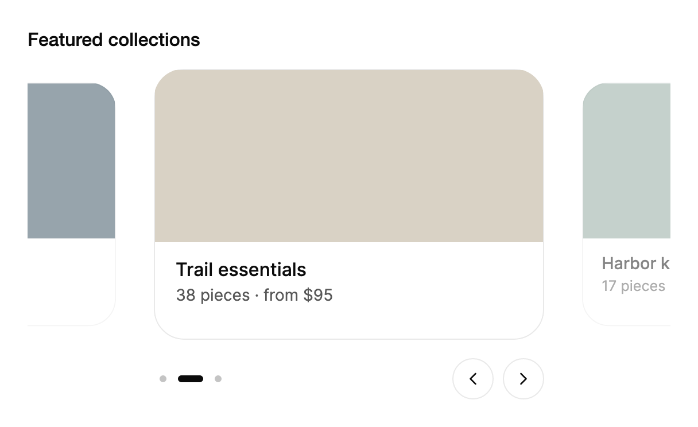

<Demo name="Slides" />

## When to use

`Carousel` shows a short, ordered row of peer items on a page where the viewer glances through them and then chooses
one. The active slide sits in the center, and the neighbors on each side show that more items exist. It belongs in a
page header, a storefront section or a content hub, where the items are the same kind of thing and none needs a
decision from the viewer.

- **Featured collections on a storefront home page**: four to six seasonal collections, each a photo with a title and
  a count of items. Dragging or the arrows reveal the rest, and the viewer opens the one that matches.
- **Room types on a hotel or rental booking page**: each slide is a room with its size and nightly rate, so the guest
  compares rooms by swiping instead of opening five pages.
- **Release highlights on a product changelog**: three or four features from the latest release, one per slide, with
  autoplay left off so the reader moves through them at their own pace.
- **Customer stories on a marketing site**: three to five case studies, each a logo, a quote and a link, in a row the
  visitor can browse without a long scroll.

## When not to use

- **Deciding on each item in turn**: use `CardStack`, which asks for a keep or pass on each card and records it.
- **Comparing two images**: use `ImageCompare`, which puts a before and after on the same frame with a divider.
- **Long lists of records that people scan or sort**: use `Table`. A carousel shows one slide at a time, so
  a reader cannot compare fields across rows.
- **Text that must be read in full, such as terms, instructions or a checklist**: use `Accordion` or `ExpandableText`.
  Slides move on and hide the text the reader has not reached.
- **Switching between panels with different content**: use `Tabs`. A carousel implies that the slides are peers of
  one kind, while tabs name separate sections.
- **Messages that the user must not miss, such as a billing warning or an outage**: use `Alert` or `AnnouncementBar`.
  Autoplay would move the message away, and a carousel is the wrong place for it.

## Usage

Each child element becomes one slide. `Label` names the carousel for assistive technology.

```xml
<arc:Carousel Label="From the Harbour suites">
    <Border Height="200" Background="#2F4858" CornerRadius="12" />
    <Border Height="200" Background="#D9D2C5" CornerRadius="12" />
    <Border Height="200" Background="#8AA399" CornerRadius="12" />
</arc:Carousel>
```

`Carousel` derives from Avalonia's `SelectingItemsControl`. It has an item list, `ItemsSource` with `ItemTemplate`, and a
`SelectedIndex` that is two-way and always selects one slide. That gives a carousel the same selection model as a list,
so binding, `SelectionChanged` and automation selection all work the same way. Only the slides near the current
position are realized, so a long list costs about as much as a short one.

### Anatomy

1. **Viewport**: the track that holds the slides. The active slide sits in the center. Slide width is
   `SlideWidthRatio` of the carousel width, capped at `MaxSlideWidth`, and `SlideGap` separates the slides.
2. **Neighbors**: the slides on either side are scaled to 90% and drop to 50% opacity as they move away from the
   center. Their edges show in the margins, which is the hint that more slides exist.
3. **Viewport focus ring**: a 2 px outline drawn 4 px outside the slides when the viewport has keyboard focus.
4. **Control row**: a row below the viewport, 16 px under it. It is hidden when the carousel has one slide or none.
5. **Play and pause** (`Interval`): a button on the left of the row. It appears only when `Interval` is positive and
   motion is full. Its name changes between "Start slide rotation" and "Pause slide rotation".
6. **Indicator**: the page dots in the middle of the row. Each dot is 6 px, and the active dot stretches
   into a 22 px pill that travels with the track. The row is 36 px tall.
7. **Previous and next**: chevron buttons on the right, 8 px apart. At the first and the last slide the matching button
   is soft-disabled, so it keeps focus but does nothing.

Below 340 px the carousel is compact: the gap between the arrow buttons drops from 8 px to 4 px, and the play button
moves closer to the arrows.

### Slide width and gap

The slide takes 80% of the carousel width (`SlideWidthRatio` 0.8) up to 340 px (`MaxSlideWidth`). The cap is reached at
a carousel width of 425 px, so on a wide page the slides keep a fixed reading size and the extra width shows more of
the neighbors. Raise the ratio to 0.9 to make the slides dominate the row, or lower it to 0.7 to show more of the
neighbors on a narrow column. Keep `SlideGap` at 16 px unless the slides have their own shadow or border that needs
more air.

The slide size follows the carousel's own width, not the window's, so a carousel placed in a narrow sidebar keeps the
same proportions as one in the main content.

### Bound items

Use `ItemsSource` with an `ItemTemplate` when the slides come from data.

```xml
<arc:Carousel Label="Harbour suites" ItemsSource="{Binding Suites}">
    <arc:Carousel.ItemTemplate>
        <DataTemplate>
            <Border Height="200" Background="#2F4858" CornerRadius="12">
                <TextBlock Text="{Binding Name}" Margin="18" />
            </Border>
        </DataTemplate>
    </arc:Carousel.ItemTemplate>
</arc:Carousel>
```

### Binding to a view model

The view model owns the slides and the position the carousel should show. Bind `SelectedIndex` two-way so the view
model can set the slide at startup, and read the position back when the viewer moves. Bind `IsAutoPlay` two-way so a
settings toggle can turn rotation on or off.

```csharp
public interface IStorefrontService
{
    IEnumerable<Collection> GetFeatured();
}

public partial class HomeViewModel : ObservableObject
{
    public HomeViewModel(IStorefrontService storefront)
    {
        Collections = new ObservableCollection<Collection>(storefront.GetFeatured());
    }

    public ObservableCollection<Collection> Collections { get; }

    [ObservableProperty]
    private int _featuredIndex;

    [ObservableProperty]
    private bool _rotateFeatured;
}
```

```xml
<StackPanel Spacing="16">
    <arc:Carousel Label="Featured collections"
                  ItemsSource="{Binding Collections}"
                  SelectedIndex="{Binding FeaturedIndex, Mode=TwoWay}"
                  Interval="0:0:6"
                  IsAutoPlay="{Binding RotateFeatured, Mode=TwoWay}">
        <arc:Carousel.ItemTemplate>
            <DataTemplate>
                <Border Height="200" Background="#2F4858" CornerRadius="12">
                    <TextBlock Text="{Binding Title}" Margin="18" />
                </Border>
            </DataTemplate>
        </arc:Carousel.ItemTemplate>
    </arc:Carousel>
</StackPanel>
```

- Prefer the bound `SelectedIndex` over calling `GoTo()` from the view model. The view model then moves the carousel
  without a reference to the control, and the same binding handles the viewer's own moves.
- `SelectionChanged` fires for viewer moves and for rotation. Use it to update a readout or to log a view, and treat
  the value as the current slide, not as a decision.
- `IsRotating` and `CanRotate` are read-only. Read them to show whether rotation is running, but change rotation only
  through `IsAutoPlay`.
- The carousel has no command interface. Next, previous and go-to are methods on the control, so a view model that
  needs them keeps the carousel's `SelectedIndex` as the single source of truth instead.

### Driving it from code

```csharp
carousel.SelectionChanged += (_, _) => readout.Text = $"Slide {carousel.SelectedIndex + 1} of {count}";

carousel.Next();
carousel.Previous();
carousel.GoTo(3);
```

`Next` and `Previous` stop at the ends; they do not wrap. `GoTo` clamps the index to the valid range, so a value past the
last slide selects the last slide.

### Slide size and labels

`SlideLabelFormatter` builds the text that is announced for each slide and used as the slide's accessible name. Without
it the carousel uses the localized "2 of 5" format. Use a formatter when the slide names carry meaning, such as the
title of the content on the slide.

```csharp
carousel.SlideLabelFormatter = (index, count) => $"Archive photo {index + 1} of {count}";
```

### Autoplay

Set `Interval` to a positive time span to add a play control. The carousel moves forward on that interval and returns to
the first slide after the last one. `IsAutoPlay` starts rotation, and the play control toggles it. Rotation is off by
default, so the viewer decides when the slides move.

The indicator drains from the right while a slide is on show, so the viewer can see how long it has before the next
slide. Rotation is available only with full motion and at least two slides.

<Demo name="Rotation" />

```xml
<arc:Carousel Label="Seasonal offers" Interval="0:0:4" IsAutoPlay="True">
    <Border Height="200" Background="#2F4858" CornerRadius="12" />
    <Border Height="200" Background="#D9D2C5" CornerRadius="12" />
</arc:Carousel>
```

### Using motion with restraint

Rotation moves content without a request, so use it only when the slides are decoration or a teaser and the reader
does not need to finish each one. Keep it off for the content the viewer must read, such as an offer's terms, a
product's price or a warning.

Rotation pauses on its own when the viewer needs control: while the mouse is over the carousel, while keyboard focus
is inside it, while a drag is running, when the carousel scrolls out of view and when the window is minimized. It
resumes when the cause ends. The play control stays visible so the viewer can stop rotation for good. Use an interval
of at least four seconds, so a slide has time to be read before it moves.

Reduced motion turns rotation off completely, so a viewer who asked for less movement sees the first slide and can
move through the others by hand.

### Long carousels

With 120 slides, only the slides around the current position are realized. The indicator then holds 120 dots. It
scrolls so that the active pill stays in the middle and fades out at the edges, so the row does not become a wall of
dots.

<Demo name="LongCarousels" />

### Photos

Slides can show `AsyncImage` photos over a drawn scene, so they still look complete offline.

<Demo name="Photos" />

### Example: storefront featured collections

A storefront home page with four seasonal collections in a row. Each slide has a color block that stands in for the
photo, a title and one line with the item count and the starting price. Autoplay is off, so the viewer chooses when to
move on, and the neighbors on both sides show that more collections exist. The copy is short and states the facts a
shopper compares: how many items and from what price. The width of the carousel is the page's content width, so the
slide size is the 340 px cap and the neighbors fill the margins.



```xml
<StackPanel Width="560" Spacing="16">
    <TextBlock Text="Featured collections"
               FontSize="16"
               FontWeight="Medium"
               Foreground="{arc:ArcDesignTokenResource Foreground}" />
    <arc:Carousel Label="Featured collections" SelectedIndex="1">
        <Border Height="236"
                BorderThickness="1"
                ClipToBounds="True"
                Background="{arc:ArcDesignTokenResource Surface}"
                BorderBrush="{arc:ArcDesignTokenResource Border}"
                CornerRadius="{arc:ArcDesignTokenResource RadiusPanel}">
            <StackPanel>
                <Border Height="150" Background="#2F4858" />
                <StackPanel Margin="18,14,18,18" Spacing="4">
                    <TextBlock Text="Spring linen"
                               FontSize="16"
                               FontWeight="Medium"
                               Foreground="{arc:ArcDesignTokenResource Foreground}" />
                    <TextBlock Text="24 pieces · from $180"
                               FontSize="14"
                               Foreground="{arc:ArcDesignTokenResource TextSecondary}" />
                </StackPanel>
            </StackPanel>
        </Border>
        <Border Height="236"
                BorderThickness="1"
                ClipToBounds="True"
                Background="{arc:ArcDesignTokenResource Surface}"
                BorderBrush="{arc:ArcDesignTokenResource Border}"
                CornerRadius="{arc:ArcDesignTokenResource RadiusPanel}">
            <StackPanel>
                <Border Height="150" Background="#D9D2C5" />
                <StackPanel Margin="18,14,18,18" Spacing="4">
                    <TextBlock Text="Trail essentials"
                               FontSize="16"
                               FontWeight="Medium"
                               Foreground="{arc:ArcDesignTokenResource Foreground}" />
                    <TextBlock Text="38 pieces · from $95"
                               FontSize="14"
                               Foreground="{arc:ArcDesignTokenResource TextSecondary}" />
                </StackPanel>
            </StackPanel>
        </Border>
        <Border Height="236"
                BorderThickness="1"
                ClipToBounds="True"
                Background="{arc:ArcDesignTokenResource Surface}"
                BorderBrush="{arc:ArcDesignTokenResource Border}"
                CornerRadius="{arc:ArcDesignTokenResource RadiusPanel}">
            <StackPanel>
                <Border Height="150" Background="#8AA399" />
                <StackPanel Margin="18,14,18,18" Spacing="4">
                    <TextBlock Text="Harbor kitchen"
                               FontSize="16"
                               FontWeight="Medium"
                               Foreground="{arc:ArcDesignTokenResource Foreground}" />
                    <TextBlock Text="17 pieces · from $60"
                               FontSize="14"
                               Foreground="{arc:ArcDesignTokenResource TextSecondary}" />
                </StackPanel>
            </StackPanel>
        </Border>
    </arc:Carousel>
</StackPanel>
```

### Content guidelines

- **Label**: name the set of slides, such as "Featured collections" or "From the Harbour suites". The label is the
  carousel's only name for assistive technology, so avoid "Carousel" or "Slides".
- **Slide title**: a short noun phrase that names the item. Keep it to one line at the slide width.
- **Slide detail**: a count and a fact the viewer compares, such as "24 pieces · from $180". Write numbers as digits and
  keep the currency symbol with the amount.
- **Slide names**: when the position matters, use a `SlideLabelFormatter` that names the slide, such as "Archive photo
  3 of 120", instead of the bare position.

| Instead of | Write |
|---|---|
| Carousel | Featured collections |
| Click here to see more! | Trail essentials, 38 pieces from $95 |
| Slide 1 | Spring linen |
| Auto-scrolling deals | Seasonal offers, rotating every 6 seconds |

### Best practices

**Do**

- Give every carousel a `Label` that names what the slides are. It is the first thing a screen reader announces.
- Keep the active slide's copy self-contained, so a viewer who lands on it from a link understands it at once.
- Leave `IsAutoPlay` off unless the slides are decoration. A reader who did not ask for motion should not lose the
  slide they are reading.
- Use `SelectedIndex` to start on the slide the page needs, such as the newest release, instead of always starting on
  the first.

**Avoid**

- Autoplay for content that carries a warning, a price or a deadline. Rotation moves it out of view before it is read.
- Slides that do not match in kind, such as a banner next to a product card. The neighbors then read as noise, not as
  more of the same.
- Putting the only navigation to a page in a carousel. Keyboard and screen reader users still reach it, but a link list
  is easier to scan and remember.
- Very short intervals. A slide that moves within a few seconds does not allow the copy to be read.
- Replacing `ItemsSource` on every data refresh. The position is clamped and the track can jump when the items change;
  update the collection in place when the data changes.

### Common questions

**Why does the carousel stop at the first and last slide instead of wrapping?** Manual navigation does not wrap:
`Previous` and `Next` clamp at the ends, and the matching button is soft-disabled. Only autoplay wraps, and it returns to
the first slide after the last one.

**Why does the play button not appear?** The button appears only when `Interval` is a positive time span and motion is
full. With reduced motion, rotation is unavailable, so the button stays hidden and `CanRotate` is `False`.

**Why does autoplay not start even with `IsAutoPlay` set?** Rotation needs an interval, at least two slides and full
motion. It also pauses while the mouse is over the carousel, while keyboard focus is inside it, during a drag, when the
carousel scrolls out of view and when the window is minimized. `IsRotating` tells you whether it is running.

**How do I start on a particular slide?** Set `SelectedIndex`, for example `SelectedIndex="2"` in XAML, or call
`GoTo(2)` after the carousel loads. `SelectedIndex` is two-way, so the value the viewer leaves on is available to read
back.

**Why does a trackpad swipe settle on its own?** A horizontal trackpad swipe moves the track one to one with the
fingers. After 120 ms without a wheel event the carousel settles on the nearest slide, so a half-swipe does not leave the
track between two slides.

## API reference

<!-- api: Carousel -->

## Accessibility

- `Label` names the carousel. Slides are announced as "2 of 5" through `SlideLabelFormatter` when the selection changes.
- Left and right arrows move one slide. Home and End go to the first and the last slide.
- Tab moves through the slides, the play control, the indicator and the previous and next buttons.
- Slides that are not active are removed from the focus order and from the automation tree.
- Autoplay pauses while the pointer is over the carousel, while keyboard focus is inside it, while a drag runs,
  when it scrolls out of view and when the window is minimized. Autoplay does not announce each slide.
- The indicator is a tab list named "Choose a slide", and each dot is a tab named like the slide it selects, such as
  "2 of 4".
- The play control is named "Start slide rotation" or "Pause slide rotation", and the previous and next buttons are
  named "Previous slide" and "Next slide".
- Selection changes made by the viewer or by a key are announced politely. Rotation does not announce.

### Keyboard

| Keys | Action |
|---|---|
| `Left` / `Right` | Move one slide back or forward; focus moves to the new indicator tab when one has focus |
| `Home` / `End` | Go to the first or the last slide |
| `Tab` / `Shift+Tab` | Move between the viewport, the play control, the indicator and the previous and next buttons |
| `Enter` or `Space` | Press the focused button: play or pause, previous or next |

Arrow keys with `Ctrl`, `Alt` or `Cmd` are not handled by the carousel, and arrow keys typed into a text box stay in the
box.

## Motion

- Slides follow the pointer while you drag and carry momentum into a snap to the nearest slide. A keyboard or button
  move slides in the direction of travel.
- Neighbors shrink and dim with their distance from the active slide.
- The indicator stretches into a pill that follows the active slide, and the pill drains while autoplay waits.
- Reduced motion jumps straight to the target slide and stops autoplay. Off jumps to the end state at once.

| Change | Full | Reduced | Off |
|---|---|---|---|
| Drag release | Momentum carries the track to the nearest slide; a fast flick moves at least one slide | Jumps to the nearest slide | Immediate |
| Keyboard or button move | Glides on a smooth spring toward the new slide | Jumps to the new slide | Immediate |
| Neighbor scale and opacity | Follow the track position every frame | Jump with the track | Immediate |
| Indicator pill | Stretches and follows the active slide | Jumps to the active dot | Immediate |
| Autoplay | Advances on the interval and drains the pill | Not available | Not available |

## Related

- `CardStack` when each item needs a decision, not only a look.
- `ImageCompare` for a before and after of one picture.
- `Tabs` for switching between panels that are not a row of similar items.

| Component | Choose it when |
|---|---|
| `CardStack` | Each item in the row needs a keep or pass decision |
| `ImageCompare` | Two versions of one picture are compared with a draggable divider |
| `Tabs` | The row switches between sections with different content |
| `Accordion` / `ExpandableText` | The reader must read the content in full, in order |
| `Alert` / `AnnouncementBar` | A message must stay visible until the user reads it |
| `Table` | The reader scans, sorts or compares many records |
