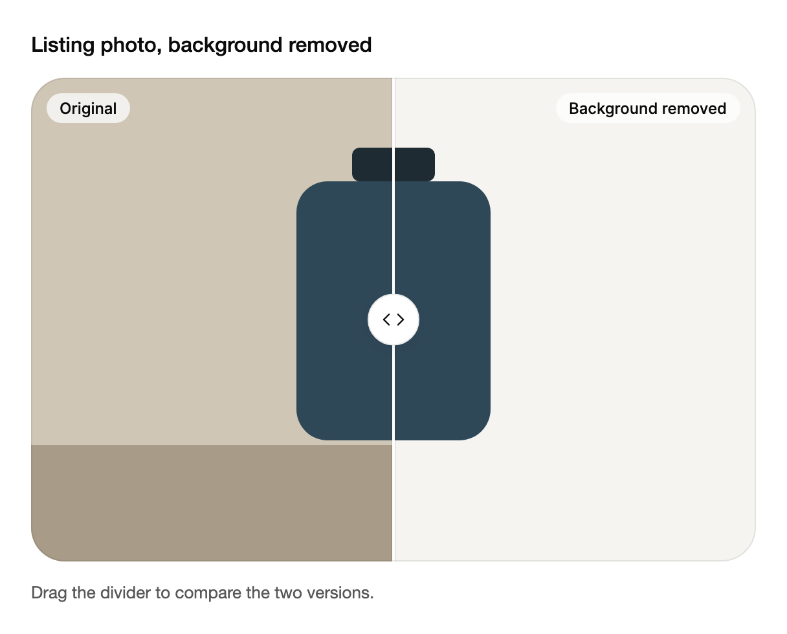

<Demo name="BeforeAndAfter" />

## 何时使用

`ImageCompare` 在同一个画面中放置同一张图片的两个版本，让读者拖动分隔线横跨两者。揭示多少变化由读者自己决定，因此它适用于任何“变化本身就是重点”的场合：修图、抠图、重新设计或视觉测试。它位于页面、审阅面板或编辑器之中，紧挨着产生变化的控件。

- **商品列表中的去背景**：卖家在商品上架前，并排查看同一画面中的原图与抠图。分隔线能显示商品边缘是否保留完好。
- **摄影工作室工具中的修图审批**：客户拖动分隔线比较人像的原始肤质与修图后的肤质，然后批准或要求再修一次。
- **房产列表工具中的样板间布置**：经纪人展示同一张照片的空房间与布置后的版本，并用“空置”和“已布置”作为说明文字，让买家看清家具带来的变化。
- **QA 或设计工具中的视觉回归审阅**：审阅者把已批准的截图与页面的新渲染结果进行对比，拖过页眉，查看间距是否发生了变化。

## 何时不用

- **浏览两张以上的图片**：用 `Carousel`，它在幻灯片之间切换，但不做对比。
- **逐个决定队列中的每张图片**：用 `CardStack`，它要求对每一项做出保留或跳过的决定。
- **把实时应用内容拆分为两个窗格**：用 `ResizablePanels`。那里的分隔线调整的是真实内容，而不是图片。
- **同一图片的三个或更多版本**：用 `Tabs` 在版本之间切换，因为分隔线只能比较两侧。
- **比较数字或记录**：用 `SortableDataTable`。图片无法显示两个数值之间的差异。

## 用法

两侧应使用相同的裁切与尺寸，揭示的部分才能对齐。

```xml
<arc:ImageCompare Width="600" AspectRatio="1.5">
    <arc:ImageCompare.Before>
        <Border Background="#D9D2C5" />
    </arc:ImageCompare.Before>
    <arc:ImageCompare.After>
        <Border Background="#2F4858" />
    </arc:ImageCompare.After>
</arc:ImageCompare>
```

`ImageCompare` 派生自 Avalonia 的 `TemplatedControl`，而不是选择型控件，因此它没有项。它的两侧都是内容：`Before` 与 `After` 可以是任意控件或绘图，`BeforeSource` 与 `AfterSource` 可以在其上绘制图片。外框由宽度与 `AspectRatio` 决定，分隔线绘制在两侧之上。前图一侧在分隔线处被裁剪，因此拖动只会移动裁剪区域，永远不会重新布局内容。

### 结构

1. **外框**：图片区域，尺寸由宽度与 `AspectRatio` 决定（宽度除以高度，默认 1.5，即 3:2）。其圆角使用主题的面板圆角。
2. **后图一侧**：结果，充满整个外框。`After` 的尺寸会覆盖外框。
3. **前图一侧**：原图，在分隔线处裁剪。`Position` 是分隔线的位置，以距左侧的百分比表示；当 `Orientation` 为垂直时，则以距顶部的百分比表示。默认值为 50。
4. **分隔线**：2 px 的线，带有 3 px 的淡色边缘，因此在明亮与昏暗的照片上都清晰可见。浅色模式下线条为凸起的表面色，深色模式下为前景色。
5. **把手**（`Label` 为其命名）：分隔线上直径 40 px 的圆形，两侧各有一个箭头。拖动时它会拉伸为 56 × 36 的胶囊。其点击区域比圆形向外扩展 8 px；距离外框边缘 42 px 以内时会减速。
6. **说明文字**：起始角的 `BeforeLabel` 与末端角的 `AfterLabel`，各自位于距外框边缘 12 px 处的磨砂胶囊中，使用超小字号。分隔线靠近时，说明文字会淡出。
7. **图片**（`BeforeSource`、`AfterSource`）：覆盖每一侧的可选图片。加载失败的图片会让其下方的内容保持可见。

### 标签与外框

`BeforeLabel` 与 `AfterLabel` 为两侧添加说明文字，默认分别为“前图”和“后图”。分隔线经过某个说明时，该说明会淡出，因此分隔线下方的说明不会遮住读者正在查看的细节。`ShowLabels` 可同时隐藏两个说明文字。`AspectRatio` 设置外框的宽度除以高度的比值，默认为 1.5（3 / 2）。请根据照片的比例来选择，使两侧的图片都不会被大幅裁切。

<Demo name="WideFrame" />

```xml
<arc:ImageCompare AspectRatio="1.7777" ShowLabels="False" Position="30" Label="清理预览">
    <arc:ImageCompare.Before>
        <Border Background="#D9D2C5" />
    </arc:ImageCompare.Before>
    <arc:ImageCompare.After>
        <Border Background="#8AA399" />
    </arc:ImageCompare.After>
</arc:ImageCompare>
```

### 上下对比

<Demo name="Vertical" />

```xml
<arc:ImageCompare Orientation="Vertical" BeforeLabel="原图" AfterLabel="调色后">
    <arc:ImageCompare.Before>
        <Border Background="#D9D2C5" />
    </arc:ImageCompare.Before>
    <arc:ImageCompare.After>
        <Border Background="#2F4858" />
    </arc:ImageCompare.After>
</arc:ImageCompare>
```

当变化是从上到下延伸的，例如重新调色的宽幅横幅，或页眉有所改动的页面，就使用垂直布局。运行时修改 `Orientation` 会让分隔线旋转四分之一圈，揭示区域随之移动。

### 图片

`BeforeSource` 与 `AfterSource` 会在每一侧的内容之上绘制图片。图片在后台加载，并从轻微模糊中淡入。加载失败时会显示下方的内容，因此图片缺失的页面仍能进行有意义的对比。把 `Before` 与 `After` 设为与图片颜色和裁切一致的占位内容，这样在图片加载期间外框看起来也是正确的。

<Demo name="Photos" />

```csharp
var compare = new ImageCompare
{
    Before = new Border { Background = Brushes.Gray },
    After = new Border { Background = Brushes.SteelBlue },
    BeforeSource = ImageSource.Parse("https://example.com/before.jpg"),
    AfterSource = ImageSource.Parse("https://example.com/after.jpg")
};
```

### 位置

`Position` 是分隔线的位置，以百分比计，从左侧起算；垂直时从顶部起算。它是双向的，默认值为 50。`PositionChanged` 报告已确定的值：拖动时每变化一个整百分点报告一次，松开时再报告一次。按键、点击和双击也会确定一个值。

```csharp
compare.PositionChanged += (_, e) => readout.Text = $"位置 {e.Position:0.#}%";
compare.Position = 75;
```

### 绑定到视图模型

在编辑器或审阅工具中，视图模型保存两张图片和揭示位置，因此审阅者返回该条目时，保存的位置会恢复。该控件没有命令：它通过双向的 `Position` 报告位置。

```csharp
public interface IPhotoService
{
    string OriginalUrl { get; }

    string CutoutUrl { get; }
}

public partial class ListingPhotoViewModel : ObservableObject
{
    public ListingPhotoViewModel(IPhotoService photos)
    {
        OriginalPhoto = ImageSource.Parse(photos.OriginalUrl);
        CutoutPhoto = ImageSource.Parse(photos.CutoutUrl);
    }

    public ImageSource OriginalPhoto { get; }

    public ImageSource CutoutPhoto { get; }

    [ObservableProperty]
    private double _revealPercent = 50;

    [ObservableProperty]
    private string _status = "拖动分隔线比较两个版本。";
}
```

```xml
<StackPanel Spacing="12">
    <arc:ImageCompare Label="商品图片，原图与抠图"
                      BeforeLabel="原图"
                      AfterLabel="已去除背景"
                      BeforeSource="{Binding OriginalPhoto}"
                      AfterSource="{Binding CutoutPhoto}"
                      Position="{Binding RevealPercent, Mode=TwoWay}" />
    <TextBlock Text="{Binding Status}" />
</StackPanel>
```

- 拖动时，分隔线每越过一个整百分点，`Position` 就会写回视图模型；松开时还会再写一次。因此无需单独的保存步骤，保存的值就会跟随审阅者最后的位置。
- 从视图模型设置的值会以弹簧动画把分隔线移动到该位置；减弱动效时则直接放置。
- 拖动期间 `PositionChanged` 会触发很多次。请在松开时再写入统计数据或保存的值，或对处理程序做节流，而不是在每个事件中处理。
- `AfterShare` 是只读的，以整百分比给出后图所占的比例。当措辞有助于审阅者理解时，可以绑定它，在外框旁显示“后图 40%”。

### 对齐与裁切

两侧都覆盖外框，因此分隔线比较的是每张图片中同一位置的内容。如果两侧的裁切不同，比较的就是裁切而不是变化本身。请为两侧使用相同尺寸和比例的源图，并把 `AspectRatio` 设为与这些照片一致。3:2 的照片放入 1.78 的外框时，两侧都会等量地失去顶部和底部，揭示区域因此保持对齐。同一张照片的两种不同裁切完全无法对齐，因此请从同一个取景框导出第二个版本。

### 克制地使用动效

分隔线与指针一比一跟随；当数值来自拖动之外时，它会以弹簧方式移动。动效在这里是为了帮助读者看清变化所在。如果分隔线自行移动，就会分散注意力，因此不要循环地为 `Position` 添加动画，也不要把方向切换的摆动当作装饰。只有当读者需要在并排视图与堆叠视图之间切换时，才使用这种摆动。按键推到边缘时的小幅弹动，是对无处可去的按键操作的反馈，因此只为键盘保留它；减弱动效时，它会与弹簧效果一同去除。

### 示例：商品列表中的去背景

一个卖家工具，在发布商品照片前去除其背景。原图与抠图共用同一个外框、同一个商品位置，因此分隔线能显示瓶身边缘是否保留完好，以及阴影是否丢失。说明文字按照改动的步骤为每一侧命名，而不是使用“前图”和“后图”，让审阅者知道第二张图是什么。状态行告诉审阅者接下来该做什么。图形用来代替照片，使截图自成一体；在应用中，请按上文所示绑定两张照片。



```xml
<StackPanel Width="560" Spacing="16">
    <TextBlock Text="Listing photo, background removed"
               FontSize="16"
               FontWeight="Medium"
               Foreground="{arc:ArcDesignTokenResource Foreground}" />
    <arc:ImageCompare Label="Listing photo, original and cut-out"
                      BeforeLabel="Original"
                      AfterLabel="Background removed"
                      Position="50">
        <arc:ImageCompare.Before>
            <Grid Background="#CFC6B6">
                <Border Height="90"
                        VerticalAlignment="Bottom"
                        Background="#A89C88" />
                <StackPanel HorizontalAlignment="Center"
                            VerticalAlignment="Center"
                            Margin="0,0,0,40">
                    <Border Width="64"
                            Height="26"
                            CornerRadius="6"
                            Background="#1E2B33" />
                    <Border Width="150"
                            Height="200"
                            CornerRadius="24"
                            Background="#2F4858" />
                </StackPanel>
            </Grid>
        </arc:ImageCompare.Before>
        <arc:ImageCompare.After>
            <Grid Background="#F6F4F0">
                <StackPanel HorizontalAlignment="Center"
                            VerticalAlignment="Center"
                            Margin="0,0,0,40">
                    <Border Width="64"
                            Height="26"
                            CornerRadius="6"
                            Background="#1E2B33" />
                    <Border Width="150"
                            Height="200"
                            CornerRadius="24"
                            Background="#2F4858" />
                </StackPanel>
            </Grid>
        </arc:ImageCompare.After>
    </arc:ImageCompare>
    <TextBlock Text="Drag the divider to compare the two versions."
               FontSize="13"
               Foreground="{arc:ArcDesignTokenResource TextSecondary}" />
</StackPanel>
```

### 文案规范

- **标签**（把手的无障碍名称）：为这对图片命名，例如“商品图片，原图与抠图”。“对比”之类的泛称对屏幕阅读器毫无内容信息。
- **前后说明文字**：说明每一侧的状态，例如“原图”和“已去除背景”，或“空置”和“已布置”。说明文字是明眼读者在外框上看到的唯一文字，因此必须说明发生了什么变化。
- **状态文案**：用一句话说明审阅者应当关注什么，例如“检查瓶身边缘与阴影”。
- 说明文字保持在一到两个词，使其在任何外框宽度下都能放进角落的标签中。

| 不要写 | 改为 |
|---|---|
| 前 / 后 | 原图 / 已去除背景 |
| 对比 | 原图与修图后 |
| 图片 1 / 图片 2 | 正面视图，原图 / 正面视图，抠图 |
| 拖我！ | 拖动分隔线进行对比。 |

### 最佳实践

**推荐**

- 通过 `BeforeLabel` 与 `AfterLabel`，用所展示的变化来命名每一侧。看到“原图”和“已去除背景”的审阅者，无需阅读页面就知道该问什么问题。
- 用 `AutomationProperties.Name` 为每张图片设置无障碍名称。说明文字只供视觉使用，否则屏幕阅读器只会读到两张没有名称的图片。
- 从同一个取景框导出两侧，使用相同的尺寸与比例，让揭示的部分精确对齐。
- 把分隔线放在变化最明显的位置，例如靠近商品的边缘，让读者无需拖动就能看到差异。

**避免**

- 比较取景或裁切不同的图片。分隔线这时测量的是构图，而不是变化本身。
- 让分隔线循环往复，或按计时器移动它。读者需要仔细研究的对比，应当由他们自己掌控。
- 当图片本身无法说明自己是什么时，用 `ShowLabels="False"` 同时隐藏两个说明文字。空白的外框让读者无从分辨哪一侧是哪一侧。
- 用于两个以上的版本。组件没有提供第二条分隔线，因此读者无法在一个外框中比较三张图片。
- 在拖动期间为每个 `PositionChanged` 事件写一条日志。请在松开时记录，或对处理程序做节流。

### 常见问题

**为什么分隔线从中间开始？** `Position` 的默认值为 50。如需从其他位置开始，可在 XAML 中设置它，或绑定到保存的值；控件加载后设置的值会以弹簧方式移动分隔线。

**哪个按键可以完整显示前图？** `Home` 会把 `Position` 设为 100，使前图覆盖整个外框。`End` 会把它设为 0，完整显示后图。`PageUp` 与 `PageDown` 每次移动分隔线 10%。

**为什么分隔线附近的说明文字会消失？** 分隔线靠近时，说明文字会淡出，因此它不会遮住读者正在比较的细节。分隔线移开后，说明文字会再次出现。

**图片加载失败时会怎样？** 会显示 `BeforeSource` 或 `AfterSource` 下方的内容。如果把 `Before` 或 `After` 设为颜色相同的占位内容，外框仍然可以作为对比来阅读。

**如何在并排与堆叠之间切换？** 把 `Orientation` 设为 `Vertical` 或 `Horizontal`。运行时修改它会使分隔线旋转四分之一圈，位置保持不变。

## API 参考

<!-- api: ImageCompare -->

`ImageComparePositionChangedEventArgs` 是 `PositionChanged` 的事件数据：

| 成员 | 含义 |
|---|---|
| `Position` | 已确定的分隔线位置，以距左侧（或顶部）的百分比表示。 |

## 无障碍

- `Label` 为分隔线把手命名，默认为“前后对比”。
- 把手是可获得焦点的滑块。其值为后图所占的比例，例如“后图 40%”。
- 方向键每次移动分隔线 1%，按住 Shift 再按方向键移动 10%，PageUp 与 PageDown 每次移动 10%。
- Home 与 End 分别完整显示前图或后图；在把手上双击会使其回到中间。
- 焦点环在按下按键后出现，而不是在焦点随指针移动时出现。
- 说明标签仅供视觉使用。请为每张图片设置各自的 `AutomationProperties.Name`，使屏幕阅读器能分辨两侧。

### 键盘

按键在把手获得焦点时生效。请先用 Tab 移到把手上；外框本身不接收方向键。

| 按键 | 操作 |
|---|---|
| `Left` / `Right` | 水平比较时每次移动分隔线 1%；垂直比较时则向相反方向移动 |
| `Up` / `Down` | 无论哪种方向，每次移动分隔线 1% |
| `Shift` + 方向键 | 移动分隔线 10% |
| `PageUp` / `PageDown` | 移动分隔线 10% |
| `Home` / `End` | 完整显示前图，或完整显示后图 |

按键在范围的任一端按下时，分隔线会向外产生一个小幅弹动，让读者知道已经到达极限。

## 动效

- 拖动时分隔线与指针一比一跟随，越过边缘时产生阻尼，松开后停留在当前位置。拖动时把手会拉伸成胶囊形状。
- 分隔线靠近说明文字时，说明文字会淡出。按键推过边缘时会产生短促的弹动。
- 减弱动效时，分隔线与把手直接定位，不使用弹簧或边缘阻尼。关闭动效时立即到达终态。

| 变化 | 完整 | 减弱 | 关闭 |
|---|---|---|---|
| 松开拖动 | 以松开时的速度停在当前位置 | 直接放置 | 立即完成 |
| 按键、点击或双击移动 | 以弹簧方式移动到新位置 | 直接放置 | 立即完成 |
| 由代码或绑定设置位置 | 以弹簧方式移动到新位置 | 直接放置 | 立即完成 |
| 按键推过边缘 | 向外产生小幅弹动 | 无弹动 | 无弹动 |
| 方向变化 | 旋转四分之一圈，揭示区域随之移动 | 直接跳到新方向 | 立即完成 |

## 相关组件

- `Carousel`：浏览一组图片或幻灯片，而不是比较两张。
- `CardStack`：逐一浏览条目，并对每一项做出决定。
- `Slider`：在没有图片的轨道上选择数值。

| 组件 | 适用场景 |
|---|---|
| `Carousel` | 读者翻阅多张图片或幻灯片 |
| `CardStack` | 每张图片都需要保留或跳过的决定 |
| `Tabs` | 在同一图片的三个或更多版本之间切换 |
| `ResizablePanels` | 两个实时应用内容窗格需要相互调整大小 |
| `Slider` | 在轨道上选择数值，没有图片 |
| `SortableDataTable` | 比较两组数字或记录 |
