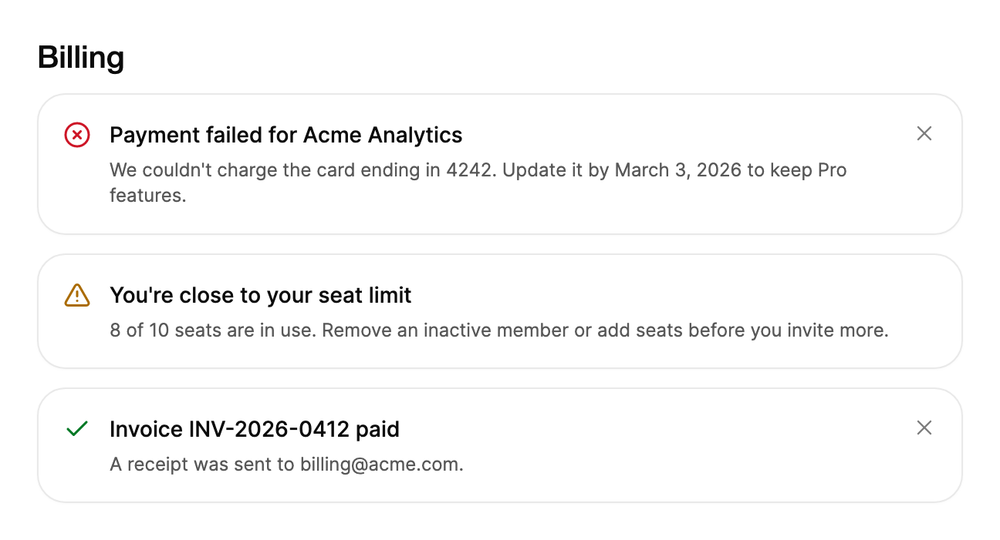

<Demo name="Tones" />

## When to use

`Alert` is a notice that stays on the page until its situation is resolved. It sits in the flow of a page or a form,
next to the content it concerns, and it can change its tone, title and text as the situation changes. It is the
right tool when a message must still be there after the person looks away.

- **Billing and plan notices**: a failed card payment on a billing page, or a plan that renews in seven days. The
  notice explains the consequence and stays until the payment method is updated.
- **Quota and limit warnings**: a workspace that uses 8 of 10 seats, or an export queue that is close to its daily
  limit. The alert sits above the Invite or Export action so the person sees the limit before they hit it.
- **Status of a long-running change**: a domain verification, a sync or a save that moves from "Saving changes" to
  "All changes saved" or "Couldn't save". Keep one `Alert` and change it, so the layout does not jump.
- **Notices that a person can close**: a maintenance window on a dashboard, or a tip in a settings form. After the
  person dismisses it, the content below closes the gap.

## When not to use

- **A confirmation of a finished action**, such as "Changes saved" after a click: use `Toast`, which disappears by
  itself.
- **Queued application results** with actions such as Undo or View, which can arrive together: use `ToastStack`.
- **A decision that must be answered before the person continues**: use `Dialog`.
- **A message about one field**, such as "Enter a full email address": use the `ErrorMessage` row of `Input`, which
  is attached to the field it describes.
- **A site-wide message above every page**: use `AnnouncementBar`, which rotates and can remember a dismissal.
- **A page or list with no content**: use `EmptyState`.

## Usage

Basic usage sets a `Title` and `Content`. The default `Tone` is `Info`.

```xml
<UserControl xmlns="https://github.com/avaloniaui"
             xmlns:arc="https://github.com/AIDotNet/TKCode.Arc">
    <arc:Alert Title="Your card expires next month"
               Content="Update your payment method to keep your plan active." />
</UserControl>
```

`Alert` derives from Avalonia's `ContentControl`, so `Content` and `ContentTemplate` work as they do on any content
control. A string `Content` becomes the description line; any other content is shown below the title as it is.
It has no `Size` property: it takes the width its container gives it, so place it in a column that matches the
content it describes.

### Anatomy

1. **Tone icon** (`Tone`): an 18 px glyph with a 2 px stroke, nudged 1 px down so it sits on the first line of the
   title, with 12 px before the text. Its color follows the tone.
2. **Title** (`Title`): 14 px, medium weight, 19.6 px line height, in the default foreground color. It wraps and
   does not truncate.
3. **Description** (`Content` as a string): 12 px in the secondary text color, 4 px below the title, with a 16.8 px
   line height. An empty description takes no space.
4. **Rich content** (`Content` as any other object): shown in the same column with the same 4 px gap. Text in it
   inherits the 12 px size and the secondary color through `TextElement`.
5. **Dismiss button** (`IsDismissible`): a 28 px round ghost button in the top right corner. It is shown only when
   `IsDismissible` is `True` and is pulled into the 16 px padding (5 px above and below, 6 px to the right) so its
   glyph lines up with the title.
6. **Surface**: 16 px padding inside a 1 px border with the control corner radius, on the surface color with the
   resting shadow.

### Tones

`Tone` sets the icon, its color and how the change is announced. Pick the tone by what the person must do next,
not by how serious the event feels.

| Tone | Icon | Use it for | Announced |
|---|---|---|---|
| `Info` (default) | Info | Neutral facts and tips: a plan renewal date, a new feature | Politely |
| `Success` | Check | A problem is fixed: a domain is verified, a payment cleared | Politely |
| `Warning` | Triangle with an exclamation mark | Action is needed soon: a limit is close, a card expires | Politely |
| `Danger` | Circle with a cross | Something failed and the person must act: a payment or a sync failed | Assertively |

```xml
<StackPanel Spacing="12">
    <arc:Alert Tone="Success" Title="Domain verified"
               Content="Emails from acme.dev will now be delivered." />
    <arc:Alert Tone="Warning" Title="You're close to your storage limit"
               Content="Free up space or upgrade before uploads pause." />
    <arc:Alert Tone="Danger" Title="Payment failed"
               Content="We couldn't charge the card ending in 4242." />
</StackPanel>
```

Use `Danger` sparingly: when it appears on every second notice, people stop reading the color. A `Danger` alert is
announced assertively, so a screen reader interrupts the current speech to read it.

### Morph in place

Keep one instance and change its properties when the state changes. The icon swaps, the new text rises in and the
height follows with a spring. Replacing the control instead skips these transitions and makes the page jump.

<Demo name="MorphInPlace" />

```csharp
// One alert instance changes tone, title and content as a save progresses.
Status.Tone = AlertTone.Info;
Status.Title = "Saving changes";
Status.Content = "Uploading 3 files to the workspace.";

await _workspace.SaveAsync(draft);

Status.Tone = AlertTone.Success;
Status.Title = "All changes saved";
Status.Content = "Everyone in the workspace now sees the latest version.";
```

When the failure path needs a message the person can act on, put the next step in `Content` ("Check your connection
and try again.") rather than in a second alert.

### Dismiss

Set `IsDismissible` to show the close button. Pressing it collapses the alert, then raises `Dismissed`. Setting
`IsOpen` back to `True` shows the alert again, and its icon settles from a smaller size to full size.

<Demo name="Dismiss" />

```csharp
var notice = new Alert { Tone = AlertTone.Warning, IsDismissible = true, Title = "Scheduled maintenance on Sunday" };
notice.Dismissed += (_, _) => SaveDismissedState();

// Show the alert again later.
notice.IsOpen = true;
```

`Dismiss()` does the same from code: it collapses the alert and raises `Dismissed` once the collapse finishes.
Setting `IsOpen` to `False` collapses the alert too, but it does not raise `Dismissed`, because `Dismissed` reports a
person's choice. Use `IsOpen` to hide an alert for another reason, such as a state change that makes it obsolete.

### Custom content

Any non-text `Content` is shown below the title. Text content gets the detail styling; other content is shown as
it is.

<Demo name="CustomContent" />

```xml
<arc:Alert Title="A new version is available">
    <WrapPanel HorizontalAlignment="Center" ItemSpacing="12" LineSpacing="12">
        <arc:Button Content="Reload" Size="Small" Variant="Secondary" />
    </WrapPanel>
</arc:Alert>
```

Keep custom content to one action or a short list. An alert with a form inside it has become a card, and a card
belongs in the layout of its own section. Content that is a plain number or another formatted value is shown as its
text, because `Alert` converts `IFormattable` values with `ToString`.

### Driving it from data

An alert is display-only, but its tone, title and visibility often come from a view model. With
CommunityToolkit.Mvvm, the view model owns the state and the alert shows it. Bind `IsOpen` two-way only when the
dismissal must reach the view model.

```csharp
public record PaymentResult(bool IsSuccess);

public abstract class BillingService
{
    public abstract Task<PaymentResult> RetryAsync(string invoiceId);
}

public partial class BillingViewModel : ObservableObject
{
    private readonly BillingService _billing;

    public BillingViewModel(BillingService billing) => _billing = billing;

    [ObservableProperty]
    private AlertTone _paymentTone = AlertTone.Danger;

    [ObservableProperty]
    private string _paymentTitle = "Payment failed";

    [ObservableProperty]
    private bool _paymentNoticeOpen = true;

    [RelayCommand]
    private async Task RetryPaymentAsync()
    {
        var result = await _billing.RetryAsync("inv_2026_0412");
        PaymentTone = result.IsSuccess ? AlertTone.Success : AlertTone.Danger;
        PaymentTitle = result.IsSuccess ? "Payment received" : "Payment failed";
    }
}
```

```xml
<StackPanel Spacing="12">
    <arc:Alert Tone="{Binding PaymentTone}"
               Title="{Binding PaymentTitle}"
               IsOpen="{Binding PaymentNoticeOpen, Mode=TwoWay}"
               IsDismissible="True"
               Content="Invoice inv_2026_0412 for Acme Analytics is still unpaid." />
    <arc:Button Content="Retry payment" Command="{Binding RetryPaymentCommand}" />
</StackPanel>
```

Give the alert the same tone and title binding as the state it reports, and let the command decide the next state.
A dismissed alert stays hidden until the view model sets `PaymentNoticeOpen` back to `True`.

### Focus and dismissal

An alert takes no focus when it appears, because a notice should not interrupt typing. Its only focus stop is the
dismiss button, which exists only when `IsDismissible` is `True`. Dismissing does not move focus to another control,
so move it yourself in the `Dismissed` handler when the person was working in the alert.

Decide per alert whether dismissal is a choice or a fix. A dismissal the person can make without resolving the
situation (a maintenance tip) can be closable. A problem that the person still has to fix (a failed payment) should
stay open until its state changes, and it should not be closable at all.

### Example: billing page notices

A billing page in a SaaS admin console shows three notices at the top of the plan section. The failed payment is
`Danger` because the workspace loses access on March 3, 2026. The seat warning is `Warning` and explains the next
action, and the receipt is `Success` and closable, because nothing needs to happen. Each title states the situation,
and the description says what the person can do about it.



```xml
<StackPanel Width="600" Spacing="12">
    <TextBlock Text="Billing" FontSize="20" FontWeight="Medium"
               Foreground="{arc:ArcDesignTokenResource Foreground}" />
    <arc:Alert Tone="Danger"
               Title="Payment failed for Acme Analytics"
               Content="We couldn't charge the card ending in 4242. Update it by March 3, 2026 to keep Pro features."
               IsDismissible="True" />
    <arc:Alert Tone="Warning"
               Title="You're close to your seat limit"
               Content="8 of 10 seats are in use. Remove an inactive member or add seats before you invite more." />
    <arc:Alert Tone="Success"
               Title="Invoice INV-2026-0412 paid"
               Content="A receipt was sent to billing@acme.com."
               IsDismissible="True" />
</StackPanel>
```

### Content guidelines

- **Title**: a short statement of the situation in sentence case, with no final period: "Payment failed for Acme
  Analytics". A title is read first by screen readers, so it must make sense on its own.
- **Description**: one or two sentences with the consequence and the next step: "Update it by March 3, 2026 to keep
  Pro features." Write dates and counts as digits.
- **Action text**: when the alert holds a button, use a verb and an object: "Update payment method", not "Click here".
- **Tone of voice**: plain and calm. Name the problem without blame, and avoid exclamation marks.

| Instead of | Write |
|---|---|
| Error! | Payment failed |
| Something went wrong. | Couldn't save your changes. Check your connection and try again. |
| Your account is in danger!!! | Your plan ends on March 3, 2026. |
| Click here to fix it. | Update your payment method. |

### Best practices

**Do**

- Keep one alert per situation, and change its tone and text when the situation changes. A second alert for the
  same problem doubles the noise and leaves a stale message behind.
- Place an alert next to the content it describes, such as above the invoice table or inside the seat settings.
  Its meaning depends on the context around it.
- Use `Danger` only for a failure the person must act on. A `Danger` tone on a routine event trains people to ignore
  the color.
- Keep the alert open until the situation is resolved, unless the person has a real choice to make about it.

**Avoid**

- Using an alert for a finished action. A short confirmation belongs in `Toast`, which does not stay on the page.
- Making a payment or a security notice dismissible. The person can close it without fixing the problem.
- Replacing the control on every state change. The new instance has no morph and the page jumps.
- Stacking more than three alerts in one place. The page becomes a list of warnings and the important one is lost.

### Common questions

**Does `Dismissed` fire when I set `IsOpen` to `False`?** No. `Dismissed` is raised only after `Dismiss()` or the
dismiss button collapses the alert, so it reports a choice the person made. Hiding the alert from code only collapses
it.

**Does a dismissal survive a restart?** No. `Alert` keeps no state. To remember a dismissal, save it in your own
settings when `Dismissed` is raised, then set `IsOpen` to `False` at startup. `AnnouncementBar` offers a remembered
dismissal with `DismissalKey` if the notice is site-wide.

**Why is there no gap between the title and the text?** An empty or null `Content` removes the description row
completely, including its 4 px gap. Set `Content` only when it has text.

**Does the alert hide itself after a while?** No. `Alert` has no timer and no duration. A message that should
disappear by itself belongs in `Toast`. Always set `Title`, because it is the accessible name of the whole alert.

**How do I put a button in the alert?** Set `Content` to a panel that holds the button, as in the custom content
example. The button keeps its own size and command, and the alert provides the padding and the tone.

## API reference

<!-- api: Alert -->

Companion type `AlertTone`:

| Member | Icon | Meaning |
|---|---|---|
| `Info` | Info | Neutral information (accent color). This is the default. |
| `Success` | Check | Something worked. |
| `Warning` | Triangle with an exclamation mark | Attention needed soon. |
| `Danger` | Circle with a cross | Something failed. Announced assertively. |

## Accessibility

- `Title` names the alert and `Content` is read as its help text. A changed title is announced again.
- `Danger` alerts are announced assertively; the other tones are announced politely. A rich `Content` has no help
  text, so put the key sentence in the title or in a text block in the content.
- The close button is named `Dismiss: {Title}`, so the user hears which alert it closes.
- The tone icon is not exposed to assistive technology. The tone is conveyed by the title and content, so the title
  must say what happened even without the color.
- The close button is a regular button: Tab reaches it and Enter or Space activates it.
- Showing an alert takes no focus, so it never interrupts typing.

### Keyboard

| Keys | Action |
|---|---|
| `Tab` / `Shift+Tab` | Moves to or from the dismiss button, when `IsDismissible` is `True` |
| `Enter` / `Space` | Dismisses the alert when the dismiss button has focus |

## Motion

- Showing and hiding the alert opens and closes its height on a smooth spring, and the content below closes up.
- A tone change swaps the icon with a short scale and blur. Changed text rises in and unblurs.
- Reduced motion removes the height animation and the movement. Text and icon only fade, and showing or hiding is
  immediate.
- Off motion jumps straight to the end state.

| Change | Full | Reduced | Off |
|---|---|---|---|
| Alert shown (`IsOpen` set to `True`) | Height springs open, the text fades in and the icon settles from a smaller size | Shown at full height, the text and icon fade in | Immediate |
| Alert dismissed or hidden | Height collapses on a smooth spring while the alert fades out, and the content below moves up | Immediate | Immediate |
| Tone changes | The icon swaps with a scale and a short blur | The icon fades | Immediate |
| Title or content changes | The new text rises in from a soft blur and the height springs to fit | The text fades | Immediate |

## Related

- `Toast` for a brief confirmation of an action that has finished.
- `ToastStack` for application notifications that are queued, updated and stacked.
- `AnnouncementBar` for a rotating banner across the top of a site.
- `EmptyState` when there is no content to show at all.

| Component | Choose it when |
|---|---|
| `Toast` | A finished action needs a short confirmation that closes by itself |
| `ToastStack` | Several results or undo actions arrive from the app and must stack |
| `AnnouncementBar` | A site-wide message sits above every page and rotates |
| `Dialog` | The person must answer before the page continues |
| `Input` | The message belongs to one field, in its description or error row |
| `EmptyState` | A list or page has no content to show |
