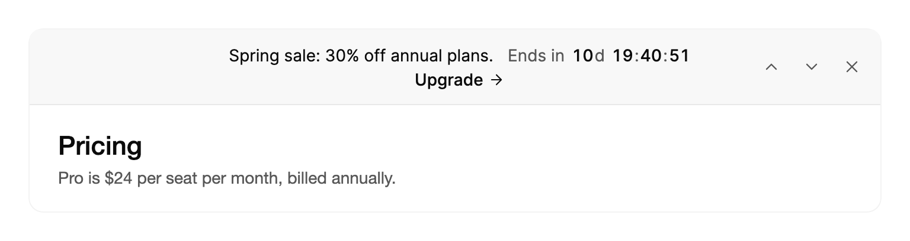

<Demo name="RotatingMessages" />

## 何时使用

`AnnouncementBar` 是页面顶部的细长横幅，面向每一位访客，而不是某个区域。它容纳两到四条简短消息并依次轮播，每条消息可附带一个操作按钮和实时倒计时。关闭后，下方页面会向上移动。它适合放置对整个站点或应用都适用、且用户一眼就能读完的消息。

- **店铺或 SaaS 定价站点的季节性促销**：“春季促销：年付套餐 7 折”，附带 `Upgrade` 操作和优惠截止倒计时，让截止时间在每个页面上都可见。
- **管理后台中的发布消息**：“Arc 2.0 已发布，新增 40 个组件”与“周四 17:00（UTC）在线演示”轮播显示，每条都有各自的链接，一条横幅即可承载一次发布的消息。
- **状态或运维仪表板上的计划维护**：使用反色横幅，附带“开始于”倒计时，直到维护窗口开启前都保持可见。它是页面上最重要的通知，因此使用最强的语气。
- **希望回访客户只看一次的活动**：带 `DismissalKey` 的横幅，在下次访问时保持关闭，当新活动更换了键值后再次显示。

## 何时不用

- **关于某个区域或表单的消息**，例如账单页面上即将到期的银行卡：用 `Alert`，它位于页面内容流中，紧挨着相关内容。
- **访客刚刚操作后的反馈**，例如“更改已保存”：用 `Toast` 或 `ToastStack`。
- **Cookie 或追踪的同意选择**：用 `CookieConsent`，它会提出问题并记录答案。
- **用户继续前必须作出的决定**：用 `Dialog`。
- **聚焦于倒计时本身的页面上的大型倒计时**，例如发布页或结账计时器：用 `Countdown`，它把时间作为页面的主要内容显示，而不是横幅中的一行。

## 用法

将公告添加到 `Messages`。公告栏先显示第一条，然后每隔 `Interval`（默认为 6 秒）轮播其余消息。

```xml
<UserControl xmlns="https://github.com/avaloniaui"
             xmlns:arc="https://github.com/AtomUICommunity/TKCode.Arc">
    <arc:AnnouncementBar>
        <arc:AnnouncementBar.Messages>
            <arc:Announcement Id="launch"
                              Message="Arc 2.0 已发布，新增 40 个组件。" />
            <arc:Announcement Id="webinar"
                              Message="周四 17:00（UTC）进行在线演示。" />
            <arc:Announcement Id="status"
                              Message="所有系统运行正常。" />
        </arc:AnnouncementBar.Messages>
    </arc:AnnouncementBar>
</UserControl>
```

`AnnouncementBar` 派生自 Avalonia 的 `TemplatedControl`。它的消息是 `Announcement` 对象，由横幅自行绘制。它的宽度由容器决定，因此请把它放在窗口或页面布局的第一行，使其横跨整个宽度。每个 `Announcement` 的 `Id` 用于在事件和你的分析数据中标识它，所以请在各个版本之间保持 `Id` 稳定。

### 结构

1. **操作**（`Announcement.Action`）：操作按钮的文字，后面带一个箭头。它以中等字重继承横幅的前景色，悬停时箭头向目标方向移动 2 px。
2. **消息**（`Message`）：消息文字，使用横幅的字号（`TypeSM`）与前景色，行高 19.6 px。消息变化时，文字在至少 32 px 高的窗口内升起就位。
3. **倒计时**（`Announcement.Countdown`）：剩余时间以中等粗细的数字显示，前面可选择性地带 `Label`，两者之间间隔 6 px。冒号与天数标记使用弱化颜色，倒计时作为一个控件绘制。
4. **镜像列**：左侧一个与右侧控件等宽的空列（每个控件 32 px，控件之间间隔 2 px）。它使消息在页面上保持居中，在窄横幅上会被移除。
5. **控件**（`IsNavigationVisible`、`IsDismissible`）：当导航可见且消息多于一条时，依次为上一条（向上箭头）、暂停环和下一条（向下箭头）；当 `IsDismissible` 为 `True` 时，还有关闭按钮（X）。每个都是 32 px 的圆形幽灵按钮，使用弱化颜色。悬停时以 10% 填充，按下时以 12% 填充。
6. **横幅**：弱化表面，底部有 1 px 边框。内边距为左 16 px、右 8 px、上下各 6 px。在宽 560 px 或更窄的横幅上，左侧内边距为 14 px，列间距为 8 px（而非 12 px），并移除镜像列，使消息从左边缘开始。

### 语气

`Tone` 决定横幅的外观。`Neutral`（默认）是带底部边框的弱化表面，适合几乎所有页面。`Inverted` 以前景色填满横幅，并以背景色设置文字。只在不能错过的那一条通知上使用它，并且同一页面上不要超过一个这样的横幅。

<Demo name="Inverted" />

在反色语气中，次要文字使用 66% 的背景色，悬停填充使用 10% 的背景色，因此控件在填充的横幅上仍然清晰可读。

### 控制与自动轮播

设置 `IsNavigationVisible` 即可显示上一条与下一条按钮以及暂停环。`IsAutoPlayEnabled` 可关闭轮播。`Next()` 与 `Previous()` 在代码中切换消息，并且两端都会循环。

<Demo name="ControlsAndCountdown" />

```xml
<arc:AnnouncementBar IsNavigationVisible="True"
                     Interval="0:0:8"
                     IsAutoPlayEnabled="True" />
```

只有同时满足三个条件时才会轮播：消息多于一条、`IsAutoPlayEnabled` 为 `True`，并且横幅的动效级别为完整。在减弱或关闭动效下，横幅会停留在第一条消息上，因此要为用户提供阅读其他消息的方式：`IsNavigationVisible` 提供的上一条与下一条按钮，或你自己调用 `Next()` 与 `Previous()` 的按钮。暂停环会在每个 `Interval` 内逐渐填满。按下它会设置 `IsPaused` 并让计时停在当前位置；再次按下则恢复，并完成该间隔剩余的部分。

`SelectedIndex` 是双向的，报告当前可见的消息。使用 `SelectedIndexChanged` 记录显示了哪条消息，例如用于统计访客看到了哪条公告。

### 操作与倒计时

`Announcement` 可以有一个带 `Label` 和 `Href` 的 `Action` 按钮，以及一个倒数到 `To` 的 `Countdown`。当操作需要运行代码时，在操作上使用 `Command` 而不是 `Href`。若操作同时设置了两者，则先运行命令，然后打开链接。无论哪种方式，之后都会引发 `ActionInvoked`，并附带消息及其索引。

```xml
<arc:AnnouncementBar>
    <arc:AnnouncementBar.Messages>
        <arc:Announcement Id="sale"
                          Message="春季促销：年付套餐享 7 折。">
            <arc:Announcement.Action>
                <arc:AnnouncementAction Label="升级" Href="https://example.com/upgrade" />
            </arc:Announcement.Action>
            <arc:Announcement.Countdown>
                <arc:AnnouncementCountdown To="2026-11-01T00:00:00+00:00" Label="距结束" />
            </arc:Announcement.Countdown>
        </arc:Announcement>
    </arc:AnnouncementBar.Messages>
</arc:AnnouncementBar>
```

```csharp
public static class Analytics
{
    public static void Track(string name, string id) { }
}

bar.ActionInvoked += (_, e) => Analytics.Track("announcement.action", e.Announcement.Id);
bar.CountdownEnded += (_, e) => bar.Messages.Remove(e.Announcement);
```

倒计时在剩余整天或更多时显示天数，之后显示小时、分钟和秒，数字以整秒变化。归零后它会停止并显示零。`CountdownEnded` 在倒计时到达零时引发一次；若消息是在结束时间已过之后才显示的，也会引发。请像上面那样在该处理程序中移除消息，使横幅不会保留已过期的优惠。

### 绑定到视图模型

横幅是带状态的数据列表，因此请绑定到视图模型拥有的集合。消息使用 `ItemsSource`，设置后会覆盖 `Messages`。只有当视图模型需要知道用户关闭了横幅或切换了消息时，才对 `IsOpen` 与 `SelectedIndex` 使用双向绑定。

```csharp
public partial class StorefrontViewModel : ObservableObject
{
    [ObservableProperty]
    private ObservableCollection<Announcement> _announcements = new()
    {
        new Announcement { Id = "sale", Message = "春季促销：年付套餐享 7 折。" },
        new Announcement { Id = "webinar", Message = "周四 17:00（UTC）进行在线演示。" }
    };

    [ObservableProperty]
    private bool _isBannerOpen = true;

    [ObservableProperty]
    private int _bannerIndex;
}
```

```xml
<arc:AnnouncementBar ItemsSource="{Binding Announcements}"
                     IsOpen="{Binding IsBannerOpen, Mode=TwoWay}"
                     SelectedIndex="{Binding BannerIndex, Mode=TwoWay}"
                     IsNavigationVisible="True" />
```

集合变化时，横幅会保留选中的索引（按新的数量取模）并重新开始轮播计时器。因此替换整个集合是安全的，添加或移除消息时也无需单独刷新。

### 记住关闭状态

设置 `DismissalKey` 可在多次运行之间记住关闭状态。该键保存在 `Storage` 中。通过 `AnnouncementBar.ClearDismissal` 清除已保存的值，即可再次显示横幅。关闭状态由 `Storage` 保存，默认为应用数据文件夹中的一个文件。

<Demo name="RememberedDismissal" />

```xml
<arc:AnnouncementBar DismissalKey="spring-campaign" IsDismissible="True" />
```

```csharp
AnnouncementBar.ClearDismissal("spring-campaign");
bar.IsOpen = true;
```

键应标明活动，而不是页面，并在新活动开始时更换键值，使每位访客都能看到新消息一次。关闭时会立即把键写入存储，`Closed` 也会立即引发，早于横幅完成收起动画。

### 示例：SaaS 站点上的春季活动

Northwind Analytics 的营销页面在定价表上方显示春季优惠。横幅承载优惠内容及其截止倒计时、升级页面的链接，以及上一条和下一条控件，访客无需等待即可阅读其他通知。自动轮播已关闭，因为优惠是要阅读的消息，而不是幻灯片。下方的页面内容代表定价表，使横幅收起时它会像在线站点上一样向上移动。



```xml
<Border Width="720"
        CornerRadius="12"
        BorderThickness="1"
        ClipToBounds="True"
        Background="{arc:ArcDesignTokenResource Background}"
        BorderBrush="{arc:ArcDesignTokenResource BorderSubtle}">
    <StackPanel>
        <arc:AnnouncementBar IsNavigationVisible="True"
                             IsAutoPlayEnabled="False">
            <arc:AnnouncementBar.Messages>
                <arc:Announcement Id="sale" Message="Spring sale: 30% off annual plans.">
                    <arc:Announcement.Countdown>
                        <arc:AnnouncementCountdown To="2026-11-01T00:00:00+00:00" Label="Ends in" />
                    </arc:Announcement.Countdown>
                    <arc:Announcement.Action>
                        <arc:AnnouncementAction Label="Upgrade" />
                    </arc:Announcement.Action>
                </arc:Announcement>
                <arc:Announcement Id="annual"
                                  Message="Annual plans include the Pro reports and 10 seats." />
                <arc:Announcement Id="status" Message="All systems operational." />
            </arc:AnnouncementBar.Messages>
        </arc:AnnouncementBar>
        <StackPanel Margin="24,20" Spacing="6">
            <TextBlock Text="Pricing" FontSize="22" FontWeight="Medium"
                       Foreground="{arc:ArcDesignTokenResource Foreground}" />
            <TextBlock Text="Pro is $24 per seat per month, billed annually."
                       FontSize="14"
                       Foreground="{arc:ArcDesignTokenResource TextSecondary}" />
        </StackPanel>
    </StackPanel>
</Border>
```

### 文案规范

- **消息**：一句话，陈述消息并在需要时给出日期或数字：“春季促销：年付套餐享 7 折。”若要在窄窗口上保持一行显示，请控制在约 70 个字符以内。
- **操作文字**：句子式大小写的动词加宾语：“查看新功能”“预留席位”。避免使用“点击这里”。
- **倒计时标签**：时间前的简短短语：“距结束”“距开始”。标签会在时间之前被朗读。
- **语气**：直接、客观。给出日期或截止时间，而不是紧迫性的词语，并避免感叹号。

| 不要写 | 改为 |
|---|---|
| 超大促销！！！ | 春季促销：年付套餐享 7 折。 |
| 点击这里 | 预留席位 |
| 新！了解更多 | Arc 2.0 已发布，新增 40 个组件。 |
| 即将维护 | 今晚 22:00（UTC）计划维护。 |

### 最佳实践

**推荐**

- 一个横幅保留两到四条消息。每条消息都应能在一个间隔（约 6 秒）内读完。
- 把最重要的消息放在最前面，因为横幅加载时显示的是第一条。
- 为每条消息设置稳定的 `Id`。事件会报告它，因此分析可以跨轮播与版本追踪同一条消息。
- 倒计时结束时从 `Messages` 中移除该消息，使横幅不再保留已过期的优惠。

**避免**

- 长消息。换行为多行的消息会把页面往下推，横幅也就不再像横幅。
- 同一页面上有多个反色横幅。两个强烈的横幅相互竞争，人们无法分辨哪个才是重要的。
- 把横幅用于页面的某一个区域。横幅面向每位访客，因此关于某个表单的通知应放在 `Alert` 中。
- 只依赖轮播。在减弱动效下，横幅会停在当前消息上，因此应提供导航控件或指向完整列表的链接。

### 常见问题

**访客关闭横幅后，为什么 `IsOpen` 仍为 `True`？** 记住的关闭状态会在不改变 `IsOpen` 的情况下隐藏横幅，因此横幅能区分本次会话中的关闭与已记住的关闭。把 `IsOpen` 设为 `True` 并不能让它重新出现。请使用该键调用 `AnnouncementBar.ClearDismissal`，然后再次设置 `DismissalKey`（例如先设为 `null` 再设回原值），使横幅重新读取存储。

**为什么我的应用中横幅不轮播？** 轮播需要多于一条消息、`IsAutoPlayEnabled` 设为 `True`，并且动效为完整。在减弱或关闭动效下，横幅会按设计停留在当前消息上。若仍需轮播，请添加导航控件，或从你自己的计时器中调用 `Next()`。

**关闭状态存放在哪里？** 若你在横幅上设置了 `Storage`，则存放在其中。否则存放在 `MessageStorage.Default`，它会在本地应用数据文件夹中写入一个小文件。请在启动时设置一次 `MessageStorage.Default`，以将其保存到你的设置服务中，或在测试中改为内存存储。

**如何读取用户正在查看的消息？** 使用 `Current`，它是当前可见的 `Announcement`；使用 `Count` 获取消息数量。`SelectedIndex` 给出位置，从零开始。

## API 参考

<!-- api: AnnouncementBar -->

<!-- api: Announcement -->

`Announcement` 所使用的配套类型：

| 类型 | 属性 |
|---|---|
| `AnnouncementAction` | `Label`（文字）、`Href`（`Uri`，通过系统启动器打开）、`Command`（`ICommand`，在调用时运行）、`CommandParameter` |
| `AnnouncementCountdown` | `To`（`DateTimeOffset`，倒计时归零的时间）、`Label`（时间前的文字，可选） |

## 无障碍

- 横幅是一个区域，由 `Label` 命名，默认为 `Announcements`。
- 每条消息都有名称，例如 `1 of 3`，让屏幕阅读器知道它在轮播中的位置。
- 轮播切换时不会逐条播报。横幅暂停时才会播报，方便用户阅读。
- Tab 依次聚焦操作、上一条按钮、暂停环、下一条按钮和关闭按钮。Enter 与空格键激活当前聚焦的控件。
- 暂停环是切换按钮，其名称在 `Pause announcements` 与 `Resume announcements` 之间变化。
- 指针位于横幅上方、焦点位于横幅内或窗口最小化时，轮播会暂停。只有鼠标指针会使其暂停，触屏不会，因此要为触屏用户提供暂停环。
- 倒计时滴答时不会被播报。其无障碍名称会完整说出剩余的天数、小时和分钟。
- 上一条、下一条与关闭按钮的名称分别为 `Previous announcement`、`Next announcement` 和 `Dismiss`。

### 键盘

| 按键 | 操作 |
|---|---|
| `Tab` / `Shift+Tab` | 依次经过操作、上一条、暂停环、下一条和关闭控件。隐藏的控件会被跳过 |
| `Enter` / `Space` | 运行聚焦的操作、按下聚焦的按钮，或切换暂停环 |

横幅本身不接收焦点，因此 `Tab` 直接进入其控件。横幅内的焦点会暂停轮播，使键盘用户可以阅读一条消息，而不会在阅读时它自行变化。

## 动效

- 下一条消息带着轻微模糊从下方升起，同时横幅以弹簧调整至适合其高度。
- 暂停环在每个间隔内填满。暂停时停在原处，恢复后继续。
- 倒计时数字变化时以下落方式出现。
- 关闭时横幅收起，下方页面随之上移。
- 减弱动效会停止轮播，并将消息与数字替换为淡入淡出。关闭仅淡出。
- 关闭动效时，每次变化都会立即显示。

| 变化 | 完整 | 减弱 | 关闭 |
|---|---|---|---|
| 自动轮播 | 每隔 `Interval` 前进；下一条消息从下方升起 | 停止；横幅停留在当前消息上 | 停止 |
| 手动切换（`Next`、`Previous`） | 消息带模糊升起或落下，高度以弹簧调整至合适尺寸 | 消息淡入淡出 | 立即完成 |
| 暂停环 | 轮播时可见；在间隔内填满，暂停时停止 | 隐藏 | 隐藏 |
| 倒计时数字变化 | 新数字下落出现，旧数字落下消失 | 数字淡入淡出 | 立即完成 |
| 关闭 | 高度以平滑弹簧收起，下方页面上移 | 横幅淡出而不收起 | 立即完成 |

## 相关组件

- `Alert`：位于某个区域或表单内、直到问题解决前一直保留的消息。
- `ToastStack`：用户刚执行操作的排队结果。
- `CookieConsent`：Cookie 与追踪的同意。

| 组件 | 适用场景 |
|---|---|
| `Alert` | 通知属于某个区域或表单，并会保留到问题解决 |
| `Toast` | 已完成的操作需要一条会自行关闭的简短确认 |
| `ToastStack` | 应用的结果、错误或撤销操作需要在窗口边缘堆叠 |
| `CookieConsent` | 通知请访客就 Cookie 或追踪作出选择 |
| `Countdown` | 倒计时是页面的主要内容，而不是横幅中的一行 |
| `Dialog` | 用户必须先作出回应，页面才能继续 |
