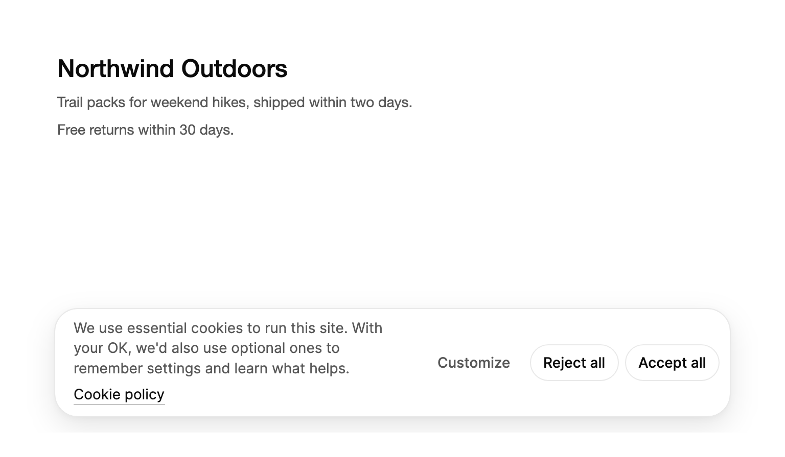

<Demo name="ConsentBar" />

## 何时使用

`CookieConsent` 向访客征求关于 Cookie 与追踪的选择，并保存这一选择。它以图层的形式覆盖在页面底部边缘，页面在它后面仍可阅读。同意条提供“全部接受”“全部拒绝”和“自定义”。点击“自定义”会打开一个带开关的类别面板；保存后的选择会收拢为一个小型的重新打开按钮，让访客在任何页面都能随时改变主意。

- **加载分析与广告脚本的营销网站**：同意条在任何可选脚本运行之前出现。“全部接受”与“全部拒绝”权重相同，拒绝与接受一样容易。
- **带可选类别的商店或 SaaS Web 应用**：偏好设置、分析与营销是各自独立的开关，初始为关闭；严格必要（登录、安全、购物车）始终开启。
- **之后更改选择**：做出选择后，重新打开按钮保留在角落，访客无需寻找页脚链接，就能在任何页面打开偏好设置。
- **政策更新需要重新征求同意**：类别或政策变化时修改 `Version`，之前保存的版本选择会被忽略，访客将被再次询问。

## 何时不用

- **不需要任何选择的全站通知**，例如促销或维护窗口：用 `AnnouncementBar`。
- **会自行关闭的简短确认**：用 `Toast`。
- **必须等用户回答才能继续的决定**，例如年龄验证：用 `Dialog`。
- **页面某个区域内的普通消息**：用 `Alert`。

## 用法

将控件放在页面之上，例如作为窗口根 `Grid` 的最后一个子元素。该控件是一个图层：除自身表面外，不接收指针输入。未设置类别时，使用 Arc 的四个默认类别：严格必要、偏好设置、分析与营销。

```xml
<UserControl xmlns="https://github.com/avaloniaui"
             xmlns:arc="https://github.com/AIDotNet/TKCode.Arc">
    <Grid>
        <!-- 页面内容放在这里。 -->
        <arc:CookieConsent StorageKey="site-consent" Version="1" />
    </Grid>
</UserControl>
```

`CookieConsent` 派生自 Avalonia 的 `TemplatedControl`。它的同意条、面板与重新打开按钮是同一表面的三种形态，控件在它们之间移动，因此只需配置一个控件，无需自行放置各个形态。由于控件会覆盖其周围的内容，它必须排在父面板中那些内容之后。

### 结构

1. **图层**：与控件父级的左、右、下边缘保持 16 px 距离。只有表面接收指针输入，因此图层下方的页面仍可点击。
2. **表面**：带 1 px 边框环和浮动阴影的凸起表面。同意条的圆角为 22 px，面板为 26 px。
3. **同意条**（`IsPreferencesOpen` 为 `False` 且没有已保存的选择）：次要文字颜色的消息，末尾是行内的 `Policy` 链接。同意条最宽 660 px，消息前为 18 px，消息后为 10 px。三个按钮依次为自定义（幽灵按钮）、全部拒绝与全部接受（次要按钮），均为小尺寸，间距 6 px。宽度小于 560 px 时，消息位于按钮上方。
4. **面板**（`IsPreferencesOpen` 为 `True`）：宽 420 px，内边距 18 px。包含标题、32 px 的关闭按钮、描述、类别列表与操作区。类别列表超过 300 px 高度后可滚动。每一行包含类别标签及其描述，以及一个开关；必需类别则显示文字 `Always on`。操作区中，“全部拒绝”与“全部接受”并排放置，“保存选择”横跨整个宽度，位于一条细分隔线之下。
5. **重新打开按钮**：直径 44 px 的圆形幽灵按钮，带有 Cookie 图标。做出选择后，当 `IsReopenButtonVisible` 为 `True` 时出现，位于同意条所在一侧的角落（由 `ReopenSide` 决定，同意条居中时位于左侧）。

### 类别与政策

设置 `Categories` 以定义类别。`IsRequired` 使某个类别始终开启，`IsEnabledByDefault` 设置可选类别在保存选择之前的初始状态。除非你设置此项，否则可选类别默认关闭。`Policy` 会在同意条消息末尾与面板描述中添加一个指向完整政策的链接。

四个默认类别如下：

| Id | 标签 | 初始状态 |
|---|---|---|
| `necessary` | Strictly necessary | 开启，始终开启（必需） |
| `preferences` | Preferences | 关闭 |
| `analytics` | Analytics | 关闭 |
| `marketing` | Marketing | 关闭 |

```xml
<arc:CookieConsent StorageKey="site-consent" Version="2">
    <arc:CookieConsent.Categories>
        <arc:CookieCategory Id="necessary" Label="严格必要"
                            Description="网站正常运行所需。"
                            IsRequired="True" IsEnabledByDefault="True" />
        <arc:CookieCategory Id="analytics" Label="分析"
                            Description="帮助我们了解哪些页面有用。" />
    </arc:CookieConsent.Categories>
    <arc:CookieConsent.Policy>
        <arc:CookieConsentPolicy Label="Cookie 政策" Href="https://example.com/cookies" />
    </arc:CookieConsent.Policy>
</arc:CookieConsent>
```

类别或政策变化时请修改 `Version`。版本不同的已保存选择会被忽略，访客将被再次询问。版本是字符串，因此 `"2"` 与 `"2.0"` 是不同的版本。

### 响应选择

访客保存、接受、拒绝或重置选择时会引发 `ConsentChanged`。`Consent` 将每个类别的 id 映射为 `True` 或 `False`，访客尚未决定时为 `null`。只在此事件中启动可选脚本，或在启动时读取已保存的选择后再启动，切勿在访客作答之前启动。

```csharp
public static class Analytics
{
    public static bool Enabled { get; set; }
}

consent.ConsentChanged += (_, e) =>
{
    if (e.Consent is not null && e.Consent.TryGetValue("analytics", out var allowed))
    {
        Analytics.Enabled = allowed;
    }
};
```

`Action` 说明选择是如何做出的：`AcceptAll`、`RejectAll`、`Save`（面板）或 `Reset`。执行 `Reset` 之后 `Consent` 的值为 `null`，因此可以据此判断访客正在被再次询问。

### 读取已保存的选择

在控件显示之前、启动时读取已保存的选择，即可为已做出决定的访客跳过同意条。

```csharp
var record = CookieConsent.Read("site-consent", "2");
if (record is not null)
{
    Analytics.Enabled = record.Value.TryGetValue("analytics", out var allowed) && allowed;
}
```

当没有存储任何内容、存储不可用，或已保存的选择是为另一个版本保存的时，`Read` 返回 `null`。记录会公开其 `Value` 字典、`Version` 以及 `UpdatedAt` 时间。控件在首次挂载时读取同一份存储，因此已做决定的访客不会在重新打开按钮出现之前看到同意条闪现。

### 绑定到视图模型

控件包含一个值（`Consent`）、一个类别列表（`ItemsSource`）以及一个打开状态（`IsPreferencesOpen`）。使用 CommunityToolkit.Mvvm 时，这些属性由视图模型持有，绑定会让它们与访客的选择保持同步。

```csharp
public partial class ConsentViewModel : ObservableObject
{
    [ObservableProperty]
    private ObservableCollection<CookieCategory> _categories = new()
    {
        new CookieCategory { Id = "necessary", Label = "严格必要", IsRequired = true, IsEnabledByDefault = true },
        new CookieCategory { Id = "analytics", Label = "分析", Description = "以汇总方式统计访问次数。" }
    };

    [ObservableProperty]
    private IReadOnlyDictionary<string, bool>? _consent;

    [ObservableProperty]
    private bool _isPreferencesOpen;
}
```

```xml
<arc:CookieConsent StorageKey="site-consent"
                   Version="2"
                   ItemsSource="{Binding Categories}"
                   Consent="{Binding Consent, Mode=TwoWay}"
                   IsPreferencesOpen="{Binding IsPreferencesOpen, Mode=TwoWay}" />
```

`Consent` 与 `IsPreferencesOpen` 是双向绑定的。访客做决定、打开或关闭面板时，控件会写入这两个属性，因此视图模型无需事件处理程序即可读取选择。从代码设置 `Consent` 不会保存任何内容：只有访客的决定或 `Reset` 才会在设置了 `StorageKey` 时写入存储。若要保存你自己计算出的选择，请使用 `Read` 读取已保存的值，或使用你自己的存储。

### 位置与重新打开按钮

`Position` 将同意条设置在底部、左下或右下。`IsReopenButtonVisible` 会在保存选择后保留 44px 的按钮。`OpenPreferences` 可从其他控件（例如页脚链接）打开面板。

```xml
<arc:CookieConsent Position="BottomRight" IsReopenButtonVisible="True" />
```

```csharp
settingsLink.Click += (_, _) => consent.OpenPreferences();
```

请将位置放在页面自身的控件不会被遮挡的地方：右下角的同意条可能会遮住聊天按钮或“返回顶部”按钮。除非访客可以在其他地方更改选择（例如账号设置页面），否则请保持 `IsReopenButtonVisible` 为 `True`。若没有重新打开按钮，已保存的选择会将控件完全隐藏。

### 示例：营销网站上的同意

一位访客来到 Northwind Outdoors（一家销售徒步背包的商店），尚未作答。同意条覆盖在商品页面之上，消息、政策链接和三个选项具有相同的阅读权重。“全部接受”与“全部拒绝”并排放置且尺寸相同，这正是访客信任的同意模式。“自定义”保持为低调的幽灵按钮，既可用，又不会与两个答案争夺注意力。



```xml
<Border Width="720"
        Height="400"
        CornerRadius="12"
        ClipToBounds="True"
        Background="{arc:ArcDesignTokenResource Background}"
        BorderBrush="{arc:ArcDesignTokenResource BorderSubtle}">
    <Grid>
        <StackPanel Margin="32,28" Spacing="10">
            <TextBlock Text="Northwind Outdoors" FontSize="24" FontWeight="Medium"
                       Foreground="{arc:ArcDesignTokenResource Foreground}" />
            <TextBlock Text="Trail packs for weekend hikes, shipped within two days."
                       FontSize="14" TextWrapping="Wrap"
                       Foreground="{arc:ArcDesignTokenResource TextSecondary}" />
            <TextBlock Text="Free returns within 30 days." FontSize="14"
                       Foreground="{arc:ArcDesignTokenResource TextSecondary}" />
        </StackPanel>
        <arc:CookieConsent StorageKey="northwind-consent">
            <arc:CookieConsent.Storage>
                <arc:InMemoryMessageStorage />
            </arc:CookieConsent.Storage>
            <arc:CookieConsent.Policy>
                <arc:CookieConsentPolicy Label="Cookie policy" />
            </arc:CookieConsent.Policy>
        </arc:CookieConsent>
    </Grid>
</Border>
```

### 文案规范

- **消息**：说明 Cookie 的用途以及访客能获得什么。默认消息会同时说明必要 Cookie 与可选 Cookie，因此替换时请保持相同的结构。
- **按钮文字**：保留默认值（全部接受、全部拒绝、自定义、保存选择），让访客在每个网站上看到相同的词语。它们采用句首大写，并说明按钮的作用。
- **类别描述**：用简单的话用一句说明用途：“只以汇总方式统计访问次数，并了解哪些页面有帮助。”
- **本地化**：文案来自 `Labels`（`CookieConsentLabels`）。每个控件都有自己的标签，因此请用页面的语言设置它们，而不是在代码中修改消息。

| 不要写 | 改为 |
|---|---|
| 接受 | 全部接受 |
| 我们使用 Cookie 来改善您的体验！！！ | 我们使用必要的 Cookie 来运行本站。若您同意，我们还会使用可选的 Cookie。 |
| 必要 | 严格必要 |
| Cookie 设置 | 自定义 |

### 最佳实践

**推荐**

- 让“全部接受”与“全部拒绝”拥有相同的权重、尺寸与位置。让拒绝变得更困难的同意会被视为暗黑模式，注意到它的访客会停止信任网站的其他部分。
- 在访客选择之前，将可选类别保持为关闭，并且只在 `ConsentChanged` 中启动可选脚本，或在启动时读取已保存的选择后再启动。
- 每当类别或政策变化时修改 `Version`，让访客被再次询问。
- 保持重新打开按钮可见，让访客随时可以更改选择。

**避免**

- 将 `IsEnabledByDefault` 设为 `True` 来预先勾选可选类别。这些类别并非访客自己选择的。
- 从代码设置 `Consent` 来记录选择。它不会被保存；请通过控件做出决定，或自行保存该值。
- 让同意条遮住访客需要的内容，例如结账按钮。请在小窗口中测试该图层。
- 用同意条询问与 Cookie 或追踪无关的问题。询问其他事项的同意对话框会让访客养成直接关闭的习惯。

### 常见问题

**为什么已经作答的访客看不到同意条？** 当前 `Version` 的已保存选择会将控件收拢为重新打开按钮，因此同意条按设计被隐藏。使用 `Reset` 可忘记该选择并重新询问。如果你预期同意条会出现，请检查 `Read` 是否返回了具有相同 `StorageKey` 与版本的记录。

**Escape 会保存选择吗？** 不会。Escape 会关闭偏好设置面板而不保存，同意条保持原样。开关的草稿会被丢弃，因此重新打开面板时显示的是已保存的值。

**如何从页脚链接打开偏好设置？** 调用 `OpenPreferences()`（如用法示例所示），或双向绑定 `IsPreferencesOpen`。`ClosePreferences()` 会在不保存的情况下关闭面板。`Reset()` 会忘记已保存的选择，清除存储，并重新显示同意条。

**选择存储在哪里？** 若你在控件上设置了 `Storage`，则存储在那里；否则存储在 `MessageStorage.Default` 中，它是本地应用数据文件夹中的一个文件。存储的文本是 JSON，包含值、版本与时间，例如 `{"value":{"analytics":true},"version":"2","updatedAt":"2026-10-21T09:30:00.0000000+00:00"}`。在预览与测试中请使用内存存储。

**能否在 Web 站点之外使用该控件？** 它是一个通用的同意图层。在桌面应用中，措辞与类别由你决定：`Labels` 修改同意条与面板的文案，你自己的类别则说明要询问的内容，因此同意条可以询问遥测或数据共享，而不是 Cookie。

## API 参考

<!-- api: CookieConsent -->

<!-- api: CookieCategory -->

与 `CookieConsent` 配合使用的辅助类型：

| 类型 | 成员 |
|---|---|
| `CookieConsentPolicy` | `Label`（链接文字，默认 `Cookie policy`）、`Href`（`Uri`，通过系统启动器打开）、`Command`（`ICommand`，调用时执行） |
| `CookieConsentLabels` | `Message`、`Customize`、`AcceptAll`、`RejectAll`、`Save`、`PreferencesTitle`、`PreferencesDescription`、`Reopen`、`AlwaysOn`、`Close` |
| `CookieConsentAction` | `AcceptAll`、`RejectAll`、`Save`、`Reset`：选择是如何做出的 |
| `CookieConsentPosition` | `Bottom`（默认）、`BottomLeft`、`BottomRight` |
| `CookieConsentRecord` | `Value`（类别 id 到是否允许）、`Version`、`UpdatedAt`：由 `CookieConsent.Read` 返回 |

## 无障碍

- 同意条与面板都是非模态对话框。二者均以标题命名，其消息或描述作为帮助文字。
- 打开面板时，焦点移到其标题。保存面板后，焦点移到重新打开按钮。
- 每个类别的开关以类别标签命名，描述作为帮助文字。必需类别显示 `Always on` 文字，而不是开关。
- Tab 在按钮与开关之间移动。空格键切换当前焦点所在的开关，点击类别名称也会切换。
- Escape 关闭面板且不保存，并将焦点返回到同意条。
- “全部拒绝”与“全部接受”权重相同，并排放置。
- 重新打开按钮以 `Cookie preferences`（`Reopen` 标签）命名，因此在做出选择之后可以通过名称找到它。
- 保存按钮的帮助文字会统计选择的数量，例如“3 个可选类别中已允许 2 个”，因此屏幕阅读器用户在保存之前就能听到效果。

### 键盘

| 按键 | 操作 |
|---|---|
| `Tab` / `Shift+Tab` | 在同意条或面板的按钮与开关之间移动 |
| `Space` | 切换当前焦点所在的类别开关 |
| `Enter` | 按下当前焦点按钮：自定义、全部拒绝、全部接受、保存选择、关闭或重新打开按钮 |
| `Escape` | 在面板中关闭它且不保存，并将焦点返回到同意条 |

## 动效

- 同意条、面板与重新打开按钮是同一个表面，它会改变位置、宽度、高度与圆角。
- 每个面板内容从短暂的模糊中上升几像素出现。离场的面板淡出并略微下沉。
- 同意条以轻微缩放从底边进入。
- 减弱动效时，表面在各形态之间直接跳转，内容只做淡入。关闭动效时，每次变化立即显示。

| 变化 | 完整 | 减弱 | 关闭 |
|---|---|---|---|
| 同意条进入 | 以轻微缩放从底边升起并淡入 | 淡入 | 立即 |
| 表面改变形态（同意条、面板、重新打开按钮） | 移动、改变尺寸与圆角。放大时带有轻微过冲，缩小时则直接稳定，没有过冲 | 直接跳转到新形态 | 立即 |
| 内容切换 | 新内容从约 10 px 的模糊中上升；离场内容淡出并略微下沉 | 新内容淡入；离场内容快速淡出 | 立即 |

## 相关组件

- `AnnouncementBar`：不需要用户选择的全站通知。
- `Dialog`：必须等用户回答才能继续的决定。
- `Toast`：会自行关闭的简短确认。

| 组件 | 适用场景 |
|---|---|
| `AnnouncementBar` | 通知面向所有访客，且不需要做出选择 |
| `Dialog` | 用户必须先作答，页面才能继续 |
| `Toast` | 简短的确认应当自行关闭 |
| `Alert` | 普通消息属于页面的某一个区域 |
| `Switch` | 在你自己的页面中，表单内设置单个偏好 |
