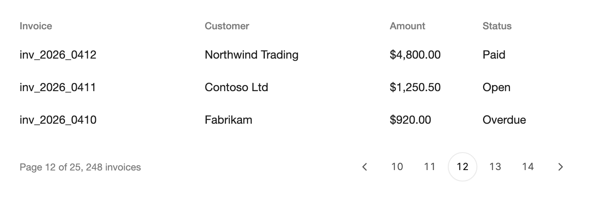

<Demo name="Default" />

## 何时使用

`Pagination` 让人在应用分页加载的一个集合中前后翻页：计费控制台中的发票列表、门店后台的订单表格、CRM 的搜索结果。控件保存当前页码与总页数，绘制上一页、下一页按钮以及一个由五个页码按钮组成的窗口，数据的加载则交由应用负责。它位于所分页的数据下方，正是人们寻找下一批数据的位置。

- **计费控制台中的发票与付款**：从服务端每次加载 10 条，共 248 张发票。页脚显示“第 12 页，共 25 页”，上一页与下一页按钮在两端停用，页码保存在视图模型中，因此刷新后人仍停留在同一页。
- **门店后台的订单与退货**：订单表格翻阅服务端结果，页码也是客服沟通时引用的数字（“退货队列第 4 页”）。
- **内部工具中的搜索结果**：结果集太长而无法滚动，总数已知，每一页都是一次单独的请求。
- **总数已知的审计日志与事件流**：页数来自服务端返回的总数，因此人在点击之前就能看到列表的边界。

## 何时不用

- **浏览条目的幻灯片**，例如商品图片或引导卡片：用 `Carousel`，它让人一次查看一个条目并逐个切换。
- **随滚动阅读的长信息流**，例如活动流或不断增长的日志：在 `ScrollArea` 这类可滚动容器中使用 `Timeline`。页码按钮会打断信息流的阅读节奏。
- **跳转到层级结构中的某个位置**，例如从“计费”到“发票”再到某一张发票：用 `Breadcrumb`，它显示通往当前页面的路径。
- **在同一对象的不同视图之间切换**，例如概览、活动与设置：用 `Tabs`。
- **选取一段日期或数值范围**：用 `DateRangePicker` 或 `Slider`。页码无法描述一段数值范围。

## 用法

绑定 `CurrentPage` 与 `PageCount`。控件会渲染一个包含五个页码按钮的窗口，窗口随当前页移动。

```xml
<UserControl xmlns="https://github.com/avaloniaui"
             xmlns:arc="https://github.com/AtomUICommunity/TKCode.Arc">
    <arc:Pagination PageCount="{Binding PageCount}"
                    CurrentPage="{Binding CurrentPage, Mode=TwoWay}" />
</UserControl>
```

`Pagination` 派生自 Avalonia 的 `TemplatedControl`，而不是列表控件。它没有 `ItemsSource`，也从不加载或计数任何内容：应用负责计算总页数并响应页码变化。`CurrentPage` 默认为双向绑定，因此 `Mode=TwoWay` 可以省略。两个值都是普通整数，所以同一个控件既可以使用服务端响应中的总数，也可以使用本地列表的数量或常量。

### 结构

1. **地标**（`Label`）：导航地标，默认名称为“Pagination”。它不会被绘制。
2. **上一页按钮**（`PreviousLabel` 为其无障碍名称）：36 px 见方的按钮，内含 16 px 的左箭头。第一页时禁用，但位置保持不变。
3. **页码按钮**：五个 36 px 见方的按钮，相互间隔 4 px。数字使用等宽数字，字号为特小号，颜色为次要文字色，圆角与控件一致。
4. **当前页标记**：表面色的胶囊形状，带 1 px 边框与静止阴影。它位于当前数字之下，页码变化时滑动到下一个数字。
5. **边界按钮与省略号**（`ShowBoundaryPages`）：首页与末页按钮，以及窗口两侧各一个 24 px 的省略号。仅当窗口未到达两端时才会出现。
6. **下一页按钮**（`NextLabel` 为其无障碍名称）：与上一页按钮对称，在末页时禁用。
7. **焦点环**：2 px 的焦点色圆环，绘制在按钮外侧 4 px 处。仅在键盘聚焦时出现。

控件将各项按行排列并保持左对齐。禁用的按钮降至 40% 不透明度，并显示“不允许”光标。

### 响应页码变化

处理 `PageChanged` 以加载页面。`NewPage` 是人请求的页码，`OldPage` 是变化之前的页码。只要 `CurrentPage` 发生变化就会触发该事件，因此由代码引起的变化（例如绑定或筛选后的重置）也会触发它。

```csharp
pagination.PageChanged += async (_, e) =>
{
    status.Text = $"第 {e.NewPage} 页，共 {pagination.PageCount} 页";
    await LoadPageAsync(e.NewPage);
};
```

`NewPage` 是 `CurrentPage` 的原始值，而不是钳制之后的值。如果代码在只有 25 页的列表上把 `CurrentPage` 设为 99，那么 `NewPage` 为 99，而按钮显示的是第 25 页。可以在处理程序中进行钳制，或在视图模型中让 `CurrentPage` 保持在有效范围内（见下文）。

### 边界页

`ShowBoundaryPages` 让首页与末页都只需一次点击即可到达，并在它们与窗口之间显示省略号。它是 Arc 规范之外的扩展，默认关闭。只有当 `PageCount` 大于五时边界按钮才会出现，并且每个按钮只在窗口尚未到达其端点时出现。适用于人可能需要快速跳到首页或末页的长列表，例如从最新条目开始阅读的日志。

<Demo name="BoundaryPages" />

### 页数很少或没有页

页数少于五页时全部显示，两端的箭头会被禁用。`PageCount` 为 `0` 时渲染一个空的导航地标：页码按钮与箭头都会隐藏，只保留地标。结果为空时使用零值，并用空状态替代该控件。

<Demo name="FewPages" />

<Demo name="NoPages" />

### 标签

`Label` 为导航地标命名。`PreviousLabel`、`NextLabel` 与 `PageLabelFormat` 为辅助技术的按钮命名。当默认文字不是用户所用的语言时，请进行设置。`PageLabelFormat` 接受一个 `{0}` 占位符表示页码，并按当前文化进行格式化。

```xml
<arc:Pagination Label="结果分页"
                PreviousLabel="上一页"
                NextLabel="下一页" />
```

### 绑定到视图模型

发票列表在视图模型中保存当前页与总页数。页数由服务端返回的总数推导，当前页变化时加载对应的行。使用 CommunityToolkit.Mvvm 时，人更改页码会触发生成的部分方法，因此加载不依赖于视图。

```csharp
public sealed record InvoiceRow(string Id, string Customer, string Amount, string Status);

public sealed record InvoicePage(int Total, IReadOnlyList<InvoiceRow> Rows);

public interface IInvoiceService
{
    Task<InvoicePage> GetPageAsync(int page, int pageSize);
}

public partial class InvoiceListViewModel : ObservableObject
{
    private const int PageSize = 10;
    private readonly IInvoiceService _invoices;

    [ObservableProperty]
    private int _currentPage = 1;

    [ObservableProperty]
    private int _pageCount;

    public ObservableCollection<InvoiceRow> Rows { get; } = new();

    public InvoiceListViewModel(IInvoiceService invoices)
    {
        _invoices = invoices;
    }

    partial void OnCurrentPageChanged(int value)
    {
        _ = LoadPageAsync(value);
    }

    private async Task LoadPageAsync(int page)
    {
        var result = await _invoices.GetPageAsync(page, PageSize);
        PageCount = (int)Math.Ceiling(result.Total / (double)PageSize);
        if (PageCount > 0 && page > PageCount)
        {
            // 列表缩短了：跳到最后一页，由它来加载。
            CurrentPage = PageCount;
            return;
        }
        Rows.Clear();
        foreach (var row in result.Rows)
        {
            Rows.Add(row);
        }
    }
}
```

```xml
<arc:Pagination PageCount="{Binding PageCount}"
                CurrentPage="{Binding CurrentPage}"
                Label="发票分页" />
```

`CurrentPage` 是双向的，因此控件会把人选择的页码写回视图模型，视图模型通过它自己的属性做出响应。在这种设计中不需要 `PageChanged`。只有当视图代码（而非视图模型）必须对变化作出反应时才使用它，例如把列表滚动到顶部。

### 保持页码在范围内

控件会对所显示的页码进行钳制，但从不自行修改绑定的值。当 `PageCount` 减少到小于 `CurrentPage` 时（例如筛选移除了若干行），`CurrentPage` 保持原值：按钮显示最后一页，而视图模型中的值已超出范围。因此在总数变化时，应在视图模型中把 `CurrentPage` 设为 `PageCount`，如上例中的 `LoadPageAsync` 所示。

`EffectivePage` 是按钮所显示的页码，没有页时为 0。`WindowStart` 是五页窗口中的第一个数字。`GoToPage(page)` 跳转到某一页，并钳制在有效范围内；未发生变化时返回 `false`。`NextPage()` 与 `PreviousPage()` 前进或后退一页，到达两端时返回 `false`。在代码后置或键盘快捷键中使用这些方法，即可与按钮应用相同的规则。

```csharp
// 一个快捷键，无需事先知道总数即可跳到最后一页。
pagination.GoToPage(int.MaxValue);
```

### 示例：发票列表页脚

一个发票表格及其分页页脚。页脚以文字说明页码与总数，这是人在页码变化后首先核对的信息；控件放在右侧，使数字与箭头成为一组。当前为第 12 页，共 25 页，因此窗口为 10 到 14，两个箭头都可用。标签将地标命名为“发票分页”，方便屏幕阅读器用户使用；行中的金额保留两位小数，状态以文字显示，而不只依靠颜色区分。



```xml
<StackPanel Width="680" Spacing="0">
    <Grid ColumnDefinitions="2*,2*,*,*" Margin="0,0,0,8">
        <TextBlock Grid.Column="0" Text="Invoice" FontSize="12" FontWeight="Medium"
                   Foreground="{arc:ArcDesignTokenResource TextMuted}" />
        <TextBlock Grid.Column="1" Text="Customer" FontSize="12" FontWeight="Medium"
                   Foreground="{arc:ArcDesignTokenResource TextMuted}" />
        <TextBlock Grid.Column="2" Text="Amount" FontSize="12" FontWeight="Medium"
                   Foreground="{arc:ArcDesignTokenResource TextMuted}" />
        <TextBlock Grid.Column="3" Text="Status" FontSize="12" FontWeight="Medium"
                   Foreground="{arc:ArcDesignTokenResource TextMuted}" />
    </Grid>
    <Grid ColumnDefinitions="2*,2*,*,*" Height="40">
        <TextBlock Grid.Column="0" Text="inv_2026_0412" FontSize="14" VerticalAlignment="Center" />
        <TextBlock Grid.Column="1" Text="Northwind Trading" FontSize="14" VerticalAlignment="Center" />
        <TextBlock Grid.Column="2" Text="$4,800.00" FontSize="14" VerticalAlignment="Center" />
        <TextBlock Grid.Column="3" Text="Paid" FontSize="14" VerticalAlignment="Center" />
    </Grid>
    <Grid ColumnDefinitions="2*,2*,*,*" Height="40">
        <TextBlock Grid.Column="0" Text="inv_2026_0411" FontSize="14" VerticalAlignment="Center" />
        <TextBlock Grid.Column="1" Text="Contoso Ltd" FontSize="14" VerticalAlignment="Center" />
        <TextBlock Grid.Column="2" Text="$1,250.50" FontSize="14" VerticalAlignment="Center" />
        <TextBlock Grid.Column="3" Text="Open" FontSize="14" VerticalAlignment="Center" />
    </Grid>
    <Grid ColumnDefinitions="2*,2*,*,*" Height="40">
        <TextBlock Grid.Column="0" Text="inv_2026_0410" FontSize="14" VerticalAlignment="Center" />
        <TextBlock Grid.Column="1" Text="Fabrikam" FontSize="14" VerticalAlignment="Center" />
        <TextBlock Grid.Column="2" Text="$920.00" FontSize="14" VerticalAlignment="Center" />
        <TextBlock Grid.Column="3" Text="Overdue" FontSize="14" VerticalAlignment="Center" />
    </Grid>
    <Grid ColumnDefinitions="*,Auto" Margin="0,20,0,0">
        <TextBlock Grid.Column="0" Text="Page 12 of 25, 248 invoices" FontSize="12"
                   VerticalAlignment="Center"
                   Foreground="{arc:ArcDesignTokenResource TextMuted}" />
        <arc:Pagination Grid.Column="1" Label="Invoice pages" PageCount="25" CurrentPage="12" />
    </Grid>
</StackPanel>
```

### 文案规范

- **摘要文字**：在控件旁用文字说明范围：“第 12 页，共 25 页，248 张发票”或“显示第 111 至 120 条，共 248 条”。控件只显示数字，文字让扫视页脚的人理解其含义。
- **标签**：为列表命名，而不是为控件命名：“发票分页”“结果分页”。地标名称会被朗读，只说“Pagination”的话，屏幕阅读器用户无法得知内容。
- **按钮名称**：除非应用语言不同，否则保留默认的“上一页”和“下一页”。只有当默认的“第 {0} 页”读起来不合适时，才用 `{0}` 占位符格式化页码标签，例如“跳转到第 {0} 页”。
- **空结果**：结果为零时不要显示分页控件。显示空状态，并用一句话说明搜索的内容。

| 不要写 | 改为 |
|---|---|
| 标签 “Pagination” | 发票分页 |
| 页脚 “12 / 25” | 第 12 页，共 25 页，248 张发票 |
| 上一页（仅图标，无名称） | 上一页 |
| 空表格下方的分页 | 没有符合这些筛选条件的发票。 |

### 最佳实践

**推荐**

- 在视图模型中让 `CurrentPage` 保持在有效范围内；总数减少时把它设为 `PageCount`，使绑定的值始终与按钮显示的一致。
- 在视图模型中根据页码加载数据，使刷新与深层链接都能到达同一页。
- 在控件旁用文字显示范围与总数，让人在翻页之前就知道共有多少行。
- 为页面上的每个分页设置 `Label`，使同一屏幕上的两个列表被读作两个地标。

**避免**

- 显示并非来自服务端总数的页数。根据已加载的行计算出的数量会隐藏列表的其余部分，并使最后一页看起来就是末尾。
- 在下一页数据到达之前清空行。请求进行期间保持当前行显示，并在页脚文字中显示变化，让人看到的是进度，而不是空表格。
- 在短列表上使用 `ShowBoundaryPages`。它增加的省略号和按钮对只有三页的列表没有必要。
- 在总数仍在加载时设置 `PageCount`。为零或过时的数量会让箭头因错误的原因被禁用。

### 常见问题

**控件允许人输入页码或更改每页条数吗？** 不允许。Arc 的分页是受控的：它只显示窗口与箭头。若需要每页条数选择，可以在旁边加一个 `Select`，再加一个跳转页码的 `NumberField`，并在它们的处理程序中调用 `GoToPage`。

**在代码中设置 `CurrentPage` 时，为什么会触发 `PageChanged`？** 该事件由属性变化引发，因此无论变化来自人还是代码都会触发。在开始请求之前，将 `e.NewPage` 与上次加载的页码进行比较，避免同一页被重复加载。

**`PageCount` 为 0 时会怎样？** 页码按钮与箭头会隐藏，`EffectivePage` 为 0。导航地标仍保留在控件树中，因此只有在确实有内容可翻页时才把它留在页面上，否则在视图中隐藏该控件。

**一次能显示超过五页吗？** 不能。窗口始终是五个页码按钮（`WindowSize` 为 5）。对于首页与末页，使用 `ShowBoundaryPages`；其他情况请使用其他组件，或使用带有自身滚动的列表。

## API 参考

<!-- api: Pagination -->

## 无障碍

- 该控件是一个导航地标，由 `Label` 命名，并会被朗读为一组控件。
- 每个页码按钮由 `PageLabelFormat` 命名，例如“第 3 页”。当前页具有当前页状态。
- 上一页与下一页按钮在两端被禁用，但保留其名称。
- Tab 键在上一页按钮、页码按钮与下一页按钮之间移动。Enter 或空格键进入焦点所在的页码。左右方向键在按钮之间移动焦点。
- 省略号与隐藏的按钮不可聚焦，并对辅助技术隐藏。
- 键盘焦点跟随数字：页码按钮获得焦点时窗口移动，焦点会随该数字移动到它的新位置。

### 键盘

| 按键 | 操作 |
|---|---|
| `Tab` / `Shift+Tab` | 在上一页按钮、可见的页码按钮与下一页按钮之间移动；跳过禁用的箭头 |
| `Enter` / `Space` | 前往焦点所在的页码，或在箭头上前往上一页或下一页 |
| `Left` / `Right` | 把焦点移到上一个或下一个可用按钮；直到按下 Enter 或 Space，页码才会改变 |

## 动效

- 单个当前页标记以 morph 弹簧滑动到所选按钮。
- 窗口移动时，数字按移动的槽位数像传送带一样滑动，新数字淡入。
- 减弱动效时，标记立即移动，数字原位替换。关闭动效时立即应用变化。

| 变化 | 完整 | 减弱 | 关闭 |
|---|---|---|---|
| 当前页变化 | 标记以 morph 弹簧滑动到新数字 | 标记立即移动 | 立即完成 |
| 窗口按若干槽位移动 | 数字按移动的槽位数滑动（每个 40 px），使用 smooth 弹簧；新数字淡入 | 数字原位替换 | 立即完成 |
| 数字离开窗口 | 滑入并在 120 ms 内淡出 | 立即移除 | 立即完成 |
| 按下箭头 | 按住时箭头缩放至 96% | 无按下缩放 | 无按下缩放 |
| 悬停、聚焦 | 背景色与文字颜色渐变 | 立即完成 | 立即完成 |

## 相关组件

- `Tabs`：用于在视图之间切换，而不是在一个集合的页面之间切换。
- `Breadcrumb`：用于显示页面在层级结构中的位置。
- `Carousel`：用于逐张浏览幻灯片。

| 组件 | 适用场景 |
|---|---|
| `Tabs` | 各视图是同一对象的并列视图，且各自有独立的面板 |
| `Breadcrumb` | 页面位于层级结构中，人需要沿路径返回上层 |
| `Carousel` | 条目一次查看一个，例如商品图片 |
| `Timeline` | 信息流或日志按顺序阅读，列表随滚动增长 |
| `ScrollArea` | 长列表通过滚动阅读，而不是通过翻页 |
| `Select` / `NumberField` | 页脚还需要每页条数选择或跳转页码字段 |
| `DateRangePicker` / `Slider` | 人选择的是一段日期或数值，而不是页码 |
