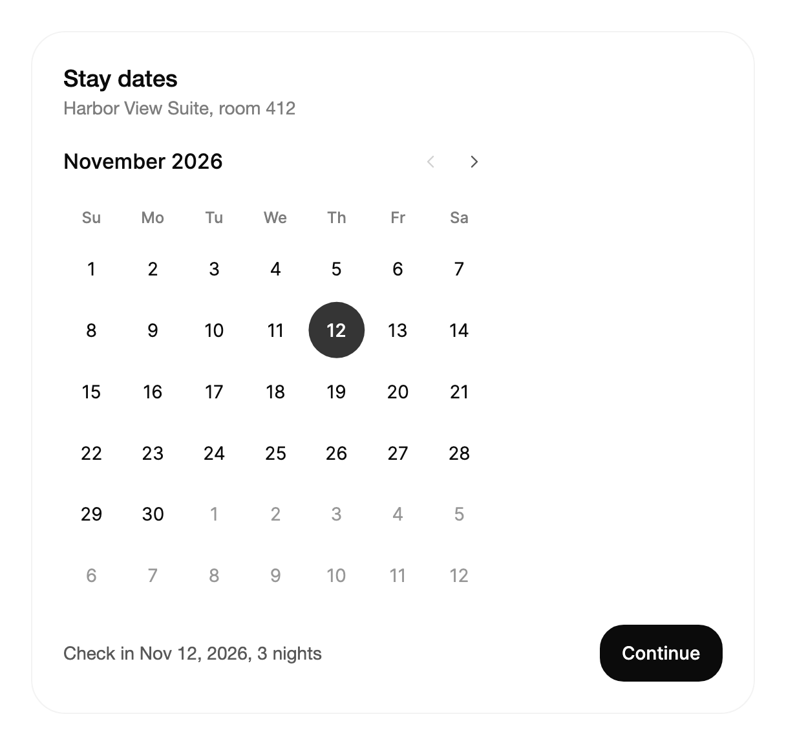

<Demo name="SingleDate" />

## 何時使用

`Calendar` 在頁面上顯示一個月的日期，選取的日期、導覽與限制始終可見。它適用於日曆本身就是內容的畫面：預訂頁、可用性檢視，或讓使用者在選定某一天之前比較多天的排程面板。會彈出的日期欄位屬於另一類工作，由 `DatePicker` 負責。

- **飯店預訂頁上的入住日期**：房客在飯店或租賃流程中選擇入住日。整個月都留在畫面上，房客無需開啟任何東西，就能看到週末、已售完的夜晚以及預訂期間的邊界。
- **診所或服務主控台中的預約時段**：營運人員先選日期，再選時間。月檢視顯示哪些日期可約，然後才載入所選日期的時間清單。
- **可用性與休假規劃**：內部工具中的主管為某天標記排班或休假申請。當使用者在編輯頁面其餘部分時，月檢視保持可見，而彈出層會把它遮住。
- **從單一日期開始的報表與匯出範圍**：財務使用者為一次發票批次選擇對帳單日期。`MaxDate` 等限制讓選擇保持在帳目的結算期之內。
- **以鍵盤為主的管理後台表單**：格線只有一個 Tab 停駐點，並支援方向鍵以及按月、按年翻頁的 Page 鍵，因此從不使用滑鼠的操作人員也能快速瀏覽一個月。

## 何時不用

- **表單中的日期欄位**：用 `DatePicker`。它是一個在彈出層中開啟日曆的欄位，因此表單保持高度，標籤、說明與錯誤列仍與其他欄位對齊。
- **開始與結束日期**：用 `DateRangePicker`。它保存兩個日期，提供「最近 7 天」等預設選項，並且只在使用者確認後才套用範圍。
- **一天中的時間或帶時間的日期**：在 `DatePicker` 旁使用 `TimePicker`。`Calendar` 只選擇一天，它的值沒有時間部分。
- **以紀錄形式列出的日期**：發票、訂單或依日期欄排序的出貨紀錄用 `DataGrid`。日曆一次只顯示一個月，無法列出許多紀錄的細節。
- **從少數已知日期中快速選取**：當選項是「本週」或「下一個帳單週期」這類具名值，而不是格線中的日期時，用 `Select` 或 `RadioGroup`。

## 用法

```xml
<UserControl xmlns="https://github.com/avaloniaui"
             xmlns:arc="https://github.com/AtomUICommunity/TKCode.Arc">
    <arc:Calendar ShowToday="True" />
</UserControl>
```

`Calendar` 衍生自 Avalonia 的 `TemplatedControl`，因此它支援常見的版面配置、`IsEnabled`、`Focusable` 與樣式屬性。它的月份與選取動態效果、鍵盤模型以及限制規則都是本程式庫的一部分。每個公開屬性、方法與事件都列在 API 參考中。

### 結構

1. **月份標題**：顯示月份與年份的名稱，採用語系的年月格式（例如 `en-US` 下的 "October 2026"）。它使用基本字級與中等字重，位於標題列左側，標題列至少 34 px 高，下方留 14 px。
2. **今天按鈕**（`ShowToday`、`TodayLabel`）：帶文字的幽靈膠囊按鈕，高 32 px，左右各有 11 px 內距。只有當 `ShowToday` 為 `True` 時才可見。
3. **上一個月與下一個月按鈕**：兩個 32 px 的圓形幽靈按鈕，內含 16 px 的箭頭圖示。它們位於標題右側，相距 2 px。會越過 `MinDate` 或 `MaxDate` 的按鈕會被停用，並以 36% 的不透明度繪製。
4. **星期列**：簡短的星期名稱，使用弱化文字顏色，採用超小字級與中等字重。它從 `FirstDayOfWeek` 開始，下方留 6 px。
5. **日期格線**：六列，每列七天，列距 4 px。每一天都是小字級的 14 px 文字。六列始終存在，因此只有五週的月份會在最後一列顯示相鄰月份的日期。
6. **選取圓點**：位於選取日期背後、填滿強調色的圓形，其數字使用強調前景色。滑鼠懸停在未選取的日期上時，它會填滿為表面弱化色；懸停在選取日期上時使用較醒目的強調色。
7. **焦點環**：圍繞取得鍵盤焦點的日期的 2 px 焦點色環。

寬度為 `min(100%, 328px)`：日曆永遠不會超過 328 px，並在其容器中靠左對齊。由於高度由六列固定，日曆在每個月占用的空間都相同，導覽時它下方的內容也不會移動。

### 選取日期

`SelectedDate` 是 `DateOnly?`，只使用其日期部分。它預設為雙向繫結，因此繫結的值會跟隨使用者選取的日期，程式碼中設定的值也會移動選取。使用 `null` 表示沒有選取：此時日曆沒有選取的日期，其可聚焦的 Tab 停駐點會移到今天，或當月第一個可用日期。

只有使用者選取某一天時才會觸發 `DateSelected`：點擊、在聚焦的日期上按下 Enter 或 Space，或點擊「今天」按鈕。從程式碼設定 `SelectedDate` 不會觸發它。當程式碼變化也需要觸發某個反應時，訂閱繫結的屬性；當反應只針對使用者操作時，才訂閱 `DateSelected`。

```xml
<arc:Calendar SelectedDate="{Binding StayDate, Mode=TwoWay}" />
```

```csharp
calendar.DateSelected += (_, e) => status.Text = $"已選取 {e.Date:D}";
```

事件只攜帶一個值：

| 成員 | 類型 | 含義 |
|---|---|---|
| `Date` | `DateOnly` | 使用者選取的日期。它永遠不會是停用的日期。 |

### 限制與停用日期

`MinDate` 與 `MaxDate` 是可選取的最早與最晚日期。`DisabledDates` 是一個 `Func<DateOnly, bool>`，對每個不能選取的日期傳回 `true`，例如週末、已訂滿的夜晚或國定假日。只要三條規則中有一條適用，該日期即被停用。

<Demo name="LimitsAndDisabledDays" />

這些規則在三個地方生效：被停用的日期不能被點擊，也不能透過 Enter 或 Space 啟動；方向鍵與 Page 鍵永遠不會落在它上面；導覽按鈕會停在包含限制的月份。當鍵盤移動會落到停用日期上時，焦點會沿移動方向跨過它：當週六和週日被停用時，在週五按右方向鍵會把焦點移到週一。

### 顯示月份

`DisplayMonth` 是 `DateOnly?`，用於指定顯示的月份。該月中的任何一天都可以；日曆會把值正規化為該月的第一天。它是雙向繫結的：當使用者用按鈕或鍵盤切換到另一個月時，`DisplayMonth` 會隨之更新，因此繫結的檢視模型總是知道畫面上顯示的是哪個月。

```xml
<arc:Calendar DisplayMonth="{Binding ViewMonth, Mode=TwoWay}" />
```

未設定 `DisplayMonth` 時，日曆從 `SelectedDate` 所在的月份開始；未選取任何日期時，從目前月份開始。控制項啟動之後，從程式碼修改 `SelectedDate` 不會把檢視轉到該日期的月份；如需如此，請設定 `DisplayMonth` 或呼叫 `GoToMonth`。`GoToMonth(DateOnly date, bool raise = true)` 會滑動到包含 `date` 的月份，並且在 `raise` 保持預設值時也會更新 `DisplayMonth`。

### 標籤與語系

`Culture` 設定月份名稱、星期名稱以及無障礙名稱中長日期的語言。未設定時使用目前的 UI 語系，因此跟隨作業系統語言的應用程式無需任何設定。`FirstDayOfWeek` 選擇第一欄；預設為 `Sunday`，歐洲或 ISO 版面通常設為 `Monday`。

`TodayLabel`、`PreviousMonthLabel` 與 `NextMonthLabel` 取代文字與名稱。今天標籤是可見文字；上一個月與下一個月標籤只是無障礙名稱，因為這些按鈕顯示的是箭頭。請把三者一起翻譯，避免螢幕閱讀器在控制項中途切換語言。

```xml
<arc:Calendar Culture="de-DE"
              FirstDayOfWeek="Monday"
              TodayLabel="Heute"
              PreviousMonthLabel="Vorheriger Monat"
              NextMonthLabel="Nächster Monat"
              ShowToday="True" />
```

### 焦點與漫遊 Tab 停駐點

格線只有一個 Tab 停駐點：最後取得焦點的日期；否則是選取的日期；否則是今天；再否則是所顯示月份中第一個可用的日期。Tab 在該日期處進入格線，並從格線移到下一個控制項，因此長表單不需要四十二個停駐點。`FocusTabbableDay(NavigationMethod method = NavigationMethod.Directional)` 會把焦點移到該日期，並在沒有任何日期能取得焦點時傳回 `false`，例如控制項尚未顯示，或該月每一天都被停用。把它承載在彈出層或對話方塊中，並在控制項掛接之後呼叫，這樣方向鍵會立即生效。

### 繫結到檢視模型

預訂頁在檢視模型中持有日期與可用性規則。日曆繫結到日期，並以函式的形式接收規則，因此規則可以讀取檢視模型中的資料。

```csharp
public partial class StayViewModel : ObservableObject
{
    private readonly HashSet<DateOnly> _bookedNights;

    public StayViewModel(IReadOnlySet<DateOnly> bookedNights)
    {
        _bookedNights = bookedNights.ToHashSet();
        MinStayDate = DateOnly.FromDateTime(DateTime.Today);
    }

    [ObservableProperty]
    private DateOnly? _stayDate;

    [ObservableProperty]
    private DateOnly? _viewMonth;

    [ObservableProperty]
    private string? _reservationNotice;

    public DateOnly MinStayDate { get; }

    public DateOnly MaxStayDate => MinStayDate.AddMonths(6);

    public Func<DateOnly, bool> IsBooked => date => _bookedNights.Contains(date);

    [RelayCommand]
    private void Continue()
    {
        if (StayDate is { } checkIn)
        {
            ReservationNotice = $"已為 {checkIn:MMM d, yyyy} 辦理入住保留 15 分鐘。";
        }
    }
}
```

```xml
<StackPanel Width="328" Spacing="12">
    <arc:Calendar SelectedDate="{Binding StayDate, Mode=TwoWay}"
                  DisplayMonth="{Binding ViewMonth, Mode=TwoWay}"
                  MinDate="{Binding MinStayDate}"
                  MaxDate="{Binding MaxStayDate}"
                  DisabledDates="{Binding IsBooked}" />
    <arc:Button Content="繼續" Command="{Binding ContinueCommand}" />
    <TextBlock Text="{Binding ReservationNotice}" />
</StackPanel>
```

`SelectedDate` 與 `DisplayMonth` 是雙向的，因此檢視模型能收到每一次選取和每一次月份切換。`MinDate`、`MaxDate` 與 `DisabledDates` 是單向輸入，檢視模型在規則變化時設定它們。只要為屬性設定新值即可：當限制變化時，日曆會重新整理格線和導覽按鈕。日曆本身沒有命令。`繼續` 按鈕呼叫檢視模型的命令，該命令讀取 `StayDate` 並設定 `ReservationNotice`，一個字串，按鈕下方的 `TextBlock` 可以繫結到它。

日期規則只在使用者輸入時檢查。透過繫結或程式碼設定的 `SelectedDate` 不會與 `MinDate`、`MaxDate` 或 `DisabledDates` 比較，因此檢視模型不能設定超出它們範圍的日期。請在檢視模型中保持限制與值的一致。

### 範例：飯店入住日期

Northwind Lodge 的租賃預訂頁。房客在 2026 年 11 月選擇入住日。日曆從所選夜晚所在的月份開始，最早的日期是 11 月 1 日，因此上一個月按鈕被停用，下方的摘要列用簡單的文字說明該決定。在這個場景中日曆沒有可見的今天按鈕，因為該場景固定在某個日期上，應該在每台機器上都看起來一樣。

月檢視就是控制項的全部：無需獨立的標題或圖例，因為頁首已經寫明月份，圓點則顯示選擇。



```xml
<Border Width="560"
        Padding="24"
        Background="{arc:ArcDesignTokenResource Surface}"
        BorderBrush="{arc:ArcDesignTokenResource BorderSubtle}"
        BorderThickness="1"
        CornerRadius="{arc:ArcDesignTokenResource RadiusPanel}">
    <StackPanel Spacing="16">
        <StackPanel Spacing="4">
            <TextBlock Text="Stay dates"
                       FontSize="{arc:ArcDesignTokenResource TypeLG}"
                       FontWeight="{arc:ArcDesignTokenResource WeightMedium}"
                       Foreground="{arc:ArcDesignTokenResource Foreground}" />
            <TextBlock Text="Harbor View Suite, room 412"
                       FontSize="{arc:ArcDesignTokenResource TypeSM}"
                       Foreground="{arc:ArcDesignTokenResource TextMuted}" />
        </StackPanel>
        <arc:Calendar SelectedDate="2026-11-12"
                      MinDate="2026-11-01"
                      MaxDate="2026-12-31" />
        <Grid ColumnDefinitions="*,Auto">
            <TextBlock Text="Check in Nov 12, 2026, 3 nights"
                       VerticalAlignment="Center"
                       FontSize="{arc:ArcDesignTokenResource TypeSM}"
                       Foreground="{arc:ArcDesignTokenResource TextSecondary}" />
            <arc:Button Grid.Column="1" Content="Continue" />
        </Grid>
    </StackPanel>
</Border>
```

這個範例中的決定都是有意為之。限制來自預訂期間，因此房客無法選擇過去的夜晚，也無法選擇年底之後的夜晚。摘要用文字重複了選擇，這對螢幕閱讀器以及向上捲動回到頁面的房客都很重要。按鈕是唯一的主要操作；日曆本身沒有操作按鈕。

### 文案規範

- **月份標題**：日曆會按語系的格式為你寫出它；不要在同一卡片中再加一個寫著同一月份的標題。請在日曆上方的標題中說明用途，例如「入住日期」或「休假申請」。
- **今天標籤**：英文介面保留預設的 “Today”，或使用產品為當天所用的詞。它是可見按鈕，因此只用一個詞。
- **上一個月與下一個月標籤**：說明目的地，即 “Previous month” 或 “Next month”，因為按鈕只透過名稱被朗讀。
- **日曆下方的摘要文字**：完整寫出結果，日期使用數字，月份名稱採用語系格式，例如 “Check in Nov 12, 2026, 3 nights”。說明結果，而不是機制。
- **停用日期**：當整類日期都不可用時，在附近加以說明，例如「週末不可預訂」。原因應寫在頁面上，因為格線本身不會說明某天為何被停用。

| 不要寫 | 改為 |
|---|---|
| Date | Stay dates |
| Choose a date | Check-in date |
| Next | Next month |
| Selected: 12 | Check in Nov 12, 2026 |
| Sat, Sun unavailable | Weekends are not bookable for this suite. |

### 最佳做法

**建議**

- 把 `MinDate` 與 `MaxDate` 設為真實的預訂或報表期間。導覽會停在邊界上，使用者不會翻到一個沒有可選日期的月份。
- 對於屬於資料的規則使用 `DisabledDates`，例如已訂滿的夜晚；對於期間使用 `MinDate` 與 `MaxDate`。這兩類規則在格線和鍵盤模型中的表現方式一致。
- 將 `SelectedDate` 設為雙向繫結，並在檢視模型中對繫結的值作出反應，使摘要和儲存操作總能看到與格線相同的日期。
- 根據產品所在的地區選擇 `FirstDayOfWeek`，因為人們首先掃視的是第一欄。
- 每個決定只放一個日曆。同一頁面上並排的兩個日曆會讓人同時比較兩個月，這種情況更適合 `DateRangePicker`。

**避免**

- 把 `DateSelected` 當作值的唯一來源。它只為使用者操作而觸發，因此在程式碼中設定的值永遠不會到達等待該事件的檢視模型。
- 在程式碼中設定會破壞 `MinDate`、`MaxDate` 或 `DisabledDates` 的 `SelectedDate`。日曆不會修正它，因此格線可能顯示一個使用者永遠無法選取的選取日期。
- 把日曆放進同時帶有日期欄位的表單。同一個值的兩個日期輸入會讓人不清楚哪一個是目前值；表單中應使用 `DatePicker`。
- 為期間不包含今天的日曆開啟 `ShowToday`。這個按鈕會把人帶到限制之外。
- 在日曆上方再加一個重複的月份標題。頁首已經寫明月份，而重複的文字不會隨使用者導覽而改變。

### 常見問題

**為什麼格線總是顯示六週？** 每個月使用六列，因此格線有 42 天，相鄰月份的日期填滿空白格。高度在導覽時從不改變，因此日曆下方的內容不會隨月份切換而跳動。

**為什麼我在程式碼中設定 `SelectedDate` 時處理常式沒有執行？** `DateSelected` 只為使用者的選擇而觸發：點擊、在聚焦的日期上按下 Enter 或 Space，或點擊「今天」按鈕。對於程式碼中的修改，請使用繫結的 `SelectedDate` 屬性；只對使用者所採取的操作使用 `DateSelected`。

**如何把檢視切換到某個日期所在的月份？** 對於帶動畫的導覽，呼叫 `GoToMonth(new DateOnly(2027, 3, 1))`；或者把 `DisplayMonth` 設為該月中的某一天。除非傳入 `raise: false`，否則 `GoToMonth` 也會更新 `DisplayMonth`。

**日曆開啟期間限制能變化嗎？** 能。設定 `MinDate`、`MaxDate`、`DisabledDates`、`FirstDayOfWeek` 或 `Culture` 都會重新整理格線，導覽按鈕也會隨之更新。現在已被停用的選取會保持選取，直到使用者選擇另一天，因此當規則使其失效時，請在程式碼中清除它。

**日曆保持開啟並跨過午夜會怎樣？** 日曆跟隨本地日期。日期變化時，突顯的今天和「今天」按鈕會更新，因此整夜留在畫面上的日曆不會把舊的一天顯示為今天。

## API 參考

<!-- api: Calendar -->

## 無障礙

- 日曆以其月份標題命名，例如 “October 2026”，因此焦點進入格線時，使用者能聽到格線顯示的內容。
- 每一天都是一個按鈕，名稱為語系長格式的完整日期，例如 “Tuesday, October 20, 2026”。選取的日期帶有說明文字 “selected”，今天則帶有 “today”。
- 上一個月、下一個月和「今天」按鈕都有名稱：即 `PreviousMonthLabel`、`NextMonthLabel`，以及後接今天完整日期的今天標籤。上一個月與下一個月按鈕在包含 `MinDate` 或 `MaxDate` 的月份中被停用，因此在那裡它們會被朗讀為不可用。
- 同一時間只有一天在 Tab 順序中。方向鍵、Home、End 與 Page 鍵在格線內移動焦點；Tab 則離開格線，進入下一個控制項。
- 月份切換以禮貌的方式通知。滑出視野的月份不可聚焦，並對輔助技術隱藏，因此焦點永遠不會落在使用者看不見的日期上。
- 停用的日期保留在格線中，因此使用者能看到該日期存在，但無法選取它。

### 鍵盤

| 按鍵 | 操作 |
|---|---|
| `Left` / `Right` | 焦點向前或向後移動一天；跨入相鄰月份 |
| `Up` / `Down` | 焦點向前或向後移動一週 |
| `Home` / `End` | 移到所在週的第一天或最後一天，依據 `FirstDayOfWeek` |
| `PageUp` / `PageDown` | 焦點向前或向後移動一個月；保留日期，並限制在該月的長度之內 |
| `Shift` + `PageUp` / `PageDown` | 焦點向前或向後移動一年 |
| `Enter` / `Space` | 選取聚焦的日期；停用的日期會被忽略 |

移動會在 `MinDate` 與 `MaxDate` 處停止，並沿移動方向跨過停用的日期。移動到新的月份時，會改變 `DisplayMonth`，並在該月開始滑動的同一影格移動焦點。Tab 與 Shift+Tab 離開格線；只有焦點位於某一天上時，日曆才處理方向鍵。

## 動態效果

- 月份沿移動方向在同一條帶上滑動。標題隨之滑動，選取的圓點從一天滑向另一天。圓點經過時，數字會改變顏色。
- 長距離跳轉（例如「今天」或 Shift + PageDown）從目標月份旁邊的月份開始，不會經過中間的各個月份。
- 減少動態效果時，月份與圓點直接跳到最終狀態，標題原地替換。關閉動態效果時亦同。

| 變化 | 完整 | 減少 | 關閉 |
|---|---|---|---|
| 移動一個月（按鈕、PageUp、PageDown） | 月份條沿移動方向以短暫、無回彈的彈簧滑動 | 新月份立即出現 | 立即 |
| 月份標題 | 舊標題沿移動方向滑出，新標題淡入 | 標題原地替換 | 立即 |
| 選取圓點在日期之間移動 | 沿直線滑過格線 | 跳到新日期 | 跳到新日期 |
| 選取首次出現 | 從 60% 的比例放大，並以快速彈簧淡入 | 立即顯示 | 立即 |
| 圓點下方的日期數字 | 圓點經過時改變顏色 | 立即改變顏色 | 立即 |
| 長距離跳轉（今天、Shift + 翻頁鍵） | 從目標旁邊的月份開始，跳過中間的月份 | 直接跳轉 | 立即 |

動態效果從不延遲鍵盤操作。在月份條仍在滑動時再次按下方向鍵，會為同一個彈簧重新設定目標，因此日曆會跟隨最新的位置，而不會排隊執行較早的移動。

## 相關元件

- `DatePicker`：用於日期欄位，點擊後在彈出層中開啟日曆，通常位於表單中。
- `DateRangePicker`：用於帶預設的開始與結束日期。
- `TimePicker`：用於選取一天中的時間。
- `DataGrid`：用於需要欄與排序的帶日期紀錄。

| 元件 | 適用情境 |
|---|---|
| `DatePicker` | 表單需要一個帶標籤、說明與錯誤列的日期欄位 |
| `DateRangePicker` | 使用者選取開始與結束日期，通常帶有「最近 30 天」等預設 |
| `TimePicker` | 值是一天中的時間，或時間與日期配對 |
| `DataGrid` | 日期屬於許多需要排序與欄的紀錄 |
| `Select` | 選項是具名的選項，而不是日期 |
