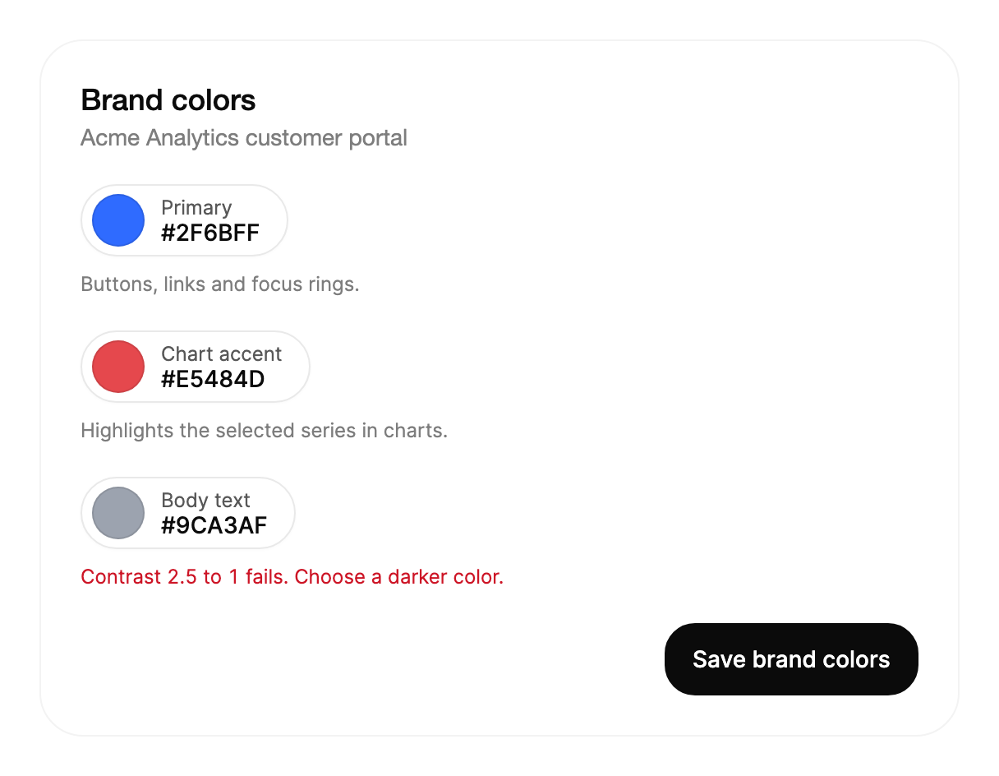

<Demo name="ColorField" />

## When to use

`ColorPicker` gives a person a full color editor in a compact field. The closed control is a swatch with a label and the
hex value; opening it reveals the saturation and brightness area, the hue and opacity sliders, a text field that accepts
four notations, a contrast readout and a row of saved colors. It belongs where a color is a real setting that the
person must tune, not a choice from a short list.

- **Brand settings in a multi-tenant admin console**: an administrator sets the primary color for a customer's invoices
  and sign-in page. The swatch shows the current brand color in the settings list, and the panel accepts a pasted hex
  value from the customer's style guide.
- **Theme and design token editors**: a product team edits surface and accent colors, including translucent overlays
  where the alpha channel is part of the value. The OKLCH format lets them adjust lightness and chroma by hand.
- **Text color checks in a content tool**: an editor chooses a text color and reads its WCAG contrast against the
  background of the page it will sit on. The grade (AAA, AA, AA large or Fails) shows whether the text is legible
  before it is published.
- **Series colors for charts and dashboards**: an analyst assigns a color to each chart series. The saved colors keep
  the palette the team has already agreed, so each new series is picked from the same set.
- **Saved brand swatches for marketing tools**: a campaign builder keeps up to seven colors that the team reuses across
  banners and emails, with the newest color first.

## When not to use

- **A few fixed colors**: use `SegmentedControl` or `RadioGroup` when the options are named choices such as "Light",
  "Dark" or three status colors. The person picks one; they do not tune the color.
- **A plain hex value with no picker**: use `Input` when the value is typed or pasted and the person never needs the
  area or the sliders, for example an API token color in a webhook setting that is copied from documentation.
- **Small preset color labels that filter a list**: use `ChipGroup` for tags such as "Red", "Blue" or "Unassigned" that
  filter invoices or tickets. A chip group selects among presets; it does not produce arbitrary values.
- **A color derived from a brand palette that the person should not change**: show the value in a read-only `Input`
  next to the setting it belongs to. A disabled picker still takes space and invites a question about why it is
  locked; state the rule in the description instead.
- **Dates, numbers or measures**: use `NumberField`, `DatePicker` or `Slider` for values with units. A color has three
  or four channels that the picker keeps in step; those controls hold a single number.

## Usage

```xml
<UserControl xmlns="https://github.com/avaloniaui"
             xmlns:arc="https://github.com/AtomUICommunity/TKCode.Arc">
    <arc:ColorPicker Label="Accent"
                     Color="#2F6BFF"
                     Format="Hex" />
</UserControl>
```

`ColorPicker` derives from Avalonia's `TemplatedControl` and implements the Arc picker automation contract, so it
takes the usual layout, `IsEnabled`, focus and styling properties. Its value is an Avalonia `Color`, so the same
color flows into brushes, resources and view models without conversion. The label, description and error copy come
from the shared field foundation, so the picker lines up with the other fields in a form.

### Anatomy

1. **Trigger**: a 44 px pill with a 22 px corner radius. It holds a 32 px chip that shows the color (over a
   checkerboard when the color is translucent), the `Label` in 12 px text and the `HexValue` in 14 px text, with a 10 px
   gap between the chip and the text. It is left aligned and takes its own width.
2. **Description** (`Description`): helper copy under the trigger, in the muted text color.
3. **Error** (`ErrorMessage`): copy in the danger color under the trigger. A non-empty value marks the picker invalid.
4. **Panel head**: when the panel is open, it repeats the chip, the label and the hex value, with a 32 px Done button at
   the right edge. The panel is at most 304 px wide, and never wider than the window minus 32 px.
5. **Saturation and brightness area**: 164 px high with a 16 px corner radius. Saturation runs left to right and
   brightness runs bottom to top, and the thumb shows the current pair.
6. **Hue and opacity sliders**: two 14 px tracks under the area. The opacity track shows the color over the checkerboard.
7. **Value field**: a 40 px row with a 14 px corner radius. The format button at its start (HEX, RGB, HSL or OKLCH) is at
   least 56 px wide. The text field takes the rest of the row, and an invalid entry shows its message below.
8. **Contrast row**: a 36 × 28 px sample with a 9 px corner radius, showing the color on `ContrastBackground`; the ratio
   text, the grade in a 22 px pill, and the words "against background" (hidden on viewports 360 px wide or less).
9. **Saved swatches**: a row of saved colors, each a small square, followed by a dashed Save button.

The panel opens downward from the trigger and grows out of it. It moves left or up only when the window edge would clip
it, and when the page is scrolled to the bottom, the page scrolls to make room first.

### Value and format

`Color` is an Avalonia `Color` and is two-way. It is the value to bind. `Format` sets the notation shown in the text
field, and the format button cycles through the four notations in the panel. Setting `Format` in code changes the
notation without changing the color.

`HexValue` is read-only and gives the color as upper-case CSS hex: `#RRGGBB`, or `#RRGGBBAA` when the color is
translucent. Use it for display, copy and export. It is not the same order as Avalonia's own string form: Avalonia's
`Color.Parse` reads eight-digit values as `#AARRGGBB`, so pass CSS values through the picker's text field or convert
them yourself.

| Format | Example output for #2F6BFF | Notes |
|---|---|---|
| `Hex` | `#2F6BFF` | The default. Translucent colors add two digits: `#2F6BFF80`. |
| `Rgb` | `rgb(47 107 255)` | Space-separated. Translucent colors add `/ 50%` in the same form. |
| `Hsl` | `hsl(223 100% 59%)` | Hue in degrees, saturation and lightness in percent. |
| `Oklch` | `oklch(56.2% 0.214 263.5)` | Perceptual lightness and chroma; useful when two colors must look equally bright. |

The text field accepts the same four notations, and it is tolerant on input: three- and four-digit hex, `rgb()` and
`rgba()`, `hsl()` and `hsla()` with or without `deg`, and `oklch()`, in both the modern space-separated and the
comma-separated forms. Anything else is rejected, as described in the validation section below.

```xml
<arc:ColorPicker Label="Brand" Color="#E5484D" Format="Oklch" />
```

```csharp
picker.ColorChanged += (_, e) => status.Text = $"Color: {e.Hex}";
```

The event arguments carry the previous color, the new color and the CSS hex:

| Member | Type | Meaning |
|---|---|---|
| `OldColor` | `Color` | The color before the change. |
| `NewColor` | `Color` | The color after the change. |
| `Hex` | `string` | The new color as upper-case CSS hex, with alpha digits when translucent. |

`ColorChanged` is raised for every change of `Color`, including each pointer move while a handle is dragged. A save
to a server on every move creates a burst of requests; save on the panel's close (`IsDropDownOpen` turning `False`), or
debounce the handler.

### Saved swatches

`Swatches` is an `IReadOnlyList<ColorSwatch>?`. A `ColorSwatch` is a record with an `Id` and a `Color`; create one with
`ColorSwatch.Create(color)`, which gives it a fresh identity. The list is newest first. The Save button adds the current
color to the front, and when the list is longer than `MaxSwatches` (7 by default) the oldest swatch is dropped.
Swatches can be reordered by dragging, or with `Alt` and the arrow keys, and removed with `Delete` or `Backspace`.

Every change creates a new list, so a view model should bind `Swatches` two-way and replace the list rather than
modify it. The `SwatchesChanged` event is raised for saves, reorders and removals made in the panel. Setting `Swatches`
in code only updates the property and the row; it does not raise the event.

<Demo name="FormatsAndSavedSwatches" />

Each swatch keeps its `Id` when it is reordered, so a view model can follow one swatch across moves.

### Limits and the eyedropper

`ColorPicker` does not offer an eyedropper. Avalonia has no cross-platform API that reads a color from the screen, and
macOS needs screen recording permission for the attempt. A design tool that needs one must take the color from its own
canvas or from the clipboard and paste the hex value into the field.

### Contrast and accessibility

`ContrastBackground` is the color that the picked color will sit on. The readout compares the value with it using the
WCAG contrast ratio, from 1 to 21, and labels the result with a grade:

| Ratio | Grade | Use |
|---|---|---|
| 7 or more | AAA | Body text at any size |
| 4.5 or more | AA | Body text |
| 3 or more | AA large | Large text and interface graphics only |
| below 3 | Fails | Do not use for text |

The default background is white. Set it to the real surface that the color sits on, such as the card color or the dark
page color, because the ratio is only as good as the background it is measured against. `ContrastRatio` and
`ContrastGrade` expose the same values in code, so a form can warn about a failing text color without opening the panel.

<Demo name="Contrast" />

### Validation and error state

A non-empty `ErrorMessage` marks the field invalid. A typed value that is not a color is rejected when the person
presses Enter: the field shakes, the danger border appears and the text "Enter a hex, RGB, HSL, or OKLCH color" (set
`InvalidColorText` to change it) is shown in the panel. The picker keeps the last valid color until a valid value is
entered.

`ErrorMessage` belongs to the app. Use it for rules the picker cannot know, such as a color that is too close to the
background of a required element, and show the rule in plain words. `IsEnabled="False"` disables the picker; it keeps the
swatch visible, so a locked value still shows what is in force.

```xml
<arc:ColorPicker Label="Locked" IsEnabled="False" />
```

### Binding to a view model

A tenant's brand settings are a view model property with a color and a list of saved swatches. The picker binds both
two-way, and the view model decides when the change is saved.

```csharp
public interface IBrandSettingsStore
{
    Task SaveBrandAsync(Color primary, IReadOnlyList<Color> saved);
}

public partial class BrandSettingsViewModel(IBrandSettingsStore settings) : ObservableObject
{
    [ObservableProperty]
    private Color _primaryColor = Color.Parse("#2F6BFF");

    [ObservableProperty]
    private IReadOnlyList<ColorSwatch> _savedColors = [];

    [RelayCommand]
    private async Task SaveAsync()
    {
        await settings.SaveBrandAsync(PrimaryColor, SavedColors.Select(s => s.Color).ToList());
    }
}
```

```xml
<StackPanel Width="304" Spacing="16">
    <arc:ColorPicker Label="Primary"
                     Color="{Binding PrimaryColor, Mode=TwoWay}"
                     Swatches="{Binding SavedColors, Mode=TwoWay}"
                     Description="Buttons, links and focus rings." />
    <arc:Button Content="Save brand" Command="{Binding SaveAsyncCommand}" />
</StackPanel>
```

`Color`, `Swatches` and `Format` are the two-way properties. `HexValue`, `ContrastRatio` and `ContrastGrade` are one-way
reads that the view model can display. `IsDropDownOpen` is two-way too, so a view model can close the panel when the
person leaves the settings page. The view model's `SaveAsync` runs from a button, not from each color change, so a
half-finished drag never reaches the server.

### Example: tenant brand colors

A brand settings card in an admin console for a SaaS product. The card holds three pickers: the primary color, the
accent color for charts, and the body text color with its contrast readout. The labels are one word, the descriptions
say where each color appears, and the error on the text color names the rule that failed. The picker is closed in the
screenshot, so the scene shows what the person sees before they open a panel.



```xml
<Border Width="560"
        Padding="24"
        Background="{arc:ArcDesignTokenResource Surface}"
        BorderBrush="{arc:ArcDesignTokenResource BorderSubtle}"
        BorderThickness="1"
        CornerRadius="{arc:ArcDesignTokenResource RadiusPanel}">
    <StackPanel Spacing="20">
        <StackPanel Spacing="4">
            <TextBlock Text="Brand colors"
                       FontSize="{arc:ArcDesignTokenResource TypeLG}"
                       FontWeight="{arc:ArcDesignTokenResource WeightMedium}"
                       Foreground="{arc:ArcDesignTokenResource Foreground}" />
            <TextBlock Text="Acme Analytics customer portal"
                       FontSize="{arc:ArcDesignTokenResource TypeSM}"
                       Foreground="{arc:ArcDesignTokenResource TextMuted}" />
        </StackPanel>
        <arc:ColorPicker Label="Primary"
                         Color="#2F6BFF"
                         Description="Buttons, links and focus rings." />
        <arc:ColorPicker Label="Chart accent"
                         Color="#E5484D"
                         Format="Oklch"
                         Description="Highlights the selected series in charts." />
        <arc:ColorPicker Label="Body text"
                         Color="#9CA3AF"
                         ContrastBackground="#FFFFFF"
                         ErrorMessage="Contrast 2.5 to 1 fails. Choose a darker color." />
        <arc:Button Content="Save brand colors" HorizontalAlignment="Right" />
    </StackPanel>
</Border>
```

The example uses `Oklch` for the chart accent because the team compares lightness across series, and the body text
color is checked against the white card so the error is visible without opening the panel. The button says what
happens, and it is the only action on the card.

### Content guidelines

- **Label**: a short noun that names the role of the color: "Primary", "Chart accent", "Body text". The label is drawn
  inside the swatch, so keep it to two words.
- **Description**: say where the color is used, in one sentence: "Buttons, links and focus rings."
- **Error**: name the rule and the fix: "Contrast 2.5 to 1 fails. Choose a darker color." Do not repeat the label.
- **Save action**: use a verb and an object that describe the saved scope: "Save brand colors", not "Submit".
- **Background names**: call the background by its role, such as "Card background", so the person knows what the
  contrast readout compares against.

| Instead of | Write |
|---|---|
| Color | Primary button color |
| Invalid color!! | Enter a hex, RGB, HSL, or OKLCH color. |
| Submit | Save brand colors |
| Contrast fail | Contrast 2.5 to 1 fails. Choose a darker color. |

### Best practices

**Do**

- Bind `Color` two-way and save on a deliberate action, because `ColorChanged` fires for every pointer move while a
  handle is dragged.
- Set `ContrastBackground` to the real surface, so the readout matches what people will see.
- Show `Format` as the team's notation: `Hex` for CSS and design handoff, `Oklch` when lightness must be compared.
- Keep `MaxSwatches` at the default of 7 unless the team has a palette that needs more; a longer row is harder to scan.
- Give every picker a `Label`, even in compact settings, because the label is the name that screen readers announce.

**Avoid**

- Using `ColorChanged` as the save trigger. Each move creates an event, so a network call per move floods the server.
- Calling `Color.Parse` on a CSS eight-digit value. Avalonia reads `#AARRGGBB`, so the alpha channel lands in the wrong
  place; use `HexValue` for CSS output and let the picker parse CSS input.
- Setting `Swatches` in code and expecting `SwatchesChanged`. The event describes changes made in the panel, so a
  view model that sets the list itself already knows the new value.
- Using the picker for a palette that must stay fixed. Offer the approved colors with `SegmentedControl` or `ChipGroup`,
  because a free picker lets people leave the palette.
- Judging contrast against the default white background when the color sits on a dark surface. The grade is accurate
  for the background it is given and misleading for any other.

### Common questions

**How do I start the picker from a stored hex string?** Keep the value as an Avalonia `Color` in the view model and set
`Color`. For a CSS-order value such as `#2F6BFF80`, reorder the digits to `#802F6BFF` before `Color.Parse`, because
Avalonia reads eight-digit values as `#AARRGGBB`. Output the value with `HexValue` so the stored form stays in CSS order.

**Why does the picker show a different notation from the one I set?** `Format` is the notation of the text field. The
person can cycle it in the panel, and the value does not change; the color stays the same in every notation.

**Can I close the panel from code?** Yes. Set `IsDropDownOpen` to `False`. Done, Escape and a press outside the panel
close it in the same way, and Done and Escape return focus to the trigger.

**Why does the Escape key not close the panel while I am typing?** The first Escape discards the typed draft, which
returns the text field to the current color. A second Escape closes the panel. This keeps a half-typed value from being
lost by accident.

**What does the readout do with a translucent color?** It composites the color over `ContrastBackground` before it
measures the ratio, so the grade describes the color as it would look on that background, not the raw color.

## API reference

<!-- api: ColorPicker -->

<!-- api: ColorSwatch -->

## Accessibility

- `Label` names the trigger, and the open panel is named after it: "Primary color". The trigger exposes its expanded
  state, so a screen reader announces whether the panel is open.
- The saturation and brightness area is a two-dimensional slider. Its value reports both saturation and brightness,
  and its type is announced as "2D slider". The hue and opacity sliders report their angle and percentage.
- The text field is named after the label and the notation, for example "Primary in Hex". An invalid entry sets the help
  text to the error message and is announced politely.
- The contrast ratio and its grade are text, not only color: the readout says "Contrast 4.52 to 1, passes AA" or
  "fails", so the grade does not depend on the color of the pill.
- The saved swatches form a horizontal list with one tab stop. The current color is exposed as selected, and the swatch
  names describe how to move and remove them.
- Focus is returned to the trigger when the panel closes with Done or Escape, so the person keeps their place in the form.

### Keyboard

| Keys | Action |
|---|---|
| `Enter` / `Space` on the trigger | Open the panel and move focus to the saturation area |
| `Enter` / `Space` on the trigger while open | Close the panel and return focus to the trigger |
| `Escape` in the panel | Close the panel and return focus to the trigger |
| `Left` / `Right` / `Up` / `Down` on the area | Move saturation (left and right) and brightness (up and down) by 1 percent |
| `Shift` or `PageUp` / `PageDown` on the area | Move saturation by 10 steps |
| `Left` / `Right` (`Up` / `Down`) on a slider | Move hue by 1 degree, or opacity by 1 percent |
| `Shift`, `PageUp` / `PageDown` on a slider | Move by 10 |
| `Home` / `End` on a slider | Move to the minimum or the maximum |
| `Enter` in the text field | Apply the typed value; an invalid value shakes the field and shows the error |
| `Escape` in the text field | Discard the typed draft; a second `Escape` closes the panel |
| `Left` / `Right`, `Home` / `End` on a swatch | Move focus between saved swatches |
| `Alt` + `Left` / `Right` on a swatch | Move the swatch one place |
| `Enter` / `Space` on a swatch | Apply the saved color |
| `Delete` / `Backspace` on a swatch | Remove the swatch |

Drag works with the pointer on the area and the sliders. A press outside the panel closes it without moving focus away
from the place the person pressed.

## Motion

- The panel is revealed from the swatch: the clip grows from the trigger's corners to the full panel, with a shadow
  that follows the clip.
- The handle follows the pointer with a quick spring, and it tightens while it is dragged.
- The format button morphs the text between HEX, RGB, HSL and OKLCH. The contrast ratio counts to its new value.
- An invalid entry shakes the field. A new swatch pops in, and a moved swatch settles into place.
- Reduced motion jumps the handles, fades the panel in place of the clip, and drops the format morph and the shake.
  Off jumps to the end state.

| Change | Full | Reduced | Off |
|---|---|---|---|
| Panel opens | Clip grows from the trigger on a spring; the content fades in and rises 10 px behind the leading edge | The panel fades in at its full size | Immediate |
| Panel closes | The clip folds back into the trigger on a short spring with no bounce | The panel fades out | Immediate |
| Handle moves | Follows the pointer on a quick spring; tightens to a firm spring while dragged | Jumps to the new position | Immediate |
| Format changes | The text morphs from the old notation to the new one | The text changes at once | Immediate |
| Contrast ratio changes | The number counts to the new value | The number changes at once | Immediate |
| Invalid entry | The field shakes side to side once and the error appears | The error appears without the shake | The error appears at once |
| Swatch saved or reordered | The swatch pops in, or settles into its new place | Appears or moves at once | Immediate |

## Related

- `SegmentedControl` or `RadioGroup` for a few fixed colors.
- `Input` for plain text values.
- `ChipGroup` for small preset labels.
- `DatePicker` for a date value that follows the same field pattern in a form.

| Component | Choose it when |
|---|---|
| `SegmentedControl` / `RadioGroup` | The person chooses one of a few fixed colors or themes |
| `Input` | The color is typed or pasted and never tuned in an area |
| `ChipGroup` | The colors are presets that filter or tag a list |
| `Slider` | A single numeric channel, such as opacity, is the only thing to set |
| `DatePicker` | The value is a date rather than a color, in the same form layout |
