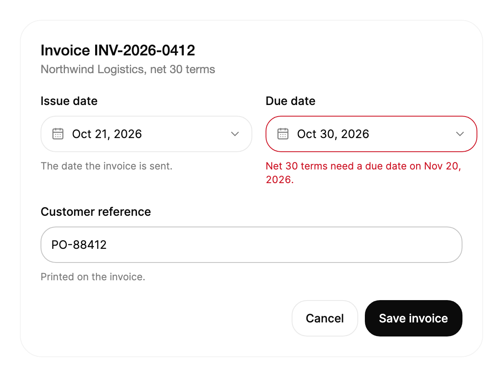

<Demo name="DateField" />

## 何时使用

`DatePicker` 是用于选择一个日历日期的表单字段。它的外观和行为都像文本框：使用者可以直接输入日期，也可以打开日历弹层来选择。它与其他字段一样拥有相同的标签、说明与错误行，因此能与周围的表单保持一致。凡是表单需要选择某一天、而且在选择期间页面需要保留上下文的地方，都可以使用它。

- **项目与订单表单中的开始日期与截止日期**：项目经理为某个里程碑设置开始日期和截止日期。两个字段位于同一列，截止日期通过 `MinDate` 受开始日期限制。
- **财务控制台中的发票与账单日期**：会计输入发票的开票日期。对于过去的某一天，输入 `Oct 21, 2026` 比在日历中翻页更快；弹层则用于处理其余情况。
- **带限制的预约与预订表单**：诊所或租赁柜台只接受营业日期。`MinDate`、`MaxDate` 与 `DisabledDates` 同时作用于弹层和输入的值，因此不可能的日期永远不会送到服务端。
- **面向多个市场的本地化表单**：多语言人力资源系统以德语、中文或 ISO 格式显示同一个字段。区域设置决定月份名称、解析方式与默认显示；当业务要求时，`DisplayFormat` 可以固定一种格式。
- **只需要一个日期的筛选器**：运营仪表板在加载数据前需要一个报表日期。若需要开始与结束日期的组合，请使用 `DateRangePicker`。

## 何时不用

- **需要持续显示在页面上的日历**：当使用者在比较各天时需要阅读的预订视图或可用性网格，用 `Calendar`。`DatePicker` 在展开前会隐藏网格。
- **带预设的开始与结束日期**：用 `DateRangePicker`。它保存两个日期，提供“最近 7 天”这类预设，并且只在使用者确认后才应用该范围。
- **一天中的时间，或同时包含日期与时间**：在 `DatePicker` 旁边使用 `TimePicker`。`DatePicker` 的值没有时间部分，因此带有小时的截止时间必须由两个字段组成。
- **属于少数命名周期之一的日期**：“本季度”“上一季度”或“自定义”这类选择，用 `Select` 或 `SegmentedControl`。若使用 `DatePicker`，使用者就得自行计算周期名称已经暗示的日期。
- **消息或备注中的自由文本日期**：当文本是给人阅读的文字，而不是要存储为日期的值时，用 `Input`。对无法解析的文本予以拒绝的日期字段，并不适合用于句子。

## 用法

```xml
<UserControl xmlns="https://github.com/avaloniaui"
             xmlns:arc="https://github.com/AtomUICommunity/TKCode.Arc">
    <arc:DatePicker Label="开始日期"
                    Description="输入日期，或按 Alt+Down 打开日历。"
                    SelectedDate="{Binding StartDate, Mode=TwoWay}" />
</UserControl>
```

`DatePicker` 派生自 `FieldTextBox`，后者是 Arc 的文本字段基类，因此本质上是一个 Avalonia `TextBox`。该字段保留文本框的行为：光标、选择、撤销、输入法组字与剪贴板。标签、说明、错误行、尺寸与占位文字都来自共享的字段基础，因此 `DatePicker` 与 `Input` 在表单中的间距一致。日历弹层是在此之上添加的，弹层自身的按键与指针事件不会传递给文本。

### 结构

1. **标签**（`Label`）：字段名称，样式与 `Input` 相同，位于外框上方。它为辅助技术提供字段名称，并与触发器相关联。
2. **外框**：1 px 边框、控件圆角、表面色背景。悬停与聚焦只改变边框，外框尺寸不变。
3. **值**：显示的日期，变化时按部分滚动（见动效）。没有值时，以弱化的文字颜色显示占位文字；默认占位文字为“Select a date”。
4. **日历按钮**（下拉按钮）：外框右侧 28 px 的按钮。弹层打开时，箭头旋转 180 度。点击它会打开或关闭弹层。
5. **说明**（`Description`）：外框下方的辅助文案。弹层打开时它会淡出，因此文字不会超出弹层的边角。
6. **错误**（`ErrorMessage`）：外框下方的危险色文案。内容非空时，字段被标记为无效。
7. **弹层**：日历与页脚，位于字段下方 8 px。宽度为 `min(320px, 窗口宽度减 32px)`，内边距为 16 px。在宽 360 px 及以下的窗口中，弹层与字段同宽，内边距为 12 px。
8. **页脚**：左侧是“Clear”按钮，没有值时禁用；右侧是状态文字，显示“Selected Oct 20, 2026”或“Choose a day”。

弹层使用与库中其他地方相同的 `Calendar`，因此键盘模型、限制与月份导航都与 `Calendar` 页面所记录的一致。

### 值与输入文本

`SelectedDate` 是 `DateOnly?`，且为双向绑定。值为 `null` 时显示占位文字。值会以三种方式变化：使用者在弹层中选择一天，使用者输入日期并提交，或代码设置该属性。输入的日期在使用者按下 Enter 或离开字段时提交。空字段提交的是 `null`，即清除该值。

无法解析的文本，或超出限制的日期，不会被接受。字段会回到最后一个有效值；对于超出限制的日期，字段会先抖动一下，以表明该输入已被拒绝。

每次提交变更后都会触发 `SelectedDateChanged`，参数包含变更前后的日期：

| 成员 | 类型 | 含义 |
|---|---|---|
| `OldDate` | `DateOnly?` | 之前的日期；没有时为 `null`。 |
| `NewDate` | `DateOnly?` | 新的日期；点击 Clear 或字段被清空后为 `null`。 |

```csharp
picker.SelectedDateChanged += (_, e) =>
{
    status.Text = e.NewDate is { } d ? $"开始：{d:yyyy-MM-dd}" : "无开始日期";
};
```

直接在代码中设置 `SelectedDate` 不会经过输入文本的规则：代码设置的值会按原样显示，因此视图模型必须确保它位于 `MinDate` 与 `MaxDate` 之内。`FormattedValue` 返回当前显示的文本；没有值时为空。

### 限制与禁用的日期

`MinDate` 与 `MaxDate` 限定可选的日期范围。`DisabledDates` 是一个 `Func<DateOnly, bool>`，对需要禁止的某一天返回 `true`。这些限制同时作用于日历和输入的日期。`IsDateAllowed(DateOnly date)` 在代码中给出相同的结果，因此表单可以在设置值之前先检查日期。

输入的日期若超出范围或被禁用，会被拒绝：字段抖动并回到最后一个有效值。当方向键移动焦点时，日历也会跳过这些日期。

<Demo name="LimitsAndDisabledDays" />

用限制来表达业务规则，而不是用来掩盖错误。必须晚于开始日期的截止日期，写作 `MinDate="{Binding StartDate}"`；只能在工作日送达，则使用 `DisabledDates`。若规则依赖选择器无法看到的数据，例如某个已关闭的周期，应放在视图模型的校验中，并通过 `ErrorMessage` 显示。

### 尺寸

`Size` 设置字段高度：`Small` 为 36，`Medium` 为 44（Arc 的外观），`Large` 为 50。一个表单的所有字段使用同一尺寸，因此 `DatePicker` 能与同一行中的 `Input` 或 `Select` 对齐。

<Demo name="Sizes" />

### 区域设置与显示格式

`Culture` 控制解析、日历的月份与星期名称，以及默认的显示方式。未设置时，使用当前的 UI 区域设置。默认显示为该区域设置下的长日期（不含星期），月份使用缩写。在 `en-US` 中，日期显示为 `Oct 20, 2026`；在 `zh-CN` 中，显示为 `2026年10月20日`。

`DisplayFormat` 接受 .NET 日期格式字符串，并以它替换显示值的默认格式。当业务要求所有使用者都使用固定格式时使用它，例如导出页面中的 ISO 格式。该格式不会改变日历中的名称，输入的文本会先按同一格式解析。

<Demo name="CulturesAndFormats" />

解析会依次尝试三种方式：显示格式、区域设置自身的日期格式，最后是对文本的宽松解析。因此使用者可以在 `en-US` 中输入 `10/21/2026`，也可以在 ISO 字段中输入 `2026-10-21`。若要接受额外的表示法，可在子类中重写 `TryParseDate`；默认行为即为上述描述的内容。

`FirstDayOfWeek` 设置弹层日历的第一列。默认为 `Sunday`；上面的德语与中文示例使用的是 `Monday`。

### 错误与禁用状态

`ErrorMessage` 非空时，字段被标记为无效。禁用的字段会淡化到一半的不透明度，既不能打开，也不能输入。

<Demo name="InvalidAndDisabled" />

在值发生变化之前，保留错误信息。文案应对应失败的规则，并写成修正方法：“请选择早于截止日期的日期。”禁用的字段应在说明中写明被锁定的原因，因为仅靠淡化的外框无法解释这一限制。

### 校验

`DatePicker` 自身检查两件事：输入的文本能否解析为日期，以及日期是否在限制范围之内。其他都是业务规则，由表单决定何时显示。

| 规则 | 检查时机 | 显示位置 |
|---|---|---|
| 文本可以解析为日期 | 使用者按下 Enter 或离开字段时 | 字段回到最后一个有效值；文本不会保留 |
| 日期位于 `MinDate` 与 `MaxDate` 之间 | 使用者按下 Enter 或离开字段时 | 字段抖动并回到最后一个有效值 |
| 日期未被禁用 | 使用者按下 Enter 或离开字段时 | 字段抖动并回到最后一个有效值 |
| 必填，或晚于另一个日期 | 提交时，或相关字段变化时 | 规则所针对的字段上的 `ErrorMessage` |
| 由服务端检查的规则，例如已关闭的周期 | 请求结束后 | `ErrorMessage`；值变化时清除 |

选择器自行检查的规则失败时是静默的，因为字段只是回到最后一个有效值。对于使用者必须处理的每条规则都应显示消息，不要让静默还原成为唯一的反馈。

```csharp
public partial class InvoiceViewModel : ObservableValidator
{
    [ObservableProperty]
    [NotifyDataErrorInfo]
    [Required(ErrorMessage = "请选择开票日期。")]
    private DateOnly? _issueDate;

    [ObservableProperty]
    [NotifyDataErrorInfo]
    [Required(ErrorMessage = "请选择截止日期。")]
    private DateOnly? _dueDate;

    [RelayCommand]
    private async Task SaveAsync()
    {
        ValidateAllProperties();
        if (HasErrors)
        {
            return;
        }
        await _invoices.SaveAsync(IssueDate!.Value, DueDate!.Value);
    }
}
```

### 绑定到视图模型

视图模型负责日期与规则，字段负责反映它们。`SelectedDate` 为双向绑定，因此使用者一提交日期，视图模型就会收到它；`MinDate` 为单向绑定，因此截止日期会跟随开票日期。

```xml
<StackPanel Width="280" Spacing="16">
    <arc:DatePicker Label="开票日期"
                    SelectedDate="{Binding IssueDate, Mode=TwoWay}" />
    <arc:DatePicker Label="截止日期"
                    SelectedDate="{Binding DueDate, Mode=TwoWay}"
                    MinDate="{Binding IssueDate}"
                    ErrorMessage="{Binding DueDateError}" />
    <arc:Button Content="保存发票" Command="{Binding SaveCommand}" IsDefault="True" />
</StackPanel>
```

当错误来自选择器无法得知的规则时，将 `ErrorMessage` 绑定到视图模型的字符串，并在值变化时清除该字符串。绑定产生的校验错误也会显示在字段中，因此每条规则只使用一个来源。选择器的 `IsDropDownOpen` 为双向绑定；在视图模型中将其设为 `False`，即可在页面切换时关闭弹层。

### 示例：发票日期

财务控制台中的一个账单表单。开票日期已设定，截止日期仅限于开票日当天或之后的日期；由于它早于该账户要求的 net 30 账期，因此截止日期会显示一条消息。标签是名词，说明写明规则，错误信息指出修正方法。截图中弹层是收起的，因此该场景展示的是使用者打开日历之前所看到的字段。



```xml
<Border Width="560"
        Padding="24"
        Background="{arc:ArcDesignTokenResource Surface}"
        BorderBrush="{arc:ArcDesignTokenResource BorderSubtle}"
        BorderThickness="1"
        CornerRadius="{arc:ArcDesignTokenResource RadiusPanel}">
    <StackPanel Spacing="20">
        <StackPanel Spacing="4">
            <TextBlock Text="Invoice INV-2026-0412"
                       FontSize="{arc:ArcDesignTokenResource TypeLG}"
                       FontWeight="{arc:ArcDesignTokenResource WeightMedium}"
                       Foreground="{arc:ArcDesignTokenResource Foreground}" />
            <TextBlock Text="Northwind Logistics, net 30 terms"
                       FontSize="{arc:ArcDesignTokenResource TypeSM}"
                       Foreground="{arc:ArcDesignTokenResource TextMuted}" />
        </StackPanel>
        <StackPanel Orientation="Horizontal" Spacing="16">
            <arc:DatePicker Label="Issue date"
                            Width="256"
                            SelectedDate="2026-10-21"
                            Description="The date the invoice is sent." />
            <arc:DatePicker Label="Due date"
                            Width="256"
                            SelectedDate="2026-10-30"
                            MinDate="2026-10-21"
                            ErrorMessage="Net 30 terms need a due date on Nov 20, 2026." />
        </StackPanel>
        <arc:Input Label="Customer reference"
                   Text="PO-88412"
                   Description="Printed on the invoice." />
        <StackPanel Orientation="Horizontal"
                    Spacing="8"
                    HorizontalAlignment="Right">
            <arc:Button Content="Cancel" Variant="Secondary" />
            <arc:Button Content="Save invoice" />
        </StackPanel>
    </StackPanel>
</Border>
```

截止日期的错误直接写出账期条款，而不是笼统的“日期无效”，因此使用者知道应该修改哪个日期。两个字段宽度相同并位于同一行，因此标签与说明对齐。客户参考号是 `Input`，因为它是标识符，而不是日期。

### 文案规范

- **标签**：简短的名词短语，句首大写，不加冒号，例如“开票日期”“截止日期”“开始日期”。
- **占位文字**：如果表单没有其他说明，保留默认的“Select a date”。只有当字段属于某个分组、并且在上下文中措辞更清楚时，才修改它。
- **说明**：用一句话说明日期控制什么，或在不明显时说明如何输入，例如“输入日期，或按 Alt+Down 打开日历。”
- **错误**：说明规则和修正方法，例如“Net 30 账期需要将截止日期设为 2026 年 11 月 20 日。”不要重复标签。
- **页脚文案**：弹层页脚使用 `ClearText`、`EmptyStatusText` 与 `SelectedStatusFormat`。“Clear”保持为动词，状态文字应说明结果，例如“已选择 {0}”。

| 不要写 | 改为 |
|---|---|
| 日期 | 开票日期 |
| 日期无效 | 请输入日期，例如 Oct 21, 2026。 |
| 请输入截止日期： | 请选择截止日期。 |
| 格式错误 | 请使用 Oct 21, 2026 当天或之后的日期。 |
| 清除日期 | 清除 |

### 最佳实践

**推荐**

- 将 `Culture` 设为使用者的区域设置；对于后台界面，设为公司的区域设置，使月份名称与解析结果符合使用者的预期。
- 每个表单只使用一种 `Size`，并让 `DatePicker` 与同一行中的相邻字段对齐。
- 用绑定到较早日期的 `MinDate` 限制依赖日期，使日历永远不会提供表单会拒绝的日期。
- 对使用者必须处理的每条规则都显示消息。被拒绝的输入日期会在抖动后静默还原；消息则说明原因。
- 只有当格式属于约定的一部分时（例如导出或法律文件）才使用 `DisplayFormat`，其他地方保留区域设置的默认格式。

**避免**

- 用 `DatePicker` 表示一天中的时间，或带有小时的截止时间。该值没有时间部分，因此小时会丢失。
- 在代码中把 `SelectedDate` 设为超出 `MinDate`、`MaxDate` 或 `DisabledDates` 的日期。输入的值会被检查，而代码设置的值不会被检查，因此字段会显示规则所禁止的日期。
- 在同一页面上同时放置日历弹层和另一个可见的 `Calendar` 来表示同一个值。同一个日期的两个视图会让使用者编辑错误的那一个。
- 只依赖 Alt+Down 快捷键。说明中应写明日历会打开，因为不知道该按键的使用者永远找不到弹层。
- 每次按键都替换错误消息。错误是在值提交时检查的，输入过程中不断变化的消息只会造成干扰。

### 常见问题

**输入无效的日期时，为什么字段会回到原来的日期？** 输入的值会在按下 Enter 或字段失去焦点时提交。若无法解析、超出限制或已被禁用，该值会被拒绝，字段显示最后一个有效日期。如果使用者需要知道原因，请添加 `ErrorMessage`。

**如何在代码中清除该值？** 将 `SelectedDate` 设为 `null`。字段会显示占位文字，并通过 `SelectedDateChanged` 触发变更，新日期为 `null`。弹层中的 Clear 按钮对使用者而言效果相同。

**选择日期后弹层会关闭吗？** 会。它会在选择后约 300 ms 关闭，让值与页脚有时间进行确认。在减弱或关闭动效时，它会立即关闭。点击 Clear 也会立即关闭弹层。

**如何在代码中打开弹层，或在页面切换时关闭它？** 将 `IsDropDownOpen` 设为 `True` 或 `False`。Escape 与 Alt+Up 可以通过键盘关闭弹层；按 Tab 离开字段会关闭它，并提交输入的文本。

**如何以与输入格式不同的格式显示日期？** 为显示的值设置 `DisplayFormat`。输入时会先接受显示格式，然后才是区域设置的格式，因此使用者可以输入他们已经熟悉的格式。

## API 参考

<!-- api: DatePicker -->

## 无障碍

- `Label` 为字段命名，并与触发器相关联。`Description` 是帮助文字；触发器的帮助文字包含格式化后的值，然后是说明。
- 触发器会公开其展开状态，因此屏幕阅读器会播报日历是否已打开。弹层以标签命名，例如“开始日期日历”。
- Enter、Space 与 ArrowDown 会打开日历，并把焦点移到选中的日期；若没有选中日期，则移到今天。在日历内部，按键的行为与 `Calendar` 中相同。
- Escape 关闭日历并把焦点返回字段。从日历中按 Tab 离开，或在日历外按下指针，也会关闭它。
- 焦点环只在键盘聚焦时显示。通过指针按下打开日历时不会显示焦点环，光标保留在文本中。
- 无效或被拒绝的输入不会被保留：字段回到最后一个有效值；如果表单设置了错误消息，该消息会留在说明行中供使用者阅读。

### 键盘

| 按键 | 操作 |
|---|---|
| 输入后按 `Enter` | 提交输入的日期；无效或被禁用的日期会被拒绝，字段回到最后一个有效值 |
| 没有输入改动时按 `Enter` | 打开日历；若已打开则关闭 |
| `Alt` + `Down`，或 `Down` | 打开日历，并把焦点移到其 Tab 停靠日（若已打开，则进入日历） |
| 弹层打开时从字段按 `Tab` | 提交输入的文本，并把焦点移入日历 |
| 有待提交的输入改动时按 `Escape` | 放弃输入的改动，并显示最后一个有效日期 |
| 日历打开时按 `Escape` | 关闭日历，并把焦点返回字段 |
| 日历中的 `Alt` + `Up` | 关闭日历，并把焦点返回字段 |
| 从日历按 `Tab` 离开 | 关闭日历，并提交任何输入的文本 |

在日历内按下的键从不编辑文本，因此在选中的日期上按方向键或 Backspace 不会改变输入的值。在日历内部，网格按键的行为与 `Calendar` 页面中的说明一致。

## 动效

- 日期中变化的部分会沿时间方向滚动：较晚的日期向上升起，较早的日期向下落下。只有变化的部分会移动。
- 选择日期后，选中的圆形高亮滑入位置，弹层随即稍后关闭。
- 弹层从日历图标处以短促的淡入打开，并以更短的淡出关闭。
- 减弱动效时，值以淡入方式切换，并在选择后立即关闭弹层。关闭动效时直接到达最终状态。

| 变化 | 完整 | 减弱 | 关闭 |
|---|---|---|---|
| 日期的某一部分变化 | 只有变化的部分滚动；较晚的日期上升，较早的日期下降 | 值淡入为新的文字 | 立即完成 |
| 某一部分的宽度变化 | 之后的部分沿同一曲线滑动，为其腾出空间 | 值淡入为新的文字 | 立即完成 |
| 弹层打开 | 从上方以快速弹簧落定 8 px，同时从 95% 缩放放大并淡入 | 淡入 | 立即完成 |
| 弹层关闭 | 上移 6 px，缩放到 97% 并以短促的补间淡出 | 淡出 | 立即完成 |
| 弹层打开时的说明 | 快速淡出，弹层关闭时恢复 | 快速淡出 | 立即完成 |
| 选择后页脚的状态 | 带着柔和的模糊升起到位 | 淡入 | 立即完成 |
| 日历按钮上的箭头 | 以弹簧旋转 180 度 | 立即转向 | 立即完成 |

## 相关组件

- 需要保留在页面上的月视图，用 `Calendar`。
- 带预设的开始与结束日期，用 `DateRangePicker`。
- 一天中的时间（与日期配对），用 `TimePicker`。
- `Field` 与 `FieldFrame` 为任何编辑器或触发器提供相同的标签、外框与消息行。

| 组件 | 适用场景 |
|---|---|
| `Calendar` | 月视图是主要内容，使用者需要在页面上比较多个日期 |
| `DateRangePicker` | 使用者需要选择开始与结束日期，且常常使用“最近 30 天”这类预设 |
| `TimePicker` | 值是一天中的时间，或日期还需要包含时间 |
| `Select` / `SegmentedControl` | 选择是几个命名周期之一，而不是一个日期 |
| `Input` | 文本是标识符或句子，而不是需要解析的日期 |
