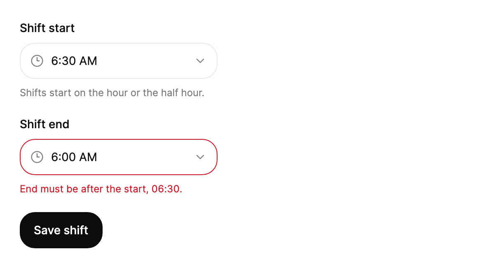

<Demo name="TimeField" />

## 何時使用

`TimePicker` 從等間隔的清單中選取一個一天中的時刻。清單每隔幾分鐘產生一次（預設 15 分鐘），因此任一時刻與其相鄰時刻之間只相差一步。它用於時刻本身就是獨立值的表單中：會議時段、提醒、班次開始、取件時段。值是 `TimeOnly`，時鐘則依使用者所在地區文化的格式顯示它。

- **會議與預約時段**：行事曆邀請或門診預約中，時刻是固定的步長，例如 8:00 到 18:00 之間每 15 分鐘一次。清單只提供網格支援的開始時刻，因此使用者選取的時間都是預約系統可以接受的。
- **提醒與排程工作**：管理後台中「在以下時間寄送每週摘要」的設定。值是沒有日期的一天中的時刻，選擇器會以使用者所讀的時鐘形式顯示它。
- **班次與可用時段編輯器**：人員排班工具中，班次從 06:30 開始、14:30 結束。將兩個選擇器搭配 `MinuteStep="30"` 使用，並驗證結束時間晚於開始時間。
- **日期與時間表單**：配送時段或活動開始時間，把負責日期的 `DatePicker` 與負責時刻的 `TimePicker` 組合在一起。兩個值分開儲存，在程式碼中合併。

## 何時不用

- **命名時刻的短清單，例如「早上」或「晚上」**：用 `Select`。命名清單不需要可捲動的時刻清單，而且「早上」並沒有唯一的 `TimeOnly` 值。
- **日期**：用 `DatePicker`；當月份必須保持在頁面上可見時，用 `Calendar`。
- **日期範圍**：用 `DateRangePicker`。整日的範圍沒有一天中的時刻，也沒有步長清單。
- **需要精確到秒的自由輸入時刻**：選擇器是步長清單。當使用者必須輸入秒數或步長之間的時刻時，用 `Input` 搭配驗證規則，並在檢視模型中解析文字。
- **時長，例如 90 分鐘的會議或 2 小時的計時器**：用 `NumberField` 輸入分鐘數。時長不是一天中的時刻，清單會暗示一個並不適用的時鐘。

## 用法

```xml
<UserControl xmlns="https://github.com/avaloniaui"
             xmlns:arc="https://github.com/AtomUICommunity/TKCode.Arc">
    <arc:TimePicker Label="會議時間"
                    Description="每 15 分鐘一個時刻。"
                    SelectedTime="{Binding MeetingTime, Mode=TwoWay}" />
</UserControl>
```

`TimePicker` 衍生自 Avalonia 的 `TemplatedControl`，並實作 Arc 選擇器的自動化行為。觸發器是位於 `Field` 中的 `FieldFrame`，因此標籤、說明與錯誤列與輸入框和日期選擇器來自同一基礎。清單是由元件自己擁有的浮層中繪製的面板。它只繪製可見的列，因此即使是 1 分鐘的步長（1440 個選項）也不會建立 1440 個控制項。由於元件是一個清單，它不解析輸入的文字：只有選取某一列或程式碼設定 `SelectedTime` 時，值才會改變。

### 結構

1. **標籤**（`Label`）：位於觸發器上方，採用欄位標籤的樣式。它同時是欄位的無障礙名稱。設定 `IsLabelVisible="False"` 時標籤隱藏，但仍為欄位命名。
2. **觸發器外框**（由 `TimePicker.FramePart` 指定的範本部件）：欄位表面上的 1 px 邊框。其高度由 `Size` 決定：`Small` 為 36 px，`Medium`（預設）為 44 px，`Large` 為 50 px。懸停、按下與開啟時，邊框變為強邊框色，背景變為淡化的表面色；無效欄位會顯示危險色邊框。
3. **時鐘圖示**：16 px，淡化文字顏色，與值之間有 9 px 間距。
4. **值**（由 `TimePicker.ValuePart` 指定的範本部件）：時刻以 14 px 文字顯示，行高為 19.6 px（14 px × 1.4）。`Large` 使用基礎字級。沒有時刻時，以淡化文字顏色顯示 `Placeholder`。
5. **箭頭**：16 px，淡化文字顏色。清單開啟時旋轉 180 度。
6. **說明**（`Description`）與**錯誤列**（`ErrorMessage`）：外框下方的說明文字與錯誤文字。非空的 `ErrorMessage` 會使欄位無效，外框顯示危險色邊框。
7. **清單**（由 `TimePicker.PopupPart` 指定的範本部件）：在觸發器下方 6 px 處開啟，寬度與觸發器相同。它有 1 px 邊框、面板圓角、5 px 內距與抬起的表面。高度最多為 `MaxDropDownHeight`（預設 250 px），超出後捲動。
8. **選項列**：高 36 px，內縮 12 px，並帶圓角。指標或鍵盤所在的列會取得淡化的表面色。已選取時刻的右側邊緣有一個 6 px 的圓點，因此任何時候只有一列會被標記為已選取。

### 步長與時鐘

`MinuteStep` 設定選項之間的間隔。預設為 15 分鐘，Arc 支援 1、5、10、15 或 30。選項數量為 1440 除以步長後無條件進位。

| `MinuteStep` | 選項數 | 適用情境 |
|---|---|---|
| 5 | 288 | 通話時段與短預約 |
| 15 | 96 | 會議、提醒與大多數行程（預設） |
| 30 | 48 | 班次開始與營業時間 |

`ClockFormat` 決定顯示方式。`Auto`（預設）遵循 `Culture` 的短時間格式：若某地區文化以「H」表示小時，則顯示 24 小時制；其他地區文化顯示 12 小時制，並附上 AM 與 PM。`TwelveHour` 顯示「9:15 AM」，`TwentyFourHour` 不論地區文化為何都顯示「09:15」。AM 與 PM 的文字來自地區文化；若地區文化沒有提供，則退回為 AM 與 PM。不論顯示方式如何，值始終是 `TimeOnly`。

<Demo name="StepsAndClocks" />

在服務多個地區的應用程式中使用 `Auto`，讓每個人都以自己書寫的方式讀取時刻。在營運主控台、時刻表或日誌檢視中，若 24 小時制是標準，則強制使用 `TwentyFourHour`。只有當產品文案在所有地方都是 12 小時制時，才使用 `TwelveHour`，因為混合顯示會讓行程令人困惑。

### 空值與預設值

`SelectedTime` 是 `TimeOnly?`。Arc 的預設值為 09:00（屬性初始為 9:00 AM），因此即使沒有選取，新的選擇器也會顯示一個時刻。值為 `null` 時，欄位顯示 `Placeholder`，其預設值為 `Select a time`。對於必須由使用者設定的欄位，使用 `null`；只有當某個時刻通常都是正確的時候，才設定真正的預設值。

```xml
<arc:TimePicker Label="提醒" Placeholder="選擇時間" SelectedTime="{x:Null}" />
```

```csharp
picker.SelectedTime = new TimeOnly(18, 30);
picker.SelectedTimeChanged += (_, e) =>
{
    status.Text = e.NewTime is { } time ? $"已設為 {time:HH:mm}" : "無時間";
};
```

不在步長上的時刻會被原樣保留：步長為 15 分鐘時，`09:07` 在觸發器上顯示為 `9:07 AM`，清單則會高亮位於它當前或之前的選項 09:00。只有從清單中選取的時刻才會落在步長上。

<Demo name="SizesAndStates" />

### 尺寸與狀態

`Size` 設定觸發器的高度：`Small` 為 36 px，`Medium` 為 44 px（Arc 的外觀），`Large` 為 50 px。同一表單維持一種尺寸，使時刻欄位與旁邊的輸入框和日期欄位對齊。非空的 `ErrorMessage` 會把欄位標記為無效；`IsEnabled="False"` 會停用它：欄位仍然可見並顯示其值，但無法開啟。

### 繫結到檢視模型

檢視模型擁有時刻以及與之相關的規則。使用 CommunityToolkit.Mvvm 時：

```csharp
public partial class ShiftViewModel : ObservableObject
{
    private readonly IShiftService _shifts;

    public ShiftViewModel(IShiftService shifts)
    {
        _shifts = shifts;
    }

    [ObservableProperty]
    private TimeOnly? _shiftStart = new TimeOnly(6, 30);

    [ObservableProperty]
    private TimeOnly? _shiftEnd = new TimeOnly(14, 30);

    [ObservableProperty]
    private string? _shiftEndError;

    partial void OnShiftStartChanged(TimeOnly? value) => ValidateShift();

    partial void OnShiftEndChanged(TimeOnly? value) => ValidateShift();

    private void ValidateShift()
    {
        ShiftEndError = ShiftStart is { } start && ShiftEnd is { } end && end <= start
            ? $"結束時間必須晚於開始時間 {start:HH:mm}。"
            : null;
    }

    [RelayCommand]
    private Task SaveShiftAsync()
    {
        if (ShiftStart is not { } start || ShiftEnd is not { } end || ShiftEndError is not null)
        {
            return Task.CompletedTask;
        }
        return _shifts.SaveAsync(start, end);
    }
}
```

```xml
<StackPanel Width="560" Spacing="20">
    <arc:TimePicker Label="班次開始"
                    SelectedTime="{Binding ShiftStart, Mode=TwoWay}"
                    MinuteStep="30"
                    Width="240"
                    HorizontalAlignment="Left" />
    <arc:TimePicker Label="班次結束"
                    SelectedTime="{Binding ShiftEnd, Mode=TwoWay}"
                    ErrorMessage="{Binding ShiftEndError}"
                    MinuteStep="30"
                    Width="240"
                    HorizontalAlignment="Left" />
    <arc:Button Content="儲存班次" Variant="Primary" Command="{Binding SaveShiftCommand}" />
</StackPanel>
```

`SelectedTime` 是唯一承載值的屬性，且預設即為雙向繫結，因此明確寫出的 `Mode=TwoWay` 可以省略。當值因選取或程式碼而改變時，`SelectedTimeChanged` 會攜帶舊時刻與新時刻觸發；它適合用於更新摘要等副作用，其他情況下直接繫結值即可。元件本身沒有命令。編譯繫結需要在檢視上設定 `x:DataType`；範例為求簡潔而省略了它。

### 驗證

時刻依排班規則進行驗證，而不是由選擇器驗證。把每條規則放在檢視模型中，並把第一則訊息顯示在與之相關的欄位下方的 `ErrorMessage` 中。

| 規則 | 何時檢查 | 顯示位置 |
|---|---|---|
| 結束晚於開始 | 任一時刻變更時 | 結束欄位上的 `ErrorMessage` |
| 在營業時間之內 | 時刻變更時 | 時刻所屬欄位上的 `ErrorMessage` |
| 必填 | 送出時，之後在值為 `null` 期間持續檢查 | `ErrorMessage`；把焦點移到第一個空白欄位 |
| 伺服器拒絕該時刻 | 請求之後 | 所涉欄位上的 `ErrorMessage`；值變更後清除 |

如 `OnShiftStartChanged` 與 `OnShiftEndChanged` 處理常式所示，在值變更時清除訊息，使錯誤不會停留在已經修正的值上。

### 焦點與關閉

清單開啟時，焦點保留在觸發器上。清單是一個帶輕觸關閉的浮層，因此在它之外按下指標會關閉清單。選取某一列或按下 Escape 同樣會關閉清單；無論哪種方式，焦點都保留在觸發器上，其他內容不會移動。在某一列上按 Enter 或 Space 會選取它並關閉清單，因此鍵盤使用者不需要另外的確認按鈕。

### 由程式碼驅動

清單由 `MinuteStep` 產生，因此在選擇器關閉時變更步長或地區文化，會重新產生清單。當頁面需要選項的文字形式時，可以從程式碼中讀取：

```csharp
var labels = new List<string>();
for (var i = 0; i < picker.OptionCount; i++)
{
    labels.Add(picker.FormatTime(picker.OptionAt(i)));
}
```

`FormatTime` 會回傳觸發器與清單在目前的 `ClockFormat` 與 `Culture` 下使用的文字，因此摘要列可以與選擇器完全一致。若要把時刻與 `DatePicker` 的值合併，請在應用程式中使用日期本身的轉換方法：`date.ToDateTime(time)`。

### 範例：班次開始與結束

一個人員排班工具，經理以半小時為步長設定班次的開始與結束。兩個欄位共用尺寸與寬度；結束欄位在不晚於開始時間時顯示錯誤；開始欄位的說明解釋了步長的意義。儲存按鈕是唯一的操作，因此表單只有一個主要按鈕。



```xml
<StackPanel Width="560" Spacing="20">
    <arc:TimePicker Label="Shift start"
                    Description="Shifts start on the hour or the half hour."
                    SelectedTime="06:30"
                    MinuteStep="30"
                    Width="240"
                    HorizontalAlignment="Left" />
    <arc:TimePicker Label="Shift end"
                    ErrorMessage="End must be after the start, 06:30."
                    SelectedTime="06:00"
                    MinuteStep="30"
                    Width="240"
                    HorizontalAlignment="Left" />
    <arc:Button Content="Save shift" Variant="Primary" HorizontalAlignment="Left" />
</StackPanel>
```

### 文案規範

以事件或數值為欄位命名：`Meeting time`、`Shift start`、提醒。預留位置文字保持為簡短的動詞片語，說明文字則應陳述與步長相關的事實，而不是重複標籤。

| 不要寫 | 改為 |
|---|---|
| `Time` | `Meeting time`、`Shift start`、提醒 |
| `Pick a time please` | `Select a time`（預設預留位置文字） |
| `Times are 15 min apart.` | `Times every 15 minutes.` |
| `Invalid time` | `End must be after the start, 06:30.` |
| `12:00 AM` in a 24-hour product | `00:00` |

錯誤訊息應寫明規則與修正方法：說明時刻必須是什麼，而不只是說它錯了。

### 最佳做法

**建議**

- 用 `MinuteStep` 表示行程的實際粒度。15 分鐘的清單適合會議，而 30 分鐘的清單能防止使用者選取業務並不提供的時刻。
- 讓 `Size` 與表單中的其他欄位相同，使日期與時刻並排的一列保持對齊。
- 對於必須由使用者選取的值使用 `null` 並顯示預留位置文字，這樣預設的 09:00 就不會被誤存。
- 在檢視模型中驗證範圍，並把訊息顯示在與之相關的欄位上，讓使用者知道該修改哪個時刻。
- 產品服務多個地區時使用 `Auto`；領域使用 24 小時制時使用 `TwentyFourHour`。

**避免**

- 用選擇器來表示命名時段的清單。「早上」或「晚上」之類的項目應使用 `Select`，因為時間選擇器暗示了這些時段並不具備的時鐘。
- 把時刻存成文字。值是 `TimeOnly`；只為顯示而格式化它，這樣比較與排序才能保持正確。
- 使用 Arc 定義之外的步長（1、5、10、15 與 30）。堅持使用它們，讓清單讀起來像使用者熟悉的時鐘。
- 只在送出時才顯示錯誤，而規則其實可以在時刻變更時就檢查。欄位旁邊的訊息能讓使用者立即修正班次結束時間。
- 期望日期與時刻共用一個值。元件只保存 `TimeOnly`，因此應把日期保存在 `DatePicker` 中，並在程式碼中用 `date.ToDateTime(time)` 將兩者合併。

### 常見問題

**為什麼我沒有設定時刻，欄位卻顯示 9:00 AM？** 元件的預設值是 09:00，Arc 使用它以便欄位始終顯示為一個時刻。把 `SelectedTime` 設為 `null`，即可改為顯示預留位置文字。

**使用者可以輸入時刻嗎？** 不可以。觸發器會開啟一個清單，只有選取某一列或程式碼設定 `SelectedTime` 時，值才會改變。需要輸入時，請對輸入框加上規則。

**時刻不在步長上時會怎樣？** 值會保持設定時的樣子，因此 `09:07` 保持為 `09:07`，顯示為 `9:07 AM`。清單高亮位於該時刻當前或之前的選項，即步長為 15 分鐘時的 09:00。若業務需要精確的步長，請在檢視模型中取整。

**如何把值存成「HH:mm」文字？** 值是 `TimeOnly`，因此文字只是它的一種格式：在應用程式中使用 `SelectedTime?.ToString("HH:mm")`，或用 `picker.FormatTime(time)` 取得顯示文字。

**清單會捲動頁面嗎？** 不會。清單會自行捲動，開啟時會把選取的時刻置中，頁面不會移動。

## API 參考

<!-- api: TimePicker -->

## 無障礙

- `Label` 為欄位命名。`Description` 與 `ErrorMessage` 是說明文字。
- 清單開啟時焦點保留在觸發器上。觸發器會回報其展開狀態與值，因此螢幕閱讀器會在清單變動時播報目前的時刻。
- 觸發器以組合方塊的形式公開，名稱為標籤，值為格式化後的時刻；沒有時刻時則為預留位置文字。
- 按 Enter、Space 或 ArrowDown 開啟清單，已選取的時刻位於中央並處於作用中。ArrowUp 與 ArrowDown 在各時刻之間移動，並在兩端循環。
- 按 Escape 關閉清單。在清單之外按下指標也會關閉它。
- 鍵盤焦點在觸發器上顯示焦點環。

### 鍵盤

| 按鍵 | 操作 |
|---|---|
| `Enter` / `Space`（清單關閉時） | 開啟清單，並啟用已選取的時刻 |
| `Enter` / `Space`（清單開啟時） | 選取作用中的時刻並關閉清單 |
| `ArrowDown` / `ArrowUp`（清單關閉時） | 開啟清單 |
| `ArrowDown` / `ArrowUp`（清單開啟時） | 向下或向上移動作用中的時刻，從最後一個時刻回到第一個，反之亦然 |
| `Home` / `End`（清單開啟時） | 移到第一個時刻（12:00 AM 或 00:00）或當天的最後一個時刻 |
| `Escape`（清單開啟時） | 關閉清單，焦點保留在觸發器上 |

指標的行為與鍵盤相同：指向某一列會使其作用中，點選則選取它。

## 動態效果

- 值朝時間的方向捲動：較晚的時刻從下方升起，較早的時刻從上方落下。
- 清單以短促的彈簧從觸發器中展開並淡入，關閉時幾乎立即消失。
- 作用中的列會迅速改變背景，一個小圓點標記已選取的時刻，因此任何時候只有一列會被高亮。
- 減少動態效果時，值以交叉淡化切換，清單只做淡入淡出。關閉動態效果時直接到達最終狀態。

| 變化 | 完整 | 減少 | 關閉 |
|---|---|---|---|
| 值變化 | 時刻朝時間的方向捲動，並帶有柔和的模糊 | 交叉淡化 | 立即完成 |
| 清單開啟 | 從觸發器展開，從上方 6 px、縮放 0.97 變為完整大小，使用迅捷的彈簧並伴隨快速淡入 | 淡入 | 立即完成 |
| 清單關閉 | 上移 4 px、縮放至 0.98，然後幾乎立即關閉 | 淡出 | 立即完成 |
| 作用中的列隨鍵盤移動 | 清單以平滑彈簧滑動，使該列保持在可視範圍之內 | 立即定位 | 立即完成 |

## 相關元件

- `DatePicker`：將日期與時刻配對。
- `Select`：短的命名選項清單。
- `DateRangePicker`：日期範圍。

| 元件 | 適用情境 |
|---|---|
| `DatePicker` | 值是一天，時刻單獨儲存或在程式碼中合併 |
| `DateRangePicker` | 值是整日的範圍 |
| `Select` | 選項是命名時刻或時段的短清單 |
| `Input` | 使用者必須輸入清單無法表達的值，並配有驗證規則 |
| `NumberField` | 值是以分鐘計的時長，而不是一天中的時刻 |
