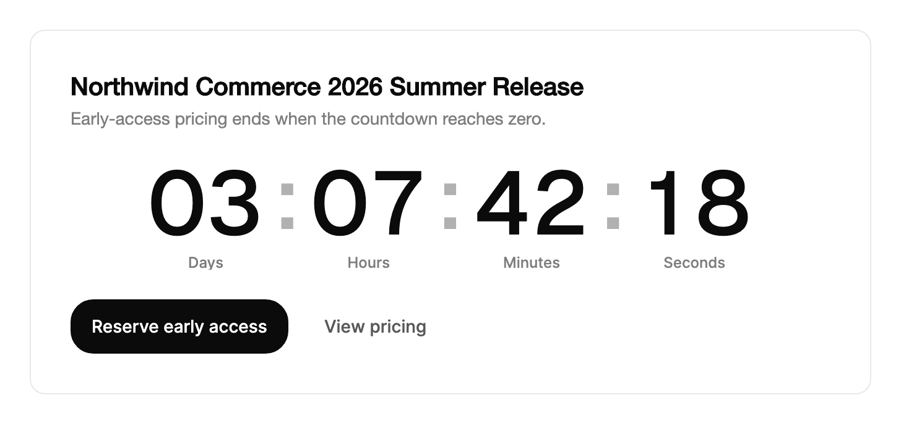

<Demo name="Launch" />

## 何時使用

`Countdown` 以逐位滾動的數字顯示距離某個固定時刻還剩多久，或距離從某個時刻起經過一段固定時長還剩多久。當剩餘時間是頁面或某一列的主要訊息時使用它。時刻到達後，控制項會自行切換為即時狀態，因此頁面不需要自己的計時器來切換文字。

- **發布與活動頁面**：產品發布、大會主題演講或在固定時間開始的網路研討會。大型變體讓頁面在首屏有一個視覺焦點，數字也便於一眼讀出開始時間。
- **促銷與限時活動時段**：結帳橫幅或定價頁上的限時搶購，將 `Target` 設為結束時刻。活動開始時控制項切換為「正在進行」，狀態變化無需伺服器往返。
- **表格與卡片中的截止時間**：帳單清單中的付款截止日、即將過期的發票，或訂閱列中即將結束的試用期。`Compact` 變體是一個單行膠囊，能以固定高度放進表格儲存格。
- **保留與存取時段**：票務流程中的座位保留，或開發者主控台中的搶先體驗時段。`Duration` 從控制項顯示時起倒數一段固定時長；訪客在另一步驟等待時，`IsPaused` 會凍結它。
- **狀態頁上的排定維護**：維護時段的剩餘時間，並將 `CompleteContent` 設為「維護進行中」，讓倒數結束後的狀態與倒數計時寫在同一位置。

## 何時不用

- **含倒數計時與操作按鈕的網站橫幅**：用 `AnnouncementBar`，它把訊息、操作和關閉控制項放在同一條橫幅中。
- **已完成工作的進度**：用 `Progress` 表示已完成工作的占比。倒數計時顯示的是剩餘時間，而不是工作完成了多少。
- **相對固定上限的消耗**：用 `UsageMeter` 表示相對配額測量的儲存空間、席位或 API 呼叫量。
- **需要在截止時間接近時被螢幕閱讀器播報的提醒**：`Countdown` 不是即時區域，它的變化不會被播報。需要注意的時刻應彈出 `Alert` 或 `Toast`。
- **隨資料變動的數字**：隨資料到達而變化的總數（例如今天收到的訂單數）用 `AnimatedCounter`。倒數計時依時鐘運作，只會向零遞減。

## 用法

```xml
<UserControl xmlns="https://github.com/avaloniaui"
             xmlns:arc="https://github.com/AIDotNet/TKCode.Arc">
    <arc:Countdown Label="距離發布" />
</UserControl>
```

將 `Target` 設為要倒數到的時刻，或將 `Duration` 設為從控制項顯示時起倒數的固定時長。預設為大型變體，顯示天、時、分、秒。

```csharp
launch.Target = new DateTimeOffset(2030, 1, 1, 9, 0, 0, TimeSpan.Zero);
```

`Countdown` 衍生自 Avalonia 的 `TemplatedControl`，因此常用的外觀屬性（`Background`、`BorderBrush`、`BorderThickness`、`CornerRadius` 和 `Padding`）會轉交給它的外殼，`Foreground`、`FontFamily` 和 `FontSize` 則由佈景主題設定。佈景主題從 Arc 權杖設定數字與單位的字型排版，因此頁面無需修改範本就能改變顏色和間距。倒數計時不會取得焦點，也沒有可見標籤：`Label` 只作為無障礙名稱。

### 結構

1. **外殼**：一個邊框，會彈性伸縮到所含內容的尺寸，因此單位群組出現或消失時寬度隨之變化。大型變體本身沒有背景或邊框。精簡變體繪製一條 1 px 的邊框（使用邊框顏色）、表面色背景、膠囊圓角和左右各 12 px 的內距。
2. **數字轉輪**：每個數字是一個裁切的轉輪，頂部和底部邊緣柔和漸隱。大型變體的數字使用展示字型、中等字重和展示字距，字級隨控制項寬度變化：寬度的 12.5%，介於 28 px 與 72 px 之間。精簡變體的數字使用內文字型、無字距，字級與文字相同。
3. **單位名稱**：大型變體中，位於每組數字下方，使用弱化文字顏色和超小字級。精簡變體中，每組數字後接一個較淡的單位字母，字級為小型。
4. **分隔符號**：大型變體中，組與組之間是冒號。精簡變體將各組顯示在同一行。
5. **完成狀態**：一個 10 px、成功色的脈動圓點，加上 `CompleteContent` 文字。大型變體的文字使用展示字型、中等字重，字級為寬度的 11%，介於 28 px 與 52 px 之間。精簡變體的文字使用內文字型和成功色。

### 選擇變體

當倒數計時是其所在區域的主要內容時，使用 `Large`（預設值）：例如主視覺區塊、活動頁首，或有空間容納四組數字的儀表板卡片。大型數字需要約 320 px 的寬度才能顯示四組，因此應給它整欄或整張卡片，而不是側邊欄中的一個儲存格。

當倒數計時只是眾多資訊之一時，使用 `Compact`：例如橫幅、表格儲存格、卡片底部或通知中的一句話。膠囊至少 32 px 高，並隨文字調整大小，因此能保持表格列的常規高度。

<Demo name="Compact" />

```xml
<arc:Countdown Variant="Compact"
               Units="Hours, Minutes"
               Label="優惠截止於" />
```

### 選擇單位

`Units` 列出要顯示的單位，由大到小排列。列出的最大單位會吸收其上的所有單位，因此只設定 `Hours` 時，兩天三小時的時段會顯示為 51 小時。預設為天到秒，適合距離發布還有一天以上的活動。以小時計的時段用 `Hours, Minutes` 較易讀，較短的保留時段則最適合 `Minutes, Seconds`。

| 值 | 顯示內容 |
|---|---|
| `Days` | 整天數；最大單位會吸收小時及以下的單位 |
| `Hours` | 整小時數；不顯示天時可以超過 24 |
| `Minutes` | 整分鐘數 |
| `Seconds` | 整秒數 |
| `All` | 天、時、分、秒（預設值） |

這些旗標可以組合使用，例如 `Hours | Minutes`。`None` 會當作 `All` 處理。執行時修改 `Units` 或 `Variant` 會原地更新各群組，因此頁面可以在短顯示與長顯示之間切換，而無需重新建立控制項。

```xml
<arc:Countdown Units="Minutes, Seconds"
               Duration="00:00:12" />
```

### 目標與時長

對每位訪客都相同的截止時間用 `Target`：例如發布時刻、促銷結束時刻，或儲存在伺服器上的到期日。從控制項顯示時開始計算的時長用 `Duration`：例如結帳保留、試用計時或審閱時段。兩者同時設定時，`Target` 優先。

目標倒數計時在訪客離開再返回後，仍會倒數到同一時刻。時長倒數計時在離開畫面期間會保留剩餘時間，因此訪客切走再切回時，看到的是剩下的時間。

### 時區與時鐘

文字不含時差偏移時，請用 `ResolveTarget` 解析目標。帶有 `Z` 或時差偏移的目標文字是精確的。當地時間會依你傳入的時區讀取，因此每位訪客都倒數到同一時刻。

```csharp
countdown.Target = Countdown.ResolveTarget("2030-01-01T09:00:00", timeZone);
```

`ResolveTarget` 不會讀取裝置的時區。當地時間會針對它所指定的日期解析，因此日光節約時間對該日期生效。若該日期上的某個當地時間因時鐘跳過而不存在，則解析為之後的那一時刻。

當裝置時鐘不可信時，請透過 `TimeProvider` 屬性傳入 `TimeProvider`。與伺服器同步的時間提供者能讓每位訪客的顯示與完成時刻使用同一時鐘。預設值為 `TimeProvider.System`。

### 暫停、繼續與重新開始

時長倒數計時在暫停期間會保留剩餘時間。目標倒數計時仍會倒數到同一時刻，因此暫停只會凍結顯示。目標被暫停時，`Completed` 仍會準時觸發。

<Demo name="DurationWithPause" />

```xml
<arc:Countdown Duration="00:00:12"
               IsPaused="{Binding IsTimerPaused, Mode=TwoWay}" />
```

```csharp
timer.Pause();
timer.Resume();
timer.Restart(); // 從完整時長重新開始
```

`IsPaused` 是雙向的，因此檢視模型可以讀取狀態，按鈕也可以繫結到它。`Restart` 會清除完成狀態，並從完整的 `Duration` 重新開始時長倒數計時。對於目標倒數計時，`Restart` 會重新讀取目標。

### 完成

`CompleteContent` 在歸零時取代數字，顯示在一個脈動的即時圓點旁。預設值為「正在進行」。處理 `Completed` 可在倒數計時到達零的那一刻做出一次回應。

```csharp
timer.CompleteContent = "報名已開始";
timer.Completed += (_, _) => offers.Refresh();
```

`Completed` 只會在倒數計時顯示期間且到達零時觸發。控制項顯示時目標已經過去，則會立即顯示完成狀態，且不觸發 `Completed`，因此在促銷結束後才載入的頁面不會重複執行優惠程式碼。倒數計時完成後 `Remaining` 為零，`IsCompleted` 則告訴檢視模型目前螢幕上顯示的是哪種狀態。

### 範例：活動頁上的產品發布

發布頁需要在首屏給出一個關鍵資訊：產品何時可用。倒數計時是區塊的主角，採用大型變體，搭配一行簡短說明和一個操作。文案寫明優惠及其結束時間，讓訪客知道這個數字的意義。本範例使用時長，以確保每次截圖的場景穩定。若每位訪客都應在同一時刻看到發布，則改用 `Target`，並以 UTC 或帶時差偏移的格式寫出該時刻。



```xml
<Border Width="680"
        Padding="32"
        CornerRadius="12"
        Background="{arc:ArcDesignTokenResource Surface}"
        BorderBrush="{arc:ArcDesignTokenResource Border}"
        BorderThickness="1">
    <StackPanel Spacing="24">
        <StackPanel Spacing="6">
            <TextBlock Text="Northwind Commerce 2026 Summer Release"
                       FontSize="20"
                       FontWeight="SemiBold"
                       Foreground="{arc:ArcDesignTokenResource Foreground}" />
            <TextBlock Text="Early-access pricing ends when the countdown reaches zero."
                       FontSize="14"
                       TextWrapping="Wrap"
                       Foreground="{arc:ArcDesignTokenResource TextMuted}" />
        </StackPanel>
        <arc:Countdown Duration="3.07:42:18" />
        <StackPanel Orientation="Horizontal" Spacing="12">
            <arc:Button Content="Reserve early access" Variant="Primary" />
            <arc:Button Content="View pricing" Variant="Ghost" />
        </StackPanel>
    </StackPanel>
</Border>
```

版面讓倒數計時占滿卡片的整個寬度，因此大型數字會放大到佈景主題允許的最大尺寸，又不擠壓文案。主要操作是一個動詞加一個對象。次要操作是幽靈按鈕，讓頁面只有一個明確的下一步。

### 文案規範

倒數計時沒有可見標籤，因此旁邊的文字承擔含義。在數字旁完整寫出截止時間，並把 `CompleteContent` 寫成時間耗盡後讀起來依然正確的簡短狀態。使用句首大寫，數字用阿拉伯數字，文案中不要使用催促性的詞語。控制項負責顯示數字和單位名稱，周圍的文字說明它們在倒數到什麼。

| 不要寫 | 改為 |
|---|---|
| `Hurry, the time is nearly up` | `Early-access pricing ends 2026-10-29 at 09:00 UTC` |
| `Time remaining`（作為唯一文字） | `Registration closes in`，時區寫在下一行 |
| `Done` | `Live now` 或 `Registration is open` |
| `Countdown expired` | `Offer closed`，當優惠不再適用時使用 |

`CompleteContent` 控制在兩到三個詞，以便放進精簡膠囊。時區要寫在文字裡，而不要只放在倒數計時中，因為數字本身不會說明該時刻屬於哪個時區。

### 最佳做法

**建議**

- 對所有訪客共用的截止時間，為 `Target` 設定時差偏移或時區，這樣同一時刻在每台裝置上都顯示一致。
- 在倒數計時旁的文字中寫明截止的是什麼，因為單靠數字無法說明歸零時會發生什麼。
- 在表格列和橫幅中使用 `Compact`，因為大型數字會讓密集清單難以瀏覽。
- 裝置時鐘不可信時（例如結帳會關閉保留），傳入與伺服器同步的 `TimeProvider`。

**避免**

- 用倒數計時表示使用者必須在幾秒內行動的截止時間，因為控制項在變化時不會被播報。結果重要時應彈出 `Alert` 或 `Toast`。
- 同一畫面上放置多個大型倒數計時，因為每個都每秒移動一次，會分散對頁面的注意力。
- 目標使用裝置的時區，因為其他時區的訪客會倒數到不同的時刻。應使用 `ResolveTarget` 並指定活動所屬的時區。
- 透過重新開始目標倒數計時來表示新的截止時間。`Restart` 只會重新讀取同一個目標；應改為設定新的 `Target`。

### 常見問題

**目標已經過去時，倒數計時顯示什麼？** 它會立即顯示 `CompleteContent` 對應的完成狀態，且不觸發 `Completed`。如果頁面應為已結束的優惠顯示不同的版面，請在檢視模型中檢查 `IsCompleted`。

**如何倒數一段固定時長，例如 15 分鐘的保留？** 將 `Duration` 設為 `00:15:00`，`Units` 設為 `Minutes, Seconds`。倒數計時從顯示時開始。將 `IsPaused` 繫結到檢視模型屬性，這樣訪客閱讀表單時，結帳步驟就能暫停計時器。

**視窗隱藏時，為什麼倒數計時不更新？** 控制項離開畫面或不在視覺樹中時，時鐘會停止走動。時長在離開期間會保留剩餘時間，目標則繼續倒數到同一時刻，因此返回時顯示是正確的。

**倒數計時結束時如何回應？** 處理路由事件 `Completed`，或在程式碼中訂閱 `timer.Completed += (_, _) => offers.Refresh();`。該事件只會在控制項顯示且歸零時觸發一次。

## API 參考

<!-- api: Countdown -->

### 配套型別

`CountdownUnits` 是一個旗標列舉。由於 `Units` 接受它們的組合，這裡列出其成員。

| 成員 | 意義 |
|---|---|
| `Days` | 天；作為顯示的最大單位時，吸收小時及以下的單位 |
| `Hours` | 小時；作為顯示的最大單位時，吸收分鐘和秒 |
| `Minutes` | 分鐘 |
| `Seconds` | 秒 |
| `All` | 天、時、分、秒 |
| `None` | 未選取任何單位；會當作 `All` 處理 |

`CountdownVariant` 有兩個成員：`Large`（帶單位名稱的展示數字，預設值）和 `Compact`（用於橫幅和表格儲存格的單一膠囊）。

## 無障礙

- `Label` 為倒數計時命名。預設為「剩餘時間」。
- 控制項沒有即時區域。剩餘時間超過一分鐘時，朗讀的文字會省略秒數；倒數結束後朗讀 `CompleteContent`。非文字的 `CompleteContent` 會朗讀為「已完成」。
- 可見數字變化時不會被播報，因此螢幕閱讀器不會每秒重複。
- 控制項類型為文字。可見數字位於原始檢視中，朗讀的文字是輔助技術讀取的值。
- 在倒數計時旁放一行文字，完整寫明截止的是什麼，例如「截止於 2026-10-29 09:00 UTC」。單獨的倒數計時不會說明它在倒數到什麼。

### 鍵盤

`Countdown` 無法取得焦點，也沒有鍵盤互動。對它進行操作的控制項（例如同一群組中的暫停按鈕）應保留在 Tab 順序中，並繫結到 `IsPaused`。

## 動態效果

- 每個數字都是一個轉輪，沿較短的方向旋轉，視窗的上下邊緣柔和過渡。
- 第一次顯示時，數字依序滾入。之後每秒變化一次。
- 單位群組出現或消失時，容器以彈簧效果伸縮到新尺寸。
- 歸零時，數字淡出並縮放到 0.92 進入完成標籤，即時圓點脈動。
- 減少動態效果時，轉輪直接跳到新值，容器立即調整尺寸，內容以淡入淡出切換，並停止脈動。

| 變化 | 完整 | 減少 | 關閉 |
|---|---|---|---|
| 數字每秒變化一次 | 轉輪沿較短方向旋轉；模糊程度隨移動距離增加 | 數字直接跳到新值 | 立即 |
| 初始數值出現 | 數字從零開始滾入，每位錯開 35 ms，最長 0.3 s | 數字立即顯示 | 立即 |
| 單位群組出現或消失 | 寬度以變形彈簧伸縮，高度以平滑彈簧伸縮 | 容器立即變為新尺寸 | 立即 |
| 歸零 | 數字淡出並縮放到 0.92 進入完成標籤 | 內容以淡入淡出切換 | 立即 |
| 即時圓點 | 以兩秒為週期脈動 | 停止 | 停止 |

### 節制地使用動態效果

數字每秒移動一次，足以表明時間正在流逝。頁面其餘部分保持靜止，不要在倒數計時旁再疊加第二個運動元素，例如閃爍的橫幅或循環動畫。每個畫面區域只放一個倒數計時。長表格中的多個倒數計時各自每秒移動，因此表格應只使用精簡膠囊，並保持少量列數。

## 相關元件

- `AnnouncementBar`：含倒數計時與操作按鈕的網站橫幅。
- `Progress`：工作有已知進度而非截止時間時使用。
- `UsageMeter`：相對固定配額（例如儲存空間或席位）的消耗。
- `Stepper`：倒數計時只是多步驟流程的一部分時使用。
- `Alert` 或 `Toast`：截止時間到達時必須被播報的訊息。

| 元件 | 適用情境 |
|---|---|
| `AnnouncementBar` | 全站橫幅需要倒數計時、訊息和按鈕 |
| `Progress` | 已完成工作的占比已知 |
| `UsageMeter` | 配額或上限相對目前用量進行測量 |
| `Stepper` | 倒數計時屬於流程中的某一步 |
| `Alert` / `Toast` | 截止結果必須向訪客播報 |
