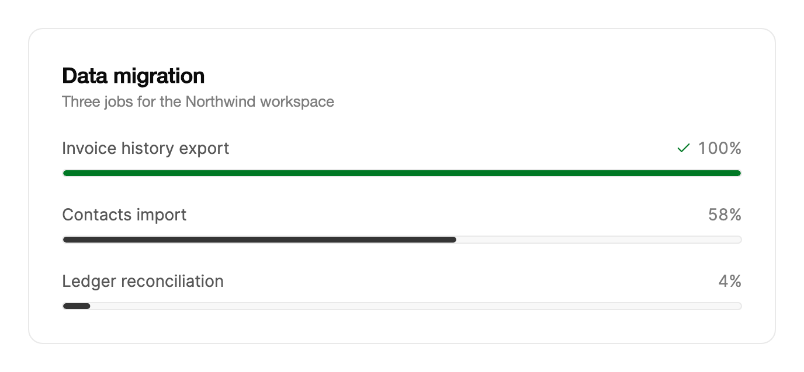

<Demo name="CountedValue" />

## 何时使用

`Progress` 显示一项总量已知的任务完成了多少：文件上传、数据导入、批处理作业或月末结账。它位于页面的内容流中，放在所描述的内容之上或旁边，并给人一个明确的答案，回答“还剩多少”。可选的计数与完成标记让进度条同时传达数字和形状，因此人无需解读填充的长度就能读出状态。

- **文件上传与导出**：账单或 CRM 页面中的发票导出或文档上传，`Label` 写明任务（“正在上传 4 个文件”），`IsValueVisible` 显示百分比。每个分块完成时，进度条随之填充。
- **行数已知的数据导入**：CRM 中导入 2,400 行联系人。将 `Maximum` 设为行数，`Value` 设为已处理的行数，这样进度条和计数使用用户所数的单位。
- **批处理作业与对账**：财务控制台中的月末总账结账或每晚对账，多个作业并行运行。每个作业都有自己的进度条，已完成的作业显示对勾。
- **可度量总量的设置与引导清单**：工作区设置已导入 5 个数据源中的 3 个。进度条显示设置已完成的比例，步骤列表说明还剩哪些。
- **开发者工具中的长时间操作**：有可度量步骤数的构建、软件包同步或日志归档。

## 何时不用

- **无法度量进度的加载**：用 `Skeleton` 预留正在加载内容的空间。
- **相对于额度测量的配额**：相对存储、席位或 API 调用上限的用量用 `UsageMeter`。进度条到 100% 表示任务已完成，而配额到 100% 表示额度已用尽，需要警示。
- **仪表板上的单一指标**：可用性或准时交付率等核心数字用 `Gauge`。
- **多步骤流程中的位置**：用 `Stepper` 显示当前处于哪一步。进度条暗示存在一个总工作量，而步骤并没有。
- **截止时间而非工作占比**：距离某个时刻还剩多久用 `Countdown`。倒数的进度条会被读成已完成的工作，这与截止时间所表达的含义正好相反。

## 用法

设置 `Value`，若总量不是 100，还需设置 `Maximum`。进度条为只读，无法获得焦点。

```xml
<UserControl xmlns="https://github.com/avaloniaui"
             xmlns:arc="https://github.com/AIDotNet/TKCode.Arc">
    <arc:Progress Label="正在上传 4 个文件"
                  IsValueVisible="True"
                  Value="35" />
</UserControl>
```

`Progress` 派生自 Avalonia 的 `RangeBase`，因此 `Value` 和 `Maximum` 与你在滑块和滚动条中已熟悉的范围属性相同。`Minimum` 按 0 处理，值为零或负数的 `Maximum` 按 100 处理。计算百分比时控件会把 `Value` 限制在范围内，因此超过最大值的数值显示为 100%，低于零的数值显示为 0%。控件从不写入 `Value`：它只显示所给的值，因此可以安全地从拥有该作业的视图模型绑定。

### 结构

1. **标签**（`Label`）：作业的可见名称，使用小字号和次要文字颜色。它位于进度条上方那一行的左侧，同时也是无障碍名称。没有标签时，该行隐藏。
2. **读数**（`IsValueVisible`）：计数的百分比，右对齐，使用弱化文字颜色和等宽数字。它位于标签之后 12 px。其占位宽度与“100%”相同，因此数字增加一位时，对勾和数字不会移位。达到 100% 时，计数旁出现成功色的对勾。
3. **轨道**：高 7 px（含 1 px 边框）的胶囊，使用边框颜色、表面弱化背景和完全圆角的两端。轨道会裁剪填充部分，因此圆形末端在任何数值下都保持形状。
4. **填充**：从轨道左边缘开始的强调色，宽度与百分比对应。达到 100% 时变为成功色。

元信息行（标签和读数）仅在 `Label` 有文字或 `IsValueVisible` 开启时出现。元信息行与轨道之间的间距为 8 px。两者都没有的进度条只显示 7 px 高的轨道，适合表格行或卡片底部。

### 仅进度条

不设置标签和数值时，进度条单独使用。其无障碍名称为“进度”。

<Demo name="BarOnly" />

当周围的布局已经为任务命名时，单独使用进度条即可，例如第一列是任务名称的表格行，或标题为“导出”的卡片。这种情况下再添加一个标签只会重复相同的字。

### 自定义最大值

`Percentage` 为 `round(Value / Maximum × 100)`，因此 2,400 中的 1,392 显示为 58%。

<Demo name="CustomMaximum" />

当总量是人们习惯计数的单位时使用 `Maximum`：行、文件、字节或步骤。相比需要用户自己计算的百分比，计数更加直观；而且总量变化时，百分比会根据两个数字重新计算，因此始终正确。`Value` 与 `Maximum` 应使用相同的单位，不要在同一个进度条中混用字节和兆字节。

### 切换标签

切换 `Label` 时，新文字会从柔和的模糊中升起，旧文字同时淡出。

<Demo name="ChangingLabel" />

当任务依次经历几个有名称的阶段时，使用会变化的标签，例如“正在准备导出”、“正在压缩归档”和“正在上传归档”。各阶段保持同一个进度条；只有当某个阶段有自己的总量时，才为该阶段重置 `Value`。如果每个阶段都从零开始，人会以为整个任务重新开始了。

```xml
<arc:Progress Label="{Binding PhaseName}"
              Value="{Binding PhaseProgress}" />
```

### 完成

达到 100% 时，填充变为成功色，计数旁出现对勾。使用 `:complete` 伪类为该状态设置样式。

```csharp
upload.Value = 100;
// upload.IsComplete 现在为 true；开启 IsValueVisible 时会显示对勾。
```

`IsComplete` 为只读。百分比达到 100 时它变为 true，`:complete` 伪类随之变化。计数停在 99/100 的作业并未完成，因此工作完成时应把 `Value` 设为完整总量。进度条本身不会播报完成状态。任务结束时，请显示通知，例如使用 Toast。

### 绑定到视图模型

在 MVVM 应用中，作业归视图模型所有，进度条只显示其状态。使用 CommunityToolkit.Mvvm 时，一个 `ObservableObject` 保存计数和计算出的百分比，进度条以单向方式绑定到它们。

```csharp
public partial class ImportViewModel : ObservableObject
{
    [ObservableProperty]
    private int _rowsImported;

    [ObservableProperty]
    private int _rowsTotal = 2400;

    [ObservableProperty]
    private string _phaseName = "正在导入联系人";
}
```

```xml
<arc:Progress Label="{Binding PhaseName}"
              IsValueVisible="True"
              Maximum="{Binding RowsTotal}"
              Value="{Binding RowsImported, Mode=OneWay}" />
```

`Value` 与 `Maximum` 应使用单向绑定。导入服务在每批次提交时设置 `RowsImported`，绑定会把变化传递给进度条，因此页面无需轮询作业。将 `Label` 绑定到阶段名称，阶段变化时新文字会升起显示。若需要“取消”按钮之类的命令（例如连接到 `[RelayCommand]` 的按钮），应放在进度条旁边而不是其内部，因为进度条不接收输入。

### 报告进度

当一个工作单元完成时（例如一批行或一个文件）更新 `Value`，而不是每个字节或每一帧都更新。每次变化都会启动填充弹簧，因此持续不断的微小更新会让进度条保持移动，却不增加任何信息。以几百行为一批，或以一个文件为单位，都是不错的单位。当作业有较长的停顿（例如服务端步骤没有任何反馈）时，应改变 `Label` 说明作业正在等待什么，而不是让进度条静止不动却没有解释。

### 示例：CRM 中的数据导入

导入界面展示三个并行运行的作业：发票历史导出、联系人导入和总账对账。每个作业都有自己的进度条和标签，因此人无需查看日志就能看出哪个已完成。已完成的作业显示对勾，正在运行的作业显示其计数与总量，刚开始的作业则位于轨道起点附近。文案写明了作业名称，因此即使不看页面标题，进度条也能读懂。



```xml
<Border Width="640"
        Padding="28"
        CornerRadius="12"
        Background="{arc:ArcDesignTokenResource Surface}"
        BorderBrush="{arc:ArcDesignTokenResource Border}"
        BorderThickness="1">
    <StackPanel Spacing="22">
        <StackPanel Spacing="4">
            <TextBlock Text="Data migration"
                       FontSize="18"
                       FontWeight="SemiBold"
                       Foreground="{arc:ArcDesignTokenResource Foreground}" />
            <TextBlock Text="Three jobs for the Northwind workspace"
                       FontSize="13"
                       Foreground="{arc:ArcDesignTokenResource TextMuted}" />
        </StackPanel>
        <arc:Progress Label="Invoice history export"
                      IsValueVisible="True"
                      Value="100" />
        <arc:Progress Label="Contacts import"
                      IsValueVisible="True"
                      Maximum="2400"
                      Value="1392" />
        <arc:Progress Label="Ledger reconciliation"
                      IsValueVisible="True"
                      Value="4" />
    </StackPanel>
</Border>
```

每个进度条使用相同的宽度和相同的读数，因此这一列读起来像一个清单。联系人导入使用 `Maximum`，因为团队以行数计数；另外两个使用默认的 100，因为它们的总量天然就是百分比。已完成的作业会以对勾保留在列表中，因此人能看出它已完成，而不会疑惑它是否消失了。

### 文案规范

标签说明作业和计数，因此两者都应能独立读懂。写明工作的对象，使用句首大写，并让标签短到能与读数并排放在一行。作业运行时使用现在分词，完成后使用普通名词，让标签告诉人作业处于什么状态。

| 不要写 | 改为 |
|---|---|
| `Progress` | `Uploading 4 files` |
| `Done` | `Invoice history export`（对勾和 100% 已经表明它已完成） |
| `Importing... please wait` | `Importing contacts` |
| `Step 2 of 5 (40%)` | `Ledger reconciliation`，并将 `Value` 设为 40 |
| `Error: upload failed` | 在进度条旁的消息中写 `Upload failed. Retry`，进度条停在出错的位置 |

读数中的数字使用阿拉伯数字，由进度条显示百分比。不要把百分比也写进标签，否则人会读到两遍同一个数字。

### 最佳实践

**推荐**

- 在人需要等待的任何作业上显示 `IsValueVisible`，因为数字能告诉他作业是否在推进。
- 当总量是人所习惯计数的数字时使用 `Maximum`，这样总量变化时百分比仍然正确。
- 作业失败时让进度条停在失败的位置，并在旁边的消息中说明原因，因为重置的进度条会掩盖已经完成的工作。
- 列表中每个作业各一个进度条，让每个作业都有自己的状态、标签和对勾。

**避免**

- 为没有可度量总量的工作显示进度条，因为随机移动的进度条会让人学会忽略它。内容加载时使用 `Skeleton`。
- 在同一作业的各阶段之间把 `Value` 重置为零，因为人会把它理解为整个作业重新开始。
- 每个字节或每一帧都更新 `Value`，因为每次变化都会重新启动填充弹簧，却不增加任何信息。
- 在列表中把对勾当作唯一的完成标志。作业结果重要时，应添加状态词或消息，例如“导出已就绪”。

### 常见问题

**`Value` 大于 `Maximum` 时会怎样？** 百分比会限制在 100，`IsComplete` 变为 true。控件本身不会修改 `Value`，因此如果该作业不应视为已完成，请在视图模型中重置它。

**进度条能显示未知总量吗？** 不能。控件没有不确定状态，因此没有总量的进度条是错误的做法。内容加载时使用 `Skeleton`，或在标签中显示作业当前阶段，而不使用进度条。

**如何隐藏标签并保留读数？** 保持 `IsValueVisible` 开启，并将 `Label` 留空。元信息行随即只显示读数，右对齐于轨道上方，无障碍名称变为“进度”。当名称重要时，请在周围布局中为进度条提供标题。

**如何知道作业何时完成？** 订阅视图模型中的作业状态，或在设置 `Value` 之后检查 `IsComplete`。控件没有完成事件，因此由页面负责播报：作业结束时显示 Toast 或消息。

## API 参考

<!-- api: Progress -->

## 无障碍

- `Label` 是无障碍名称。没有标签时，名称为“进度”。
- 控件以百分比的形式公开数值，因此屏幕阅读器会朗读当前百分比，例如 30%。
- 对辅助技术而言它是只读的进度条，不会请求焦点。
- 它不是实时区域。任务结束时请单独播报完成状态。
- 无法获得焦点，也没有键盘交互。用于启动、暂停或取消作业的控件应保留在 Tab 顺序中，紧挨进度条放置，使人能用键盘操作。
- 朗读的是百分比，因此应为作业取一个说明计数对象的名称，例如“联系人导入”，这样数字本身就有意义。

## 动效

- 同一条平滑弹簧同时驱动填充与计数的百分比，因此数字始终与进度条一致。
- 达到 100% 时，填充在短暂延迟后变为成功色，对勾以轻微缩放和模糊的方式落定。
- 标签变化时，新标签从柔和的模糊中升起，旧标签淡出。
- 减弱动效时，填充与计数直接跳到新值，标签以短暂淡入切换。

| 变化 | 完整 | 减弱 | 关闭 |
|---|---|---|---|
| `Value` 变化 | 填充与计数沿同一条平滑弹簧一起移动 | 填充与计数直接跳到新值 | 立即 |
| 达到 100% | 填充在 200 ms 后淡入成功色；对勾在 0.24 s 后从 0.6 缩放出现 | 对勾淡入 | 立即 |
| `Label` 变化 | 新标签从 0.3 em 处带柔和模糊升起；旧标签淡出 | 短暂淡入 | 立即 |

### 克制地使用动效

在进度条中，真正需要移动的只有填充与计数，而且它们应当只在作业推进时才移动。不要在运行中的进度条上循环播放脉冲或闪烁效果，因为这种动效会暗示作业有活动，而事实并非如此。暂停或等待中的进度条应停止变化，并由标签说明原因。减弱动效无需额外处理：控件会直接跳到新值，并让对勾淡入。

## 相关组件

- `Skeleton`：工作量未知且内容仍在加载时使用。
- `UsageMeter`：数值占满带上限的额度时使用。
- `Gauge`：仪表板上的单一指标。
- `Stepper`：任务由一连串命名步骤组成时使用。
- `Countdown`：剩余时间比工作完成占比更重要时使用。

| 组件 | 适用场景 |
|---|---|
| `Skeleton` | 内容正在加载，无法度量进度 |
| `UsageMeter` | 数值相对于人需要管理的上限进行测量 |
| `Gauge` | 仪表板上展示一个核心指标 |
| `Stepper` | 任务是一连串带有当前步骤的命名步骤 |
| `Countdown` | 距离某个固定时刻的剩余时间才是要传达的信息 |
