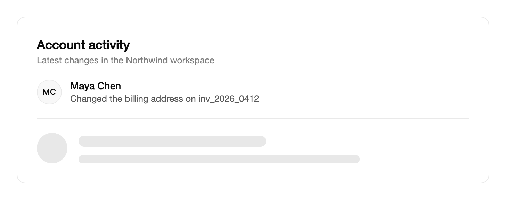

<Demo name="Profile" />

## 何時使用

`Skeleton` 在資料載入期間占住一塊內容的位置。它的預留位置形狀與所代表的內容一致：一個大頭貼加若干文字行，因此資料送達時版面不會改變。用於畫面中獨立載入的區域，例如個人檔案標頭、留言清單或活動動態。內容會取代同一位置的預留位置，使用者不會看到頁面跳動。

- **個人檔案與帳號標頭**：SaaS 管理後台中，使用者卡片在帳號紀錄載入時的樣子。大頭貼與兩行文字標出姓名和角色將出現的位置。
- **留言與活動動態**：團隊討論串或稽核紀錄在頁面開啟後再取得最新項目。五個預留位置項目展示動態的形狀，又不暗示實際數量。
- **發票與訂單明細**：電商或帳務頁面的訂單摘要區塊，而明細項與合計仍從另一項服務載入。預留空間可以避免合計在游標下移動。
- **資料稍後送達的儀表板卡片**：分析儀表板中的營收卡片或客戶清單，卡片外框已經顯示，只有內容區域在等待查詢。
- **原地替換的內容**：任何最終高度已由設計確定的區域，從載入到載入完成只是填入預留的空間。

## 何時不用

- **有可量測進度的工作**：工作會回報已完成多少時用 `Progress`，例如已知列數的上傳或匯入。骨架螢幕表示內容即將到來，而不是進行到哪一步。
- **已載入完成但沒有內容可顯示**：用 `EmptyState`，它說明清單為空的原因，並提供下一步操作。
- **行內狀態或 AI 思考提示**：用於表示系統正在工作的一行短文字時，用 `TextShimmer`，例如「正在整理這張發票」。骨架螢幕用於一塊內容，而不是一句話。
- **等待伺服器回覆的小操作**：使用按鈕的忙碌狀態。骨架螢幕用於一塊內容區域，單一按鈕或欄位不需要預留位置。
- **有自身形狀的圖表與媒體**：在你自己的預留位置中畫出圖表或圖片的形狀。`Skeleton` 只繪製文字行和大頭貼，無法與曲線或縮圖相符。

## 用法

`Content` 為 null 時，骨架螢幕顯示預留位置。設定 `Lines` 指定文字行數，設定 `IsAvatarVisible` 可在文字前顯示圓形大頭貼預留位置。

```xml
<UserControl xmlns="https://github.com/avaloniaui"
             xmlns:arc="https://github.com/AtomUICommunity/TKCode.Arc">
    <arc:Skeleton IsAvatarVisible="True" Lines="3" />
</UserControl>
```

`Skeleton` 衍生自 Avalonia 的 `ContentControl`，因此 `Content`、`ContentTemplate` 以及內容對齊屬性的用法與任何內容控制項相同。預留位置與內容共用同一個外框：預留位置淡出，內容在該外框內就位，因此載入前後控制項是同一個元素。控制項預設橫向伸展至其所在槽位的寬度，文字行佔該寬度的一定比例，因此預留位置會隨周圍的版面變化。

### 結構

1. **大頭貼預留位置**（`IsAvatarVisible`）：直徑 44 px 的圓形，即中等控制項尺寸，使用區塊顏色繪製。只有開啟該屬性時才顯示。
2. **文字行**（`Lines`）：一到六條圓角條帶，使用區塊顏色，高 12 px，條與條之間相隔 12 px。第一行高 16 px，寬為整體的 48%。最後一行寬為整體的 72%，中間的行為滿寬。
3. **區塊顏色**：邊框強調色與表面色的混合，使預留位置在兩種主題下都是安靜的中性色，且不依賴強調色。
4. **區塊上方的間距**：第一個區塊上方留 4 px，使預留位置不貼住所在槽位的上邊緣。
5. **內容框架**（`Content`）：載入完成的內容。當 `IsLoading` 變為 false 時，內容上移 4 px 就位。之後控制項採用內容的高度。

區塊的圓角是完全圓潤的。每個區塊的圓角半徑是控制項圓角與高度一半兩者中的較小值，因此 16 px 的第一行與 12 px 的行都保持圓潤的兩端。

### 配合版面

將 `Lines` 與 `IsAvatarVisible` 設為與載入後內容一致的樣子，而不是為了填滿槽位。帶姓名和角色的個人檔案標頭是一個大頭貼加兩行文字。一則留言是一個大頭貼加三行文字。行數要相符，載入時的高度變化才會小，內容送達時頁面也不會移動。

`Lines` 的取值被限制在 1 到 6 之間。大於 6 的值會降為 6，小於 1 的值會升為 1。大多數卡片使用一到三行，長文字區塊不超過六行。

### 留言預留位置

`Lines` 的範圍為 1 到 6。第一行較短、較高，最後一行的寬度為整體的 72%。

<Demo name="Lines" />

### 已載入的內容

將 `Content` 設為實際的檢視，並把 `IsLoading` 繫結到載入狀態。`IsLoading` 變為 false 時，預留位置淡出，內容上移就位，高度平滑變化。

<Demo name="IntoContent" />

```xml
<arc:Skeleton IsAvatarVisible="True"
              Lines="2"
              IsLoading="{Binding IsLoadingProfile}">
    <StackPanel Spacing="8">
        <TextBlock Text="{Binding UserName}" />
        <TextBlock Text="{Binding Bio}" TextWrapping="Wrap" />
    </StackPanel>
</arc:Skeleton>
```

`IsLoading` 預設為 true。設定了 `Content` 的骨架螢幕只有在 `IsLoading` 為 false 時才顯示內容，因此設定了 `Content` 卻忘記設定 `IsLoading` 的頁面會一直顯示預留位置。沒有內容時，無論 `IsLoading` 為何值，預留位置始終顯示。

### 繫結到檢視模型

在 MVVM 應用程式中，檢視模型掌握載入狀態與資料。使用 CommunityToolkit.Mvvm 時，由 `ObservableObject` 持有旗標與值，並由 `[RelayCommand]` 啟動載入。

```csharp
public interface IProfileService
{
    Task<UserProfile> GetCurrentAsync();
}

public partial class ProfileViewModel : ObservableObject
{
    private readonly IProfileService _profiles;

    [ObservableProperty]
    private bool _isLoadingProfile = true;

    [ObservableProperty]
    private string _userName = string.Empty;

    [ObservableProperty]
    private string _bio = string.Empty;

    public ProfileViewModel(IProfileService profiles) => _profiles = profiles;

    [RelayCommand]
    private async Task LoadAsync()
    {
        IsLoadingProfile = true;
        var profile = await _profiles.GetCurrentAsync();
        UserName = profile.DisplayName;
        Bio = profile.Bio;
        IsLoadingProfile = false;
    }
}
```

```xml
<arc:Skeleton IsAvatarVisible="True"
              Lines="2"
              IsLoading="{Binding IsLoadingProfile, Mode=OneWay}">
    <StackPanel Spacing="8">
        <TextBlock Text="{Binding UserName}" />
        <TextBlock Text="{Binding Bio}" TextWrapping="Wrap" />
    </StackPanel>
</arc:Skeleton>
```

`IsLoading` 使用單向繫結。控制項從不修改它，因此檢視模型始終是狀態的唯一持有者。只有在值指派完成之後才把旗標設為 false，內容就不會顯示空白文字。載入失敗時也應把旗標設為 false，並在內容中顯示錯誤訊息，因為一直不結束的骨架螢幕不會告訴使用者任何資訊。

### 範例：下一筆紀錄載入時的活動動態

帳號頁面顯示最近的活動。第一筆已經載入，第二筆仍在等待作者與內文。預留位置讓第二筆保持與實際項目相同的高度，因此分隔線與下方的項目位置不變。動態周圍的文案寫明了工作區名稱，因此即使其中一筆仍在載入，頁面看起來也是完整的。



```xml
<Border Width="680"
        Padding="28"
        CornerRadius="12"
        Background="{arc:ArcDesignTokenResource Surface}"
        BorderBrush="{arc:ArcDesignTokenResource Border}"
        BorderThickness="1">
    <StackPanel Spacing="20">
        <StackPanel Spacing="4">
            <TextBlock Text="Account activity"
                       FontSize="18"
                       FontWeight="SemiBold"
                       Foreground="{arc:ArcDesignTokenResource Foreground}" />
            <TextBlock Text="Latest changes in the Northwind workspace"
                       FontSize="13"
                       Foreground="{arc:ArcDesignTokenResource TextMuted}" />
        </StackPanel>
        <StackPanel Orientation="Horizontal" Spacing="12">
            <arc:Avatar DisplayName="Maya Chen" Size="Medium" />
            <StackPanel Spacing="2">
                <TextBlock Text="Maya Chen"
                           FontWeight="Medium"
                           Foreground="{arc:ArcDesignTokenResource Foreground}" />
                <TextBlock Text="Changed the billing address on inv_2026_0412"
                           FontSize="13"
                           Foreground="{arc:ArcDesignTokenResource TextSecondary}" />
            </StackPanel>
        </StackPanel>
        <Border Height="1" Background="{arc:ArcDesignTokenResource Border}" />
        <arc:Skeleton IsAvatarVisible="True" Lines="2" />
    </StackPanel>
</Border>
```

已載入的項目與預留位置使用相同的大頭貼尺寸，因此兩列對齊。預留位置有兩行，因為一筆實際的活動紀錄由一個名字和一句話組成。分隔線位於項目之間，而不在骨架螢幕內部，因此項目載入時分隔線保持不動。

### 文案規範

骨架螢幕在畫面上沒有自己的文字，因此它的文字就是無障礙名稱和周圍的文案。用它所載入的內容為載入區域命名，使用句子式大小寫，並讓周圍的文案保持具體。不要把「正在載入」寫進區域的可見標題，因為內容送達後標題仍會留在畫面上。

| 不要寫 | 改為 |
|---|---|
| `Loading content`（留言清單的預設名稱） | `Loading comments` |
| 預留位置下方可見的 `Please wait...` | 不顯示任何文字；由名稱向輔助技術傳達狀態 |
| 以 `Loading` 作為區域標題 | 區域標題，例如 `Recent activity`，骨架螢幕位於其下方 |
| 只顯示 `Error loading data` | `Could not load the billing history. Try again`，並附帶重試按鈕 |

`Label` 應簡短而具體。「正在載入發票摘要」之類的標籤能告訴螢幕閱讀器哪個區域正在忙碌，而單獨的「正在載入」做不到。

### 最佳實務

**建議**

- 讓 `Lines` 與 `IsAvatarVisible` 配合載入後的內容，這樣載入時的高度變化就小，頁面不會跳動。
- 為每個獨立的區域設定各自的骨架螢幕，使某個慢查詢不會拖住頁面的其餘部分。
- 檢視模型指派完成之後再把 `IsLoading` 設為 false，內容就不會顯示空白文字。
- 載入失敗時在內容區域顯示錯誤，否則預留位置會一直留在畫面上，卻沒有任何說明。

**避免**

- 對有已知進度的工作使用骨架螢幕。能回報已完成比例的進度條比預留位置更有用，這類工作請使用 `Progress`。
- 同時轉譯數百個骨架螢幕，因為每個區塊都要繪製和動畫，長清單會因此變慢。只顯示少量預留列，並讓清單隨資料送達逐步填滿。
- 在無法繪製的形狀上放置骨架螢幕，例如圖表或縮圖，因為預留位置會承諾一種內容並不具備的版面。
- 當頁面為一個已經完成的載入設定了 `Content`，卻仍保留預設值 true 的 `IsLoading`，內容會一直隱藏在預留位置之後。

### 常見問題

**設定了 `Content` 之後內容為什麼不顯示？** `IsLoading` 預設為 true，而內容只在它為 false 時才顯示。將 `IsLoading` 繫結到你的載入旗標，或在資料就緒時將其設為 false。

**預留位置會在一段時間後停止嗎？** 脈動約持續 20 秒，然後靜止。預留位置本身會一直留在畫面上，直到 `IsLoading` 變為 false 或 `Content` 將其取代。如果載入時間超過脈動的時長，請顯示一則狀態提示。

**可以完全不設定內容來使用 `Skeleton` 嗎？** 可以。`Content` 為 null 時預留位置始終顯示，`IsLoading` 設為 false 的控制項也是如此。這適用於資料尚未接上時作為裝飾的區域。

**如何為圖表或圖片繪製骨架螢幕？** `Skeleton` 只繪製文字行和大頭貼。請在你自己的控制項或一般的 `Border` 中建構圖表或圖片的形狀，並以內容所用的同一種淡入方式顯示它。

## API 參考

<!-- api: Skeleton -->

## 無障礙

- 預留位置顯示時，`Label` 是無障礙名稱。預設值為「正在載入內容」。
- 預留位置是禮貌模式的即時區域，狀態朗讀為「載入中」。
- 預留位置的形狀不會被朗讀。內容載入後，請為實際內容提供各自的標籤。
- 控制項無法取得焦點，也沒有鍵盤互動。
- 顯示內容時，名稱與狀態會被清除，因此載入後的內容會作為頁面自身的文字被朗讀。

### 鍵盤

`Skeleton` 不接收焦點，也沒有鍵盤互動。載入完成時焦點不會移動，因此使用者正在使用的欄位或按鈕在內容送達後仍保持焦點。

## 動態效果

- 文字行與大頭貼以平緩的波浪從上到下脈動，波浪持續約 20 秒後停止。
- 載入結束時，預留位置淡出，內容上移 4 px 就位，高度以彈簧過渡到內容高度。
- 減少動態效果時，脈動停止，預留位置以短暫淡入切換為內容，高度不做動畫。

| 變化 | 完整 | 減少 | 關閉 |
|---|---|---|---|
| 預留位置脈動 | 每個區塊依序脈動，比上方的區塊晚 90 ms，週期 1.8 s，共 11 次（約 20 s），然後靜止 | 停止 | 停止 |
| 載入結束 | 預留位置快速淡出，內容上移 4 px 就位 | 預留位置與內容之間短暫淡入 | 立即 |
| 高度變化 | 高度以彈簧從預留位置過渡到內容 | 不做動畫 | 立即 |

### 節制地使用動態效果

脈動是有限的波浪，因此長時間的載入會在約 20 秒後停止移動，預留位置仍留在畫面上。不要在骨架螢幕旁邊再加入一個會移動的元素，例如閃爍的橫幅或旋轉的指示器，否則頁面會同時出現兩種互相競爭的載入提示。載入時間超過波浪時長時，應顯示一則狀態提示，說明頁面正在等待什麼，預留位置可以保持原樣。減少動態效果無需額外程式碼：脈動停止，內容以淡入方式切換。

## 相關元件

- `Progress`：工作量已知並可回報時使用。
- `EmptyState`：載入完成且沒有內容可顯示時使用。
- `TextShimmer`：用於行內狀態或 AI 思考狀態。
- `Avatar`：預留位置所代表的已載入大頭貼。

| 元件 | 適用情境 |
|---|---|
| `Progress` | 工作量已知，並可以比例形式回報 |
| `EmptyState` | 載入已完成，且沒有內容可顯示 |
| `TextShimmer` | 一行短文字表示系統正在工作 |
| `Avatar` | 已載入的身分在預留位置所在的位置顯示 |
