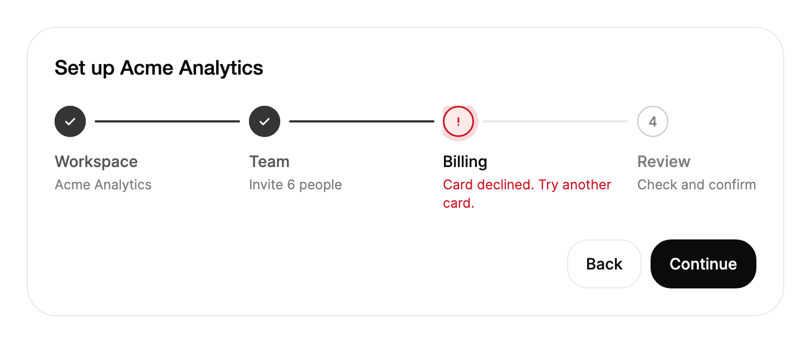

<Demo name="Checkout" />

## When to use

`Stepper` shows the position in a fixed sequence of steps and which steps are finished. It sits above the content of
a flow, such as a checkout or an onboarding wizard, and tells the person how far they have come and what is left.
It only indicates progress: the step content, the validation and the rules for moving on stay in your application.

- **Checkout in an e-commerce store**: account, shipping, payment and review. The person sees that shipping is done
  and payment is next, and can return to shipping to change the address without losing the rest of the order.
- **Workspace setup in a SaaS admin console**: create the workspace, invite the team, add billing and review. When the
  payment step fails, the error appears on that step, where the person has to act.
- **Identity verification in fintech onboarding**: document upload, a selfie check, the home address and a final
  review. The steps are strict, so a later step never shows as complete before the earlier ones are done.
- **Multi-step imports in an internal tool**: upload a CSV, map the columns, preview the rows and confirm. A vertical
  stepper with a description per step explains each stage in a side panel.
- **A runbook in an operations console**: acknowledge, mitigate, verify and close an incident. The stepper states where
  the on-call team is in a procedure that always runs in the same order.

## When not to use

- **A single percentage of finished work**, such as an upload or a nightly export: use `Progress`, which shows one value
  against a whole. A stepper with one step per percent would be unreadable.
- **Sections that people open in any order**, such as the tabs of an account settings page: use `Tabs`. A stepper
  implies an order, and only completed steps can be chosen from it.
- **A history of events**, such as the audit trail of an order or the replies on a ticket: use `Timeline`. A timeline
  lists what happened over time; a stepper shows where a fixed flow stands now.
- **Content that is still loading**, such as the fields of a step while its data arrives: show `Skeleton` in the step
  body. The stepper itself has no loading state.
- **Choosing one value from several options**: use `Select`, `RadioGroup` or `SegmentedControl`. A stepper does not
  collect a value; it only reports the position in a flow.

## Usage

Give `Stepper` its steps and the index of the step in progress. `CurrentIndex` is zero-based. An index equal to the
step count marks every step complete. Steps are either written inline, as in the example below, or bound from a
collection.

```xml
<UserControl xmlns="https://github.com/avaloniaui"
             xmlns:arc="https://github.com/AIDotNet/TKCode.Arc">
    <arc:Stepper CurrentIndex="1">
        <arc:Stepper.Steps>
            <arc:StepperStep Label="Account" Description="Create your login" />
            <arc:StepperStep Label="Shipping" Description="Where should we send it" />
            <arc:StepperStep Label="Payment" Description="Card or invoice" />
            <arc:StepperStep Label="Review" Description="Check and confirm" />
        </arc:Stepper.Steps>
    </arc:Stepper>
</UserControl>
```

`Stepper` derives from Avalonia's `TemplatedControl`, not from an items control. It owns the whole flow: it lays out
the steps as one panel, draws the connectors between them and animates the flow as a unit. Each step is drawn
as one internal item inside the panel, which is why the stepper can fill the connectors in order when progress jumps. Because it is not an
items control, it has no `ItemTemplate`; the step content is always the label and the description.

Two rules shape the whole control:

- `CurrentIndex` is the single source of truth. Steps before it are complete, the step at it is current and steps after
  it are upcoming. A value below zero is treated as zero, and a value above the step count as the step count.
- A step's `Error` overrides its status. A step with an error is shown as failed even when it is before or after the
  current index, so set `Error` only on the step the person must fix.

### Anatomy

1. **Marker** (one per step): a 28 px disc with a 1 px inner outline in the strong border color. It shows the step
   number while the step is upcoming or current, a drawn check when it is complete, and an alert mark when it has an
   error.
2. **Halo**: a ring that grows 4 px outside the disc around the current step, in the accent-subtle color. A failed step
   uses a halo in the danger color at 16% strength instead.
3. **Connector**: a 2 px line between two markers. The track is the border color; the part that is already reached
   fills with the accent color.
4. **Label** (`StepperStep.Label`): the step name, 14 px with medium weight and a 20 px line height. Completed steps show
   it in the secondary text color, the current step and an error in the foreground color, and upcoming steps in the
   muted text color.
5. **Description** (`StepperStep.Description`): 12 px copy with a 16.8 px line height, 2 px below the label, in the muted
   text color. An `Error` replaces it in the danger color.
6. **Caption** (compact only): the current step's label and detail, with 12 px of space above them. It shows only in a
   horizontal stepper that is in compact mode.

The sizes come from the stepper's design tokens. Horizontally, each step takes its own column, with 16 px before the
next column and 12 px between the marker and the label row. Vertically, the marker sits on the left with 12 px between
it and the text, each step has 20 px below it (24 px when compact), and the first label line is offset 4 px so it
centers on the marker.

### Bound steps

`ItemsSource` takes precedence over the inline `Steps`; inline steps are ignored while it is set. Bind a collection of
`StepperStep` objects. The stepper observes the collection and each step, so changing a `Label`, a `Description` or an
`Error` on a step updates the stepper without rebuilding it.

```xml
<arc:Stepper ItemsSource="{Binding Steps}"
             CurrentIndex="{Binding CurrentStep, Mode=TwoWay}" />
```

Give each step a stable `Id`. The `Id` is the key for the step's motion, so a step keeps its own state animation when
the collection is reordered or a step is added before it.

### Binding to a view model

In an MVVM application the view model owns the steps, the current index and the rules for moving on. The stepper shows
them. With CommunityToolkit.Mvvm, the view model below keeps the flow state and marks a failed payment on its step.

```csharp
public partial class CheckoutViewModel : ObservableObject
{
    private readonly IOrderService _orders;

    public CheckoutViewModel(IOrderService orders)
    {
        _orders = orders;
    }

    public ObservableCollection<StepperStep> Steps { get; } = new()
    {
        new StepperStep("Account", "Create your login") { Id = "account" },
        new StepperStep("Shipping", "Where should we send it") { Id = "shipping" },
        new StepperStep("Payment", "Card or invoice") { Id = "payment" },
        new StepperStep("Review", "Check and confirm") { Id = "review" }
    };

    [ObservableProperty]
    private int _currentStep = 1;

    [RelayCommand]
    private async Task PayAsync()
    {
        var result = await _orders.PayAsync(OrderId);
        Steps[2].Error = result.IsSuccess ? null : result.Error;
        if (result.IsSuccess)
        {
            CurrentStep = 3;
        }
    }

    [RelayCommand]
    private void Continue()
    {
        CurrentStep = Math.Min(Steps.Count, CurrentStep + 1);
    }
}
```

```xml
<StackPanel Spacing="20">
    <arc:Stepper ItemsSource="{Binding Steps}"
                 CurrentIndex="{Binding CurrentStep}"
                 IsNavigable="True" />
    <arc:Button Content="Continue" Command="{Binding ContinueCommand}" />
</StackPanel>
```

- `CurrentIndex` is two-way by default, so the view model sees the step a person returns to when they choose a completed
  step. Writing `Mode=TwoWay` explicitly, as above, documents the intent.
- The stepper does not block a move. `Continue` above only moves forward; the rules that decide whether the person may
  leave a step belong in the view model, which sets `CurrentIndex` only when they pass.
- Set `Error` on the step from the view model and clear it with `null` or an empty string. The stepper treats both as
  "no error".

### Errors and recovery

An error belongs on the step that the person can fix. The status changes at once, the marker becomes an alert, and the
error text replaces the description, so the cause is visible where the action is.

- Set `Error` when the server rejects the step (a declined card, a document that is too large) and keep the person on
  that step. The `CurrentIndex` does not change, so the flow stays where it is.
- Clear `Error` as soon as the value changes or the person retries. A stale error on a step that was fixed reads as a
  second failure.
- An error on a completed step (for example, a payment that was reversed after review) turns that step into an alert
  while the current index stays put. Consider moving the current index back to that step so the person sees the cause
  in context.

### Vertical with error

<Demo name="VerticalWithError" />

`Orientation` set to `Vertical` gives a timeline: markers on the left, labels and descriptions beside them, and the
connectors running down. Use it in a side panel, a drawer or a column of a split layout, where the steps are read top to
bottom. Give it a width, as in the example below, so the labels wrap instead of overflowing the column.

```xml
<arc:Stepper ItemsSource="{Binding Steps}"
             CurrentIndex="2"
             Orientation="Vertical"
             Width="320" />
```

### Compact and current details

A horizontal stepper narrower than 480 px switches to compact mode by itself. Set `IsCompact="True"` to ask for compact
mode at any width. `IsCompact="False"` does not turn the automatic rule off: a narrow horizontal stepper is still
compact, so give a full stepper at least 480 px.

<Demo name="Compact" />

In compact mode the markers stay, the labels hide, and the caption under the stepper names the current step with its
description. A vertical stepper is never compact by this rule, because it has room for its labels.

`Details` decides which descriptions show. `StepperDetails.All` (the default) shows every description. `Current` shows
the description of the current step only, which keeps a long flow short in a tight space. Errors always show, whatever
the setting.

<Demo name="CurrentDetails" />

```xml
<arc:Stepper ItemsSource="{Binding Steps}"
             CurrentIndex="2"
             IsCompact="True" />
<arc:Stepper ItemsSource="{Binding Steps}"
             CurrentIndex="1"
             Details="Current" />
```

### Navigable steps

Set `IsNavigable` to let people return to completed steps, by click or by keyboard. A read-only stepper, the default,
shows progress only: its items take no focus and ignore clicks. Handle `StepSelected` when the step has to do work
before the flow moves back, such as saving the draft of the current step.

```xml
<arc:Stepper ItemsSource="{Binding Steps}"
             CurrentIndex="{Binding CurrentStep, Mode=TwoWay}"
             IsNavigable="True" />
```

```csharp
stepper.StepSelected += (_, e) =>
{
    // e.Index is the completed step that was chosen; e.Step is its StepperStep.
    SaveDraft();
};
```

`StepSelected` is a routed event. Its arguments carry `Index`, the zero-based index of the chosen step, and `Step`, the
`StepperStep` itself. If no handler marks the event as handled, the chosen step becomes the current step. A handler that
sets `e.Handled = true` takes over: the index does not change, so the view model must set `CurrentIndex` itself when
the move should happen.

Code can choose a step the same way a click does with `Select(int index)`. It has no effect when `IsNavigable` is off,
when the index is out of range, or when the index is not before the current step.

Only completed steps can be chosen. The current step and the upcoming steps are not clickable, and a pointer press on a
completed step shrinks its marker slightly until the press ends; the step is chosen only when the pointer is released
over it.

### Example: billing setup for a new workspace

A SaaS admin console walks an owner through four steps: name the workspace, invite the team, add billing and review.
The billing step has failed because the card was declined. The stepper stays on that step, the marker is an alert and
the error text replaces the description, so the person sees what to fix and where. The footer offers a Back action,
which is a secondary button, and a single primary action, so the next step is obvious. Both the card and the footer sit
inside a panel with the standard surface and border, so the flow reads as one object on the page.



```xml
<Border Width="680"
        Padding="24"
        CornerRadius="{arc:ArcDesignTokenResource RadiusPanel}"
        Background="{arc:ArcDesignTokenResource Surface}"
        BorderBrush="{arc:ArcDesignTokenResource Border}"
        BorderThickness="1">
    <StackPanel Spacing="24">
        <TextBlock Text="Set up Acme Analytics"
                   FontSize="{arc:ArcDesignTokenResource TypeLG}"
                   FontWeight="{arc:ArcDesignTokenResource WeightMedium}"
                   Foreground="{arc:ArcDesignTokenResource Foreground}" />
        <arc:Stepper CurrentIndex="2" Label="Workspace setup" CompleteLabel="Setup complete">
            <arc:Stepper.Steps>
                <arc:StepperStep Id="workspace" Label="Workspace" Description="Acme Analytics" />
                <arc:StepperStep Id="team" Label="Team" Description="Invite 6 people" />
                <arc:StepperStep Id="billing"
                                 Label="Billing"
                                 Description="Card or invoice"
                                 Error="Card declined. Try another card." />
                <arc:StepperStep Id="review" Label="Review" Description="Check and confirm" />
            </arc:Stepper.Steps>
        </arc:Stepper>
        <StackPanel Orientation="Horizontal" Spacing="8" HorizontalAlignment="Right">
            <arc:Button Content="Back" Variant="Secondary" />
            <arc:Button Content="Continue" />
        </StackPanel>
    </StackPanel>
</Border>
```

The example uses inline steps because the content is fixed. For a flow that changes at run time, bind `ItemsSource`
as shown earlier. The failed step keeps its place in the sequence: the stepper never skips a step, and the view model
decides whether the person may leave the failed step.

### Content guidelines

- **Step label**: one or two words in sentence case that name the step: "Shipping", "Billing", "Review". Avoid verbs
  and full sentences; the description carries the detail.
- **Description**: a short hint about what happens in the step: "Card or invoice", "Invite 6 people". It is shown
  under the label and is what people read when the label is not enough.
- **Error**: say what is wrong and what to do, in the same terms as the step name. The error replaces the description,
  so it must stand alone.
- **Complete label**: a short statement that the flow is finished, such as "Setup complete" or "All steps complete".
  It is announced to assistive technology and shown in the compact caption.
- **Stepper label**: the name of the whole flow, such as "Checkout progress". It is the accessible name of the group.

| Instead of | Write |
|---|---|
| Step 1 | Account |
| Please enter your shipping address here | Shipping |
| Error! | Card declined. Try another card. |
| Done | All steps complete |
| Proceed to the next step | Continue |
| Progress | Checkout progress |

### Best practices

**Do**

- Keep one stepper per flow and make the steps the same kind of thing: a stepper of pages, not a mix of pages and
  actions.
- Put the error on the step the person must fix and keep the current index on that step, so the cause and the action
  are in one place.
- Use `IsNavigable` only when returning to a completed step is safe. Save the draft of the current step first, in the
  view model or in `StepSelected`.
- Give every step a stable `Id` when the steps come from data, so each step keeps its own motion across changes.
- Set `Width` on a vertical stepper so the labels wrap inside the column.

**Avoid**

- Using the stepper for a flow people can enter at any point. Its order is fixed by `CurrentIndex`, and a jump to an
  upcoming step is not possible; use `Tabs` for free navigation.
- Setting `CurrentIndex` past the end to mean "done" in a flow that has an unfinished step. The index equal to the
  count marks every step complete, so the flow must really be finished.
- Putting long text into `Label`. A long label wraps in the step head and pushes the other steps out of alignment;
  move the detail into `Description`.
- Setting `Error` on many steps at once. Several alerts in a row make it unclear which step to fix first; mark the first
  failing step and explain the rest on the page.
- Relying on color alone for state. Each state has its own marker: a number, a check and an alert mark, so the flow
  reads without color.

### Common questions

**Does the stepper stop a person from moving forward when a step is invalid?** No. The stepper only displays
`CurrentIndex` and `Error`. Check the rules in your view model before you increase the index, and set `Error` on the
step that failed.

**Why can I not Tab to the current step?** With `IsNavigable` on, Tab stops on each completed step. The current step is
reached with the arrow keys from a completed step, and `End` moves to it. This keeps the Tab order short in long flows.

**How do I show only the title of the current step on a narrow screen?** Set `IsCompact="True"` on a horizontal
stepper. The markers stay and the caption below names the current step and its description. Without `IsCompact`, a
horizontal stepper narrower than 480 px does this on its own.

**How do I change the default names for assistive technology?** Set `Label` (default "Progress") for the flow and
`CompleteLabel` (default "All steps complete") for the end state. Each step name is generated from its label and its
state, such as "Account, Completed".

**What happens when the step count changes while the flow is running?** The stepper rebuilds its steps when the
collection changes and displays the index clamped to the new count; it does not rewrite `CurrentIndex`. Keep the index
in the view model in step with the collection so the person does not land on a different step after a change.

## API reference

<!-- api: Stepper -->

<!-- api: StepperStep -->

Event arguments of `StepSelected`:

| Member | Type | Meaning |
|---|---|---|
| `Index` | `int` | The zero-based index of the completed step that was chosen |
| `Step` | `StepperStep` | The step that was chosen |

## Accessibility

- `Label` names the stepper, and it defaults to "Progress". Set it to the name of the flow, such as "Checkout progress".
- Each step is named with its state: "Account, Completed", "Review, Not started" or "Error", so a failed step is
  identified by name as well as by its alert mark.
- The current step is marked as the current step, and the stepper reports its position: "Step 3 of 4: Payment".
- Changes of step are announced politely, so the new position is read without moving focus. When every step is
  complete, `CompleteLabel` is announced instead.
- A read-only stepper takes no focus. It is read as a group with its steps and their states.
- A navigable stepper keeps focus on the steps. Focus is drawn as a ring 4 px outside the step head.
- Steps that are not reached yet are not focusable and are skipped by Tab.

### Keyboard

Keys apply when `IsNavigable` is on. Otherwise the stepper takes no focus.

| Keys | Action |
|---|---|
| `Tab` / `Shift+Tab` | Move between the completed steps; the current and upcoming steps are not Tab stops |
| `Right` / `Down`, `Left` / `Up` | Move to the next or previous reachable step (completed or current); in a right-to-left horizontal stepper, `Left` and `Right` swap |
| `Home` | Move to the first reachable step |
| `End` | Move to the last reachable step, normally the current step |
| `Enter` / `Space` | Choose the focused completed step, as a click does; they do nothing on the current or upcoming steps |

## Motion

- When progress jumps over several steps, the connectors fill one after another, and the new current marker gets a halo
  that grows in.
- A number turns into a drawn check when a step completes, or into an alert mark when it fails.
- A changed description rises in from a soft blur, and the space it occupies springs to its new height.
- Reduced motion applies every change at once.

| Change | Full | Reduced | Off |
|---|---|---|---|
| Progress moves forward or back | Connectors fill or drain one after another, 80 ms apart; the halo grows around the new current step | Immediate | Immediate |
| A step completes | The number pops in from 0.5 with a subtle blur and its check stroke is drawn | Immediate | Immediate |
| A step fails | The marker becomes an alert and the error text replaces the description | Immediate | Immediate |
| A description changes | The text rises in from a soft blur and the row springs to its new height | Immediate | Immediate |
| Marker and label colors | The marker colors cross over 240 ms; label colors change with a standard tween | Immediate | Immediate |

A press on a completed step shrinks its marker to 0.92. Pointer hover on a completed step brightens its label to the
foreground color.

## Related

- `Progress` when the work has a percentage rather than steps.
- `Tabs` when the person can switch between sections in any order.
- `Skeleton` when the content of a step is still loading.

| Component | Choose it when |
|---|---|
| `Progress` | One value shows how much of a single task is finished |
| `Tabs` | Sections are peers and can be opened in any order |
| `Timeline` | A list of events over time is the content, such as an order history |
| `Skeleton` | The content of a step is loading and has no shape yet |
| `Breadcrumb` | The person needs to see the path to a page, not the progress through a flow |
| `Select` / `RadioGroup` | The step asks for one value from a list of options |
