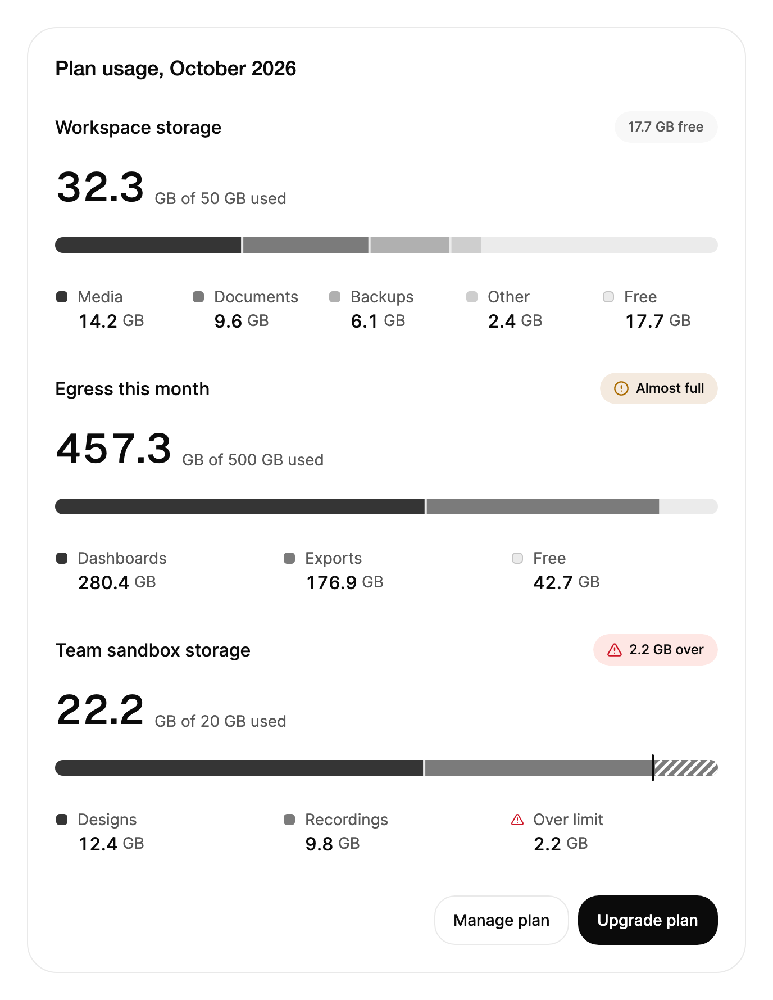

<Demo name="Storage" />

## 何時使用

`UsageMeter` 顯示一組類別如何占滿一個固定的配額，以及總量離上限有多遠。它適用於用量或帳單頁面：使用者可以一眼看清剩餘額度、狀態以及哪些內容占用了方案，無需查看表格。它不用來表示朝完成方向推進的工作，也不用來比較沒有上限的類別。

- **帳單頁面中的儲存空間**：媒體、文件、備份與其他檔案相對於方案內含的儲存空間。圖例列出每個類別，使用者在刪除任何內容之前就能看到媒體占用了最多的空間。
- **用量報表中的流量或 API 呼叫**：月度配額，例如 500 GB 的出站流量，當徽章在 90% 時切換為「即將用完」，團隊可以在觸及上限前採取行動。
- **方案中的席次或專案**：一個團隊有 20 個席次，分布在工程、設計與業務中。總量超過上限時，超出部分以數字和斜紋長條顯示，因此方案升級提示有一個明確的金額可以參考。
- **管理主控台中的用量提醒**：工作區擁有者開啟用量面板，就能看到哪個工作區超出了配額，超出量直接寫在徽章裡。
- **內部平台中每個租戶的配額**：在租戶詳細資訊頁面上，把每個租戶的建置分鐘數或容器小時數與其配額對照顯示，並與變更配額的控制項放在一起。

## 何時不用

- **朝完成狀態推進的工作**，例如匯入或遷移：用 `Progress`。用量表沒有「完成」狀態，它只有一個總量可能超過的上限。
- **沒有上限、彼此比較的類別**，例如各地區的營收：用 `BarChart`。用量表始終以配額為基準進行度量。
- **單一核心指標**，例如本月的活躍使用者數：用於刻度上某個值時用 `Gauge`，用於帶趨勢的數字時用 `MetricCard`。
- **類別超過少數幾個**，例如一份包含五十個成本中心的帳本：用 `Treemap` 或排序過的 `SortableDataTable`。長條在大約四個強調色階內仍然易讀，五十條圖例對使用者的判斷沒有幫助。
- **沒有配額的整體占比**，例如流量來源的組成：用 `DonutChart`，它只顯示比例，沒有上限線。

## 用法

為用量表設定 `Label`、`Limit` 與各個類別。每個類別是一個 `UsageSegment`，包含 `Id`、`Label` 與 `Value`，`Value` 與上限使用相同的單位。保持 `Id` 穩定，這樣清單變動時每個類別都能保留自己的動態效果。

```xml
<UserControl xmlns="https://github.com/avaloniaui"
             xmlns:arc="https://github.com/AtomUICommunity/TKCode.Arc">
    <arc:UsageMeter Label="Workspace storage" Limit="50" Unit="GB">
        <arc:UsageSegment Id="media" Label="Media" Value="14.2" />
        <arc:UsageSegment Id="docs" Label="Documents" Value="9.6" />
        <arc:UsageSegment Id="backups" Label="Backups" Value="6.1" />
        <arc:UsageSegment Id="other" Label="Other" Value="2.4" />
    </arc:UsageMeter>
</UserControl>
```

`UsageMeter` 衍生自 Avalonia 的 `TemplatedControl`。它的範本繪製標題、狀態徽章、總量、說明文字、長條與圖例，而用量表會根據類別與上限計算狀態。它本身不可取得焦點；其中的圖例項目接收鍵盤輸入，因此用量表可以放在卡片裡，而不佔用自己的 Tab 停駐點。

### 結構

1. **標題**（`Label`）：被度量對象的名稱，16 px、中等字重。需要時會換成兩行，位於至少 28 px 高的標題列中。
2. **狀態徽章**：28 px 高的膠囊形標籤，水平內距 12 px，圖示前有 6 px 間距。總量低於預警比例時顯示「{free} 剩餘」；從預警比例直到上限之間顯示帶預警圖示的「即將用完」；超過上限後顯示「超出 {overage}」。靜止時背景為淡化的表面色；即將用完時為預警色暈染（預警色 14% 混入表面色）；超出時為危險色暈染（危險色 12%）。
3. **數值**：顯示字型、36 px 的滾動總量，使用前景色。它顯示總量，或正在預覽或固定的類別的數值。
4. **說明文字**：14 px 的文字，使用次要文字色，位於數值旁並與其基線對齊。它說明數值的含義：「已用 50 GB 中的 GB」、「媒體中的 GB · 占方案 28%」或「剩餘 GB」。
5. **長條**：14 px 的軌道，兩端為完整圓角，顏色為前景色以 7% 強度疊加在表面色上，因此空白部分在兩種主題下都可見。已用部分是一段段強調色階，段與段之間留 2 px 間隙。
6. **圖例**：由切換項目組成的格線，每個類別一項，外加一項剩餘量（`FreeLabel`）或超出量（`OverLabel`）。每欄至少 108 px 寬，欄數鋪滿整個寬度。每個項目有 8 px 內距、12 px 圓角、12 px 色塊、14 px 標籤，以及 16 px 的滾動數值，數值旁顯示單位。
7. **焦點環**：2 px 的焦點環外框，繪製在圖例項目外側 4 px 處，圓角為 16 px。

標題列、數值、長條與圖例之間的垂直間距為 16 px。圖例向左偏移 8 px，使色塊與標題對齊。長條與圖例的寬度與用量表相同。

### 即將用完與超出上限

徽章顯示剩餘量。上限的 90%（預設 `WarnThreshold` 為 0.9）時，它變為帶預警圖示的「即將用完」；超過上限後，它顯示超出量。`WarnThreshold` 決定觸發預警的比例，同一比例也驅動程式碼中的 `Near` 狀態。

<Demo name="AlmostFull" />

<Demo name="OverTheLimit" />

```xml
<arc:UsageMeter Label="API calls this month"
                Limit="100"
                Unit="K"
                WarnThreshold="0.8" />
```

超過上限後，長條上會疊加斜紋，並在旁邊顯示上限標記，因此不依賴顏色也能讀出超出的部分。圖例的最後一項從剩餘量變為超出量，標籤由 `OverLabel` 指定。徽章和圖例的用字要與方案保持一致：「超出 8.1 GB」告訴使用者他們將為什麼付費，或必須刪除什麼。

### 繫結到檢視模型

在 MVVM 應用程式中，檢視模型負責管理類別、上限以及方案允許的規則，用量表只負責呈現。使用 CommunityToolkit.Mvvm 時，下面的檢視模型把類別保存在 `ObservableCollection<T>` 中，由用量資料來源更新每個類別的 `Value`。用量表同時監聽集合和每個類別，因此長條、總量、徽章和圖例都會隨每次變動更新。

```csharp
public partial class StorageUsageViewModel : ObservableObject
{
    public StorageUsageViewModel()
    {
        Categories = new ObservableCollection<UsageSegment>
        {
            new UsageSegment("media", "Media", 14.2),
            new UsageSegment("docs", "Documents", 9.6),
            new UsageSegment("backups", "Backups", 6.1),
            new UsageSegment("other", "Other", 2.4)
        };
    }

    public ObservableCollection<UsageSegment> Categories { get; }

    [ObservableProperty]
    private double _limit = 50;

    [ObservableProperty]
    private string _unit = "GB";

    public void ApplyUsage(IReadOnlyDictionary<string, double> usage)
    {
        foreach (var category in Categories)
        {
            if (category.Id is not null && usage.TryGetValue(category.Id, out var value))
            {
                category.Value = value;
            }
        }
    }
}
```

```xml
<arc:UsageMeter Label="Workspace storage"
                ItemsSource="{Binding Categories}"
                Limit="{Binding Limit}"
                Unit="{Binding Unit}" />
```

- `ItemsSource` 優先於內嵌的 `Segments`。繫結的是 `UsageSegment` 物件的集合，而不是數字清單，這樣每個類別都保有自己的身分。
- `Limit` 與 `Unit` 是單向繫結。用量表不會向檢視模型寫回任何值。
- 類別的 `Value` 是應用程式唯一寫入的值。每次 `Value` 變動都會重新排版長條，並重新計算總量與狀態。應在數字變動時設定 `Value`，而不是在資料來源每個計時器週期都設定（即使數值沒有變化）。
- `Status` 與 `Total` 是唯讀的。頁面需要做出反應時（例如顯示升級提示）在程式碼中讀取它們。
- 編譯繫結需要在檢視上設定 `x:DataType`；這裡的範例為求簡潔省略了它。

### 資料結構與效能

每個類別是一個 `UsageSegment`，包含 `Id`、`Label` 與 `Value`。`Id` 是類別在多次更新之間的身分識別：數值變動時保持它不變，這樣色段會重新排列，而不是被取代。`Id` 應來自你的資料（類別鍵或資料庫識別碼），而不要用標籤，因為使用者重新命名類別時標籤可能會變。

- 四個類別便於閱讀。強調色階共四個色調（完整的強調色，然後是混入表面色 62%、36% 和 22% 的顏色），因此第五個類別很難與相鄰類別區分。把最小的類別合併為「其他」後再傳給用量表。
- 圖例是格線，類別越多只會增加列數，而不會擠壓長條。標籤應保持簡短，因為每個圖例項目都在至少 108 px 寬的欄中顯示完整標籤。
- 總量依 `Decimals` 捨入（預設 1，允許 0 到 6）。當某個類別需要用量表不顯示的單位（例如貨幣）時，在資料層完成格式化。用量表在所有文化中都以句點作為小數點分隔符，因此應把在地化的單位放在 `Unit` 中，把在地化的標籤放在 `Label` 中。
- 每次 `Value` 變動都會重新整理整個用量表。只寫入有變化的數值，而不是在資料來源的每個週期都寫入所有類別。

### 單位與小數位

`Unit` 顯示在每個數值之後。`Decimals` 設定小數點後的位數。對於席次等整數計數，使用 `Decimals="0"`。

```xml
<arc:UsageMeter Label="Seats" Limit="20" Decimals="0">
    <arc:UsageSegment Id="eng" Label="Engineering" Value="12" />
    <arc:UsageSegment Id="design" Label="Design" Value="6" />
    <arc:UsageSegment Id="sales" Label="Sales" Value="5" />
</arc:UsageMeter>
```

每個用量表選擇一種精度。以 GB 為單位的儲存空間用量表保留一位小數讀起來最好，這樣 0.1 GB 的上傳是看得見的；席次數帶小數位則會讓人以為是錯誤。上限文字會去掉結尾的零，因此上限為 50.0 時顯示為「50 GB」。

### 剩餘與超出金額的標籤

`FreeLabel` 指定圖例中剩餘配額的名稱（預設為「Free」），`OverLabel` 指定總量超過上限後超出量的名稱（預設為「Over limit」）。使用與方案用語一致的一般名詞。

```xml
<arc:UsageMeter Label="Projects"
                Limit="10"
                FreeLabel="Remaining"
                OverLabel="Above plan" />
```

### 在程式碼中讀取狀態

讀取 `Status` 取得目前狀態（`Ok`、`Near` 或 `Over`），讀取 `Total` 取得所有類別的總和。狀態與徽章使用相同的規則：達到上限的預警比例時為 `Near`，總量高於上限本身時為 `Over`。

```csharp
if (meter.Status == UsageMeterStatus.Over)
{
    ShowUpgradePrompt();
}
meter.ClearPin(); // clears a category pinned from the legend
```

### 範例：帳單頁面中的方案用量

SaaS 管理主控台中的一個帳單頁面展示本月的三項配額：工作區儲存空間在方案範圍內，剩餘 17.7 GB；本月的出站流量即將用完，已達 91.5%，因此在觸及上限前發出預警；團隊沙盒的儲存空間超出上限 2.2 GB。每個標題都寫明了被度量的對象，單位與方案表格中使用的單位一致，說明文字寫明了上限，因此使用者無需打開方案詳情就能判斷每種狀態。三種狀態使用三種不同的徽章，超出部分有斜紋，因此即使沒有顏色頁面也能讀懂。



```xml
<Border Width="640"
        Padding="24"
        CornerRadius="{arc:ArcDesignTokenResource RadiusPanel}"
        Background="{arc:ArcDesignTokenResource Surface}"
        BorderBrush="{arc:ArcDesignTokenResource Border}"
        BorderThickness="1">
    <StackPanel Spacing="28">
        <TextBlock Text="Plan usage, October 2026"
                   FontSize="{arc:ArcDesignTokenResource TypeLG}"
                   FontWeight="{arc:ArcDesignTokenResource WeightMedium}"
                   Foreground="{arc:ArcDesignTokenResource Foreground}" />
        <arc:UsageMeter Label="Workspace storage" Limit="50" Unit="GB">
            <arc:UsageSegment Id="media" Label="Media" Value="14.2" />
            <arc:UsageSegment Id="docs" Label="Documents" Value="9.6" />
            <arc:UsageSegment Id="backups" Label="Backups" Value="6.1" />
            <arc:UsageSegment Id="other" Label="Other" Value="2.4" />
        </arc:UsageMeter>
        <arc:UsageMeter Label="Egress this month" Limit="500" Unit="GB">
            <arc:UsageSegment Id="dashboards" Label="Dashboards" Value="280.4" />
            <arc:UsageSegment Id="exports" Label="Exports" Value="176.9" />
        </arc:UsageMeter>
        <arc:UsageMeter Label="Team sandbox storage" Limit="20" Unit="GB">
            <arc:UsageSegment Id="designs" Label="Designs" Value="12.4" />
            <arc:UsageSegment Id="recordings" Label="Recordings" Value="9.8" />
        </arc:UsageMeter>
        <StackPanel Orientation="Horizontal" Spacing="8" HorizontalAlignment="Right">
            <arc:Button Content="Manage plan" Variant="Secondary" />
            <arc:Button Content="Upgrade plan" />
        </StackPanel>
    </StackPanel>
</Border>
```

把兩個操作放在使用者需要的位置：徽章說明配額處於什麼狀態，頁尾提供下一步操作。團隊沙盒用量表以數字顯示超出量（「超出 2.2 GB」），而升級決策正依賴這個數字。

### 文案規範

- **標題**：被度量對象的簡短名詞片語，採用句首大寫：「Workspace storage」「Egress this month」。只有當上限按此週期重置時才加句號。
- **單位**：方案所用的簡短單位，例如「GB」。它顯示在每個數值之後，因此要保持簡短。
- **剩餘與超出標籤**：除非方案使用其他用字，否則保留預設的「Free」與「Over limit」。同一頁面中使用相同的名詞。
- **說明文字與徽章**：用數字寫出數值與上限。「剩餘 17.7 GB」比「還有很多」更清楚。

| 不要寫 | 改為 |
|---|---|
| 儲存用量 | 工作區儲存空間 |
| 空間快用完了！！ | 即將用完。剩餘 4.3 GB。 |
| 嚴重超出限制 | 超出 2.2 GB |
| 可用空間 | 剩餘 |
| 超出量：2.2 | 超出限制：2.2 GB |

### 最佳做法

**建議**

- 讓 `Value` 與 `Limit` 使用相同的單位，並在 `Unit` 中顯示該單位，使每個數字都帶有單位。同一個用量表中混用 GB 和 MB 會讓長條失去意義。
- 選擇足夠早的 `WarnThreshold`，讓預警來得及採取行動：對於需要一週時間才能提高的配額，像 0.8 這樣較低的比例較合適。
- 當橫幅必須與徽章保持一致時，在程式碼中讀取 `Status`，而不是把同一規則再計算一次。
- 在用量表旁寫出超出量所需的操作，例如「升級方案」，讓看到「超出」的使用者知道該怎麼做。

**避免**

- 把用量表用於沒有上限的數值。上限是作為參照繪製的，因此無限制方案在這裡沒有意義；計數應使用 `MetricCard`。
- 傳入許多小類別。強調色階只有四個色調，超過四段後長條就難以辨認；應把最小的類別合併為「其他」。
- 依賴長條的顏色來表示超出。斜紋、上限標記和徽章文字承載了狀態。
- 顯示超出方案所用精度的小數位。兩位小數的儲存空間用量表暗示了一種沒有人能據此行動的精度。

### 常見問題

**為什麼徽章顯示「即將用完」而不是剩餘量？** 達到預警比例時狀態變為 `Near`，徽章會標明這一狀態。剩餘量仍顯示在圖例中，並保留在輔助技術讀取的文字摘要裡。

**為什麼總量與我預期的總和不一致？** 總量是在求和之後依 `Decimals` 捨入的。小數位多於 `Decimals` 的值會先相加再捨入，因此應把 `Decimals` 設為方案所用的精度，並以相同方式在資料中捨入。

**如何清除從圖例中固定的類別？** 再次按下已固定的項目，在圖例取得焦點時按 `Escape`，或在程式碼中呼叫 `ClearPin()`。

**變更上限會更新狀態嗎？** 會。變更 `Limit`、`Unit`、`Decimals`、`WarnThreshold` 或標籤屬性都會重新整理用量表，因此狀態、徽章和圖例會立即跟隨新的配額。

## API 參考

<!-- api: UsageMeter -->

<!-- api: UsageSegment -->

`UsageMeter.Status` 的狀態值：

| 成員 | 含義 |
|---|---|
| `Ok` | 總量低於上限的預警比例（`WarnThreshold`） |
| `Near` | 總量達到或超過預警比例，但尚未超過上限 |
| `Over` | 總量超過上限 |

## 無障礙

- 用量表是一個以 `Label` 命名的群組。長條是一張圖像，其名稱是對每個類別、總量與狀態的完整文字摘要，例如「Workspace storage: 32.3 GB of 50 GB used. Media 14.2 GB, Documents 9.6 GB, Backups 6.1 GB, Other 2.4 GB. 17.7 GB free.」。
- 滾動的數字不計入控制項檢視，輔助技術改為朗讀文字摘要，因此數值變動時不會逐位朗讀。
- 狀態變化以禮貌的方式播報：總量越過預警比例時播報「即將用完。剩餘 4.3 GB。」，超過上限時播報「超出方案上限 8.1 GB。」。超出量增長時也會播報；同一狀態內的例行變化保持安靜。
- 每個圖例項目都是切換按鈕，固定對應類別時處於按下狀態，名稱由類別與數值組成，例如「Media, 14.2 GB」。剩餘與超出項目的命名方式相同。
- 滑鼠懸停或焦點落在圖例項目上時，會預覽該類別：數值與說明文字顯示其占方案的比例，直到指標或焦點移開。
- 顏色從來不是唯一的訊號：徽章同時帶有文字與圖示，超出部分以斜紋和上限標記顯示，因此即使是灰階狀態也能讀出。

### 鍵盤

圖例是一個帶漫遊焦點的 Tab 停駐點：上次使用的圖例項目持有 Tab 停駐點，方向鍵在各項目之間移動。

| 按鍵 | 操作 |
|---|---|
| `Tab` / `Shift+Tab` | 進入圖例並停在上次使用的項目上，或離開圖例 |
| `Right` / `Down`、`Left` / `Up` | 移到下一個或上一個圖例項目；焦點從最後一項循環回到第一項，反之亦然 |
| `Home` / `End` | 移到第一個或最後一個圖例項目 |
| `Enter` / `Space` | 固定或取消固定目前焦點所在的類別；被固定的類別會在長條、數值和說明文字上保持顯示 |
| `Escape` | 清除固定的類別 |

## 動態效果

- 用量表第一次有 40% 可見時，各類別從左到右依序生長出現。
- 之後，數值變動時每個類別會滑動到新的寬度，數字也會滾動到新值。
- 超過上限後，超出部分的斜紋和上限標記淡入。
- 懸停或聚焦某個類別時，其他類別變暗；按下則固定該類別。
- 減少動態效果時，直接設定數值與長條，文字以短暫淡入的方式切換。

| 變化 | 完整 | 減少 | 關閉 |
|---|---|---|---|
| 用量表首次顯示 | 各類別從左到右生長，0.58 s，每項間隔 70 ms，僅一次 | 直接以完整尺寸顯示 | 直接以完整尺寸顯示 |
| 類別數值變動 | 其色段以平滑彈簧滑動到新的寬度；其後的色段在同一影格跟隨 | 直接設定 | 直接設定 |
| 數字變動 | 數字朝新值滾動，方向與變動方向一致 | 直接設定，文字以短暫淡入切換 | 立即完成 |
| 類別被預覽或固定 | 其他色段以快速補間變暗至 28%，圖例項目變暗至 45% | 立即完成 | 立即完成 |
| 用量越過上限 | 超出部分的斜紋和上限標記淡入 | 立即完成 | 立即完成 |
| 狀態徽章變化 | 其寬度透過變形彈簧適應新文字；顏色暈染交叉淡化 | 文字以短暫淡入切換 | 立即完成 |

## 相關元件

- `Progress`：工作朝完成方向推進，且沒有配額時使用。
- `BarChart`：沒有上限、彼此比較的類別。
- `Gauge` 或 `MetricCard`：一個核心數字。

| 元件 | 適用情境 |
|---|---|
| `Progress` | 任務朝完成方向推進，且沒有可超出的配額 |
| `BarChart` | 類別沒有上限，並且彼此比較 |
| `DonutChart` | 只關心每個類別在整體中的占比，沒有上限 |
| `Gauge` | 一個值需要對照刻度讀取，例如分數或負載 |
| `MetricCard` | 一個核心數字需要標籤、變化量與趨勢 |
