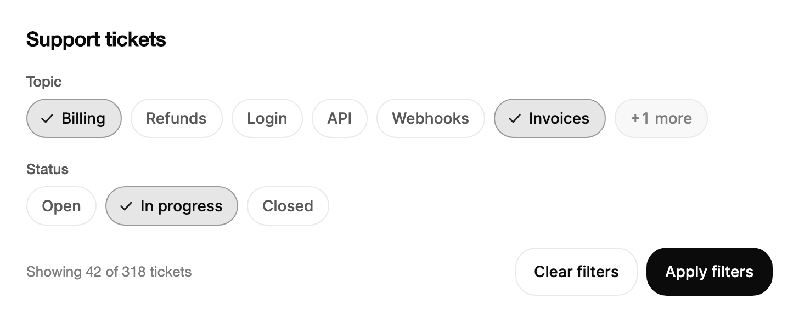

<Demo name="FilterChips" />

## 何時使用

`ChipGroup` 以切換標籤的形式呈現一小組選項，所有標籤同時可見，使用者不需開啟選單就能看到有哪些可選項、哪些已啟用。它適合放在清單頂端的篩選列和面向選擇器中：選項已知、數量少且經常變動。每個標籤都是帶按下狀態的按鈕，整組只保留一個 Tab 停駐點，因此一排標籤在鍵盤順序中只佔一個位置。

- **支援收件匣篩選**：客服中心的工單清單依主題（帳單、退款、登入、API、Webhooks）篩選。客服每班要多次切換主題，所有主題都保持可見，無須開啟選單就能知道有哪些選項。
- **電商後台的訂單狀態**：訂單表格中單選「開啟」「已包裝」「已出貨」或「已退回」。設定 `IsMultiple="False"` 後，再按一次會清除篩選，這與使用者退出篩選的習慣一致。
- **分析儀表板的面向**：圖表上方放置地區或管道，例如 EMEA、北美、付費搜尋或電子郵件。標籤排在它們所影響的元件上方的同一行，所選結果就是檢視模型在重新載入資料時讀取的狀態。
- **需要選取幾項興趣的引導步驟**：在工作區設定頁中，團隊選取將會使用的領域（財務、銷售、支援）。簡短且可見的選項比下拉式選單更容易掃讀。
- **報表頁中的長面向清單**：`MaxVisibleItems` 保留前幾個標籤，把其餘標籤摺疊在「+N more」標籤之後，因此包含二十條產品線的頁面不會變得很高，已選的產品線也保持可見。

## 何時不用

- **選取的值必須放進精簡欄位或工具列位置**：用 `MultiSelect`，它在觸發器中顯示所選值，並開啟清單。
- **表單中每個選項都是「是」或「否」的回答**：用 `Checkbox`，它為每個選項提供標籤、狀態與驗證訊息。
- **從幾個檢視中選擇一個**，例如表格、看板或日曆：用 `SegmentedControl`，它較像模式切換，而非篩選。
- **表單中從長清單或可搜尋清單中選取單一值**：清單較短時用 `Select`；使用者需要輸入才能找到值時用 `Combobox`。
- **使用者自行輸入的值**：用 `TagInput`，它接受新文字作為標籤。標籤群組只能選取已存在的選項。

## 用法

```xml
<UserControl xmlns="https://github.com/avaloniaui"
             xmlns:arc="https://github.com/AIDotNet/TKCode.Arc">
    <arc:ChipGroup Label="主題" MaxWidth="560">
        <arc:SelectItem Content="設計" />
        <arc:SelectItem Content="工程" />
        <arc:SelectItem Content="研究" />
        <arc:SelectItem Content="行銷" />
        <arc:SelectItem Content="業務" />
    </arc:ChipGroup>
</UserControl>
```

`ChipGroup` 衍生自 Avalonia 的 `SelectingItemsControl`，即 `ListBox` 的基底類別。項目來源、`Items`、`SelectedItem`、`SelectedIndex`、`Selection` 以及 `SelectionChanged` 事件的行為與清單方塊一致。在此基礎上，此控制項把標籤排在可換行的面板中，選取時讓標籤變形，並把過長的選項集摺疊在「+N more」標籤之後。`SelectItem` 提供每個選項的內容與值；設定 `ItemsSource` 後，任何物件都可以作為選項。

### 結構

1. **群組標籤**（`Label`）：此群組的無障礙名稱，例如「主題」。控制項本身不繪製它，因此請在群組上方放置一個可見的標題。
2. **標籤**：膠囊形，圓角為高度的一半。高度為 Arc 小尺寸控制項的 36 px。文字使用小號字型尺寸（`TypeSM`）、中等字重（500），每側內距 14 px（`ChipInlinePadding`）。填滿為表面色，邊框為 1 px 的邊框色，文字為次要文字色。
3. **選取狀態**：填滿色將 11% 的強調色混入表面色，邊框將 42% 的強調色混入邊框色。兩者都在 OKLab 中計算，因此色調會跟隨強調色。懸停時混合比例升至 16% 和 60%。選取狀態一定會有勾號，因此顏色不是唯一的訊號。
4. **勾號**（已選取的標籤）：14 px 的勾，顏色為強調色的深色。其占位為 18 px，選取時標籤讓出這部分空間。
5. **更多標籤**（`+N more`）：使用淡化的表面色與淡化的文字色，高度與標籤相同。顯示摺疊項目時，它會讀作「Show less」。
6. **間距**：標籤之間以及行之間為 8 px（`ChipGap`）。
7. **焦點環**：2 px 的環，繪製在取得焦點的標籤外側 3 px 處，顏色為焦點環色。群組本身不繪製焦點裝飾。

### 選取模式

`IsMultiple` 預設為 `True`，因此每個標籤各自切換，所選值保持選項的順序，而不是點選的先後順序。設定 `IsMultiple="False"` 可進行單選。點選另一個標籤會取代選取，點選已選取的標籤則會清除選取，因此整組最後可以沒有任何選擇。此群組沒有禁止清除的設定；如果表單需要一個值，請在送出時驗證。

<Demo name="SingleChoice" />

```xml
<arc:ChipGroup Label="狀態" IsMultiple="False">
    <arc:SelectItem Content="開啟" Value="open" />
    <arc:SelectItem Content="處理中" Value="progress" />
    <arc:SelectItem Content="已關閉" Value="closed" />
</arc:ChipGroup>
```

當標籤是同一事物的互斥狀態時，例如工單狀態或報表週期，請選擇單選模式。對於可以組合的面向，例如主題或地區（「帳單和登入」是有效的篩選），請保持多選模式。

### 摺疊長清單

`MaxVisibleItems` 會顯示指定數量的標籤，其餘標籤摺疊在「+N more」標籤之後。預設不限制數量。兩條規則讓摺疊行為可預期：

- 已選取的標籤即使超過上限也會保持可見，因此生效中的篩選永遠不會被隱藏。在清單展開時選取的標籤，在清單再次摺疊後也保持可見。
- `IsExpanded` 為雙向繫結。點選更多標籤會切換它，清單展開時該標籤會顯示「Show less」。

<Demo name="Folded" />

```xml
<arc:ChipGroup Label="主題"
               MaxVisibleItems="5"
               MaxWidth="560"
               IsExpanded="{Binding ShowAllTopics, Mode=TwoWay}"
               ItemsSource="{Binding Topics}" />
```

請選擇一個上限，使第一行標籤在群組的寬度下依然有用。桌面頁面的篩選列適合五到七個標籤，較窄的側邊面板則適合更少。把最常用的選項放在前面，因為摺疊的選項正是使用者需要展開才能找到的。

### 繫結到檢視模型

使用 CommunityToolkit.Mvvm 時，選項與選取內容都由檢視模型持有，群組只負責顯示。把選項繫結到 `ObservableCollection<T>`，把已選項目繫結到第二個集合，並在檢視模型而非檢視中回應變動。

```csharp
public partial class TicketFilterViewModel : ObservableObject
{
    public ObservableCollection<string> Topics { get; } = new()
    {
        "帳單", "退款", "登入", "API", "Webhook", "發票", "SSO"
    };

    public ObservableCollection<string> ChosenTopics { get; } = new();

    [ObservableProperty]
    private bool _showAllTopics;

    [ObservableProperty]
    private string? _status = "處理中";

    [RelayCommand]
    private async Task ApplyFiltersAsync()
    {
        await _tickets.QueryAsync(ChosenTopics.ToArray(), Status);
    }
}
```

```xml
<StackPanel Spacing="16">
    <arc:ChipGroup Label="主題"
                   MaxVisibleItems="5"
                   ItemsSource="{Binding Topics}"
                   SelectedItems="{Binding ChosenTopics}"
                   IsExpanded="{Binding ShowAllTopics, Mode=TwoWay}" />
    <arc:ChipGroup Label="狀態" IsMultiple="False">
        <arc:SelectItem Content="開啟" Value="open" />
        <arc:SelectItem Content="處理中" Value="progress" />
        <arc:SelectItem Content="已關閉" Value="closed" />
    </arc:ChipGroup>
    <arc:Button Content="套用篩選" Command="{Binding ApplyFiltersCommand}" />
</StackPanel>
```

- `SelectedItems` 為雙向繫結。點選標籤會把對應項目加入或移出 `ChosenTopics`；檢視模型加入集合的項目會被選取。請使用與 `ItemsSource` 相同值的集合，讓兩個清單依值比對。
- `IsExpanded` 為雙向繫結，因此檢視模型可以展開摺疊的標籤，例如搜尋命中其中某一個時。
- 單選模式下，`SelectedItem` 是唯一的選擇。當檢視模型需要設定它時，請以 `Mode=TwoWay` 繫結。
- `SelectedValues` 為唯讀，依選項順序列出每個已選選項的 `Value`。請在處理常式中或命令執行時讀取它，而不要當作繫結來源。
- 若要回應每一次變動，請在程式碼中處理 `SelectionChanged`，或在命令執行時查詢檢視模型。

對於物件而非字串的選項，請在程式碼中把 `TextSelector` 設為標籤、把 `ValueSelector` 設為值。兩者都是強型別委派，因此不需要反射，也適用於裁剪。

```csharp
topicsGroup.TextSelector = item => ((Topic)item!).Name;
topicsGroup.ValueSelector = item => ((Topic)item!).Id;
```

### 資料結構與效能

每個標籤都是有自己文字配置與動態效果的控制項，因此此群組是為簡短的面向清單設計的，而不是為目錄設計的。選項數量應控制在一眼就能看完的範圍內；清單較長時，用 `MaxVisibleItems` 讓第一行保持簡短。對於包含大量值的目錄，請使用搭配搜尋的 `MultiSelect` 或 `Combobox`。

標籤列會在選項或寬度變動時重新排列，每個標籤都會以彈簧效果滑到新位置。標籤在重新排列時會移動，因此請避免在使用者正在選取時變更選項清單。

### 範例：支援收件匣篩選列

工單清單上方的篩選列。主題為多選，超過五個標籤後摺疊；狀態為單選，初始選取「處理中」；底部說明結果數量，讓使用者在套用篩選前就能看到其效果。標籤使用與工單欄位一致的簡短名詞，摺疊後的集合仍會把目前已選取的「發票」標籤保持在可見範圍內，即使它超過了上限。



```xml
<StackPanel xmlns="https://github.com/avaloniaui"
            xmlns:x="http://schemas.microsoft.com/winfx/2006/xaml"
            xmlns:arc="https://github.com/AIDotNet/TKCode.Arc"
            xmlns:generic="using:System.Collections.Generic"
            Width="680"
            Spacing="20">
    <TextBlock Text="Support tickets"
               FontSize="18"
               FontWeight="SemiBold"
               Foreground="{arc:ArcDesignTokenResource Foreground}" />
    <StackPanel Spacing="8">
        <TextBlock Text="Topic"
                   FontSize="13"
                   FontWeight="Medium"
                   Foreground="{arc:ArcDesignTokenResource TextSecondary}" />
        <arc:ChipGroup Label="Topics" MaxVisibleItems="5">
            <arc:ChipGroup.ItemsSource>
                <generic:List x:TypeArguments="x:String">
                    <x:String>Billing</x:String>
                    <x:String>Refunds</x:String>
                    <x:String>Login</x:String>
                    <x:String>API</x:String>
                    <x:String>Webhooks</x:String>
                    <x:String>Invoices</x:String>
                    <x:String>SSO</x:String>
                </generic:List>
            </arc:ChipGroup.ItemsSource>
            <arc:ChipGroup.SelectedItems>
                <generic:List x:TypeArguments="x:String">
                    <x:String>Billing</x:String>
                    <x:String>Invoices</x:String>
                </generic:List>
            </arc:ChipGroup.SelectedItems>
        </arc:ChipGroup>
    </StackPanel>
    <StackPanel Spacing="8">
        <TextBlock Text="Status"
                   FontSize="13"
                   FontWeight="Medium"
                   Foreground="{arc:ArcDesignTokenResource TextSecondary}" />
        <arc:ChipGroup Label="Status" IsMultiple="False" SelectedIndex="1">
            <arc:SelectItem Content="Open" Value="open" />
            <arc:SelectItem Content="In progress" Value="progress" />
            <arc:SelectItem Content="Closed" Value="closed" />
        </arc:ChipGroup>
    </StackPanel>
    <Grid ColumnDefinitions="*,Auto">
        <TextBlock Text="Showing 42 of 318 tickets"
                   VerticalAlignment="Center"
                   FontSize="13"
                   Foreground="{arc:ArcDesignTokenResource TextMuted}" />
        <StackPanel Grid.Column="1" Orientation="Horizontal" Spacing="8">
            <arc:Button Content="Clear filters" Variant="Secondary" />
            <arc:Button Content="Apply filters" />
        </StackPanel>
    </Grid>
</StackPanel>
```

### 文案規範

- **選項標籤**：句首大寫的簡短名詞或名詞片語，例如「帳單」「已包裝」「處理中」。使用篩選所針對欄位的用字，讓標籤與欄標題一致。
- **群組標籤**：在群組上方可見標題中顯示的面向名稱，例如「主題」或「狀態」。`Label` 的值會為輔助技術重複這個名稱，因此兩者應保持一致。
- **計數與結果**：在底部說明效果，例如「顯示 318 張工單中的 42 張」，數字用阿拉伯數字書寫。
- **按鈕**：使用動詞加物件，例如「套用篩選」和「清除篩選」，而不是「確定」。

| 不要寫 | 改為 |
|---|---|
| 篩選選項 | 主題 |
| 請選取你的主題 | 帳單、退款 |
| 按一下以篩選 | 套用篩選 |
| 雜項 | 其他 |
| 所有內容 | 所有主題 |

### 最佳做法

**建議**

- 在每個群組上方使用可見的標題，並讓 `Label` 與之相同，使螢幕閱讀器與看得見的使用者為同一個面向命名。
- 對可組合的面向保持 `IsMultiple` 為 true，只有互斥的狀態才使用單選模式。
- 對較長的面向清單設定 `MaxVisibleItems`，並把最常用的選項排在前面。
- 透過命令或清除動作套用篩選，並顯示結果數量，使標籤不會讓人覺得它們自行改變了資料。

**避免**

- 用標籤表示使用者輸入或建立的值。此群組只選取已存在的選項；新標籤請使用 `TagInput`。
- 只依賴第二次點選作為清除篩選的唯一方式。單選時可以這樣清除，但可見的「清除篩選」按鈕更容易找到，而且還能清除多選的結果。
- 沒有摺疊的長選項清單。每個標籤都是帶有自身動態效果的控制項，因此很長的目錄會讓篩選列變得沉重、難以掃讀。
- 在表單中用標籤回答「是」或「否」的問題。`Checkbox` 帶有表單所需的標籤、狀態與驗證。
- 在執行階段重新排列選項。標籤會隨指標移動，因此使用者在閱讀一個不斷變動的清單時會失去位置。

### 常見問題

**為什麼此群組不顯示標題？** 控制項只繪製標籤和「+N more」標籤。`Label` 是無障礙名稱，因此請像範例那樣，在群組上方另外放置一個 `TextBlock` 作為標題。

**能否阻止使用者清除單一選擇？** 不能。依設計，此群組會在第二次點選時清除選取。如果表單需要一個值，請在送出時驗證，並在群組旁邊顯示訊息。

**清單摺疊時，已選取的標籤會被隱藏嗎？** 不會。摺疊時已選取的標籤會保持可見，清單開啟時選取的標籤也是如此。只有未選取的溢出項目會被摺疊。

**如何在程式碼中選取標籤？** 使用 `Selection.Select(index)` 和 `Selection.Deselect(index)`，或使用與點選效果相同的 `Toggle(index)`。`Toggle` 會忽略超出範圍的索引與已停用的選項。若要一次選取多個值，請把它們加入 `SelectedItems` 清單。

**如何在 XAML 中預先選取標籤？** 單選模式下使用 `SelectedIndex` 選取一個標籤，如上方的摺疊清單範例所示。對於多個標籤，請把 `SelectedItems` 繫結或設定為與 `ItemsSource` 相同值的清單，如截圖所示。

## API 參考

<!-- api: ChipGroup -->

<!-- api: SelectItem -->

## 無障礙

- `Label` 是此群組的無障礙名稱。此群組以具名群組的形式對外呈現；未設定其他名稱時，名稱取自 `Label`。
- 每個標籤都是帶切換狀態的按鈕。螢幕閱讀器會將標籤播報為開或關，因此選取狀態不只靠顏色傳達。
- 「+N more」標籤是可展開的控制項。它會回報摺疊的標籤是否已展開，並可透過自動化的展開與收合動作進行展開和收合。
- 此群組只保留一個 Tab 停駐點，因此 Tab 進入群組一次、離開群組一次。停駐點為最後一個取得過焦點的標籤；若沒有，則為第一個已選取的標籤；再沒有則為第一個標籤。
- 焦點環以焦點環色繪製在取得焦點的標籤上，因此在已選取的標籤上依然可見。

### 鍵盤

此群組只佔用一個 Tab 停駐點，方向鍵在群組內的標籤之間移動。

| 按鍵 | 操作 |
|---|---|
| `Tab` / `Shift+Tab` | 進入群組時停在其 Tab 停駐點標籤上，離開時移出群組 |
| `Right` / `Down` | 移到下一個標籤；從最後一個循環到第一個 |
| `Left` / `Up` | 移到上一個標籤；從第一個循環到最後一個 |
| `Home` / `End` | 移到第一個或最後一個標籤；摺疊時最後一個是「+N more」標籤 |
| `Space` 或 `Enter` | 切換取得焦點的標籤；在「+N more」標籤上，展開或收合摺疊的標籤 |

## 動態效果

- 選取的標籤會從左邊緣長出勾號，標籤文字滑開至新的寬度，標籤的邊緣隨彈簧效果一起伸展。
- 相鄰的標籤滑動到新位置，包括跨行時，因此標籤列重新排列時不會跳動。
- 清單展開時，摺疊的標籤會以短暫的錯開時間出現，群組的高度平順地變化。
- 按下的標籤會稍微縮小，放開時以彈簧回彈。

| 變化 | 完整 | 減少 | 關閉 |
|---|---|---|---|
| 標籤被選取或取消選取 | 勾號長出，標籤滑動，邊緣以彈簧效果伸展到新寬度 | 短暫淡入淡出 | 立即完成 |
| 相鄰標籤移動 | 滑動到新位置，跨行時同樣如此 | 短暫淡入淡出 | 立即完成 |
| 摺疊的標籤出現 | 錯開入場，群組高度緩動變化 | 短暫淡入淡出 | 立即完成 |
| 摺疊的標籤消失 | 原地淡出，比出現時更快 | 短暫淡入淡出 | 立即完成 |

## 相關元件

- `MultiSelect` 用於精簡欄位中的同類選擇，`Checkbox` 用於彼此獨立的表單選項。
- `SegmentedControl` 用於選取一個檢視，`Select` 或 `Combobox` 用於表單中從清單選取一個值。

| 元件 | 適用情境 |
|---|---|
| `MultiSelect` | 選取的值必須放進精簡欄位或工具列位置 |
| `Checkbox` | 每個選項都是表單中的「是」或「否」的回答，並有各自的驗證 |
| `SegmentedControl` | 使用者從兩到四個檢視或模式中選取一個 |
| `Select` | 表單中從短清單選取一個值 |
| `Combobox` | 從較長的清單中選取一個值，使用者需要輸入來查找 |
| `TagInput` | 使用者建立自己的標籤，而不是選取已存在的選項 |
