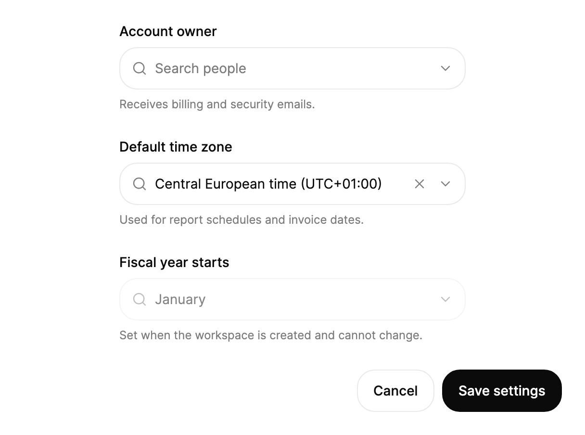

<Demo name="Searchable" />

## When to use

`Combobox` is a single-value picker for a list that is too long to scan, where people already know the name of the
thing they want. It sits in a form like an input: a visible label, a 44 px field and a description, with the list
opening under the field while the person types. Use it wherever the list is long enough that scrolling costs more than
typing.

- **Time zones and countries in account settings**: a team sets its default time zone or its billing country from a
  list of IANA zones. People type "berlin", "new york" or "UTC+01" and get the match in one step.
- **Account owners and assignees in a CRM or a helpdesk**: an opportunity owner or a ticket assignee is picked from the
  team directory. `Keywords` let a person find "Priya Raman" by her email alias or her team name.
- **Product and SKU lookup in an order editor**: a line item needs one product from a catalog. Keywords hold the SKU
  and old product names, so a search for the discontinued name still lands on the current item.
- **Ledger and cost-center selection in finance tools**: an expense report needs one cost center from a few hundred.
  Disabled options remain visible so a person sees that a center exists but is closed to new spend.
- **Developer tools that pick a target**: a deployment form picks one environment or one region from a long list.
  Search narrows it, and the chosen label stays in the field as the value people read.

## When not to use

- **A short, fixed list that needs no typing**: use `Select`. Three to seven options read faster in a list than behind
  a search field.
- **Choosing several values**: use `MultiSelect`, which keeps every choice visible as a token and never closes after a
  pick.
- **Facets that people switch often**: use `ChipGroup`, where every option is visible and one click changes the
  filter.
- **A search that navigates content rather than setting a value**: use `ExpandingSearch` in a header, which opens
  results rather than filling a field.
- **Free text that is not chosen from a list**: use `Input`. A combobox only holds values from its items.

## Usage

```xml
<UserControl xmlns="https://github.com/avaloniaui"
             xmlns:arc="https://github.com/AIDotNet/TKCode.Arc">
    <arc:Combobox Label="Framework"
                  Width="280"
                  Description="Type to search.">
        <arc:SelectItem Content="Avalonia" Keywords="xaml dotnet" />
        <arc:SelectItem Content="AtomUI" Keywords="ant design" />
        <arc:SelectItem Content="MAUI" Keywords="xamarin" IsEnabled="False" />
        <arc:SelectItem Content="WinUI" />
    </arc:Combobox>
</UserControl>
```

`Combobox` derives from Avalonia's `SelectingItemsControl`, so `ItemsSource`, `Items`, `SelectedItem`, `SelectedIndex`,
`SelectedValue`, `Selection` and `SelectionChanged` behave as they do in a list box, and the chosen item is always one
of the items. What the control adds is the field: a text input that filters the list, the label and description rows,
the popup list and the clear button. Inside a `SelectingItemsControl` each `SelectItem` is one option, and `Keywords`
on it are searched but never shown.

### Anatomy

1. **Label** (`Label`): a visible label above the field in the small type size, medium weight, 8 px above the field.
   It also names the field and its list for assistive technology.
2. **Field**: 44 px high (the medium control size), 1 px border with the control radius, the surface color and 12 px of
   horizontal padding. Hover and focus change its colors, not its size.
3. **Text input**: shows the query while the list is open. While the list is closed it shows the chosen label, never
   the value.
4. **Placeholder** (`Placeholder`): the default text is "Search or select…". While the person is searching, the chosen
   label stays in the field as muted copy, so the current choice is not lost.
5. **Clear button**: a 22 px button that appears while something is selected. It removes the selection and the query.
6. **Description** (`Description`): the muted helper line under the field, 12 px in the muted text color.
7. **List** (popup): opens 8 px under the field, with the panel radius, 5 px of inner padding and option rows 36 px high.
   The list is at most 300 px tall, and never more than 40% of the window height (`MaxDropDownHeight`).
8. **Status row** (`EmptyText`): the result count below the options, or the empty text ("No matches found" by default)
   when nothing matches. It uses the small type size in the muted color.

### Choosing the data

The field is the same whether the list has five options or five hundred. The difference is in the item data:

- Use `SelectItem` children for a short, static list defined in XAML, as in the usage example.
- Use `ItemsSource` with `SelectOption` records for a list from code or a view model. `SelectOption` takes a value and a
  label, `IsDisabled` marks a shown but unavailable option, and `Keywords` adds the terms the search matches.
- Set `TextSelector` and `ValueSelector` when the items are your own objects, so the label and the stored value come
  from properties rather than from `ToString()`.

```csharp
var zone = new Combobox
{
    Label = "Time zone",
    Width = 320,
    ItemsSource = cities.Select(c => new SelectOption(c.City, c.City)
    {
        Keywords = $"{c.Zone} {c.Offset}"
    }).ToArray()
};
zone.SelectionChanged += (_, _) => Console.WriteLine(zone.SelectedValue);
```

### Binding to a view model

With CommunityToolkit.Mvvm, the view model owns the value and the list of options, and the combobox edits both through
bindings. The value is the stored identifier, and the label is shown to people.

```csharp
public partial class TeamSettingsViewModel : ObservableObject
{
    public IReadOnlyList<SelectOption> Owners { get; }

    [ObservableProperty]
    private string? _ownerId;

    [ObservableProperty]
    private string? _timeZoneId = "europe-berlin";

    public TeamSettingsViewModel(IDirectoryService directory)
    {
        Owners = directory.ListMembers()
            .Select(m => new SelectOption(m.Id, m.DisplayName) { Keywords = m.Email })
            .ToArray();
    }

    [RelayCommand]
    private async Task SaveAsync()
    {
        if (OwnerId is null)
        {
            return;
        }
        await _settings.SaveAsync(OwnerId, TimeZoneId);
    }
}
```

```xml
<StackPanel Width="360" Spacing="16">
    <arc:Combobox Label="Account owner"
                  Placeholder="Search people"
                  ItemsSource="{Binding Owners}"
                  SelectedValue="{Binding OwnerId, Mode=TwoWay}" />
    <arc:Combobox Label="Default time zone"
                  ItemsSource="{Binding TimeZones}"
                  SelectedValue="{Binding TimeZoneId, Mode=TwoWay}" />
    <arc:Button Content="Save settings" Command="{Binding SaveCommand}" />
</StackPanel>
```

- `SelectedValue` is two-way and holds `null` while nothing is chosen. Bind it with `Mode=TwoWay` so the view model
  receives the choice and can set the field from code.
- `SelectedText` is read-only and holds the label of the selection. Show it in a summary line rather than binding it
  back.
- `IsOpen` is two-way. Set it from code only when a command needs to close the list before it navigates away.
- Do not bind `SelectedIndex` for a value that comes from a database. Indexes change when the list is reloaded, so bind
  the value instead.

### Searching and filtering

By default the search matches the label, the meta and the keywords as case-insensitive substrings, and the result list
keeps the order of the items. `SearchText` reports the current query, which is empty when the list is closed.

Set `FilterPredicate` to change the match. It receives the source item and the trimmed query, and it runs for every
item on each keystroke, so keep it cheap.

<Demo name="CustomFilter" />

```csharp
combo.FilterPredicate = (item, query) =>
    item is SelectOption option && option.Label.StartsWith(query, StringComparison.CurrentCultureIgnoreCase);
```

Use a prefix match for lists people scan by their first letters, such as a list of countries. Keep the default
substring match for names and aliases, where "york" should find "New York" in the middle of the words.

### Placeholder, empty text and status

`Placeholder` is shown in the empty field. `EmptyText` is the status row when nothing matches, and it should name the
thing that was searched, such as "No time zone matches." Keep the status row short, because it is announced when it
appears.

```xml
<arc:Combobox Label="Country"
              Placeholder="Search countries"
              EmptyText="No country matches." />
```

### Clearing and focus

`Clear()` removes the selection and the query, and the clear button does the same when a person presses it. Focus goes
to the field with `FocusInput()`, which opens the list, as it does when a person tabs into the field.

```csharp
zone.Clear();
zone.FocusInput();
```

Clearing is the right answer when the empty state is valid, for example a filter that can match everything. For a
required value, do not clear the field on a save; keep the value and show the message beside the field.

### Validation

The combobox has no message row of its own. Its `Description` is the place for a constraint that is always true ("Used
for report schedules."). For a rule that can fail, place a `TextBlock` below the field, bind its text to the view model's
error, and use the text color of the danger token. Check the rule when the list closes, not on each keystroke, so the
message does not appear while the person is still searching.

| Rule | When to check | Where it shows |
|---|---|---|
| A value is required | On save, or when the list closes with no value | A message below the field, with the focus moved to it |
| The value is still available | On save, because an option can be disabled later | A message below the field that names the option |
| The owner must belong to the team | On the server response | The same message row, cleared when the value changes |

### Inline options and disabled options

Disabled options show in the list but cannot be picked. The arrow keys skip them. Use this for an option that exists but
is not available to the person, such as a closed cost center. Explain the reason in the option label or in the
description, not only by graying the row.

<Demo name="InlineOptions" />

```xml
<arc:SelectItem Content="MAUI" Keywords="xamarin" IsEnabled="False" />
```

### Disabled

A disabled `Combobox` keeps its value and ignores input. It cannot open, so the person can still read the value but not
change it. Use it when a value is set by a policy, such as a fiscal year that cannot change after the workspace is
created, and say why in the description.

<Demo name="Disabled" />

### Example: team settings form

A team settings form in an admin console. The owner field is a searchable list of people with keywords for their email
addresses, so a person can type a surname or a domain. The time zone field is closed with a value chosen, and the
fiscal year field is disabled with a reason in its description. The labels are nouns, the placeholder names what to
search for, and the descriptions state the effect of each choice.



```xml
<StackPanel Width="560" Spacing="20">
    <arc:Combobox Label="Account owner"
                  Width="360"
                  Placeholder="Search people"
                  Description="Receives billing and security emails.">
        <arc:SelectItem Content="Priya Raman" Keywords="priya.raman@acme.com finance" />
        <arc:SelectItem Content="Marcus Hale" Keywords="marcus.hale@acme.com operations" />
        <arc:SelectItem Content="Elena Ruiz" Keywords="elena.ruiz@acme.com support" />
        <arc:SelectItem Content="Tomas Berg" Keywords="tomas.berg@acme.com engineering" />
    </arc:Combobox>
    <arc:Combobox Label="Default time zone"
                  Width="360"
                  SelectedIndex="1"
                  Description="Used for report schedules and invoice dates.">
        <arc:SelectItem Content="Pacific time (UTC-08:00)" Keywords="los angeles seattle" />
        <arc:SelectItem Content="Central European time (UTC+01:00)" Keywords="berlin paris rome" />
        <arc:SelectItem Content="Japan time (UTC+09:00)" Keywords="tokyo osaka" />
    </arc:Combobox>
    <arc:Combobox Label="Fiscal year starts"
                  Width="360"
                  IsEnabled="False"
                  SelectedIndex="0"
                  Description="Set when the workspace is created and cannot change.">
        <arc:SelectItem Content="January" />
        <arc:SelectItem Content="April" />
    </arc:Combobox>
    <StackPanel Orientation="Horizontal" Spacing="8" HorizontalAlignment="Right">
        <arc:Button Content="Cancel" Variant="Secondary" />
        <arc:Button Content="Save settings" />
    </StackPanel>
</StackPanel>
```

### Content guidelines

- **Label**: a noun naming the value, in sentence case, such as "Account owner" or "Default time zone". Do not add a
  colon or a question.
- **Placeholder**: the action and the object, such as "Search people" or "Search countries". It is not a restatement of
  the label.
- **Description**: one sentence on the effect of the choice, for example "Used for report schedules", or the reason an
  option cannot be chosen.
- **Empty text**: name what was searched and say that nothing matched. Keep it to one line.
- **Option labels**: the name people recognize, such as a full time zone name or a person's display name. Put aliases in
  `Keywords`, not in the label.

| Instead of | Write |
|---|---|
| Select | Search people |
| Enter a value | Search or select |
| Nothing found | No time zone matches. |
| Owner: | Account owner |
| Click to choose the time zone | Choose a default time zone |

### Best practices

**Do**

- Use `Keywords` for the terms people actually type, such as an email alias, a city, a former product name or a region,
  so the match works without the label containing them.
- Bind the value (`SelectedValue`) rather than the index, so reloading the list does not change the selection.
- Keep the list sorted by the label people read, and filter by prefix only when the list is an ordered catalog.
- Show the chosen item in a summary when the choice changes a total or a schedule, so the effect is visible without
  reopening the list.

**Avoid**

- A combobox for three or four options. The search field adds a step where a `Select` list would show every choice.
- Hiding the reason an option is disabled. A person who cannot pick "MAUI" needs to know why.
- Replacing the items while a person is typing in the list. The list is rebuilt under the query, so the highlight can
  move to an option the person did not choose.
- Building `FilterPredicate` on expensive work such as a server request. It runs on every keystroke. Load the list from
  the server with a debounced query in the view model instead.
- Relying on the placeholder to say which field is required. Put a visible label above the field.

### Common questions

**Why does the field show the label and not the value?** `SelectedValue` is the stored identifier, and the field is the
text a person reads. While the list is closed, the field shows `SelectedText`. The value stays in the view model.

**What happens to the typed query when I press Escape?** The list closes, the query is dropped and the previous value
stays. The field shows the chosen label again.

**How do I move the highlight or pick an option with the keyboard?** Press `Down` to open the list, then `Down` and
`Up` to move the highlight, and `Enter` to pick it. The highlight wraps from the last option to the first. The disabled
options are skipped.

**Can I open the list from code?** Set `IsOpen` to `True` or call `FocusInput()`, which also moves focus into the field.
The list opens when the field gains focus or when a person types.

**Does focusing the field open the list?** Yes. Focus opens the list, and typing opens it too. `Enter` picks the
highlighted option and closes it, and `Tab` closes it and moves focus on.

## API reference

<!-- api: Combobox -->

<!-- api: SelectOption -->

## Accessibility

- `Label` names the field and its list. `Description` is the help text read after the name and the value.
- The field is exposed as a combo box. Its value is the chosen label, and its expanded state follows the list.
- Focus stays in the text input while the person moves the highlight with the arrow keys, so typing and navigating
  do not compete.
- The clear button is named "Clear selection". The status row under the options is a polite live region, so a change
  in the result count or the empty message is announced without moving focus.
- Caret, selection, IME composition and clipboard shortcuts are the native `TextBox` behavior.
- A focused field only strengthens its border (`BorderStrong`); there is no focus ring around it.

### Keyboard

| Keys | Action |
|---|---|
| Typing | Filters the options by label, meta and keywords; opens the list if it is closed |
| `Down` / `Up` | Opens the list if it is closed; otherwise moves the highlight to the next or previous enabled option, wrapping |
| `Enter` | Picks the highlighted option and closes the list; with no highlight it does nothing |
| `Escape` | Closes the list and drops the query; the chosen value stays |
| `Tab` | Closes the list and moves focus to the next control |
| Focus into the field | Opens the list |
| Pointer click on an option | Picks it and closes the list |

## Motion

- The list opens from above on a spring. Its height follows the number of matching results, so it grows and shrinks as
  the query changes.
- The chosen label rises into the field from below, 0.35em, and comes out of a soft blur.
- The clear button pops in while something is selected and scales down slightly when pressed.
- The status row under the options rises 4 px and fades in when the list has no matches.

| Change | Full | Reduced | Off |
|---|---|---|---|
| The list opens | Springs in from above | Fades in | Immediate |
| The result count changes | The list height follows on a smooth spring | The height changes at once | Immediate |
| A chosen label appears | Rises 0.35em from below out of a soft blur | Fades in | Immediate |
| The clear button appears | Pops in | Fades in | Immediate |
| The empty status row appears | Rises 4 px and fades in | Fades in | Immediate |

## Related

- `Select` for short fixed lists that people choose from without typing.
- `MultiSelect` when several values are chosen, and `ChipGroup` for facets that people switch often.
- `ExpandingSearch` when the search navigates content rather than setting a value.
- `Input` for free text that is not chosen from a list.

| Component | Choose it when |
|---|---|
| `Select` | The list is short and fixed, and people do not need to type |
| `MultiSelect` | Several values are chosen and each stays visible as a token |
| `ChipGroup` | A few facets are switched often and every option should stay visible |
| `ExpandingSearch` | The search opens results to read or navigate, not to set a field |
| `Input` | The value is free text rather than one of the items |
| `TagInput` | People create their own tags instead of picking existing options |
