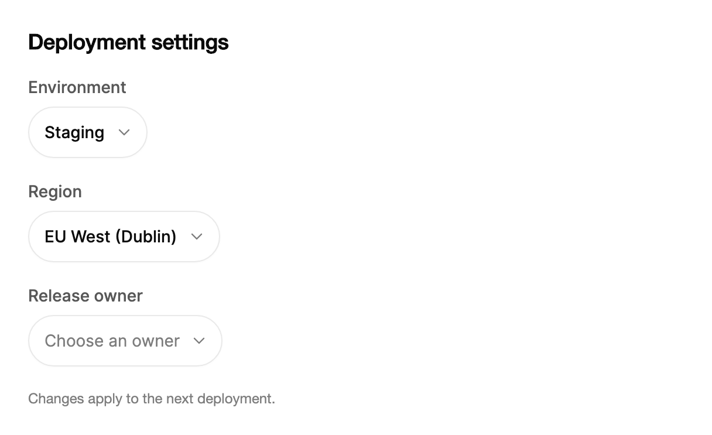

<Demo name="GroupedWithSearch" />

## 何時使用

`MorphSelect` 是用於表單或屬性面板中已知清單的單值選取器。收合時，觸發器是一個與其標籤等寬的膠囊形狀；展開時，同一形狀會生長為選項清單，讓使用者看到清單從正在變更的值中展開。它適合選取很重要、選項已知的情境：設定頁、詳細資料面板和工具列，在這些地方一般下拉式選單顯得過於笨重。

- **開發者主控台中的部署設定**：發佈時從雲端區域群組中選擇環境（Production、Staging、Preview）與地區。「Americas」「Europe」這類群組標題讓使用者不必瀏覽整個清單就能找到地區。
- **專案追蹤工具中的屬性面板**：任務的狀態、優先順序與負責人從簡短的已知清單中選取。精簡的膠囊排在說明上方的一列中，每一個都在原位展開。
- **CRM 詳細資料面板中的負責人與團隊選取**：客戶負責人從業務團隊中選出。選項超過八個時，搜尋欄位會自動出現，讓較長的團隊清單仍然好用。
- **精簡的狀態與優先順序工具列**：看板或表格工具列以附圖示的膠囊顯示目前的篩選條件。隱藏標籤可以讓工具列更短，觸發器仍以標籤作為無障礙名稱。
- **金融與帳單設定**：發票幣別、計費週期或稅務地區是已知清單，每個選項在名稱旁的清單中帶有一個簡短的中繼資料值，例如匯率或時差。

## 何時不用

- **自由文字，或來自遠端資料來源的長清單**：用 `Combobox`，它會隨輸入搜尋，並把已輸入的文字保留為查詢字詞。
- **選取多個值**：用 `MultiSelect`，它把每個已選值保留為權杖，並在兩次選取之間保持展開。
- **執行動作而非選取值**：用 `DropdownMenu`，其項目會執行重新命名或封存等命令。
- **三到四個且都能放進螢幕的選項**：用 `SegmentedControl` 或 `ChipGroup`，所有選項都可見，不需要額外的展開步驟。
- **密集表單中只需一個收合清單即可滿足的一般標籤欄位**：用 `Select`，它是帶固定清單的經典欄位。

## 用法

```xml
<UserControl xmlns="https://github.com/avaloniaui"
             xmlns:arc="https://github.com/AtomUICommunity/TKCode.Arc">
    <arc:MorphSelect Label="狀態" SelectedIndex="1">
        <arc:SelectItem Content="待辦" />
        <arc:SelectItem Content="進行中" />
        <arc:SelectItem Content="待審核" />
        <arc:SelectItem Content="已完成" />
        <arc:SelectItem Content="已取消" IsEnabled="False" />
    </arc:MorphSelect>
</UserControl>
```

`MorphSelect` 衍生自 Avalonia 的 `SelectingItemsControl`，因此 `ItemsSource`、`Items`、`SelectedItem`、`SelectedIndex`、`SelectedValue`、`Selection` 和 `SelectionChanged` 的行為與清單方塊一致。控制項另外提供觸發器、變形的展開面板、標籤飛行動畫、搜尋以及分組清單模型。`SelectItem` 提供每個選項，程式碼中可以用 `SelectOption` 做同樣的事。

### 結構

1. **標籤**（`Label`）：小字級、中等字重、次要文字顏色，位於觸發器上方 8 px。無論是否繪製，它都是觸發器及其清單的無障礙名稱。
2. **觸發器**：高 44 px 的膠囊，1 px 邊框，值前有 14 px 內距，箭頭保留 36 px。圓角半徑 22 px，兩端完全圓潤。寬度隨所選標籤變化，再加上 50 px 的內距與箭頭，最大為 320 px。
3. **值或預留位置文字**：所選標籤使用前景色。未選取時，以淡化顏色顯示 `Placeholder`，預設值為 "Select"。
4. **箭頭**：距觸發器右邊緣 12 px。
5. **展開面板**（展開狀態）：觸發器生長為寬 `PanelWidth` 的面板（預設 272 px，且不窄於觸發器）。面板在清單四周有 6 px 的內距，清單最高為 `MaxListHeight`（預設 296 px），超出時可捲動。
6. **選項列**：高 36 px。每一組連續共用同一 `Group` 的選項上方會插入一個分組標題，標題高 28 px。
7. **反白**：前景色的柔和淡色，透明度為 6.5%，隨使用者在清單中移動而在選項之間滑動。
8. **搜尋欄位**（開啟搜尋時）：在展開的觸發器內取代值的顯示。其清除按鈕使用前景色 8% 的淡色。
9. **焦點環**：觸發器取得焦點時繪製，寬 2 px，位於觸發器外 4 px。

### 選取模式與寬度

觸發器是單選，其寬度由標籤決定，因此較長的標籤會得到較寬的膠囊。當選項文字較長、清單需要比預設的 272 px 更寬時，設定 `PanelWidth`。當觸發器位於工具列的右邊緣時，將 `PanelAlignment` 設為 `End`，讓面板朝空白處展開，而不是伸到視窗之外。

```xml
<arc:MorphSelect Label="優先順序" PanelAlignment="End" PanelWidth="220">
    <arc:SelectItem Content="緊急" />
    <arc:SelectItem Content="高" />
    <arc:SelectItem Content="中" />
    <arc:SelectItem Content="低" />
    <arc:SelectItem Content="無優先順序" />
</arc:MorphSelect>
```

### 分組、圖示與中繼資料

為每個選項設定 `Group`、`Icon` 與 `Meta`。每一組連續共用同一 `Group` 的選項上方會插入一個分組標題，因此請在原始碼中把同一組的選項放在一起。`Icon` 接受 Lucide 幾何圖形或圖片。`Meta` 是尾端的簡短細節，例如時差、匯率或數量，以等寬數字樣式顯示。

```csharp
var zone = new MorphSelect
{
    Label = "時區",
    SelectedValue = "London",
    ItemsSource = cities.Select(c => new SelectOption(c.City, c.City)
    {
        Group = c.Region,
        Meta = c.Utc,
        Keywords = c.Zone,
        Icon = ArcIcons.Globe
    }).ToArray()
};
zone.SelectionChanged += (_, _) => Console.WriteLine(zone.SelectedValue);
```

當選項屬於使用者已經習慣的幾類（例如地區、方案或團隊）時使用分組。不要為只有一個選項的群組加上分組，因為標題占用的空間會超過選項本身。

### 精簡工具列

使用 `IsLabelVisible="False"` 隱藏標籤。觸發器仍以 `Label` 作為無障礙名稱，因此膠囊保持精簡，螢幕閱讀器依然能讀出它的名稱。

<Demo name="CompactToolbar" />

```xml
<arc:MorphSelect Label="狀態" IsLabelVisible="False" />
<arc:MorphSelect Label="優先順序" PanelAlignment="End" PanelWidth="220"
                 ItemsSource="{Binding Priorities}" />
```

只有當膠囊的值本身能說明情況時才隱藏標籤，例如工具列中的狀態或優先順序。在表單中，如果值可能有多種解讀，請讓標籤保持在觸發器上方可見。

### 搜尋

`SearchMode` 決定展開的面板是否有搜尋欄位。預設值 `Auto` 在選項超過八個時加入搜尋欄位，`On` 則一律加入，`Off` 從不加入。`SearchPlaceholder` 設定其提示文字，預設為所選標籤或 "搜尋"。在收合的觸發器上鍵入字母會跳到相符的選項並展開清單。清單展開且開啟搜尋後，鍵入的文字會進入搜尋欄位，並依標籤、中繼資料與關鍵字進行比對。

```xml
<arc:MorphSelect Label="負責人"
                 SearchMode="On"
                 SearchPlaceholder="尋找人員"
                 ItemsSource="{Binding Owners}" />
```

對於超過約八個人員、專案或帳號的任何清單，請開啟搜尋。短清單保持 `Auto`，不顯示搜尋欄位；當清單依排名排序、而搜尋會把它隱藏時，使用 `Off`。

### 繫結到檢視模型

使用 CommunityToolkit.Mvvm 時，檢視模型擁有值與清單，變形選取器透過繫結修改值。值的標籤為唯讀，並顯示在摘要中。

```csharp
public partial class DeploymentSettingsViewModel : ObservableObject
{
    public IReadOnlyList<SelectOption> Regions { get; }

    [ObservableProperty]
    private string? _regionId = "us-east-1";

    [ObservableProperty]
    private bool _isRegionOpen;

    public DeploymentSettingsViewModel(ICloudCatalog catalog)
    {
        Regions = catalog.Regions()
            .Select(r => new SelectOption(r.Id, r.Name) { Group = r.Area, Meta = r.Code })
            .ToArray();
    }

    [RelayCommand]
    private async Task SaveAsync()
    {
        await _deployments.SetRegionAsync(RegionId);
    }
}
```

```xml
<StackPanel Spacing="16" HorizontalAlignment="Left">
    <arc:MorphSelect Label="地區"
                     ItemsSource="{Binding Regions}"
                     SelectedValue="{Binding RegionId, Mode=TwoWay}"
                     IsOpen="{Binding IsRegionOpen, Mode=TwoWay}" />
    <arc:Button Content="儲存地區" Command="{Binding SaveCommand}" />
</StackPanel>
```

- `SelectedValue` 為雙向繫結，保存的是穩定的識別碼，因此檢視模型能收到選取結果。應使用值而不是索引，這樣重新載入清單時選取不會改變。
- `IsOpen` 為雙向繫結。當檢視模型需要在導覽前先關閉清單，或其他地方的變動應當將其展開時，繫結它。
- `SelectedText` 為唯讀，保存所選項的標籤。把它顯示在摘要列中，而不要把檢視模型屬性反向繫結到它。
- 對每次選取都必須執行的副作用使用 `SelectionChanged`，儲存操作仍由命令完成。

### 驗證

觸發器沒有自己的訊息列。在欄位下方放置一個 `TextBlock` 並繫結到檢視模型的錯誤，訊息使用危險文字顏色。應在清單收合時驗證，而不是在使用者移動反白時驗證，以免訊息在指標下方變動。

| 規則 | 何時檢查 | 顯示在哪裡 |
|---|---|---|
| 必須選取一個值 | 儲存時，或清單在沒有值的情況下收合時 | 觸發器下方的訊息，並把焦點移到此處 |
| 所選地區仍然可用 | 儲存時，因為選項之後可能被停用 | 觸發器下方的訊息，並指出該地區 |
| 帳號允許該選取 | 伺服器回應時 | 同一訊息列，值變動時清除 |

### 範例：部署設定面板

開發者主控台中的部署設定面板。環境與地區是帶可見標籤的收合式觸發器，環境中有一個停用選項，並說明了為何不能使用。截圖展示靜止狀態：觸發器膠囊、它們的標籤，以及尚無值的欄位的預留位置文字。



```xml
<StackPanel Width="560" Spacing="20">
    <TextBlock Text="Deployment settings"
               FontSize="18"
               FontWeight="SemiBold"
               Foreground="{arc:ArcDesignTokenResource Foreground}" />
    <arc:MorphSelect Label="Environment" SelectedIndex="1">
        <arc:SelectItem Content="Production" />
        <arc:SelectItem Content="Staging" />
        <arc:SelectItem Content="Preview" />
        <arc:SelectItem Content="Archived" IsEnabled="False" />
    </arc:MorphSelect>
    <arc:MorphSelect Label="Region" SelectedIndex="2">
        <arc:SelectItem Content="US East (Virginia)" Group="Americas" Meta="us-east-1" />
        <arc:SelectItem Content="US West (Oregon)" Group="Americas" Meta="us-west-2" />
        <arc:SelectItem Content="EU West (Dublin)" Group="Europe" Meta="eu-west-1" />
        <arc:SelectItem Content="EU Central (Frankfurt)" Group="Europe" Meta="eu-central-1" />
        <arc:SelectItem Content="Asia Pacific (Tokyo)" Group="Asia Pacific" Meta="ap-northeast-1" />
    </arc:MorphSelect>
    <arc:MorphSelect Label="Release owner" Placeholder="Choose an owner">
        <arc:SelectItem Content="Priya Raman" />
        <arc:SelectItem Content="Marcus Hale" />
        <arc:SelectItem Content="Elena Ruiz" />
    </arc:MorphSelect>
    <TextBlock Text="Changes apply to the next deployment."
               FontSize="12"
               Foreground="{arc:ArcDesignTokenResource TextMuted}" />
</StackPanel>
```

### 文案規範

- **標籤**：命名屬性的名詞，採句首大寫，例如「環境」或「地區」。即使標籤被隱藏，它也會為輔助技術命名觸發器。
- **預留位置文字**：補完標籤的指示，例如「請選擇負責人」。一般欄位使用預設的「選擇」即可。
- **選項標籤**：使用者在工作中使用的名稱，例如「美國東部（維吉尼亞）」或「正式環境」。把識別碼放進 `Meta`，把別名放進 `Keywords`。
- **群組標題**：表示類別的複數名詞，例如「美洲」或「歐洲」。
- **搜尋預留位置文字**：說明要搜尋什麼，例如「尋找人員」或「尋找地區」。

| 不要寫 | 改為 |
|---|---|
| 選擇… | 請選擇負責人 |
| 環境縮寫 ENV | 環境 |
| 地區（必填） | 地區 |
| 雜項 | 其他地區 |
| 點選這裡挑選 | 請選擇地區 |

### 最佳做法

**建議**

- 表單中保持標籤可見，只有在值本身已能說明控制項用途的工具列中才隱藏標籤。
- 繫結 `SelectedValue`，並在檢視模型中保存穩定的識別碼，這樣重新命名選項不會改變已儲存的選取。
- 每個群組至少給出兩個選項，讓標題幫助使用者快速掃視清單。
- 對於使用者以名稱熟知、超過約八個選項的清單，開啟搜尋。

**避免**

- 用膠囊執行重新命名或封存等動作。這些應放在 `DropdownMenu` 中，其項目執行命令。
- 在窄工具列中使用長標籤。觸發器會隨標籤增長至 320 px，這會把其他工具列項目擠開。
- 停用選項卻不在其標籤或周圍文案中說明原因。無法選取「已封存」的使用者需要知道原因。
- 清單展開時重新排序選項。反白停留在原來的索引上，使用者可能選錯項目。
- 只用箭頭作為欄位可互動的提示。應保持標籤與膠囊形狀可見。

### 常見問題

**選取較長的值時，膠囊為什麼會變寬？** 觸發器的寬度等於標籤加上內距與箭頭，最大 320 px，因此膠囊剛好容納其值。如果工具列中的位置不能隨值變動而移動，請為它提供固定的位置。

**如何讓清單在最後一個選項處展開？** 在收合的觸發器上按 `End`，清單會在最後一個選項處展開。`Home` 則在第一個選項處展開。Enter、Space、`Down` 與 `Up` 會在所選選項處展開。

**將 `SearchMode` 設為 `Off` 時，搜尋欄位會顯示嗎？** 不會。`Off` 從不顯示搜尋欄位，即使是長清單；在收合的觸發器上鍵入仍會跳到相符的選項。

**如何避免清單遮住頁面邊緣？** 將 `PanelAlignment` 設為 `End`，使展開面板向觸發器左側生長。面板相對於觸發器保持位置，不會翻轉到另一側。

**清單能顯示來自伺服器的選項嗎？** 在檢視模型中載入選項，並在它們抵達時指派 `ItemsSource`。選取依值比對，因此每次載入時都應保持識別碼穩定。

## API 參考

<!-- api: MorphSelect -->

<!-- api: SelectItem -->

## 無障礙

- `Label` 為觸發器命名，即使 `IsLabelVisible` 為 `False` 也是如此。清單也由同一標籤命名。
- 觸發器是帶有清單方塊彈出層的組合方塊。清單展開時會公開展開狀態，並播報目前反白的選項。
- 方向鍵移動反白並略過停用的選項。`Page Up` 與 `Page Down` 每次移動八個選項，`Home` 與 `End` 分別前往第一個與最後一個選項。
- `Enter` 或 `Space` 選取反白的選項。`Alt+Up` 選取並關閉清單。`Escape` 關閉清單，並把焦點返回觸發器。
- 選項分組以其標題命名。開啟搜尋時，結果數量會以禮貌的方式播報；清單展開期間，搜尋欄位接管組合方塊角色。

### 鍵盤

| 按鍵 | 操作 |
|---|---|
| 收合的觸發器上的 `Enter`、`Space`、`Down`、`Up` | 在所選選項處展開清單 |
| 收合的觸發器上的 `Home` / `End` | 在第一個或最後一個選項處展開清單 |
| 清單展開時的 `Down` / `Up` | 把反白移到下一個或上一個可用選項；到達兩端時不循環 |
| `Page Down` / `Page Up` | 每次把反白移動八個選項 |
| 清單展開時的 `Home` / `End` | 把反白移到第一個或最後一個選項 |
| 清單展開時的 `Enter` 或 `Space` | 選取反白的選項並關閉清單 |
| `Alt+Up` | 選取反白的選項並關閉清單 |
| 可列印字元 | 跳到第一個相符的選項；開啟搜尋時，輸入到搜尋欄位中 |
| `Escape` | 不選取即關閉清單，並把焦點返回觸發器 |
| `Tab` | 不選取即關閉清單 |

## 動態效果

- 觸發器展開為清單。其圓角從膠囊形狀變形為面板的圓角；面板打開時帶有輕微彈跳，關閉時無過衝。
- 反白在選項之間滑動。
- 選取的標籤從清單飛回觸發器，觸發器寬度調整為新標籤的寬度。
- 觸發器中的值會朝清單的方向捲入，使這一變化看起來像同一個值在移動。

| 變化 | 完整 | 減少 | 關閉 |
|---|---|---|---|
| 清單展開 | 觸發器以輕微彈跳生長為面板，圓角變形 | 尺寸跳到展開形狀，並伴隨短暫淡入 | 立即完成 |
| 清單收合 | 面板無過衝地縮回膠囊 | 尺寸跳到收合形狀，並伴隨短暫淡入 | 立即完成 |
| 反白移動 | 滑動到下一個選項 | 直接跳到該選項 | 立即完成 |
| 選取選項 | 標籤飛入觸發器，寬度調整到位 | 短暫淡入 | 立即完成 |
| 搜尋接管觸發器 | 搜尋欄位以輕微模糊淡入 | 短暫淡入 | 立即完成 |

## 相關元件

- `Select`：帶固定清單的一般標籤選取欄位。
- `Combobox`：使用者鍵入即可搜尋的單選控制項。
- `MultiSelect`：需要選取多個值時使用。
- `DropdownMenu`：選單用於執行動作而非選取值時使用。

| 元件 | 適用情境 |
|---|---|
| `Select` | 帶固定清單的經典標籤欄位適合該表單 |
| `Combobox` | 使用者需要鍵入查找值，或清單很長且來自遠端 |
| `MultiSelect` | 需要選取多個值，且每個值都以權杖的形式保持可見 |
| `DropdownMenu` | 選單執行重新命名或封存等命令 |
| `SegmentedControl` | 應一次顯示兩到四個選項 |
| `ChipGroup` | 少數幾個切換頻繁的篩選項，且每個選項都保持可見 |
