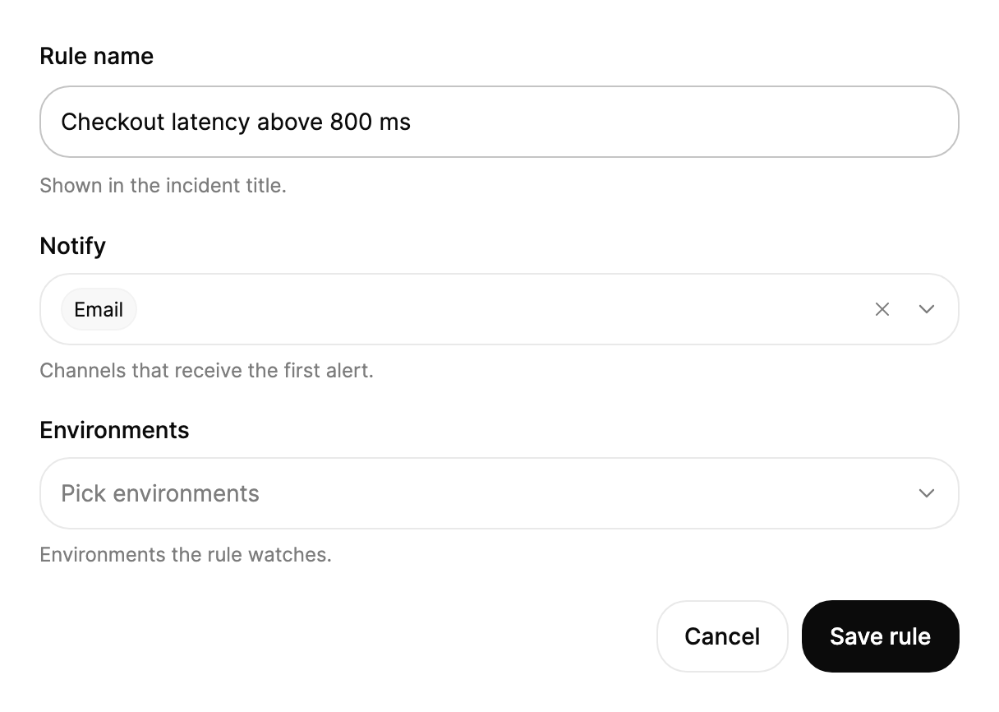

<Demo name="Chips" />

## 何時使用

`MultiSelect` 讓使用者從一份固定清單中選取多個值，同時欄位不會隨之變高。它用於表單與篩選列中，答案是一組值的情境：工單上的標籤、專案的負責人、接收警示的通道。選取的值會以標籤的形式顯示在欄位內，使用者不必開啟選單就能看到已做的選擇。

- **問題或工單上的標籤**：客服人員在工單編輯器中為一個案件設定「錯誤」「帳務」和「優先順序」。固定清單讓全團隊的標籤保持一致，標籤則能一眼看出整組選擇。
- **客服佇列或訂單清單中的負責人與團隊篩選**：主管依兩三位客服或地區篩選佇列。篩選列中的標籤顯示目前生效的篩選條件，`+N` 標籤則顯示其餘的數量。
- **警示規則中的通知通道**：SRE 為一條規則選取「電子郵件」「Slack」和「PagerDuty」。每個通道都是固定選項，規則表單會依使用者選取的先後順序儲存這些值。
- **部署或報表範圍中的環境與地區**：發佈負責人為一條流水線選取預備環境與正式環境。使用者無權使用的選項可以停用，欄位則維持一行的高度。
- **帶搜尋的大型固定清單**：業務主管從一份很長的清單中選取多個城市。`IsSearchable` 會在選單中加入搜尋欄位，無需另開對話方塊也能順暢使用。

## 何時不用

- **切換選項時必須始終看到全部選項**：使用 `ChipGroup`。它的標籤始終在畫面上，使用者可以同時比較選項及其狀態。
- **使用者需要自行輸入並建立的值**：使用 `TagInput`。`MultiSelect` 只能從你提供的清單中選取。
- **只能選一個值**：清單較短時使用 `Select`，使用者需要搜尋的長清單則使用 `Combobox`。
- **彼此獨立的是或否設定**：每個設定使用一個 `Checkbox` 或 `Switch`，讓每個設定都有自己的標籤與說明。
- **指令而非值**：使用 `DropdownMenu`。在那裡選擇一個項目會執行動作；在這裡選擇選項則是把值存入表單。

## 用法

```xml
<UserControl xmlns="https://github.com/avaloniaui"
             xmlns:arc="https://github.com/AIDotNet/TKCode.Arc">
    <arc:MultiSelect Label="標籤"
                     Description="顯示在問題卡片上。"
                     Width="320">
        <arc:SelectItem Content="錯誤" Value="bug" />
        <arc:SelectItem Content="功能" Value="feature" />
        <arc:SelectItem Content="文件" Value="docs" />
        <arc:SelectItem Content="基礎架構" Value="infra" IsEnabled="False" />
    </arc:MultiSelect>
</UserControl>
```

`MultiSelect` 衍生自 Avalonia 的 `SelectingItemsControl`，因此保留您熟悉的項目模型：`ItemsSource`、`SelectedItems`、`Selection`、`SelectionChanged`、鍵盤焦點和 `IsEnabled`。它的選取模式預設為 `Multiple | Toggle`，因此每次選取會新增或移除一個值。Arc 層在此之上加入標籤、說明、標籤列、清除按鈕和選單。`SelectItem` 子元素和 `SelectOption` 記錄都可以使用；沒有 `Value` 的 `SelectItem` 會把 `Content` 當作值。

### 結構

1. **欄位標籤**（`Label`）：14 px、中等字重，位於觸發器上方。它同時是欄位的無障礙名稱。
2. **觸發器**：至少 44 px 高（`ControlSizeMD`）的帶邊框方塊，標籤前 12 px，下拉箭頭後 11 px，上下各 5 px。它使用控制項圓角、表面色和淡化的邊框顏色。懸停與展開時只改變邊框與背景顏色。
3. **標籤列**（顯示時取代 `Placeholder`）：標籤依使用者選取的先後順序顯示所選項目的名稱。每個標籤最寬 144 px，左右內距 7 px、上下內距 3 px，使用 12 px 的超小字級，與前一個標籤相距 5 px。標籤使用淡化的表面色並帶有淡化的邊框。
4. **溢出標籤**：可見標籤之後的 `+N` 標籤。它的數字來自超出 `MaxVisibleChips` 的選取項，使用次要文字顏色。
5. **預留位置文字**（`Placeholder`，預設為「選取選項」）：未選取任何值時顯示的淡化文字。選取第一個值後立即淡出。
6. **下拉箭頭**：16 px 的向下箭頭。選單展開時旋轉 180 度。選取值時，它的左外距從 8 px 增加到 34 px，使旁邊的清除按鈕不會與箭頭重疊。
7. **清除按鈕**：22 px 的圓形按鈕，內含 14 px 的叉號，距觸發器右邊緣 36 px。當至少選取一個值且欄位啟用時顯示，名稱為「清除選取項目」。
8. **說明**（`Description`）：觸發器下方 12 px 的淡化輔助文字。它同時是欄位的無障礙說明文字。
9. **選單**：帶 1 px 邊框、面板圓角與 5 px 內距的抬升表面。它在觸發器下方 8 px 處展開，寬度與觸發器相同。每個選項列高 38 px，圓角為 21 px，已選取的選項顯示勾選標記。停用的選項以 42% 的不透明度繪製。

預設情況下，選單沒有高度限制。當長清單會超出螢幕時，`MaxDropDownHeight` 可以限制其高度（參見資料結構一節）。

### 標籤與溢出

選取的值會以標籤的形式顯示在欄位內。`MaxVisibleChips` 設定在其餘值折疊為 `+N` 標籤之前顯示幾個標籤，預設為 2。窄的篩選列可設為 1，只顯示數量時設為 0。當標籤列空間不足時，可見標籤會隨剩餘寬度縮小，但 `+N` 標籤保持其尺寸，因此數量不會消失。

<Demo name="OneVisibleChip" />

```xml
<arc:MultiSelect Label="負責人"
                 MaxVisibleChips="1"
                 Width="280"
                 ItemsSource="{Binding Owners}" />
```

應依欄位的寬度而不是清單的長度來選擇數量。每個標籤需要的空間取決於其文字，最寬 144 px。對於較長的標籤，例如「基礎架構審查」，請使用一個可見標籤，讓欄位維持在一行，並由選單顯示完整的選擇。

### 繫結的選項與值

將 `ItemsSource` 設為 `SelectOption` 記錄。`SelectedValues` 依選取的先後順序列出值，它是唯讀的，因此請在事件處理常式或程式碼中讀取它。

```csharp
var labels = new MultiSelect
{
    Label = "標籤",
    Width = 320,
    ItemsSource = new[]
    {
        new SelectOption("bug", "錯誤"),
        new SelectOption("feature", "功能"),
        new SelectOption("docs", "文件"),
        new SelectOption("infra", "基礎架構", isDisabled: true),
    }
};
labels.SelectionChanged += (_, _) => Console.WriteLine(string.Join(", ", labels.SelectedValues));
```

`SelectedValues` 是應該儲存的清單。標籤與 `SelectedValues` 都依選取的順序排列，而不是依選項的順序：如果使用者先選取「文件」再選取「錯誤」，標籤和儲存的清單都會以「文件」開頭。當儲存的順序很重要時，請在程式碼中對值排序。

### 繫結到檢視模型

在 MVVM 應用程式中，檢視模型擁有選項與已選取的項目，欄位負責顯示它們。將 `ItemsSource` 繫結到選項，將 `SelectedItems` 繫結到檢視模型中的 `ObservableCollection`。`MultiSelect` 衍生自 Avalonia 的 `SelectingItemsControl`，它會讓繫結的 `SelectedItems` 清單與選取狀態保持雙向同步：每次選取或移除標籤都會在集合中新增或移除對應的選項，而在程式碼中對集合新增或移除選項會更新標籤。

```csharp
public partial class AlertRuleViewModel : ObservableObject
{
    private readonly IAlertRuleService _rules;

    public AlertRuleViewModel(IAlertRuleService rules) => _rules = rules;

    public ObservableCollection<SelectOption> Channels { get; } = new()
    {
        new SelectOption("email", "電子郵件"),
        new SelectOption("slack", "Slack"),
        new SelectOption("pagerduty", "PagerDuty"),
        new SelectOption("sms", "簡訊", isDisabled: true),
    };

    public ObservableCollection<SelectOption> SelectedChannels { get; } = new();

    [RelayCommand]
    private async Task SaveAsync()
    {
        var ids = SelectedChannels.Select(c => (string)c.Value!).ToArray();
        await _rules.SaveAsync("checkout-latency", ids);
    }
}
```

```xml
<StackPanel Width="320" Spacing="16">
    <arc:MultiSelect Label="通知"
                     ItemsSource="{Binding Channels}"
                     SelectedItems="{Binding SelectedChannels}"
                     Placeholder="選取通道"
                     Description="接收第一則警示的通道。" />
    <arc:Button Content="儲存規則" Command="{Binding SaveCommand}" IsDefault="True" />
</StackPanel>
```

- `SelectedItems` 使用預設的單向繫結：控制項會把選取項目填入你提供的集合，因此檢視模型在表單的整個生命週期中只保留一個集合。取代集合物件會把選取狀態重設為其內容。
- 集合依 Avalonia 回報的選取順序排列；`SelectedValues` 則給出使用者選取的先後順序。當順序很重要時，請儲存 `SelectedValues`。
- `IsOpen` 是雙向的，因此繫結可以開啟與關閉選單，選單也會把其狀態寫回。`SelectedValues` 是唯讀的：只能讀取，絕不可指派。
- 每次選取與移除後都會引發 `SelectionChanged`，包括鍵盤選取；請用它處理即時預覽等附帶作用，而不是用來複製選取狀態。
- 編譯繫結需要在檢視上設定 `x:DataType`（為求簡潔，這裡的範例省略了它）。

### 可搜尋的選單

`IsSearchable` 會在選單頂端加入搜尋欄位。輸入會篩選選項；按 `Down` 可醒目提示第一個符合的項目，按 `Enter` 則選取它。`SearchPlaceholder` 設定搜尋欄位中的提示，`EmptyText` 設定沒有符合項目時顯示的文字。

<Demo name="Searchable" />

```xml
<arc:MultiSelect Label="城市"
                 Placeholder="選取城市"
                 SearchPlaceholder="輸入城市名稱"
                 IsSearchable="True"
                 Width="320"
                 ItemsSource="{Binding Cities}" />
```

預設的比對方式是對每個選項的名稱、其 `Meta` 文字與 `Keywords` 進行不區分大小寫的文字搜尋。為使用者會搜尋的同義詞加上 `Keywords`：名稱為「基礎架構」且關鍵字為 "devops" 的選項，在使用者輸入 "devops" 時會出現。當比對必須遵循你自己的規則時，例如依客戶代碼的前綴比對，請設定 `FilterPredicate`。該述詞會接收選項與去除前後空白後的搜尋文字。

搜尋是 Arc 之外的附加功能，Arc 的選單本身沒有搜尋欄位，因此只在清單長到捲動比輸入更慢時才使用它。開啟選單時焦點會移入搜尋欄位；關閉選單時，如果焦點原本在搜尋欄位中，則會回到觸發器。

### 以程式碼選取

`Selection` 是選取模型。`SelectAll()` 與 `UnselectAll()` 只供程式碼使用，因為 Arc 沒有全選控制項。

```csharp
labels.Selection.Select(0);
labels.Selection.Select(1);
labels.UnselectAll();
```

使用 `Selection.Select` 與 `Selection.Deselect` 加上項目索引，每次變更一個選取項目。`SelectAll()` 會選取每個已啟用的選項，因此會略過停用的選項；`UnselectAll()` 會清除選取狀態與標籤。

### 預留位置文字與停用狀態

未選取任何值時顯示 `Placeholder`。停用的欄位會忽略輸入，如果選單原本是開啟的則會將其關閉，隱藏清除按鈕，並以 50% 的不透明度與「不允許」游標淡化顯示。

<Demo name="Disabled" />

```xml
<arc:MultiSelect Label="審查者" Placeholder="選取選項" IsEnabled="False" />
```

只有在值無法變更時才停用欄位，並在附近說明原因，例如在說明中寫明：「發佈核准後鎖定。」停用的欄位仍會顯示其標籤，因此使用者可以讀取目前的選擇。

### 資料結構與效能

選項可以是 `SelectItem` 子元素或 `SelectOption` 記錄，控制項會自行繪製每個可見的選項（`SelectItem` 只是資料載體，而不是容器），因此選單不會為每個項目建立一個控制項。讓項目模型保持精簡：一個值、一個名稱，以及所需的旗標（`IsDisabled`、`Keywords`）。把大頭照或帳號詳細資料等較重的資料放在檢視模型中，並在儲存時查詢。

- 選單預設沒有高度限制，由螢幕邊界決定其範圍。對於超過十幾個選項的清單，請設定 `MaxDropDownHeight`（例如 320），讓選單可以捲動並維持在螢幕內。
- 保持名稱簡短。超過標籤寬度（144 px）的名稱會以省略號截斷，因此完整文字只在選單中可見。
- 選單開啟時清單發生變化，選單會立即重新篩選並保留已選取的值。載入新清單時，請替換整個集合，而不是逐項編輯。

### 範例：警示規則表單

一個可觀測性主控台中的警示規則表單。標籤是簡短的名詞，通道是固定清單，輔助文字說明選擇的作用（「接收第一則警示的通道」）。「通知」欄位有一個標籤，因此使用者能看到已選取的值以及旁邊的清除按鈕。「環境」欄位為空並顯示預留位置文字，因此很清楚仍需要做出選擇。每個選取通道的標籤顯示其名稱，下拉箭頭則告訴使用者該欄位可以展開。



```xml
<StackPanel Width="560" Spacing="20">
    <arc:Input Label="Rule name"
               Text="Checkout latency above 800 ms"
               Description="Shown in the incident title." />
    <arc:MultiSelect Label="Notify"
                     Description="Channels that receive the first alert."
                     Placeholder="Pick channels"
                     SelectedIndex="0">
        <arc:SelectItem Content="Email" Value="email" />
        <arc:SelectItem Content="Slack" Value="slack" />
        <arc:SelectItem Content="PagerDuty" Value="pagerduty" />
        <arc:SelectItem Content="SMS" Value="sms" IsEnabled="False" />
    </arc:MultiSelect>
    <arc:MultiSelect Label="Environments"
                     Description="Environments the rule watches."
                     Placeholder="Pick environments">
        <arc:SelectItem Content="Production" Value="prod" />
        <arc:SelectItem Content="Staging" Value="staging" />
        <arc:SelectItem Content="Sandbox" Value="sandbox" />
    </arc:MultiSelect>
    <StackPanel Orientation="Horizontal" Spacing="8" HorizontalAlignment="Right">
        <arc:Button Content="Cancel" Variant="Secondary" />
        <arc:Button Content="Save rule" />
    </StackPanel>
</StackPanel>
```

範例中使用 `SelectedIndex` 來選取通道，因為 XAML 無法在不借助名稱的情況下列出多個選取項目。在應用程式中，請像檢視模型範例那樣，把已儲存的選擇載入到 `SelectedItems`。

### 文案規範

- **標籤**：句首大寫的簡短複數名詞：「標籤」「負責人」「通道」。單值欄位使用單數名詞。
- **預留位置文字**：空欄位的操作說明，使用動詞片語：「選取通道」「選取選項」。選取第一個值後它就會消失，因此不要在其中放入標籤所要承載的資訊。
- **選項名稱**：產品中使用者已經在用的名稱，句首大寫，不加數量或標點。寫「帳務」，而不是「帳務（3）」。數量屬於 `+N` 標籤。
- **說明**：一句話說明選擇的作用或出現的位置：「顯示在問題卡片上。」
- **搜尋預留位置文字**：一個要搜尋的對象，而不是一道指令：寫「輸入城市名稱」，而不是「在此搜尋城市」。

| 不要寫 | 改為 |
|---|---|
| 選取選項…… | 選取通道 |
| 標籤（可任意選取） | 標籤 |
| 已選取：錯誤、功能、文件，+1 項 | `+N` 標籤已經顯示了其餘的數量 |
| 搜尋 | 輸入城市名稱 |
| 點擊此處新增標籤 | 選取標籤 |

### 最佳做法

**建議**

- 為每個欄位提供可見的標籤，因為單靠標籤本身無法說明這些值的意義。
- 儲存值（`SelectedValues`）並顯示名稱，這樣重新命名選項不會改變已儲存的資料。
- 依欄位寬度設定 `MaxVisibleChips`，讓標籤維持在一行內。
- 送出時驗證必填的選擇，並指向該欄位，因為欄位本身沒有錯誤列。

**避免**

- 用 `MultiSelect` 處理使用者需要輸入的值。自由文字應放在 `TagInput` 中，那裡每一項都會被建立與檢查。
- 在兩個欄位中顯示同一組選擇。使用者在一處設定了某項，就會預期它出現在另一處。
- 透過停用選項來隱藏它們。停用的選項仍會列出，這樣使用者才知道它的存在以及被鎖定的原因。
- 無理由地在選單開啟時更改選項清單。清單一變動，選單就會重新篩選，因此使用者在選取時看到的會是另一組內容。
- 依賴選取順序來表達意義。標籤與 `SelectedValues` 依選取的順序排列，而這個順序因人而異；當順序很重要時，請對值排序。

### 常見問題

**為什麼 `SelectedValues` 與我的清單順序不一致？** 控制項在值被選取時就記錄下來，並為標籤和 `SelectedValues` 保留這個順序。當順序必須與清單一致時，請在程式碼中對值排序。

**如何預先選取值，之後又如何清除？** 將 `SelectedItems` 繫結到一個選項物件清單，即可設定初始的選取項目。之後要在程式碼中變更選取狀態，請使用 `Selection.Select` 與 `Selection.Deselect` 加上項目索引，或用 `UnselectAll()` 清除。

**為什麼沒有清除按鈕？** 它只在至少選取一個值且欄位啟用時顯示。停用的欄位會隱藏它，空欄位則沒有可清除的內容。

**按 Enter 會送出表單或觸發預設按鈕嗎？** 不會。在觸發器上，Enter 會開啟選單，因此它永遠不會到達視窗的預設按鈕。在已開啟的選單中，Enter 會切換醒目提示的選項，並保持選單開啟。送出表單請使用按鈕。

**使用者能用鍵盤或滑鼠選取全部選項嗎？** Arc 沒有全選控制項。`SelectAll()` 可在程式碼中使用，並且只會選取已啟用的選項。

## API 參考

<!-- api: MultiSelect -->

<!-- api: SelectOption -->

## 無障礙

- `Label` 為欄位命名。該名稱同時列出已選取的標籤，因此螢幕閱讀器會讀出目前的值。
- 欄位會播報它開啟的是一個多選清單。選單展開時會公開展開狀態。
- 標籤對輔助技術隱藏，改由語音摘要取代。清除按鈕的名稱為「清除選取項目」。
- 焦點環繪製在觸發器上而不是選單上，因此選單展開時焦點仍停留在欄位上。
- 每次醒目提示的移動與每次切換都會在即時區域中播報，包括選項在清單中的位置以及是否已選取。
- `Description` 是欄位的說明文字。停用的欄位會被讀為已停用，且無法取得焦點以進行輸入。

### 鍵盤

以下按鍵在觸發器取得焦點時有效。附有說明的按鍵在搜尋欄位取得焦點時同樣有效。

| 按鍵 | 操作 |
|---|---|
| `Enter` 或 `Space` | 選單關閉時將其開啟 |
| `Enter`（選單開啟，選項已醒目提示） | 切換醒目提示選項的選取狀態，並保持選單開啟 |
| `Enter`（選單開啟，沒有醒目提示的選項） | 關閉選單 |
| `Space`（選單開啟） | 關閉選單；要切換選項請使用 `Enter` |
| `Down` / `Up` | 選單關閉時先將其開啟，然後移動醒目提示。兩端循環，並略過停用的選項 |
| `Escape` | 關閉選單，不變更已選取的項目 |
| `Tab`（搜尋欄位已開啟） | 關閉選單並把焦點移到下一個控制項 |
| 字母與數字（搜尋欄位已開啟） | 篩選選項；`Space` 會在搜尋文字中輸入空白 |

點擊選項會切換其選取狀態並保持選單開啟，因此使用者可以一次就選取多個值。點擊選單之外的區域會關閉選單；點擊清除按鈕會移除全部選取項目、關閉選單，並把焦點送回觸發器。

## 動態效果

- 標籤位置會以平滑的彈簧展開到新寬度，每個標籤從模糊中逐漸放大出現。
- `+N` 數字會隨數量變化向上或向下捲動。
- 每個勾選標記在選單中自行繪製出來，選單則從上方落入。
- 減少動態效果時，尺寸與縮放變化會改為短促的交叉淡化。關閉動態效果時變化直接切換。
- 選取第一個值時，清除按鈕會以俐落的彈簧彈出；按下時會壓縮到 96%。

| 變化 | 完整 | 減少 | 關閉 |
|---|---|---|---|
| 選取一個值 | 標籤位展開，標籤從模糊中放大出現 | 短促的交叉淡化 | 立即完成 |
| 移除一個值 | 標籤縮小消失，其位置收合 | 短促的交叉淡化 | 立即完成 |
| `+N` 數量變化 | 數字向上或向下捲動 | 短促的交叉淡化 | 立即完成 |
| 選單展開或收合 | 從上方 6 px 處帶輕微縮放落入 | 短促的交叉淡化 | 立即完成 |
| 選項的勾選變化 | 勾選標記繪入或繪出 | 短促的交叉淡化 | 立即完成 |
| 懸停、按下、展開 | 邊框與背景顏色交叉淡化 | 立即完成 | 立即完成 |

## 相關元件

- `ChipGroup` 一次顯示所有選項；`MultiSelect` 把清單收在選單中。
- `TagInput` 用於使用者建立的值；`MultiSelect` 用於來自固定清單的值。
- `Select` 用於從短清單中選取一個值。
- `Combobox` 用於從使用者需要搜尋的長清單中選取一個值。

| 元件 | 適用情境 |
|---|---|
| `ChipGroup` | 所有選項都應保持可見，並且只切換少數幾個維度 |
| `TagInput` | 使用者建立自由值，例如標籤或收件者 |
| `Select` | 表單中從短清單選取一個值 |
| `Combobox` | 從使用者需要搜尋的長清單中選取一個值 |
| `Checkbox` / `Switch` | 每個設定都是彼此獨立的是或否 |
| `DropdownMenu` | 選單用於執行動作，而不是儲存值 |
