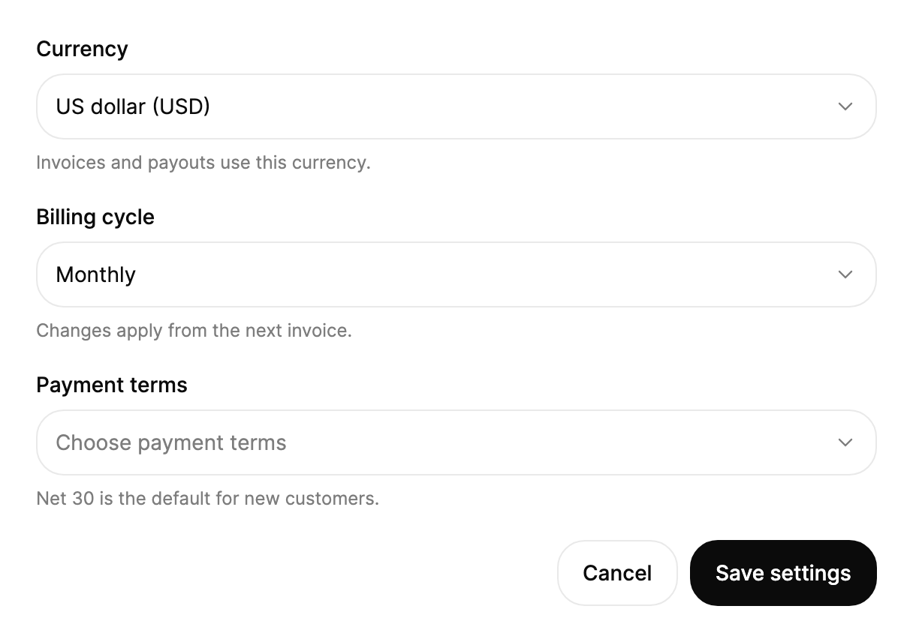

<Demo name="Field" />

## 何时使用

`Select` 是从一个简短的固定列表中选取一个值的默认字段：货币、结算周期、排序方式、套餐或地区。它在表单中以带标签的字段出现，在触发器中保留所选值，并从那里展开列表，因此人们无需离开表单就能浏览选项。

- **发票设置中的结算周期与货币**：财务管理员为工作区选择 USD 和年度周期。这份简短列表由计费系统固定，所选值与发票设置表单一起保存。
- **表格或列表工具栏中的排序方式**：事件列表的工具栏中，在筛选控件旁显示“排序方式：最新优先”。字段紧凑，列表仍便于浏览。
- **订阅变更表单中的套餐或等级**：团队管理员在 Free、Pro 或 Team 中选择。套餐名称就是值，被禁用的选项可以展示账号不允许选择的套餐。
- **工作区设置中的地区或数据驻留**：入驻向导询问数据存储的位置。字段带有标签和说明，因此人们知道这个选择为什么重要。
- **工单编辑器中的优先级或严重程度**：支持人员为案例设置 P1 到 P4。选项少且始终相同，因此这个字段比自由文本框更快。

## 何时不用

- **长列表或需要搜索的列表**，例如时区、客户账号或国家：用 `Combobox`。菜单会滚动，但长列表通过输入来查找会更快。
- **同时选择多个值**：用 `MultiSelect`，它会把每个已选值以标签的形式保留在字段中。
- **只有两到四个选项且应始终可见**：用 `SegmentedControl`。所有选项同时显示，人们无需打开菜单即可比较。
- **每个选项需要描述或价格才能做决定**：用 `RadioCards`。Select 的行只显示标签，因此说明必须紧挨着选项。
- **执行操作而不是选择值**，例如编辑、复制或删除：用 `DropdownMenu`。在那里选择一项会执行操作；在这里选择选项则会保存一个值。

## 用法

```xml
<UserControl xmlns="https://github.com/avaloniaui"
             xmlns:arc="https://github.com/AIDotNet/TKCode.Arc">
    <arc:Select Label="地区"
                Description="工作区数据的存储位置。"
                Width="280">
        <arc:SelectItem Content="北美" Value="na" />
        <arc:SelectItem Content="欧洲" Value="eu" />
        <arc:SelectItem Content="南美（即将推出）" Value="sa" IsEnabled="False" />
        <arc:SelectItem Content="非洲" Value="af" />
    </arc:Select>
</UserControl>
```

`Select` 派生自 Avalonia 的 `SelectingItemsControl`，处于单选模式，因此保留了项模型：`ItemsSource`、`Items`、`SelectedIndex`、`SelectedItem`、`SelectedValue`、`SelectionChanged` 和 `IsEnabled`。控件已关闭 Avalonia 内置的文本搜索，因为 `Select` 有自己的键入搜索（见“键盘”）。Arc 层在此之上加入标签、说明、带值滚动动效的触发器，以及带高亮和勾选标记的菜单。`SelectItem` 子元素与 `SelectOption` 记录都可以使用；没有 `Value` 的 `SelectItem` 以其 `Content` 作为值。

### 结构

1. **标签**（`Label`）：14 px、中等字重，位于触发器上方。它同时是字段的无障碍名称，字号与 `Input` 的标签相同。
2. **触发器**：至少 44 px 高（`ControlSizeMD`）的方框，左右各 12 px 内边距，1 px 边框，控件圆角（18 px）。使用表面色。悬停与展开时边框变为强边框色，背景变为弱化的表面色。键盘焦点会在触发器外 4 px 处绘制 2 px 的焦点环。
3. **值**（`SelectedText`）：所选选项的标签，在选择变化时以滚动动效显示。未选择任何项时，`Placeholder` 以弱化文字颜色显示。
4. **箭头**：值之后、间隔 12 px 的 16 px 下箭头。菜单打开时旋转 180 度。
5. **说明**（`Description`）：触发器下方 12 px 的弱化文字。它同时是字段的无障碍帮助文本。
6. **菜单**：带 1 px 边框、20 px 圆角和 6 px 内边距的浮起表面。它在触发器下方 4 px 处展开，宽度与触发器完全一致。
7. **选项行**：36 px 高，圆角 14 px。标签从左侧 11 px 处开始，右侧保留 34 px 放置勾选标记，勾选标记距右边缘 10 px。高亮行使用弱化表面色，禁用行以 45% 不透明度绘制。
8. **滚动按钮**：列表顶部和底部 28 px 的区域，当上方或下方还有行时出现。将指针停留其上即可滚动列表。
9. **菜单高度**：列表高度上限为 `MaxDropDownHeight`（默认 320 px），超出部分在该高度内滚动。

禁用的字段会淡化到 50% 不透明度，显示“不允许”光标，并在菜单打开时将其关闭。

### 绑定选项与值

将 `ItemsSource` 设为任意对象或 `SelectOption` 记录。`SelectedValue` 为双向绑定，所选值会写入被绑定的属性。

```xml
<arc:Select Label="排序方式"
            Width="220"
            ItemsSource="{Binding SortOrders}"
            SelectedValue="{Binding SortKey, Mode=TwoWay}" />
```

```csharp
var sort = new Select
{
    Label = "排序方式",
    Width = 220,
    ItemsSource = new[]
    {
        new SelectOption("newest", "最新优先"),
        new SelectOption("oldest", "最早优先"),
        new SelectOption("az", "名称，A 到 Z"),
    },
    SelectedValue = "newest"
};
sort.SelectionChanged += (_, _) => Console.WriteLine(sort.SelectedValue);
```

`SelectedValue` 是表单保存的值。`SelectedText` 是所选选项的标签，只读，适合用作摘要行或日志消息。`SelectedIndex` 与 `SelectedItem` 则分别按位置或项对象进行选择。

### 绑定到视图模型

在 MVVM 应用中，视图模型拥有选择与选项列表，字段负责显示它们。使用 CommunityToolkit.Mvvm 时，视图模型以普通字符串保存已保存的值，字段把所选值写入其中。

```csharp
public partial class InvoiceSettingsViewModel : ObservableObject
{
    private readonly IBillingSettings _settings;

    public InvoiceSettingsViewModel(IBillingSettings settings) => _settings = settings;

    public ObservableCollection<SelectOption> Currencies { get; } = new()
    {
        new SelectOption("usd", "美元（USD）"),
        new SelectOption("eur", "欧元（EUR）"),
        new SelectOption("gbp", "英镑（GBP）"),
    };

    [ObservableProperty]
    private string _currency = "usd";

    [ObservableProperty]
    private string _billingCycle = "monthly";

    [RelayCommand]
    private async Task SaveAsync()
    {
        await _settings.SaveAsync(Currency, BillingCycle);
    }
}
```

```xml
<StackPanel Width="360" Spacing="16">
    <arc:Select Label="货币"
                ItemsSource="{Binding Currencies}"
                SelectedValue="{Binding Currency, Mode=TwoWay}" />
    <arc:Select Label="结算周期"
                SelectedValue="{Binding BillingCycle, Mode=TwoWay}">
        <arc:SelectItem Content="按月" Value="monthly" />
        <arc:SelectItem Content="按年付，预先收费" Value="annual" />
    </arc:Select>
    <arc:Button Content="保存设置" Command="{Binding SaveCommand}" />
</StackPanel>
```

- `SelectedValue` 为双向绑定，因此当视图模型需要接收选择时，应显式设置 `Mode=TwoWay`。它保存的是选项的值，而不是标签。
- `IsOpen` 为双向绑定，可由视图模型打开或关闭菜单。`SelectedText` 为只读，因此仅用单向绑定来显示。
- 只在处理副作用时使用 `SelectionChanged`，例如埋点统计或预览。视图模型应读取绑定的值，这样代码修改与人工修改都以相同的方式到达它。
- 编译绑定需要在视图上设置 `x:DataType`（这里的示例为简洁起见省略了它）。

### 自定义标签与值

对于不是 `SelectOption` 的数据项，设置 `TextSelector` 和 `ValueSelector`。它们与 `DisplayMemberBinding` 不同，对 AOT 友好。标签是人们看到的内容，值是表单保存的内容。

<Demo name="Selectors" />

```csharp
public sealed record Plan(string Code, string Name, int MonthlyPrice);

var plans = new Select
{
    Label = "套餐",
    Width = 260,
    ItemsSource = new[]
    {
        new Plan("free", "免费版", 0),
        new Plan("pro", "专业版", 24),
        new Plan("team", "团队版", 48),
    },
    TextSelector = item => item is Plan p ? $"{p.Name} (${p.MonthlyPrice}/月)" : null,
    ValueSelector = item => item is Plan p ? p.Code : null,
};
```

没有 `ValueSelector` 时，值就是项本身，因此 `SelectedValue` 返回的是 `Plan` 对象。只要表单保存的是代码或标识符而不是对象，就应设置选择器。

### 占位文字与说明

未选择任何项时显示 `Placeholder`，默认值为 “Select an option”。占位文字应告诉人们该选什么，例如“选择套餐”，并保持足够短以适应触发器。`Description` 是触发器下方的弱化提示，同时也是无障碍帮助文本。

```xml
<arc:Select Label="套餐" Placeholder="选择套餐" Description="之后可以随时更改。" />
```

说明应写选择的后果（“从下一张发票起生效”），而不是选项列表。一旦选中值，占位文字就会消失，因此它不应承载字段在此之后还需要的信息。

### 长列表与禁用状态

菜单高度上限为 `MaxDropDownHeight`（默认 320 px），超出部分可以滚动。只绘制可见的行，因此包含数千项的列表仍能保持响应。禁用的 `Select` 会忽略输入，也不会展开。

<Demo name="LongLists" />

<Demo name="Disabled" />

```xml
<arc:Select Label="构建编号" ItemsSource="{Binding Builds}" MaxDropDownHeight="240" />
<arc:Select Label="套餐" IsEnabled="False" SelectedIndex="1">
    <arc:SelectItem Content="免费版" />
    <arc:SelectItem Content="专业版" />
</arc:Select>
```

当字段位于窗口底部或较窄的对话框中时，降低 `MaxDropDownHeight`，使菜单保持在窗口之内。避免把高度设得过小，以至于只能容纳一行。

### 数据结构与性能

选项可以是字符串、记录、`SelectOption` 值或内联的 `SelectItem` 子元素。控件自行绘制每个可见选项，不会为每一项创建控件，因此开销取决于屏幕上的行数，而不是列表的大小。保持项模型精简：一个值、一个标签，以及所需的标志，例如禁用状态。大量或远程数据应加载到视图模型中，每次加载时设置一次 `ItemsSource`，而不是在每次按键时修改集合。

- 在创建时设置一次 `TextSelector` 与 `ValueSelector`。修改它们会重建选项列表。
- 值就是表单保存的内容；让它在各版本之间保持稳定，这样即使套餐标签被重命名，已保存的套餐代码仍能解析。
- 用 `SelectedValue` 获取保存的值，用 `SelectedText` 生成摘要。不要通过解析标签来反推值。

### 焦点与关闭

菜单打开时焦点保留在触发器上，高亮的选项会被播报而不是获得焦点。Escape 关闭菜单且不改变值。Tab 关闭菜单，并照常移动焦点。点击菜单外部会关闭菜单（轻量关闭），再次按下触发器也会关闭菜单，因此触发器不会重新打开刚刚关闭的菜单。鼠标在按下时打开菜单，因此按下、拖动并松开即可在一次手势中选中选项；触摸则在松开时打开。选中选项后菜单关闭，焦点返回触发器。

字段被禁用或离开窗口时，打开的菜单会自行关闭。在代码中将 `IsOpen` 设为 `False` 可在保存后关闭菜单，或调用 `Close()`；调用 `Open()` 则会打开菜单并高亮所选选项。

### 示例：发票设置

SaaS 管理后台中的结算设置表单。两个字段都是带标签的简短固定列表，所选值正是账号实际使用的：USD 与月度周期。货币字段有值，因此触发器显示标签与箭头；周期字段显示 Monthly，年付选项的计费规则写在其标签中。辅助文字说明变更何时生效，让人们在保存前就知道其后果。



```xml
<StackPanel Width="560" Spacing="20">
    <arc:Select Label="Currency"
                Description="Invoices and payouts use this currency."
                SelectedIndex="0">
        <arc:SelectItem Content="US dollar (USD)" Value="usd" />
        <arc:SelectItem Content="Euro (EUR)" Value="eur" />
        <arc:SelectItem Content="Pound sterling (GBP)" Value="gbp" />
        <arc:SelectItem Content="Japanese yen (JPY)" Value="jpy" />
    </arc:Select>
    <arc:Select Label="Billing cycle"
                Description="Changes apply from the next invoice."
                SelectedIndex="0">
        <arc:SelectItem Content="Monthly" Value="monthly" />
        <arc:SelectItem Content="Annual, billed up front" Value="annual" />
        <arc:SelectItem Content="Quarterly" Value="quarterly" IsEnabled="False" />
    </arc:Select>
    <arc:Select Label="Payment terms"
                Placeholder="Choose payment terms"
                Description="Net 30 is the default for new customers.">
        <arc:SelectItem Content="Net 15" Value="net15" />
        <arc:SelectItem Content="Net 30" Value="net30" />
        <arc:SelectItem Content="Net 60" Value="net60" />
        <arc:SelectItem Content="Net 90 (needs approval)" Value="net90" IsEnabled="False" />
    </arc:Select>
    <StackPanel Orientation="Horizontal" Spacing="8" HorizontalAlignment="Right">
        <arc:Button Content="Cancel" Variant="Secondary" />
        <arc:Button Content="Save settings" />
    </StackPanel>
</StackPanel>
```

季度周期与 90 天账期被禁用，让人们看到这些选项存在，并知道它们需要其他套餐或审批。付款条款字段尚无值，显示占位文字，提示在保存表单之前需要做出选择。

### 文案规范

- **标签**：句首大写的简短名词，例如“货币”“结算周期”“地区”。不要在标签中重复问题（“你要使用哪种货币？”）。
- **占位文字**：“选择套餐”或“请选择一个选项”这类指令。选中第一项后它就会消失，因此它只需在字段为空时读起来正确。
- **选项标签**：人们在产品中已经看到的名称，句首大写。只有列表需要时才加入单位或代码，例如“美元（USD）”“Net 30”。
- **说明**：一句关于选择后果的话：“从下一张发票起生效。”
- **禁用选项**：在标签或说明中写明原因，例如“Net 90（需要审批）”。

| 不要写 | 改为 |
|---|---|
| 选择 | 选择套餐 |
| 你要使用哪种货币？ | 货币 |
| 选择一个值 | 请选择一个选项 |
| usd - 美元 - 默认 | 美元（USD） |
| 选项 3 | 按季度 |

### 最佳实践

**推荐**

- 列表应简短到便于浏览，约十几个选项。更长的列表改用 `Combobox`，让人们通过输入来查找值。
- 为字段提供标签；当选择会产生后果时，写出该后果的说明。
- 保存值而不是标签，这样重命名不会改变已保存的数据。
- 存在最常见的选项时预先选中它，使常见情况下无需选择即可完成表单。

**避免**

- 用 `Select` 选择多个值；字段只保存一个值，每次选中后菜单都会关闭。
- 把菜单选项隐藏在“选择”这类对选择毫无说明的占位文字之后。
- 通过禁用选项来隐藏它们。被禁用的选项依然显示，人们因此知道它存在以及为何被锁定。
- 在菜单打开时更改列表。菜单会立即重新填充，人们正在阅读的行会在眼前变化。
- 把 `Select` 当作只读显示。禁用的字段会变暗；当值不应看起来可以交互时，改用纯文本。

### 常见问题

**设置 `SelectedValue` 后字段显示占位文字，为什么？** 没有选项具有该值，因此未选中任何项，于是显示占位文字。请检查该值是否与选项的 `Value` 匹配，或与 `ValueSelector` 返回的值匹配。

**为什么高亮停在最后一个选项，而不是循环？** `Select` 在第一个和最后一个可用选项处停止，让人们看到列表在哪里结束。`MultiSelect` 则会循环。

**如何在代码中打开或关闭菜单？** 调用 `Open()` 或 `Close()`，或设置 `IsOpen`。`Open()` 会高亮所选选项；未选中任何项时，则高亮第一个可用选项。

**能否显示一个无法更改的值，又不让它看起来像字段？** `Select` 没有只读状态。当选择被锁定时，禁用它并说明原因；当表单不应暗示该值可以更改时，则在标签中以纯文本显示该值。

**键入会改变值吗？** 会。菜单关闭时，键入一个字母会选中下一个文字以该字母开头的选项，而无需打开菜单。菜单打开时，键入会高亮匹配项，按 Enter 即可选中它。

## API 参考

<!-- api: Select -->

<!-- api: SelectItem -->

## 无障碍

- `Label` 为字段命名，`Description` 是其帮助文本。
- 所选值以纯文本形式提供给辅助技术，带动画的副本会被隐藏。
- 字段会公开其菜单是否展开。
- 高亮移动时，被高亮的选项会在礼貌实时区域中播报，并附带它在列表中的位置与列表长度。
- 菜单打开时焦点框保留在触发器上。悬停与展开只改变边框和背景。

### 键盘

以下按键在触发器获得焦点时生效。

| 按键 | 操作 |
|---|---|
| `Enter`、`Space`、`Down`、`Up`（菜单关闭时） | 打开菜单并高亮所选选项；未选中任何项时高亮第一个可用选项 |
| `Down` / `Up`（菜单打开时） | 将高亮移到下一个或上一个可用选项；在第一个和最后一个选项处停止 |
| `Home` / `End`（菜单打开时） | 移到第一个或最后一个可用选项 |
| `PageDown` / `PageUp`（菜单打开时） | 每次将高亮移动八个选项 |
| `Enter` 或 `Space`（菜单打开时） | 选中高亮的选项，关闭菜单并将焦点返回触发器 |
| `Escape`（菜单打开时） | 关闭菜单，不做更改 |
| `Tab`（菜单打开时） | 关闭菜单并移动焦点 |
| 字母键（菜单关闭时） | 选中下一个文字以所键入字母开头的选项 |
| 字母键（菜单打开时） | 高亮下一个与所键入字母匹配的选项 |

键入停顿约一秒后，会开始新的键入搜索。方向键、Home、End、翻页键以及键入搜索都会跳过禁用的选项。

## 动效

- 显示的值沿列表方向滚动：后面的选项从下方升起，前面的选项从上方落下。
- 菜单以短促的缩放与淡入淡出从触发器处展开。关闭时即时完成。
- 高亮从一个选项平滑滑到下一个。
- 减弱动效时，值以瞬时交叉淡入淡出的方式切换，菜单淡入淡出。关闭动效时，值与菜单直接切换，没有任何过渡。

| 变化 | 完整 | 减弱 | 关闭 |
|---|---|---|---|
| 所选值变化 | 沿列表方向滚入 | 瞬时交叉淡入淡出 | 立即完成 |
| 菜单打开 | 从触发器处展开，带轻微缩放和 6 px 偏移 | 淡入 | 立即完成 |
| 菜单关闭 | 立即完成 | 淡出 | 立即完成 |
| 箭头转动 | 以弹簧旋转 | 立即完成 | 立即完成 |
| 悬停、展开、焦点 | 边框与背景颜色渐变 | 立即完成 | 立即完成 |

## 相关组件

- 列表较长或需要用户输入来查找值时用 `Combobox`。
- 需要同时选择多个值时用 `MultiSelect`。
- 触发器需要展开为列表，且选项需要图标或分组时用 `MorphSelect`。
- 两到四个选项需要始终可见时用 `SegmentedControl`。

| 组件 | 适用场景 |
|---|---|
| `Combobox` | 列表较长，或人们需要输入来查找值 |
| `MultiSelect` | 选择多个值，并以标签形式显示 |
| `MorphSelect` | 触发器需要展开为列表，或选项需要图标、辅助文字或分组 |
| `SegmentedControl` | 两到四个选项需要始终可见 |
| `RadioCards` | 每个选项在人们选择前需要各自的说明 |
| `DropdownMenu` | 菜单执行操作，而不是保存值 |
