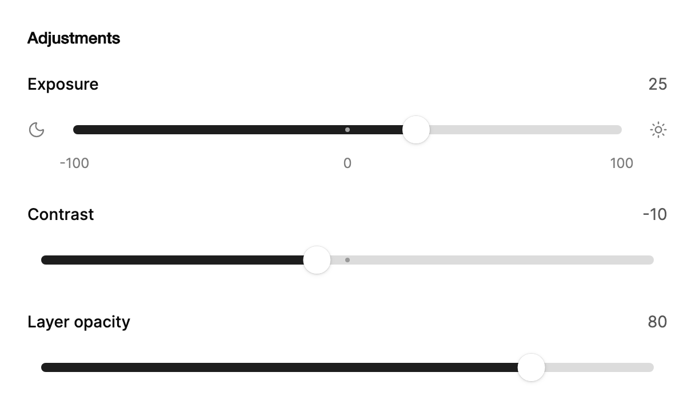

<Demo name="RubberBand" />

## 何时使用

`ElasticSlider` 在一条会在手指下让位的轨道上设置一个值。它适合一个需要凭手感调整、并通过观察轨道来确认的单一设置：媒体播放器栏中的控件、工具检查器，或是滑块为该行唯一控件的设置行。轨道在两端之外拉伸，松开后回弹，因此用户无需看到任何消息，也能感觉到已经到达极限。

- **会议或媒体应用中的播放与输出级别**：播放器栏中的音量或麦克风增益。精确的分贝值远不如“轻”与“响”的手感重要，而在有用的级别（`Off`、`50`、`Max`）上设置档位，可以提供一个明确的目标。
- **创作工具检查器中的调整项**：所选图层的亮度、对比度或模糊度。人们通过来回拖动来比较效果，因此跟随滑块的数值标签和在极限处的拉伸很适合这类任务。
- **运维控制台或信息亭设置中的设备与显示控件**：设备设置页中的屏幕亮度，或机架面板上的风扇转速。这些设置经常变动，而 50% 这类预设值是常见的目标。
- **主题或品牌编辑器中视觉效果的强度**：例如横幅遮罩的不透明度，或阴影的强度。此时用户判断的是效果看起来如何，而不是读取一个数字。

## 何时不用

- **安静的表单或只设置一次值的设置页**：用 `Slider`。它有相同的轨道和数值气泡，但在两端保持静止，更适合用户从上到下阅读的表单。
- **需要下限和上限的范围**，例如价格或日期筛选：用支持 `IsRange` 的 `Slider`。`ElasticSlider` 只有单一的 `Value`，没有范围模式。
- **用户必须键入的精确数字**，例如税率、折扣或数量：用 `NumberField`。轨道只能近似一个值，当用户需要精确数字时，拉伸效果没有帮助。
- **用户无法更改的值**，例如上传进度、已用存储或任务完成度：用 `Progress`。
- **同一列表中的大量滑块**，例如调音台中每个通道一行，或库存表格中每个商品一行：用 `Slider`。拉伸、摇摆和档位弹出在每一行重复出现，会把注意力从数据上转移开。

## 用法

基本用法是单个值。`Value` 是滑块在轨道上的位置，`Minimum` 和 `Maximum` 设置其范围。

```xml
<UserControl xmlns="https://github.com/avaloniaui"
             xmlns:arc="https://github.com/AIDotNet/TKCode.Arc">
    <arc:ElasticSlider Label="音量"
                       Value="40"
                       Width="360"
                       ValueFormatter="{Binding VolumeFormatter}" />
</UserControl>
```

`ElasticSlider` 派生自 Avalonia 的 `RangeBase`。因此 `Value`、`Minimum`、`Maximum`、`SmallChange`、`LargeChange` 以及 `ValueChanged` 事件的行为与任何范围控件一致。该控件额外加入标签、读数、数值标签、橡皮筋式轨道、档位以及两个图标位。`SmallChange` 是数值吸附的步长，在此控件上默认为 1。

### 结构

1. **标签**（`Label`）：中等字重，位于轨道上方一行，行高 19.6 px。宽度不足时以省略号截断。它同时是滑块手柄的无障碍名称。
2. **读数**：格式化后的 `Value`，右对齐显示在标签行上，使用次要文字颜色，与前面保持 16 px 的间距。数值标签跟随滑块移动时，读数会淡出，因此同一个数字不会同时显示两次。
3. **起始图标**（`StartIcon`）：位于轨道之前，间距 12 px，使用弱化文字颜色。属性为 null 时隐藏。
4. **轨道与填充**：8 px 高的轨道，使用控件轨道颜色；滑块之前的部分使用控件填充颜色。轨道所在行为中等控件高度。
5. **滑块手柄**：24 px 的圆盘，使用控件滑块颜色与其上浮阴影。命中区域向圆盘两侧各延伸 12 px，因此稍微偏离也能抓住它。
6. **数值标签**：位于滑块手柄上方 10 px 的上浮气泡（触摸或触控笔按下时再上移 10 px），高度至少 28 px，水平内边距 12 px。它以前景色为背景、以背景色为文字颜色。
7. **档位刻度点**：4 px 的圆点，每个刻度一个。轨道上的刻度点使用前景色、透明度 32%；填充部分上的刻度点使用控件字形颜色、透明度 60%，以便在填充上仍然可见。
8. **结束图标**（`EndIcon`）：位于轨道之后，间距 12 px，使用弱化文字颜色。
9. **刻度标签行**：高 20 px，位于轨道下方，使用超小字号与弱化颜色。只有当至少一个刻度设置了 `Label` 时，该行才会出现。

### 图标

`StartIcon` 和 `EndIcon` 分别位于轨道之前和之后。当轨道被拉过某一端时，该端的图标会随之向外移动，因此拉伸看起来是整个控件在手指下让位。这里应使用字形或小图标按钮，而不是需要空间伸展的文字。例如音量的减号与加号、亮度的月亮与太阳，都能告诉用户数值的变化方向。

```xml
<arc:ElasticSlider Label="亮度"
                   Value="50"
                   Width="360">
    <arc:ElasticSlider.StartIcon>
        <TextBlock Text="-" />
    </arc:ElasticSlider.StartIcon>
    <arc:ElasticSlider.EndIcon>
        <TextBlock Text="+" />
    </arc:ElasticSlider.EndIcon>
</arc:ElasticSlider>
```

### 档位

在 `Marks` 中添加 `SliderMark` 值。被拖动的滑块会卡入每一个刻度。带标签的刻度会在轨道下方显示标签，点击标签会将滑块移动到该位置。

<Demo name="Detents" />

档位只在滑块被拖动时生效。当指针距离某个刻度在屏幕上 7 px 以内时，数值会保持在该刻度上，滑块滑向它；移到更远处，数值才重新跟随指针。超出 `Minimum` 与 `Maximum` 范围的刻度会被忽略。当两个刻度在屏幕上相距不到约 14 px 时，较近的那个总是优先，另一个无法通过拖动到达。按键不会吸附到刻度：它们按 `SmallChange` 移动，但恰好落在刻度上的按键仍会播放刻度的弹出效果。

刻度只用于用户真正会选择的值：限制值 `0` 与 `100`、一个中间预设，或具有特定含义的级别，例如单位增益。只为需要名称的刻度加标签（`Off`、`Max`）；轨道下方一排裸数字只会增加噪音。

```xml
<arc:ElasticSlider Label="亮度" Value="50" Width="360">
    <arc:ElasticSlider.Marks>
        <arc:SliderMark Value="0" Label="关闭" />
        <arc:SliderMark Value="50" Label="50" />
        <arc:SliderMark Value="100" Label="最大" />
    </arc:ElasticSlider.Marks>
</arc:ElasticSlider>
```

### 步长与格式

`SmallChange` 是数值吸附的步长。方向键以及没有档位的拖动都会落在它上面。`LargeChange` 是 `PageUp`、`PageDown` 以及方向键配合 `Shift` 使用的步长；未设置时为范围的十分之一。

`ValueFormatter` 格式化数值标签、读数和朗读的数值。它是一个 `Func<double, string>`，因此可以在代码中设置，或从视图模型绑定。未设置时，数值按步长与最小值所需的小数位数显示，因此步长为 0.1 时显示 `1.0`，整数步长时显示 `40`。`IsValueVisible` 可隐藏标签旁的读数。拖动滑块或通过按键修改时，数值标签仍会显示，因此隐藏读数并不会隐藏数值。

<Demo name="FineSteps" />

```xml
<arc:ElasticSlider Label="缩放"
                   Minimum="0.5"
                   Maximum="3"
                   SmallChange="0.1"
                   Value="1"
                   Width="360"
                   ValueFormatter="{Binding ZoomFormatter}" />
```

根据轨道宽度选择步长。步长应使滑块移动数个像素：在约 300 px 宽的轨道上，对于 2.5 的范围，步长 0.1 会使滑块移动 12 px，这是可见的。步长过细会让每次按键看起来毫无变化，步长过粗则会跳过中间的值。

### 事件

`ValueCommitted` 在每次松开时、每次按键使数值改变时，以及每次点击刻度标签时各触发一次。其 `SliderValueCommittedEventArgs.Value` 即为提交的值；`LowerValue` 与 `UpperValue` 重复该值，`IsRange` 为 `False`，因为该控件只有一个值。在极限处按键不会改变数值，因此不会提交。应将耗时操作（例如网络请求）放在 `ValueCommitted` 中，而不是 `ValueChanged` 中，后者在拖动的每一步都会由继承的事件触发。

```csharp
volume.ValueCommitted += (_, e) => SaveVolume(e.Value);
volume.ValueChanged += (_, e) => PreviewVolume(e.NewValue);
```

### 绑定到视图模型

在 MVVM 应用中，值由视图模型持有，滑块只负责镜像它。视图模型使用 CommunityToolkit.Mvvm。`Value` 是双向属性：拖动、按键或档位都会把新值写回视图模型；在代码中做出的更改会以弹簧动画移动滑块手柄。`ValueCommitted` 是事件而非命令，因此应在视图的代码后置文件中订阅它，再从那里调用视图模型。

```csharp
public interface IAudioSettings
{
    Task SetVolumeAsync(double level);
}

public partial class PlaybackViewModel : ObservableObject
{
    private readonly IAudioSettings _settings;

    [ObservableProperty]
    private double _volume = 40;

    public PlaybackViewModel(IAudioSettings settings) => _settings = settings;

    public Task SaveVolumeAsync(double value) => _settings.SetVolumeAsync(value);
}
```

```xml
<arc:ElasticSlider x:Name="Volume"
                   Label="音量"
                   Minimum="0"
                   Maximum="100"
                   Value="{Binding Volume, Mode=TwoWay}"
                   Width="360" />
```

```csharp
// 在视图的代码后置文件中，InitializeComponent() 之后。
Volume.ValueCommitted += async (_, e) => await ViewModel.SaveVolumeAsync(e.Value);
```

- `Value` 是要绑定的双向属性。
- 显式绑定 `Mode=TwoWay`，让意图在 XAML 中一目了然。拖动的每一步都会更新视图模型的 `Volume`，这对预览是正确的，但对昂贵的保存操作则不适合；应改从 `ValueCommitted` 保存。
- 将 `Value` 绑定到 `double` 属性。滑块以 `double` 工作，因此整数属性也应为 `double`，或由视图模型在边界处转换。
- `ValueFormatter` 在代码中设置，或绑定到视图模型上的 `Func<double, string>`，如用法示例所示。

### 克制地使用动效

这个控件上的动效承载着信息。拉伸表示已到达极限，摇摆表示滑块移动的速度，档位弹出确认数值落在了刻度上。应在视图中只用于一两个弹性滑块，即用户花时间凭手感调整数值的地方。若在列表中放入多个，动效就会变成与内容争夺注意力的图案；此处应使用 `Slider`。

减弱动效会移除拉伸、摇摆和档位弹出。滑块直接移动到目标值，标签只淡入，因此即使没有物理反馈，控件仍能正确表达。不要依赖动效来显示数值：读数和朗读的数值始终承载它。

### 禁用状态

禁用的滑块会移出 Tab 顺序，并淡化到 50% 不透明度。其轨道显示“禁止”光标，并忽略指针和按键。只在数值暂时无法应用时使用，并在附近说明原因，例如“需 Pro 套餐可用”。用户永远无法更改的值应使用 `Progress` 或纯文字。

<Demo name="Disabled" />

### 示例：照片编辑器调整

一个图像编辑器的检查器，包含三项调整：以 0 为中心的曝光与对比度，以及所选图层的不透明度。整数无需格式化器，因此读数直接显示原始值。其中最重要的是 0 处的档位：把曝光拖离中性再拖回的用户，希望精确回到这里，而滑块会停留在该处。



```xml
<StackPanel Width="560" Spacing="22">
    <TextBlock Text="Adjustments"
               FontSize="14"
               FontWeight="SemiBold"
               Foreground="{arc:ArcDesignTokenResource Foreground}" />
    <arc:ElasticSlider Label="Exposure"
                       Minimum="-100"
                       Maximum="100"
                       Value="25"
                       SmallChange="1">
        <arc:ElasticSlider.StartIcon>
            <arc:ArcGlyph Data="{x:Static arc:ArcIcons.Moon}"
                          Size="16"
                          Foreground="{arc:ArcDesignTokenResource TextMuted}"
                          VerticalAlignment="Center" />
        </arc:ElasticSlider.StartIcon>
        <arc:ElasticSlider.EndIcon>
            <arc:ArcGlyph Data="{x:Static arc:ArcIcons.Sun}"
                          Size="16"
                          Foreground="{arc:ArcDesignTokenResource TextMuted}"
                          VerticalAlignment="Center" />
        </arc:ElasticSlider.EndIcon>
        <arc:ElasticSlider.Marks>
            <arc:SliderMark Value="-100" Label="-100" />
            <arc:SliderMark Value="0" Label="0" />
            <arc:SliderMark Value="100" Label="100" />
        </arc:ElasticSlider.Marks>
    </arc:ElasticSlider>
    <arc:ElasticSlider Label="Contrast"
                       Minimum="-100"
                       Maximum="100"
                       Value="-10"
                       SmallChange="1">
        <arc:ElasticSlider.Marks>
            <arc:SliderMark Value="0" />
        </arc:ElasticSlider.Marks>
    </arc:ElasticSlider>
    <arc:ElasticSlider Label="Layer opacity"
                       Minimum="0"
                       Maximum="100"
                       Value="80"
                       SmallChange="1"
                       IsValueVisible="True" />
</StackPanel>
```

标签使用名词，刻度只标出用户需要辨认的数值：两个极限和中性点。对比度滑块在 0 处有一个无标签的刻度，因此它的档位仍然有效，而不必增加标签行。图层不透明度滑块没有刻度，因为对每个图层而言，任何预设的不透明度都没有意义。

### 文案规范

- **标签**：一到两个句首大写的名词，例如“音量”“亮度”“图层不透明度”。标签为滑块手柄提供无障碍名称，因此它必须说明数值是什么。
- **刻度标签**：简短的词或数字，用来命名预设：`Off`、`Max`、`50`。没有标签的刻度仍然会吸住滑块，因此，对于轨道上一目了然的预设，保持无标签即可。
- **单位**：把单位放在 `ValueFormatter` 的输出中，而不是标签里，使读数、标签和朗读的数值保持一致。单位应简短；在这么小的轨道上，百分号比“percent”一词更清晰。
- **提示**：当数值会产生后果时，在控件旁边（而不是控件内部）写一句话，例如“仅作用于所选图层。”

| 不要写 | 改为 |
|---|---|
| 设置音量级别 | 音量 |
| 最大音量 | 最大 |
| 百分之 40 | 40% |
| 亮度（0 到 100） | 亮度 |

### 最佳实践

**推荐**

- 每个决策只放一个弹性滑块，并放在用户已经在看结果的地方，例如预览旁边。拉伸与标签在效果能随滑块移动时显示时效果最好。
- 在用户会回到的数值上添加档位，例如中性值、关闭或标准预设，使他们无需精确操作即可停在那里。
- 从 `ValueCommitted` 保存，而不要从 `ValueChanged` 保存。拖动会在每一步触发 `ValueChanged`；在松开时提交，只会为所选的值发送一次请求。
- 选择与该设置所需精度相匹配的 `SmallChange`，并让 `LargeChange` 覆盖一个有用的跳跃（默认的范围十分之一是个好的起点）。

**避免**

- 将该控件用于必须精确输入的值，例如税率或数量。轨道只能近似数值，用户随后只能逐键修正。
- 在同一列表或表格中堆叠多个弹性滑块。重复的拉伸与摇摆会把注意力从它们所属的数据上分散开。
- 隐藏读数、仅依赖数值标签来记录用户必须记下的值。数值标签只在滑块移动或被按键修改时出现，因此稳定下来的数值会变得不可见。
- 刻度间距小于约 14 px。较近的刻度会胜出，另一个则无法用指针到达。
- 将需要空间的文字放在 `StartIcon` 或 `EndIcon` 中。这些位置会随拉伸移动，长文字会被裁剪或挤压轨道。

### 常见问题

**为什么我按键时滑块没有落在刻度上？** 按键以 `SmallChange` 为步长移动，从不吸附到刻度。只有当某一步恰好落在刻度的数值上时，键盘才能到达该刻度。对于 0、25、50、75 与 100 的刻度，请设置 `SmallChange="25"`，或使用能将刻度间距均匀整除的 `SmallChange`。

**如何隐藏读数并让数值不碍事？** 设置 `IsValueVisible="False"` 即可隐藏标签旁的读数。拖动滑块或通过按键修改时数值标签仍会出现，因此调整过程中数字始终可用，用户停止操作后则隐藏。

**一个弹性滑块能选择范围吗？** 不能。`ElasticSlider` 只有一个 `Value`，没有 `IsRange`。应使用设置了 `IsRange="True"` 的 `Slider`，并读取 `LowerValue` 与 `UpperValue`。

**为什么在端点处按键不触发 `ValueCommitted`？** 在极限处数值无法改变，因此控件只会把轨道朝按键方向弹一下。数值没有变化，也就没有需要提交的内容；在提交时保存的监听器会正确地什么都不做。

**为什么在减弱动效的设备上没有拉伸或摇摆？** 拉伸、摇摆和档位弹出只在完整动效级别下运行。在减弱级别下，滑块直接到达目标值，标签只淡入。应在完整级别下测试控件的手感，并确认减弱级别下数值仍能正确读取。

## API 参考

<!-- api: ElasticSlider -->

<!-- api: SliderMark -->

## 无障碍

- `Label` 为滑块手柄命名。滑块朗读的数值是格式化后的 `Value`，因此返回 `40%` 的 `ValueFormatter` 会被读作 `40%`。没有标签时滑块手柄没有名称，因此应保持标签可见。
- 控件本身是一个分组，滑块手柄是 Tab 顺序中唯一的停靠点。轨道行、数值标签、读数和刻度标签都不是独立的停靠点。
- 刻度标签对辅助技术隐藏。点击标签是指针操作的快捷方式；键盘可通过 `SmallChange` 或 `LargeChange` 步进到相同的数值。
- 数值标签和档位弹出仅是视觉效果。朗读的数值承载着相同的数字，因此标签不会为屏幕阅读器用户增加任何所需信息。
- 焦点环在按键后出现，而不是在指针按下后出现，因此鼠标用户不会在滑块手柄上看到一个焦点环。

### 键盘

滑块手柄通过 `Tab` 获得焦点。控件本身不接受焦点。

| 按键 | 操作 |
|---|---|
| `Tab` / `Shift+Tab` | 将焦点移入或移出滑块手柄；禁用的滑块会被跳过 |
| `Right` / `Up` | 按 `SmallChange` 增大数值 |
| `Left` / `Down` | 按 `SmallChange` 减小数值 |
| `Shift` + 方向键、`PageUp` / `PageDown` | 按 `LargeChange` 增大或减小 |
| `Home` / `End` | 移到 `Minimum` 或 `Maximum` |
| 在极限处按方向键、`PageUp`、`PageDown`、`Home` 或 `End` | 数值保持不变；轨道朝按键方向拉伸后弹回 |

## 动效

- 越过任一端时，轨道会如橡皮筋般拉伸，最多 26 px，并依松开时的速度弹回。按住期间，滑块手柄会膨胀。
- 数值标签悬挂在滑块手柄上方，并以柔和的弹簧跟随它。其倾斜角随滑块手柄的速度变化，因此快速拖动时倾斜更多，最多 11 度。
- 滑块手柄卡入档位时，轨道上的刻度点会弹出一次，放大到最多两倍，并在 0.34 s 内稳定。
- 来自拖动之外的数值变化（例如按键、绑定的值或点击的刻度标签）会以弹簧动画从滑块手柄当前在屏幕上的位置移动过去。
- 减弱动效会移除拉伸、摇摆和档位弹出。滑块手柄直接到达目标值，标签仅淡入。关闭动效时直接跳到最终状态。

| 变化 | 完整 | 减弱 | 关闭 |
|---|---|---|---|
| 越过端点拖动 | 轨道最多拉伸 26 px，并以松开时的速度弹回（0.5 s，弹性 0.42） | 无拉伸；滑块手柄停在极限处 | 立即完成 |
| 拖动时的滑块手柄 | 以灵敏的弹簧放大到 1.28 倍 | 立即放大 | 立即完成 |
| 数值标签 | 以柔和弹簧跟随滑块手柄，并最多摇摆 11 度 | 停留在滑块手柄处，并在 0.15 s 内淡入 | 立即完成 |
| 读数 | 数值标签跟随滑块手柄时淡出 | 立即切换 | 立即完成 |
| 档位弹出 | 刻度点在 0.34 s 内从 1 倍变为 2.1 倍再回到 1 倍 | 无弹出 | 无弹出 |

## 相关组件

- `Slider` 用于安静的表单控件、带两个滑块手柄的范围，或动效会重复出现的滑块列表。
- 用户需要键入精确数字时使用 `NumberField`。
- `Progress` 用于显示但不由用户更改的数值。

| 组件 | 适用场景 |
|---|---|
| `Slider` | 设置位于表单中、数值是范围，或同一视图中有多个滑块重复出现 |
| `NumberField` | 用户必须键入或步进一个精确数字，并带有单位与界限 |
| `ScrubInput` | 数值通过拖动标签本身来改变，没有轨道 |
| `Progress` | 数值向用户显示，并由应用程序设置 |
| `Switch` | 设置只有两种状态，没有中间值 |
