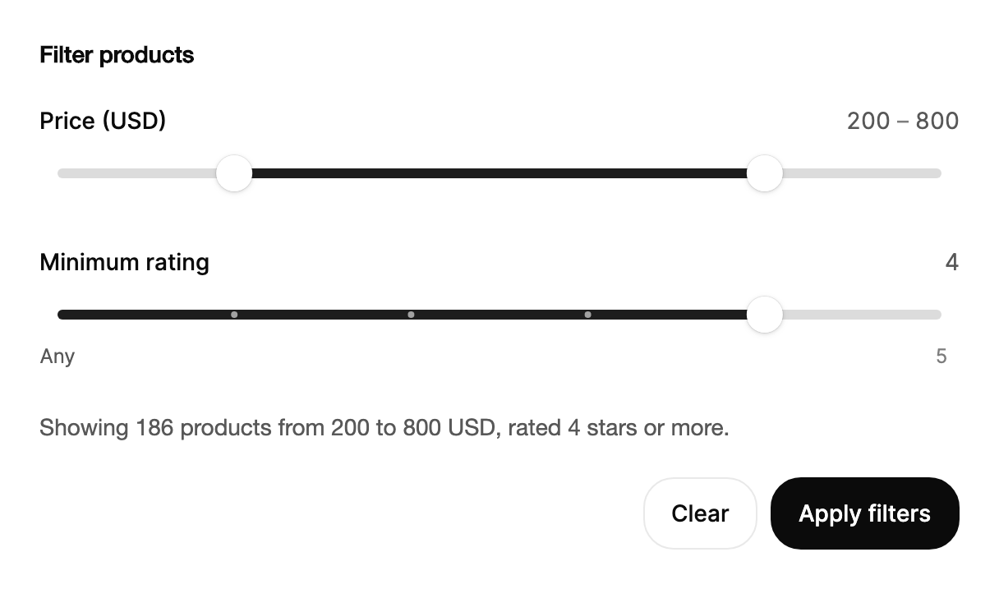

<Demo name="SingleValue" />

## 何時使用

`Slider` 讓使用者沿軌道移動滑桿把手，以選取一個值或一個範圍。它適用於設定與篩選中，軌道位置本身承載意義、精確數字不那麼重要的情境。它位於表單、篩選面板或控制列中，使用者移動滑桿時，會在標籤旁的讀數以及滑桿把手上方的泡泡中顯示所選的值。

- **商品清單中的價格與金額篩選**：帶兩個滑桿把手的範圍，`IsRange="True"`，下限與上限值成為查詢條件。軌道一眼就能看出商品目錄的分布，而讀數會在滑桿把手移動時顯示「$200 至 $800」。
- **計費或採購主控台中的支出上限與預算**：為團隊設定的每月上限，範圍在 $0 到 $5,000 之間。使用者大致能看出上限的位置，而格式化的讀數給出精確數字。
- **媒體或培訓應用程式中的播放與顯示設定**：帶有 0.5x 與 1x 標註刻度的播放速度，或通話音量。帶標籤的刻度為預設命名，點按標籤即可跳到該處。
- **營運儀表板中的告警門檻**：CPU 或錯誤率門檻，範圍在 0 到 100% 之間，並在團隊執行手冊使用的等級上設定刻度。只有數字時不夠直觀，而軌道能讓刻度一目了然。
- **資料工具中的不透明度、密度或縮放控制項**：此時數值是透過滑桿把手移動時螢幕上發生的變化來判斷的。

## 何時不用

- **使用者需要鍵入的精確數字**，例如退款金額或數量：用 `NumberField`；帶幣別的金額用 `MoneyInput`。軌道只能近似一個值。
- **使用者無法變更的值**，例如已用儲存空間或上傳進度：用 `Progress`。
- **應有物理感的單一設定**，軌道會越過兩端拉伸，滑桿把手會卡入檔位：用 `ElasticSlider`。它只有一個值，沒有範圍。
- **從短固定清單中選擇**，例如方案等級或配送速度：下拉選擇用 `Select`；選項能放進一列時用 `SegmentedControl`。
- **日期或時間跨度**：用 `DatePicker`、`DateRangePicker` 或 `TimePicker`。滑桿無法顯示日曆單位。
- **開或關的設定**：用 `Switch`。滑桿意味著中間值是有意義的。

## 用法

基本用法是單一數值。`Value` 是滑桿在軌道上的位置，`Minimum` 與 `Maximum` 設定其範圍。

```xml
<UserControl xmlns="https://github.com/avaloniaui"
             xmlns:arc="https://github.com/AtomUICommunity/TKCode.Arc">
    <arc:Slider Label="音量"
                Value="64"
                Width="360" />
</UserControl>
```

`Slider` 衍生自 Avalonia 的 `RangeBase`，因此 `Value`、`Minimum`、`Maximum`、`LargeChange` 與 `ValueChanged` 的行為與任何範圍控制項一致。與原生滑桿有兩點不同。`SmallChange` 是數值貼齊的步長，在此控制項上預設為 1。設定 `IsRange` 會將控制項切換為兩個滑桿把手，並以 `LowerValue` 與 `UpperValue` 取代 `Value`。此控制項還加入了標籤、讀數、數值泡泡、刻度以及內容插槽。

### 結構

1. **標籤**（`Label`）：中等字重，位於軌道上方一列，行高 19.6 px。寬度不足時以省略號截斷。它為輔助技術提供滑桿把手的名稱。
2. **讀數**：格式化後的數值，靠右對齊顯示在標籤列上，使用次要文字顏色，與前面保持 16 px 的間距。在範圍模式下，它以淡化顏色顯示低值與高值，中間以短破折號分隔，兩個數字相距 4 px。`IsValueVisible` 可將其隱藏。
3. **起始內容**（`StartContent`）：位於軌道之前，間距 12 px。屬性為 null 時隱藏。
4. **軌道與填滿**：6 px 的軌道，使用控制項軌道顏色。填滿從起點延伸到滑桿把手；範圍模式下則位於兩個滑桿把手之間，使用控制項填滿顏色。
5. **滑桿把手**：22 px 的圓盤，使用控制項滑桿把手顏色與上浮陰影。每個滑桿把手的點擊區域向圓盤兩側各延伸 11 px。
6. **刻度點**：4 px 的圓點，每個刻度一個。填滿之外的刻度點使用前景色、透明度 30%；填滿之上的刻度點使用控制項字形顏色、透明度 60%。
7. **數值泡泡**：位於作用中滑桿把手上方 8 px 的上浮泡泡（觸控或觸控筆按下時為 18 px），高度至少 28 px，水平內距 12 px，帶 1 px 邊框。其顏色是反轉的：前景色作為背景，背景色作為文字。它在滑桿把手被拖曳或取得鍵盤焦點時出現。
8. **結束內容**（`EndContent`）：位於軌道之後，間距 12 px，與起始內容的處理方式相同。
9. **刻度標籤列**：高 20 px，位於軌道下方，使用超小字級。標籤為淡化顏色；當數值已到達某刻度時，該刻度的標籤使用次要顏色。只有當至少一個刻度設定了 `Label` 時，該列才會出現。

### 起始與結束內容

`StartContent` 與 `EndContent` 分別位於軌道之前與之後，例如圖示或靜音按鈕。靜音按鈕適合用於音量控制項：使用者無需移動滑桿把手即可讓輸出靜音。內容應保持為單一字符或小圖示按鈕，因為軌道會占用其餘的寬度。

```xml
<arc:Slider Label="音量"
            Value="64"
            Width="360">
    <arc:Slider.StartContent>
        <TextBlock Text="-" />
    </arc:Slider.StartContent>
    <arc:Slider.EndContent>
        <TextBlock Text="+" />
    </arc:Slider.EndContent>
</arc:Slider>
```

### 範圍

設定 `IsRange` 即可顯示兩個滑桿把手。透過 `LowerValue` 與 `UpperValue` 讀寫兩端的值，並用 `MinStepsBetweenThumbs` 讓兩個滑桿把手保持間距，該值以步數計。在範圍模式下不使用 `Value`。`ValueFormatter` 用於格式化每個滑桿把手的讀數、泡泡與朗讀的數值。

當使用者在縮小一個集合時選取範圍，例如價格、以天為單位的日期跨度或分數區段。門檻值使用單一滑桿把手，因為第二個滑桿把手會要求使用者同時選取兩個相關的數字。

<Demo name="Range" />

```xml
<arc:Slider Label="價格"
            IsRange="True"
            Minimum="0"
            Maximum="1000"
            SmallChange="10"
            LowerValue="{Binding MinPrice, Mode=TwoWay}"
            UpperValue="{Binding MaxPrice, Mode=TwoWay}"
            MinStepsBetweenThumbs="5"
            LowerThumbName="最低價格"
            UpperThumbName="最高價格"
            ValueFormatter="{Binding PriceFormatter}" />
```

`MinStepsBetweenThumbs` 讓兩個滑桿把手保持一定的步數間距，因此在 `SmallChange="10"` 且值為 `5` 時，兩個滑桿把手永遠不會靠得比 50 個單位更近。被推向另一個滑桿把手的那個會停在間距處。保持預設值 `0` 即表示兩端可以相遇。

### 步長與刻度

`SmallChange` 是數值貼齊的步長。`Marks` 會在軌道上加入刻度。帶標籤的刻度會在軌道下方顯示標籤，點按標籤會將最近的滑桿把手移到該位置。不帶標籤的裸 `SliderMark`（或可隱式轉換的數字）就是沒有標籤的刻度。

刻度適用於使用者會反覆選取的預設，例如播放的 0.5x、1x 與 2x，或執行手冊為告警指定的數值。只為需要名稱的預設加標籤，其餘保留為刻度；在狹窄的軌道下，一排標籤很快就會互相重疊。

<Demo name="StepsAndMarks" />

刻度本身不會改變數值。拖曳、按鍵或點按標籤才會設定數值，刻度只說明預設位於何處。

### 範圍與極限值

數值始終保持在 `Minimum` 與 `Maximum` 之內，範圍的兩端也保持在其中。控制項在接收數值時會將其鉗制到範圍內，因此 XAML 頁面中先設定 `Minimum="360"` 再設定 `Maximum="900"` 不會報錯；最終的值才是應依賴的值。

`LargeChange` 用於 `PageUp`、`PageDown` 以及方向鍵配合 `Shift` 產生的跳躍。未設定時，跳躍為範圍的十分之一，這適用於大多數刻度。若十分之一對某個刻度來說太粗，應明確設定，例如 0 到 5 的評分，其跳躍應為 1。

### 事件

`ValueCommitted` 會在每次放開時、每次按鍵使數值改變時，以及每次點按刻度標籤時各觸發一次。應將耗時作業（例如網路要求）放在此事件上。其 `SliderValueCommittedEventArgs` 包含 `Value`、`LowerValue`、`UpperValue` 與 `IsRange`。對於單一值，下限與上限值重複 `Value`；在範圍模式下，`Value` 為下端。`RangeChanged` 在範圍被拖曳或以按鍵變更時，每一步都會觸發，其 `SliderRangeChangedEventArgs` 包含 `LowerValue` 與 `UpperValue`。

```csharp
price.ValueCommitted += (_, e) => SavePriceFilter(e.LowerValue, e.UpperValue);
price.RangeChanged += (_, e) => committed.Text = $"${e.LowerValue:N0} – ${e.UpperValue:N0}";
```

### 繫結到檢視模型

典型情境是篩選面板：檢視模型持有兩個價格，滑桿把手鏡像它們，使用者操作完成後由命令執行查詢。檢視模型使用 CommunityToolkit.Mvvm。

```csharp
public interface ICatalogQuery
{
    Task FilterByPriceAsync(double minPrice, double maxPrice);
}

public partial class PriceFilterViewModel : ObservableObject
{
    private readonly ICatalogQuery _catalog;

    [ObservableProperty]
    private double _minPrice = 200;

    [ObservableProperty]
    private double _maxPrice = 800;

    [ObservableProperty]
    private string _summary = "正在顯示 $200 至 $800 之間的商品。";

    public PriceFilterViewModel(ICatalogQuery catalog) => _catalog = catalog;

    [RelayCommand]
    private async Task ApplyAsync()
    {
        Summary = $"正在顯示 ${MinPrice:N0} 至 ${MaxPrice:N0} 之間的商品。";
        await _catalog.FilterByPriceAsync(MinPrice, MaxPrice);
    }
}
```

```xml
<StackPanel Spacing="12">
    <arc:Slider Label="價格"
                IsRange="True"
                Minimum="0"
                Maximum="1000"
                SmallChange="10"
                LowerValue="{Binding MinPrice, Mode=TwoWay}"
                UpperValue="{Binding MaxPrice, Mode=TwoWay}"
                MinStepsBetweenThumbs="5"
                Width="360" />
    <TextBlock Text="{Binding Summary}" />
</StackPanel>
```

- `LowerValue` 與 `UpperValue` 是範圍模式下要繫結的雙向屬性；`Value` 是單值模式下的雙向屬性。繫結與 `IsRange` 相符的那一組。
- 明確繫結 `Mode=TwoWay`。檢視模型的 `MinPrice` 會在拖曳的每一步更新，這對讀數或摘要列是正確的，但對查詢則不對。應從 `ApplyAsync` 執行查詢，或從檢視程式碼後置檔中的 `ValueCommitted` 執行，這樣一次拖曳只送出一個要求。
- 檢視中的命令是繫結到 `ApplyCommand` 的 `Button`；在滑桿把手移動時它保持可用，因此使用者可以在任何時候套用新的範圍。

### 節制地使用動態效果

滑桿上的動態效果會告訴使用者滑桿把手做了什麼：泡泡確認數值，數字捲動顯示變化方向，輕甩後的慣性顯示滑桿把手能被帶多遠。這些提示有助於使用者憑手感搜尋範圍。但在只需設定一次數值的頁面上，它們會造成干擾，此處應使用一般欄位。

減少動態效果會移除慣性、拉伸與數字捲動。滑桿把手直接到達目標值，泡泡只淡入淡出，這樣即使沒有顯示變化方向的動態效果，控制項仍然易於閱讀。

### 停用狀態

停用的滑桿會移出 Tab 順序，並淡化到 50% 不透明度。其軌道顯示「禁止」游標，並忽略指標與按鍵。在數值暫時無法套用時使用，並在附近說明原因，例如「由你的方案管理員設定」。使用者永遠無法變更的值應使用 `Progress` 或純文字。

<Demo name="Disabled" />

### 範例：商品篩選面板

商品清單上的篩選面板，包含價格範圍與最低評分。價格的兩個滑桿把手有各自的名稱，因此螢幕閱讀器會唸出「最低價格」與「最高價格」，並且標籤註明了單位。評分滑桿在最低處（「Any」）與最高處使用了帶標籤的刻度，因此最低與最高的選項都有名稱，而無需一排數字。控制項下方的摘要列用文字說明目前的選擇，使用者無需移動滑桿把手即可讀懂結果。



```xml
<StackPanel Width="560" Spacing="22">
    <TextBlock Text="Filter products"
               FontSize="14"
               FontWeight="SemiBold"
               Foreground="{arc:ArcDesignTokenResource Foreground}" />
    <arc:Slider Label="Price (USD)"
                IsRange="True"
                Minimum="0"
                Maximum="1000"
                SmallChange="10"
                LowerValue="200"
                UpperValue="800"
                MinStepsBetweenThumbs="5"
                LowerThumbName="Minimum price"
                UpperThumbName="Maximum price" />
    <arc:Slider Label="Minimum rating"
                Minimum="0"
                Maximum="5"
                SmallChange="1"
                Value="4">
        <arc:Slider.Marks>
            <arc:SliderMark Value="0" Label="Any" />
            <arc:SliderMark Value="1" />
            <arc:SliderMark Value="2" />
            <arc:SliderMark Value="3" />
            <arc:SliderMark Value="4" />
            <arc:SliderMark Value="5" Label="5" />
        </arc:Slider.Marks>
    </arc:Slider>
    <TextBlock Text="Showing 186 products from 200 to 800 USD, rated 4 stars or more."
               Foreground="{arc:ArcDesignTokenResource TextSecondary}" />
    <StackPanel Orientation="Horizontal" Spacing="8" HorizontalAlignment="Right">
        <arc:Button Content="Clear" Variant="Secondary" />
        <arc:Button Content="Apply filters" />
    </StackPanel>
</StackPanel>
```

在應用程式中，摘要來自檢視模型，並在執行查詢的同一個命令中更新，因此文字與結果永遠不會不一致。XAML 範例直接寫入文字，以使場景完整。

### 文案規範

- **標籤**：簡短的名詞，當讀數不包含單位時，在括號中註明單位：「音量」「價格（USD）」。標籤為滑桿把手命名，因此必須說明數值是什麼。
- **滑桿把手名稱**：在範圍中，用 `LowerThumbName` 與 `UpperThumbName` 明確命名每個滑桿把手，例如「最低價格」與「最高價格」。預設的「最小」「最大」後綴與單位放在一起讀起來不通順。
- **刻度標籤**：簡短的預設名稱或數字：「0.5x」「1x」「Any」。當數字含義不明確時使用字詞，例如評分下限為 0 時用「Any」。
- **讀數**：格式化後的數字，而不是句子。應在格式化器中寫入單位，使讀數、泡泡與朗讀的數值保持一致。
- **摘要**：在控制項下方用完整的文字說明目前的選擇，例如「正在顯示 $200 至 $800 之間的商品。」

| 不要寫 | 改為 |
|---|---|
| 價格範圍 | 價格（USD） |
| 最小 | 最低價格 |
| 評分 0 | Any |
| $200.00 至 $800.00 | $200 至 $800 |
| 設定音量等級 | 音量 |

### 最佳做法

**建議**

- 在標籤或格式化器中寫明單位，並保持讀數與朗讀的數值一致。沒有單位時，對於看不見軌道的使用者來說，數字只是猜測。
- 對於使用者要縮小的區間，使用 `IsRange` 的範圍，並從已提交的值執行查詢，使結果不會在拖曳的每一步都更新。
- 當兩個滑桿把手描述同一件事時設定 `MinStepsBetweenThumbs`，這樣在應用程式邏輯中，最小值永遠不會超過最大值。
- 只為使用者會選取的預設加標籤，其餘保留為無標籤的刻度。刻度仍能顯示刻度的劃分位置，而標籤足夠短，不會在狹窄的軌道上互相重疊。

**避免**

- 用滑桿來處理使用者必須精確輸入的值，例如稅率或退款。使用者無法在軌道上瞄準某個數字，之後修正數值只能靠運氣。
- 在 `ValueChanged` 或 `RangeChanged` 中執行昂貴的要求。拖曳會在每一步觸發它們，因此一次調整會讓要求執行數十次。
- 設定比軌道能顯示的精度更細的 `SmallChange`。在 1000 個單位的範圍上，0.001 的步長只會使滑桿移動不到一個像素，按鍵看起來毫無作用。
- 依賴泡泡來顯示數值。泡泡只在滑桿把手被拖曳或取得鍵盤焦點時出現，因此穩定下來的數值需要讀數或摘要列。

### 常見問題

**開啟 `IsRange` 後，為什麼滑桿忽略了我的 `Value`？** 在範圍模式下，控制項只讀取 `LowerValue` 與 `UpperValue`，不使用 `Value`。請設定兩端的值，並從相同的屬性中讀回。

**如何防止兩個滑桿把手相遇？** 將 `MinStepsBetweenThumbs` 設為兩個滑桿把手必須保持的步數。按鍵與拖曳都會在間距處停止，因此下限值永遠不會超過上限減去間距。

**為什麼輕甩有時會讓數值在放開位置之外多移動一步？** 放開時會保留拖曳的慣性，而當該步在螢幕上寬度至少為 12 px 時，可能會再多移動一步。放開前稍作停頓可以消除慣性，因此緩慢放開會落在最近的步長上。

**在範圍模式下點按刻度標籤會怎樣？** 它會移動離標籤數值最近的滑桿把手，並提交變更。另一個滑桿把手保持原位。

**沒有標籤的刻度能點按嗎？** 不能。只有帶標籤的刻度才會透過其標籤回應點按。無標籤的刻度需透過拖曳或按鍵到達，因此當使用者應能點按某個預設時，請為它加上標籤。

## API 參考

<!-- api: Slider -->

<!-- api: SliderMark -->

## 無障礙

- `Label` 為滑桿命名。在範圍中，每個滑桿把手的名稱來自 `LowerThumbName` 與 `UpperThumbName`，或由 `Label` 加上「最小」與「最大」組成。
- 每個滑桿把手都以文字回報其數值，因此朗讀的數值遵循 `ValueFormatter`。每個滑桿把手還會回報其允許的最小與最大值，因此另一個滑桿把手會限制它的範圍。
- 讀數、泡泡與刻度標籤對輔助技術隱藏。點按標籤是指標操作的捷徑；同樣的數值也能以鍵盤到達。
- 控制項本身是一個分組，每個滑桿把手都是 Tab 順序中單獨的停靠點。
- 焦點框在按鍵後出現，而不是在指標按下後出現。

### 鍵盤

每個滑桿把手透過 `Tab` 取得焦點。在範圍模式下，`Tab` 會從下限滑桿把手移到上限滑桿把手，下表中的按鍵作用於目前取得焦點的滑桿把手。

| 按鍵 | 操作 |
|---|---|
| `Tab` / `Shift+Tab` | 將焦點移到下一個或上一個滑桿把手，然後移出控制項；停用的滑桿會被跳過 |
| `Right` / `Up` | 依 `SmallChange` 增加數值 |
| `Left` / `Down` | 依 `SmallChange` 減少數值 |
| `Shift` + 方向鍵、`PageUp` / `PageDown` | 依 `LargeChange` 增加或減少 |
| `Home` / `End` | 移到該滑桿把手可取的最低或最高值；在範圍模式下，另一個滑桿把手與 `MinStepsBetweenThumbs` 設定限制 |
| 在極限處按鍵 | 數值保持不變；滑桿把手朝按鍵方向用力，然後彈回 |

## 動態效果

- 滑桿把手與指標一對一跟隨。放開時，它會貼齊到最近的步長，並保留拖曳的慣性，因此快速輕甩可能會再多移動一步。慣性僅在該步寬度至少為 12 px 時才會使用。
- 按下軌道時，最近的滑桿把手會以彈簧動畫移動到指標處。在極限處按鍵時，滑桿把手會朝按下的方向用力，然後彈回。
- 數值泡泡在作用中滑桿把手上方彈出，數值變動時數字逐位滾動，放開後保留 700 ms。被拖曳的滑桿把手會略微放大。
- 越過任一極限時，軌道會以最多 9 px 讓位，並在放開時回彈，因此使用者無需訊息也能感覺到範圍的邊界。
- 減少動態效果會移除慣性、拉伸與數字滾動。滑桿把手直接到達目標值，泡泡只淡入淡出。關閉動態效果時直接跳到最終狀態。

| 變化 | 完整 | 減少 | 關閉 |
|---|---|---|---|
| 越過極限拖曳 | 軌道最多讓位 9 px，並回彈 | 無拉伸；滑桿把手停在極限處 | 立即完成 |
| 放開 | 滑桿把手帶著拖曳的慣性貼齊到一個步長，至多再多移動一步 | 滑桿把手無慣性地貼齊到最近的步長 | 立即完成 |
| 在軌道上按下 | 最近的滑桿把手以彈簧動畫移到指標下方 | 滑桿把手直接移到指標處 | 立即完成 |
| 拖曳中的滑桿把手 | 以靈敏的彈簧放大到 1.16 倍 | 立即放大 | 立即完成 |
| 數值泡泡 | 從 0.6 倍彈出並伴隨柔和模糊；以 0.8 倍淡出 | 淡入淡出 | 立即完成 |
| 讀數數字 | 數值變動時逐位滾動 | 立即切換 | 立即完成 |

## 相關元件

- `ElasticSlider` 用於單一設定，可越過兩端拉伸並卡入刻度檔位。
- 使用者需要鍵入精確數字時使用 `NumberField`。
- `Progress` 用於顯示但不由使用者變更的數值。

| 元件 | 適用情境 |
|---|---|
| `ElasticSlider` | 一個有物理感的設定，例如音量或亮度，帶有檔位，並在極限處拉伸 |
| `NumberField` | 使用者必須鍵入或步進一個精確數字，並帶有單位與界限 |
| `MoneyInput` | 數值是需要幣別與解析的金額 |
| `Select` / `SegmentedControl` | 選擇是從短固定選項清單中挑一個 |
| `DateRangePicker` | 範圍是日期跨度而非數字 |
| `Progress` | 數值向使用者顯示，並由應用程式設定 |
