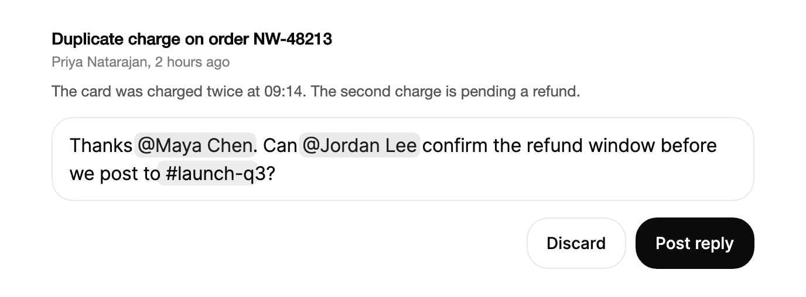

<Demo name="CommentBox" />

## 何時使用

`MentionInput` 是用於回覆人員與頻道的多行欄位。使用者輸入 `@` 並選擇同事，或輸入 `#` 並選擇頻道，提及就會成為一個整體權杖，欄位會將其作為整體保留。它適用於留言串的編輯區、回覆方塊、聊天訊息或工作描述：文字讀起來像一個句子，而提及仍須指向應用程式可以通知或連結的紀錄。

- **事件、訂單或工單的留言串**：支援負責人寫下「謝謝 @Alex Rivera，@Priya Natarajan 能確認一下退款編號嗎？」，每個提及都儲存人員的 ID，因此應用程式可以通知正確的人，而不必事後依名字比對。
- **發布到頻道的發行說明與更新**：工程師在句子中連結 `#launch-q3`，訊息因此帶有一個頻道參照，聊天服務可以將其呈現為連結。
- **專案工具中的工作與審查描述**：設計師在描述中用 `@` 提及來指派後續工作，儲存的值把人員保留為結構化資料，供指派歷程使用。
- **帶傳送動作的聊天編輯區**：訊息方塊透過 `IsSubmitOnEnter` 在按下 Enter 時送出，自行清空，並將 `MentionValue` 傳給傳送命令。

## 何時不用

- **沒有參照的一般多行文字**：用 `Textarea`，它沒有建議清單，也沒有需要整體保留的權杖。
- **獨立於句子之外的值**：用 `TagInput`，它把每個值作為標籤保留在文字之外。
- **標題、清單、連結或粗體文字**：用富文字編輯器。`MentionInput` 只保存純文字加提及，沒有格式模型。
- **名稱、標題或搜尋詞等單行內容**：用 `Input` 或 `SearchField`。單行欄位不需要自動增長的編輯區或按 Enter 送出的流程。
- **從大型目錄中選擇一筆紀錄**：用附搜尋的 `Combobox` 或 `Select`。提及清單只顯示最佳的 `MaxSuggestions` 個符合項目，適合人員與頻道的短清單，而不適合完整的目錄查詢。

## 用法

```xml
<UserControl xmlns="https://github.com/avaloniaui"
             xmlns:arc="https://github.com/AtomUICommunity/TKCode.Arc">
    <arc:MentionInput Label="留言"
                      Placeholder="寫下留言。輸入 @ 提及，輸入 # 選擇頻道"
                      MinLines="1"
                      MaxLines="8" />
</UserControl>
```

此欄位沒有可見的標籤：`Label` 只為輔助技術提供編輯區的名稱，說明文字由預留位置文字承擔。欄位本身不是獨立的 Tab 停留點，焦點會直接移入編輯區。

`MentionInput` 衍生自 `TemplatedControl`。其範本包含一個真正的多行 `TextBox`，因此游標、選取、輸入法組字、復原與剪貼簿的行為與文字方塊一致。編輯區自身的文字是透明的，其後的鏡像層以相同的度量繪製同樣的文字並為提及權杖上色，因此顏色與換行都與游標保持對齊。你透過 `Value`（一個 `MentionValue`）讀寫內容：純文字加上各提及及其字元位移量。

### 結構

1. **外框**（PART_Shell）：1 px 邊框，控制項圓角，表面色背景。靜止時使用邊框顏色，編輯區取得焦點時使用強邊框顏色。懸停不會改變它。
2. **編輯區**（PART_TextBox）：16 px 內文字型的可編輯文字，行高 24 px，字母間距 -0.01 em，左右各 14 px 內距，上下各 11 px。
3. **預留位置文字**（`Placeholder`）：值為空且沒有待定的輸入法文字時，以淡化的文字顏色顯示。
4. **提及權杖**：圓角背景上的 `@Label` 或 `#Label` 文字，水平內距 3 px，垂直內距 1 px。人員權杖使用強調色的淺色填滿與強調色的深色文字；頻道權杖使用前景色 7% 不透明度的背景與前景文字。
5. **建議面板**：在觸發字元處彈出的浮層，寬 272 px（欄位較窄時與欄位同寬），距離所在列 6 px。每列依序包含 28 px 的大頭貼或圖示、名稱，再是角色或描述。頻道列在右側顯示成員數量。

### 何時開啟建議

輸入 `@` 會開啟人員清單，輸入 `#` 會開啟頻道清單。只有在詞的開頭才算觸發：位於空白之後、行首，或左括號、引號之後。因此 `billing@acme.com` 中的 `@` 不會開啟清單。觸發字元之後的查詢有以下限制：

- 人員查詢可以包含一個空白，因此 `@maya chen` 可以符合。第二個空白會關閉清單。
- 頻道查詢不允許空白，因此 `#launch q3` 在空白處關閉清單。
- 超過 48 個字元的查詢，或跨越換行的查詢，會關閉清單。
- 在查詢中間再輸入一個觸發字元會關閉清單。

將 `People` 或 `Channels` 設為 `null` 或空集合即可關閉對應的觸發。此時欄位把 `@` 或 `#` 視為一般文字，這適合只需要通知人員的留言串。

結果會先排序，再保留前 `MaxSuggestions` 個（預設 6 個）。名稱以查詢開頭的排在最前，其次是名稱中以查詢開頭的字詞，再次是名稱中包含查詢的，最後是角色或描述中的符合項目。沒有符合項目時顯示空狀態（「沒有符合 “zz” 的人員」或「沒有符合 “zz” 的頻道」），清單保持開啟，使使用者可以繼續輸入或按 Escape。

### 繫結到檢視模型

檢視模型擁有儲存的值。`Value` 預設為雙向繫結，因此每次編輯都會回傳到檢視模型。使用 CommunityToolkit.Mvvm 時：

```csharp
public partial class ReplyComposerViewModel : ObservableObject
{
    private readonly ICommentService _comments;

    public ReplyComposerViewModel(ICommentService comments,
                                  IReadOnlyList<MentionPerson> people,
                                  IReadOnlyList<MentionChannel> channels)
    {
        _comments = comments;
        People = people;
        Channels = channels;
    }

    [ObservableProperty]
    private MentionValue _draft = MentionValue.Empty;

    [ObservableProperty]
    [NotifyCanExecuteChangedFor(nameof(SendCommand))]
    private bool _isSending;

    public IReadOnlyList<MentionPerson> People { get; }

    public IReadOnlyList<MentionChannel> Channels { get; }

    [RelayCommand(CanExecute = nameof(CanSend))]
    private async Task SendAsync(MentionValue value)
    {
        IsSending = true;
        try
        {
            await _comments.PostAsync("inc_2026_0412", value);
            Draft = MentionValue.Empty;
        }
        finally
        {
            IsSending = false;
        }
    }

    private bool CanSend(MentionValue? value) =>
        !IsSending && value is not null && !string.IsNullOrWhiteSpace(value.Text);
}
```

```xml
<StackPanel Width="560" Spacing="12">
    <arc:MentionInput Label="回覆"
                      Value="{Binding Draft, Mode=TwoWay}"
                      People="{Binding People}"
                      Channels="{Binding Channels}"
                      IsSubmitOnEnter="True"
                      SubmitCommand="{Binding SendCommand}"
                      MinLines="2"
                      MaxLines="6" />
    <arc:Button Content="發布回覆"
                Command="{Binding SendCommand}"
                CommandParameter="{Binding Draft}"
                HorizontalAlignment="Right" />
</StackPanel>
```

- 繫結 `Value`，而不是文字，因為只有文字會遺失提及。`People` 與 `Channels` 是單向的。
- 傳送動作使用 `SubmitCommand` 或 `Submitted` 事件。只有當 `CanExecute` 對送出的值回傳 `true` 時，命令才會執行。
- 選擇人員或頻道的附帶效果使用 `MentionAdded` 處理；依賴整段文字的內容使用 `ValueChanged`。

### 預填值

以文字及其提及來設定 `Value`。每個位移量分別指向觸發字元（`Start`）與標籤之後的位置（`End`）。在提及周圍編輯會移動它：在它之前輸入會同時改變兩個位移量。在提及內部編輯會移除該提及，其文字作為純文字保留在欄位中。

<Demo name="Prefilled" />

```csharp
var text = "Thanks @Maya Chen. Can @Jordan Lee review it in #design?";
comment.Value = new MentionValue(text,
[
    new Mention(MentionKind.Person, "u_maya", "Maya Chen", 7, 17),
    new Mention(MentionKind.Person, "u_jordan", "Jordan Lee", 24, 34),
    new Mention(MentionKind.Channel, "c_design", "design", 47, 54)
]);
```

從範本產生內容時應依文字計算位移量，因為錯誤的位移量會把提及附加到錯誤的字元上。

### 按 Enter 送出

將 `IsSubmitOnEnter` 設為 `True` 後，Enter 送出，Shift+Enter 換行。預設值 `False` 時，Enter 換行，傳送動作是一個按鈕。輸入法正在組字時 Enter 永遠不會送出，因此可以用 Enter 確認候選字。空白的值不會送出。建議清單有結果時，Enter 改為選擇反白的一列，因此寫到一半的提及永遠不會被送出。

<Demo name="SubmitOnEnter" />

```csharp
message.IsSubmitOnEnter = true;
message.Submitted += (_, e) =>
{
    Console.WriteLine($"{e.Value.Text} ({e.Value.Mentions.Count} mentions)");
    message.Clear();
};
```

### 行數與增長

`MinLines` 與 `MaxLines` 設定高度範圍（以行計）。欄位從 `MinLines` 開始，隨文字換行或輸入新行，每次增長一行 24 px，直到 `MaxLines`。超過該高度後，編輯區在外框內捲動並隱藏捲軸，使編輯區不會把頁面其餘部分往下推。預設值為 1 和 8。

留言串的編輯區通常使用 `MinLines="2"` 與 `MaxLines="6"`。

<Demo name="Growth" />

### 尺寸與位置

`SuggestionPlacement` 設定清單的展開位置。`Auto`（預設）在下方展開，但當下方空間少於 300 px 且上方空間較大時翻到上方。`Top` 與 `Bottom` 始終使用所選的一側。

<Demo name="Placement" />

### 命令與事件

`Insert`、`OpenSuggestions` 與 `Clear` 從程式碼操作欄位。`Insert` 在游標處輸入文字，效果與使用者手動輸入相同，因此會進入復原堆疊。`OpenSuggestions` 輸入某類的觸發字元；若游標前的字元不是空白，會先加入一個空白。`Clear` 清空值並重設游標。

```csharp
button.Click += (_, _) => comment.OpenSuggestions(MentionKind.Person);

comment.MentionAdded += (_, e) => Console.WriteLine($"Added {e.Mention.Text}");
```

`ValueChanged` 在 `Value` 的每次變化時觸發，並帶有舊值與新值。`MentionAdded` 只在建議變為提及時觸發。

### 停用

整個欄位會淡化到 55%，且不接受任何輸入。其文字與提及仍可讀。

<Demo name="Disabled" />

### 焦點與關閉

建議清單是會自行關閉的浮層：

- **Escape** 只關閉目前觸發的清單。在同一查詢中繼續輸入會讓它保持關閉，空白之後的新觸發則會再次開啟它。
- **在欄位與清單之外按下** 會關閉清單。在欄位內按下（例如移動游標）不會關閉。
- 清單有結果時，**Tab** 選擇反白的建議；否則移動焦點。
- **點選某一列** 會讓焦點留在編輯區，並把游標放在權杖及其後的空白之後，使使用者可以繼續輸入。復原（Ctrl+Z，macOS 上為 Cmd+Z）會撤回該選擇，但不會撤回提及物件本身。

### 序列化輸出

<Demo name="Serialized" />

`MentionSerializer.Serialize` 將值轉換為儲存文字。預設情況下，每個人員變為 `<@id>`，每個頻道變為 `<#id>`，其餘文字不變。傳入格式化函式可以寫成其他形式，例如方括號中的顯示名稱。當名稱可能變動時應儲存預設形式，因為儲存的文字會持續指向同一個 ID。

```csharp
var stored = MentionSerializer.Serialize(comment.Value);
// 儲存結果："Thanks <@u_maya>. Can <@u_jordan> review it in <#c_design>?"
```

### 範例：事件回覆串

事件回覆串中的回覆方塊（`inc_2026_0412`，Northwind 訂單的重複扣款）。被回覆的訊息位於其上方以供參考。回覆中提及了兩人和一個頻道，每個都在欄位中顯示為權杖。主要動作位於欄位下方右側。



```xml
<UserControl xmlns="https://github.com/avaloniaui"
             xmlns:x="http://schemas.microsoft.com/winfx/2006/xaml"
             xmlns:arc="https://github.com/AtomUICommunity/TKCode.Arc"
             xmlns:generic="using:System.Collections.Generic">
    <StackPanel Width="600" Spacing="14">
        <StackPanel Spacing="4">
            <TextBlock Text="Duplicate charge on order NW-48213"
                       FontSize="14"
                       FontWeight="SemiBold"
                       Foreground="{arc:ArcDesignTokenResource Foreground}" />
            <TextBlock Text="Priya Natarajan, 2 hours ago"
                       FontSize="12"
                       Foreground="{arc:ArcDesignTokenResource TextMuted}" />
            <TextBlock Text="The card was charged twice at 09:14. The second charge is pending a refund."
                       FontSize="13"
                       TextWrapping="Wrap"
                       Margin="0,6,0,0"
                       Foreground="{arc:ArcDesignTokenResource TextSecondary}" />
        </StackPanel>
        <arc:MentionInput Label="Reply to incident" MinLines="2" MaxLines="6">
            <arc:MentionInput.Value>
                <arc:MentionValue>
                    <x:Arguments>
                        <x:String>Thanks @Maya Chen. Can @Jordan Lee confirm the refund window before we post to #launch-q3?</x:String>
                        <generic:List x:TypeArguments="arc:Mention">
                            <arc:Mention>
                                <x:Arguments>
                                    <arc:MentionKind>Person</arc:MentionKind>
                                    <x:String>u_maya</x:String>
                                    <x:String>Maya Chen</x:String>
                                    <x:Int32>7</x:Int32>
                                    <x:Int32>17</x:Int32>
                                </x:Arguments>
                            </arc:Mention>
                            <arc:Mention>
                                <x:Arguments>
                                    <arc:MentionKind>Person</arc:MentionKind>
                                    <x:String>u_jordan</x:String>
                                    <x:String>Jordan Lee</x:String>
                                    <x:Int32>23</x:Int32>
                                    <x:Int32>34</x:Int32>
                                </x:Arguments>
                            </arc:Mention>
                            <arc:Mention>
                                <x:Arguments>
                                    <arc:MentionKind>Channel</arc:MentionKind>
                                    <x:String>c_launch</x:String>
                                    <x:String>launch-q3</x:String>
                                    <x:Int32>78</x:Int32>
                                    <x:Int32>88</x:Int32>
                                </x:Arguments>
                            </arc:Mention>
                        </generic:List>
                    </x:Arguments>
                </arc:MentionValue>
            </arc:MentionInput.Value>
        </arc:MentionInput>
        <StackPanel Orientation="Horizontal" Spacing="8" HorizontalAlignment="Right">
            <arc:Button Content="Discard" Variant="Secondary" />
            <arc:Button Content="Post reply" />
        </StackPanel>
    </StackPanel>
</UserControl>
```

短回覆會保持 `MinLines` 設定的兩行高度，因此輸入時回覆方塊不會跳動。

### 文案規範

- **預留位置文字**：告訴使用者這個欄位用於什麼，以及如何提及某人：「寫下留言。輸入 @ 提及，輸入 # 選擇頻道」。在欄位寬度內保持一行。
- **標籤**：供輔助技術使用的簡短名詞片語，例如「回覆事件」。它不顯示在螢幕上。
- **動作**：用動詞加受詞為傳送動作命名，例如「發布回覆」或「傳送訊息」，不要用「送出」。空狀態文案（「沒有符合「{0}」的人員」）保持預設，因為它會指出查詢內容。

| 不要寫 | 改為 |
|---|---|
| 在這裡輸入你的留言！ | 寫下留言。輸入 @ 提及，輸入 # 選擇頻道 |
| 提及某人 | 輸入 @ 提及人員 |
| 送出 | 發布回覆 |
| 提及（Maya Chen，產品設計師） | Maya Chen |
| 沒有結果 | 沒有符合 “zz” 的人員 |

### 最佳做法

**建議**

- 儲存 `MentionValue`，或其序列化形式，而不是純文字，使 ID 在編輯與改名之後仍然有效。
- 將 `MinLines` 設為典型回覆的高度，將 `MaxLines` 設為欄位下方可用的空間，使回覆方塊在使用者輸入時不會推動頁面。
- 當某類提及不適用時，用空集合關閉對應的觸發，使 `@` 或 `#` 保持為一般文字。
- 使用目錄中的穩定 ID，而不是顯示名稱，使改名後的人仍然指向同一參照。

**避免**

- 只儲存 `Text`。這樣提及就無法依 ID 通知，也無法在下一次編輯時還原。
- 在文件編輯器中使用 `IsSubmitOnEnter`，因為那裡 Enter 必須換行。在那裡應使用按鈕來傳送。
- 把整個目錄載入到 `People` 中。清單只顯示最佳符合項目，因此大型目錄需要一個會為每個查詢更新 `People` 的搜尋。

### 常見問題

**為什麼按 Enter 是選擇建議，而不是送出？** 清單開啟且有結果時，Enter 與 Tab 會選擇反白的一列。清單關閉後（選擇之後、按下 Escape，或以空白結束查詢之後），Enter 才會送出。

**復原之後為什麼提及不見了？** 復原會還原權杖中輸入的文字，但不會還原提及物件。若復原時必須保留提及，請處理 `ValueChanged`，並用 `NewValue` 重建你自己的提及清單。

## API 參考

<!-- api: MentionInput -->
<!-- api: MentionPerson -->
<!-- api: MentionChannel -->

`Mention` 是值的基本單位；`Start` 與 `End` 是 `Text` 中的字元位移量。

| 成員 | 類型 | 含義 |
|---|---|---|
| `Kind` | `MentionKind` | `Person`（`@`）或 `Channel`（`#`） |
| `Id` | `string` | 人員或頻道的 ID，用於儲存與通知 |
| `Label` | `string` | 觸發字元之後顯示的名稱 |
| `Start` | `int` | 觸發字元的位移量 |
| `End` | `int` | 標籤之後的位移量（不含末尾） |
| `Text` | `string` | 權杖文字：`@Label` 或 `#Label` |

## 無障礙

- 編輯區是附清單自動完成的組合方塊。`Label` 為其命名；當 `Label` 為 null 時，改用控制項的 `AutomationProperties.Name`。
- 建議清單由 `PeopleListName`（人員）或 `ChannelsListName`（頻道）命名。每一列會朗讀其名稱及角色或描述，例如「Maya Chen，產品設計師」。
- 結果數量以禮貌方式播報（"3 people"、"1 channel"、"No matches"），清單關閉時清除。
- 提及顏色來自隱藏的圖層，因此輔助技術讀取的是純文字。

### 鍵盤

| 按鍵 | 操作 |
|---|---|
| 空白、行首，或左括號、引號之後輸入 `@` 或 `#` | 開啟人員或頻道建議 |
| `Down` / `Up` | 在建議之間移動反白，到兩端時循環（清單開啟時） |
| `Enter` / `Tab` | 清單有結果時選擇反白的建議 |
| `Escape` | 只關閉目前觸發的清單 |
| `Enter` | 當 `IsSubmitOnEnter` 為 `True` 且文字不為空時送出；否則換行 |
| `Shift+Enter` | 換行 |
| `Left` / `Right` | 移動一個字元，或整體跳過一個提及權杖 |
| 提及旁的 `Backspace` / `Delete` | 一次按鍵刪除整個權杖 |
| `Ctrl+Z` / `Ctrl+Y`（macOS 上為 `Cmd+Z` / `Cmd+Shift+Z`） | 復原與重做，包括從清單中做出的選擇 |

Enter 在輸入法組字期間永遠不會送出。

## 動態效果

- 欄位在平滑的彈簧上隨內容變化，建議面板從游標處以小幅縮放展開，反白在各列之間滑動。減少動態效果時高度與反白直接跳轉，面板只淡入。

| 變化 | 完整 | 減少 | 關閉 |
|---|---|---|---|
| 欄位高度隨文字變化 | 平滑彈簧 | 直接跳到新高度 | 立即完成 |
| 建議面板展開 | 從游標處小幅縮放，俐落明快 | 淡入，無縮放 | 立即完成 |
| 反白在各列之間移動 | 0.3 秒內滑動，帶輕微回彈 | 直接跳轉 | 立即完成 |
| 結果變化時面板高度 | 彈簧 | 直接跳轉 | 立即完成 |
| 取得焦點時的邊框 | 邊框顏色漸變 | 短暫淡入 | 立即完成 |

## 相關元件

| 元件 | 適用情境 |
|---|---|
| `Textarea` | 文字是多行純文字，沒有需要參照的人員或頻道 |
| `Input` / `SearchField` | 值只有一行，例如名稱或搜尋詞 |
| `TagInput` | 值是一組獨立於句子之外的標籤 |
| `Select` / `Combobox` | 使用者必須從完整清單中選擇一個值，而不是在文字中提及 |
| `Field` + `FieldFrame` | 你要自行建構編輯器，並希望獲得相同的標籤、外框與訊息列 |
