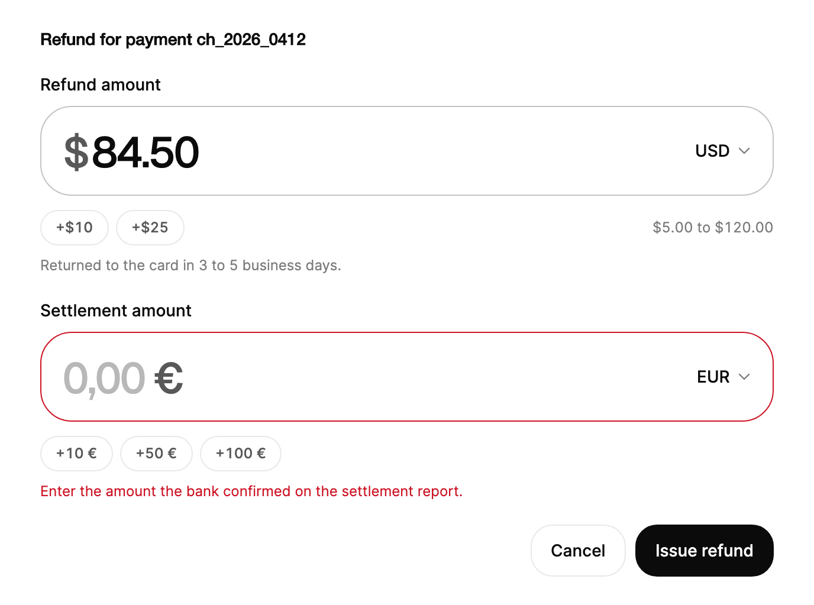

<Demo name="Default" />

## When to use

`MoneyInput` is the field for a hand-typed amount of money. It groups digits as the person types, shows the missing
cents as faded digits, keeps the width steady as the amount grows, and reports both the major value (`12.5` for
$12.50) and the minor units (`1250`) that payment and ledger APIs expect. It sits where a person states an amount that
will be charged, refunded, budgeted or transferred, and where the currency may need to change.

- **Payment and checkout forms**: a customer enters a donation, a tip or a custom amount, with quick-add chips for the
  common values and a maximum that matches the card limit or the order total.
- **Refund and credit screens in a billing console**: an agent enters the refund amount up to the amount paid, and the
  range line under the field states the allowed span ("$5.00 to $120.00") before the agent types.
- **Invoices and expense reports with a changeable currency**: the amount stays as a number while the currency menu
  switches the code, so a 1,250.00 USD invoice can be re-entered as EUR without retyping the digits.
- **Budgets and transfers in a fintech app**: a person sets a monthly limit, with a minimum checked when the field loses
  focus so a value of 0.50 is reported after the person leaves the field, not while they type.
- **Storage and payment APIs that need minor units**: the field exposes `MinorUnits`, so the application sends 1250
  for $12.50 and never handles a binary floating-point amount.

## When not to use

- **Quantities and counts that carry no currency**: use `NumberField`, which has steps and a unit without currency
  formatting.
- **Choosing an amount from a range by dragging**: use `Slider`. It shows the whole span at once.
- **Dense property panels where a value is dragged in place**: use `ScrubInput`, which changes a number by dragging its
  label.
- **Free text that only looks like a number, such as an account code or an invoice number**: use `Input`. A money field
  groups digits and drops letters, which would corrupt an identifier.
- **A price picked from a list of products**: use `Select` or `Combobox`. The person chooses a record, not an amount.

## Usage

```xml
<UserControl xmlns="https://github.com/avaloniaui"
             xmlns:arc="https://github.com/AIDotNet/TKCode.Arc">
    <arc:MoneyInput Label="Amount"
                    Currency="USD"
                    Minimum="5"
                    Maximum="1000"
                    Description="Arrow keys step by one unit." />
</UserControl>
```

`MoneyInput` derives from `FieldTextBox`, which is an Avalonia `TextBox` with the Arc label, description and error rows
around it. The text box holds the caret and the selection only: its own text is transparent, and the amount is painted
on the same origin by the field, column by column. That is why digits can roll and grow without moving the caret. The
text box also keeps the Avalonia input behavior for the caret, selection and clipboard, but undo is turned off, because
the amount is controlled and must not drift from `Value`.

### Anatomy

1. **Shell** (PART_Frame): a 76 px tall frame on the panel radius with 18 px of padding on the left and 8 px on the
   right. The border darkens while the amount itself has focus, and not while the currency switch has focus.
2. **Symbol and amount** (PART_Amount): the amount in the display face at 36 px, medium weight, with tabular digits and
   no kerning. Letter spacing is -0.03 em. Missing decimals show as faded digits in the muted color at 55% opacity.
3. **Prefix or suffix symbol** (PART_PrefixSymbol, PART_SuffixSymbol): the currency symbol before or after the digits,
   following the culture's positive pattern. Euros in `de-DE` take the symbol after the amount.
4. **Currency button** (PART_CurrencyButton): a 36 px button with the ISO code and a 16 px chevron. It opens the currency
   menu. With one currency in `Currencies`, the code becomes static text instead (PART_StaticCode).
5. **Range line** (PART_Range): 12 px muted text under the shell, such as "$5.00 to $1,000.00". It flashes in the
   warning color when a change is refused.
6. **Quick-add chips** (PART_Chips): 30 px high chips labelled "+$10", "+$50" and "+$100" by default, 6 px apart, on the
   same row as the range line.
7. **Currency menu**: 256 px wide, with rows of at least 36 px and a list up to 288 px high, placed 8 px from the shell.
8. **Description and error rows**: the field's label, description and `ErrorMessage` rows from `Field`.

### Currency and quick-add chips

`Currencies` sets the codes in the currency menu. The default is eight codes: USD, EUR, GBP, JPY, CAD, AUD, CHF and
INR. Use a shorter list that matches the markets the screen serves, because a long menu slows the choice. With one code,
the field shows the code as static text and no menu opens.

`QuickAddAmounts` sets the chips in major units. The default is 10, 50 and 100. Each chip adds its amount to the current
value. An empty list hides the chips. Set chips that suit the amount: tips and donations use small values, a refund uses
the values of the orders in the account. At the maximum, the chips look disabled.

Japanese yen has no minor unit, so the field shows no cents and the minor-unit value equals the major value.

<Demo name="SingleCurrency" />

<Demo name="NoQuickAdd" />

<Demo name="NoDecimals" />

### Culture

`Culture` sets the grouping separator, the decimal separator and the symbol placement. The default is `en-US`, and the
field does not follow the current thread culture, so a user in another locale sees the same format on every screen.
Set `Culture` to the locale of the amount's audience, such as `de-DE` for a German invoice.

<Demo name="Culture" />

### Error and description

`Description` gives help text under the field. `ErrorMessage` marks the field invalid and replaces the description with
the message. A built-in range error appears instead when no explicit message is set and the value is out of range.

<Demo name="DescriptionAndError" />

### Binding and events

`Value` is two-way and uses major units, so `12.50` is `12.5`. `Currency` is also two-way. `ValueChanged` reports the
old and new value, the currency, the minor units, the formatted string and the `ChangeSource`. `CurrencyChanged` reports
the old and new code and whether the menu or code changed it.

<Demo name="BindingAndEvents" />

```xml
<arc:MoneyInput Label="Amount" Value="{Binding Amount}" Currency="{Binding Currency}" />
```

```csharp
amount.ValueChanged += (_, e) =>
{
    Console.WriteLine($"{e.Formatted} ({e.Currency}), minor units {e.MinorUnits}, from {e.ChangeSource}");
};

amount.OpenCurrencyMenu();
```

`OpenCurrencyMenu` needs at least two codes in `Currencies`; `CloseCurrencyMenu` closes the menu and returns focus to the
button. `IsCurrencyMenuOpen` reports the state.

### Binding to a view model

The view model stores the amount in major units as a `decimal?`, and the currency as its ISO code. Store the minor units
only at the boundary with the payment service.

```csharp
public partial class RefundViewModel : ObservableValidator
{
    [ObservableProperty]
    [NotifyDataErrorInfo]
    [Required(ErrorMessage = "Enter a refund amount.")]
    [Range(typeof(decimal), "0.01", "120", ErrorMessage = "Enter an amount between $0.01 and $120.00.")]
    private decimal? _amount = 84.50m;

    [ObservableProperty]
    private string _currency = "USD";

    [RelayCommand]
    private async Task RefundAsync()
    {
        ValidateAllProperties();
        if (HasErrors || Amount is not { } major)
        {
            return;
        }
        long minorUnits = decimal.ToInt64(major * 100m);
        await _payments.RefundAsync("ch_2026_0412", minorUnits, Currency);
    }
}
```

```xml
<arc:MoneyInput Label="Refund amount"
                Value="{Binding Amount, Mode=TwoWay}"
                Currency="{Binding Currency, Mode=TwoWay}"
                Minimum="0.01"
                Maximum="120" />
```

- `Value` and `Currency` are two-way by default, so the view model receives every change, including changes made from the
  menu.
- Use `ValueChanged` for side effects that depend on the change source. Programmatic sets from the view model raise
  `ValueChanged` with `ChangeSource` set to `Programmatic`, and they make no announcement and no kick.

### Minimum and maximum

`Minimum` and `Maximum` set the range in major units. Typing past the maximum is refused: the amount kicks back toward the
press, the range line flashes and the limit is announced. The minimum is checked when the field loses focus, so a person
can type a short value on the way to a larger one.

<Demo name="Limits" />

### Validation

Check each rule at the time the person can act on it. The field handles the range; the rest of the form decides what
an amount means.

| Rule | When it is checked | Where it shows |
|---|---|---|
| Above `Maximum` | While typing, refused as the person types | The range line flashes and the limit is announced; the value does not change |
| Below `Minimum` | When the field loses focus | `ErrorMessage` with "The minimum is $5.00" (the `MinimumErrorFormat` text); the frame turns invalid |
| Required or business rules | On submit, from the view model | `ErrorMessage`; the explicit message replaces the built-in range error |
| Server rules, such as the card limit | After the request | `ErrorMessage` on the field; clear it when the amount changes |

Set `ErrorMessage` to `null` to remove an explicit message and let the built-in range error show again. The built-in
texts come from `MinimumErrorFormat` and `MaximumErrorFormat`, and the range texts from `RangeFormat` ("{0} to {1}"),
`MaximumOnlyFormat` ("Up to {0}") and `MinimumOnlyFormat` ("At least {0}"). Change them for a product's wording, and keep
the `{0}` placeholders.

### Hidden label

`IsLabelVisible="False"` hides the label but keeps it for screen readers. Use it only when a heading above the field
already names the amount.

<Demo name="HiddenLabel" />

### Disabled

A disabled field keeps its amount and ignores input. Explain why the amount is locked in a description, for example
"Locked after the invoice is sent".

<Demo name="Disabled" />

### Example: refund form in a billing console

An agent refunds part of a payment in a billing console. The refund field shows the range under the shell ("$5.00 to
$120.00"), so the agent sees the limit before typing. Two quick-add chips (+$10 and +$25) let the agent add common
amounts. The settlement field is empty and carries an explicit error that says what is missing and where to find it,
because the bank has not confirmed the amount yet. The description states a consequence ("Returned to the card in 3 to 5
days"), which is the reason a person needs to read the field.



```xml
<UserControl xmlns="https://github.com/avaloniaui"
             xmlns:x="http://schemas.microsoft.com/winfx/2006/xaml"
             xmlns:arc="https://github.com/AIDotNet/TKCode.Arc"
             xmlns:generic="using:System.Collections.Generic">
    <StackPanel Width="620" Spacing="20">
        <TextBlock Text="Refund for payment ch_2026_0412"
                   FontSize="14"
                   FontWeight="SemiBold"
                   Foreground="{arc:ArcDesignTokenResource Foreground}" />
        <arc:MoneyInput Label="Refund amount"
                        Value="84.5"
                        Currency="USD"
                        Minimum="5"
                        Maximum="120"
                        Description="Returned to the card in 3 to 5 business days.">
            <arc:MoneyInput.QuickAddAmounts>
                <generic:List x:TypeArguments="x:Decimal">
                    <x:Decimal>10</x:Decimal>
                    <x:Decimal>25</x:Decimal>
                </generic:List>
            </arc:MoneyInput.QuickAddAmounts>
        </arc:MoneyInput>
        <arc:MoneyInput Label="Settlement amount"
                        Currency="EUR"
                        Culture="de-DE"
                        ErrorMessage="Enter the amount the bank confirmed on the settlement report." />
        <StackPanel Orientation="Horizontal" Spacing="8" HorizontalAlignment="Right">
            <arc:Button Content="Cancel" Variant="Secondary" />
            <arc:Button Content="Issue refund" />
        </StackPanel>
    </StackPanel>
</UserControl>
```

The two fields share one column and one label style, so the eye reads them as one form. The error on the second field
uses the explicit message, which replaces the built-in range error, because the field is empty and no range error applies.

### Content guidelines

- **Label**: name the amount's role in a noun phrase: "Refund amount", "Tip", "Monthly limit". Avoid "Amount" alone on a
  screen that has more than one amount.
- **Description**: state the consequence or the limit: "Returned to the card in 3 to 5 business days", "Up to the amount
  paid". Write numbers as digits.
- **Errors**: say what is wrong and what to enter, in the terms of the description: "Enter an amount between $0.01 and
  $120.00." Avoid "Invalid amount".
- **Actions**: a button names the outcome with a verb and object, "Issue refund", "Save limit". Do not write "Submit".

| Instead of | Write |
|---|---|
| Invalid amount | Enter an amount between $0.01 and $120.00. |
| Amount | Refund amount |
| The value is too high! | The maximum is $120.00. |
| Submit | Issue refund |

### Best practices

**Do**

- Set `Minimum` and `Maximum` from the business rule, so the field refuses impossible typing and the range line tells the
  person the span before they type.
- Store and send `MinorUnits` to payment APIs, and keep `Value` in the view model in major units for display.
- Pass `Culture` for the audience of the screen, not the operating system's culture, so the same amount reads the same
  way on every machine.
- Keep the chips to two or three values that match the screen's work, because more chips crowd the row.
- Show the currency menu only when the amount may change currency. A single code is shown as static text for a reason.

**Avoid**

- Converting `Value` to `double` or `float`. The decimal type keeps the cents exact, and a binary float does not.
- Using `MoneyInput` for a quantity, a count or a percentage. The currency symbol and the cents then mislead the person.
- Showing an error on the first keystroke for a minimum. The minimum is checked on blur, so the person can finish typing
  first.
- Keeping a stale `ErrorMessage` after the amount is fixed. Clear it (set it to `null`) so the built-in range error or the
  description returns.
- Relying on the current culture for a financial screen. A machine set to another locale changes the grouping and the
  symbol.

### Common questions

**Why does the empty field show 0.00?** Those are ghost digits that mark where the cents go. `Value` is `null` and
`FormattedValue` is an empty string, so check `Value` for `null`, not the displayed digits.

**How do I get the amount for a payment API?** Read `MinorUnits` (a `long?`). For USD it is cents, for JPY yen. The
value is `null` when the field is empty, so validate it before the request.

**Why are the currency names in English?** The field uses a built-in table of ISO 4217 codes with English names, because
.NET does not provide localized display names for every currency. The symbol and the number format still follow
`Culture`.

**Why does the amount move when I enter a value over the maximum?** The refusal is a kick: the amount slides toward the
press and springs back, so the person sees that the change was refused. With reduced motion the kick is removed and the
range line still flashes.

**What happens to the amount when the currency changes?** The major amount is kept (12.5 stays 12.5), and the minor units
are recalculated in the new currency. From the menu, `CurrencyChanged` fires with `Menu`, then `ValueChanged` fires with
`ChangeSource` set to `Currency`.

## API reference

<!-- api: MoneyInput -->

The event arguments and the change sources are public types that the events use.

| Type | Members |
|---|---|
| `MoneyInputValueChangedEventArgs` | `OldValue`, `NewValue` (decimal?), `Currency`, `MinorUnits` (long?), `Formatted`, `ChangeSource` |
| `MoneyInputCurrencyChangedEventArgs` | `OldCurrency`, `NewCurrency`, `ChangeSource` |
| `MoneyInputChangeSource` | `Programmatic`, `Type`, `Paste`, `Key`, `Chip`, `Currency`, `Automation` |
| `MoneyInputCurrencyChangeSource` | `Programmatic`, `Menu` |

## Accessibility

- `Label` names the field. With `IsLabelVisible="False"` the label is hidden but still names it.
- The field is a spin button. Its numeric value is the major value, and its value text is the full currency string, such
  as "$12.50", or "Empty" when there is no amount. The range appears as the minimum and maximum of the spin button.
- The description, the range and the error are the field's help text, read after the name and the value.
- The currency button is named "Currency, US Dollar" and opens a list with typeahead.
- Refused changes ("Maximum is $100.00"), key and chip steps, and currency changes are announced politely. Typing does
  not announce, so a screen reader does not repeat each digit.
- Animated digits are hidden from assistive technology, which reads the real text of the field.

### Keyboard

| Keys | Action |
|---|---|
| Digits and the decimal separator | Type the amount; letters are dropped and the caret stays |
| `Up` / `Down` | Adds or subtracts one major unit, or the `Step` value |
| `Shift` + `Up` / `Down`, `PageUp` / `PageDown` | Steps ten times as far |
| `Enter` | Settles the decimals (12.5 becomes 12.50) and moves the caret to the end |
| `Backspace` / `Delete` on a group separator | Deletes the digit next to the separator instead of doing nothing |
| `Ctrl+V` (`Cmd+V` on macOS) | Pastes a value such as "$1,234.56", "1.234,56 €" or "1234.5"; replaces a whole-field selection, otherwise inserts at the caret |
| `Tab` | Moves focus to the next control |
| `Down` / `Up` on the currency button | Opens the currency menu |
| `Up` / `Down`, `Home` / `End` in the menu | Moves the highlight through the currencies |
| Letters in the menu | Jump to the currency whose code or name starts with the typed text (typeahead resets after 600 ms) |
| `Enter` / `Space` in the menu | Chooses the highlighted currency and keeps the major amount |
| `Escape` in the menu | Closes the menu and returns focus to the currency button |
| `Tab` in the menu | Closes the menu and moves focus on |

Enter settles the decimals but does not submit. The key still reaches the form, so a default button can submit it.

## Motion

- Digits roll in the direction of the change when a step or a chip changes the amount. In full motion, typed digits land
  at once, so the caret never lags behind the keystroke.
- A refused change pushes the amount sideways with a spring and flashes the range line.
- Changing the currency rolls the symbol to its new position, and a long amount scales down to fit the width.

| Change | Full | Reduced | Off |
|---|---|---|---|
| Step key or quick-add chip | Digit columns roll in the change direction | Digits fade, sizes jump | Digits fade, sizes jump |
| Refused change (over the maximum) | The amount kicks sideways with a spring; the range line flashes | No kick; the range line still flashes | No kick; the range line still flashes |
| New digit column appears | The column grows in width on a spring | Width jumps | Width jumps |
| Currency change | The symbol rolls to its new place | The symbol changes without the roll | The symbol changes without the roll |

## Related

- `NumberField` for quantities and other numbers that have no currency.
- `ScrubInput` for dragged numeric settings, and `Slider` for picking from a range.
- `Input` for free text that has no amount structure.

| Component | Choose it when |
|---|---|
| `NumberField` | The number is a quantity, a count or a value with a unit, not money |
| `ScrubInput` | A numeric setting is adjusted by dragging it in a dense panel |
| `Slider` | The person picks a value across a range and the exact figure matters less |
| `Input` | The value is an identifier or free text that happens to contain digits |
| `Select` / `Combobox` | The person chooses a priced item or record from a list |
