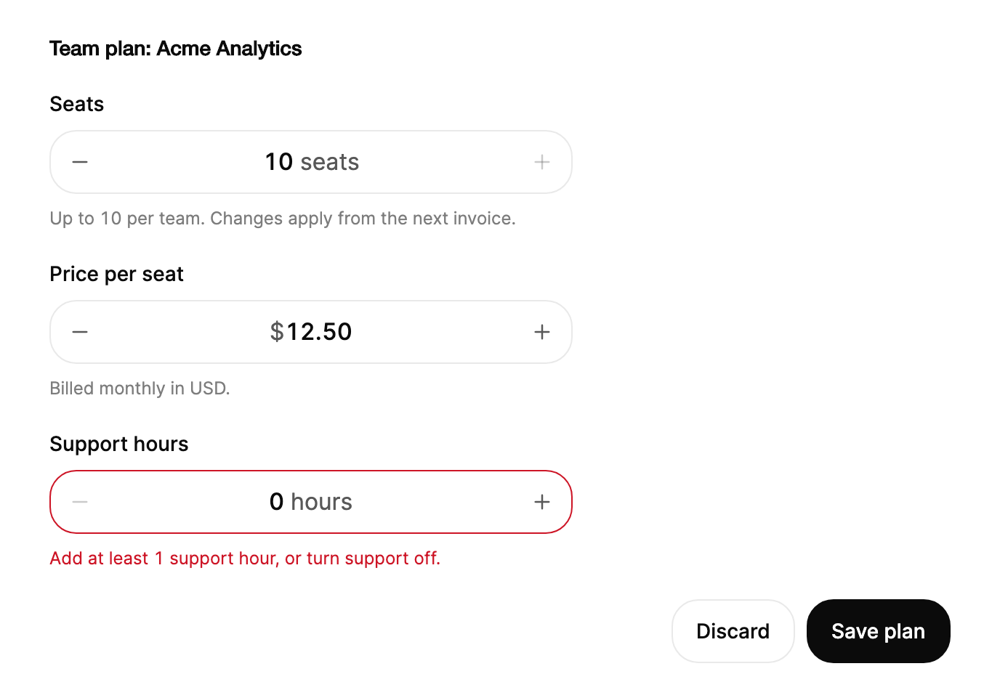

<Demo name="Default" />

## 何時使用

`NumberField` 是兩側各帶一個步進控制項的有界數字輸入框。它適合使用者精確設定、且經常按一個步長調整的值：方案的座位數、購物車中的商品數量、保留天數、單價。欄位在使用者輸入以及按下步進控制項時都會執行範圍限制，因此表單永遠不會儲存超出所顯示限制的值。

- **SaaS 管理後台中的座位與授權數量**：管理員用加號步進控制項把座位數從 3 調到 4，「每個團隊最多 10 個」的標籤在限制生效期間保持可見。
- **訂單或購物車中的數量**：買家把某一列商品的數量在 1 到 99 之間調整，限制提示說明加號步進控制項為何停在最大值。
- **開發者或維運工具中的重試與閾值設定**：工程師設定重試次數、以秒為單位的逾時時間或百分比閾值，單位後綴隨數值變化。
- **固定步長的價格與單位成本**：商品目錄編輯器以 $0.50 為步長調整價格，或以 $0.01 為步長調整成本，步長決定欄位顯示的小數位數。
- **可就地調整數值的精簡設定面板**：設計工具中的寬度或不透明度欄位，開啟 `IsScrubEnabled` 後拖曳標籤即可改變數值。

## 何時不用

- **位置比精確數字更重要的近似值**：用 `Slider`，它展示完整的範圍，讓使用者判斷位置。
- **電話號碼、郵遞區號或驗證碼等數字字串**：用 `Input`。步進控制項對識別碼沒有意義，欄位還會改變其格式。
- **帶貨幣代碼的金額**：用 `MoneyInput`，它為金額分組、顯示貨幣並輸出最小單位值。
- **需要拖曳調整多個數值的畫布式屬性面板**：整個面板圍繞拖曳建構時，用 `ScrubInput`。
- **從固定選項清單中選擇的數字**：用 `Select` 或 `Combobox`。步進控制項暗示數值是連續的。

## 用法

```xml
<UserControl xmlns="https://github.com/avaloniaui"
             xmlns:arc="https://github.com/AtomUICommunity/TKCode.Arc">
    <arc:NumberField Label="座位數"
                     Minimum="1"
                     Maximum="10"
                     Value="3"
                     Description="每個團隊最多 10 個。" />
</UserControl>
```

`NumberField` 衍生自 `FieldTextBox`，因此它是帶有 Arc 標籤、輔助文字與錯誤列的 Avalonia `TextBox`。文字方塊就是草稿編輯器：當欄位未處於編輯狀態時，它的文字是透明的，數值以滾動數字的形式繪製。輸入會開啟一個草稿；草稿只要有效、在範圍內並且落在步長格線上，就會即時生效，並在使用者按下 Enter 或離開欄位時提交。`Value` 是 `decimal`，因此價格和小數的運算是精確的。

### 結構

1. **標籤**（PART_Label）：欄位的標籤，位於外殼上方的標題列中，標題列與外殼之間相距 8 px。
2. **限制提示**（PART_LimitNote）：標籤旁邊 12 px 的提示，例如「最多 10 個座位」，顏色由前景色與警告色混合而成的警示色調。按壓碰到限制時出現。
3. **減少步進控制項**（PART_DecreaseButton）：依尺寸為 28、34 或 40 px 的方形，帶 16 px 的減號圖示，圓角 14 px。
4. **數值**（PART_ValueGroup、PART_Digits）：數值及其前綴與後綴，位於兩個步進控制項之間，兩側各留 2 px 間距。
5. **增加步進控制項**（PART_IncreaseButton）：與減少步進控制項相同的方形，帶 16 px 的加號圖示。
6. **外殼**：欄位外框，四周內縮 3 px（大尺寸時為 4 px）。除非設定了 `Width`，否則小、中、大三種尺寸的寬度分別為 164、196 與 228 px；中等尺寸的外殼高 44 px。
7. **輔助文字與錯誤列**：外殼下方的欄位輔助文字與 `ErrorMessage`。

步進控制項到達限制時淡化到 32%，拒絕按壓時淡化到 60%，欄位停用時淡化到 35%。位於限制處的步進控制項仍可按壓，因此按壓時依然會顯示限制。

### 前綴、後綴與步長

`Step` 設定增量，其精度決定預設的小數位數：步長 `0.5` 顯示一位小數，步長 `0.01` 顯示兩位。`Prefix` 與 `Suffix` 是數值之前與之後的文字。`SuffixFormatter` 是數值的函式，因此單位可以隨數值變化，例如單數與複數形式。

<Demo name="Price" />

```csharp
var seats = new NumberField
{
    Label = "座位數",
    Minimum = 1,
    Maximum = 10,
    Value = 3,
    SuffixFormatter = n => n == 1 ? " seat" : " seats"
};
```

`PrefixFormatter` 對前綴的作用相同。兩者都是函式，因此無法在 XAML 中使用；請像上面的範例那樣在程式碼後置檔中設定。`Suffix` 字串是靜態形式。

使用者輸入時，小於零的最小值會接受負號，因此 -20 到 40 這樣的範圍無需特殊處理。

<Demo name="NegativeRange" />

### 格式與地區文化

`Culture` 設定分組分隔符與小數分隔符，預設值為 `en-US` 而不是目前的地區文化，因此同一個數值在每台機器上的讀法都一致。`UseGrouping` 用於開啟或關閉分組分隔符。`MinimumFractionDigits` 與 `MaximumFractionDigits` 會覆寫步長所給出的小數位數。當數值有固定的顯示格式時使用它們，例如以整數步進但需要顯示兩位小數的費率。

### 尺寸

`Size` 設定寬度與步進控制項尺寸：`Small` 寬 164 px，步進控制項為 28 px；`Medium`（預設值）寬 196 px，步進控制項為 34 px；`Large` 寬 228 px，步進控制項為 40 px。明確設定的 `Width` 會把外殼拉伸到該寬度，而不是尺寸所對應的寬度。

<Demo name="Sizes" />

同一個表單只用一種尺寸。`Small` 適合密集的表格或工具列，`Medium` 是設定頁與表單的預設值，`Large` 適合頁面上單一醒目的數字，例如商品頁上的數量。

### 限制提示與錯誤

`IsLimitHintEnabled`（預設開啟）在按壓碰到限制或輸入的值越界時，在標籤旁顯示提示。預設文字為「最多 10 個座位」或「最少 1 個座位」。`LimitHintFormatter` 根據觸及的邊界及其限制值產生提示。

<Demo name="LimitHint" />

`ErrorMessage` 會把欄位標記為無效。它用於範圍無法表達的規則，例如訂單中有商品時數量至少為一。

<Demo name="States" />

### 驗證

範圍規則由欄位負責，業務規則由檢視模型或表單負責。下表說明每項檢查何時執行。

| 規則 | 何時檢查 | 顯示在哪裡 |
|---|---|---|
| 超過 `Maximum` | 輸入時草稿變為警告色調；在限制處按壓會使其抖動並說明限制 | 限制提示與即時播報（「10 個座位，已達最大值」） |
| 低於 `Minimum` | 輸入時，等待短暫時間（700 ms）後檢查，使使用者能夠輸入較大數字的第一位 | 外殼變為警告色調，然後顯示限制提示 |
| 落在步長格線上 | 草稿提交時（按 Enter 或離開欄位） | 數值會對齊到步長格線並限制在範圍內 |
| 業務規則，例如至少一件商品 | 送出時，由檢視模型檢查 | `ErrorMessage`；數值變動時清除 |

透過程式碼設定 `Value` 永遠不會顯示抖動或提示。它會靜默地更新顯示，因此載入的表單不會閃現警告。

### 繫結與事件

`Value` 為雙向繫結。`ValueChanged` 回報舊值、新值以及 `ChangeSource`，後者說明數值來自程式碼、步進控制項、按鍵、滾輪、拖曳還是輸入。

<Demo name="BindingAndEvents" />

```xml
<arc:NumberField Label="項目數" Minimum="0" Maximum="50" Value="{Binding ItemCount, Mode=TwoWay}" />
```

```csharp
field.ValueChanged += (_, e) =>
{
    Console.WriteLine($"{e.OldValue} -> {e.NewValue} ({e.ChangeSource})");
};
```

`StepUp` 與 `StepDown` 從程式碼中按一個步長移動數值。它們會先提交已開啟的草稿，並且不做任何播報，也不產生抖動，因此應用程式中的「加一」按鈕不會閃現限制。

### 繫結到檢視模型

將數值及其限制保存在檢視模型中，並讓欄位執行它所顯示的限制。來自欄位的變化會以 `Value` 更新的形式到達，因此檢視模型無需額外的處理常式。

```csharp
public partial class SeatPlanViewModel : ObservableObject
{
    public const int MaxSeats = 10;

    [ObservableProperty]
    [NotifyPropertyChangedFor(nameof(SeatCost))]
    private decimal _seats = 3;

    [ObservableProperty]
    private decimal _pricePerSeat = 12.5m;

    public decimal SeatCost => Seats * PricePerSeat;

    [RelayCommand]
    private async Task SavePlanAsync()
    {
        await _plans.SaveAsync("plan_team_2026", (int)Seats);
    }
}
```

```xml
<StackPanel Spacing="16">
    <arc:NumberField Label="座位數"
                     Value="{Binding Seats, Mode=TwoWay}"
                     Minimum="1"
                     Maximum="10"
                     Suffix=" 個座位"
                     Description="每個團隊最多 10 個。" />
    <arc:Button Content="儲存方案" Command="{Binding SavePlanCommand}" />
</StackPanel>
```

- 在 XAML 中保留 `Minimum` 與 `Maximum`，使限制在標記中可見，只繫結 `Value`。
- 只在邊界處轉換為整數，因為欄位保存的是 `decimal`，而座位數是整數。

### 拖曳標籤

開啟 `IsScrubEnabled` 後，左右拖曳標籤即可改變數值：每移動 6 px 改變一個步長。越過限制後，數值會帶阻力地跟隨指標，放開指標時停在限制處。只有當標籤是明顯的拖曳把手時（例如設計面板）才啟用拖曳。在其他地方，無意的拖曳會改變數值。

<Demo name="ScrubLabel" />

### 鍵盤

先讓欄位取得焦點，再使用鍵盤。按鍵列在欄位下方。

<Demo name="Keyboard" />

### 範例：管理後台中的座位方案表單

管理員在管理後台中為團隊方案設定座位數。座位欄位在輔助文字中說明限制，並且加號步進控制項到達最大值後，限制提示也會出現。每個座位的價格使用相同的步長規則，帶有前綴並保留兩位小數，使價格保持易讀。支援時數欄位的值為 0，業務規則不允許這樣做，因此它帶有一則說明該規則的 `ErrorMessage`。主要動作按鈕說明了接下來會發生什麼。



```xml
<UserControl xmlns="https://github.com/avaloniaui"
             xmlns:x="http://schemas.microsoft.com/winfx/2006/xaml"
             xmlns:arc="https://github.com/AtomUICommunity/TKCode.Arc">
    <StackPanel Width="620" Spacing="20">
        <TextBlock Text="Team plan: Acme Analytics"
                   FontSize="14"
                   FontWeight="SemiBold"
                   Foreground="{arc:ArcDesignTokenResource Foreground}" />
        <arc:NumberField Label="Seats"
                         Value="10"
                         Minimum="1"
                         Maximum="10"
                         Suffix=" seats"
                         Width="360"
                         HorizontalAlignment="Left"
                         Description="Up to 10 per team. Changes apply from the next invoice." />
        <arc:NumberField Label="Price per seat"
                         Value="12.5"
                         Prefix="$"
                         Step="0.5"
                         MinimumFractionDigits="2"
                         Minimum="0"
                         Maximum="999"
                         Width="360"
                         HorizontalAlignment="Left"
                         Description="Billed monthly in USD." />
        <arc:NumberField Label="Support hours"
                         Value="0"
                         Minimum="0"
                         Maximum="40"
                         Suffix=" hours"
                         Width="360"
                         HorizontalAlignment="Left"
                         ErrorMessage="Add at least 1 support hour, or turn support off." />
        <StackPanel Orientation="Horizontal" Spacing="8" HorizontalAlignment="Right">
            <arc:Button Content="Discard" Variant="Secondary" />
            <arc:Button Content="Save plan" />
        </StackPanel>
    </StackPanel>
</UserControl>
```

三個欄位共用同一寬度，因此數值在一欄中對齊。限制提示在按壓到達限制之前保持隱藏，這讓畫面在有內容要說之前保持安靜。

### 文案規範

- **標籤**：為數量或設定命名的名詞，例如「座位數」「重試次數」「逾時」。標籤始終可見；步進控制項的名稱也包含標籤，因此請保持簡短。
- **後綴**：當單位隨數字變化時，用 `SuffixFormatter` 分別給出單數與複數形式，例如「 seat」與「 seats」。後綴以空格開頭，使數字與單位不會緊貼在一起。
- **輔助文字**：說明限制或後果，例如「每個團隊最多 10 個」「變更從下一張發票開始生效」。數字用阿拉伯數字書寫。
- **限制提示**：用欄位的術語說明使用者觸及的限制，例如「最多 10 個座位」「最少 1 個座位」。保持為一個簡短的片語。
- **錯誤提示**：說明應該輸入什麼，而不是哪裡錯了，例如「請至少新增 1 個支援小時，或關閉支援。」

| 不要寫 | 改為 |
|---|---|
| 數值無效 | 請輸入 1 到 10 之間的數字。 |
| 數量 | 本訂單中的商品 |
| 已達上限！ | 最多 10 個座位 |
| 座位數： | 座位數 |

### 最佳做法

**建議**

- 根據業務規則設定 `Minimum` 與 `Maximum`，使步進控制項停在規則所允許的位置，並由限制提示說明原因。
- 把 `Step` 設為使用者應做出的最小變化：半小時用 `0.5`，分用 `0.01`。步長也決定小數位數，因此顯示的值永遠不會是步長無法產生的值。
- 「加一」按鈕使用 `StepUp` 與 `StepDown`，因為在限制處使用按鈕時它們不會閃現限制。
- 在檢視模型中以 `decimal` 保存數值，只在與整數或支付介面的邊界處取整。
- 在表單中關閉 `IsScrubEnabled`，避免在標籤上的拖曳意外改變數值。

**避免**

- 把欄位用於識別碼或代碼，因為步進控制項與格式化會改變字元。
- 保存欄位會拒絕的數字，例如超過 `Maximum` 的座位數。這樣表單就會保存一個畫面從未顯示為有效的值。
- 在使用者仍在輸入有效數字時就顯示 `ErrorMessage`。應在送出時或欄位失去焦點後再設定。
- 在大範圍上使用很小的 `Step`。在 0 到 999 之間以 0.01 為步長需要按很多次，因此使用 `MoneyInput` 或 `Input` 直接輸入會更快。
- 當限制從情境中並不明顯時，用 `IsLimitHintEnabled="False"` 隱藏限制提示。沒有提示時，停住的步進控制項看起來像是壞了。

### 常見問題

**為什麼加號步進控制項看起來變暗了？** 數值已達最大值。步進控制項會淡化到 32%，但仍可按壓，因此按壓時依然會顯示限制提示與抖動。

**如何顯示隨數字變化的單位？** 在程式碼中設定 `SuffixFormatter`：`n => n == 1 ? " seat" : " seats"`。它是函式，因此不是 XAML 屬性。

**為什麼輸入的數字會對齊到步長？** 草稿在按下 Enter 或欄位失去焦點時提交，提交時會把數值對齊到從 `Minimum` 開始的步長格線上，然後限制在範圍內。

**如何知道數值是因步進還是輸入而改變的？** 讀取 `ValueChanged` 中的 `ChangeSource`。`Key` 表示方向鍵或翻頁鍵，`Button` 表示步進控制項，`Wheel` 表示欄位有焦點時的滑鼠滾輪，`Scrub` 表示拖曳標籤，`Type` 表示輸入，`Programmatic` 表示程式碼。

**可以使用滑鼠滾輪嗎？** 可以，欄位有鍵盤焦點時，每一格滾輪都會步進數值。這是 Arc 設計的延伸，不希望使用它的應用程式可以避免讓欄位取得焦點。

## API 參考

<!-- api: NumberField -->

變化來源與限制邊界是公用列舉，事件與限制提示會使用它們。

| 型別 | 成員 |
|---|---|
| `NumberFieldValueChangedEventArgs` | `OldValue`、`NewValue`（decimal）、`ChangeSource`（`NumberFieldChangeSource`） |
| `NumberFieldChangeSource` | `Programmatic`、`Button`、`Key`、`Wheel`、`Scrub`、`Type` |
| `NumberFieldLimitEdge` | `Minimum`、`Maximum` |

## 無障礙

- `Label` 為欄位命名。`IsLabelVisible="False"` 時標籤隱藏，但仍作為名稱。
- 欄位是帶範圍的微調按鈕：其最小值、最大值、小步長（1）與大步長（10）都會暴露，值文字為帶前綴與後綴的數值，例如「3 個座位」。
- 步進控制項根據 `DecreaseText`、`IncreaseText` 與標籤命名為「Decrease Seats」和「Increase Seats」。它們在限制處仍可取得焦點，因此螢幕閱讀器可以讀到限制提示。
- 變化以禮貌方式播報。限制生效時播報所到達的限制（「10 個座位，已達最大值」），超出範圍的輸入值會被加入說明文字。
- 焦點環只在鍵盤焦點時出現。使用指標按壓時不繪製焦點環。

### 鍵盤

| 按鍵 | 操作 |
|---|---|
| `Up` / `Down` | 按 `Step` 步進；按住按鍵會重複步進，400 ms 後開始，並逐漸加快 |
| `Shift` + `Up` / `Down`，`PageUp` / `PageDown` | 按 `LargeStep` 步進（預設為十個步長） |
| `Home` / `End` | 沒有開啟草稿時移到 `Minimum` / `Maximum`（`End` 需要有限的最大值） |
| 數字、`-`（當 `Minimum` 小於零時）、小數分隔符 | 輸入草稿；有效的草稿即時生效 |
| `Enter` | 提交已開啟的草稿（對齊並限制範圍）；沒有草稿時選取整個數字 |
| `Escape` | 把已開啟的草稿還原為編輯前的值 |
| 步進控制項取得焦點時的 `Enter` | 步進一次 |
| `Tab` | 從編輯器移到減少與增加步進控制項，然後繼續向後 |

欄位有鍵盤焦點時，滑鼠滾輪會步進數值。按在步進控制項上的按鍵屬於步進控制項，而不屬於草稿。

## 動態效果

- 數字沿變化方向像里程表一樣滾動，從 9 回繞到 0。被另一次步進打斷的步進會在滾動途中改變目標。
- 在限制處按壓會把數值彈回，使被拒絕的步進控制項抖動，並顯示限制提示約 1.5 秒。
- 減少動態效果時數值立即設定，並以警告色閃爍限制。關閉動態效果時同樣如此。

| 變化 | 完整 | 減少 | 關閉 |
|---|---|---|---|
| 步進控制項或方向鍵步進 | 數字沿變化方向滾動 | 數值立即變化 | 數值立即變化 |
| 在限制處按壓 | 數值彈回，步進控制項抖動，限制提示上升 | 數字以警告色閃爍 | 數字以警告色閃爍 |
| 輸入的草稿超出限制 | 外殼變為警告色調 | 外殼變為警告色調 | 外殼變為警告色調 |

## 相關元件

- `Slider`：當範圍上的位置比精確數字更重要時使用。
- `Input`：用於沒有步進控制項的數字字串。
- `MoneyInput` 用於貨幣金額，`ScrubInput` 用於精簡的屬性面板。

| 元件 | 適用情境 |
|---|---|
| `Slider` | 使用者在範圍內判斷位置，精確數字不那麼重要 |
| `MoneyInput` | 數字是帶貨幣代碼與最小單位的金額 |
| `ScrubInput` | 精簡面板中的多個數值透過拖曳調整 |
| `Input` | 值是識別碼或代碼，而不是數量 |
| `Select` / `Combobox` | 值是固定選項清單中的一項 |
