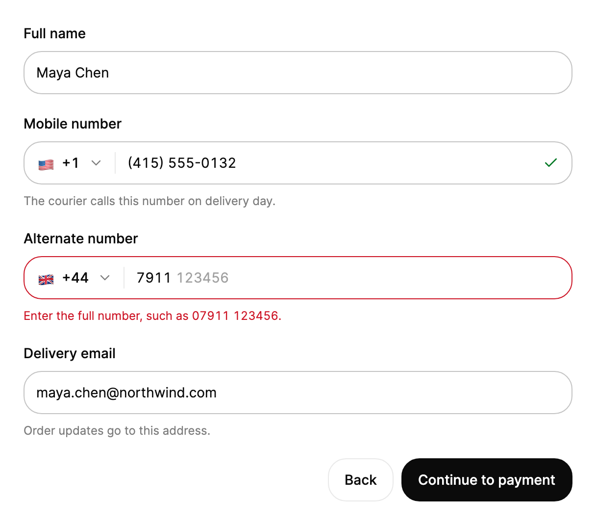

<Demo name="Default" />

## 何时使用

`PhoneInput` 用于收集一个电话号码以及它所属的国家/地区。它与流程中的其他字段并列放在表单里，并处理普通文本字段容易出错的部分：国家区号、本地格式、用户在本地习惯输入的长途前缀，以及服务端保存的 E.164 值。用户只需选择一次国家/地区、输入本地号码，组件就会把保存的值统一为一种标准形式。

- **SaaS 产品中的注册与账号创建**：接收登录验证码的手机号码。号码必须完整后才能提交页面，因此字段在失去焦点时校验，并显示预期的位数。
- **电商中的结账与配送信息**：快递需要一个能联系到的号码。用 `Country` 预选收货国家/地区，并用 `PreferredCountries` 列出店铺配送的市场。
- **CRM 与客服工具中的联系表单**：每位联系人的客户记录保存一个带 `+` 的号码。将 `Value` 绑定到记录，并原样保存 E.164 字符串，之后所有拨号与短信集成读取的都是同一个值。
- **金融科技中的账户设置与账单资料**：银行或支付服务商发送提醒的号码。`Countries` 可以把选择器限制在产品获得许可的市场。
- **内部工具中的批量导入界面**：`PhoneNumbers.Parse` 在号码显示到字段之前，读取 "+44 (0)7911 123456" 或 "0044 7911..." 这类写法，客服人员无需重新输入即可修正某一行。

## 何时不用

- **不会被拨打的自由文本**：用 `Input`。作为标签、编号或订单备注保存的号码不需要国家选择器。
- **验证码**：请在你自己的界面中使用一次性验证码输入。验证码不是电话号码，本库也不提供 OTP 输入。
- **运营商、号码类型或可达性检查**：请使用号码元数据或消息服务。`PhoneInput` 只根据内置的 49 个国家表检查号码的长度与格式，不判断线路是否可用。
- **没有数字含义的固定选项列表**：当用户从已知选项中选择时（例如客服队列或套餐类型），用 `Select` 或 `Combobox`。
- **只用于展示的号码**：详情页上的值用 `Text`，或用 `IsReadOnly` 的 `Field`。在列表或表格中只需显示 E.164 字符串时，调用 `PhoneNumbers.Format`，无需编辑器。
- **金额或数量**：用 `MoneyInput` 或 `NumberField`。电话号码是标识符，它是带格式的文本，而不是数量。

## 用法

```xml
<UserControl xmlns="https://github.com/avaloniaui"
             xmlns:arc="https://github.com/AIDotNet/TKCode.Arc">
    <arc:PhoneInput Label="电话号码"
                    Country="US"
                    Description="我们会向此号码发送登录验证码短信。" />
</UserControl>
```

`PhoneInput` 派生自 `FieldTextBox`，而 `FieldTextBox` 派生自 Avalonia 的 `TextBox`，因此号码就是一个普通的文本编辑器：光标、选择、输入法、撤销与剪贴板都与文本框的行为一致。组件在此基础上增加国家按钮、格式化、E.164 的 `Value`、国家列表与消息行。`Label`、`Description` 与 `ErrorMessage` 与 `Input` 使用的属性相同。

### 结构

1. **标签**（`Label`）：字段的名称，显示在外框上方。它也是号码的无障碍名称。只有当可见的标题已经为字段命名时，才用 `IsLabelVisible="False"` 隐藏它。
2. **字段外框**：字段的 Arc 外框。默认主题下为中等控件高度（44 px），带控件圆角与表面色。悬停时边框加深，聚焦时变为前景色，无效时变为危险色。尺寸始终不变。
3. **国家按钮**：高 36 px 的按钮，在外框内缩进 3 px。它显示旗帜与区号（例如 "+1"），旗帜前留 9 px，右侧为下拉箭头预留 33 px。箭头位于锚点右边缘 12 px 处，一条上下各缩进 10 px 的分隔线将触发器与号码分开。
4. **号码**（文本编辑器，即 `PhoneInput` 本身）：用户输入的数字，按所选国家/地区的格式显示。号码左侧留 12 px 内边距，右侧留 36 px，为有效标记预留空间。
5. **输入提示**：已输入数字之后、以弱化文字颜色显示的剩余预期号码，不透明度为 72%。它只是提示，不属于值。
6. **有效标记**：距右边缘 12 px、宽 18 px 的位置，在号码长度对该国家/地区有效时显示。
7. **辅助文字行**（`Description`）：外框下方的辅助文案。只有在没有消息时才显示。
8. **错误行**（`ErrorMessage` 或内置校验消息）：外框下方以危险色显示的文案。`ErrorMessage` 中的文字会替换内置消息。

### 预设值

`Value` 接受 E.164 字符串，例如 `+447400123456`。国家/地区由区号推断，字段以该国家/地区的格式显示本地号码。在代码中设置的值不会自动发出提示。

<Demo name="PresetValue" />

### 限定国家/地区

`Countries` 把选择器限制为列出的 ISO 3166-1 alpha-2 代码。当产品或店铺只在固定的市场中运营时使用它：例如一家只服务挪威、瑞典和丹麦的北欧银行，或只接受其配送地图上国家的运费表单。`PreferredCountries` 列出显示在上方"推荐"分组中的国家/地区。不在 `Countries` 中的推荐国家会被去掉，因此受限列表永远不会提供产品不服务的国家。`PreferredCountries` 为空时，显示按名称排序的单一列表。

<Demo name="RestrictedCountries" />

<Demo name="NoPreferredCountries" />

给任一属性赋一个新列表即可更改。原列表被原地修改时，选择器不会刷新，因此应替换整个列表。

### 校验与错误

校验在号码失去焦点后运行，而且只在用户输入过数字时进行。从未输入过内容的字段保持安静，使可选的号码可以留空。号码不完整或过长时，错误行显示内置消息，外框变为危险色。号码完整且长度有效时，显示有效标记。

| 情况 | 检查时机 | 消息 |
|---|---|---|
| 已输入数字，位数少于该国家/地区的有效长度 | 号码失去焦点时 | 内置消息："Numbers in United States have 10 digits" |
| 已输入数字，位数多于最长有效长度 | 号码失去焦点时 | 同一条内置消息，使用该国家/地区的长度 |
| 长度有效的完整号码 | 从不显示为错误；显示有效标记 | 无 |
| `ErrorMessage` 有内容 | 立即 | `ErrorMessage` 的文字替换内置消息 |
| `IsValidationEnabled` 为 `False` | 从不 | 无；只显示 `ErrorMessage` |

`IsValidationEnabled="False"` 会关闭内置检查，此时只显示 `ErrorMessage`。当服务端在提交后校验号码，或在允许不完整号码的资料页中，使用它。`ValidationTextFormat` 用于更改内置文案：其中的 `{0}` 为国家/地区名称，`{1}` 为有效长度，例如 "10"，对有两种长度的国家/地区则为 "10 or 11"。

<Demo name="ValidationOff" />

<Demo name="DescriptionAndError" />

`ValidationMessage` 返回当前显示的内置消息，没有时为 `null`。当表单需要把消息作为文本使用时读取它，例如在长表单顶部的摘要中。`Status` 以值的形式给出同样的结论：`Empty`、`Incomplete`、`Valid` 或 `TooLong`。

### 存储与校验号码

存储 `Value` 字符串。它是 E.164 格式：加号、区号，加上不含长途前缀的本地数字，例如 `+14155550132`。`PhoneNumbers` 辅助方法与选择器使用同一份数据，因此表单、导入器与列表可以共用一套规则，无需第二张表：

| 辅助方法 | 用途 |
|---|---|
| `PhoneNumbers.Format(e164)` | 在表格或摘要中显示已保存的号码，例如 "+44 7400 123456"；无法解析时原样返回输入 |
| `PhoneNumbers.Parse(input)` | 把粘贴或导入的号码解析为国家/地区与本地数字；文本不以 "+" 或 "00" 开头，或区号未知时返回 `null` |
| `PhoneNumbers.StatusOf(country, digits)` | 使用与字段相同的长度，在服务端检查本地号码 |
| `PhoneNumbers.ToE164(country, digits)` | 根据国家/地区与本地数字生成保存的值 |
| `PhoneNumbers.Find(iso)` | 获取 ISO 代码对应的表项，未知代码返回 `null` |

要在代码中检查已保存的记录，把 `Value` 传给 `PhoneNumbers.Parse`。它返回 `Country` 与用于 `StatusOf` 的 `National` 数字：

```csharp
var parsed = PhoneNumbers.Parse(contact.Phone);
if (parsed is { } number)
{
    var status = PhoneNumbers.StatusOf(number.Country, number.National);
    // status 为 Valid、Incomplete 或 TooLong；为 Valid 时原样保存 contact.Phone。
}
```

### 绑定与事件

`Value` 与 `Country` 是双向的。每次编辑（输入、粘贴、选择国家/地区）都会触发 `ValueChanged`。它报告旧的与新的 E.164 值、国家/地区、格式化后的号码、状态以及 `IsValid`。实时反馈用事件，保存的值用绑定。

<Demo name="ValueChanged" />

```xml
<arc:PhoneInput Label="电话号码"
                Value="{Binding Phone, Mode=TwoWay}"
                Country="{Binding Country, Mode=TwoWay}" />
```

```csharp
phone.ValueChanged += (_, e) =>
{
    Console.WriteLine($"{e.NewValue} ({e.Status}, valid: {e.IsValid})");
};

phone.OpenPicker();
```

在代码中为 `Value` 赋值时同样会触发 `ValueChanged`。如果处理程序会把值写回，应先比较 `e.NewValue` 与已保存的值，避免循环。`OpenPicker()` 与 `ClosePicker()` 用于在代码中打开和关闭国家列表；`IsPickerOpen` 报告其状态。

### 绑定到视图模型

在 MVVM 应用中，号码、国家/地区以及保存规则都由视图模型持有。字段负责显示这些值，并把编辑写回。下例使用 CommunityToolkit.Mvvm，并在保存调用之前用 `PhoneNumbers` 辅助方法检查号码。

```csharp
public partial class ContactViewModel : ObservableObject
{
    private readonly IContactService _contacts;

    public ContactViewModel(IContactService contacts)
    {
        _contacts = contacts;
    }

    [ObservableProperty]
    private string _phone = string.Empty;

    [ObservableProperty]
    private string _country = "US";

    [ObservableProperty]
    private string? _phoneError;

    [RelayCommand]
    private async Task SaveAsync()
    {
        PhoneError = null;
        var parsed = PhoneNumbers.Parse(Phone);
        if (parsed is not { } number ||
            PhoneNumbers.StatusOf(number.Country, number.National) != PhoneNumberStatus.Valid)
        {
            PhoneError = "请输入完整的电话号码，例如 +1 415 555 0132。";
            return;
        }

        await _contacts.SaveAsync(Phone);
    }
}
```

```xml
<StackPanel Spacing="16">
    <arc:PhoneInput Label="手机号码"
                    Value="{Binding Phone, Mode=TwoWay}"
                    Country="{Binding Country, Mode=TwoWay}"
                    ErrorMessage="{Binding PhoneError}" />
    <arc:Button Content="保存联系人" Command="{Binding SaveCommand}" IsDefault="True" />
</StackPanel>
```

`Value` 与 `Country` 是双向属性。`SaveCommand` 是绑定到提交按钮的命令，`ErrorMessage` 接收服务端的规则。号码变化时清除 `PhoneError`，避免过时的消息停留在屏幕上。`ValidationMessage`、`Status`、`SelectedCountry` 与 `IsPickerOpen` 是只读属性；表单需要时单向绑定即可。

### 禁用与隐藏标签

`IsEnabled="False"` 会让字段变淡，并阻止国家列表打开。`IsLabelVisible="False"` 会隐藏标签，但标签仍为辅助技术提供号码的名称。只有列标题或标题已经为字段命名时，才应隐藏它。

<Demo name="States" />

### 键盘

国家按钮在 Tab 顺序中位于号码之前。在按钮上，ArrowDown 与 ArrowUp 打开列表，输入可打印字符则打开以该字符为初始内容的搜索。在号码中输入 `+` 会以区号搜索打开列表；在分隔符上按 Backspace 或 Delete 会删除其旁边的数字。完整的键位表见无障碍部分。

<Demo name="Keyboard" />

### 示例：结账联系信息

结账流程中的联系信息步骤。手机号码以 E.164 保存，并预选了国家/地区，因为快递员会在配送当天拨打这个号码。备用号码显示一条替换内置校验的消息，给出用户可以采取行动的指引。邮箱字段与按钮完成这一步，主按钮的文字说明了下一步会发生什么。



```xml
<StackPanel Width="560" Spacing="20">
    <arc:Input Label="Full name"
               Text="Maya Chen" />
    <arc:PhoneInput Label="Mobile number"
                    Value="+14155550132"
                    Description="The courier calls this number on delivery day." />
    <arc:PhoneInput Label="Alternate number"
                    Country="GB"
                    Value="+447911"
                    ErrorMessage="Enter the full number, such as 07911 123456." />
    <arc:Input Label="Delivery email"
               Text="maya.chen@northwind.com"
               Description="Order updates go to this address." />
    <StackPanel Orientation="Horizontal" Spacing="8" HorizontalAlignment="Right">
        <arc:Button Content="Back" Variant="Secondary" />
        <arc:Button Content="Continue to payment" />
    </StackPanel>
</StackPanel>
```

### 文案规范

- **标签**：按用途为号码命名，使用句子式大小写："手机号码"、"配送电话"、"备用号码"。只有表单中没有其他号码时才用"电话号码"。标签在用户输入时始终可见。
- **辅助文字**：用一句话说明这个号码用于什么，例如"我们会向此号码发送登录验证码短信。"只说明后果，让用户理解为什么需要这个字段。
- **错误提示**：说明缺少什么，并以本地格式给出示例："请输入完整号码，例如 07911 123456。"不要把校验文字写成规则（"号码无效"）。
- **国家/地区名称**：选择器使用内置表中的英文名称。请用 `SearchPlaceholder`、`SearchLabel`、`ListLabel`、`SuggestedLabel` 与 `AllCountriesLabel` 本地化选择器的文字。
- **占位文字与示例**：占位文字和输入提示来自该国家/地区的示例号码，因此把 `Country` 设为表单所服务的市场，让字段显示该国的本地格式。

| 不要写 | 改为 |
|---|---|
| 电话 | 手机号码 |
| 号码无效。 | 请输入完整号码，例如 07911 123456。 |
| 电话号码为必填项。 | 请输入手机号码，以便快递员联系你。 |
| 号码错误 | Numbers in United Kingdom have 10 digits.（内置消息，保留即可） |

### 最佳实践

**推荐**

- 原样保存 `Value` 字符串。E.164 是系统其他部分唯一需要的形式，短信、通话与 CRM 同步的集成都以它为准。
- 在用户输入之前，根据其收货、账单或账号所在的国家/地区设置 `Country`。选择器会从用户预期的位置开始，号码也无需带前缀。
- 把 `Countries` 限制在产品服务的市场内。这样选择器永远不会提供订单或账号无法使用的国家/地区。
- 用 `PhoneNumbers.StatusOf` 在服务端再次校验号码。客户端检查只是便利功能，服务端不能只信任字段。
- 注册与结账场景保持内置校验开启；否则过短的号码会在之后悄无声息地失败。

**避免**

- 保存本地格式或用户输入的原始文本。以 "07911 123456" 保存的号码，如果没有所属国家/地区就无法拨打，而每个使用方都得去猜测这个国家/地区。
- 因为选择器看起来增加了工作量，就用 `Input` 存放电话号码。普通文本字段分不清 "+44" 与本地的 0，也无法保存号码所属的国家/地区。
- 依赖国旗 emoji 表达含义。在 Windows 上国旗显示为两个字母，因此国家/地区名称与区号才是可靠的提示。
- 在用户离开字段之前就显示校验消息。组件有意等待失去焦点，避免仍在输入的号码闪现错误。
- 原地修改 `Countries` 或 `PreferredCountries`。应赋一个新列表，因为选择器是根据属性赋值重建的。

### 常见问题

**我粘贴的号码选中了另一个国家/地区，这是 bug 吗？** 不是。粘贴或输入的国际号码（"+44 ..."、"+33 ..."）会根据其区号设置国家/地区，选择器会播报 "Country set to ..."。当区号 "+1" 所对应的区域属于加拿大时，会选中加拿大。

**如何知道号码是否完整？** 读取 `Status` 获取当前结果，或处理 `ValueChanged` 并读取 `IsValid`。位数少于有效长度时 `Status` 为 `Incomplete`，多于最长有效长度时为 `TooLong`，长度有效时为 `Valid`。`Empty` 表示没有任何本地数字。

**为什么我刚输入了一半的号码没有显示错误？** 校验只在号码失去焦点、且输入过数字之后才运行。离开字段即可看到消息；通过 `Value` 在代码中设置的号码，要等用户编辑并离开字段后才会检查。

**能否用其他语言显示内置消息？** 可以。用 `ValidationTextFormat` 设置，其中 `{0}` 为国家/地区名称，`{1}` 为有效长度；并将 `NoMatchesTextFormat`、`SearchLabel`、`SearchPlaceholder` 等文字属性设置为你的字符串。国家/地区名称本身来自内置表。

## API 参考

<!-- api: PhoneInput -->

配套类型。`PhoneNumberStatus` 是 `Status` 的值，也是事件参数中的 `Status`：

| 成员 | 含义 |
|---|---|
| `Empty` | 没有本地数字（只输入长途前缀时仍为空） |
| `Incomplete` | 位数少于有效长度，或介于两个有效长度之间 |
| `Valid` | 该国家/地区的有效长度 |
| `TooLong` | 位数多于最长有效长度 |

`PhoneInputValueChangedEventArgs` 是 `ValueChanged` 的参数：

| 成员 | 含义 |
|---|---|
| `OldValue` | 之前的 E.164 值，没有数字时为 `""` |
| `NewValue` | 新的 E.164 值，例如 `+14155550132`，没有数字时为 `""` |
| `Country` | 选中的 `PhoneCountry` |
| `Formatted` | 字段中显示的号码，不含区号；保留输入的长途前缀 |
| `Status` | 号码的 `PhoneNumberStatus` |
| `IsValid` | `Status` 为 `Valid` 时为 `True` |

`PhoneNumbers` 是字段背后的静态辅助类。它是公开的，以便表单与导入使用同一套规则：

| 成员 | 含义 |
|---|---|
| `Countries` | 内置表中的 49 个国家/地区，按表中顺序排列 |
| `Find(iso)` | ISO 代码对应的 `PhoneCountry`（不区分大小写），未知时为 `null` |
| `Flag(iso)` | 以区域指示符字母表示的国旗；台湾、香港与澳门返回中国的国旗 |
| `FormatNational(country, digits)` | 按输入的样子格式化本地数字，分隔符仅在其后仍有数字时显示 |
| `StatusOf(country, digits)` | 本地数字的 `PhoneNumberStatus`（允许长途前缀） |
| `ToE164(country, digits)` | E.164 格式，没有数字时为 `""` |
| `Parse(input, pool)` | 把国际号码解析为 `PhoneNumberParseResult`（`Country`、`National`），失败时为 `null` |
| `Format(e164)` | 把 E.164 号码格式化为便于显示的形式，例如 "+44 7400 123456" |

## 无障碍

- `Label` 为字段命名。`IsLabelVisible="False"` 时标签隐藏，但仍作为名称。
- `IsRequired="True"` 会为辅助技术与表单将号码标记为必填。
- 国家按钮的名称为 "Country, <name> +<code>"，例如 "Country, United States +1"。搜索框是组合框，会报告当前选中的国家，列表包含 Suggested 与 All countries 两个分组。
- ArrowDown 与 ArrowUp 在国家按钮上打开选择器。在搜索框内，方向键、PageUp 与 PageDown 用于移动，Home 与 End 跳到第一项与最后一项，Enter 选中，Escape 将焦点返回按钮。
- 因粘贴或选择器而更改国家/地区的操作以礼貌方式播报，内容为 "Country set to <name>" 或 "<name>, +<code>"。搜索结果的数量以 "<n> countries" 或 "No matches" 播报。
- 号码错误在失去焦点后以辅助文字出现。有效号码会播报为 "Valid <country> number"。
- 说明与错误是字段的帮助文本，在名称与值之后朗读。

### 键盘

| 按键 | 操作 |
|---|---|
| `Tab` | 从外部进入时移到国家按钮；从按钮移到号码；从号码离开字段 |
| `Shift+Tab` | 向后移动：从号码回到国家按钮，从按钮回到上一个控件 |
| 国家按钮上的 `ArrowDown` / `ArrowUp` | 打开国家列表 |
| 国家按钮上输入可打印字符 | 打开列表，并以该字符作为搜索内容 |
| 国家按钮上的 `Backspace` / `Delete` | 对号码没有作用 |
| 号码中输入 `+` | 打开列表并以区号搜索，例如 "+44" 会找到 United Kingdom |
| 号码中分隔符上的 `Backspace` / `Delete` | 删除分隔符旁边的数字 |
| 搜索中的 `ArrowDown` / `ArrowUp` | 将当前国家移动一行 |
| 搜索中的 `PageDown` / `PageUp` | 每次移动 8 行 |
| 搜索为空时的 `Home` / `End` | 移到第一行或最后一行 |
| 搜索中的 `Enter` | 选中当前国家，将数字保持在新国家的长度范围内，并返回号码 |
| 搜索中的 `Escape` | 关闭列表，并将焦点返回国家按钮 |
| 搜索中的 `Tab` / `Shift+Tab` | 关闭列表，并移到号码或回到国家按钮 |
| 列表外按下指针 | 关闭列表，不更改国家/地区 |

## 动效

- 字段的表面从国家按钮展开为国家列表：宽度、高度与圆角一起以弹簧变化。列表最宽 340 px，圆角从 17 px 变为 22 px。
- 旗帜与区号沿列表方向滚动到新国家/地区。高亮在各行之间滑动。
- 消息行平滑展开高度，文字带着柔和模糊升起。有效标记会弹出。
- 减弱动效时，表面直接跳到最终尺寸，内容以短淡入切换。关闭动效时立即切换。

| 变化 | 完整 | 减弱 | 关闭 |
|---|---|---|---|
| 国家列表打开 | 表面以弹簧从触发器展开（0.4 s，轻微回弹） | 表面直接跳到最终尺寸；内容淡入 | 立即完成 |
| 国家列表关闭 | 表面以较短的弹簧收回（0.32 s，无回弹） | 表面直接跳到关闭尺寸；内容淡入 | 立即完成 |
| 国家切换 | 旗帜与区号沿列表方向滚入（0.2 s 淡入与滑动） | 短淡入 | 立即切换 |
| 高亮在行间移动 | 高亮滑动（0.28 s，轻微回弹） | 短淡入 | 立即切换 |
| 消息行出现或变化 | 高度平滑展开；新文字带着柔和模糊从下方升起 | 完整高度，短淡入 | 立即完成 |
| 有效标记出现 | 以灵敏的弹簧弹出 | 短淡入 | 立即完成 |
| 悬停、聚焦、无效 | 边框颜色渐变 | 边框颜色渐变 | 立即完成 |

## 相关组件

- 非电话号码的文本用 `Input`，多行文本用 `Textarea`。
- 固定值列表用 `Select`；要围绕自己的编辑器构建类似的带标签字段，用 `Field` 或 `FieldFrame`。
- 有各自格式规则的数值用 `MoneyInput` 与 `NumberField`。
- 密码与搜索文本用 `PasswordField` 与 `SearchField`。

| 组件 | 适用场景 |
|---|---|
| `Input` | 值是自由文本、标识符或 URL，没有国家或区号 |
| `Select` / `Combobox` | 用户从已知列表中选择一个值，且该列表不是国家集合 |
| `NumberField` / `MoneyInput` | 值是需要格式化与取整的数量或金额 |
| `SearchField` | 文字用于筛选或搜索内容，而不是保存为联系方式 |
| `Field` + `FieldFrame` | 你要自己构建编辑器，并希望与标签、外框和消息行保持一致 |
