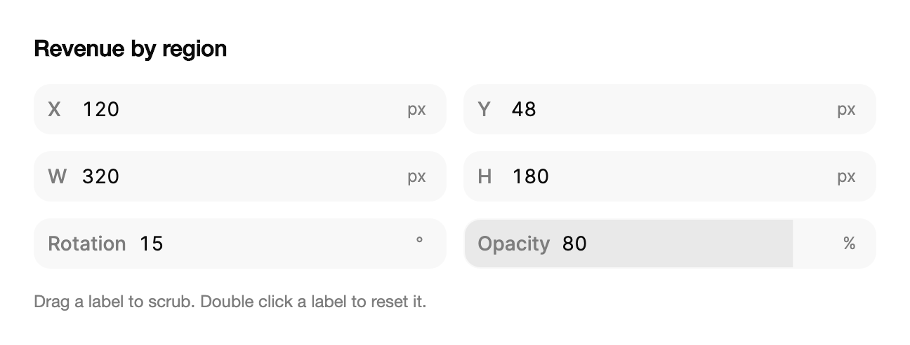

<Demo name="Inspector" />

## 何時使用

`ScrubInput` 是為屬性檢視器與屬性面板設計的精簡數字欄位。它的標籤兼作拖曳把手：使用者可以左右拖曳標籤來微調數值，也可以點選欄位輸入精確的數值。一組這樣的欄位讀起來就像設計工具的檢視器，因此適用於任何需要反覆調整、並憑視覺檢查一列數字的介面。

- **儀表板編輯器中的元件版面**：圖表卡片的 X、Y、W 與 H。設計師拖曳 W 查看網格的反應，然後輸入 `320` 使其對齊到網格單位。
- **報告或文件編輯器中的視覺設定**：不透明度、旋轉與縮放。拖曳可以快速回饋，輸入則能得到品牌規範要求的精確數值。
- **可由使用者更改單位的設定**：設計師以 `px`、`pt` 或 `em` 輸入描邊寬度。單位按鈕會在 `Units` 之間循環，輸入 `50%` 這類帶單位的值也會切換單位。
- **規則或門檻面板中的限值**：0 到 100 百分比之間的告警門檻，或最小為 1 秒的逾時時間。`Minimum` 與 `Maximum` 在使用者拖曳時保持數值在範圍內。
- **內部工具中的佈景主題與權杖編輯器**：間距、圓角與陰影的數值會立即改變預覽，`ValueChanged` 驅動預覽，`ValueCommitted` 寫入已保存的佈景主題。

## 何時不用

- **使用者用按鈕步進的表單數字**：用 `NumberField`，它帶有步進按鈕與限值提示，適用於結帳數量或席位數等場景。
- **位置比精確數字更重要的範圍取值**：用 `Slider`，例如音量或亮度控制。
- **貨幣金額**：用 `MoneyInput`，它負責貨幣符號、分組與金額取整。
- **表格中的大量數值**：用 `DataGrid` 呈現數字表格。`ScrubInput` 設計用於一個面板中的少量欄位，不適用於清單中的每個儲存格。
- **沒有數值意義的文字**：用 `Input`。`ScrubInput` 只接受數字、算術與單位。

## 用法

```xml
<UserControl xmlns="https://github.com/avaloniaui"
             xmlns:arc="https://github.com/AtomUICommunity/TKCode.Arc">
    <arc:ScrubInput Label="X" Value="120" Unit="px" />
</UserControl>
```

`ScrubInput` 衍生自 `TemplatedControl`，而不是文字方塊。控制項自行繪製外殼（背景、1 px 邊框、軌道與拉伸效果），並承載一個無邊框的文字編輯器用於輸入。因此拖曳、拉伸與抖動都發生在外殼上，而數字仍是普通的可編輯文字。標籤就是拖曳把手，因此可見的標籤也是控制項唯一的滑鼠操作把手。

### 結構

1. **標籤**（`Label`）：以 500 字重繪製的文字，或是一個控制項，例如 14 px 的 `ArcGlyph`。標籤寬度至少 30 px，前面留 10 px 內距，後面留 4 px。拖曳標籤即可調整數值，連按兩下則將數值還原為 `ResetValue`。
2. **外殼**：帶淡化表面色的外殼，1 px 邊框，中等尺寸下圓角為 12 px（小尺寸為 9 px）。`Medium` 時高 36 px，`Small` 時高 30 px。
3. **軌道**（`IsTrackVisible`）：一層輕柔的底色，前景色的 6%，依數值在兩個限值之間的比例填滿外殼。僅在兩個限值都是有限值時顯示，拖曳數值時會變亮。
4. **數字**（編輯器）：欄位顯示的數值，依有效精度取整。左側留 4 px 內距，取得焦點時全選其文字。
5. **單位**（`Unit`、`Units`）：數字之後的單位，間距 2 px。只有一個單位時顯示為普通文字。有多個單位時變為按鈕，循環切換各單位，圓角 6 px，懸停時出現前景色 7% 的底色。
6. **修飾鍵標籤**：拖曳過程中按住 Shift 時顯示 "×10"、按住 Alt 時顯示 "×0.1" 的 20 px 膠囊標籤，位於欄位上方約 6 px 處。只有按住修飾鍵時才顯示。

### 拖曳與輸入

在標籤上按下並水平移動 3 px 或以上即開始拖曳。每移動 `PixelsPerStep` 像素（預設 2）改變一個 `Step`。拖曳過程中數值跟隨指標，放開後提交。點選數字即可聚焦欄位並選取其文字。輸入時數值不會改變，直到按 Enter、欄位失去焦點或按方向鍵時才提交。

Shift 與 Alt 在拖曳中改變步進，標籤會顯示倍數。Escape 取消拖曳，並將數值還原為拖曳開始時的值。觸控同樣可用：水平拖曳調整數值，垂直觸碰則捲動父面板，因此很長的檢視器仍可用手指捲動。

### 限值與循環

`Minimum` 與 `Maximum` 定義範圍。預設值為負無窮與正無窮，即沒有限制。拖曳超過限值時，欄位最多會拉伸 12 px 並帶有阻力，放開後彈回。輸入或步進超過限值時，數值會被夾制到限值並提交；處於限值時的步進不會改變數值，並給出一個小的反彈。

`IsWrapping` 使數值從最大值循環回最小值，而不是停止。它需要兩個限值，並且最大值必須大於最小值。缺少任一有限限值時此設定無效，因此無界的欄位永遠不會循環。

```xml
<arc:ScrubInput Label="W" Value="320" Minimum="0" Unit="px" ResetValue="320" />
<arc:ScrubInput Label="O" Value="80" Minimum="0" Maximum="100" Unit="%" ResetValue="100" />
```

```csharp
var rotation = new ScrubInput
{
    Label = "R",
    Value = 15,
    Minimum = 0,
    Maximum = 360,
    IsWrapping = true,
    IsTrackVisible = false,
    Unit = "°",
    ResetValue = 0
};
```

`ResetValue` 是連按兩下標籤後還原的值。`IsTrackVisible` 預設在兩個限值都是有限值時顯示軌道；對於角度，0 到 360 的軌道意義不大，可將其設為 `False`。

### 步進與精度

`Step` 是每次方向鍵和每步拖曳的變化量，預設為 1。`FineStep`（按住 Alt）預設為 `Step` 的十分之一，`CoarseStep`（按住 Shift）預設為 `Step` 的十倍。粗步進落在粗網格上，因此按住 Shift 時從 13 步進會得到 20（步進為 10），而不是 23。

`Precision` 設定小數位數。未設定時，欄位保留 `Step` 與精細步進中較多的小數位，因此 `Step` 為 0.1 時保留兩位小數。顯示文字會去掉結尾的零，因此 1.5 顯示為 `1.5`。

```xml
<arc:ScrubInput Label="間距" Value="1.5" Step="0.1" Minimum="0" Unit="em" />
```

### 輸入語法

編輯器接受算術、數字後的單位，以及作為小數點的逗號。`ScrubExpression.Evaluate` 執行相同的語法，因此欄位與設定匯入對數值的意義保持一致。

| 輸入 | 結果 |
|---|---|
| `12*2`、`12 × 2`、`24/2`、`12+3-1` | 算術運算；`×`、`÷` 與 `−` 也可作為運算子 |
| `(100-24)/2` | 括號用於分組運算 |
| `1,5em` | `1.5`，單位為 `em`；逗號是小數點 |
| `50%` | `50`，單位為 `%`；若 `%` 在 `Units` 中，則切換到該單位 |
| `15deg`、`15°` | `15`，單位為角度，與 `°` 相同 |
| `abc`、`Units` 中沒有 `px` 時的 `12px`、`4/0` | 被拒絕：保留舊值，欄位將輸入標記為無效 |

單位不區分英文字母大小寫。單位不在單位清單中的輸入會被拒絕，結果不是有限值（例如除以零）時也會被拒絕。

### 多個單位

設定多個 `Units` 後，單位變為按鈕。點選會切換到下一個單位，數值保持不變。在輸入框中鍵入單位也會切換單位：在單位為 `px` 的欄位中輸入 `50%`，會把單位設為 `%`，數值設為 50。只有一個單位，或未設定 `Units` 的欄位，單位以普通文字顯示，單位按鈕不是 Tab 停駐點。

<Demo name="CyclingUnits" />

### 尺寸

`Size` 設定高度。`Small` 為 30 px，文字 12 px，圓角 9 px。`Medium` 為預設值：36 px，文字 14 px，圓角 12 px。`Large` 沒有自己的尺寸，渲染為 `Medium`。密集的檢視器欄使用 `Small`；與其他 36 px 控制項混用的表單或面板使用 `Medium`。

<Demo name="Sizes" />

### 繫結與事件

`Value` 與 `Unit` 是雙向的。`ValueChanged` 在每次變化時觸發，包括拖曳的每一步以及程式碼中的每次變化。`ValueCommitted` 在變化穩定後觸發：拖曳結束時、按 Enter 或失去焦點提交輸入時、按鍵步進落定時，或執行重設時。兩者都會回報舊值、新值、單位以及 `ChangeSource`。

`ChangeSource` 說明變化來自何處。`Programmatic` 標記由程式碼或繫結設定的值，它只觸發 `ValueChanged`，不提供回饋；`Scrub`、`Type`、`Key` 與 `Reset` 分別標記使用者改變數值的四種方式。保存數值的處理常式應使用 `ValueCommitted`，以免在拖曳的每一步都寫入。

<Demo name="Events" />

```xml
<arc:ScrubInput Label="不透明度" Value="{Binding Opacity, Mode=TwoWay}" Minimum="0" Maximum="100" Unit="%" />
```

```csharp
amount.ValueCommitted += (_, e) =>
{
    Console.WriteLine($"{e.OldValue} -> {e.NewValue} {e.Unit} ({e.ChangeSource})");
};
```

`ValueCommitted` 在提交未改變數值時也會觸發，例如被夾制到限值的輸入。若保存的成本較高，保存前請比較 `e.OldValue` 與 `e.NewValue`。

### 繫結到檢視模型

版面檢視器把每個欄位繫結到所選元件的一個屬性。檢視模型持有數值並負責保存，欄位負責顯示。範例使用 CommunityToolkit.Mvvm。

```csharp
public partial class WidgetLayoutViewModel : ObservableObject
{
    [ObservableProperty]
    private double _x = 120;

    [ObservableProperty]
    private double _width = 320;

    [ObservableProperty]
    private double _opacity = 80;

    [RelayCommand]
    private void ResetLayout()
    {
        X = 0;
        Width = 320;
        Opacity = 100;
    }
}
```

```xml
<StackPanel Spacing="12">
    <arc:ScrubInput Label="X"
                    Value="{Binding X, Mode=TwoWay}"
                    Unit="px" />
    <arc:ScrubInput Label="W"
                    Value="{Binding Width, Mode=TwoWay}"
                    Minimum="0"
                    Unit="px"
                    ResetValue="320" />
    <arc:ScrubInput Label="不透明度"
                    Value="{Binding Opacity, Mode=TwoWay}"
                    Minimum="0"
                    Maximum="100"
                    Unit="%"
                    ResetValue="100" />
</StackPanel>
```

`Value` 與 `Unit` 是雙向屬性。`ValueChanged` 與 `ValueCommitted` 是事件而不是命令，因此需要在程式碼後置或行為中連接，並在 `ValueCommitted` 中寫入已保存的文件。`Minimum`、`Maximum`、`Step` 與 `ResetValue` 是欄位的單向設定。

### 圖示標籤

14 px 的圖示可以代替文字標籤，使密集的面板保持平靜。圖示沒有可供輔助技術讀取的文字，因此請用 `AutomationProperties.Name` 為欄位設定無障礙名稱。連按兩下圖示仍會重設數值。

<Demo name="GlyphLabels" />

### 狀態

停用的欄位會淡化到 50% 並忽略輸入，因此不能被拖曳或輸入。無法讀取的輸入（例如 `abc`）會被拒絕：邊緣變為紅色 900 ms，並伴隨短暫的抖動，舊值保留。被拒絕的輸入是欄位唯一顯示錯誤的方式；欄位沒有訊息列，因此當有效範圍很重要時，請在面板旁邊放一條可見的提示。

<Demo name="States" />

### 範例：儀表板卡片檢視器

儀表板編輯器的版面面板，顯示所選卡片 "Revenue by region"。設計師拖曳 W 與 H 標籤來感受網格，並在品牌規範要求時輸入精確的尺寸。旋轉沒有軌道，因為 0 到 360 度的軌道意義不大。拖曳超過 0 或 100% 時，不透明度欄位會拉伸並回彈。卡片的數值是唯一的資料來源；面板在 `ValueCommitted` 時寫回。



```xml
<StackPanel Width="600" Spacing="16">
    <TextBlock Text="Revenue by region"
               FontSize="16"
               FontWeight="SemiBold"
               Foreground="{arc:ArcDesignTokenResource Foreground}" />
    <Grid ColumnDefinitions="*,*" RowDefinitions="Auto,Auto,Auto" ColumnSpacing="12" RowSpacing="12">
        <arc:ScrubInput Grid.Row="0" Grid.Column="0" Label="X" Value="120" Unit="px" />
        <arc:ScrubInput Grid.Row="0" Grid.Column="1" Label="Y" Value="48" Unit="px" />
        <arc:ScrubInput Grid.Row="1" Grid.Column="0" Label="W" Value="320" Minimum="0"
                        Unit="px" ResetValue="320" />
        <arc:ScrubInput Grid.Row="1" Grid.Column="1" Label="H" Value="180" Minimum="0"
                        Unit="px" ResetValue="180" />
        <arc:ScrubInput Grid.Row="2" Grid.Column="0" Label="Rotation" Value="15" Minimum="0"
                        Maximum="360" IsWrapping="True" IsTrackVisible="False" Unit="°"
                        ResetValue="0" />
        <arc:ScrubInput Grid.Row="2" Grid.Column="1" Label="Opacity" Value="80" Minimum="0"
                        Maximum="100" Unit="%" ResetValue="100" />
    </Grid>
    <TextBlock Text="Drag a label to scrub. Double click a label to reset it."
               FontSize="12"
               Foreground="{arc:ArcDesignTokenResource TextMuted}" />
</StackPanel>
```

### 文案規範

- **標籤**：密集面板中用簡短的軸或屬性名（"X"、"W"、"旋轉"、"不透明度"），表單中用完整的詞（"不透明度"，而不是縮寫）。單位放在 `Unit` 中，絕不寫在標籤裡。
- **單位**：數值的度量單位：`px`、`%`、`em`、`°`。在密集的列中使用符號，而不是文字。
- **限值**：將 `Minimum` 與 `Maximum` 設為實體或業務上的限制，使拖曳不能越過產品拒絕的數值。只有在數值沒有自然邊界時才留空。
- **說明文字**：`ScrubInput` 沒有訊息列。應在附近的標籤、標題或面板的工具提示中說明有效範圍，例如 "不透明度 0 到 100 百分比"。

| 不要寫 | 改為 |
|---|---|
| 標籤 "Width (px)"，單位 "px" | 標籤 "W"，單位 "px" |
| 標籤 "Opacity %" | 標籤 "Opacity"，單位 "%" |
| 標籤 "Rot" | 標籤 "Rotation"，單位 "°" |
| 單位 "pixels" | 單位 "px" |

### 最佳做法

**建議**

- 為每個有預設值的欄位設定 `ResetValue`。連按兩下即可把設計還原為預設值，比選單更快，也符合設計工具使用者的習慣。
- 從 `ValueCommitted` 保存，而不是從 `ValueChanged`。拖曳會在每一步觸發 `ValueChanged`，在每一步都保存會每秒寫入文件數十次。
- 將 `Step` 設為產品使用的粒度，例如版面用 1 px、排版用 0.1 em。精細與粗步進由它推導。
- 欄位寬度與面板的欄寬保持一致，密集的檢視器欄使用 `Size="Small"`。

**避免**

- 用於貨幣。拖曳得到的金額沒有取整規則，而 `MoneyInput` 會依地區設定格式化貨幣、分組與小數。
- 只靠拖曳來設定使用者必須精確到達的值。輸入是精確的途徑，應保持欄位可編輯。
- 在長表格中放置大量 `ScrubInput`。每個欄位都是帶有自己指標追蹤的範本；數字的列請使用 `DataGrid`。
- 在沒有有限限值時設定 `IsWrapping`。循環需要同時設定 `Minimum` 與 `Maximum`，否則該設定沒有任何作用。
- 透過停用欄位來表示錯誤。停用的欄位會變暗並忽略輸入；被拒絕的輸入才是錯誤訊號。

### 常見問題

**為什麼我輸入的數值跳回了舊值？** 輸入被拒絕了。未知單位、格式錯誤的運算式或除以零會保留舊值，將 `IsInvalid` 設為 900 ms，並使欄位抖動。超出限值的值不會被拒絕；它會被夾制到限值並提交。

**步進為 0.1 時，為什麼輸入的 `1.5` 顯示為 `1.5`？** 沒有設定 `Precision`，因此欄位保留 `Step` 與精細步進（`Step` 的十分之一）中較多的小數位。結尾的零會被去掉。設定 `Precision` 可為所有數值固定小數位數。

**如何從程式碼更改單位？** 將 `Unit` 設為一個字串。如果使用者可以循環或鍵入該單位，也要把它放進 `Units`，使單位按鈕與輸入框都接受它。`Unit` 的變化是雙向的，因此繫結會收到它。

**支援觸控嗎？** 支援。水平觸控拖曳會調整數值，垂直觸碰會捲動父面板，因此很長的檢視器仍可用手指捲動。

**可以不用標籤嗎？** 可以，透過圖示標籤實現，圖示標籤可以是任何控制項。`Label` 是 `object`，因此 `ArcGlyph` 可以使用。請為欄位設定 `AutomationProperties.Name`，因為圖示沒有可供輔助技術讀取的文字。

## API 參考

<!-- api: ScrubInput -->

配套型別。`ScrubInputChangeSource` 是事件參數中的 `ChangeSource`：

| 成員 | 含義 |
|---|---|
| `Programmatic` | 由程式碼或繫結設定的 `Value`；只觸發 `ValueChanged` |
| `Scrub` | 在標籤上拖曳；也包括按 Escape 取消的拖曳 |
| `Type` | 用 Enter、失去焦點、方向鍵或輔助技術提交的輸入 |
| `Key` | ArrowUp 或 ArrowDown 步進 |
| `Reset` | 連按兩下標籤，還原為 `ResetValue` |

`ScrubInputValueChangedEventArgs` 是 `ValueChanged` 與 `ValueCommitted` 的參數：

| 成員 | 含義 |
|---|---|
| `OldValue` | 變化前的值；拖曳後 `ValueCommitted` 回報拖曳開始時的值 |
| `NewValue` | 變化後的值 |
| `ChangeSource` | 產生變化的 `ScrubInputChangeSource` |
| `Unit` | 變化後生效的單位；欄位沒有單位時為 `""` |

`ScrubExpression.Evaluate(text, units)` 為公開方法，回傳 `ScrubExpressionResult`（`Value`、`Unit`），被拒絕的輸入回傳 `null`。在匯入或命令列中讀取輸入的值時使用它，其規則與欄位相同。

## 無障礙

- 數字是微調按鈕。其無障礙名稱為標籤，其值文字會朗讀帶單位的數值（例如 "50 percent" 或 "90 degrees"），並以範圍形式公開最小值、最大值與目前值。
- 標籤是真正的標籤：點選會聚焦欄位並選取其數字。若標籤是圖示，則需要 `AutomationProperties.Name`。
- 無效輸入會在短時間內將欄位設為無效狀態，並保留舊值。該訊息會被播報。
- 單位按鈕的名稱為 "Unit: <unit>. Change unit"，只有存在多個單位時才是 Tab 停駐點。
- 透過範圍提供程式設定數值時，與輸入一樣會被夾制到限值。

### 鍵盤

欄位本身不是焦點目標：數字編輯器取得焦點，標籤僅是指標把手。

| 按鍵 | 操作 |
|---|---|
| `Tab` / `Shift+Tab` | 將焦點移到數字；有多個單位時也會移到單位按鈕 |
| 點選數字 | 聚焦並選取其文字 |
| `ArrowUp` / `ArrowDown` | 按 `Step` 步進數值；若有未提交的輸入，先提交 |
| `Shift` + `ArrowUp` / `ArrowDown` | 按 `CoarseStep` 步進，落在粗網格上 |
| `Alt` + `ArrowUp` / `ArrowDown` | 按 `FineStep` 步進 |
| `Enter` | 提交輸入，並選取全部文字 |
| `Escape`（輸入未提交時） | 將輸入還原為上一次的值，並全選 |
| `Escape`（拖曳中） | 取消拖曳，並將數值還原為拖曳開始時的值 |
| 焦點離開數字 | 提交未完成的輸入 |
| 拖曳中按住 `Shift` 或 `Alt` | 立即切換步進，並顯示倍數標籤 |
| 連按兩下標籤 | 將數值還原為 `ResetValue` |

## 動態效果

- 超過限值時，欄位帶阻力拉伸，放開後彈回。數字隨拉伸傾斜。
- 無效輸入或處於限值的步進會使欄位抖動一次。
- 單位變更時帶著輕微模糊升起。拖曳時軌道填滿跟隨指標；輸入或步進時，則滑動到新值。

| 變化 | 完整 | 減少 | 關閉 |
|---|---|---|---|
| 超過限值拖曳 | 欄位拉伸至多 12 px，放開後彈回 | 不拉伸 | 立即完成 |
| 被拒絕的輸入或處於限值的步進 | 欄位抖動一次；邊緣紅色保持 900 ms | 不抖動；紅色邊緣仍顯示 900 ms | 立即完成；紅色邊緣顯示 900 ms |
| 單位變更 | 單位帶著輕微模糊升起 | 單位原地淡入 | 立即完成 |
| 軌道填滿 | 拖曳時跟隨指標；輸入或步進時滑動到新值 | 跳到新值 | 立即完成 |

## 相關元件

- `NumberField`：帶步進按鈕與限值提示的表單數字。
- `Slider`：範圍上的位置比精確數值更重要時使用。
- `MoneyInput`：貨幣數值。
- `Input`：自由文字；`DataGrid`：數字表格。

| 元件 | 適用情境 |
|---|---|
| `NumberField` | 數值是使用者透過按鈕步進的表單值，例如數量 |
| `Slider` | 使用者在範圍上選擇一個位置，精確數值沒那麼重要 |
| `MoneyInput` | 值是帶貨幣與取整規則的金額 |
| `DataGrid` | 數字是表格中的列與欄，而不是面板中的幾個欄位 |
| `Input` | 值是沒有數字意義的文字 |
