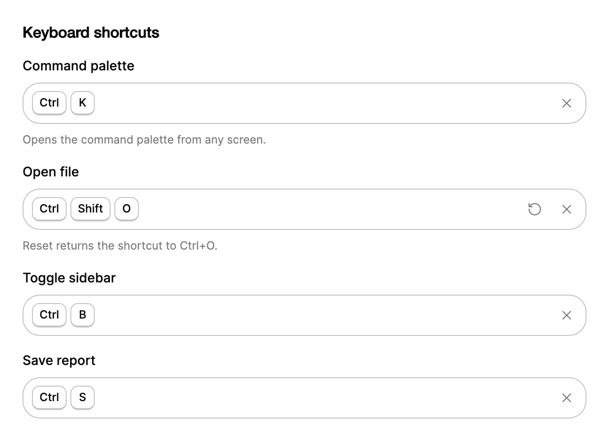

<Demo name="Default" />

## 何时使用

`ShortcutRecorder` 让使用者通过按下组合键来设置快捷键，而不必输入按键名称。它放在设置页中，与其他偏好设置并列，并以符合当前平台的键帽显示结果。在字段背后，它会把组合键与应用已在使用的快捷键，以及浏览器和操作系统保留的组合键进行比对，因此重新映射不会悄悄破坏某个命令。

- **生产力应用中的快捷键设置**：使用者把“打开文件”从 Ctrl+O 改为 Ctrl+Shift+O。录入器会记录该组合键；如果 Ctrl+Shift+O 已被“导出报告”占用，它会发出警告，并把结果保存为 `KeyGesture`。
- **开发者工具或 IDE 中的键位映射**：终端、编辑器或查询控制台中，使用者重新绑定“运行查询”或“注释行”。`Bindings` 保存应用当前的映射，因此每个冲突都会在录入时被发现。
- **显示实时绑定的帮助对话框与速查表**：命令旁的快捷键文字来自已保存的 `Value`，因此重新映射后的快捷键在各处都会显示新的按键。
- **键盘优先的管理控制台**：调度或客服工具中，坐席用快捷键进行分诊。录入器让主管无需借助编辑器中的按键名称，就能修改这些快捷键。
- **偏好设置页中恢复默认值**：`ResetValue` 是默认快捷键，值不同时，重置按钮会把字段恢复为它。

## 何时不用

- **只用于展示、不可修改的固定快捷键**：用自己的文字或键帽控件显示它，因为没有人会重新映射它。
- **按名称执行操作**：使用 `Blocks` 与命令类组件中的命令面板模式，它按操作名称查找，不依赖按键组合。
- **仅触屏的产品**：没有可录入的物理键盘，点击也永远不会产生组合键。
- **没有按键语义的文本值**：使用 `Input`，例如宏名称、标签或关于快捷键的备注。
- **使用者在搜索框中输入的自由文字**：使用 `SearchField`；录入器接收的是整个组合键，不编辑文字。

## 用法

```xml
<UserControl xmlns="https://github.com/avaloniaui"
             xmlns:arc="https://github.com/AIDotNet/TKCode.Arc">
    <arc:ShortcutRecorder Label="命令面板"
                          Description="在应用的任何位置打开命令面板。" />
</UserControl>
```

点击字段或按 Enter，然后按下组合键。录入器会保存一个 `KeyGesture`，并将它绘制为键帽。

`ShortcutRecorder` 派生自 `TemplatedControl`。它的外框是 Arc 字段外框，与 `Input` 相同；其中的录入区域是一个按钮，自行绘制键帽、录入指示灯与占位文字。因此，录入器是带有字段标签、外框与消息行的值编辑器，同时具备切换按钮的录入行为。

### 结构

1. **标签**（`Label`）：字段名称，位于外框上方。`IsLabelVisible="False"` 会将其隐藏，但辅助技术仍会朗读它。
2. **外框**：中等控件高度（默认主题下为 44 px）的 Arc 字段外框。悬停与焦点时，外框以前景色描边。录入时，录入区域带有 4% 的强调色底色；发生冲突时使用警告色边缘。
3. **录入区域**：填满整行，右侧内边距 6 px，左侧 9 px。它是获得焦点并开始录入的元素。
4. **键帽**：快捷键的每个按键对应一个键帽，最小尺寸 26 × 26 px，圆角 8 px，键帽之间间距 4 px。在 Mac 上，键帽显示图形符号（⌃ ⌥ ⇧ ⌘）；其他平台显示名称（Ctrl、Alt、Shift）。
5. **录入指示灯与占位文字**：录入时，在 `RecordingPlaceholder`（默认为“按下按键”）旁显示一个 7 px 的圆点。没有快捷键时显示 `Placeholder`（“录入快捷键”）。
6. **清除按钮**（`ClearText`，“清除快捷键”）：32 px 的方形按钮，内含 16 px 图标。设置了快捷键且未在录入时显示。
7. **重置按钮**：32 px 的方形按钮，图标相同。值与 `ResetValue` 不同时显示，点击后恢复为 `ResetValue`。
8. **消息行**：外框下方 12 px 的文案。一次只显示一条消息，顺序如下：冲突（带 6 px 警告圆点，以及 `UseAnywayText` 和 `CancelText` 两个链接）、修饰键提示、录入提示（“按 Esc 取消，按 Backspace 清除”），最后是 `Description`。

### 值与重置

`Value` 是录入到的 `KeyGesture`；没有快捷键时为 `null`。它是双向的。`ResetValue` 是重置按钮恢复的值。Avalonia 没有默认值，因此除非你设置，否则 `ResetValue` 为 `null`；值已设置而重置值为 `null` 的字段，其重置按钮显示为“重置为无”。

<Demo name="Empty" />

```csharp
var palette = new ShortcutRecorder
{
    Label = "命令面板",
    Value = ShortcutFormatter.Parse("mod+k", ShortcutPlatform.Other),
    ResetValue = ShortcutFormatter.Parse("mod+k", ShortcutPlatform.Other)
};
```

`mod` 在 macOS 上表示 Command，在其他平台上表示 Control。使用 `ShortcutFormatter.Parse` 从这段文字创建手势；当文字来自设置文件且可能无效时，改用 `ShortcutFormatter.TryParse`。对于不是恰好包含一个按键的快捷键文字，`Parse` 会抛出 `FormatException`。

### 已知快捷键与冲突

`Bindings` 列出应用已在使用的快捷键，每项都是一个带有 `Gesture` 和 `Label` 的 `ShortcutBinding` 对象。录入其中某个快捷键时，会显示冲突，并提供两个真实按钮：仍然使用和取消。“仍然使用”会采用该快捷键，并在 `ValueChanged` 中报告其来源的绑定，因此应用可以从自己的映射中移除该绑定。“取消”则保留之前的快捷键。

<Demo name="Conflicts" />

保留组合键同样会发出警告，例如用于关闭标签页的 Ctrl+W、新建标签页的 Ctrl+T、复制与粘贴的 Ctrl+C 和 Ctrl+V、撤销的 Ctrl+Z，以及全选的 Ctrl+A。它们在 `Bindings` 之后检查。若保留组合键已被占用，使用者选择“仍然使用”，报告的被替换绑定为空，因为应用中没有任何东西拥有它。只有当应用确实拥有这些组合键，且警告只会造成干扰时，才将 `IsReservedWarningEnabled` 设为 `False`。

<Demo name="Reserved" />

### 修饰键与平台

`IsModifierRequired` 默认为 `True`：单独的字母不是快捷键，因此录入器会显示提示“请包含 Ctrl 或 Alt”（在 Mac 上为“请包含 ⌘、⌃ 或 ⌥”），并等待修饰键。功能键始终允许。对于单键快捷键，例如“?”帮助键，或用于切换视图的数字键，将其设为 `False`。

`Platform` 设置键帽样式以及 `mod` 的含义：`ShortcutPlatform.Mac` 显示图形符号，并以 Command 作为 `mod`；`ShortcutPlatform.Other` 显示名称，并以 Control 作为 `mod`。保持为 `null` 时会检测正在运行的平台，这正是桌面应用通常需要的。若设置页必须在每台机器上显示相同的键帽，或用于截图，则应显式设置它。

<Demo name="NoModifier" />

<Demo name="Platforms" />

### 事件

`ValueChanged` 在 `Value` 变化时引发：录入了快捷键、清除了快捷键、重置，或从代码设置了值。它的参数包含旧的与新的 `KeyGesture`，以及 `Replaced` 绑定。`Replaced` 保存“仍然使用”所取自的那个绑定，在其他所有变化中为 `null`。

<Demo name="Events" />

```csharp
recorder.ValueChanged += (_, e) =>
{
    var replaced = e.Replaced is { } binding ? $" (replaced {binding.Label})" : string.Empty;
    Console.WriteLine($"{e.OldValue} -> {e.NewValue}{replaced}");
};
```

### 绑定到视图模型

设置页的视图模型拥有快捷键映射。每一行将 `Value` 双向绑定到自己的手势，而录入器的 `Bindings` 列表则是映射中的其他快捷键。示例使用 CommunityToolkit.Mvvm。

```csharp
public partial class ShortcutSettingsViewModel : ObservableObject
{
    public ShortcutSettingsViewModel()
    {
        Shortcuts.Add(new ShortcutBinding(ShortcutFormatter.Parse("ctrl+p", ShortcutPlatform.Other), "快速打开"));
        Shortcuts.Add(new ShortcutBinding(ShortcutFormatter.Parse("ctrl+s", ShortcutPlatform.Other), "保存"));
    }

    public ObservableCollection<ShortcutBinding> Shortcuts { get; } = new();

    [ObservableProperty]
    private KeyGesture? _openFile = ShortcutFormatter.Parse("ctrl+o", ShortcutPlatform.Other);

    [RelayCommand]
    private void ResetOpenFile() => OpenFile = ShortcutFormatter.Parse("ctrl+o", ShortcutPlatform.Other);
}
```

```xml
<arc:ShortcutRecorder Label="打开文件"
                      Value="{Binding OpenFile, Mode=TwoWay}"
                      Bindings="{Binding Shortcuts}"
                      ResetValue="Ctrl+O"
                      Platform="Other" />
```

`Value` 是双向的。`Bindings` 是字段在使用者录入时读取的列表，因此应将它绑定到应用所用的映射。`ValueChanged` 是事件，当应用必须从自己的映射中移除被替换的绑定时，在代码后置中连接它。`IsRecording` 是只读的，`StartRecording()` 与 `StopRecording()` 用于从代码启动和停止录入器。

### 隐藏标签

`IsLabelVisible="False"` 只为屏幕阅读器保留标签。在表格行或列表中，若该行已经为操作命名，可以使用它，无障碍一节对此有说明。

<Demo name="HiddenLabel" />

### 说明

`Description` 是字段下方的辅助文字。在录入提示、修饰键提示或冲突生效时，它们会取代该位置，因此当其他内容都不需要这一行时，说明即描述该快捷键。

<Demo name="Description" />

### 禁用

禁用的录入器会在弱化的表面色上淡化显示，不会录入，也不会获得焦点。

<Demo name="Disabled" />

### 示例：设置页中的键盘快捷键

一个桌面生产力应用的偏好设置页。每一行以句首大写的形式命名一个操作，录入器显示当前的快捷键。“打开文件”已从 Ctrl+O 改为 Ctrl+Shift+O，因此它的重置按钮可见，点击即可恢复默认值。第一行的说明解释了该快捷键的作用，平台固定为“Other”，因此截图在任何机器上都显示 Ctrl 名称。



```xml
<StackPanel Width="600" Spacing="16">
    <TextBlock Text="Keyboard shortcuts"
               FontSize="16"
               FontWeight="SemiBold"
               Foreground="{arc:ArcDesignTokenResource Foreground}" />
    <arc:ShortcutRecorder Label="Command palette"
                          Platform="Other"
                          Value="Ctrl+K"
                          ResetValue="Ctrl+K"
                          Description="Opens the command palette from any screen." />
    <arc:ShortcutRecorder Label="Open file"
                          Platform="Other"
                          Value="Ctrl+Shift+O"
                          ResetValue="Ctrl+O"
                          Description="Reset returns the shortcut to Ctrl+O." />
    <arc:ShortcutRecorder Label="Toggle sidebar"
                          Platform="Other"
                          Value="Ctrl+B"
                          ResetValue="Ctrl+B" />
    <arc:ShortcutRecorder Label="Save report"
                          Platform="Other"
                          Value="Ctrl+S"
                          ResetValue="Ctrl+S" />
</StackPanel>
```

### 文案规范

- **标签**：该快捷键所执行的操作，使用句首大写的简短名词短语：“命令面板”“打开文件”“切换侧边栏”。绝不要用按键作为标签：当值变化时，标签为“Ctrl+O”对使用者毫无意义。
- **说明**：一句话说明该快捷键的作用，或它与什么冲突，例如“在任何页面打开命令面板。”。这句话对每个默认值都必须成立；其余内容由冲突消息补充。
- **冲突文案**：由录入器根据绑定的标签生成。点名该快捷键已经执行的操作，并让两个选项使用相同的术语：“仍然使用”和“取消”。
- **提示**：快捷键需要修饰键，因此提示应点名需要添加的修饰键。不要写泛泛的错误信息。

| 不要写 | 改为 |
|---|---|
| Keybinding | 快捷键 |
| Ctrl+O（作为标签） | 打开文件 |
| Shortcut invalid | 请包含 Ctrl 或 Alt |
| Shortcut already taken | Ctrl+K 已被命令面板使用。仍然使用，或录入另一个。 |
| Set key | 录入快捷键（默认占位文字，请保留） |

### 最佳实践

**推荐**

- 在 `Bindings` 中传入应用当前的映射。只有字段知道的快捷键才会被检测为冲突，因此空列表会让所有冲突都不可见。
- 为每个有默认值的字段设置 `ResetValue`。没有它，重置按钮会显示“重置为无”，且不会恢复任何有用的内容。
- 处理 `ValueChanged`，当“仍然使用”采用某个快捷键时，从应用自己的映射中移除 `Replaced`。录入器不会替你解除另一个操作的绑定。
- 用 `ShortcutFormatter.Matches` 在窗口的按键处理中匹配快捷键。录入器记录的是 `KeyGesture`，而 `Matches` 按物理按键与精确的修饰键进行比较，因此同一手势执行同一操作。

**避免**

- 用于仅触屏的界面，因为无法按下任何组合键。这些界面应改用其他控件。
- 在普通桌面应用中关闭 `IsReservedWarningEnabled`。该警告能阻止重新映射破坏复制、粘贴或关闭，这些操作在其他应用中都被广泛依赖。
- 把快捷键作为触达某个命令的唯一途径。同时把命令放入菜单或命令面板，使其可以被发现。
- 在开启 `IsModifierRequired` 的快捷键字段中录入单独的字母。提示会拒绝它，而且单个字母会在使用者向任何文本字段输入时被触发。

### 常见问题

**为什么录入器看不到 Tab 或 Alt+Tab？** Tab 永远不会被录入：它会停止录入并移动焦点。操作系统保留的组合键（Alt+Tab、Ctrl+Alt+Delete、大多数 Windows 组合键以及 macOS 截图快捷键）永远不会到达应用，因此无法被录入。

**如何执行快捷键绑定的操作？** 在窗口的 `KeyDown` 处理程序中，使用保存的手势调用 `ShortcutFormatter.Matches(e, gesture, platform)`。当物理按键与精确的修饰键都匹配时，它返回 `true`。

**为什么没有重置按钮？** 当值与 `ResetValue` 不同时，重置按钮才会显示。若两者都为 `null`，就没有可以恢复的内容，因此不显示按钮。将 `ResetValue` 设为默认快捷键即可显示它。

**在代码中设置值会引发 `ValueChanged` 吗？** 会。录入、清除、重置的值，以及从代码或绑定设置的值，都会引发该事件。如果保存只应在使用者的操作时进行，请在处理程序中比较新旧手势。

## API 参考

<!-- api: ShortcutRecorder -->

配套类型。`ShortcutPlatform` 设置键帽样式以及 `mod` 的含义：

| 成员 | 含义 |
|---|---|
| `Mac` | Apple 键盘：⌃ ⌥ ⇧ ⌘ 图形符号，`mod` 为 Command |
| `Other` | Windows 与 Linux 键盘：显示 Ctrl、Alt、Shift 和 Win 名称，`mod` 为 Control |

`ShortcutBinding` 是 `Bindings` 的一项。它有供 XAML 使用的无参构造函数，以及接收手势与标签的构造函数。它的 `Gesture` 是一个 `KeyGesture`，`Label` 是冲突消息中显示的操作名称。

`ShortcutRecorderValueChangedEventArgs` 是 `ValueChanged` 的参数：

| 成员 | 含义 |
|---|---|
| `OldValue` | 之前的快捷键，没有时为 `null` |
| `NewValue` | 新的快捷键，被清除时为 `null` |
| `Replaced` | 在“仍然使用”之后，该快捷键所取自的绑定；在其他所有变化中为 `null`，包括保留快捷键 |

`ShortcutFormatter` 是录入器使用的静态辅助类。它是公开的，以便应用使用相同的规则显示与匹配手势：

| 成员 | 含义 |
|---|---|
| `CurrentPlatform` | 进程所在的平台：在 macOS 与 iOS 上为 `Mac` |
| `Format(gesture, platform)` | 文字（Mac 上为 “⌘⇧K”，其他平台为 “Ctrl+Shift+K”）以及朗读形式（“Command Shift K”） |
| `Tokens(gesture, platform)` | 按显示顺序排列的键帽，每个都带有标签、标识和朗读名称 |
| `Matches(e, gesture, platform)` | 当按键事件与手势的物理按键和精确修饰键一致时返回 `true` |
| `FromKeyEvent(e)` | 将按下的按键读取为快捷键；仅按下修饰键时返回 `null` |
| `Parse(text, platform)` | 解析 “mod+shift+k”“alt+f4” 或 “ctrl+/”；对无效快捷键抛出 `FormatException` |
| `TryParse(text, platform, out gesture)` | 相同的解析，但不抛出异常 |

## 无障碍

- 录入器是一个切换按钮，以其标签和朗读形式的快捷键命名，例如“命令面板 Command Shift K”。录入时它处于按下状态，其帮助文本即为消息行。
- 录入、结果、冲突和清除都会通过实时区域礼貌地播报。播报使用与消息行相同的文字。
- 录入器内的键帽对辅助技术隐藏，朗读名称改由按钮提供。
- 重置与清除按钮分别命名为“重置为 <快捷键>”（或“重置为无”）和“清除快捷键”。
- 录入时，组合键归录入器所有，因此窗口快捷键不会被触发。
- `IsLabelVisible="False"` 会隐藏标签，但标签仍会为辅助技术命名录入器。

### 键盘

| 按键 | 操作 |
|---|---|
| 录入器上的 `Enter` 或 `Space` | 开始录入 |
| 录入时按下组合键 | 从物理按键录入组合键；`Alt+K` 录入的是 K，而不是输入的符号 |
| 录入时按 `Escape` | 取消，之前的快捷键保持不变 |
| 录入时按 `Backspace` 或 `Delete` | 清除快捷键 |
| 录入器上未在录入时按 `Backspace` 或 `Delete` | 设置了快捷键时，清除快捷键 |
| 录入时按 `Tab` | 停止录入并移动焦点，不录入 Tab |
| 焦点离开录入器 | 停止录入，并清除提示 |
| 没有修饰键的单个字母 | 显示提示并继续录入；功能键无需修饰键即可录入 |
| 用 `Tab` 进入冲突提示 | 依次到达“仍然使用”和“取消”；两者都会将焦点返回录入器 |

## 动态效果

- 键帽以小幅缩放和模糊弹入。组合键完整后，键帽依次落定，每个间隔 35 ms。
- 组合键变化时，键帽滑动到新位置。
- 录入时录入指示灯会脉动。消息行以高度弹簧展开和收起。
- 减弱动态效果时会去掉缩放、错峰与滑动。键帽和消息只做淡入淡出，录入指示灯停止脉动。关闭动态效果时立即到达最终状态。

| 变化 | 完整 | 减弱 | 关闭 |
|---|---|---|---|
| 录入时键帽出现 | 以小幅缩放和模糊弹入 | 短暂淡入 | 立即完成 |
| 组合键完成 | 键帽依次落定，每个间隔 35 ms | 短暂淡入 | 立即完成 |
| 组合键变化 | 键帽以灵敏的弹簧滑动到新位置 | 短暂淡入 | 立即完成 |
| 录入指示灯 | 录入时脉动 | 保持稳定，不脉动 | 保持稳定 |
| 消息行变化 | 以高度弹簧展开和收起；新文字带着柔和模糊升起 | 短暂淡入 | 立即完成 |

## 相关组件

- `Input` 用于不是快捷键的自由文本。
- `Button` 用于快捷键所触发的命令。
- `Field` 与 `FieldFrame` 用于搭配自定义编辑器构建类似的字段。
- `SearchField` 用于筛选列表的文字输入。

| 组件 | 适用场景 |
|---|---|
| `ShortcutRecorder` | 使用者通过按下按键设置快捷键，并需要冲突检查 |
| `Input` | 值是文本，例如宏名称或备注 |
| `SearchField` | 使用者输入文字以筛选列表或菜单 |
| `Button` | 快捷键执行一个命令，而该命令需要自己的控件 |
| `Field` + `FieldFrame` | 你要构建自己的编辑器，并希望拥有相同的标签、外框与消息行 |
