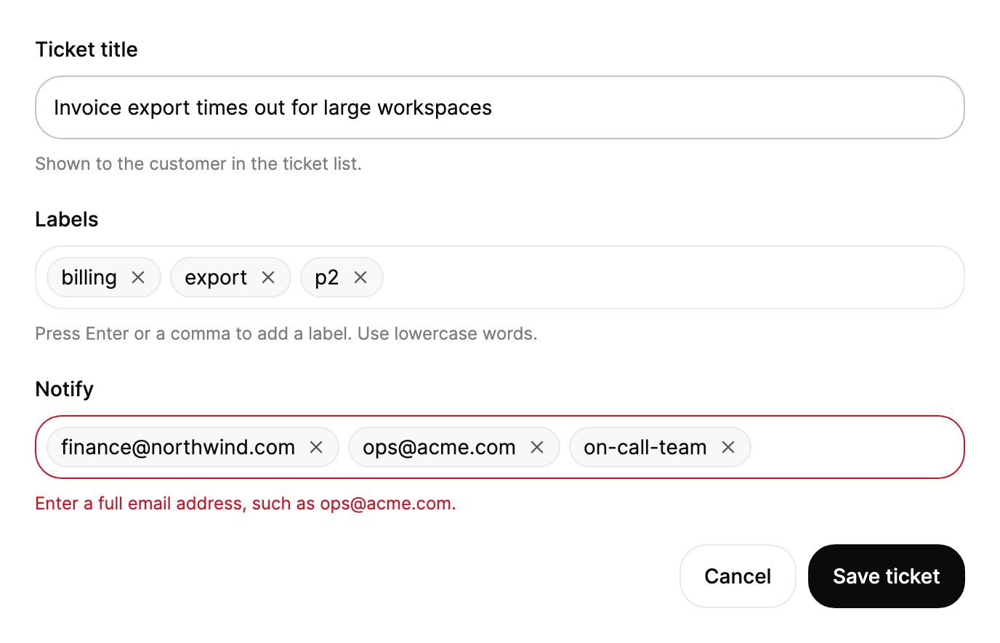

<Demo name="Default" />

## 何时使用

`TagInput` 把人输入的简短值转换为一个表单字段内可移除的标签。它适用于用户需要逐个建立简短字符串列表、并且要同时看到每一项的表单：支持工单上的标签、定时报告的收件人、允许登录工作区的域名。字段自己绘制标签、辅助文字和错误行，因此列表与周围的输入框一样，是一个完整的表单控件。

- **支持工单或 CRM 联系人上的标签**：客服输入 `billing`，按下 Enter，再输入 `refund`。标签是自由文本，因此标签集合会随团队的用语增长，而不必等管理员修改列表。
- **定时报告的收件人**：财务负责人逐个添加 `cfo@northwind.com` 等地址，或粘贴从电子表格复制的一列。粘贴的逗号、换行和制表符都会拆分为标签，每个地址在报告保存前都清晰可见。
- **单点登录设置中允许的域名**：管理员输入 `acme.com` 和 `acme.co.uk`。每个域名都以独立标签显示在屏幕上，因此缺失或拼错的域名在表单保存前很容易发现。
- **知识库文章或商品列表中的关键词**：作者添加多个搜索词。重复的词会在忽略大小写的情况下被拒绝，因此 Refund 与 refund 不能同时保存。
- **方案表单中有数量上限的列表**：包含五项集成的方案设置 `MaxTags="5"`。第六次添加会被拒绝，并伴随抖动与提示，因此上限在用户操作的地方就得到了说明。

## 何时不用

- **从现有目录中选取的值**：角色、方案、仓库或地区等已经作为记录存在的内容：用 `MultiSelect`（从列表中选择），列表很长并需要搜索时用 `Combobox`。
- **结果页面上的分面筛选**：几个用于收窄表格或动态列表的开关：用 `ChipGroup`，它专为在筛选分面中选择而设计。
- **单个值**：一个邮箱地址、一个名称或一个 URL：用 `Input`。只有一个标签的标签字段比单个输入框更难阅读和校验。
- **金额与数量**：价格、重量或计数的列表需要解析和格式化：用 `MoneyInput` 或 `NumberField`。`TagInput` 存储的是普通字符串，不做任何解析。
- **连续文本中的提及**：评论或消息中的 @人员和 #频道引用：用 `MentionInput`，它会把每个提及保持为句子中的一个词元。
- **多行文字**：备注、描述或粘贴的段落：用 `Textarea`。

## 用法

```xml
<UserControl xmlns="https://github.com/avaloniaui"
             xmlns:arc="https://github.com/AtomUICommunity/TKCode.Arc">
    <arc:TagInput Label="标签"
                  Placeholder="添加一个标签"
                  Description="按 Enter 或输入逗号即可添加标签。" />
</UserControl>
```

`TagInput` 派生自 Avalonia 的 `TemplatedControl`。它的外框是其他 Arc 字段共用的 `Field` 与 `FieldFrame`，因此标签、消息行、焦点光晕和无效边框都与 `Input` 一致。外框内，标签与无边框的文本编辑器排列在可换行的行中。编辑器是一个文本框，因此光标、选区、输入法和剪贴板的行为与 `Input` 相同；此控件额外为标签添加了 Enter、逗号、Backspace 和方向键的处理。

### 结构

1. **标签**（`Label`）：字段标签，样式与 `Input` 相同（14 px、中等字重，位于外框上方 8 px）。它同时是编辑器的无障碍名称。只有当可见的标题已经为字段命名时，才用 `IsLabelVisible="False"` 将其隐藏。
2. **外框**（`FieldFrame`）：表面色背景上 1 px 的边框，颜色为边框色。只有在字段未获得焦点且没有错误时，悬停才会加深边框。获得焦点时显示 3 px 的焦点光晕。出现错误（`ErrorMessage` 或 `IsInvalid`）时，边框变为危险色。外框的最小高度为 44 px，可容纳一行标签。
3. **内容**：四周 7 px 内边距，标签、编辑器和换行之间的间距为 6 px。每多一行，高度增加 34 px。高度以平滑弹簧跟随行数变化。
4. **标签**（`Value` 的一项）：至少 28 px 高，标签文字前 9 px、后 4 px 的内边距，位于 1 px 的胶囊形边框内，背景为弱化的表面色。标签文字使用小字号的正文字体和前景色，与删除按钮之间留 3 px 间距。宽于字段的标签会以省略号截断。
5. **删除按钮**：22 px 的圆形按钮，中间是 14 px 的 X 图形，线宽 2 px，颜色为次要文字色。悬停时背景变为表面色。键盘焦点会在圆圈内绘制 1.5 px 的焦点环。按下时缩小到 96%。
6. **编辑器**（草稿）：占据该行剩余的空间。最小宽度为 80 px，以 100 px 作为基准宽度，高度 28 px，水平内边距 5 px。当一行剩余不足 100 px 时，编辑器移到下一行。
7. **占位文字**（`Placeholder`）：默认为“添加一个标签”，以弱化的文字颜色、12 px 的内缩显示。仅当没有标签且草稿为空时才显示。
8. **辅助文字**（`Description`）与**错误行**（`ErrorMessage`）：外框下方的辅助文案和错误文案，与 `Input` 的行相同。`ErrorMessage` 非空时字段即为无效。

`TagInput` 没有 `Size` 属性。它的高度跟随行数变化，因此应让标签换行，而不是缩小文字。

### 初始标签

`Value` 以 `IReadOnlyList<string>` 保存标签。设置它会替换整个列表并触发 `ValueChanged`；`null` 读回时为空列表。

```csharp
var tags = new TagInput
{
    Label = "标签",
    Value = ["design", "motion", "react"]
};
```

### 绑定到视图模型

在 MVVM 应用中，视图模型负责管理列表及其规则。控件从不修改它收到的列表：每次添加、删除或粘贴都会赋予一个新数组。应持有一个 `IReadOnlyList<string>` 属性并替换它；不要期望 `ObservableCollection<T>` 被原地修改。下面的示例检查收件人的邮箱格式。

```csharp
public partial class ReportViewModel : ObservableObject
{
    [ObservableProperty]
    private IReadOnlyList<string> _labels = Array.Empty<string>();

    [ObservableProperty]
    private IReadOnlyList<string> _recipients = Array.Empty<string>();

    [ObservableProperty]
    private string? _recipientsError;

    partial void OnRecipientsChanged(IReadOnlyList<string> value)
    {
        // 控件会立即添加标签，因此被规则拒绝的标签需要移除，并说明原因。
        var valid = value.Where(IsEmailAddress).ToArray();
        if (valid.Length != value.Count)
        {
            Recipients = valid;
            RecipientsError = "请输入完整的邮箱地址，例如 ops@acme.com。";
            return;
        }
        RecipientsError = null;
    }

    [RelayCommand]
    private async Task SendAsync()
    {
        if (Recipients.Count == 0)
        {
            RecipientsError = "至少添加一个收件人。";
            return;
        }
        await _reports.ScheduleAsync(Labels, Recipients);
    }

    private static bool IsEmailAddress(string tag) =>
        Regex.IsMatch(tag, @"^[^@\s]+@[^@\s]+\.[^@\s]+$");
}
```

```xml
<StackPanel Spacing="16">
    <arc:TagInput Label="标签"
                  Value="{Binding Labels, Mode=TwoWay}"
                  Description="按 Enter 或输入逗号即可添加标签。" />
    <arc:TagInput Label="收件人"
                  Value="{Binding Recipients, Mode=TwoWay}"
                  ErrorMessage="{Binding RecipientsError}"
                  Placeholder="name@company.com" />
    <arc:Button Content="安排报告" Command="{Binding SendCommand}" />
</StackPanel>
```

- `Value` 默认是双向的，因此 `Mode=TwoWay` 只是明确表达意图。视图模型会收到每次变化，包括通过粘贴添加的标签。
- `ErrorMessage` 是单向的：消息由视图模型掌握，并在列表再次有效时清除。
- 编译绑定需要在视图上设置 `x:DataType`（为简洁起见，这里的示例省略了它）。

### 绑定与事件

`ValueChanged` 会报告变化前后的列表，以及被 `Added` 和 `Removed` 的标签。需要完整状态时使用双向的 `Value` 绑定；需要差异时使用事件，例如写入审计记录，或为每个新增标签调用一次服务器。

<Demo name="TwoWayValue" />

```xml
<arc:TagInput Label="关键词" Value="{Binding Keywords, Mode=TwoWay}" />
```

```csharp
tags.ValueChanged += (_, e) =>
{
    Console.WriteLine($"Added: {string.Join(", ", e.Added)}; removed: {string.Join(", ", e.Removed)}");
};

tags.AddTag("release");
tags.FocusEditor();
```

`AddTag` 与 `RemoveTag` 会触发 `ValueChanged`，但不会播报任何内容，因为用户并没有操作该字段。

### 限制与错误

`MaxTags` 拒绝超过上限的添加。字段会抖动，并播报上限信息。`ErrorMessage` 会把字段标记为无效并显示错误行。

<Demo name="Limit" />

<Demo name="Error" />

`MaxTags` 作用于所有添加方式：输入、Enter、逗号、粘贴和 `AddTag`。`null`（默认值）表示没有上限。粘贴超出上限时，能放下的部分会被添加，被拒绝的部分保留在草稿中。

对于控件无法得知的规则（例如服务器错误），使用 `ErrorMessage`。将其设为 `null` 或空字符串即可清除。

### 校验

`TagInput` 没有提交前的钩子：按下 Enter 时草稿会立即添加。控件负责执行数量上限和重复检查；格式与服务器规则在变化之后由视图模型执行。

| 规则 | 何时执行 | 显示在哪里 |
|---|---|---|
| 最大数量（`MaxTags`） | 每次添加时立即执行 | 字段抖动，并播报上限信息；没有错误行。如果人需要看到数量，把计数放在 `Description` 中 |
| 重复 | 按下 Enter、输入逗号或粘贴时 | 已有的标签闪烁，并播报“<tag> 已添加”；草稿保留 |
| 格式（邮箱、域名、slug） | 标签出现之后，在视图模型中 | 由视图模型绑定的 `ErrorMessage`，直到列表再次有效 |
| 至少一个标签 | 提交时 | `ErrorMessage`；用 `FocusEditor()` 把焦点移到该字段 |
| 服务器或唯一性规则 | 请求返回之后 | 在错误所指的字段上使用 `ErrorMessage`；列表变化时清除 |

重复检查忽略大小写，因此列表中已有 design 时，再输入 Design 会被拒绝，并保留原有的写法。

### 数据结构与性能

标签就是一个字符串，没有 id、颜色或显示文本。像每个标签的颜色这类额外数据，应以标签文本为键保存在视图模型中。

每次添加或删除都会复制列表，对于表单中几十个标签的规模来说开销可以忽略。批量加载大量标签时，使用一次 `Value` 赋值：它只触发一次 `ValueChanged` 事件，而循环调用 `AddTag` 则会为每个标签各触发一次。

### 粘贴的列表

粘贴包含逗号、换行或制表符的文本时，文本会被拆分为多个标签。最后一段留在草稿中。

<Demo name="Paste" />

各段会被去除首尾空白；空段和重复项会被跳过。不含分隔符的文本会粘贴到草稿中。

### 空状态与占位文字

字段没有标签且草稿为空时，占位文字会升起出现。

<Demo name="Empty" />

除非有更好的示例，例如收件人字段使用 `name@company.com`，否则保留默认的“添加一个标签”。

### 辅助文字

字段下方的辅助文字也会为屏幕阅读器描述编辑器。

<Demo name="Description" />

用一句话说明规则或列表的作用，例如“最多 5 项技能”。屏幕阅读器会在编辑器名称之后，把它作为编辑器的帮助文本朗读。

### 换行

标签会换到新的一行，字段随之增高。删除一个标签，可以看到其余标签滑动到新位置。

<Demo name="Wrapping" />

很长的列表会换行，字段向下增高；它从不横向滚动。宽于字段的标签会以省略号截断。

### 键盘

在行首按 Backspace 会选中最后一个标签；再按 Backspace 或 Delete 会删除选中的标签；方向键移动选中项；Escape 清除选中。点击标签也会选中它。

<Demo name="Keyboard" />

按键列在无障碍一节中。

### 禁用

禁用的字段会以 0.5 的不透明度淡化，背景为 `SurfaceMuted`。

<Demo name="Disabled" />

列表暂时不能修改时使用 `IsEnabled="False"`，并在附近说明原因。`TagInput` 没有只读状态，因此禁用字段是锁定列表的唯一方式；Tab 键会跳过它。

### 示例：支持工单表单

一个用于工单的支持控制台表单。收件人字段展示了一条拒绝地址的规则：错误的标签已被移除，并且提示说明了如何修正。两个字段宽度相同，因此它们的消息行对齐。



```xml
<UserControl xmlns="https://github.com/avaloniaui"
             xmlns:x="http://schemas.microsoft.com/winfx/2006/xaml"
             xmlns:arc="https://github.com/AtomUICommunity/TKCode.Arc"
             xmlns:generic="using:System.Collections.Generic"
             Width="640">
    <StackPanel Spacing="20">
        <arc:Input Label="Ticket title"
                   Text="Invoice export times out for large workspaces"
                   Description="Shown to the customer in the ticket list." />
        <arc:TagInput Label="Labels"
                      Description="Press Enter or a comma to add a label. Use lowercase words."
                      HorizontalAlignment="Stretch">
            <arc:TagInput.Value>
                <generic:List x:TypeArguments="x:String">
                    <x:String>billing</x:String>
                    <x:String>export</x:String>
                    <x:String>p2</x:String>
                </generic:List>
            </arc:TagInput.Value>
        </arc:TagInput>
        <arc:TagInput Label="Notify"
                      ErrorMessage="Enter a full email address, such as ops@acme.com."
                      HorizontalAlignment="Stretch">
            <arc:TagInput.Value>
                <generic:List x:TypeArguments="x:String">
                    <x:String>finance@northwind.com</x:String>
                    <x:String>ops@acme.com</x:String>
                    <x:String>on-call-team</x:String>
                </generic:List>
            </arc:TagInput.Value>
        </arc:TagInput>
        <StackPanel Orientation="Horizontal" Spacing="8" HorizontalAlignment="Right">
            <arc:Button Content="Cancel" Variant="Secondary" />
            <arc:Button Content="Save ticket" />
        </StackPanel>
    </StackPanel>
</UserControl>
```

### 文案规范

- **标签**：句首大写的复数名词，不加冒号，例如“标签”“收件人”“允许的域名”。不要写“请输入标签：”。标签在字段有内容时仍然可见，因此由它承载含义。
- **占位文字**：一个标签的示例（“name@company.com”“billing”），仅在字段为空时显示。
- **辅助文字**：一句话说明规则或作用，例如“最多 5 项技能。”“显示在发票抬头上。”。数字用阿拉伯数字书写。
- **标签内容**：保存人应看到的形式，并保持大小写一致。
- **错误提示**：用与辅助文字相同的措辞说明规则和修正方法，例如“请输入完整的邮箱地址，例如 ops@acme.com。”。

| 不要写 | 改为 |
|---|---|
| 在此输入标签 | 添加一个标签 |
| 邮箱无效！ | 请输入完整的邮箱地址，例如 ops@acme.com。 |
| 标签太多 | 最多可添加 5 项技能。删除一项后才能再添加。 |
| 标签已存在 | Design 已添加。 |
| 请添加点什么 | 至少添加一个收件人。 |

### 最佳实践

**推荐**

- 为每个标签字段提供可见标签；当规则不明显时，还要提供辅助文字。标签就是编辑器的无障碍名称，没有标签的字段就是没有名称的控件。
- 把列表保存为 `IReadOnlyList<string>` 属性，并像控件那样为每次变化赋予新列表。
- 对表单已经声明的上限使用 `MaxTags`，这样添加会被立即拒绝并播报。
- 格式错误在列表有效之前一直保留在字段上，让规则在人操作的地方可见。
- 提交失败时，用 `FocusEditor()` 把焦点移到该字段。

**避免**

- 用标签字段来表示固定的目录。人无法判断哪些标签是允许的，拼写错误也会变成新值。对于已经存在的列表，使用 `MultiSelect` 或 `Combobox`。
- 删除被拒绝的标签却不给出提示。应在字段上说明违反了哪条规则以及如何修正。
- 依赖占位文字来说明规则。字段有了标签或草稿后，占位文字就会消失。

### 常见问题

**为什么按 Enter 不会提交我的表单？** 编辑器会用 Enter 把草稿添加为标签，因此表单的默认按钮（`IsDefault="True"`）不会响应该按键。用户需要按保存按钮，或 Tab 切换到它。

**如何显示还剩多少个标签？** `TagInput` 没有计数器。把 `Description` 绑定到视图模型根据 `Value.Count` 和 `MaxTags` 生成的字符串，例如“已用 3 个，共 5 个”。这样计数会随每次变化更新。

**如何清空所有标签？** 把 `Value` 设为空列表，例如 `tags.Value = [];`。草稿也为空时，占位文字会重新出现。


## API 参考

<!-- api: TagInput -->

### 事件参数

`ValueChanged` 传递的是 `TagInputValueChangedEventArgs`。

| 成员 | 类型 | 说明 |
|---|---|---|
| `OldValue` | `IReadOnlyList<string>` | 变化前的标签 |
| `NewValue` | `IReadOnlyList<string>` | 变化后的标签 |
| `Added` | `IReadOnlyList<string>` | `NewValue` 中存在而 `OldValue` 中不存在的标签 |
| `Removed` | `IReadOnlyList<string>` | `OldValue` 中存在而 `NewValue` 中不存在的标签 |

## 无障碍

- `Label` 为字段命名。`IsLabelVisible="False"` 时标签被隐藏，但仍为字段命名。
- 编辑器的帮助文本来自 `Description` 和 `ErrorMessage`，因此屏幕阅读器会在名称之后朗读规则或错误。
- 每个标签的删除按钮命名为“Remove <tag>”（即 `RemoveLabelFormat` 的格式，默认为 `Remove {0}`）。标签本身作为普通文本朗读；它的删除按钮是其中唯一的控件。
- 添加、删除、选中、重复和被拒绝的添加都会以礼貌的方式播报。添加或选中时焦点不移动；用按钮或 Backspace 删除标签后，焦点会回到编辑器。重复的标签不会被再次添加：已有的标签会闪烁，使被忽略的 Enter 也有反馈。

### 键盘

| 按键 | 操作 |
|---|---|
| `Enter` 或 `,` | 把修剪后的草稿添加为标签。重复项不会被添加：已有的标签闪烁，并播报重复信息。草稿为空时无任何操作 |
| 光标位于空草稿开头时按 `Backspace` | 选中最后一个标签 |
| 光标位于草稿开头时按 `ArrowLeft`，或已选中标签时 | 选中前一个标签；在第一个标签时选中项保持不变 |
| 已选中标签时按 `ArrowRight` | 选中后一个标签；超过最后一个标签后清除选中，光标回到草稿 |
| 已选中标签时按 `Backspace` 或 `Delete` | 删除选中的标签，并把焦点移回编辑器 |
| 已选中标签时按 `Escape` | 清除选中 |
| 草稿内按 `Backspace` | 照常编辑文字 |
| `Tab` / `Shift+Tab` | 按值的顺序依次经过删除按钮，然后到达编辑器 |
| 在获得焦点的删除按钮上按 `Enter` | 删除该标签 |
| 点击标签 | 选中它；再次点击清除选中。焦点保留在编辑器中 |
| 点击字段的空白部分 | 把焦点移到编辑器 |

输入任何字符都会清除选中。离开字段时，草稿会作为标签提交，并清除选中。

## 动效

- 新标签在输入的位置以模糊和轻微缩放淡入。被删除的标签离开，其余标签滑动到新的位置。
- 选中光环在标签之间滑动；标签换行时，外框高度随之变化。
- 重复的标签闪烁一次。被拒绝的添加会使字段抖动。
- 减弱动效时，去掉布局移动、缩放和模糊，仅保留短暂淡入。关闭动效时直接到达最终状态。

| 变化 | 完整 | 减弱 | 关闭 |
|---|---|---|---|
| 添加标签 | 带模糊淡入，在输入位置从 90% 放大 | 淡入 | 立即完成 |
| 删除标签 | 从原位置离开，其余标签滑入新位置 | 立即消失 | 立即完成 |
| 标签重排或换行 | 通过变形弹簧滑动；外框高度以平滑弹簧跟随 | 直接跳到新位置 | 立即完成 |
| 选中的标签变化 | 选中光环滑动到新标签 | 光环直接跳到该标签 | 立即完成 |
| 输入重复项 | 已有的标签闪烁一次 | 不闪烁 | 不闪烁 |
| 被拒绝的添加（超出上限） | 内容向一侧晃动，并以弹性弹簧回弹到原位 | 不抖动 | 不抖动 |
| 占位文字出现 | 以 0.3 em 升起，并带轻微模糊 | 淡入 | 立即完成 |

## 相关组件

- 当值来自已存在的列表时，用 `MultiSelect` 或 `Combobox`。
- `ChipGroup` 用于收窄结果集的分面筛选。
- `Input` 用于单个值。
- `MentionInput` 用于连续文本中的 @人员和 #频道引用。

| 组件 | 适用场景 |
|---|---|
| `Input` | 值是一行文字，而不是列表 |
| `MultiSelect` | 值来自固定列表，人需要选择多个 |
| `Combobox` | 列表很长，人在选择前需要搜索 |
| `ChipGroup` | 标签是结果集上的筛选分面 |
| `MentionInput` | 连续文本中包含 @人员或 #频道引用 |
| `Textarea` | 文字跨多行，或人会粘贴整段内容 |
| `MoneyInput` / `NumberField` | 值是需要解析的金额或数字 |
