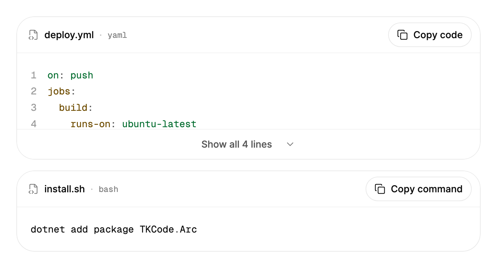

<Demo name="Default" />

## When to use

`CodeBlock` shows a source file or a snippet in a read-only, selectable frame with a file-name header, syntax colors
and a copy action. It sits in documentation, settings and developer tools where people need to read code, copy it
and know which file it belongs to, without giving them an editor.

- **Install and setup instructions** in an onboarding or integration page: a `dotnet add package` line, a `.env`
  file or a `docker compose` file, with the file name in the header so people know where each line goes.
- **Generated or exported configuration** in an admin console: a webhook payload, a CI pipeline or a Terraform plan
  that an operator copies into another system. The copy action copies the full source, not the visible part.
- **Long files that should fold**: a 200-line deployment script or a generated SDK client shows its first lines and a
  Show all toggle, so the settings page stays scannable.
- **Snippets in a developer portal or API reference**: a request and a response in `json`, a C# client call or a
  `curl` command, each with its own file name or language label.
- **Code samples inside a support or incident view**: a failing query or a configuration diff that an engineer
  reads next to a timeline, with line numbers so the team can refer to a line in a conversation.

## When not to use

- **Copying one value such as an API key or a webhook secret**: use `CopyButton` on its own. A code frame for a
  single token adds a header and a frame that the value does not need.
- **JSON that people explore by key, search or expand**: use `JsonViewer`, which shows a tree with search and per-row
  copy. `CodeBlock` shows the JSON as text.
- **Folders and file names as a navigable hierarchy**: use `TreeView` to browse the files, and place a `CodeBlock`
  beside it so the selected file drives the code shown.
- **Editing code or text in place**: use `Textarea` for plain multi-line text. `CodeBlock` is read-only; people can
  select and copy its text but cannot change it.
- **Rich documents with headings, lists and code mixed together**: use `Markdown`, which renders fenced code with the
  same syntax colors inside the document flow.

## Usage

```xml
<UserControl xmlns="https://github.com/avaloniaui"
             xmlns:arc="https://github.com/AtomUICommunity/TKCode.Arc">
    <arc:CodeBlock FileName="greeting.tsx"
                   Language="tsx"
                   Code="{Binding Source}" />
</UserControl>
```

`CodeBlock` derives from Avalonia's `TemplatedControl`, so it takes the usual layout, styling and automation
behavior of a control. It is not a `TextBox`: `Code` is the only text it accepts, the text is read-only, and the frame
has a header and an optional expand row around the code area. Highlighting uses the TextMate grammars of the StreamMark
engine, painted with Arc's syntax role colors.

### Anatomy

1. **Header** (`FileName`, `SourceCodeLabel`, `Language`): at least 52 px tall, 16 px from the left edge and 12 px
   from the right, with 8 px above and below. It shows a file icon, the file name, a middle dot and the language name.
   A long file name is cut with an ellipsis while the language keeps its width. When `FileName` is empty, the header
   shows `SourceCodeLabel` (default "Source code").
2. **Copy button** (`CopyLabel`): a `CopyButton` at the end of the header, 12 px from the file label. It copies `Code`.
3. **Line number gutter** (`ShowLineNumbers`): a right-aligned column of numbers in a muted color, mixed toward the
   surface. It is hidden from assistive technology and does not move when the code scrolls sideways.
4. **Code area**: the source in the monospace font of the Arc tokens, 14 px with a line height of 23.8 px (1.7 times
   the size) and 20 px of padding on every side. Text is selectable. Long lines scroll horizontally inside the block.
5. **Expand toggle** (`IsCollapsible`, `MaxLines`, `IsExpanded`): a full-width row at least 44 px tall with a top
   border, a 16 px chevron and the label "Show all 14 lines" (or "Show fewer lines" when expanded). It appears only when
   the source has more lines than `MaxLines`.
6. **Frame**: a 1 px border in the panel radius on the surface color. The frame clips its contents, so the header and
   the expand row keep the corners of the frame.

The narrow layout starts below 420 px of width (the `CompactWidth` of the theme): the header padding drops to 12 px
on the left, the copy button shows only its icon, the code drops to 12 px with a 20.4 px line height and 16 px of
padding, and the line numbers follow the same sizes.

### Collapsing long code

`IsCollapsible` adds the expand row. `MaxLines` sets how many lines show while the block is collapsed (default 12,
at least 1). A source with the same number of lines or fewer shows no toggle, so `IsCollapsible` can stay on for
every block in a list.

<Demo name="Collapsible" />

`IsExpanded` is two-way and tells you whether the block is open. Bind it when the page remembers the state, or set it
from code when a surrounding action should open the source (for example, a search result that points to line 40).

```csharp
block.IsCollapsible = true;
block.MaxLines = 6;
block.IsExpanded = false;
```

The collapsed height is `MaxLines` times the line height, plus the padding of the code area, so a collapsed block
always has the same height for the same settings, whatever the code is.

### Language

`Language` sets the highlighting and the language label in the header. It accepts the common names and the aliases
that code fences use, such as `cs`, `ts`, `py`, `sh`, `yaml`, `json` and `axaml`. Names are case-insensitive and a
leading dot is ignored, so `.TSX` and `tsx` are the same language. The default is `tsx`.

A language without a grammar, such as `text`, shows plain text with no colors. Use it for logs, notes and output that
is not code, so the block does not color words by accident.

<Demo name="Languages" />

```xml
<arc:CodeBlock FileName="stats.py" Language="py" Code="{Binding PythonSource}" />
<arc:CodeBlock FileName="notes.txt" Language="text" Code="Plain text." />
```

The highlighter maps the TextMate token colors to nine roles: comment, string, number, keyword, type, function,
property, tag and punctuation. Comments are italic and use the muted text color, punctuation uses the secondary text
color, and the other roles have their own color per appearance. The role colors do not follow the accent, so a
product can change its accent without changing how code reads. The mapping is an approximation of the grammar's
classes. A few tokens, such as the keys of a JavaScript object literal, may show as plain text, and built-in type
names in some languages are colored as types.

### Copy and line numbers

The copy button is in the header and copies `Code` exactly as you set it: tabs and line endings are the ones in your
source. The display differs only in two ways: a tab shows as two spaces, and a carriage return and line feed show as
one line break. `ShowLineNumbers` adds a line number column that stays in place when the code scrolls sideways.

<Demo name="LineNumbers" />

```xml
<arc:CodeBlock FileName="deploy.sh"
               Language="bash"
               ShowLineNumbers="True"
               Code="{Binding Script}" />
```

`Copied` is a routed event raised after the copy action put the code on the clipboard. Use it to confirm the copy
in your own status area:

```csharp
block.Copied += (_, _) => status.Text = "Code copied";
```

`LineCount` gives the number of lines in `Code`, which is useful for a caption such as "42 lines".

### Labels

The copy label, the file name fallback and the collapse text are properties, so you can translate them or use the
wording of your product. `ShowAllLinesFormat` takes one `{0}` placeholder, which receives the line count, formatted for
the current culture.

```xml
<arc:CodeBlock Code="{Binding Source}"
               CopyLabel="Copy snippet"
               SourceCodeLabel="Snippet"
               ShowAllLinesFormat="Show all {0} lines"
               ShowFewerLinesLabel="Show fewer lines" />
```

### Switching files

Setting a new `FileName`, `Language` and `Code` swaps the file in place. The file name slot follows the new width, the
new source rises in and the height follows on a spring. Change the three properties together, so the header and the
highlighting never show one file's name with another file's code.

<Demo name="SwitchingFiles" />

### Narrow

Below 420 px the padding and text shrink and the copy action keeps only its icon. The block adapts to its own width,
not the window width, so a narrow side panel gets the compact layout without any code.

<Demo name="Narrow" />

### Data shape and performance

A `CodeBlock` holds one string. It does not create a control per token: the whole source is one text layout with
colored runs, so the cost grows with the length of the source rather than the number of tokens.

- Highlighting runs when `Code` or `Language` changes, not on every redraw. A source of up to 32 KB whose grammar has
  already been used is highlighted on the UI thread at once. Any other source shows plain text first and receives its
  colors from a background pass, so the first long file of a session may appear uncolored for a moment.
- Collapse sources of more than a few screens. The collapsed block keeps a fixed height, and the rest of the source
  opens on demand, so a page with many long files stays scannable.
- Give each file its own block. A block is one selectable text layout, so a page of many short snippets reads well
  as separate blocks, each with its own file name and copy action.

### Binding to a view model

In an MVVM app the view model owns the source, the file name and the open state. The block only shows them. With
CommunityToolkit.Mvvm, `ObservableObject` and `[ObservableProperty]` are enough.

```csharp
public partial class PipelineViewModel : ObservableObject
{
    [ObservableProperty]
    private string _fileName = "deploy.yml";

    [ObservableProperty]
    private string _language = "yaml";

    [ObservableProperty]
    private string _source = string.Empty;

    [ObservableProperty]
    private bool _isSourceExpanded;
}
```

```xml
<StackPanel Spacing="16">
    <arc:CodeBlock FileName="{Binding FileName}"
                   Language="{Binding Language}"
                   Code="{Binding Source}"
                   IsCollapsible="True"
                   MaxLines="8"
                   IsExpanded="{Binding IsSourceExpanded}" />
</StackPanel>
```

- `Code`, `FileName` and `Language` are one-way inputs. Change them in the view model, and the block updates the
  header, the highlighting and the collapse together.
- `IsExpanded` is two-way by default. The user's toggle writes back to `IsSourceExpanded`, so a page can remember the
  state, or the view model can open the block when a search result points into it.
- `Copied` is an event, not a command. Subscribe to it in code-behind or in an attached behavior, and keep the
  feedback in the view model where the status text belongs.

### Example: deployment pipeline on a settings page

A project settings page in a deployment tool shows the pipeline file the project uses. The header names the file and
its language, the line numbers let an engineer refer to "line 4" in a review, and the source collapses to three lines
with the full length shown in the toggle label. The copy action gives the whole file to the person who needs to
paste it into another repository. The install command below it sets no `IsCollapsible`, so it shows no toggle.



```xml
<StackPanel Width="680" Spacing="16">
    <arc:CodeBlock FileName="deploy.yml"
                   Language="yaml"
                   ShowLineNumbers="True"
                   IsCollapsible="True"
                   MaxLines="3"
                   Code="on: push&#10;jobs:&#10;  build:&#10;    runs-on: ubuntu-latest" />
    <arc:CodeBlock FileName="install.sh"
                   Language="bash"
                   CopyLabel="Copy command"
                   Code="dotnet add package TKCode.Arc" />
</StackPanel>
```

### Content guidelines

- **File name**: the path the code belongs to, as the reader would find it: `deploy.yml`, `Program.cs`.
  Use a descriptive label only when there is no file, and then keep it short: "Webhook payload", "Sample response".
- **Copy label**: a verb and an object, in sentence case: "Copy command", "Copy snippet". Use the label your product
  uses for the action elsewhere, so people recognize it.
- **Collapse label**: keep the count in the label, so people know how long the file is before they open it. The
  default "Show all 14 lines" does this; a translated format must keep the `{0}`.
- **Source text**: copy the code as it should run. Remove secrets, real customer IDs and internal host names before the
  code reaches the page, because the copy action makes them easy to take.

| Instead of | Write |
|---|---|
| Click to copy the code below | Copy command |
| Code | Source code, or the file name |
| Show more | Show all 14 lines |
| Output (plain text) | Use `text` as the language and name the file "output.txt" |

### Best practices

**Do**

- Set `FileName` for every block that a reader might copy into a file. The header tells people where the code goes,
  and the block gets its own name for assistive technology.
- Collapse long sources with `IsCollapsible` and a `MaxLines` that shows the part people need first, such as the
  signature or the first job of a pipeline.
- Use `ShowLineNumbers` when people discuss specific lines, such as a review, an incident or a support thread.
- Use `text` for output and logs, so the block does not color words that are not code.

**Avoid**

- Using the block for one value: a `CopyButton` is the right control for a key, a token or a URL, and a frame around
  one line draws more attention than the value deserves.
- Switching `Code` to a sample in another language without setting `Language`. The new text keeps the old language's
  highlighting, so a Python sample shows C# colors. Set `FileName`, `Language` and `Code` together.
- Driving `Code` from a text editor on every keystroke. The block is a read-only view, and each change starts a new
  highlighting pass; use `Textarea` for editing and show the result in a `CodeBlock` only when the person saves.
- Expecting line numbers in the copied text. The gutter is not part of `Code`, so the copy action never includes
  them.

### Common questions

**Why does my block show no toggle when the source is long?** The toggle appears only when `IsCollapsible` is `True`
and the source has more lines than `MaxLines`. Check both, and check that `MaxLines` is larger than the number of
lines you expect to hide.

**Does collapsing change what the copy action copies?** No. The copy action copies `Code` in full, collapsed or not,
so a person can copy a 200-line file from a block that shows eight lines.

**Why does the code show without colors for a moment?** The highlighter colors a source on a background pass when its
grammar is not loaded yet, or when the source is larger than 32 KB. The text shows plain until the colors arrive. A
language with no grammar, such as `text`, stays plain.

**How do I show the line count in my own text?** Read `LineCount`. It counts the lines of `Code` after the line
breaks are normalized, so a source with a trailing line break counts one more line than the text shows.

**Can I change the tab width?** Not with a property. Tabs always display as two spaces. Use spaces in the source when
the exact width matters, because the copy action copies the source as you set it.

## API reference

<!-- api: CodeBlock -->

## Accessibility

- The block is a labeled region. Its name comes from `FileName` (for example "deploy.yml source code"), or from the
  language when the file name is empty ("yaml source code"), so each block on a page has its own name.
- The code area is named "Selectable source code". The line number gutter is marked as raw content, so a screen reader
  reads the code without the numbers.
- Tab moves to the copy button, to the code area and to the expand toggle, in that order.
- Enter or Space copies the code or toggles the expanded state, depending on the focused control.
- The code area can take focus, so keyboard users can scroll long lines with the arrow keys. A keyboard focus shows a
  2 px focus ring inside the frame; a pointer click does not.
- The expand toggle exposes its expanded state to assistive technology. The copy result is announced by `CopyButton`.

### Keyboard

| Keys | Action |
|---|---|
| `Tab` / `Shift+Tab` | Move between the copy button, the code area and the expand toggle |
| `Enter` or `Space` on the copy button | Copy `Code` to the clipboard |
| `Enter` or `Space` on the expand toggle | Expand or collapse the source |
| Arrow keys in the code area | Scroll the source; long lines scroll sideways |
| `Ctrl+C` (`Cmd+C` on macOS) in the code area | Copy the selected text |

## Motion

- Expanding or collapsing changes the height of the code on a smooth spring.
- New code fades in and rises slightly, so an update is visible without a jump.
- The toggle label swaps with a short blur and its arrow turns.
- The file name swaps with a short blur, and the language after it glides to its new position.
- Reduced motion sets the height at once and swaps the label in place without movement. Off jumps straight to the final state.

| Change | Full | Reduced | Off |
|---|---|---|---|
| Expand or collapse | The height springs to the new size and the code area clips to it | The height is set at once | Immediate |
| New `Code` | The text rises 4 px while it fades in | The text is replaced in place | Immediate |
| Toggle label | The label blurs out and in, and the chevron turns 180 degrees on a snappy spring | The label is swapped in place and the chevron turns at once | Immediate |
| New `FileName` | The name blurs out and in, and the language glides to its new position | The name is swapped in place | Immediate |

## Related

- `CopyButton` to copy a single value, such as a token or a URL.
- `JsonViewer` for JSON that people search and explore.
- `TreeView` next to a block, so the selected file drives the code shown.
- `Markdown` for documents that mix prose with fenced code.

| Component | Choose it when |
|---|---|
| `CopyButton` | The thing to copy is one value, not a file or a snippet |
| `JsonViewer` | People search, expand or copy parts of a JSON document |
| `TreeView` | The files form a hierarchy, and the code shown depends on the selection |
| `Markdown` | Code sits inside prose, such as a help article or a changelog |
| `Textarea` | The text is plain and people must edit it |
