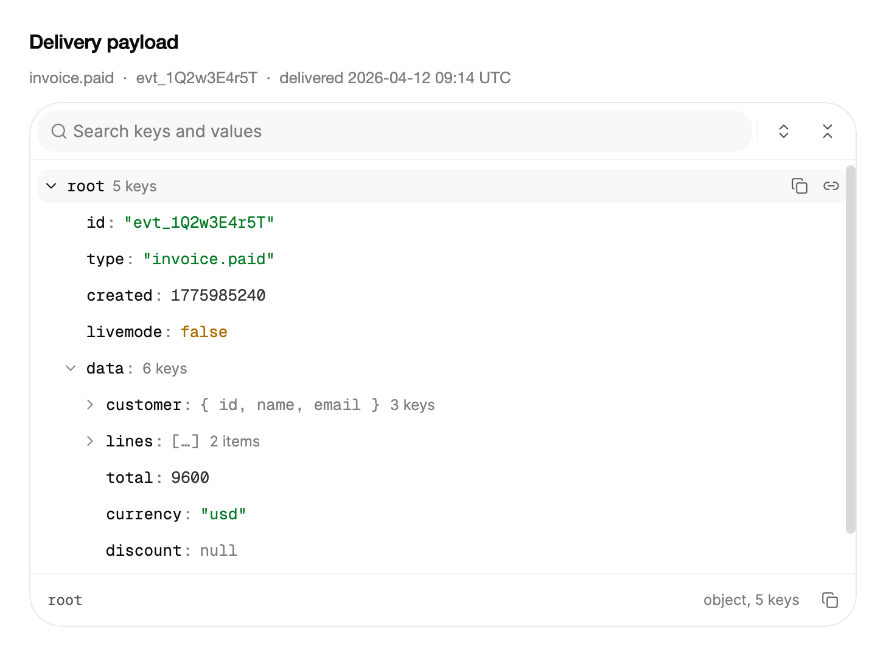

<Demo name="WebhookPayload" />

## 何時使用

`JsonViewer` 把 JSON 文件顯示為一棵可以逐個分支展開的樹。它用在工程師和客服人員需要閱讀、而不是編輯文件的地方：開發者面板、客服主控台、整合記錄。檢視器自成一體（包括附搜尋的工具列、樹狀區域和路徑列），因此頁面只需提供 JSON，並把控制項放進自己的版面配置中。

- **Webhook 投遞檢查**：在整合主控台中，開發者打開一個 `invoice.paid` 或 `order.updated` 酬載，檢查處理常式讀取的欄位。設定 `ExpandDepth="2"` 後，根節點和 `data` 會展開，使用者只需打開需要的分支，例如 `data.customer`。
- **API 回應除錯**：在內部工具中，把 `GET /v1/orders` 呼叫的回應本文顯示在產生它的請求旁邊。複製某個欄位的路徑（`root.items[2].sku`），即可得到用於錯誤回報的精確參照。
- **記錄與事件詳情**：在事件時間軸或稽核檢視中，結構化記錄項目的 `metadata` 物件包含隨事件變動的欄位。搜尋可以在整筆記錄中尋找鍵或值。
- **設定檢視**：在設定頁或部署頁中，維運人員閱讀功能旗標文件或管線定義，並從中複製某個值，而不必冒著修改來源的風險。
- **大型匯出預覽**：在資料工具中，一個包含數千筆記錄的陣列以每頁 50 個子項載入，因此首屏立即出現，其餘內容依需求載入。

## 何時不用

- **把整份文件當作可複製的原始碼**，例如 README 中的片段或客服回覆：用 `CodeBlock`，它把文字顯示為一個區塊，並提供一個複製操作。
- **使用者需要選取的巢狀分類**，例如資料夾、檔案或組織圖：用 `TreeView`，它為選取而設計，且不解析 JSON。
- **結構相同的表格記錄**，例如使用者依欄位排序和篩選的發票清單：用 `Table`。JSON 樹顯示結構，表格用於比較列。
- **不是 JSON 的值**，例如任意 .NET 物件：先把它們轉換為 `JsonNode` 或 `JsonElement`。檢視器只讀取 System.Text.Json 資料。
- **編輯文件**：檢視器是唯讀的。使用者需要修改文字時，使用 `Textarea` 或 `RichTextEditor`。

## 用法

用 `Json` 傳入 JSON 文字。資料已經解析完成時，用 `Value` 傳入 `JsonNode`，或用 `Element` 傳入 `JsonElement`。

```xml
<arc:JsonViewer Json="{Binding ResponseJson}"
                ExpandDepth="2"
                MaxTreeHeight="320" />
```

`JsonViewer` 衍生自 Avalonia 的 `TemplatedControl`。它的範本包含工具列、可捲動的列樹、路徑列和解析錯誤列，並自行繪製焦點框與列操作。主題負責設定這些部件的樣式；鍵盤、搜尋、分頁和複製行為則由控制項本身負責。

### 結構

1. **工具列**：當 `IsSearchable` 為 `True` 或文件超過一列時顯示。它包含搜尋框、比對計數、上一個與下一個比對按鈕，以及全部展開和全部摺疊按鈕。
2. **搜尋框**（`SearchPlaceholder`、`Query`）：高 34 px 的膠囊形區域，使用淡化的表面色，帶搜尋圖示；預設預留位置文字為 "Search keys and values"。
3. **比對計數**：目前是三個比對中的第一個時顯示 `1/3`；沒有比對時顯示 `0/0`。它是一個禮貌即時區域。
4. **樹狀區域**（`MaxTreeHeight`）：列在此高度內捲動，預設為 420 px。每列高 30 px。
5. **列**：鍵（或陣列索引）、冒號和值。字串使用成功色，數字使用強調色，布林值使用警告色；鍵使用前景色。分支以淡化色顯示子項數量（`2 items`、`1 key`），摺疊時還會顯示預覽，例如 `{ name, email }`。
6. **列操作**：列右側的兩個圖示按鈕，分別是複製值和複製路徑。它們在滑鼠懸停和目前列上出現，不在 Tab 順序中。
7. **顯示更多列**：在較長分支的結尾顯示 "Show 50 more" 以及隱藏子項的數量。點擊後載入下一頁，每頁 `PageSize` 個子項。
8. **解析錯誤列**（`ParseError`）：當 `Json` 不是有效的 JSON 時，取代樹狀區域顯示。
9. **路徑列**（`IsPathVisible`）：目前列的路徑（等寬字型）、附子項數量的類型標籤（`object, 5 keys`），以及複製路徑按鈕（`IsCopyable`）。檢視器較窄時，類型標籤隱藏。

### 載入資料

有三個屬性可以載入文件。每個屬性都會取代其他屬性的文件，因此螢幕上顯示的是最後設定的值。

| 屬性 | 型別 | 檢視器的處理方式 |
|---|---|---|
| `Json` | `string?` | 把文字解析為文件。無效的文字會設定 `ParseError`，並讓樹狀區域保持為空。 |
| `Value` | `JsonNode?` | 設定時把節點序列化為文件。之後對節點的修改不會顯示；需要再次設定 `Value`。 |
| `Element` | `JsonElement?` | 複製該元素，因此檢視器接收之後，它所屬的 `JsonDocument` 即可釋放。 |

`RootName`（預設 `root`）是每條路徑的第一段。`ExpandDepth`（預設 `1`）設定資料抵達時展開的層數：`1` 只展開根節點，`2` 同時展開根節點的子項。

如果文字不是有效的 JSON，`ParseError` 會保存錯誤訊息，樹狀區域保持為空。

#### 已解析的資料

資料已經是 `JsonNode` 時，繫結 `Value`。在程式碼中用 `JsonNode` 的多載建立 `JsonNode` 值，這種寫法對 AOT 是安全的。

```csharp
var items = new JsonArray();
items.Add((JsonNode)new JsonObject { ["id"] = 1, ["sku"] = "SKU-0001", ["inStock"] = true });

viewer.Value = new JsonObject
{
    ["count"] = 1,
    ["items"] = items
};
```

### 展開

`ExpandDepth` 設定首次顯示時展開的層級，預設只展開根節點。`ExpandedPaths` 列出已展開的分支；它是雙向的，因此檢視模型可以保存展開的集合，並在之後還原。集合變動後會觸發 `ExpandedPathsChanged`。

```csharp
viewer.ExpandAll();
viewer.CollapseAll();
viewer.Expand("root.data.lines");
viewer.Collapse("root.data.customer");
```

設定 `Json`、`Value` 或 `Element` 會重新開始：展開集合依 `ExpandDepth` 重建，搜尋重新執行，樹狀區域捲回頂部。若要在重新整理後保留使用者所在的位置，請在新文件抵達之前讀取 `ExpandedPaths`，並在之後重新設定它。

```csharp
viewer.ExpandedPaths = ["root", "root.data", "root.data.lines"];
```

### 搜尋

`IsSearchable` 預設開啟。`Query` 會以不區分大小寫的方式過濾鍵和基本值，展開包含比對項目的分支，並在 `MatchCount` 中回報比對數量。計數最多統計到 2,000 個比對。輸入查詢時，`CurrentPath` 移到第一個比對項目；`NextMatch` 和 `PreviousMatch` 依文件順序逐一切換比對項目。

<Demo name="Search" />

```xml
<arc:JsonViewer Json="{Binding Payload}"
                Query="{Binding SearchText, Mode=TwoWay}"
                SearchPlaceholder="搜尋鍵和值" />
```

```csharp
viewer.NextMatch();
viewer.PreviousMatch();
```

搜尋進行中，如果使用者關閉了某個分支，它會保持關閉，直到查詢改變。檢視器不會在下一次切換比對時把它重新打開，因此使用者的選擇優先於搜尋。

### 長陣列

`PageSize` 設定一個分支一次顯示的子項數量，預設為 50，最小值為 1。"Show more" 列會載入下一頁，並回報仍被隱藏的子項數量。在該列上按 Enter 或 Space 同樣會載入下一頁，`FocusPath` 可以依路徑把焦點移到任意一列。

<Demo name="LongArrays" />

```xml
<arc:JsonViewer Json="{Binding LargeCatalog}" PageSize="50" />
```

分頁同時適用於陣列和物件。頁面大小為 50 時，對於數千件商品的目錄匯出，首屏仍然很快。只有當使用者需要一次掃視整頁時才提高 `PageSize`；一頁 500 列通常並不比十頁 50 列更容易閱讀。

### 路徑與複製

每一列都有一個路徑，描述其值在文件中的位置。路徑以 `RootName` 開頭，識別字形式的鍵使用點號，其他情況使用方括號。

| JSON 中的鍵 | 路徑 |
|---|---|
| `data` | `root.data` |
| `$ok_1` | `root.$ok_1`（由字母、數字、`_` 和 `$` 組成，且不以數字開頭的鍵） |
| `order-id` | `root["order-id"]` |
| `lines` 的第二項 | `root.lines[1]` |

`IsPathVisible` 在路徑列中顯示目前列的路徑，`IsCopyable` 啟用複製操作。複製值時得到值的文字：字串不含引號，分支複製為兩個空格縮排的 JSON，其他值複製為字面值。複製路徑時得到路徑文字。

```csharp
viewer.RootName = "payload";
viewer.Copied += (_, e) => status.Text = $"已複製 {e.Kind}：{e.Path}";
viewer.CurrentRowChanged += (_, e) => current.Text = $"{e.Path} ({e.ValueType})";
```

`CurrentRowChanged` 在某一列成為目前列時觸發（透過鍵盤或點擊），並回報其路徑、值和 `JsonViewerValueType`。`Copied` 回報複製的類型（`JsonViewerCopyKind.Value` 或 `JsonViewerCopyKind.Path`）、路徑和複製的文字。用 `Copied` 產生狀態訊息或稽核記錄。

### 窄容器

寬度為 420 px 及以下（`CompactWidth`）時，縮排收緊為 12 px，鍵只佔列的有限部分，以確保值仍然可見，路徑列中的類型標籤隱藏。不需要寫程式碼，版面配置會隨寬度自動調整。

<Demo name="Narrow" />

### 資料結構與效能

檢視器只接受 JSON：文字、`JsonNode` 或 `JsonElement`。它不讀取任意 CLR 物件，這讓它對提前編譯（AOT）和裁剪保持安全。繫結之前，用 `System.Text.Json` 序列化你的模型，或像上面那樣手動建立 `JsonNode` 樹。

- **列依可視範圍建立。** 樹狀區域是一個扁平的列清單，檢視器只為可見的列建立實體。即使文件包含數千個物件，也可以打開（`ExpandAll`）並保持順暢捲動；分頁上限讓每個分支保持較小。
- **搜尋在 UI 執行緒上讀取整份文件。** 它會走訪每一個鍵和基本值，並在 2,000 個比對後停止回報。對於數 MB 的酬載，請在檢視模型的 `Query` 抵達檢視器之前做防抖處理（等待輸入短暫停頓）。
- **值依原樣顯示。** 檢視器不會格式化貨幣、日期或千分位符號；請在檢視器旁的標籤中自行格式化。

### 繫結到檢視模型

在 MVVM 應用程式中，檢視模型保存 JSON 文字和搜尋查詢，檢視器負責顯示它們。使用 CommunityToolkit.Mvvm 時，由 `ObservableObject` 保存狀態和命令。

```csharp
public interface IWebhookService
{
    Task<string> GetLatestPayloadJsonAsync();
}

public partial class WebhookInspectorViewModel : ObservableObject
{
    private readonly IWebhookService _webhooks;

    public WebhookInspectorViewModel(IWebhookService webhooks)
    {
        _webhooks = webhooks;
    }

    [ObservableProperty]
    private string? _payloadJson;

    [ObservableProperty]
    private string? _query;

    [ObservableProperty]
    private string _status = "選擇一個值以檢視其內容。";

    [RelayCommand]
    private async Task LoadLatestAsync()
    {
        PayloadJson = await _webhooks.GetLatestPayloadJsonAsync();
    }
}
```

```xml
<StackPanel Spacing="12">
    <arc:Button Content="載入最新投遞"
                Command="{Binding LoadLatestCommand}" />
    <arc:JsonViewer Json="{Binding PayloadJson}"
                    Query="{Binding Query, Mode=TwoWay}"
                    ExpandDepth="2"
                    MaxTreeHeight="360" />
    <TextBlock Text="{Binding Status}" />
</StackPanel>
```

- `Json`、`Value`、`Element`、`RootName`、`ExpandDepth`、`PageSize`、`MaxTreeHeight`、`IsSearchable`、`IsCopyable` 和 `IsPathVisible` 是單向的：檢視模型設定它們，檢視器不會寫回。
- `Query` 是雙向的。在檢視器的搜尋框中輸入會更新檢視模型，檢視模型也可以把 `Query` 設為空字串來清除搜尋。
- `ExpandedPaths` 是雙向的，如「展開」一節所述。`CurrentPath` 和 `MatchCount` 是唯讀的，並隨使用者的移動和搜尋而更新。
- `Copied` 和 `CurrentRowChanged` 是事件，不是命令。在程式碼後置檔中把它們轉發給檢視模型：

```csharp
viewer.CurrentRowChanged += (_, e) => vm.Status = $"{e.Path} ({e.ValueType})";
viewer.Copied += (_, e) => vm.Status = $"已複製{(e.Kind == JsonViewerCopyKind.Path ? "路徑" : "值")}：{e.Path}";
```

### 範例：Webhook 投遞檢查器

開發者從整合主控台打開一次投遞。面板在樹狀區域上方顯示事件名稱及其時間。根節點及其第一層已展開，因此 customer 和項目列一眼可見；巢狀的 `metadata` 物件在開發者展開之前保持關閉。樹狀區域的高度限制為 340 px，使面板可以與投遞清單並排放置。



```xml
<StackPanel Width="680" Spacing="12">
    <TextBlock Text="Delivery payload"
               FontSize="16"
               FontWeight="SemiBold"
               Foreground="{arc:ArcDesignTokenResource Foreground}" />
    <TextBlock Text="invoice.paid  ·  evt_1Q2w3E4r5T  ·  delivered 2026-04-12 09:14 UTC"
               FontSize="13"
               Foreground="{arc:ArcDesignTokenResource TextMuted}" />
    <arc:JsonViewer ExpandDepth="2" MaxTreeHeight="340">
        <arc:JsonViewer.Json>{
  "id": "evt_1Q2w3E4r5T",
  "type": "invoice.paid",
  "created": 1775985240,
  "livemode": false,
  "data": {
    "customer": {
      "id": "cus_9s8d7f6g",
      "name": "Ada Lovelace",
      "email": "ada@example.com"
    },
    "lines": [
      { "description": "Pro plan", "amount": 4800, "quantity": 1 },
      { "description": "Additional seats", "amount": 1200, "quantity": 4 }
    ],
    "total": 9600,
    "currency": "usd",
    "discount": null,
    "metadata": {
      "order-id": "A-1042",
      "note": "Renewed early to keep the founding-member price."
    }
  }
}</arc:JsonViewer.Json>
    </arc:JsonViewer>
</StackPanel>
```

設計決策體現在資料和深度上。`ExpandDepth="2"` 展開根節點及其直接子項，因此 `data` 物件是展開的，開發者最先檢查的欄位位於下一層。`customer`、`lines` 和 `metadata` 分支保持關閉，每個分支的列上都有預覽（`{ id, name, email }`、`[ … ]`），因此樹狀區域讀起來像一份摘要，直到有人需要細節為止。工具列中的搜尋涵蓋常見情況：在較長的酬載中尋找 `customer` 或 `amount`。

### 文案規範

檢視器中的大部分文字來自控制項本身（預留位置文字、計數、複製訊息）。它周圍的文字，即標題和狀態，由你自己撰寫。

| 不要寫 | 改為 |
|---|---|
| JSON | 投遞酬載、回應本文或事件資料 |
| 輸出 | POST /v1/invoices 的回應 |
| 搜尋... | Search keys and values（預設預留位置文字） |
| 根節點 | 團隊文件中使用的名稱，用 `RootName` 設定，例如 `event` |
| 已複製！ | 已複製 root.data.customer 的值（根據 `Copied` 事件產生的狀態列） |

- 用文件的來源和事件為它命名，讓支援工程師知道螢幕上是哪一個酬載。
- 標題和狀態文字使用句首大寫的寫法；你撰寫的文字中的計數使用阿拉伯數字。

### 最佳做法

**建議**

- 把 `ExpandDepth` 設為能回答常見問題的層級，通常是 `2`。預設層級過深會讓每份文件看起來都很雜亂，並掩蓋使用者要找的欄位。
- 對於外部服務傳回的陣列，保持 `PageSize` 為預設的 50。較小的頁面讓每個分支夠短、便於掃視，而 "Show more" 列會說明還剩多少項。
- 對於數 MB 的酬載，對 `Query` 做防抖處理，因為搜尋會在 UI 執行緒上走訪整份文件。

**避免**

- 把 `Value` 繫結到 `JsonNode` 之後又原地修改該節點。檢視器在設定時會複製節點，因此樹狀區域不會更新；請用新節點再次指派 `Value`。
- 預設對大型文件呼叫 `ExpandAll`。它會打開每個分支，包含數千個物件的酬載會顯示數千列需要掃視。
- 在共用螢幕上顯示包含機密或個人資料的酬載而不先遮罩。檢視器會顯示它收到的每一個值。

### 常見問題

**修改 `JsonNode` 之後，樹狀區域沒有變化。** 設定 `Value` 時會序列化節點，之後對節點的修改不會被察覺。請用更新後的節點再次設定 `Value`，或建立一個新的 `JsonObject`。

**`Json`、`Value` 和 `Element` 該用哪一個？** 資料以文字形式抵達時（例如 HTTP 回應本文）使用 `Json`。在程式碼中建立或解析了 `JsonNode` 時使用 `Value`。已經持有 `JsonElement` 時使用 `Element`；檢視器會複製它，因此之後你可以釋放 `JsonDocument`。

**重新整理資料時，樹狀區域為什麼會收合？** 每份新文件都從 `ExpandDepth` 開始，因此使用者展開的分支會再次關閉。在重新整理之前儲存 `ExpandedPaths`，並在新文件載入後重新設定它。

**如何用鍵盤複製值？** 用方向鍵選取列，然後按 Ctrl+C（macOS 上為 Cmd+C）複製它的值，或按 Ctrl+Shift+C（Cmd+Shift+C）複製它的路徑。列操作按鈕不在 Tab 順序中，因此鍵盤快速鍵是更可靠的途徑。

## API 參考

<!-- api: JsonViewer -->

## 無障礙

- 樹狀區域遵循 WAI-ARIA 樹狀模式：列面板公開為樹，每一列公開其層級、在同層中的位置，以及展開或選取狀態。
- 只有一列在 Tab 順序中，即目前列。方向鍵、Home 和 End 在列之間移動焦點。
- 一列的朗讀內容包含它的鍵和值，例如 `id: evt_1`；或它的鍵、類型和子項數量，例如 `lines, array, 2 items`。"Show more" 列朗讀為 `Show 50 more, 70 hidden`。
- 搜尋框的名稱為 "Search JSON"。比對計數是禮貌即時區域，因此計數的每次變動都會被播報，而焦點不會移動。
- 複製結果在禮貌狀態區域中播報："Copied value of root.customer" 或 "Copy failed"。路徑列的複製按鈕會把名稱改為 "Copied" 或 "Copy failed"。
- 列操作按鈕由控制項繪製，不在 Tab 順序中，透過 Ctrl+C 或 Ctrl+Shift+C 使用。路徑列的複製按鈕和工具列按鈕是一般的 Tab 停駐點，名稱分別為 "Expand all"、"Collapse all"、"Previous match"、"Next match" 和 "Copy path"。
- 滑鼠懸停只改變列的填滿色；目前列由反白和路徑列標示。

### 鍵盤

| 按鍵 | 操作 |
|---|---|
| `Up` / `Down` | 移到上一個或下一個可見列 |
| `Home` / `End` | 移到第一列（根節點）或最後一個可見列 |
| `Right` | 展開已關閉的分支；在已展開的分支上，移到它的第一個子項 |
| `Left` | 關閉已展開的分支；否則移到父列 |
| `Enter` / `Space` | 展開或關閉分支；在 "Show more" 列上，載入下一頁 |
| `Ctrl+C` / `Cmd+C` | 複製目前列的值 |
| `Ctrl+Shift+C` / `Cmd+Shift+C` | 複製目前列的路徑 |
| `/` | 聚焦搜尋框並選取其中的文字 |
| `Enter` / `Shift+Enter`（在搜尋框中） | 跳到下一個或上一個比對 |
| `Escape`（在搜尋框中） | 查詢不為空時清除查詢 |
| `Down`（在搜尋框中） | 把焦點移入樹狀區域，停在目前列 |
| `Tab` / `Shift+Tab` | 離開樹狀區域或返回；樹狀區域只佔一個 Tab 停駐點 |

## 動態效果

- 分支展開時，每一列都以平滑彈簧展開高度。載入一頁和全部展開使用相同的動態效果。
- 目前列的反白在列之間滑動；樹狀區域會在列穩定後捲動到該列。滑鼠滾輪的移動會停止仍在進行的捲動。
- 複製圖示會以輕微的縮放和模糊變為勾號或叉號。
- 減少動態效果時，列的變化立即生效，反白和捲動直接移動到目標位置。關閉動態效果時直接到達最終狀態。

| 變化 | 完整 | 減少 | 關閉 |
|---|---|---|---|
| 分支展開或收合，或載入一頁 | 每一列以平滑彈簧展開高度 | 列立即變化 | 立即完成 |
| 目前列移動 | 反白在列之間滑動 | 反白直接移動 | 立即完成 |
| 樹狀區域捲動到目前列 | 以彈簧方式捲動到列穩定後的位置 | 直接跳轉 | 立即完成 |
| 樹狀區域中可見列超過 400 列 | 列立即變化 | 列立即變化 | 立即完成 |

## 相關元件

- `CodeBlock` 把整份 JSON 顯示為可複製的原始碼，提供一個複製操作。
- `TreeView` 用於使用者選取而非檢查的巢狀記錄。
- `Table` 用於使用者依欄位排序和篩選的同一結構記錄。
- `CopyButton` 在樹狀區域之外複製單一值。

| 元件 | 適用情境 |
|---|---|
| `CodeBlock` | JSON 是使用者以文字形式複製的程式碼片段，例如範例請求 |
| `TreeView` | 巢狀項目是使用者選取的資料夾、檔案或分類 |
| `Table` | 記錄結構相同，使用者依欄位比較它們 |
| `CopyButton` | 需要在旁邊提供複製操作的單一值，例如 ID 或鍵 |
