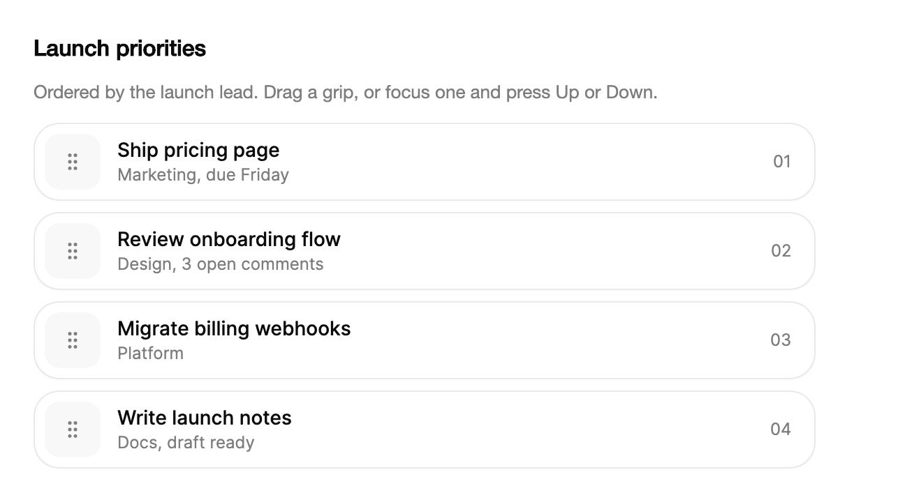

<Demo name="Priorities" />

## When to use

`ReorderableList` lets a person put a short list of items in the order they want. It is the control for a decision
the person makes by hand, where the order itself is the information: the team's launch priorities, the next tracks
in a queue, the steps of a review checklist. It sits in a card, a side panel or a settings page, and it saves the
new order through the `Reordered` event.

- **Launch priorities in a planning view**: a product lead ranks four or five workstreams before a release review.
  The order is the answer, so a drag handle beside each item is clearer than a number field.
- **Playlists and task queues** in a media or operations console: the next items to play or process, where the
  person moves an item up or down and the rest of the list stays in place.
- **Approval or review steps** in a workflow editor: a checklist whose order decides which reviewer sees a document
  first, edited by the person who owns the process.
- **Pinned shortcuts** in a dashboard or a navigation panel: the items people use most, ordered to their taste and
  saved per account.

## When not to use

- **The order comes from column values**, such as sorting invoices by due date or amount: use `Table`,
  which sorts by the column and keeps the data in a grid.
- **Quick actions on a row** such as archive, snooze or delete, with no reordering: use `SwipeActions`, which reveals
  actions from a swipe without moving the row.
- **Long lists** of hundreds of items: rows are not virtualized and each row runs a layout animation when another
  row moves, so split the list or use `Table` with a sort control.
- **Nested items** such as folders, categories or subtasks: use `TreeView`, which shows the hierarchy and lets people
  expand each level.
- **A choice from a fixed set** that people toggle and do not rank, such as filter chips or channels: use
  `ChipGroup`; the order of those options is not the person's decision.

## Usage

Each row shows a grip. Dragging the grip moves the row. The list reports the new order in `Reordered`.

```xml
<arc:ReorderableList Label="Priorities"
                     Width="520"
                     ItemsSource="{Binding Priorities}" />
```

`ReorderableList` derives from Avalonia's `ItemsControl`, so `ItemsSource`, `Items`, `ItemTemplate` and the container
methods work as they do on other items controls. `ItemsSource` takes a `ReorderableListEntry` list with an `Id`, a
`Title` and an optional `Detail`.

```csharp
var priorities = new ObservableCollection<ReorderableListEntry>
{
    new("pricing", "Ship pricing page", "Marketing - due Friday"),
    new("onboarding", "Review onboarding flow", "Design - 3 open comments"),
    new("billing", "Migrate billing webhooks", "Platform")
};
var list = new ReorderableList { ItemsSource = priorities };
```

### Anatomy

1. **Grip** (the handle): a 40 px square with a 16 px vertical grip glyph, 7 px from the top, bottom and left edges
   of the row, on the muted surface color. It is the only part that starts a drag.
2. **Row**: a surface with the Arc border and control radius, at least 56 px high. Rows are 8 px apart.
3. **Content**: the item's title at 14 px medium weight, with the detail line below it at 12 px in the muted text
   color. The default content comes from `ReorderableListEntry`; `ItemTemplate` replaces it.
4. **Position** (on the right): a two-digit number, `01`, `02` and so on, at 12 px in the muted text color. It
   updates after every move and rolls in the direction the row travelled.
5. **Announcer** (not visible): a hidden polite region that speaks each keyboard and drag step.

### Reacting to a move

`Reordered` gives the item, its old index and its new index. When `ItemsSource` is an `ObservableCollection` and
`MovesItems` is `True` (the default), the list moves the item in the collection itself. Set `MovesItems` to `False`
to keep the collection unchanged and save the order yourself. A list bound to an array or another fixed source
behaves the same way: the list raises `Reordered` and leaves the source as it is.

```csharp
list.Reordered += (_, e) => status.Text =
    $"Moved {((ReorderableListEntry)e.Item!).Title} from {e.OldIndex + 1} to {e.NewIndex + 1}";

list.MoveItem(0, 2);   // move the first row to the third place
```

`MoveItem` moves the row with the same slide animation as a drag, and it also raises `Reordered`, so code moves and
person moves reach the same handler.

### Custom item template

`ItemTemplate` replaces the default title and detail. `ItemTitleSelector` gives the title used in the grip's
accessible name and in announcements; when it is not set, the list uses the entry's `Title` or the item's text.

<Demo name="CustomItemTemplate" />

```csharp
var colors = new ReorderableList
{
    ItemsSource = new ObservableCollection<string> { "Coral", "Saffron", "Mint" },
    ItemTemplate = new FuncDataTemplate<string>((name, _) => new TextBlock { Text = name }),
    ItemTitleSelector = item => item.ToString() ?? string.Empty
};
```

### Length and scrolling

Put the list in a `ScrollViewer` when it is taller than the space you give it. Dragging a row to the edge of the
scrolling area scrolls it, so a person can move a row past the visible part of the list.

<Demo name="AutoScroll" />

```xml
<ScrollViewer Height="340">
    <arc:ReorderableList ItemsSource="{Binding Tracks}" />
</ScrollViewer>
```

### Binding to a view model

In an MVVM app the view model owns the collection and the code that saves the order. With CommunityToolkit.Mvvm, an
`ObservableObject` holds the collection, and the list moves the items in that collection when `MovesItems` is
`True`. The binding is one-way: the list changes the collection, and the view model reads it.

```csharp
public partial class LaunchPlanViewModel : ObservableObject
{
    public ObservableCollection<ReorderableListEntry> Priorities { get; } =
    [
        new("pricing", "Ship pricing page", "Marketing, due Friday"),
        new("onboarding", "Review onboarding flow", "Design, 3 open comments"),
        new("billing", "Migrate billing webhooks", "Platform")
    ];

    [ObservableProperty]
    private string _status = "Drag a grip to reorder the launch priorities.";

    [RelayCommand]
    private void SaveOrder()
    {
        // Persist the order here, for example through your API client.
        Status = $"Saved order: {string.Join(", ", Priorities.Select(p => p.Id))}";
    }
}
```

```xml
<StackPanel Spacing="12">
    <arc:ReorderableList Label="Launch priorities"
                         Width="560"
                         HorizontalAlignment="Left"
                         ItemsSource="{Binding Priorities}" />
    <TextBlock Text="{Binding Status}" TextWrapping="Wrap" />
</StackPanel>
```

Forward `Reordered` to the command from code behind, so each move saves the order:

```csharp
list.Reordered += (_, _) => vm.SaveOrderCommand.Execute(null);
```

`ItemsSource` is one-way. Do not bind it back from the list, because the list does not write to the property; the
collection itself carries the new order.

### Data shape and performance

The list is for short collections, and the cost is in the row count. Every row is laid out and animated when another
row moves, and rows are not virtualized, so a list of a few dozen rows moves smoothly while a list of several
hundred does not.

- **Use `ReorderableListEntry` for the common case.** It carries an `Id` for your own code to find the item when it
  saves the order, a `Title` that names the accessible row and a `Detail` line for the second line of text.
- **Use `ItemTemplate` for other data.** Items of any type show through `ItemTemplate`; set `ItemTitleSelector` as
  well so the grip names and announcements read the right title.
- **Keep the data in one collection.** When the list moves items in place, the collection must be the one the list
  is bound to, not a copy.

### Example: Launch priorities

A product lead orders the launch workstreams before a review. The list is the whole page's decision, so it has a
title above it and a status line that confirms the saved order. Each row has a detail line with an owner or a
due date, so the position reads as a plan rather than a bare number.



```xml
<StackPanel Width="600" Spacing="14">
    <TextBlock Text="Launch priorities"
               FontSize="16"
               FontWeight="SemiBold"
               Foreground="{arc:ArcDesignTokenResource Foreground}" />
    <TextBlock Text="Ordered by the launch lead. Drag a grip, or focus one and press Up or Down."
               FontSize="13"
               TextWrapping="Wrap"
               Foreground="{arc:ArcDesignTokenResource TextMuted}" />
    <arc:ReorderableList Label="Launch priorities"
                         Width="560"
                         HorizontalAlignment="Left">
        <arc:ReorderableListEntry Id="pricing"
                                  Title="Ship pricing page"
                                  Detail="Marketing, due Friday" />
        <arc:ReorderableListEntry Id="onboarding"
                                  Title="Review onboarding flow"
                                  Detail="Design, 3 open comments" />
        <arc:ReorderableListEntry Id="billing"
                                  Title="Migrate billing webhooks"
                                  Detail="Platform" />
        <arc:ReorderableListEntry Id="notes"
                                  Title="Write launch notes"
                                  Detail="Docs, draft ready" />
    </arc:ReorderableList>
</StackPanel>
```

The design decisions are in the copy and the scale. Four rows are enough to show the grip, the title, the detail and
the position without scrolling, which is the list length the control is built for. The detail lines state an owner
and a status, so a person can judge the order without opening each item.

### Content guidelines

The control writes the grip names and the announcements from the titles, so the titles carry the wording.

| Instead of | Write |
|---|---|
| Item 1, Item 2 | The work item's name, such as Ship pricing page |
| Drag handle | Grip; its accessible name is built from the title |
| Reorder list | `Label="Launch priorities"`, the name of what is ordered |
| Priority 1: ship pricing | Ship pricing page, with the position shown by the list |
| Moved item | The title, which the announcement already includes |

- Write titles as the work item's name in sentence case, with no number in front. The list adds the position.
- Keep titles short enough for one line at the list's width; put the owner, the date or the status in `Detail`.
- Use digits for dates and counts in the detail line, such as "due Friday" or "3 open comments".

### Best practices

**Do**

- Set `Label` to the name of what is ordered. The label is the list's accessible name, and a screen reader user hears
  it before the first row.
- Save the order in `Reordered`, not when the window closes, so a closed window does not lose the change.
- Keep the list in a `ScrollViewer` with a height when it can grow, so the drag can reach past the visible rows.
- Give each item a stable `Id`, so the order you save survives a reload and a rename.
- Show the outcome in a status line, so the person sees that the change was kept.

**Avoid**

- Using the list for an order that a column already defines. A user who wants to see items by due date needs a
  sortable table, and a manual order would conflict with the sort.
- Reordering a list with hundreds of rows. Every row animates when another row moves, so the list loses its
  smoothness long before it loses its usefulness.
- Making the whole row draggable. Only the grip starts a drag, so the text stays selectable and a click on the text
  does not start a move.
- Adding a second copy of the order in a button handler. The list already moves the items in place, so save the
  collection as it is when `Reordered` fires instead of rebuilding the order by hand.

### Common questions

**The list moves rows, but my source list does not change.** `MovesItems` is `False`, or the source is not a
mutable collection. Use an `ObservableCollection` and keep `MovesItems` at its default, or save the order from
`Reordered` yourself.

**Can I start a drag from the text of a row?** No. Only the grip starts a drag, so the row text can be selected and
copied. Users with a keyboard focus the grip and use the arrow keys.

**Why does Up do nothing on the first row?** The keyboard move stops at the ends of the list, and the focus stays on
the grip. The row does not wrap to the other end; use Home or End while a row is picked up to jump to the first or
last place.

**How do I move an item from code?** Call `MoveItem(from, to)`. It uses the same slide animation as a drag and raises
`Reordered`, so the handler that saves the order runs for code moves too.

**Does focus stay on the row after a keyboard move?** Yes. Focus stays on the moved row's grip, so the next key
press moves the same row again. Tab leaves the list as it does for any other control.

## API reference

<!-- api: ReorderableList -->

<!-- api: ReorderableListEntry -->

## Accessibility

- Each grip is exposed as a button. Its name gives the item title and its position, such as "Reorder Ship pricing
  page. Position 1 of 4. Use arrow keys.", and the name updates after each move.
- The list is named by `Label`, which defaults to "Reorder items". Set it to the name of what is ordered.
- Only the grip is focusable for dragging. The row text is a normal selectable text area.
- Each step is announced in a polite region: "Picked up Ship pricing page. Position 1 of 4. Use the arrow keys to
  move, Space to drop, Escape to cancel.", then "Ship pricing page dropped at position 3 of 4."
- Focus stays on the moved row's grip after a keyboard move, so the next key press acts on the same row.

### Keyboard

| Keys | Action |
|---|---|
| `Up` / `Down` (on a grip) | Move the row one place up or down at once; focus stays on its grip |
| `Space` / `Enter` (on a grip) | Pick the row up; the arrow keys then move it while the list previews the place |
| `Up` / `Down` (row picked up) | Move the picked row one place |
| `Home` / `End` (row picked up) | Move the picked row to the first or last place |
| `Space` / `Enter` (row picked up) | Drop the row at its place |
| `Escape` (row picked up) | Cancel: the row returns to where it was |
| Pointer drag on the grip | Move the row to a new place; the rows it passes make room |

## Motion

- A row lifts slightly while its grip is pressed. It settles back with a short spring when released.
- While dragging, the row follows the pointer and the rows it passes slide aside on springs.
- The position number rolls in the direction the row travelled.
- Reduced motion keeps the pointer follow, but the row lands at once and does not lift. Off behaves like Reduced.
- Dragging to the edge of a scrolling area scrolls it.

| Change | Full | Reduced | Off |
|---|---|---|---|
| Press a grip | The row lifts and scales to 1.02 on a snappy spring | The row does not lift | The row does not lift |
| Drag | The row follows the pointer and the rows it passes slide aside on springs | The row follows the pointer and lands at once | The row follows the pointer and lands at once |
| Drop | The row settles on a quick spring that keeps the release velocity | The row lands at once | The row lands at once |

## Related

- `Table` when the order comes from column values, not from a person's choice.
- `SwipeActions` for quick actions on a row without reordering it.

| Component | Choose it when |
|---|---|
| `Table` | The order comes from the values in a column, and people sort by it |
| `SwipeActions` | A row needs quick actions such as archive or snooze, not a new place |
| `TreeView` | The items nest, and people expand folders or categories to find them |
| `ChipGroup` | People pick from a fixed set of options and the order is not theirs to set |
