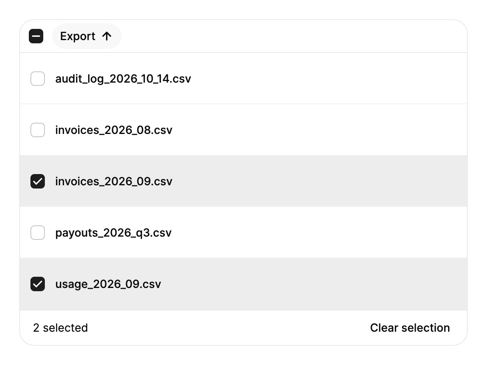

<Demo name="Projects" />

## When to use

`SortableDataTable` shows records that share the same fields and lets people compare them by column. It is the table
for a page where the records are the work: a billing history, a project list in an admin console, a user directory.
Each column sorts on its own, the rows can carry a checkbox for bulk actions, and a count line says how many rows
exist and how many are selected.

- **Invoices and billing history** on a billing page: sort by issue date or amount to find the latest or largest
  charge, then select rows to download or resend them.
- **Projects and workstreams** in an admin console: sort by owner, status or budget to see which work needs attention,
  with a status badge in a `CellTemplate` column.
- **Users in an internal directory**: select several people with the checkbox column, then run one bulk action such
  as deactivating accounts. The count line shows "3 selected" while the action is prepared.
- **Orders in a back office**: sort by total to find large orders, and use Shift + click to select a run of
  consecutive rows for a batch refund or export.
- **Export and job history** in a developer tool: list past runs with their status and duration, sorted by the column
  the person cares about, without any editing.

## When not to use

- **An order that people set by hand**, such as a release queue or a pinned list of priorities: use `ReorderableList`,
  because a column sort cannot express a custom order.
- **Events in time order**, such as an audit trail or an incident log: use `Timeline`, which shows the sequence and
  the gaps between events.
- **Narrowing rows by fields and search text**: put a `FilterToolbar` above the table and pass only the matching rows.
  The table sorts the rows it receives; it does not filter them.
- **Nested records**, such as folders that contain files: use `TreeView`, which expands and collapses each level.
- **Editing cells in place like a spreadsheet**: this table is read-only. Use a form built from `Input` and `Select`.

## Usage

Columns are declared in XAML. Each column reads its cell value through `Binding`, and the table sorts on that value
unless the column has a separate sort value.

```xml
<arc:SortableDataTable Caption="Projects"
                       ItemsSource="{Binding Projects}"
                       ItemNameOne="project"
                       ItemNameOther="projects"
                       SortKey="Budget"
                       SortDirection="Descending">
    <arc:SortableDataTable.Columns>
        <arc:DataTableColumn Header="Project" Key="Name" Binding="{Binding Name}" />
        <arc:DataTableColumn Header="Owner" Binding="{Binding Owner}" IsSortable="False" />
        <arc:DataTableColumn Header="Budget" Key="Budget" Binding="{Binding Budget}" IsNumeric="True" />
    </arc:SortableDataTable.Columns>
</arc:SortableDataTable>
```

`SortableDataTable` derives from Avalonia's `TemplatedControl`. It does not build on `ItemsControl` or `DataGrid`: it
draws its header, rows and count line itself. Cells are text by default, which keeps a row cheap to draw, and a
column that needs more than text sets `CellTemplate`.

### Anatomy

1. **Caption** (`Caption`): the table's accessible name. It is not drawn, so write a noun phrase such as
   "Invoices for October 2026".
2. **Header row**: 44 px tall including its 1 px rule. Header labels use the medium weight. A sortable header is a
   button; a column with `IsSortable="False"` is a plain label. The sorted column's cells carry the muted column tint.
3. **Select all checkbox** (`IsSelectable`, `SelectAllLabel`): a 44 px checkbox column at the start of the header, with
   8 px extra inset before the first column. It shows a mixed state when only some rows are selected.
4. **Body rows**: 52 px tall with a 1 px divider in the subtle border color and 16 px inline cell padding. `IsNumeric`
   columns align right. Hover fills the row, and the selection fill eases in on the standard tween at full motion.
5. **Count line** (`ItemNameOne`, `ItemNameOther`, `SelectedNoun`): a 44 px footer shown only when `IsSelectable` is
   true. It reads "6 projects" with no selection and "2 selected" with one. The text is muted until a row is selected.
6. **Clear selection** (`ClearSelectionLabel`): a 30 px ghost button in the footer, shown only while rows are selected.
7. **Empty row** (`EmptyMessage`): 120 px tall, in the muted text color.
8. **Loading veil** (`IsLoading`, `LoadingMessage`): covers the rows below the header with the surface color at 60%
   opacity, an 18 px spinner and the message in the muted color.
9. **Frame**: the surface background, a 1 px border in the border color and the control corner radius. Below 560 px
   of table width the table scrolls horizontally rather than squeezing its columns.

### Columns and sorting

The header is the default sort id, so `SortKey` and the sort events report `Header` unless you set `Key`. Choose the
property that fits the data:

| Column property | Use it when |
|---|---|
| `Binding` | The value is a property of the row item and a binding is enough. |
| `ValueSelector` or `DataTableColumn.Create<T>` | The app is published with AOT or trimming, or you prefer typed code without bindings. |
| `SortBinding` or `SortValueSelector` | The displayed text is not the value to sort by, such as a formatted amount that should sort as a number. |
| `Comparer` | The order is domain specific, such as release versions. It orders ascending; empty values still go last. |
| `IsSortable="False"` | The column is descriptive, such as a free-text note. |
| `IsNumeric="True"` | The column holds amounts or counts and should right-align. Leave it unset to detect numeric columns. |
| `Width` | A pixel width (`Width="120"`) keeps a column steady; `*` shares the space left over. |

Text sorts by natural order (digit runs compare as numbers, so "Item 2" comes before "Item 10"), numbers numerically
and dates by their own order. Empty values sort last in both directions.

### Selection

Set `IsSelectable` to show a checkbox column. Clicking a row selects it, Shift + click selects every row between the
last toggled row and the clicked one, and the header checkbox selects or clears every row. `SelectedItems` is
two-way, and the table updates a bound mutable list in place.

```xml
<arc:SortableDataTable ItemsSource="{Binding Projects}"
                       IsSelectable="True"
                       SelectedItems="{Binding SelectedProjects, Mode=TwoWay}">
    <arc:SortableDataTable.Columns>
        <arc:DataTableColumn Header="Project" Binding="{Binding Name}" />
    </arc:SortableDataTable.Columns>
</arc:SortableDataTable>
```

Selection follows the row item, or the key from `RowKeySelector` when you set it. Set `RowKeySelector` when a refresh
creates new objects for the same records, so the selection and the row motion keep following the same record.

### Cell content and formatting

Use `Formatter` for text, or `CellTemplate` for custom content such as a status badge. A `Formatter` receives the raw
value and returns the text, so pass a culture to it for amounts and dates. `StringFormat` is the simpler option for a
standard or composite format. When both are set, `Formatter` wins, and a null value shows an en dash.

```csharp
var table = new SortableDataTable { ItemsSource = projects, Caption = "Projects" };
table.Columns.Add(DataTableColumn.Create<Project>("Project", p => p.Name));
table.Columns.Add(DataTableColumn.Create<Project>("Budget", p => p.Budget, key: "Budget"));
table.Columns[1].Formatter = value => value is decimal amount ? amount.ToString("C0", CultureInfo.GetCultureInfo("en-US")) : "-";
table.Columns.Add(new DataTableColumn("Status", p => ((Project)p).Status)
{
    CellTemplate = new FuncDataTemplate<Project>((_, _) => new StatusPill())
});
```

Rows are recycled as the person scrolls, so a template control must read its content from the data context whenever
it changes. The status badge in the demos does this in `OnDataContextChanged`:

```csharp
public sealed record Project(string Name, string Owner, string Status, decimal Budget, DateOnly Due);

private sealed class StatusPill : Border
{
    private readonly TextBlock _text = new() { FontSize = 12 };

    public StatusPill()
    {
        Child = _text;
        Padding = new Thickness(8, 2);
        CornerRadius = new CornerRadius(999);
        HorizontalAlignment = HorizontalAlignment.Left;
    }

    protected override void OnDataContextChanged(EventArgs e)
    {
        base.OnDataContextChanged(e);
        _text.Text = (DataContext as Project)?.Status ?? string.Empty;
    }
}
```

### Sorting and events

Click a sortable header to sort ascending, and again to sort descending; a new column always starts ascending. With
`IsSortClearable` a third click clears the sort and returns the rows to the source order. `SortChanged` reports every
user sort and every call to `Sort`, and `SelectionChanged` reports user changes to the selection. `SortColumn`,
`SortKey` and `SortDirection` are two-way, so a view model can set or read the sort.

<Demo name="SortedFromCode" />

```csharp
table.SortChanged += (_, e) => status.Text = e.Column is null
    ? "Sort cleared"
    : $"Sorted by {e.Column.Header}, {e.Direction}";
table.SelectionChanged += (_, e) => status.Text = $"{e.SelectedItems.Count} selected";
table.Sort(table.Columns[1], DataTableSortDirection.Ascending);
```

### Binding to a view model

The view model owns the rows, the sort and the selection; the table reflects them. The table sorts the rows it is
given, so the view model sets `SortKey` and `SortDirection` and reacts to the selection instead of sorting its own
collection. The example uses CommunityToolkit.Mvvm.

```csharp
public sealed record Invoice(string Number, string Customer, decimal Amount, DateOnly Issued);

public interface IInvoiceService
{
    Task<IReadOnlyList<Invoice>> ListAsync();
    Task ResendAsync(IReadOnlyList<string> numbers);
}

public partial class InvoicesViewModel : ObservableObject
{
    private readonly IInvoiceService _invoices;

    public InvoicesViewModel(IInvoiceService invoices) => _invoices = invoices;

    [ObservableProperty]
    private ObservableCollection<Invoice> _rows = [];

    [ObservableProperty]
    private ObservableCollection<Invoice> _selectedRows = [];

    [ObservableProperty]
    private string? _sortKey = "Issued";

    [ObservableProperty]
    private DataTableSortDirection _sortDirection = DataTableSortDirection.Descending;

    [ObservableProperty]
    private bool _isBusy;

    [RelayCommand]
    private async Task RefreshAsync()
    {
        IsBusy = true;
        try
        {
            Rows = new ObservableCollection<Invoice>(await _invoices.ListAsync());
        }
        finally
        {
            IsBusy = false;
        }
    }

    [RelayCommand(CanExecute = nameof(HasSelection))]
    private Task ResendAsync() => _invoices.ResendAsync(SelectedRows.Select(r => r.Number).ToList());

    private bool HasSelection => SelectedRows.Count > 0;
}
```

```xml
<arc:SortableDataTable Caption="Invoices for October 2026"
                       ItemsSource="{Binding Rows}"
                       IsLoading="{Binding IsBusy}"
                       IsSelectable="True"
                       ItemNameOne="invoice"
                       ItemNameOther="invoices"
                       SortKey="{Binding SortKey, Mode=TwoWay}"
                       SortDirection="{Binding SortDirection, Mode=TwoWay}"
                       SelectedItems="{Binding SelectedRows, Mode=TwoWay}">
    <arc:SortableDataTable.Columns>
        <arc:DataTableColumn Header="Number" Key="Number" Binding="{Binding Number}" />
        <arc:DataTableColumn Header="Customer" Binding="{Binding Customer}" />
        <arc:DataTableColumn Header="Amount" Key="Amount" Binding="{Binding Amount}" IsNumeric="True"
                             StringFormat="C0" />
        <arc:DataTableColumn Header="Issued" Key="Issued" Binding="{Binding Issued}" StringFormat="d" />
    </arc:SortableDataTable.Columns>
</arc:SortableDataTable>
```

- `SortKey` and `SortDirection` are two-way: a sort the person chooses writes back, and the default "Issued"
  descending from the view model applies when the table loads.
- `SelectedItems` is two-way and needs an `ObservableCollection<Invoice>` target. `ResendAsync` reads the same list.
- Bind `IsLoading` to the busy flag so the veil covers the rows while the request runs.
- Rebuild the collection on refresh, or change an existing `ObservableCollection<T>`. The selection follows the row
  key, so it survives a refresh when the rows are the same objects or `RowKeySelector` returns the same key.
- Compiled bindings need `x:DataType` on the view (the examples here leave it out for brevity).

### Data shape and performance

Each row is one record with the same fields for every column. The table sorts the rows it is given on the client, so
it suits a result set that is already loaded. Only the rows near the viewport are realized, which keeps the
5,000-row demo below scrollable, and sorting reorders the indices rather than the row controls.

Sorting runs on every change to the source or the sort, so keep the sort value cheap: sort by a stored number or
`DateOnly`, not by a string built from several fields. For a result set in the tens of thousands, load one page at a
time and show `Pagination` under the table, so the table never holds more rows than a page needs.

### Empty and loading states

`EmptyMessage` shows when there are no rows, and `IsLoading` covers the rows with a veil named by `LoadingMessage`.
Write the empty message as a reason and a next step, especially after a filter.

<Demo name="EmptyAndLoading" />

```xml
<arc:SortableDataTable EmptyMessage="No projects match these filters"
                       IsLoading="{Binding IsBusy}" />
```

### Five thousand rows

The 5,000-row demo sets `IsSortClearable` and a 420 px maximum height, so the table scrolls inside its own frame and
the header stays in place.

<Demo name="FiveThousandRows" />

### Narrow

Below 620 px the rows fold into two lines, the row height grows to 64 px, and the header becomes a strip of sort pills
(32 px tall) with Select all pinned at the start. Clicking a pill sorts by its column and scrolls the pill into view.

<Demo name="Narrow" />

### Example: Export history with a selection

A developer tool lists the exports a team has produced. Each export is a file name, and the operator selects the ones
to download or delete. The rows are plain strings, so the column has no `Binding` and each cell shows the row item
itself; in an app the column would bind to a property such as `FileName`. The names are sorted ascending so the
exports group by type, and two rows are selected, so the count line reads "2 selected" and Clear selection appears.



```xml
<UserControl xmlns="https://github.com/avaloniaui"
             xmlns:x="http://schemas.microsoft.com/winfx/2006/xaml"
             xmlns:arc="https://github.com/AtomUICommunity/TKCode.Arc"
             xmlns:generic="using:System.Collections.Generic"
             Width="560">
    <arc:SortableDataTable Caption="Export history"
                           ItemNameOne="export"
                           ItemNameOther="exports"
                           IsSelectable="True"
                           SortKey="Export"
                           SortDirection="Ascending">
        <arc:SortableDataTable.ItemsSource>
            <generic:List x:TypeArguments="x:String">
                <x:String>invoices_2026_08.csv</x:String>
                <x:String>invoices_2026_09.csv</x:String>
                <x:String>usage_2026_09.csv</x:String>
                <x:String>payouts_2026_q3.csv</x:String>
                <x:String>audit_log_2026_10_14.csv</x:String>
            </generic:List>
        </arc:SortableDataTable.ItemsSource>
        <arc:SortableDataTable.SelectedItems>
            <generic:List x:TypeArguments="x:Object">
                <x:String>invoices_2026_09.csv</x:String>
                <x:String>usage_2026_09.csv</x:String>
            </generic:List>
        </arc:SortableDataTable.SelectedItems>
        <arc:SortableDataTable.Columns>
            <arc:DataTableColumn Header="Export" Width="*" />
        </arc:SortableDataTable.Columns>
    </arc:SortableDataTable>
</UserControl>
```

### Content guidelines

Table text is scanned, not read. Keep headers to one or two nouns and let the cells carry the detail.

| Instead of | Write |
|---|---|
| Total amount in USD (incl. tax) | Total |
| Date the invoice was issued on | Issued |
| 5 items are currently selected | 5 selected |
| No data | No invoices match these filters |
| Loading... please wait | Loading invoices |
| Select all records on this page | Select all invoices |


### Best practices

**Do**

- Set `Key` on columns whose header is a display label, so the sort id that events and the view model store stays
  stable when the label is translated.
- Set `IsNumeric="True"` on amount and count columns so the digits right-align.
- Set `RowKeySelector` when a refresh creates new objects for the same records, so the selection survives it.
- Give the table at least 560 px, the width below which it scrolls sideways, and test it below 620 px, where it
  folds into the compact layout.

**Avoid**

- Sorting by a formatted string such as "$1,200" without `SortBinding` or `SortValueSelector`: the text is compared by
  its digit runs, so "$1,200" sorts before "$900".
- Loading a very large data set without `Pagination`: the rows stay in memory and a sort runs over all of them on
  each click.
- Relying on color alone for a status. Keep the badge text in the cell so the status reads without color.
- Expecting the table to edit rows. It is read-only and does not track edits; open a form instead.

### Common questions

**Why does a numeric column sort as text?** The cell value is a string, usually because the binding returns a
formatted value. Bind the number, or set `SortBinding` (or `SortValueSelector`) to the numeric property.

**How do I clear the sort from code?** Call `Sort(null, DataTableSortDirection.None)`. The rows return to the source
order and `SortChanged` reports a null column.

**How do I select the rows that match a filter?** Set `ItemsSource` to the filtered rows and call `SelectAll()`, or
bind `SelectedItems` to the matching items. `ClearSelection()` clears the selection and moves focus to Select all.

**Can the table filter rows?** No. It sorts and selects the rows it receives. Filter in the view model or with a
`FilterToolbar`, and pass the filtered collection as `ItemsSource`.

## API reference

<!-- api: SortableDataTable -->

<!-- api: DataTableColumn -->

## Accessibility

- The table has its `Caption` as its name and exposes table, header and row roles.
- A sortable header is a button named like "Sort by Budget, currently ascending". The sort direction is part of the
  name, and the header also reports it as its item status (ascending, descending or none).
- The Select all checkbox shows a mixed state when only some rows are selected. Its name is `SelectAllLabel`, which
  defaults to "Select all rows".
- Sort and selection changes are announced in a polite live region without interrupting the current speech, such as
  "Sorted by Budget, ascending", "Sort cleared", "2 of 5 selected" and "Selection cleared".
- The table draws its own focus ring for keyboard focus only, and it suppresses the window's default focus adorner.

### Keyboard

| Keys | Action |
|---|---|
| `Left` / `Right` in a header | Move to the previous or next header control; Select all is the first one when selection is on |
| `Home` / `End` in a header | Move to the first or last header control |
| `Down` in Select all | Move to the first row's checkbox (only when `IsSelectable` is true and there are rows) |
| `Enter` / `Space` on a sortable header | Sort ascending, then descending; with `IsSortClearable` a third press clears the sort |
| `Enter` / `Space` on Select all | Select every row, or clear the selection when every row is already selected |
| `Up` / `Down` in the rows | Move to the previous or next row; `Up` from the first row returns to Select all |
| `Home` / `End` in the rows | Move to the first or last row |
| `PageUp` / `PageDown` in the rows | Move by about one screen of rows |
| `Enter` / `Space` on a row | Toggle the row's selection (only when `IsSelectable` is true) |
| `Shift` + `Enter` / `Space` on a row | Toggle the row, and give the rows from the last toggled row to this one the same new state |
| `Shift` + click on a row | Give the rows from the last toggled row to the clicked row the clicked row's new state |
| `Escape` | Clear the selection when rows are selected; with Clear selection focused, focus returns to Select all |

## Motion

- When the sort changes, surviving rows slide from where they were drawn to their new places on a smooth spring, and
  the sort arrow flips on a snappy spring.
- The selection count rolls to its new value, and Clear selection fades in with a short blur.
- Reduced motion reorders rows at once and only fades the count. Off jumps straight to the final state.

| Change | Full | Reduced | Off |
|---|---|---|---|
| Sort changes | Rows slide to their new places on a smooth spring; the sort arrow flips | Rows reorder at once | Immediate |
| Selection count changes | The count rolls to the new value | The count fades | Immediate |

## Related

- `TreeView` for records that nest, such as folders with children.
- `ReorderableList` when the user sets the order by dragging, not by a column.
- `FilterToolbar` to narrow the rows by fields and search before they reach the table.
- `Pagination` to split large record sets into pages.

| Component | Choose it when |
|---|---|
| `ReorderableList` | The person orders the items by dragging them, and no column describes the order |
| `Timeline` | The records are events in time order and the sequence matters more than the fields |
| `FilterToolbar` | The rows need filters or search fields above them before they are compared |
| `Pagination` | The result set is too large to load at once, and each page is a separate query |
| `TreeView` | The records nest, and people open and close each level |
| `CodeBlock` | The value is a snippet to read and copy, not a set of comparable records |
