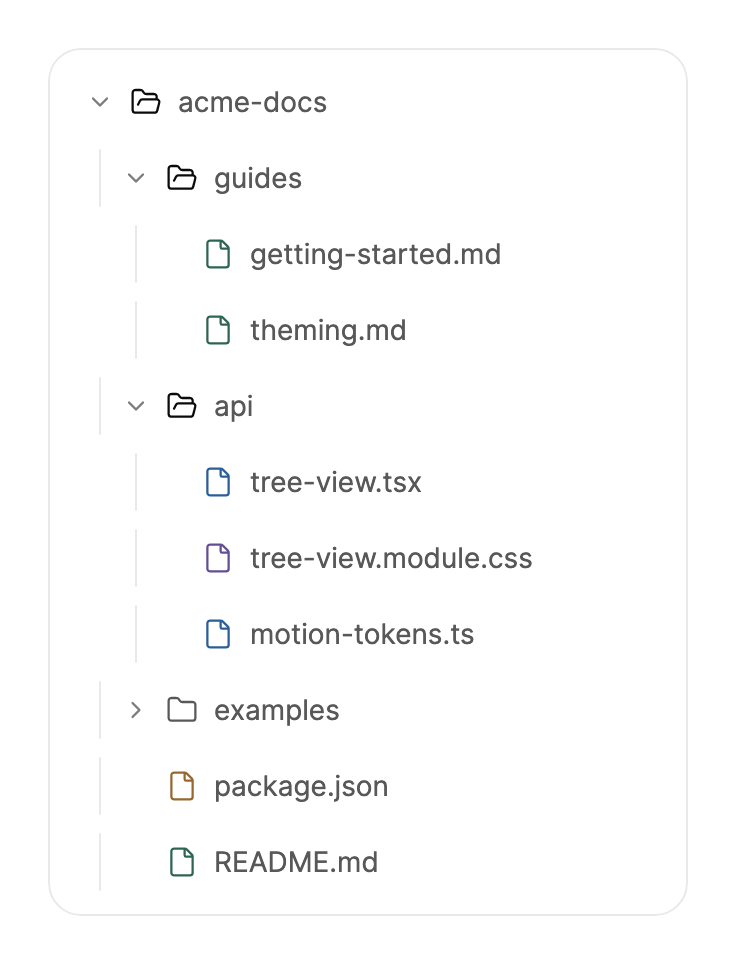

<Demo name="FileTree" />

## When to use

`TreeView` shows nested records that people open, close and select: folders and files, a chart of accounts, a
category hierarchy. It sits in the navigation of a page, and a selection in the tree usually drives the content beside
it, such as a preview, a form or a code viewer. Rows are drawn from a flat, virtualized list, so a large hierarchy
stays responsive.

- **Repository and file browsers** in a developer tool: folders and files open and close, and the selected file
  appears in a `CodeBlock` next to the tree.
- **Documentation and knowledge-base navigation** in an internal admin: sections nest several levels, and selecting a
  page loads it in the editor pane.
- **Chart of accounts and cost centres** in a finance app: parent accounts open to reveal their children, and the
  selected account drives the ledger view.
- **Organization and team structures** in an HR or admin console: departments contain teams, and teams contain
  people, with the selection opening the person's profile.
- **Media and asset libraries** with folders of thousands of files: the tree stays usable because only the rows near
  the viewport are created.

## When not to use

- **A few collapsible sections of content** that people read top to bottom: use `Accordion`.
- **The current location in a page hierarchy**: use `Breadcrumb`, which shows the path and links back up it.
- **The keys and values of one JSON document**: use `JsonViewer`, which shows the values beside their keys and
  supports search and copy.
- **A flat list that the user reorders**: use `ReorderableList`. A tree has no drag order between siblings.
- **Records with the same fields that people compare by column**: use `Table`. A tree shows one label per
  node and no columns.

## Usage

Nodes can be declared inline in XAML. A `TreeViewItem` with child items is a folder.

```xml
<arc:TreeView MinWidth="260" ShowIndentGuides="True">
    <arc:TreeView.Items>
        <arc:TreeViewItem Header="src" IsExpanded="True">
            <arc:TreeViewItem.Items>
                <arc:TreeViewItem Header="components">
                    <arc:TreeViewItem.Items>
                        <arc:TreeViewItem Header="button.tsx" />
                        <arc:TreeViewItem Header="tree-view.tsx" />
                    </arc:TreeViewItem.Items>
                </arc:TreeViewItem>
                <arc:TreeViewItem Header="lib" />
            </arc:TreeViewItem.Items>
        </arc:TreeViewItem>
        <arc:TreeViewItem Header="README.md" />
    </arc:TreeView.Items>
</arc:TreeView>
```

`TreeView` derives from Avalonia's `TemplatedControl`. It does not use Avalonia's nested item containers: it keeps one
flat list of pooled rows, so opening a folder costs the rows it reveals and the rest of the tree is not relayouted.
Inline `Items` suit a fixed navigation tree that you write in XAML. For data from a service or a database, bind
`ItemsSource`, which takes precedence over `Items` when both are set.

### Anatomy

1. **Frame**: the surface background with a 1 px border in the border color, a 16 px corner radius and 8, 6, 8, 8 px
   padding. The tree fills its width when you set `HorizontalAlignment` to `Stretch`, the default.
2. **Row**: 36 px tall with a 2 px gap below it, so each row takes a 38 px slot. Rows have a 10 px corner radius and
   10 px inline padding.
3. **Indent**: 18 px for each level. With `ShowIndentGuides` a short branch line in the border color joins nested rows
   to their parent.
4. **Chevron**: on a folder, the arrow that turns when the folder opens.
5. **Icon** (`ShowIcons`, `IconSelector`, `TreeViewItem.Icon`): a 16 px slot before the label. Folders show a folder
   icon that opens; files show a file icon. `Icon` and `IconSelector` take a 24 by 24 glyph, such as an `ArcIcons`
   member. With `ShowIcons` false the label starts at the indent.
6. **Label** (`Header`, `HeaderSelector`): the row text in the secondary text color. The active row uses the
   foreground color.
7. **Row fills**: a hover fill and a selection fill, both in the muted surface color. The selection fill glides from
   row to row.
8. **File tints**: `.ts` and `.tsx` files, and `.css`, `.md` and `.json` files, take a file-type tint. Other files use
   the muted text color.
9. **Focus ring**: drawn by the control for keyboard focus only.

### Choosing inline items or a data source

| Source | Use it when | Children |
|---|---|---|
| Inline `Items` | The tree is fixed navigation, small and written in XAML | Nested `TreeViewItem` elements |
| `ItemsSource` | The nodes come from data and change at run time | `ChildrenSelector` returns each node's children |

### Data with a children selector

Bind `ItemsSource` and set the selectors from code. `ChildrenSelector` returns the children of a node, and
a node with children is a folder.

<Demo name="DataWithChildrenSelector" />

```csharp
var tree = new TreeView
{
    ItemsSource = nodes,
    ChildrenSelector = item => ((FileNode)item).Children,
    HeaderSelector = item => ((FileNode)item).Name,
    Width = 300
};
tree.SelectionChanged += (_, e) => selected.Text = $"SelectedItem: {e.NewItem}";
tree.SelectedItem = nodes[0].Children![2];   // expands the ancestors of the node
```

`SelectedItem` is two-way, so it can be bound to a view model:

```xml
<arc:TreeView ItemsSource="{Binding Files}"
              SelectedItem="{Binding SelectedFile, Mode=TwoWay}" />
```

### Binding to a view model

In an MVVM app the view model owns the node data and the selection, and the tree reflects them. The example uses
CommunityToolkit.Mvvm. The node is a plain record, and the view model loads the tree and holds the selected node.

```csharp
public sealed record FileNode(string Name, IReadOnlyList<FileNode>? Children = null)
{
    public override string ToString() => Name;
}

public interface IRepositoryService
{
    Task<IReadOnlyList<FileNode>> GetTreeAsync();
}

public partial class WorkspaceViewModel : ObservableObject
{
    private readonly IRepositoryService _repository;

    public WorkspaceViewModel(IRepositoryService repository) => _repository = repository;

    [ObservableProperty]
    private ObservableCollection<FileNode> _files = [];

    [ObservableProperty]
    private FileNode? _selectedFile;

    [RelayCommand]
    private async Task LoadAsync() => Files = new ObservableCollection<FileNode>(await _repository.GetTreeAsync());
}
```

```xml
<arc:TreeView ItemsSource="{Binding Files}"
              SelectedItem="{Binding SelectedFile, Mode=TwoWay}"
              ShowIcons="True" />
```

Selectors are functions, which XAML cannot express, so set them once in the view's code-behind:

```csharp
Tree.ChildrenSelector = item => ((FileNode)item).Children;
Tree.HeaderSelector = item => ((FileNode)item).Name;
```

- `SelectedFile` is two-way. Setting it from the view model selects the node and opens its ancestors, so a deep link
  to a file shows the file.
- Use the same node instances after a refresh, or the selection and the open folders no longer match the rows. When
  the service returns new objects, map the selected node by its path and assign the new instance.
- Compiled bindings need `x:DataType` on the view (the examples here leave it out for brevity).

### Icons

`ShowIcons` turns icons on or off for the whole tree, and `IconSelector` supplies an icon for each data node. A
`TreeViewItem` takes its own `Icon` instead. Both take a 24 by 24 stroked geometry, and the `ArcIcons` members are
the usual source.

```csharp
tree.ShowIcons = true;
tree.IconSelector = item => ((FileNode)item).Children is null ? ArcIcons.File : ArcIcons.Folder;
```

### Expanding and collapsing from code

```csharp
tree.ExpandAll();
tree.CollapseAll();
tree.ToggleExpanded(folderNode);
tree.ScrollIntoView(fileNode);
tree.FocusItem(fileNode);
```

`ScrollIntoView` and `FocusItem` open the ancestors of the node first, so a node the person cannot see yet becomes
visible. `IsItemExpanded` reports whether a folder is open. For an inline `TreeViewItem`, `IsExpanded` is two-way and
the tree keeps it in sync.

### Events

`ItemInvoked` fires when a row is activated by a click, Enter or Space, including a row that is already selected.
`SelectionChanged` reports a change of the selected node. `ItemExpanded` and `ItemCollapsed` report folders that open
and close. Activating a folder selects it and toggles it, so a folder that opens from a click also raises
`ItemExpanded`.

```csharp
tree.ItemInvoked += (_, e) => OpenFile(e.Item);
tree.ItemExpanded += (_, e) => log.Text = $"Opened {e.Item}";
```

### Thousands of nodes

The tree has 40 folders with 250 files each. Rows are virtualized and pooled, and only the rows near the viewport are
realized, so opening a folder costs about one screenful of rows and the rest of the tree is not built.

<Demo name="ThousandsOfNodes" />

### Example: Docs repository browser

A docs team browses the repository of its component documentation. The tree sits in the left pane, and a `CodeBlock`
in the right pane shows the selected file, as in the File tree demo at the top of the page. Two folders are open by
default, so the reader sees the structure at a glance, and the folders that the team rarely edits stay closed. The
file tints show which files are code, styles, prose and configuration without any extra column.



```xml
<arc:TreeView Width="320"
              HorizontalAlignment="Left"
              ShowIndentGuides="True"
              ShowIcons="True">
    <arc:TreeViewItem Header="acme-docs" IsExpanded="True">
        <arc:TreeViewItem.Items>
            <arc:TreeViewItem Header="guides" IsExpanded="True">
                <arc:TreeViewItem.Items>
                    <arc:TreeViewItem Header="getting-started.md" />
                    <arc:TreeViewItem Header="theming.md" />
                </arc:TreeViewItem.Items>
            </arc:TreeViewItem>
            <arc:TreeViewItem Header="api" IsExpanded="True">
                <arc:TreeViewItem.Items>
                    <arc:TreeViewItem Header="tree-view.tsx" />
                    <arc:TreeViewItem Header="tree-view.module.css" />
                    <arc:TreeViewItem Header="motion-tokens.ts" />
                </arc:TreeViewItem.Items>
            </arc:TreeViewItem>
            <arc:TreeViewItem Header="examples">
                <arc:TreeViewItem.Items>
                    <arc:TreeViewItem Header="basic-tree.tsx" />
                </arc:TreeViewItem.Items>
            </arc:TreeViewItem>
            <arc:TreeViewItem Header="package.json" />
            <arc:TreeViewItem Header="README.md" />
        </arc:TreeViewItem.Items>
    </arc:TreeViewItem>
</arc:TreeView>
```

### Content guidelines

Node labels are names that people search for, so show them exactly as the source stores them.

| Instead of | Write |
|---|---|
| Untitled folder | The folder's real name, or "New folder" while it is being created |
| Documentation (42 files) | Documentation, with the count shown elsewhere in the page |
| Click to open file | No text; the row is the control |
| Files | Project files, or the name of the repository |
| Item 1 | The file name, such as theming.md |

- Keep labels as the stored name, including its case and extension, so people can match them to their repository.
- Keep the tree's accessible name specific: "Repository files" or "Chart of accounts" rather than "Tree".

### Best practices

**Do**

- Open the first one or two levels by default, so people see the structure without hunting for it.
- Use `ShowIndentGuides` for trees deeper than two levels, so the parent of each row is easy to see.
- Keep the same node instances across a refresh, so the selection and the open folders keep matching the rows.
- Bind `SelectedItem` two-way, so a deep link or a search result can select a node from the view model.
- Bound the tree's height with `MaxHeight` when it sits in a page with other content, so the scroll area is the tree.

**Avoid**

- Using the tree for a few sections of prose: an `Accordion` reads better and needs no keyboard model.
- Putting columns of data into the labels, such as sizes and dates. Use a `Table` for records.
- Expecting multiple selection. The tree has one `SelectedItem`, and a modifier key does not select a range.
- Nesting more than a few levels by default. Deep folders expanded at once make the structure hard to scan.
- Building the tree from a fresh copy of the data on every keystroke. Refresh it on a deliberate action.

### Common questions

**Why does a node with children not show its children?** `ItemsSource` needs a `ChildrenSelector`. Without one, each
node is a file. Return the child collection from the selector, or return null or an empty list for a file.

**How do I open the tree to a specific file?** Set `SelectedItem` to the node. The tree opens its ancestors and
scrolls the row into view. Use `ScrollIntoView` when you want to reveal a node without selecting it.

**Can the tree select several nodes?** No. `SelectedItem` holds one node, and the keyboard ignores modifier keys
such as Control, Alt and Meta. Use a `Table` with `IsSelectable` when people must pick several records.

**Does the tree sort its nodes?** No. It shows the nodes in the order you supply them, so sort the source before you
bind it.

## API reference

<!-- api: TreeView -->

<!-- api: TreeViewItem -->

### Event arguments

| Type | Member | Meaning |
|---|---|---|
| `TreeViewItemEventArgs` | `Item` | The node: a `TreeViewItem` or an item of `ItemsSource` |
| `TreeViewSelectionChangedEventArgs` | `OldItem`, `NewItem` | The previously selected node and the new one |

## Accessibility

- The tree has the name "File tree" by default. Set `AutomationProperties.Name` to name it for your content.
- Rows expose tree item roles with their level, position in the set, expanded state and selected state.
- Only the focused row is in the Tab order. Arrow keys, Home and End, PageUp and PageDown move between rows.
- Right arrow opens a folder or enters its first child. Left arrow closes a folder or moves to its parent.
- Enter or Space selects the row and toggles a folder. Typing a name moves to the next row that starts with it.
- The focus ring is drawn for keyboard focus only. Icons and indent guides are not announced.

### Keyboard

| Keys | Action |
|---|---|
| `Up` / `Down` | Move to the previous or next visible row |
| `Right` | Open a closed folder; on an open folder, move to its first child |
| `Left` | Close an open folder; otherwise move to the parent row |
| `Home` / `End` | Move to the first or last visible row |
| `PageUp` / `PageDown` | Move by about one screen of rows |
| `Enter` / `Space` | Select the row, raise `ItemInvoked`, and toggle a folder |
| Letters | Move to the next row whose label starts with the typed text |

The tree ignores key presses that use Control, Alt or Meta, so shortcuts of the window still work.

## Motion

- Opening a folder grows its space on a spring, and the new rows stagger in from the left.
- The selection highlight glides from row to row, and the folder arrow turns with a snappy spring.
- Closing a folder collapses its rows smoothly.
- Reduced motion shows and hides rows at once. Off jumps straight to the final state.

| Change | Full | Reduced | Off |
|---|---|---|---|
| A folder opens or closes | The space grows or collapses on a spring; new rows stagger in | Rows show or hide at once | Immediate |

The selection highlight glides between rows at full motion only.

## Related

- `Accordion` for a few sections of content that open and close.
- `Breadcrumb` to show where the current page sits in a hierarchy.
- `JsonViewer` for nested data that people inspect, with search and copy.
- `CodeBlock` to show the source of the file selected in the tree.

| Component | Choose it when |
|---|---|
| `Accordion` | A few sections of prose open and close, and the order is fixed |
| `Breadcrumb` | The page shows its place in a hierarchy and links back up it |
| `JsonViewer` | The nested data is one document that people inspect and copy |
| `CodeBlock` | The selected file's source is shown beside the tree |
| `Table` | The records share fields that people compare by column |
| `ReorderableList` | The person orders a flat list by dragging |
