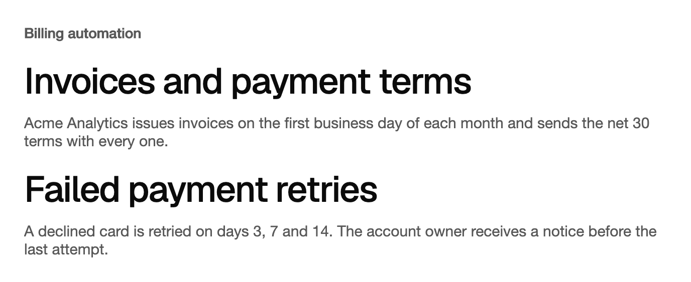

<Demo name="Variants" />

## 何时使用

视口内标题是长页面上的分节标题。它在有 45% 进入视口之前一直隐藏，然后以五种样式之一呈现。每个分节在读者看到它时才出现，因此长页面有了有节奏的入场效果，而无需为每个标题单独编排动画时间线。它适合人们从上到下阅读的页面：功能概览、产品导览、年度报告、安全或合规页面。

- **账单产品概览**："发票与付款条款"、"税务与增值税"和"付款失败"作为长篇落地页上的分节标题。每个标题在读者滚动到它时呈现，页面因此有节奏感，而应用中无需任何动效工作。
- **客户成功回顾**：季度报告，每章以标题开始。默认的 `Blur` 样式适合编辑式标题：读者看到的是平静的入场，而不是一阵动效。
- **帮助中心或新手引导**：当读者滚回某一步时，分节标题应使用 `IsReplayEnabled` 重新播放，让他们回到的那个标题清楚可见。
- **带固定断行的定价或套餐对比**：两行的标题，例如 "Pay for the seats you use." 与 "Add more when your team grows."。配合 `Lines` 使用 `Line` 变体，可在任何宽度下保持这些断行。

## 何时不用

- **页面加载时出现的首个标题**：用 `TextReveal`。视口内标题要等读者滚动到它才开始，因此页面顶部的大标题会在读者已经看到空白之后才开始出现。
- **持续进行的状态文字，例如"正在生成发票摘要"**：用 `TextShimmer`。它在工作进行期间循环播放；视口内标题只播放一次，然后保持静止。
- **正文、标签、表头或长段落**：用普通的 `TextBlock`。逐词呈现是为标题设计的，逐词出现的段落读起来很慢。
- **会就地变化的值，例如状态词或套餐名称**：用 `TextMorph`，它会把字母从旧标签移动到新标签。视口内标题不会为 `Text` 的变化播放动画。
- **用于展开和收起内容的标题**：用 `Accordion`，它为标题提供开关，并与之保持内容状态。

## 用法

```xml
<UserControl xmlns="https://github.com/avaloniaui"
             xmlns:arc="https://github.com/AtomUICommunity/TKCode.Arc">
    <arc:InViewTitle Text="模糊效果逐词变清晰"
                     Variant="Blur" />
</UserControl>
```

`InViewTitle` 派生自 Avalonia 的 `Control`，并自行绘制整个标题。它不会为每个词或每行创建子控件，因此一个有四十个分节标题的页面只持有四十个控件，而不是数千个。它按文字的尺寸测量，因此可以像任何标题一样放进 `StackPanel` 或 `Grid`。它以 `Text` 作为自身名称，并由 `Level` 设置标题级别，因此屏幕阅读器在页面大纲中看到的是真正的标题。

呈现从标题有 45% 可见时开始。页面打开时已可见的标题会立即开始；位于首屏以下的标题会等到读者滚动到它时才开始。默认变体为 `Blur`。

### 结构

1. **标题文字**（`Text`）：整个标题，根据变体绘制为一组词、行或字母。它的文字同时也是无障碍名称。
2. **标题级别**（`Level`）：设置字号与标题级别。`H1` 使用 4XL 展示字号，`H2`（默认）使用 3XL，`H3` 使用 2XL，`Paragraph` 使用 XL。四个级别都使用主题中的展示字体族、中等字重和展示字距。
3. **行框**（`Leading`）：行高为字号的 1.1 倍，取自标题令牌。因此两行标题约为 2.2 个字号的高度。
4. **前景**（`Foreground`）：标题颜色。主题从前景令牌设置它；未设置画笔时，标题以黑色绘制。
5. **显式分行**（`Lines`）：`Line` 变体可选的行列表。未设置时，整个 `Text` 视为一行。
6. **起始模糊**（`BlurRadius` 与 `SoftBlurRadius`）：`Blur` 变体中每个词的起始模糊（`BlurRadius`），以及 `Tracking` 变体中的起始模糊（`SoftBlurRadius`）。主题从模糊令牌同时设置两者。

### 选择变体

`Variant` 选择呈现样式。不透明度先上升，模糊在该样式有模糊时随后清除，位移最后稳定，因此标题在完全到位之前就已可读。页面上的大多数标题应使用同一种变体。

| 变体 | 移动内容 | 单元间隔 | 稳定耗时 | 适用场景 |
|---|---|---|---|---|
| `Blur`（默认） | 每个词从模糊中变清晰，并上升 0.2em | 60 ms，长标题会缩短 | 0.8 s | 大多数分节标题 |
| `Word` | 每个词从各自的裁剪区中上升 0.9em | 60 ms，长标题会缩短 | 0.8 s | 裁剪式上升符合版面的标题 |
| `Line` | 每一行从其裁剪区中上升 | 每行 80 ms | 0.86 s | 带固定断行的大标题（需要 `Lines`） |
| `Tracking` | 紧密的字距展开，同时每个词清除柔和模糊 | 每个字母 32 ms | 0.9 s | 短而醒目的开场，例如单行的首屏区域 |
| `Wipe` | 柔边遮罩从左到右揭开标题 | 无：整体为一个单元 | 0.9 s | 用作分隔线的单个短语 |

```xml
<arc:InViewTitle Text="文字从裁剪区中升起" Variant="Word" />
<arc:InViewTitle Text="柔和的擦拭揭开标题" Variant="Wipe" />
```

逐词错开的间隔为每词 60 ms，但标题词数较多时会缩短，使整个错开时长保持在 0.4 s 以内。因此十个词的标题，每个词在上一个词之后 40 ms 开始。长标题请选择 `Blur` 或 `Word`：错开时间短，标题很快就完整呈现。

只对短标题使用 `Tracking`。字母会在标题的整个宽度上展开，因此长标题在移动时看起来被拉伸。`Wipe` 要少用：它的遮罩会被看作横跨整个标题的一个动作，每页用一次很有效，若每个分节都这样做就会令人疲倦。

### 标题级别

`Level` 设置标题级别（`H1`、`H2` 或 `H3`），并同时设置对应的 `AutomationProperties.HeadingLevel`。默认为 `H2`。请根据页面大纲选择级别，而不是根据想要的字号。页面通常有一个作为标题的 `H1`，分节用 `H2`，分节内的子节用 `H3`。`Paragraph` 不设置标题级别，因此只用于不属于大纲的简短引导文字。

### 显式分行

`Lines` 为 `Line` 变体设置各行。各行按给定内容显示，不会重新排版。每一行在最窄的屏幕上都必须放得下，因此请以页面支持的最小宽度检查最长的一行。未设置 `Lines` 时，整个 `Text` 为一行。

```csharp
title.Variant = InViewTitleVariant.Line;
title.Lines = ["逐行升起，", "不再重新排版"];
```

只有当断行本身承载含义时才设置 `Lines`，例如标题把论断与其限定语配成一对。若文案应自然换行，请只用 `Text` 配合 `Word` 或 `Blur`。

### 每次进入都重播

`IsReplayEnabled` 会在标题离开视口时以快速淡出隐藏它，且没有错落效果。每次标题重新进入时都会再次播放。默认值为 `false`，因此标题只播放一次，然后保持可见。

```xml
<arc:InViewTitle Text="每次进入都会重播"
                 IsReplayEnabled="True"
                 Level="H3" />
```

对读者会滚回去的标题使用重播，例如长篇设置指南中，读者在后续步骤时会返回的某一步。页面上的其他标题请保持关闭，因为每次滚动都淡出再升起的标题，会与读者正在阅读的内容争抢注意力。

### 由数据驱动

`InViewTitle` 只负责显示：文字来自视图模型，呈现效果自行运行。绑定 `Text`，并在 XAML 中保留标题级别和变体。

```csharp
public partial class BillingOverviewViewModel : ObservableObject
{
    [ObservableProperty]
    private string _invoicesTitle = "发票与付款条款";

    [ObservableProperty]
    private string _failuresTitle = "付款失败";
}
```

```xml
<StackPanel Spacing="48">
    <arc:InViewTitle Text="{Binding InvoicesTitle}" Variant="Blur" />
    <arc:InViewTitle Text="{Binding FailuresTitle}" Variant="Blur" Level="H3" />
</StackPanel>
```

更改 `Text` 会更新文字，但不会再次播放呈现效果。入场动画属于标题进入视口的那一刻。请在每个页面上只设置一次文案。若标题的文字会随页面中的选择而变化，例如当前打开的发票名称，普通标题会更合适。

### 节制地使用动效

分节标题正是这种效果发挥作用的地方：读者已经在滚动，而标题标志着一个新观点的开始。动效很短（不到一秒），并在读者开始阅读其下的段落之前结束。

当页面上有许多动画各异的标题、当长列表的设置中每次滚动都重播标题，或当标题位于人们需要扫视数字的密集仪表板中时，动效就会分散注意力。对于这类页面，请保持默认的 `Blur`，关闭 `IsReplayEnabled`，让内容来承载页面。

减弱动效会去掉所有这些效果。当动效级别设为 `Reduced` 或 `Off` 时，标题会立即显示最终状态，没有位移、模糊或遮罩。请用 `arc:ArcMotion.Level` 在窗口或容器上设置级别，标题会继承该级别。

### 示例：账单产品功能页

账单产品的功能页面有一个纯文本页面标题，以及其下的两个分节：发票如何开具，以及付款失败如何重试。两个分节标题都使用 `Blur` 与 `H2`，使页面从第一节到最后一节都保持同一节奏。每个标题下的段落是普通文本，因此标题稳定后读者便可立即阅读。每个标题都是真正的 `H2`，这使屏幕阅读器看到的大纲保持正确。



```xml
<StackPanel Width="640" Spacing="16">
    <TextBlock Text="Billing automation"
               FontSize="14"
               FontWeight="SemiBold"
               Foreground="{arc:ArcDesignTokenResource TextSecondary}" />
    <arc:InViewTitle Text="Invoices and payment terms" Variant="Blur" />
    <TextBlock Text="Acme Analytics issues invoices on the first business day of each month and sends the net 30 terms with every one."
               TextWrapping="Wrap"
               FontSize="15"
               Foreground="{arc:ArcDesignTokenResource TextSecondary}" />
    <arc:InViewTitle Text="Failed payment retries" Variant="Blur" />
    <TextBlock Text="A declined card is retried on days 3, 7 and 14. The account owner receives a notice before the last attempt."
               TextWrapping="Wrap"
               FontSize="15"
               Foreground="{arc:ArcDesignTokenResource TextSecondary}" />
</StackPanel>
```

### 文案规范

分节标题应点明主题并保持简短。请写成句首大写的名词短语，末尾不加句号，并尽量在页面宽度下保持一行。标题是分节的标签，因此其下的段落承载解释。

| 不要写 | 改为 |
|---|---|
| "INVOICES & PAYMENTS" | "发票与付款条款" |
| "这里说明我们如何处理你发送的发票。" | "发票" |
| "准备好开始了！"（带感叹号） | "开始你的第一张发票" |
| "付款失败处理系统概览" | "付款失败" |
| "进一步了解增值税。" | "税务与增值税" |

### 最佳实践

**推荐**

- 页面上的大多数标题使用同一种变体。`Blur` 作为默认值是有原因的：它在每个分节都显得平静。
- 按页面大纲设置 `Level`：一个 `H1`，分节用 `H2`，子节用 `H3`。屏幕阅读器和大纲都依赖它。
- 只有当断行是信息的一部分时才使用 `Lines`，并在发布前于 360 px 宽的屏幕上检查每一行。
- 保持标题简短。一个折成四行的标题会延迟其下的段落，并削弱节奏。
- 在页面的整个生命周期内保持文案不变。更改文案不会重播呈现效果，因此这种变化不会被宣布。

**避免**

- 在同一页面混用 `Word`、`Line`、`Tracking` 和 `Wipe`。每种变体都有自己的时间安排，混用会显得杂乱而非有结构。
- 为每个标题都设置 `IsReplayEnabled`。重播是为读者会回头看的标题准备的；若每个标题都重播，它会与内容争抢注意力。
- 在长标题上使用 `Tracking`。字母会在整个宽度上展开，因此长标题在移动时看起来被拉伸。
- 必须立刻读到的标题，例如表单上方的警告。标题在 45% 可见之前一直隐藏，因此警告应使用 `Alert` 或普通文本行。
- 把标题当作状态行或计数器使用。对于会改变状态的文案，请使用 `TextShimmer` 或 `TextMorph`。

### 常见问题

**为什么我滚动到标题时它没有出现？** 当标题有 45% 位于可滚动视口之内时，呈现才会开始。从未显示过的标题，例如位于未选中标签页中的标题，要等它被显示并滚动进入视口后才会呈现。

**页面打开时，长页面顶部附近的标题已经可见。会怎样？** 挂载时已可见的标题会立即开始呈现。读者已经滚动越过的标题会直接显示最终状态而没有动效，因此在页面中段打开页面的读者，不会看到标题在他们身后播放入场效果。

**读者滚回上方时，标题会再次播放吗？** 只有设置 `IsReplayEnabled="True"` 才会。默认只播放一次。开启重播后，标题离开视口时会快速淡出，再次进入时完整呈现一遍。

**如何更改单个标题的字体？** 在控件上设置 `FontFamily`、`FontSize`、`FontWeight` 或 `Foreground`。这些本地值只覆盖该标题的主题设置。若想要与大纲匹配的标题字号，请改为设置 `Level`。

**能否为单个标题单独关闭动效？** 不能单独关闭。动效级别是继承的，因此在窗口或容器上设置 `arc:ArcMotion.Level="Reduced"`（或 `Off`），其下的每个标题都会立即显示最终状态。

## API 参考

<!-- api: InViewTitle -->

## 无障碍

- 标题以其完整文字作为名称，并由 `Level` 设置 `HeadingLevel`。`Paragraph` 标题不设置标题级别。
- 控件会报告文本角色。动画部分对辅助技术隐藏，因此只朗读文字。
- 页面打开时已滚动越过的标题会立即显示最终状态。
- `Text` 的修改不会被播报。当修改需要播报时，请在父元素上使用实时区域。
- 本控件不可获得焦点，也没有键盘交互，因此不会为页面增加焦点停靠点。

## 动效

- 标题在 45% 可见时开始呈现。不透明度先行，模糊随后清除，位移最后稳定。
- `Word` 与 `Line` 从裁剪区中升起，`Wipe` 从左到右揭开，`Tracking` 展开字距，`Blur` 使每个词变清晰。
- 启用 `IsReplayEnabled` 后，离开视口是快速淡出，没有错落效果。
- 减弱动效时标题立即显示，没有位移、模糊或遮罩。关闭动效时同样如此。

| 变化 | 完整 | 减弱 | 关闭 |
|---|---|---|---|
| 标题到达 45% 可见 | 各单元按变体的顺序在 0.8 到 0.9 s 内呈现 | 立即显示 | 立即显示 |
| 挂载时标题已滚动越过 | 立即显示 | 立即显示 | 立即显示 |
| 启用 `IsReplayEnabled` 时标题离开视口 | 快速淡出，没有错落效果（约 180 ms） | 保持可见 | 保持可见 |
| 启用 `IsReplayEnabled` 时标题重新进入 | 再次呈现 | 立即显示 | 立即显示 |

## 相关组件

- `TextReveal`：页面加载时只播放一次的首个大标题。
- `TextShimmer`：表示正在进行工作的状态文字。

| 组件 | 适用场景 |
|---|---|
| `TextReveal` | 标题是页面上的第一个元素，出现时应播放 |
| `TextShimmer` | 状态行显示仍在进行的工作 |
| `TextMorph` | 短标签改变状态，字母应从旧文字移动到新文字 |
| `Accordion` | 标题开启和收起其下方的内容 |
| `Alert` | 警告或消息必须立即阅读，且不需要呈现效果 |
