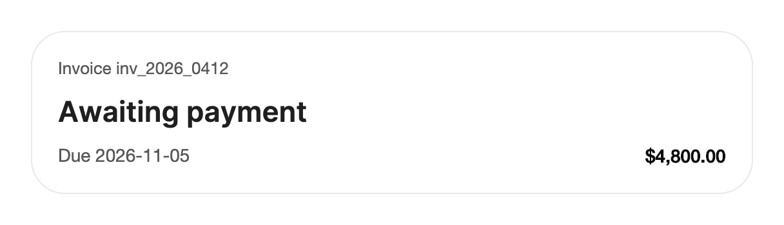

<Demo name="Status" />

## 何時使用

`TextMorph` 是一個會原地變更狀態的簡短標籤。它保持一行，依文字量測寬度，並把保持不變的字母移動到新位置，因此狀態變化讀起來是同一個標籤在更新，而不是一個新標籤出現。它適合在人們一眼掃過時閱讀的一行產品文案：狀態、方案名稱或在使用者注視時變化的價格。

- **發布看板上的部署狀態**：流水線卡片上的標籤從「部署」變為「部署中」，再變為「已部署」或「已回滾」。共用的字母保持原位，因此狀態變化時卡片不會閃爍。
- **帳單詳情頁首中的發票狀態**：「草稿」、「已寄出」或「已付款」，旁邊是編號 `inv_2026_0412`。在財務審查中，變化從房間另一端就看得見，無需小通知或對話方塊。
- **方案選擇器中的價格**：「$12 / 月」在使用者切換計費週期時變為「$120 / 年」。搭配 `PrefixSuffix`，只有金額變化；結尾的單位保持原位。
- **自訂控制項內的標籤**：徽章或分段標籤隨使用者操作改變文字，此時一般的 `Button` 無法提供合適的外形或行為。

## 何時不用

- **可點選且有自身狀態的控制項**：用 `Button`。`TextMorph` 只是文字，本身沒有點選、懸停或焦點行為。
- **複製後的確認**：用 `CopyButton`，它專為複製操作及其回饋而設計。
- **會換成多行的文字**：`TextMorph` 永遠為單行。請用一般的 `TextBlock`，或用 `TextReveal` 處理只播放一次的標題。
- **表示持續工作的狀態列**：用 `TextShimmer`。它在工作進行時在文字上掃過一道光；`TextMorph` 只在文字變更時移動字母。
- **需要完整閱讀的訊息**：用 `Toast`，它承載完整的句子並有自己的時間。變形的標籤太短，無法說明發生了什麼。
- **隨時間計數增減的數字**：用 `AnimatedCounter`。每秒變化的數字會讓字母一直在動，令人分心。

## 用法

將 `Text` 設為目前的標籤。控制項載入後 `Text` 變更時，字母會滑動、升起或淡入到新標籤。該控制項衍生自 Avalonia 的 `Control`，並自行繪製文字：它用文字版面量測每個字母並直接繪製，因此不會為每個字母建立子控制項。

```xml
<UserControl xmlns="https://github.com/avaloniaui"
             xmlns:arc="https://github.com/AIDotNet/TKCode.Arc">
    <arc:TextMorph Text="部署" FontSize="28" />
</UserControl>
```

```csharp
status.Text = "部署中";
```

控制項從 `TextElement` 取得字型與筆刷，與文字區塊相同。直接設定在控制項上的值優先於父元素上的值，主題設定了內文字型家族，因此未設定樣式的標籤已與內文文案一致。

### 結構

1. **標籤**（`Text`）：一行文字。字母逐個量測和繪製，因此文字不會被換行或截斷。
2. **字型**（`FontFamily`、`FontSize`、`FontWeight`）：來自主題的內文字型家族，字級與字重可在控制項或父元素上設定。修改其中任何一項都會以新字級重繪標籤，且無動畫。
3. **前景**（`Foreground`）：繪製字母的筆刷。與字型一樣從 `TextElement` 繼承。
4. **寬度**：控制項與目前文字等寬。寬度以彈簧方式跟隨變化，因此標籤周圍的空間（徽章邊緣或按鈕邊緣）會隨文字增長和縮小。
5. **動態區域**：進入的字母從下方上升 0.14em，離開的字母上移 0.1em。控制項不裁剪其內容，因此這些移動在量測框之外仍然可見。

### 切換狀態

狀態詞從一個狀態切換到下一個狀態。兩個標籤共有的字母會滑動到新位置。新字母以短暫的錯落效果升起，被移除的字母則淡出。例如當工作的狀態從伺服器抵達時，在程式碼中將 `Text` 設為下一個狀態。

```csharp
var words = new[] { "部署", "部署中", "已部署", "已回滾" };
var index = 0;
next.Click += (_, _) => status.Text = words[index = (index + 1) % words.Length];
```

狀態清單應簡短，並依使用者閱讀的順序排列。在彼此無關的詞之間跳轉（例如「部署」與「已回滾」）動畫仍然正確，但共用的字母很少，動態效果所傳達的含義也較少。對於這類組合請直接切換，不使用動態效果。

### 與檢視模型繫結

`TextMorph` 只負責顯示。狀態由檢視模型持有，標籤跟隨其文字。將 `Text` 繫結到字串屬性；每次變更都會是一次變形，因此只在狀態變化時設定該屬性。

```csharp
public partial class DeploymentViewModel : ObservableObject
{
    [ObservableProperty]
    private string _statusLabel = "部署";

    public void MarkRunning() => StatusLabel = "部署中";

    public void MarkDone(bool succeeded) => StatusLabel = succeeded ? "已部署" : "已回滾";
}
```

```xml
<arc:TextMorph Text="{Binding StatusLabel}" FontSize="28" FontWeight="SemiBold" />
```

不要把 `Text` 繫結到每一影格或每個計時週期都變化的值。每次變更都會觸發一次變形，因此每秒變十次的值會讓字母一直處於運動中。

### 比對方式

`Matching` 設定新舊文字之間如何配對字母。它接受 `TextMorphMatching` 值。

- `Occurrence`（預設）將每個字元與新文字中相同次序的字元配對。第二個 "i" 與新文字中的第二個 "i" 配對。適用於單字，字母會移動到字內的新位置。
- `PrefixSuffix` 保持共同的開頭與結尾不動，只取代中間部分。適用於價格和計數，此時數字變化而單位或貨幣符號不應移動。

<Demo name="PrefixAndSuffix" />

比對以單一字元為單位，因此字型會把其連在一起顯示為一個圖形的字元（連字，或組合表情符號）在變形時可能被拆開。依賴這類字串之前，請在實際字型中檢查。

### 字型

`TextMorph` 使用 `TextElement` 的字型與前景屬性。可以在控制項或其父元素上設定。

```xml
<arc:TextMorph Text="已儲存" FontSize="16" FontWeight="SemiBold" />
```

為整列設定樣式的父元素同樣有效，因此清單中的狀態標籤共用同一字級：

```xml
<StackPanel TextElement.FontSize="14"
            TextElement.FontWeight="Medium"
            TextElement.Foreground="{arc:ArcDesignTokenResource TextSecondary}">
    <arc:TextMorph Text="草稿" />
</StackPanel>
```

### 範例：帳單頁首中的發票狀態

帳單詳情頁首顯示發票編號、金額和狀態標籤。在使用者處理發票時，只有狀態會變化，因此它是唯一的 `TextMorph`。無論處於哪種狀態，卡片寬度都保持一致，因此標籤從「已寄出」變為「等待付款」時頁首不會移動。金額和到期日是保持不動的一般文字。



```xml
<Border Width="560"
        Padding="20"
        CornerRadius="{arc:ArcDesignTokenResource RadiusPanel}"
        Background="{arc:ArcDesignTokenResource Surface}"
        BorderBrush="{arc:ArcDesignTokenResource Border}"
        BorderThickness="1">
    <StackPanel Spacing="12">
        <TextBlock Text="Invoice inv_2026_0412"
                   FontSize="13"
                   Foreground="{arc:ArcDesignTokenResource TextSecondary}" />
        <arc:TextMorph Text="Awaiting payment"
                       FontSize="22"
                       FontWeight="SemiBold" />
        <Grid ColumnDefinitions="*,Auto">
            <TextBlock Grid.Column="0"
                       Text="Due 2026-11-05"
                       Foreground="{arc:ArcDesignTokenResource TextSecondary}" />
            <TextBlock Grid.Column="1"
                       Text="$4,800.00"
                       FontWeight="SemiBold"
                       Foreground="{arc:ArcDesignTokenResource Foreground}" />
        </Grid>
    </StackPanel>
</Border>
```

### 文案規範

變形標籤依設計應當簡短：一個詞或一個簡短片語，句首大寫，結尾不加句號。各狀態應屬於同一類詞，例如物件的狀態，這樣變化讀起來是狀態，而不是句子。數字用阿拉伯數字書寫，並讓單位與數字放在一起。

| 不要寫 | 改為 |
|---|---|
| 「你的發票現已寄送給客戶。」 | 「已寄出」 |
| 「全數付清」 | 「已付款」 |
| 「正在部署……」 | 「部署中」 |
| 「價格：每年 120 美元」 | 「$120 / 年」 |
| 「因故障而回滾」 | 「已回滾」 |

### 最佳做法

**建議**

- 每個狀態保持一到兩個詞。過長的標籤會讓寬度彈簧變化明顯，並推動相鄰的內容。
- 將標籤放在寬度固定的容器中，或放在足夠寬的 `Grid` 欄中，以容納最長的狀態。控制項寬度隨文字變化，因此不設限的標籤會推動其旁邊的內容。
- 在價格和計數上使用 `PrefixSuffix`，使標籤中穩定的部分保持原位。
- 只在狀態變化時修改標籤。每次變化都是使用者需要跟隨的動態效果，因此應盡量少。
- 當新狀態很重要時，在父元素上用即時區域宣告變化。控制項本身不會播報。

**避免**

- 將標籤繫結到每個計時週期都變化的值，例如計時器或進度百分比。字母永遠無法穩定，進度值更適合用 `Progress` 顯示。
- 把 `TextMorph` 用作有點選行為的按鈕標籤。控制項本身沒有點選或焦點行為。
- 長句或換行的文案。控制項是一行，過長的狀態會推動其周圍的版面。
- 依賴動態效果來傳達變化。減少動態效果和關閉動態效果會直接跳到新標籤，因此文字本身必須已經說明了變化的內容。
- 在控制項載入前設定標籤並期望它有動畫。首次文字會無動畫地出現。

### 常見問題

**為什麼我的標籤直接跳變而不變形？** 標籤只有在載入完成後才會變形，並且只在動態效果層級為 `Full` 時變形。在 `Reduced` 或 `Off` 下，變更會立即取代標籤。修改 `FontSize`、`FontWeight` 或 `FontFamily` 也會直接跳到新字級，因為字母是重新量測而非移動的。

**狀態變化時，標籤旁邊的一列為什麼會移動？** 控制項寬度以彈簧方式跟隨其文字，因此較長的狀態會把其旁邊的控制項推開。可在 `Grid` 欄中為標籤設定固定寬度，或量測最長的狀態並預留該寬度。

**將 `Text` 設為相同的值時，標籤會變形嗎？** 不會。變形只在文字變更時開始；再次設定相同的字串會讓字母留在原位。

**標籤能換成兩行嗎？** 不能。控制項永遠為一行。需要兩行的文字，標題請用 `TextReveal`，內文請用一般文字區塊。

**如何讓字母以另一種動態效果移動？** 動態效果由控制項固定。它的時間與距離都已內建，而視窗或容器上設定的動態效果層級（`arc:ArcMotion.Level`）決定它是否播放。選定狀態與對應的比對模式，其餘交給控制項即可。

## API 參考

<!-- api: TextMorph -->

## 無障礙

- 目前的文字即為控制項的名稱，輔助技術讀取的是純文字。
- 字母對輔助技術隱藏，因此變化不會被逐字母朗讀。
- 控制項本身不播報變化。需要播報新狀態時，請在父元素上使用即時區域。
- 在 `Reduced` 和 `Off` 動態效果下，新文字會立即出現，因此僅靠文字本身必須能傳達變化。
- 本控制項無法取得焦點，也沒有鍵盤互動，因此不會為頁面增加焦點停駐點。

## 動態效果

- 共用的字母在彈簧作用下滑動到新位置。
- 新字母從 80% 的尺寸開始放大並升起，同時淡入，依序出現。第一個在 50 ms 後開始，之後每個字母間隔 32 ms，最多八個字母。
- 被移除的字母在輕微縮小並稍微上移的同時淡出，然後消失。其退場為一個較短的標準淡出。
- 容器寬度以彈簧方式跟隨新標籤變化。字型或容器尺寸變化時，寬度無動畫地直接跳到新值。
- 減少動態效果時，標籤與寬度立即替換。關閉動態效果時同樣如此。

| 變化 | 完整 | 減少 | 關閉 |
|---|---|---|---|
| 共用字母移動 | 在彈簧作用下滑動到新位置 | 跳變 | 跳變 |
| 新字母出現 | 上升 0.14em 並淡入，錯落進行 | 跳變 | 跳變 |
| 被移除的字母 | 淡出，上移 0.1em，然後離開 | 立即移除 | 立即移除 |
| 標籤寬度 | 以彈簧方式變為新寬度 | 跳變 | 跳變 |
| 字型、字重或字級變化 | 直接跳到新字級 | 跳變 | 跳變 |
| 控制項載入前設定的文字 | 立即顯示，無動態效果 | 立即顯示 | 立即顯示 |

## 相關元件

- `Button`：用於可點選且有自身狀態的控制項。
- `TextShimmer`：表示持續工作的狀態列。
- `TextReveal`：出現時只播放一次的標題。

| 元件 | 適用情境 |
|---|---|
| `Button` | 標籤屬於一個可點選的控制項 |
| `CopyButton` | 標籤確認某內容已被複製 |
| `TextShimmer` | 狀態列顯示仍在進行的工作 |
| `TextReveal` | 標題出現時應播放一次 |
| `AnimatedCounter` | 數字隨時間增加或減少 |
| `Toast` | 必須閱讀完整句子，例如某操作的結果 |
