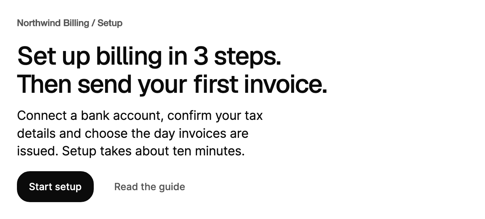

<Demo name="Hero" />

## When to use

`TextReveal` is a headline or a short paragraph that plays one entrance when it appears on screen. Each word rises out
of its own clip while it sharpens and fades in, so the first thing a person sees on a screen is a settled sentence
that arrived with a deliberate rhythm. It belongs at the top of a screen, where the reader's attention is on the
headline and not yet on the controls.

- **A welcome headline on a setup screen**: "Set up billing in three steps." at the top of a billing onboarding flow.
  The headline plays once when the screen opens, and the form below it is ready to use from the first frame.
- **A hero section on a pricing or product page**: the large headline of a landing page for an invoicing product,
  with a short paragraph under it that reveals word by word.
- **A release announcement at the top of a changelog page**: a headline that says what shipped, with its lines broken
  on purpose so the wording holds at every width.
- **A workspace home page greeting**: a headline such as "Good morning, Priya" that plays when the dashboard opens and
  stays put while the person works in the tables below it.

## When not to use

- **Section titles further down a page that should reveal as the reader scrolls**: use `InViewTitle`. A `TextReveal`
  mounted below the fold waits until it is visible, but it plays only once, and it is designed for the top of a screen.
- **A status line that keeps working, such as "Generating invoice summary"**: use `TextShimmer`. It loops while the
  work continues, where `TextReveal` plays once and rests.
- **Long body text**: use a regular `TextBlock`. The per-word effect is for headlines and short paragraphs only, and
  a long paragraph would keep the reader waiting for every word.
- **A label that changes state, such as "Draft" to "Sent"**: use `TextMorph`. A change to `Text` on `TextReveal` plays
  the whole entrance again, which is too much motion for a status word.
- **A warning or an error that must be read at once**: use `Alert`. A headline that reveals word by word delays a
  message the person needs straight away.

## Usage

```xml
<UserControl xmlns="https://github.com/avaloniaui"
             xmlns:arc="https://github.com/AIDotNet/TKCode.Arc">
    <arc:TextReveal Text="Interfaces that feel considered from the first frame"
                    Level="H1" />
</UserControl>
```

`TextReveal` derives from Avalonia's `Control` and draws the whole text itself. It does not create a child control per
word, so a headline with twenty words is one control with twenty clipped words inside it. It measures to its lines, so
it sits in a `StackPanel` or a `Grid` like any text. It names itself by its text, and a heading level sets the
heading role in the outline.

The control plays its entrance once. Text with `\n` breaks lines on purpose; lines are balanced and at most 24
characters wide.

### Anatomy

1. **Headline or paragraph** (`Text`): the words, drawn line by line. A `\n` in the text forces a line break.
2. **Level** (`Level`): `H1`, `H2`, `H3` or `Paragraph`. The level picks the font size, the font family and the line
   height: `H1` uses the 4XL display size, `H2` the 3XL size and `H3` the 2XL size, all in the display font at medium
   weight. `Paragraph` uses the large body size in the body font at regular weight.
3. **Line box** (`Leading`): 1.1 times the font size for headings and 1.4 for a paragraph, from the theme.
4. **Measure** (`MaxWidthInChars`): the text is at most 24 "0" glyph widths wide. Lines are balanced, so a long
   headline splits into lines of similar length rather than one long line and one short one.
5. **Word clip**: each word rises out of a clip with a soft bottom edge while it is still arriving. Once the entrance
   ends, the words are drawn as plain text, so nothing stays masked.

### Heading levels and paragraphs

`Level` sets the heading level (`H1`, `H2`, `H3`) or `Paragraph`. Headings use display type and tighter leading. A
paragraph uses body type, regular weight and a softer blur. The level also sets `AutomationProperties.HeadingLevel` for
headings: `H1` sets level 1, `H2` level 2 and `H3` level 3. A paragraph sets no heading level.

<Demo name="ForcedLinesAndDelay" />

<Demo name="Paragraph" />

Choose the level from the page outline, not from the size you want. A welcome screen usually has one `H1` or `H2`
headline; a short lead-in under it is a `Paragraph`.

### Line breaks and width

`\n` in `Text` forces a line break, and a forced break is kept at every width. The lines are balanced inside the
width limit, so a headline with a break reads as two lines of similar length on a wide screen and still fits a
narrow one.

`MaxWidthInChars` sets the width limit in "0" glyph widths. The theme sets 24, which keeps a headline near a comfortable
line length. Set it to `0` to disable the limit and let the headline use the full width of its parent. Keep the limit
on for a paragraph, because a paragraph that runs the full width of a 1440 px screen is hard to read.

```xml
<arc:TextReveal Text="Ship invoices on the day you close the books"
                Level="H2"
                MaxWidthInChars="30" />
```

### Delay and stagger

`Delay` waits before the first word rises. The stagger after it stays under half a second, so long text does not
extend the entrance. Each word starts after the one before it, and a forced line break adds one more step, so the
second line starts after the first has begun.

A short delay gives a related control time to settle first, for example a logo or a form that appears above the
headline. Keep the delay under half a second; a longer wait looks like a slow page.

```xml
<arc:TextReveal Text="Welcome back" Level="H2" Delay="0:0:0.4" />
```

### Replay

`Replay()` plays the entrance again. Call it from code, for example from a button click. It does nothing when the
control is not attached to a window. `IsRevealing` is `true` while the entrance runs, which helps when you want to
wait for it to finish before you show something below it.

```csharp
var hero = new TextReveal { Text = "Interfaces that feel considered from the first frame", Level = TextLevel.H1 };
var replay = new Button { Content = "Replay", Variant = ButtonVariant.Secondary };
replay.Click += (_, _) => hero.Replay();
```

Changing `Text` on a control that is on screen plays the entrance again, so the change is visible. Changing `Level`
does not replay it; the new size takes effect at once.

### Entrance before the first layout

A control that is mounted below the fold waits, hidden, until it first enters the viewport. A control that is on
screen when it mounts starts on its first frame. `IsRevealing` is `true` while the entrance runs.

### Tracking, leading and blur

`Tracking` sets letter spacing in em, `Leading` sets the line height as a multiple of the font size, and
`BlurRadius` sets the starting blur of each word. The level theme sets these values; override them only when a
headline needs a different rhythm.

```xml
<arc:TextReveal Text="Quiet by default" Level="H2" Tracking="-0.02" Leading="1.2" />
```

### Driving it from data

The text can come from a view model. Bind `Text` and keep the level in XAML. Because a text change replays the
entrance, change the property only when the screen changes, such as when the person picks a different workspace.

```csharp
public partial class WelcomeViewModel : ObservableObject
{
    [ObservableProperty]
    private string _greeting = "Good morning, Priya";
}
```

```xml
<arc:TextReveal Text="{Binding Greeting}" Level="H2" />
```

### Using motion with restraint

The entrance helps once per screen: it tells the reader where the page starts and gives a calm first impression. It
distracts when a screen holds several headlines that each play, when the headline sits next to a form the person has
to fill in quickly, or when the text changes often. For those screens, use one `TextReveal` at the top and plain text
below it.

Reduced motion keeps the words in order and removes the rise and the clip, so the words only fade in quickly. With
the motion level set to `Off`, the final text shows at once. Set the level on a window or a container with
`arc:ArcMotion.Level`, which the control inherits.

### Example: setup screen for a billing product

A setup screen for a billing product opens with a headline that names the three steps and a paragraph that says how
long they take. The headline is the only `TextReveal` on the screen, so the entrance marks the start of the flow. The
paragraph uses the `Paragraph` level, so it reads as body copy and its softer blur keeps it calm. The button is the
action, and it sits under the text where the reader's eye ends up after the paragraph.



```xml
<StackPanel Width="640" Spacing="16">
    <TextBlock Text="Northwind Billing / Setup"
               FontSize="13"
               FontWeight="SemiBold"
               Foreground="{arc:ArcDesignTokenResource TextSecondary}" />
    <arc:TextReveal Text="Set up billing in 3 steps.&#10;Then send your first invoice."
                    Level="H2" />
    <arc:TextReveal Text="Connect a bank account, confirm your tax details and choose the day invoices are issued. Setup takes about ten minutes."
                    Level="Paragraph"
                    MaxWidthInChars="44" />
    <WrapPanel ItemSpacing="12" LineSpacing="12">
        <arc:Button Content="Start setup" Variant="Primary" />
        <arc:Button Content="Read the guide" Variant="Ghost" />
    </WrapPanel>
</StackPanel>
```

### Content guidelines

A headline states the outcome in sentence case, without a final period or an exclamation mark. Keep it under about
ten words so the two-line balance holds. A paragraph under the headline says what the person does next and how long
it takes. Write numbers as digits, including a step count in a headline ("3 steps").

| Instead of | Write |
|---|---|
| "Welcome to the amazing billing setup!" | "Set up billing in 3 steps." |
| "CLICK HERE TO GET STARTED" | "Start setup" (on the button) |
| "Our revolutionary platform makes invoicing effortless." | "Send your first invoice today." |
| "We are so excited that you are here." | "Good morning, Priya" |
| "Step 1 of 3: connecting your bank account" | "Connect a bank account" |

### Best practices

**Do**

- Use one `TextReveal` at the top of a screen. The entrance tells the reader where the screen begins, and a second one
  competes with it.
- Keep the text short, so the headline settles within a second or so and the reader can start on the content below.
- Break lines with `\n` where the wording needs it, and check the break at a 360 px wide screen.
- Keep the level tied to the outline: `H1` or `H2` for the screen headline, `Paragraph` for the lead-in under it.
- Put the controls the reader needs next below the headline, so the reveal leads into the action.

**Avoid**

- Revealing body copy or long paragraphs. The word-by-word rhythm is slow to read at length, and the reader waits for
  each word.
- Changing `Text` on every update, such as a counter or a clock. Each change replays the entrance and the headline
  never settles.
- Using the effect for a status or a warning. A message the person must act on should be visible at once.
- Long delays. A `Delay` over half a second makes the page feel stalled, not considered.
- Expecting screen readers to announce a change. The control does not announce its text, so use a live region on a
  parent when a change must be read.

### Common questions

**Why does my headline appear with no animation?** The motion level is `Off`, or the text is empty. Under `Off` the
final text shows at once. An empty `Text` has no words to reveal.

**Why does my headline stay hidden until I scroll to it?** The control was mounted below the fold. It waits until it
first enters the viewport, then plays. Move it to the top of the screen if it should play when the screen opens.

**Does a headline play again when I navigate back to the screen?** Yes, if the control is removed from the visual
tree and attached again: each attachment starts a new check for the entrance. A control that stays in the tree plays
once. Call `Replay()` to play it without removing the control.

**Can I play the entrance and wait for it before I show a button?** Check `IsRevealing`. It is `true` while the
entrance runs and `false` after it ends. Under `Reduced` and `Off` the entrance ends at once or quickly, so the
button can wait on the same check in all three levels.

**How do I break a headline into exact lines?** Use `\n` in `Text`. Each piece between breaks is balanced against the
others, and a forced break is kept at every width. Check each piece fits the narrowest width the screen supports.

## API reference

<!-- api: TextReveal -->

## Accessibility

- Headings expose the full text as their name and set `HeadingLevel` 1 to 3. A paragraph is plain text.
- A forced line break is read as a space.
- The control does not announce its changes. Use a live region on a parent element when the text must be announced.
- The control is not focusable and has no keyboard interaction, so it adds no tab stop to the page.
- Choose the level from the page outline, not from the size you want.

## Motion

- Each word rises out of its own clip while it sharpens from a soft blur. Words start in order.
- The whole entrance plays once when the control appears on screen. It replays only when `Replay()` is called or when
  `Text` changes while the control is on screen.
- Reduced motion keeps the word order but removes the rise and the clip; the words fade in quickly.
- Off shows the final text at once.

| Change | Full | Reduced | Off |
|---|---|---|---|
| Control appears on screen | Words rise 0.62em, sharpen and fade in, word after word | Words fade in quickly, in order | Final text at once |
| Control mounts below the fold | Waits hidden, then plays when it enters the viewport | Waits, then fades in quickly | Final text at once |
| `Text` changes on screen | The entrance plays again | The fast fade plays again | Final text at once |
| `Replay()` | The entrance plays again | The fast fade plays again | Final text at once |
| `Level` or `Delay` changes | No replay; the new size or delay applies to the next entrance | No replay | No replay |

## Related

- `InViewTitle` for section titles that reveal as they scroll into view.
- `TextShimmer` for a status line that shows ongoing work.
- `TextMorph` for a short label that changes state letter by letter.

| Component | Choose it when |
|---|---|
| `InViewTitle` | A section title reveals as the reader scrolls to it |
| `TextShimmer` | A status line shows work that is still running |
| `TextMorph` | A short label changes state and the letters should move to the new text |
| `Alert` | A warning or a message must be read at once |
| `Card` | The headline sits on a card that holds its own content |
