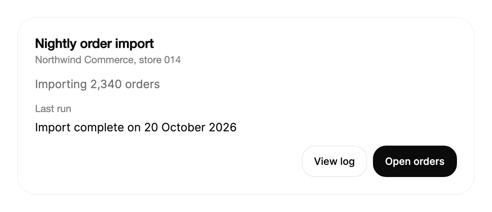

<Demo name="StatusLine" />

## When to use

`TextShimmer` is a single line of status text with a soft light that sweeps across it while work is running. It sits
where an application reports that something is still happening and has no measurable amount to show: in a status
bar, a page header, an activity row or an assistant's reply. The light says "still working" without a spinner, and
the words say what the work is.

- **An AI assistant that is still working**: a "Thinking" line above a reply, then "Generating summary" while a
  long answer is written. The label is the only thing that moves, so the reply area stays readable.
- **A background import or sync in an admin console**: a panel that shows "Importing 2,340 orders" while a nightly
  job runs. When the job ends, the same control switches to "Import complete" and the text settles in place.
- **A multi-step job whose steps are known only by name**: a workspace export that moves through "Reading 14 files",
  "Drafting a plan" and "Writing the summary". Each step replaces the text while the sweep keeps running.
- **A developer tool header while a build runs**: "Compiling 212 modules" in the top bar of a deployment view, with
  the sweep stopped once the build passes.
- **A finished label that stays on screen**: a status line that ends as solid text, such as "Summary ready", so the
  result reads as settled rather than as a loading state.

## When not to use

- **A placeholder for content that has not arrived yet**: use `Skeleton`, which shows the shape of the content. A
  shimmer over words tells people about work, not about layout.
- **Work with a known amount done**: use `Progress`, which shows how far the job has come. A sweep cannot show a
  percentage or a remaining time.
- **A label that changes letter by letter without a sweep**: use `TextMorph`, which morphs the characters into the
  next label.
- **Paragraphs or several lines of text**: use a plain `TextBlock`. The control is built for one short line and does
  not wrap.
- **A problem that needs the person to act**: a failed import, an expired session or a payment that was declined.
  Use `Alert` with the message and the next step. A sweep on a failed job says the work is still running, which is
  false.
- **Text that never changes and no work is running**: a page title or a field label. The sweep would only add noise.

## Usage

`TextShimmer` derives from Avalonia's `Control`, not from `TextBlock`, and draws its own text. Its `FontFamily`,
`FontSize`, `FontWeight` and `Foreground` properties default to the values inherited from `TextElement`, so it takes
the typography of the surrounding style without extra markup. Because it is one control that draws directly, a
busy label is one element on the page, not one element per letter. Keep the number of animated labels on a screen
small: one or two busy lines are readable, a row of six competes for attention.

```xml
<UserControl xmlns="https://github.com/avaloniaui"
             xmlns:arc="https://github.com/AtomUICommunity/TKCode.Arc">
    <arc:TextShimmer Text="Thinking" />
</UserControl>
```

The sweep runs while `IsActive` is `true`, which is the default. A new control therefore starts sweeping as soon as
it is shown. Set `IsActive` to `false` when the work ends, and the text settles to a solid color.

### Anatomy

1. **Base text** (drawn in `BaseForeground`): the resting color of the line. When `BaseForeground` is not set, the
   base is 12% of the `Foreground` color mixed into the muted text color in the OKLab color space. The theme sets the
   muted color to the TextMuted token, so the resting label keeps the palette of the text around it.
2. **Band**: a bell-shaped band in the `Foreground` color, 4.4 em wide (2.2 em on each side of its center). It is
   strongest at its center and fades to nothing at both edges. Internally it is the text drawn again through a
   moving mask, so the band follows the letters exactly.
3. **Solid text**: the `Foreground` color at full strength. It replaces the base once `IsActive` is `false`, and the
   band has left the line.
4. **Line**: one line of text at `FontSize` (14 px by default, from the TypeSM token), in `BodyFontFamily` at regular
   weight. The control measures the width of the text and the height of one line. It never wraps.

### Choosing the state

Use `IsActive` to say whether the work is still running, not to decorate the page. A shimmer on a label whose work
has finished tells people to wait.

- **Busy**: `IsActive="True"`, the default. The band runs and the accessible item status is "Busy".
- **Finished**: `IsActive="False"`. The band glides off and the text becomes solid. Keep the control in place, so the
  line settles where it was.
- **Idle before the first request**: create the control with `IsActive="False"`. It then shows solid text and does
  not run the loop until you set `IsActive` to `true`.

```xml
<arc:TextShimmer Text="Ready to import" IsActive="False" />
```

### Changing the text

A new `Text` value rises in place while the line springs to its new width. Keep `IsActive` on while the steps change,
so the band keeps running across the change.

<Demo name="ChangingAndFinishing" />

Write each step as a short present participle with its object, and keep each one on screen long enough to read. A
label that changes faster than people can read it becomes a blur of rising words.

### Finishing

Set `IsActive` to `false` instead of removing the control. The band glides off and the text becomes solid, so the
line does not jump, and the surrounding layout does not shift.

```csharp
summary.Text = "Summary ready";
summary.IsActive = false;
```

Set the final text and `IsActive` in the same step, so the finished label and its settled state appear together.

### Sweep speed

`SweepDuration` sets the time of one pass across the text. The default is 1.8 seconds. Each pass is followed by a
short rest, about a third of the duration, before the next one starts. Use a slower sweep when the page is calm and
the label is a long-running background task, such as indexing a workspace. Keep the default for an assistant reply
or a button state, where people expect a brisk signal.

<Demo name="SlowerSweep" />

`SweepDuration` takes a `TimeSpan`. In code, `TimeSpan.FromSeconds(3)` gives the same value as the XAML above.

### Size and color

The text uses the font properties of `TextElement`. A larger size suits a status heading; the band scales with the
font size, so the sweep looks the same at any size.

```xml
<arc:TextShimmer Text="Generating summary" FontSize="22" FontWeight="SemiBold" />
```

`Foreground` sets the color of the band and of the solid text. `BaseForeground` sets the resting color explicitly.
Set it when the default mix does not hold the contrast you need, for example on a dark header where the base must
stay readable while the band passes over it.

```xml
<arc:TextShimmer Text="Syncing orders"
                 Foreground="{arc:ArcDesignTokenResource Accent}"
                 BaseForeground="{arc:ArcDesignTokenResource TextMuted}" />
```

### Driving it from code

The control is display-only, so the view model owns the words and the busy flag, and the view binds them. The sweep
and the text change are handled by the control.

```csharp
public partial class ImportViewModel : ObservableObject
{
    private readonly IOrderImportService _imports;

    [ObservableProperty]
    private string _statusText = "Importing 2,340 orders";

    [ObservableProperty]
    private bool _isBusy = true;

    public ImportViewModel(IOrderImportService imports)
    {
        _imports = imports;
    }

    [RelayCommand]
    private async Task RunImportAsync()
    {
        IsBusy = true;
        StatusText = "Importing 2,340 orders";

        var result = await _imports.RunAsync();

        StatusText = result.IsSuccess ? "Import complete" : "Import needs attention";
        IsBusy = false;
    }
}
```

```xml
<arc:TextShimmer Text="{Binding StatusText}"
                 IsActive="{Binding IsBusy}"
                 FontSize="16" />
```

When the import fails, show the reason with `Alert` next to the line rather than only changing the wording of the
shimmer. The shimmer ends with `IsBusy` set to `false`, so it never claims that work is still running.

### Using motion with restraint

Motion helps when it marks the one thing that is still alive on a page. It distracts when several lines sweep at
once, when the sweep runs on a finished label, or when the words are only a decoration around the motion.

- **Where it helps**: a status row in a header or a panel where no other element moves, so the band tells people
  the job is running without a spinner.
- **Where it distracts**: a list of busy rows that all sweep, or a sweep faster than the default on a label that
  people read while they wait.
- **Reduced motion**: the band stops and the label swaps with a plain fade. The state must still read from the
  words alone, so write "Reading 14 files", not only a shimmer, and stop the sweep when the work ends.

To lower the motion for a part of the interface, set `arc:ArcMotion.Level="Reduced"` on the container. The level is
inherited, so every shimmer below it stops sweeping.

### Example: nightly import panel

A panel in an admin console that shows a nightly order import. The busy line says what the job is doing and how
many orders it covers, so people can judge the wait from the words. Below it, the finished line of an earlier run
is the same control with `IsActive` set to `false`, so the two states read as one component. The action row uses
the secondary button for the log and the primary button for the next step.



```xml
<Border Width="640"
        Padding="24"
        CornerRadius="{arc:ArcDesignTokenResource RadiusPanel}"
        Background="{arc:ArcDesignTokenResource Surface}"
        BorderBrush="{arc:ArcDesignTokenResource BorderSubtle}"
        BorderThickness="1">
    <StackPanel Spacing="16">
        <StackPanel Spacing="4">
            <TextBlock Text="Nightly order import"
                       FontSize="{arc:ArcDesignTokenResource TypeLG}"
                       FontWeight="SemiBold"
                       Foreground="{arc:ArcDesignTokenResource Foreground}" />
            <TextBlock Text="Northwind Commerce, store 014"
                       Foreground="{arc:ArcDesignTokenResource TextMuted}" />
        </StackPanel>
        <arc:TextShimmer Text="Importing 2,340 orders" FontSize="16" />
        <StackPanel Spacing="8">
            <TextBlock Text="Last run"
                       Foreground="{arc:ArcDesignTokenResource TextMuted}" />
            <arc:TextShimmer Text="Import complete on 20 October 2026" FontSize="16"
                             IsActive="False" />
        </StackPanel>
        <StackPanel Orientation="Horizontal" Spacing="8" HorizontalAlignment="Right">
            <arc:Button Content="View log" Variant="Secondary" />
            <arc:Button Content="Open orders" />
        </StackPanel>
    </StackPanel>
</Border>
```

### Content guidelines

The words carry the meaning, so write them as the status of the work, not as a mood.

- **Busy label**: a present participle with its object or a count: "Reading 14 files", "Generating summary". Use
  digits for counts so the number reads at a glance: "2,340 orders", not "two thousand orders".
- **Finished label**: the result as a short noun phrase or past participle: "Summary ready", "Import complete".
- **Length**: keep the line under about 40 characters, so it fits a status bar or a header on a narrow window.
- **No vague waiting copy**: name the work, not the wait. "Please wait" tells people nothing about what is happening.

| Instead of | Write |
|---|---|
| Loading... | Reading 14 files |
| Please wait | Syncing orders |
| Processing | Importing 2,340 orders |
| Done! | Summary ready |
| Thinking about your request | Thinking |

### Best practices

**Do**

- Put the meaning in the words. The band only shows that work is live; reduced motion and assistive technology remove
  it, and the label must still say what the work is.
- Set `IsActive` to `false` when the work ends, rather than removing the control. The text settles in place, so the
  layout around it does not shift.
- Keep one busy label per region and each label on one line. The control is built for a short status line, and a
  second line of sweep competes with the first.
- Show the failure with `Alert` and stop the sweep when the job fails. A sweep means the work is still running.

**Avoid**

- Using the shimmer as a placeholder for content that has not loaded. Use `Skeleton`, which shows the shape of the
  content, so people see what will appear.
- Leaving `IsActive` on after the work is done, or on a label that has nothing to wait for. The sweep then
  contradicts the page.
- Changing the text on a timer faster than people can read it. Each change rises in with a blur, and a stream of
  them reads as noise instead of progress.
- Setting a `BaseForeground` that is close to the background. The resting base must stay readable while the band is
  elsewhere on the line.
- Using the shimmer on a label that is also the only status message for an error. Use `Alert` for errors so the
  message does not depend on motion.

### Common questions

**Why does the sweep stop when the label scrolls out of view or its window is hidden?** The control runs its loop
only while it is visible, attached to the tree, within 64 px of the viewport and at the Full motion level. It does
not spend frames on a label that nobody can see, and it resumes from the position where it stopped.

**How do I stop the sweep without hiding the text?** Set `IsActive` to `false`. The text becomes solid and stays
visible, which is what a finished state should look like. To stop it for a whole region because the person asked for
less motion, set `arc:ArcMotion.Level="Reduced"` on the container; the sweep stops and the label swaps with a fade.

**Does the text wrap when the column is narrow?** No. The control is one line. Shorten the label or give the
control more room; do not rely on wrapping.

**How do I make the sweep slower or change its colors?** Set `SweepDuration` for the speed, `Foreground` for the
band and solid color, and `BaseForeground` for the resting color. `FontSize` and `FontWeight` change the text
itself.

**Does the control announce its changes to a screen reader?** No. Its text is the accessible name and its item status
reads "Busy" while it sweeps. To announce the finished state, put a live region on the parent, or announce the
message in the same step that sets `IsActive` to `false`.

## API reference

<!-- api: TextShimmer -->

## Accessibility

- The `Text` value is the control's accessible name, and the control reports itself as a text element.
- While `IsActive` is `true`, the item status is "Busy". It is cleared when `IsActive` is `false`. Not every
  assistive technology exposes item status, so the words must carry the meaning on their own.
- The sweep is decorative. Nothing is read letter by letter, and the band is not a separate element.
- The control does not announce changes. Put the finished state in a live region on a parent element, as described
  in the common questions above.
- The control does not switch to system colors for high contrast. Choose `Foreground` and `BaseForeground` from the
  theme so that both the band and the resting base keep the contrast the page needs.
- The control takes no focus and has no keyboard interaction, so there is no keyboard table. Nothing in it can be
  reached with `Tab`.

## Motion

- The band sweeps across the text once per `SweepDuration`, rests briefly, then sweeps again. The first pass waits a
  moment after the control starts.
- The sweep runs only while the control is active, visible, within 64 px of the viewport and at the Full motion
  level. It resumes where it stopped.
- A new label rises in from below with a soft blur while the line springs to its new width. The outgoing label
  leaves upward with a shorter blur.
- Setting `IsActive` to `false` glides a band in flight off the text, then the text becomes solid. Setting it back to
  `true` returns the line to its resting base.
- Reduced motion stops the sweep and swaps labels with an instant fade. Off swaps labels at once and settles the
  state without animation.

| Change | Full | Reduced | Off |
|---|---|---|---|
| Sweep band | Crosses the text once per `SweepDuration`, then rests | No band; the text shows its resting base | No band; the text shows its resting base |
| A new `Text` value | Rises in with a soft blur over 240 ms; the old text leaves over 160 ms | Instant fade over 120 ms | Immediate |
| Width after a text change | Springs to the new width while the labels change | Jumps to the new width | Immediate |
| `IsActive` to `true` | The text returns to the resting base over 240 ms | Instant fade over 120 ms | Immediate |
| `IsActive` to `false` | The band glides off over up to 420 ms, then the text is solid over 360 ms | Solid text over 120 ms | Immediate |

## Related

- `Skeleton` for placeholder content while a page loads, and `Progress` for work with a measurable amount done.
- `TextMorph` for a short label that changes letter by letter, and `Alert` for a message that needs action.

| Component | Choose it when |
|---|---|
| `Skeleton` | Content is loading and the page needs placeholder shapes that match the final layout |
| `Progress` | The amount of work done is known and can be shown as a bar or a value |
| `Stepper` | The job has fixed, named steps and people need to see where they are in them |
| `TextMorph` | A short label changes state and the letters should morph into the next label |
| `Alert` | A failure, an expired session or a result needs the person's attention and a next step |
| `TextReveal` | A heading or a short paragraph enters the page for the first time |
