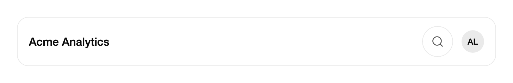

<Demo name="HeaderSearch" />

## When to use

`ExpandingSearch` is a search for a crowded header or toolbar. At rest it is a 44 px circle with a search glyph, so it
costs no more room than an icon button. When the person activates it, the circle grows into a text field and the
matching results open beneath it in groups. It fits where a full search field would take space the page needs for
navigation, titles and actions, and where search is an occasional way to jump somewhere rather than the main task.

- **Project and document jump in a SaaS console header**: a Northwind workspace header with a notification bell and an
  avatar. Typing "atlas" opens the Atlas redesign project, and the person is in the right place in two keystrokes.
- **Recent items before the person types**: `Suggestions` shows the three documents or dashboards the person opened
  most recently under a "Recent" heading, so the field is useful before any text is typed.
- **Dashboard and report switching in an analytics app**: a toolbar that already holds a date range and an export
  button. The search finds one of 200 dashboards by name, a keyword or its owner's team without a second row of controls.
- **Support and operations tools**: a ticket, customer or order lookup in the top bar of an internal console. Each
  result has a title and one meta line (for example "Order · Paid · 12 Mar 2026"), which tells two similar results apart.
- **Settings and admin navigation**: a compact way to reach a settings page from any screen, where the list of pages is
  short enough to match on titles and keywords.

## When not to use

- **Filtering a table, list or grid already on the page**: use `SearchField`, which filters in place with a clear button
  and `SearchSubmitted`. An expanding field hides its filter behind a click, so people do not see that the list narrowed.
- **Choosing a value that is stored in a form**: use `Combobox` or `Select`. Those keep the chosen value as a field of the
  form and support validation; this control only reports the item that was chosen.
- **A global command palette that runs actions**: use the `CommandPalette` block from the gallery, which is built for
  commands with shortcuts and categories. `ExpandingSearch` is for finding records and places.
- **A search over thousands of records with server paging**: the control ranks the items it is given in memory on every
  keystroke. Query the server with `SearchField` and show the page of results in a `Table` or `DataGrid`.
- **A search that must stay visible**: a results list that a person reads through (for example, a message search with
  snippets over several lines) needs room. Put it on a page with `SearchField` and a result list.
- **A single fixed choice in the header**, such as a workspace switcher: use `DropdownMenu` or `Select`, which keep the
  options visible and labelled.

## Usage

```xml
<UserControl xmlns="https://github.com/avaloniaui"
             xmlns:arc="https://github.com/AtomUICommunity/TKCode.Arc">
    <arc:ExpandingSearch Label="Search projects and docs"
                         MaxResults="6"
                         ExpandedWidth="360" />
</UserControl>
```

`ExpandingSearch` derives from Avalonia's `TemplatedControl`. Its template is a button that covers the collapsed
circle, a shell that grows with the field, and a field built on Avalonia's `TextBox`. Caret, selection, IME composition
and the clipboard shortcuts therefore behave as they do in a text box. The results list is a popup that is anchored to
the field, so it is never clipped by the header it sits in. The control adds the state machine: opening, closing,
highlighting and choosing.

### Anatomy

1. **Trigger button**: a transparent button that covers the collapsed circle. Its name is `Label`. The circle is 44 px,
   the height of the medium control size.
2. **Search glyph**: an 18 px Lucide search icon placed 12 px from the leading edge of the circle. It uses the secondary
   text color at rest and the foreground color when the field is open or focused.
3. **Shell**: a 1 px border on the surface color. It uses the default border color at rest, the strong border color while
   the field is open, and the foreground color while the field or the button has focus. The shell's corner radius
   travels from a circle to the control radius as it widens.
4. **Focus ring**: a 3 px halo outside the shell in the focus color. It shows for keyboard focus only.
5. **Field text and placeholder**: the text runs at the body size (14 px) with a 38 px leading inset and a 40 px
   trailing inset that keeps text clear of the clear button. `PlaceholderText` shows in the muted text color while the
   field is empty; when it is not set, `Label` is the placeholder.
6. **Clear button**: a 28 px round button, 7 px from the trailing edge, with a 16 px close glyph. It appears only while
   the field has text. It is not focusable; the keyboard clears the query with `Escape`, which also folds the field.
7. **Results panel**: a floating surface on the raised surface color with the floating shadow and the panel radius. It
   sits 8 px below the field, follows the field's width and is at most 352 px tall or 60% of the window height, whichever
   is smaller. Longer lists scroll inside it.
8. **Group heading**: the group name (`Group`) in the muted color, 12 px, medium weight, above its rows.
9. **Result row**: at least 48 px tall, with 12 px horizontal and 6 px vertical padding and a 20 px corner radius. It
   holds an optional 18 px icon (`Icon`), the title at 14 px with the matched text in medium weight, and an optional
   meta line at 12 px in the muted color.
10. **Empty state**: the title "No results for" followed by the query in quotes, and the `EmptyHint` line in the muted
    color.

### Items and suggestions

Fill `ItemsSource` with `ExpandingSearchItem` objects. Each item has an `Id` (a stable key, which falls back to the
title when empty), a `Title`, and optional `Meta`, `Group`, `Icon`, `Keywords` and `Tag`. `Keywords` are extra words that
find the item without being shown. `Tag` is any object you want back when the item is chosen, such as the record or
its route. Inline `Items` added in XAML work the same way: the control observes changes to that list.

`Suggestions` is a second list that appears before anything is typed, under the heading `SuggestionsLabel` (the default
heading is "Recent"). Suggestions are not filtered by the query; they are replaced by the results as soon as the person
types.

```csharp
var items = new List<ExpandingSearchItem>
{
    new() { Id = "q3", Title = "Quarterly report", Meta = "Doc · Edited 2 hours ago", Group = "Docs" },
    new() { Id = "atlas", Title = "Atlas redesign", Meta = "Project · 12 open tasks", Group = "Projects" },
    new() { Id = "billing", Title = "Billing migration", Group = "Projects", Keywords = ["invoices", "payments"] }
};

header.ItemsSource = items;
header.Suggestions = new[] { items[0], items[1] };
header.SuggestionsLabel = "Recent";
```

#### How results are ranked

Matching is case-insensitive and uses the trimmed query. Each item gets the best of four match tiers, and lower tiers
sort first:

| Tier | The query matches | Example for "report" |
|---|---|---|
| 1 | The start of the title | "Report automation" |
| 2 | The start of a word in the title (after a space, `-` or `/`) | "Quarterly report" |
| 3 | Text inside a word in the title | "Subreport tools" |
| 4 | The meta line or a keyword, when the title does not match | "Revenue", with the meta "Monthly report" |

Items with no match are dropped. Items in the same tier keep the order in which they were supplied. `MaxResults`
(default 6) applies after ranking, so the best matches stay when the list is cut. Results are then grouped under their
`Group` headings, and the groups appear in the order their first item appears in the source list, not in the order of
the best match. Only the matching items of each group are shown.

Because the tiers come first, a short item that starts with the query beats a long item that only contains it. Give
titles the words people actually type, since the start of the title carries the most weight.

### Selection

A result is chosen in two ways: the person presses `Enter` on the highlighted result, or clicks a row with the left
mouse button. Either way the choice runs in the same order:

1. The field folds back into the icon and the query is cleared.
2. Focus returns to the trigger button.
3. `ItemSelected` is raised with the chosen item in `e.Item`. The event bubbles, so a handler higher in the tree also
   sees it.
4. `SelectCommand` runs with the chosen item as its parameter, if the command can execute.

Use `SelectCommand` in an MVVM app, and the event when the code-behind needs to act on the item directly.

```csharp
header.ItemSelected += (_, e) => Open(e.Item.Id);
```

```xml
<arc:ExpandingSearch Label="Search"
                     ItemsSource="{Binding Items}"
                     SelectCommand="{Binding OpenCommand}" />
```

### Binding to a view model

The view model owns the items, the query and the navigation. The control shows the results and reports the choice.
`Query` and `IsExpanded` are two-way; `ItemsSource`, `Suggestions` and `SelectCommand` are one-way.

```csharp
public partial class HeaderViewModel : ObservableObject
{
    private readonly INavigationService _navigation;

    public HeaderViewModel(INavigationService navigation)
    {
        _navigation = navigation;
    }

    [ObservableProperty]
    private string _searchText = string.Empty;

    [ObservableProperty]
    private bool _isSearchOpen;

    public ObservableCollection<ExpandingSearchItem> SearchItems { get; } = new();

    public ObservableCollection<ExpandingSearchItem> RecentItems { get; } = new();

    [RelayCommand]
    private void OpenResult(ExpandingSearchItem? item)
    {
        if (item is null)
        {
            return;
        }
        IsSearchOpen = false;
        _navigation.Open(item.Id);
    }
}
```

```xml
<arc:ExpandingSearch Label="Search projects and docs"
                     ItemsSource="{Binding SearchItems}"
                     Suggestions="{Binding RecentItems}"
                     SuggestionsLabel="Recent"
                     Query="{Binding SearchText, Mode=TwoWay}"
                     IsExpanded="{Binding IsSearchOpen, Mode=TwoWay}"
                     SelectCommand="{Binding OpenResultCommand}" />
```

- `Query` is two-way and follows each keystroke. Collapsing the field, by `Escape` or by a choice, clears it and the view
  model sees the empty string. Setting it from the view model updates the field.
- `IsExpanded` is two-way. Setting it to `True` opens the field and focuses it; the control sets it back to `False`
  when it folds. Use it to open search from a keyboard shortcut in the window.
- Run the search where `Query` changes (in its setter or a property-changed handler) if it must run as the person types.
- `ItemsSource` is read again on each query change. Changes to an `ObservableCollection` appear at the next keystroke,
  or at once when you assign a new collection to `ItemsSource`.
- Compiled bindings need `x:DataType` on the view (the examples here leave it out for brevity).

### Open and close from code

`Expand` opens the field and moves focus into it. `Collapse` folds it back into the icon and clears the query. By
default `Collapse` returns focus to the trigger button; pass `returnFocus: false` when the caller is moving focus
somewhere else, for example to a page that the item opened.

```csharp
search.Expand();
search.Collapse();
search.Collapse(returnFocus: false);
```

`IsExpanded` is two-way, so you can also bind it to the view model. Three read-only members report what is listed:
`IsPanelOpen` (the results are showing), `VisibleItems` (the items in order, suggestions or results) and `ActiveIndex`
(the highlighted position in `VisibleItems`, or -1). Read `Query` for the text in the field.

### Anchor and width

`Anchor` sets the edge the button sits on. The field grows away from that edge up to `ExpandedWidth` (default 360).
Put the control in a lane that can hold the full width; the control fills its lane, and the field never grows past the
lane or past `ExpandedWidth`, whichever is smaller. On a narrow header the field shrinks to the lane instead of
pushing the other header items.

Use `Anchor="Start"` when the control sits at the left edge of a header or a panel, so the circle stays where the
person expects it and the field opens toward the content. Keep the default `End` when the control is at the right edge
of a toolbar, which is the common case.

<Demo name="AnchoredAtStart" />

### Focus and dismissal

Opening the field moves focus into it. The results panel opens only while the field has focus, and it stays open until
the field loses focus or the field folds. Clicks outside the panel do not close it, because light dismiss is off; the
panel closes when focus leaves the field.

- **Focus leaves an empty field**: the field folds back into the icon at once, without moving focus.
- **Focus leaves a field with text**: the results close and the field stays open with its text. Focus returns to it
  through a click or a keyboard move, and the results reopen.
- **Switching to another window**: the field keeps its state. It does not fold when the window loses activation.
- **Escape**: folds the field, clears the query and returns focus to the trigger button.

### Example: project search in a console header

A header for an analytics console. The workspace name and an avatar sit on the left and right, and the search waits in
the middle as its 44 px circle, the way it looks before anyone uses it. The header reserves the room the field needs
when it opens, so the title and the avatar do not move when the person activates it. The field's results are not in the
picture: they open in a floating panel on input, as the panel description above explains. In the application, the
header would also set `Suggestions`, so the panel offers recent items as soon as the field opens.



```xml
<Border Width="680"
        Padding="16,12"
        CornerRadius="16"
        BorderThickness="1"
        BorderBrush="{arc:ArcDesignTokenResource Border}"
        Background="{arc:ArcDesignTokenResource Surface}">
    <DockPanel>
        <Border DockPanel.Dock="Right"
                Width="32"
                Height="32"
                CornerRadius="16"
                Margin="12,0,0,0"
                Background="{arc:ArcDesignTokenResource AccentSubtle}">
            <TextBlock Text="AL"
                       FontSize="12"
                       FontWeight="Medium"
                       HorizontalAlignment="Center"
                       VerticalAlignment="Center"
                       Foreground="{arc:ArcDesignTokenResource Foreground}" />
        </Border>
        <TextBlock DockPanel.Dock="Left"
                   Text="Acme Analytics"
                   FontSize="16"
                   FontWeight="Medium"
                   VerticalAlignment="Center"
                   Foreground="{arc:ArcDesignTokenResource Foreground}" />
        <arc:ExpandingSearch Label="Search projects and docs"
                             ExpandedWidth="360"
                             HorizontalAlignment="Right" />
    </DockPanel>
</Border>
```

### Content guidelines

- **Label**: a short noun phrase that names what is searched, such as "Search projects and docs" or "Search orders".
  It is the accessible name of the button and the field, so it must make sense on its own.
- **Placeholder**: set `PlaceholderText` only when the default (the label) would be unclear. Show what can be found,
  not an instruction, for example "Projects, docs, dashboards".
- **Item titles**: the name the person would recognise: a project, a document, a customer. Keep titles under about
  40 characters so the row does not truncate.
- **Meta line**: one short line of facts that separates similar items: the type, the owner or the last change, with
  numbers as digits ("12 open tasks").
- **Empty hint**: name the next step ("Try a shorter word or check the spelling." is the default). Do not blame the person.
- **Group names**: plural nouns in sentence case ("Projects", "Docs", "Dashboards").
- **Suggestions label**: a short heading that says why the items are shown ("Recent", "Pinned").

| Instead of | Write |
|---|---|
| Search... | Search projects and docs |
| No matches found!!! | No results for "forecast" |
| Results | Projects |
| Enter the name of the item you are looking for | Projects, docs, dashboards |

### Best practices

**Do**

- Name the field for what it finds ("Search projects and docs"). `Label` is the accessible name of the button, the field
  and the results, so a generic label makes every result list ambiguous.
- Set `Suggestions` for the destinations people open most. The panel then has useful content before anything is typed,
  and the first keystroke narrows a short list rather than starting from nothing.
- Give every item a stable `Id` and a `Group`. The id keeps the chosen item traceable to its record, and groups keep a
  long result list scannable.
- Put the control in a lane that can hold `ExpandedWidth`. The field never grows past its lane, so a narrow lane gives a
  cramped search and a clipped result row.
- Bind `SelectCommand` in an MVVM app. The command runs after the field folds back, so navigation starts from a settled
  header.

**Avoid**

- Searching a list that is already on the page. Use `SearchField`, which filters in place and does not hide its filter
  behind a click.
- Filling `ItemsSource` with thousands of records. Ranking runs over every item on each keystroke, so pre-filter by
  permission and let the server answer large queries.
- Relying on a hidden result when the query is empty. Without a query and without `Suggestions`, the panel shows nothing,
  so the field looks broken to a person who has not typed yet.
- Replacing the items while the field is open without a new query. The panel reads `ItemsSource` again only when the
  query changes or the property is reassigned, so a stale list stays on screen until the next keystroke.
- Using the control for a value stored in a form. `Combobox` keeps the value and its validation; this control only
  reports the item that was chosen.

### Data shape and performance

Each keystroke runs the ranking over every item, then builds the rows for the results. That is fast for hundreds of items
in a header, and slower for thousands. For a large catalogue, keep `ItemsSource` to the items the person can open in
this workspace (filter by permission before you bind), and let the server answer the query when the list is too long
for memory. Keep `MaxResults` small (6 to 8), because the panel is short by design and a long list only scrolls.

Build the items once per session and reuse them. Create a new `ExpandingSearchItem` for each record, with a stable
`Id`, so the control and the view model can match the chosen item back to its record. Put the record itself in `Tag`
when the route needs more than the `Id`.

Format numbers and dates in the meta line with the application's culture, for example
`amount.ToString("C", CultureInfo.CurrentUICulture)` for an amount, so a Chinese or German user sees the local format.
The control does not format values for you; it shows the meta string as given.

### Common questions

**Why does the field fold when I click elsewhere?** An empty field folds when it loses focus, by design, so an idle
search does not hold header space. A field with text stays open and keeps its query, so the person can come back to it.

**How do I open search with a keyboard shortcut?** Bind a shortcut in the window to a command that sets the view model's
`IsSearchOpen` to `True`, or call `Expand` on the control from the code-behind. Focus moves into the field, so the
person can type at once.

**Can a result be selected with the mouse without the keyboard?** Yes. Pressing a row with the left button keeps focus in
the field, and releasing the button on the same row chooses it. The row also takes the highlight while the pointer moves
over it, so a keyboard user and a mouse user see the same highlight.

**Why does the first result already show a highlight when I type?** As soon as the query has text, the first result is
highlighted, so `Enter` chooses it. Suggestions are shown without a highlight; `Down` selects the first suggestion.

**Why are my items not listed under the group I set?** Groups appear in the order their first item appears in
`ItemsSource`, and items keep the rank order within a group. Put the group you want first at the top of the list, and
check that `Group` matches exactly, since groups compare the text as written.

## API reference

<!-- api: ExpandingSearch -->

<!-- api: ExpandingSearchItem -->

## Accessibility

- `Label` names the trigger button and the field. The placeholder falls back to `Label`, so the name is still visible while the field is empty.
- The highlighted result's title is the field's help text. A screen reader that announces the field also says which result is highlighted as the person moves through the list.
- Each result row is named by its title, followed by its meta line when there is one ("Billing migration, Project · Paused").
- The number of results, "No results for" with the query, or the number of suggestions is announced politely. The announcement changes only when the count or the state changes.
- The collapsed field is inert: it is not focusable, takes no pointer input and is not in the tab order, so it never blocks the content under it.
- The clear button is not in the tab order. Keyboard users clear the text by selecting it and deleting, or fold the whole
  field with `Escape`.
- The button's focus ring appears for keyboard focus only (Tab or arrow navigation), so a pointer press opens the field
  without a ring. The field shows its focused border on any focus.
- Result rows are not in the tab order. Keyboard users reach them with `Down` and `Up` while the field has focus.

### Keyboard

| Keys | Action |
|---|---|
| `Tab` / `Shift+Tab` | Move between the controls of the header; the collapsed button is the stop, and the open field takes its place |
| `Enter` or `Space` on the button | Opens the field and moves focus into it |
| Typing | Updates `Query`, lists the results or the empty state and highlights the first result once there is text |
| `Down` / `Up` | Move the highlight to the next or previous result and wrap at both ends. From no highlight, `Down` selects the first and `Up` selects the last |
| `Enter` | Chooses the highlighted result, folds the field and returns focus to the button. With no highlight the control does not handle it |
| `Escape` | Folds the field into the icon, clears the query and returns focus to the button |
| `Ctrl+A`, `Ctrl+C`, `Ctrl+X`, `Ctrl+V` (`Cmd` on macOS) | Select all, copy, cut and paste in the field |

## Motion

- Opening morphs the width on a spring with a slight overshoot, and the round icon becomes a rounded field. The corner
  radius rides the same spring as the width, so the two never drift apart.
- Closing folds the width back on a smoother spring with no overshoot, so the circle never dips below its size.
- The results panel opens its height from zero on a smooth spring and fades its text in. Reduced motion only fades it.
- The highlight glides between results on a snappy spring and keeps the speed of the previous move. A new result set
  fades in on its row without travel.
- A pressed button scales to 97% until it is released, and the morph takes over on release.

| Change | Full | Reduced | Off |
|---|---|---|---|
| Field opens | The width morphs on a spring; the placeholder and text fade in after the shape starts to move | The width changes at once; the text fades in over 150 ms | Immediate |
| Field folds | The width folds back on a smooth spring; the text fades out first | The width changes at once; the text fades out over 100 ms | Immediate |
| Results panel opens or closes | Height opens on a smooth spring; text fades in | Fades only | Immediate |
| Highlight moves | Glides between rows on a snappy spring, keeping velocity | No glide; the highlight moves in place | Immediate |
| Trigger pressed | Scales to 97% until released | No scale | Immediate |
| Hover and focus colors | The border, background and glyph colors crossfade; the focus ring fades in | Immediate | Immediate |

## Related

- `SearchField` for a field that filters content already on the page.
- `Combobox` for choosing a value that is stored in a form.
- `Input` for a general single-line field, which the search field's text box is built on.

| Component | Choose it when |
|---|---|
| `SearchField` | The search filters a table, a list or a page in place |
| `Combobox` / `Select` | The chosen value is stored as a field of a form |
| `DropdownMenu` | A short fixed list of actions or options is always visible in a menu |
| `Input` | A single-line value is typed and saved, not searched |
| `CommandPalette` block | The person runs commands with keyboard shortcuts across the app |
| `Breadcrumb` | The person needs to see where they are and move up the hierarchy |
