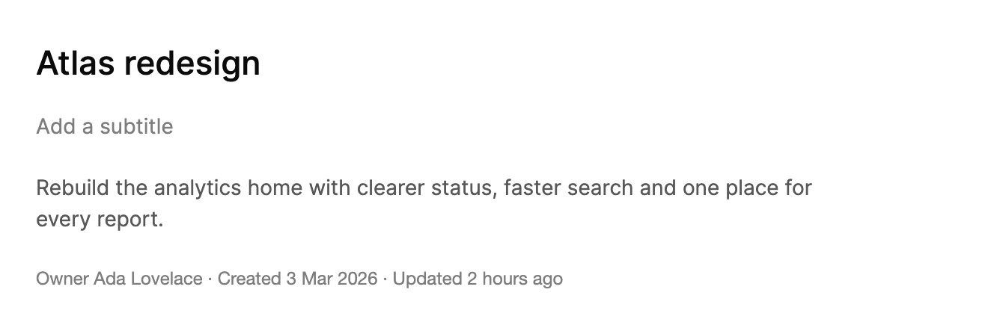

<Demo name="Rename" />

## 何時使用

`InlineEdit` 把一個值顯示為一般文字，當使用者選擇編輯時，它會在原來的位置變為欄位。它適用於在頁面上多次出現、且很少變動的名稱與標題：頁首中的專案名稱、儀表板標題、CRM 紀錄中客戶的顯示名稱。開始編輯時，文字周圍的內容不會移動，因此頁面版面維持不變，而且該值會自動儲存，無需外圍的表單。

- **頁首中的專案與工作區名稱**：專案頁頂部的「Atlas 改版」。使用者每天都會閱讀它，偶爾才重新命名，因此它應該看起來像標題，並在啟動時變為可編輯。
- **分析應用程式中的報表與儀表板標題**：儀表板上的「依地區劃分的第三季營收」。使用者確認標題時即儲存；儲存失敗時，標題會還原為上次儲存的內容，並提供重試連結。
- **CRM 或帳單畫面中的聯絡人與帳號名稱**：客戶的公司名稱或聯絡人的顯示名稱，其中編輯只是一次更正，而不是一次表單送出。
- **標題下的說明與簡短備註**：一行的專案摘要，或使用 `IsMultiline` 的多行說明，文字可以換行，按 Enter 仍會儲存。
- **維運主控台中的事件與工單標題**：值班工程師原地修正標題，而時間軸保持原位。

## 何時不用

- **需要一起儲存的多個欄位**：個人資料或帳單地址是一個表單。應為每個欄位使用 `Input` 或 `Textarea`，並配一個儲存按鈕，使使用者能在儲存前檢視全部內容。
- **必須始終看起來可編輯的欄位**：搜尋框、正在輸入的訂單中的發票號碼，或任何需要使用者填寫的值。使用 `Input`，它始終顯示外框與標籤。
- **使用者撰寫的長篇正文**：發行說明、客服回覆或政策文字。使用 `Textarea`，它在使用者輸入時保持較大的文字區域與可見的外框。
- **需要解析的數字與金額**：價格、數量或百分比。使用 `NumberField` 或 `MoneyInput`，它們會解析、格式化並步進該值。
- **從固定清單中挑選的值**：狀態、負責人或貨幣。使用 `Select` 或 `Combobox`，它們會顯示選項及其狀態。

## 用法

該值以文字顯示。啟動它後，文字會變為同樣大小的欄位。編輯確認時儲存該值。

```xml
<UserControl xmlns="https://github.com/avaloniaui"
             xmlns:arc="https://github.com/AtomUICommunity/TKCode.Arc">
    <arc:InlineEdit Label="專案名稱"
                    Value="Atlas redesign"
                    HeadingLevel="2" />
</UserControl>
```

`InlineEdit` 衍生自 Avalonia 的 `TemplatedControl`。它的靜態文字是一個按鈕（`Enter` 和 `Space` 開始編輯，因此可以用鍵盤觸及該文字），其編輯器是一個 `TextBox`，因此游標、選取、輸入法組字與剪貼簿快速鍵的表現與任何文字方塊相同。控制項在此之上加入儲存流程：新文字的樂觀顯示、儲存中指示、失敗時的復原以及驗證訊息。

### 結構

1. **靜態文字**：按鈕中的值。`Title` 變體使用超大字級（22 px）與中等字重，行高 28 px，上下內距 3 px，左右內距 8 px。`Body` 變體使用 14 px 的次要文字顏色，行高 21 px，上下內距 5 px，左右內距 8 px。該框的前導邊界為 -9 px，使文字與周圍內容對齊。
2. **外框**：帶有控制項圓角的框。靜止時保持透明；靜止文字的懸停會顯示淡化的表面色；編輯時變為帶前景色邊框的表面色框。
3. **焦點環**：鍵盤焦點位於靜態文字時，圍繞它顯示 2 px 的焦點環，圓角半徑 22 px。編輯時焦點環為 3 px，並位於外框之內。
4. **鉛筆圖示**：文字末端 14 px 的淡化圖示。使用精確指標時在懸停時出現，鍵盤焦點時也會出現。它是文字可以編輯的視覺提示；觸控輸入則直接進入編輯器。
5. **編輯器**：`TextBox`，其字型度量與靜態文字相同，因此開啟欄位時文字不會位移。它的內距在末端增加 24 px，最小寬度為 5 em（`Title` 為 110 px，`Body` 為 70 px），因此下一個字元無需等待框體變寬。
6. **操作區**：末端的保留區域。編輯時顯示儲存按鈕（28 px 圓形主要按鈕，帶勾號圖示）與取消按鈕（28 px 外框圓形按鈕，帶關閉圖示）。儲存時顯示 14 px 的載入指示；儲存成功後顯示自行繪製的勾號；儲存失敗後顯示危險圖示。單行保留 66 px 給操作區，多行保留 38 px，因此操作區出現時文字不會重新換行。
7. **訊息列**：欄位下方 12 px 的文案。驗證訊息使用危險色。儲存失敗時使用次要文字顏色，並以 `RetryText` 連結結尾，點選後會以失敗的文字重新開啟欄位。
8. **狀態**：一個隱藏的禮貌區域，用於播報儲存進度與結果。

### 變體與多行

`Variant` 設定視覺權重。`Title` 是名稱與標題的預設值；`Body` 適合說明文字。設定 `IsMultiline` 後，文字會換行，欄位高度隨之增長。按 Enter 仍會儲存，Shift+Enter 則加入換行。

<Demo name="Multiline" />

```xml
<arc:InlineEdit Label="說明"
                Variant="Body"
                IsMultiline="True"
                PlaceholderText="新增說明"
                Value="{Binding Description}" />
```

對於為某物命名、並被讀作標題的文字，使用 `Title`；對於描述該事物的文字，使用 `Body`。在同一頁面上，每一類文字保持一種變體，使名稱對齊、說明讀起來像一組。只有使用者以段落形式撰寫的文字才使用 `IsMultiline`；單行名稱換行，表示它對所在的位置來說太長了。

### 繫結

`Value` 是雙向的。當使用者未在編輯時，來自外部的新值會取代文字。

```xml
<arc:InlineEdit Label="專案名稱"
                Value="{Binding ProjectName}"
                HeadingLevel="2" />
```

### 繫結到檢視模型

在 MVVM 應用程式中，檢視模型擁有已儲存的值與規則，控制項負責編輯。`Value` 是雙向繫結。`SaveHandler` 與 `Validator` 是委派，因此需要在檢視的程式碼後置中，用檢視模型的方法為它們指派。委派無法在 XAML 中設定。

```csharp
// 應用程式自己的服務；它不屬於控制項程式庫的一部分。
public interface IProjectService
{
    Task RenameAsync(ProjectId id, string name);
}

public partial class ProjectHeaderViewModel : ObservableObject
{
    private readonly IProjectService _projects;
    private readonly ProjectId _projectId;

    public ProjectHeaderViewModel(IProjectService projects, ProjectId projectId)
    {
        _projects = projects;
        _projectId = projectId;
    }

    [ObservableProperty]
    private string _projectName = string.Empty;

    [ObservableProperty]
    private string _description = string.Empty;

    public string? ValidateName(string value)
        => value.Length switch
        {
            0 => "專案需要一個名稱。",
            > 80 => "請使用 80 個字元以內的名稱。",
            _ => null
        };

    // 此工作完成時，控制項會把 Value 設為已儲存的文字，因此繫結會更新該屬性。
    public Task SaveNameAsync(string name) => _projects.RenameAsync(_projectId, name);
}
```

```csharp
// 在檢視的程式碼後置中，於 InitializeComponent 之後且設定 DataContext 之後。
ProjectTitle.Validator = viewModel.ValidateName;
ProjectTitle.SaveHandler = viewModel.SaveNameAsync;
```

```xml
<StackPanel Spacing="8">
    <arc:InlineEdit x:Name="ProjectTitle"
                    Label="專案名稱"
                    Value="{Binding ProjectName, Mode=TwoWay}"
                    HeadingLevel="1" />
    <arc:InlineEdit Label="說明"
                    Variant="Body"
                    IsMultiline="True"
                    PlaceholderText="新增說明"
                    Value="{Binding Description, Mode=TwoWay}" />
</StackPanel>
```

- `Value` 是雙向的，因此儲存成功時，已儲存的名稱會傳到檢視模型。在儲存成功之前，控制項不會寫入該值，因此儲存失敗時，檢視模型的屬性保持不變。
- 當使用者正在編輯或儲存正在進行時，來自外部的值不會取代文字，因此編輯期間應避免把重新整理的資料推送到檢視模型。
- 程式碼後置中的名稱（`x:Name`）屬於檢視。處理常式應放在檢視或檢視模型中；控制項只負責呼叫它們。

### 儲存與驗證

`SaveHandler` 持久化已確認的值。它在欄位顯示儲存狀態時執行。失敗的工作會使文字復原，並顯示重試連結。`Validator` 在草稿無法儲存時傳回訊息；該訊息顯示在欄位下方。

```csharp
title.Validator = value => value.Length == 0 ? "專案需要一個名稱。" : null;

title.SaveHandler = async next =>
{
    await projects.RenameAsync(projectId, next);
};
```

處理 `TextCommitted`、`Saved` 和 `SaveFailed`，以對結果做出反應。

```csharp
title.TextCommitted += (_, e) => log.Text = $"已確認「{e.NewValue}」（原為「{e.OldValue}」）";
title.Saved += (_, e) => log.Text = $"已儲存「{e.NewValue}」";
title.SaveFailed += (_, e) => log.Text = $"儲存失敗：{e.Error.Message}";
```

儲存流程分為四個步驟，控制項透過 `Phase`（`Idle`、`Saving`、`Saved`、`Failed`）公開每個步驟：

1. **確認**：文字會被修剪（單行還會折疊內部的空白）、驗證，並且若與目前顯示的值不同，則送給 `SaveHandler`。`TextCommitted` 會攜帶舊值與新值一併引發。不改變文字的確認會直接關閉欄位，不儲存，也不引發事件。
2. **儲存中**：新文字立即以半透明顯示，並帶有載入指示。`Value` 尚未改變。在儲存結束之前，欄位無法再次開啟。
3. **已儲存**：`Value` 變為新文字，引發 `Saved`，並繪製勾號。約 1.8 秒後，階段回到 `Idle`。若沒有 `SaveHandler`，值會立即儲存，並隨之引發相同的事件。
4. **失敗**：顯示的文字回到上次儲存的值，引發 `SaveFailed`（攜帶嘗試儲存的文字與例外），外框會短暫閃現危險色。訊息列使用 `FailedMessageFormat` 說明原因，並提供 `RetryText`。選擇它會以失敗的文字重新開啟欄位，游標位於末尾。

`ErrorMessage` 在驗證訊息生效期間保存該訊息。驗證失敗時，若確認來自 `Enter` 或儲存按鈕，欄位會保持開啟並保留使用者的文字，進入無效狀態，並把焦點留在欄位中。當文字變動並再次通過驗證時，訊息會被清除。

```csharp
// 伺服器擁有最終決定權：它的錯誤會顯示為驗證訊息，下一次編輯時清除。
title.SaveHandler = async next =>
{
    var result = await projects.RenameAsync(projectId, next);
    if (!result.IsSuccess)
    {
        throw new InvalidOperationException(result.Error);
    }
};
```

### 空值

在有值之前，預留位置文字會保留該列。

<Demo name="Empty" />

`Value` 為空時，`PlaceholderText` 以淡化顏色顯示，且欄位與有值時同樣高，因此新增值時版面不會跳動。預留位置文字應說明要新增什麼（「新增副標題」），而不是通用的提示。

### 儲存與離開欄位

Enter 儲存，Escape 取消，離開欄位則儲存。無論使用者以哪種方式離開，規則都相同：

- **Enter** 確認。在多行欄位中，Shift+Enter 改為插入換行。
- **Escape** 取消：欄位關閉，已儲存的文字恢復，並引發 `EditCanceled`。
- **Tab 或點選欄位之外** 會確認，與 Enter 相同。焦點移到儲存或取消按鈕不會確認，因為這些按鈕屬於控制項。
- **切換到其他視窗** 不會確認。欄位保持開啟，待使用者返回並離開欄位時再確認。
- **驗證訊息** 即使確認來自失去焦點，也會讓欄位保持開啟，使使用者在欄位關閉前看到訊息。

操作區中的儲存按鈕與取消按鈕，其結果與 Enter 和 Escape 相同。程式碼可以用 `BeginEdit`、`CommitEdit` 與 `CancelEdit` 完成同樣的操作。`BeginEdit(caret)` 會在指定位置開啟欄位並放置游標；`-1`（預設值）則選取全部文字，便於重新輸入。

### 範例：專案頁面頁首

一個分析工作區的專案頁面。專案名稱是 `Title` 標題，說明是多行的 `Body` 文字，第三行是副標題，它仍為空，並顯示其預留位置文字。文字看起來就是頁面本身的內容，而不像表單，因此在有人選擇編輯之前，頁首讀起來就是標題。說明下方的中繼資料列使用一般文字，因為此處的負責人與日期都是唯讀的。頁首在兩種狀態下保持相同的版面：外框與文字共用相同的度量，因此標題變為欄位時不會移動。



```xml
<StackPanel Width="620" Spacing="8">
    <arc:InlineEdit Label="Project name"
                    Value="Atlas redesign"
                    HeadingLevel="1" />
    <arc:InlineEdit Label="Subtitle"
                    Variant="Body"
                    PlaceholderText="Add a subtitle" />
    <arc:InlineEdit Label="Description"
                    Variant="Body"
                    IsMultiline="True"
                    PlaceholderText="Add a description"
                    Value="Rebuild the analytics home with clearer status, faster search and one place for every report." />
    <TextBlock Text="Owner Ada Lovelace · Created 3 Mar 2026 · Updated 2 hours ago"
               FontSize="12"
               Margin="0,8,0,0"
               Foreground="{arc:ArcDesignTokenResource TextMuted}" />
</StackPanel>
```

### 文案規範

- **標籤**：欄位的名稱，使用句首大寫（「專案名稱」「報表標題」）。它是無障礙名稱，並會出現在儲存播報中（「正在儲存專案名稱」）。
- **預留位置文字**：說明要新增什麼內容的指令（「新增副標題」「新增說明」）。不要使用「點選以編輯」，因為文字本身已經表明可以修改。
- **驗證訊息**：說明哪裡有問題以及允許什麼，用與欄位一致的術語（「專案需要一個名稱。」「請使用 80 個字元以內的名稱。」）。
- **儲存失敗語句**：預設格式為「無法儲存「{0}」，已復原為上次儲存的{1}。」。若預設文案讀起來通順，請保留它；只有需要更精確地指明對象時，才修改 `FailedMessageFormat`。
- **重試文字**：一個動詞（預設為「重試」）。保持簡短，因為它位於訊息列的末端。

| 不要寫 | 改為 |
|---|---|
| Click to edit | 新增說明 |
| Name is required!!! | 專案需要一個名稱。 |
| Error saving | 無法儲存「Atlas」，已復原為上次儲存的專案名稱。 |
| Enter text here | 新增副標題 |

### 最佳做法

**建議**

- 名稱與標題使用 `Title`，說明使用 `Body`，並且在同一頁面上每類文字保持一種變體，使頁面按一致的順序閱讀。
- 為頁面或區段的標題設定 `HeadingLevel`，使螢幕閱讀器使用者能依標題快速跳轉。對於不是標題的文字，保持 `0`。
- 用 `Validator` 在用戶端驗證規則；伺服器的拒絕則透過失敗的 `SaveHandler` 顯示，並附上清楚的訊息。在欄位顯示錯誤時，控制項會保留使用者的文字。
- 為每次編輯設定獨立的 `Label`，使播報能指明被儲存的對象。

**避免**

- 將它用於表單。需要一起儲存的多個欄位應使用 `Input` 或 `Textarea`，使使用者能在儲存前檢視每個值，並且取消會捨棄全部內容。
- 沒有 `SaveHandler` 時仍然儲存。沒有它，值會立即儲存，且沒有錯誤路徑；只要變更要送到伺服器，就加入處理常式，使失敗能夠復原，並讓使用者知情。
- 頁首中換行或截斷的長單行名稱。標題應保持簡短，或對以段落形式撰寫的文字使用 `IsMultiline`。
- 在儲存期間從程式碼開啟欄位。控制項在儲存執行時拒絕開啟，因此該呼叫不會有任何作用；開啟前應先檢查 `Phase`。

### 常見問題

**為什麼我的新名稱變回了舊名稱？** 儲存失敗了。`SaveHandler` 擲出了例外，文字復原到上次儲存的值，訊息列提供「重試」。處理 `SaveFailed`，記錄 `e.Error` 並告知使用者出了什麼問題。

**為什麼按下 Enter 後欄位仍保持開啟？** `Validator` 傳回了一則訊息。欄位保留使用者的文字，將自己標記為無效，並顯示該訊息。當文字變動並通過驗證時，訊息會被清除。帶有驗證訊息的失去焦點同樣會讓欄位保持開啟。

**如何從程式碼開啟欄位或確認它？** 呼叫 `BeginEdit()` 可以開啟欄位並選取全部文字，或呼叫 `BeginEdit(caret)` 將游標放在指定位置。呼叫 `CommitEdit()` 儲存，呼叫 `CancelEdit()` 捨棄。先檢查 `IsEditing`，因為欄位未開啟時這些呼叫不會有任何作用。

**伺服器重新整理的值會覆寫使用者正在輸入的內容嗎？** 不會。當使用者正在編輯或儲存正在執行時，來自外部的值不會取代文字。應等到編輯結束後再推送重新整理。

**能否用於有固定格式的值，例如金額或日期？** 不能直接使用。控制項保存的是字串，即使用者輸入的內容。金額請使用 `NumberField` 或 `MoneyInput`，日期請使用 `DatePicker`，使值在到達檢視模型之前已被解析。

## API 參考

<!-- api: InlineEdit -->

## 無障礙

- 靜態文字是一個按鈕，以標籤和值命名，例如「專案名稱：Atlas redesign」。值為空時，名稱使用預留位置文字。其說明文字為「啟動以編輯。」。
- `HeadingLevel` 會把文字回報為標題，供輔助技術使用。頁面或區段標題使用 `1` 至 `3`，非標題文字保持預設的 `0`。標題層級的支援取決於平台。
- 編輯器由 `Label` 命名。其說明文字說明各按鍵的作用（「Enter 儲存，Escape 取消。」）；當驗證訊息生效時，訊息會取代該說明文字。
- 驗證訊息與儲存錯誤位於禮貌的訊息列中；儲存進度與結果則透過禮貌的狀態區域播報（「正在儲存專案名稱」「專案名稱已儲存」）。
- 儲存與取消按鈕分別命名為「儲存專案名稱」和「取消編輯」；重試連結讀作「重試」。
- Enter、儲存按鈕和 Escape 會把焦點傳回靜態文字，使鍵盤使用者從原來的位置繼續。失去焦點（Tab 或點選其他地方）時，焦點留在使用者移動到的位置。

### 鍵盤

| 按鍵 | 操作 |
|---|---|
| 文字上的 `Enter` 或 `Space` | 開啟欄位，並選取全部文字，便於重新輸入 |
| 欄位中的 `Enter` | 確認並儲存；有驗證訊息時，欄位保持開啟 |
| `Shift+Enter`（多行） | 加入換行 |
| 欄位中的 `Escape` | 取消，復原已儲存的文字，並把焦點傳回文字 |
| 欄位中的 `Tab` | 確認並儲存；焦點移到下一個控制項 |
| `Left` / `Right`、`Home` / `End`、`Shift` 選取 | 移動游標並擴大選取範圍，與文字方塊相同 |
| `Ctrl+A`、`Ctrl+C`、`Ctrl+X`、`Ctrl+V`（macOS 上為 `Cmd`） | 在欄位中全選、複製、剪下和貼上 |

## 動態效果

- 舊值滾出，新值帶著柔和模糊升起。儲存失敗時，復原方向相反，並短暫為外框著上危險色。
- 輸入時寬度跟隨草稿變化；多行時，框體高度平順變化。
- 儲存時，一個小型載入指示持續旋轉。儲存完成後，繪製勾號。
- 減少動態效果時，文字交叉淡入，勾號立即繪製，載入指示替換為靜態標記。關閉動態效果時效果相同，但沒有淡入。

| 變化 | 完整 | 減少 | 關閉 |
|---|---|---|---|
| 從外部取代值，或儲存完成 | 新文字帶著柔和模糊從下方升起；舊文字上移並淡出 | 文字交叉淡入 | 立即完成 |
| 開啟或關閉欄位 | 外框的寬度與邊框以彈簧就位；文字與操作區隨外框切換 | 文字立即切換 | 立即完成 |
| 輸入改變寬度 | 快速的彈簧，無過衝（約 0.16 s） | 立即完成 | 立即完成 |
| 儲存中 | 載入指示持續旋轉，文字為半透明 | 靜態標記取代載入指示 | 與減少相同 |
| 儲存完成 | 勾號在短暫延遲後約 0.32 s 內繪製 | 勾號立即繪製 | 勾號立即繪製 |
| 儲存失敗 | 舊文字從上方落回；外框泛起危險色調並逐漸消退 | 文字交叉淡入；色調無淡出即清除 | 立即完成 |
| 懸停與鍵盤焦點 | 鉛筆圖示淡入，外框顯示懸停色調 | 立即完成 | 立即完成 |

## 相關元件

- `Input` 用於始終可見、並與表單一起儲存的欄位。
- `Textarea` 用於表單中較長的正文文字。
- `ExpandingSearch` 用於會展開搜尋欄位與結果的控制項。

| 元件 | 適用情境 |
|---|---|
| `Input` | 欄位始終可見，有標籤，並與其他欄位一起儲存 |
| `Textarea` | 文字是使用者在儲存前撰寫並檢視的長篇正文 |
| `NumberField` / `MoneyInput` | 值是需要解析和格式化的數字或金額 |
| `Select` / `Combobox` | 值是已知選項清單中的一項 |
| `ExpandingSearch` | 使用者從頁首搜尋紀錄或頁面 |
| `InlineEdit` | 標題或名稱在顯示位置被重新命名，並單獨儲存 |
